# 專案 Code Review 文件：InvestmentLineNotify-main

> 產出時間：2026-04-29 08:36:31
> 來源路徑：`D:\Personal\ProjectToMD\projects\InvestmentLineNotify-main`
> 工具版本：project-to-md v1.0

---

## 📋 給 AI 的閱讀指引

這份文件是專案的完整原始碼整合，目的是讓你（AI）進行 **Code Review、架構分析、重構建議或問題排查**。

### 建議的閱讀順序

1. **先讀此節下方的「專案總覽」** — 掌握技術棧、規模、token 分布
2. **接著讀「專案結構」** — 理解目錄組織與分層架構
3. **跳到「文件區」** — 閱讀 README / ADR / 規格取得設計脈絡
4. **最後依使用者問題針對性閱讀「程式碼」**

### 回答時的要求

- **務必引用具體檔案路徑與行號**，例如 `Controllers/UserController.cs:45`
- 指出問題時，**先說明問題所在的設計考量**，再給建議
- 跨檔案的相依關係要明確指出來源與目標
- 若程式碼有截斷標示（`... [省略中間 N 行] ...`），請告訴使用者該檔案完整內容未提供，避免揣測

### 注意事項

- 二進位檔、編譯產物、第三方依賴均不在本文件中
- 「已排除清單」記錄了被跳過的檔案，可參考
- 若有大檔被截斷，截斷位置會以 `... [省略中間 N 行] ...` 標示

## 📊 專案總覽

- **檔案總數**：139 個（文件 16 / 程式 123）
- **程式碼總行數**：38,301 行
- **總大小**：1.4 MB
- **預估 token 數**：約 333,958 tokens (精準失敗，回退粗估)
- **被跳過的項目**：3 個（詳見最後清單）
- **被截斷的大檔**：0 個

### 檔案類型分布（依 token 占比）

- `.mjs` (javascript): 90 檔 / 17,182 行 / ~128,187 tokens (38.4%)
- `.md` (markdown): 16 檔 / 4,131 行 / ~40,928 tokens (12.3%)
- `.vue` (vue): 12 檔 / 5,289 行 / ~36,344 tokens (10.9%)
- `.js` (javascript): 10 檔 / 435 行 / ~3,503 tokens (1.0%)
- `.json` (json): 9 檔 / 11,211 行 / ~124,631 tokens (37.3%)
- `.cjs` (javascript): 1 檔 / 28 行 / ~164 tokens (0.0%)
- `.html` (html): 1 檔 / 25 行 / ~201 tokens (0.1%)

⚠️ **token 警告**：本檔超過 200K tokens，可能超出多數模型的單次上下文上限，建議分段使用或啟用 RAG。

## 🌳 專案結構

```
InvestmentLineNotify-main/
├── data/  (6 檔)
│   └── config/  (6 檔)
│       ├── parts/  (4 檔)
│       │   ├── AssetConfig.json
│       │   ├── GuardConfig.json
│       │   ├── IndicatorConfig.json
│       │   └── SystemConfig.json
│       ├── ConfigMeta.json
│       └── Strategy.json
├── docs/  (14 檔)
│   ├── api/  (1 檔)
│   │   └── report-signals-contract.md
│   ├── modules/  (5 檔)
│   │   ├── ai_pipeline.md
│   │   ├── core_infrastructure.md
│   │   ├── entry_and_notifications.md
│   │   ├── market_strategy.md
│   │   └── providers.md
│   ├── agent_prompts.md
│   ├── ai-coach-checklist.md
│   ├── architecture.md
│   ├── env-vars.md
│   ├── langfuse-prompt-management.md
│   ├── langfuse-score-configs-analytics.md
│   ├── langfuse-score-configs.md
│   └── schedules.md
├── src/  (90 檔)
│   ├── api/  (9 檔)
│   │   ├── middleware/  (1 檔)
│   │   │   └── initDataGuard.mjs
│   │   ├── routes/  (4 檔)
│   │   │   ├── config.mjs
│   │   │   ├── news.mjs
│   │   │   ├── reports.mjs
│   │   │   └── status.mjs
│   │   ├── schema/  (1 檔)
│   │   │   └── contract.mjs
│   │   ├── utils/  (2 檔)
│   │   │   ├── reportAggregator.mjs
│   │   │   └── snapshotAggregator.mjs
│   │   └── server.mjs
│   ├── domain/  (3 檔)
│   │   ├── dailyRunContext.mjs
│   │   ├── ilnState.mjs
│   │   └── signalContext.mjs
│   ├── modules/  (53 檔)
│   │   ├── ai/  (6 檔)
│   │   │   ├── aiClient.mjs
│   │   │   ├── aiCoach.mjs
│   │   │   ├── aiDataPreprocessor.mjs
│   │   │   ├── llmJudge.mjs
│   │   │   ├── periodReportAgent.mjs
│   │   │   └── ruleOptimizerAgent.mjs
│   │   ├── bot/  (3 檔)
│   │   │   ├── handlers/  (1 檔)
│   │   │   │   └── statusHandlers.mjs
│   │   │   ├── middleware/  (1 檔)
│   │   │   │   └── adminGuard.mjs
│   │   │   └── runnerLock.mjs
│   │   ├── data/  (2 檔)
│   │   │   ├── archiveManager.mjs
│   │   │   └── newsPoolManager.mjs
│   │   ├── news/  (1 檔)
│   │   │   └── newsConflictGrouper.mjs
│   │   ├── notifications/  (4 檔)
│   │   │   ├── templates/  (2 檔)
│   │   │   │   ├── periodReportBuilder.mjs
│   │   │   │   └── telegramHtmlBuilder.mjs
│   │   │   ├── transports/  (1 檔)
│   │   │   │   └── telegramClient.mjs
│   │   │   └── notifier.mjs
│   │   ├── providers/  (13 檔)
│   │   │   ├── basePriceProvider.mjs
│   │   │   ├── cnnProvider.mjs
│   │   │   ├── dataSourceConfig.mjs
│   │   │   ├── finmindProvider.mjs
│   │   │   ├── kgiProvider.mjs
│   │   │   ├── macroProvider.mjs
│   │   │   ├── marketData.mjs
│   │   │   ├── ndcProvider.mjs
│   │   │   ├── providerRegistry.mjs
│   │   │   ├── quoteProvider.mjs
│   │   │   ├── twseProvider.mjs
│   │   │   ├── usMarketProvider.mjs
│   │   │   └── yahooProvider.mjs
│   │   ├── strategy/  (21 檔)
│   │   │   ├── core/  (5 檔)
│   │   │   │   ├── cooldownManager.mjs
│   │   │   │   ├── index.mjs
│   │   │   │   ├── leverageCapManager.mjs
│   │   │   │   ├── marginStateMachine.mjs
│   │   │   │   └── valuationGuard.mjs
│   │   │   ├── policies/  (8 檔)
│   │   │   │   ├── budgetSynergyPolicy.mjs
│   │   │   │   ├── entryGatePolicy.mjs
│   │   │   │   ├── entryScoringPolicy.mjs
│   │   │   │   ├── index.mjs
│   │   │   │   ├── macroSentimentPolicy.mjs
│   │   │   │   ├── marginPolicy.mjs
│   │   │   │   ├── rebalancePolicy.mjs
│   │   │   │   └── sellScoringPolicy.mjs
│   │   │   ├── indicators.mjs
│   │   │   ├── leverageMonitor.mjs
│   │   │   ├── riskManagement.mjs
│   │   │   ├── signalGenerator.mjs
│   │   │   ├── signalRules.mjs
│   │   │   ├── strategyEngine.mjs
│   │   │   ├── strategyLoader.mjs
│   │   │   └── strategySchema.mjs
│   │   ├── keywordConfig.mjs
│   │   ├── newsFetcher.mjs
│   │   └── storage.mjs
│   ├── scripts/  (2 檔)
│   │   ├── rollbackOptimizer.mjs
│   │   └── testMacroProvider.mjs
│   ├── test/  (10 檔)
│   │   ├── integration/  (3 檔)
│   │   │   ├── aiPrompt.test.mjs
│   │   │   ├── apiContract.test.mjs
│   │   │   └── strategyEngine.test.mjs
│   │   ├── unit/  (5 檔)
│   │   │   ├── archiveManager.test.mjs
│   │   │   ├── keywords.test.mjs
│   │   │   ├── notifications.test.mjs
│   │   │   ├── snapshotCrypto.test.mjs
│   │   │   └── storage.test.mjs
│   │   ├── utils/  (1 檔)
│   │   │   └── mockFactory.mjs
│   │   └── providers.test.mjs
│   ├── utils/  (6 檔)
│   │   ├── coreUtils.mjs
│   │   ├── dataMigrator.mjs
│   │   ├── envGuard.mjs
│   │   ├── logger.mjs
│   │   ├── normalizer.mjs
│   │   └── snapshotCrypto.mjs
│   ├── bot.mjs
│   ├── dailyCheck.mjs
│   ├── runDailyCheck.mjs
│   ├── runMonthlyReport.mjs
│   ├── runNewsFetch.mjs
│   ├── runOptimizer.mjs
│   └── runWeeklyReport.mjs
├── webapp/  (23 檔)
│   ├── src/  (20 檔)
│   │   ├── api/  (1 檔)
│   │   │   └── index.js
│   │   ├── components/  (2 檔)
│   │   │   ├── FloatingPill.vue
│   │   │   └── StrategyConfigPanel.vue
│   │   ├── composables/  (3 檔)
│   │   │   ├── useIOSSwipeGuard.js
│   │   │   ├── usePortfolioSnapshots.js
│   │   │   └── useTelegram.js
│   │   ├── config/  (1 檔)
│   │   │   └── tabsConfig.js
│   │   ├── router/  (1 檔)
│   │   │   └── index.js
│   │   ├── test/  (1 檔)
│   │   │   └── ReportsView.test.js
│   │   ├── views/  (9 檔)
│   │   │   ├── AccountView.vue
│   │   │   ├── ChartView.vue
│   │   │   ├── DashboardView.vue
│   │   │   ├── MacroBattleView.vue
│   │   │   ├── MarketRadarView.vue
│   │   │   ├── NewsView.vue
│   │   │   ├── ReportsView.vue
│   │   │   ├── StrategyView.vue
│   │   │   └── TechnicalView.vue
│   │   ├── App.vue
│   │   └── main.js
│   ├── index.html
│   ├── package.json
│   └── vite.config.js
├── CHANGELOG.md
├── ecosystem.config.cjs
├── eslint.config.js
├── package.json
├── README.md
└── swagger.json
```

## 📝 文件區（README / ADR / 規格）

### `CHANGELOG.md`

> 行數：54 ｜ 大小：3.3 KB ｜ tokens：~577

```markdown
# Changelog

所有重要變更均記錄於此，格式遵循 [Keep a Changelog](https://keepachangelog.com/en/1.0.0/)。

---

## [Unreleased]

---

## [2026-04-14] — 大盤量價資料整合 & Provider 架構抽象化

### Added

#### 大盤量價概覽（`rawMarketOverview`）

- **`twseProvider.mjs`**：新增 `fetchMarketOverview()` 函式，呼叫 TWSE OpenAPI `FMTQIK` endpoint，回傳：
  - 最新交易日加權指數收盤價（`taiex`）
  - 當日漲跌點（`changePoint`）與漲跌幅百分比（`changePercent`）
  - 當日全市場成交金額（`tradeValueHundredMillion`，億元）
  - 近 20 日平均成交金額（`avgTradeValue20dHundredMillion`）
  - 近 20 日最大成交金額（`maxTradeValue20dHundredMillion`）
- **`dataSourceConfig.mjs`**：新增 `rawMarketOverview` Slot，`providerId: 'twMarketOverview'`。
- **`providerRegistry.mjs`**：新增 `twMarketOverview` provider adapter，label 為「台股大盤量價概覽 (指數與成交金額)」。
- **`marketData.mjs`**：新增 **段落 G** 快取策略——每日抓一次（比對 `lastFetch` 日期），同日多次呼叫讀快取。

#### Provider 架構抽象化（Slot + Registry）

- 引入 `dataSourceConfig.mjs` 與 `providerRegistry.mjs`，將「資料來源」與「快取策略」從 `marketData.mjs` 的程式碼中分離。
- `marketData.mjs` 不再直接 import 個別 provider，所有總經資料一律透過 Slot key + providerId 路由。
- 抽換資料來源只需：① 在 `providerRegistry` 加 adapter、② 改 `dataSourceConfig` 的 `providerId`，無需變動上層消費者。

### Changed

- **`docs/modules/providers.md`**：全面更新，補充 Slot-based 架構說明、`fetchAllMacroData()` A~G 七段快取表、`twMarketOverview` 相關欄位與診斷說明。
- **`docs/architecture.md`**：補充 `rawMarketOverview` 於 `MarketRadarView.vue` 台股資料欄位說明、`data/market` persistence 快取結構說明。

### Technical Notes

- 原始程式碼使用 CommonJS `require('axios')`，整合時改為專案既有的 `fetchWithTimeout` + `twseAgent`（ES Module，無需新增套件）。
- 漲跌點優先讀 API `Change` 欄位；缺值時自動 fallback 為 `taiex - prevTaiex`（取陣列倒數第二筆計算）。
- 前端 `AccountView.vue` 的 `SOURCE_LABELS` 可加入 `twMarketOverview: '大盤量價 (FMTQIK)'` 以顯示中文 provider 名稱。

---

## [2026-04-13] — Oracle VM 全面遷移 & Mini App 完整功能上線

### Changed

- 所有排程任務從 GitHub Actions 全面移轉至 Oracle VM crontab，消除 Actions 延遲問題。
- Bot daemon（`src/bot.mjs`）與 API Server（`src/api/server.mjs`）改由 PM2 長駐執行。
- GitHub Actions workflows 降格為「僅手動觸發」備援模式。

### Added

- Telegram Mini App 正式上線，7 個 Tab 儀表板（總覽 / 雷達 / 多空 / 圖表 / 報告 / 新聞 / 設定）。
- `AccountView.vue` 系統狀態區塊：即時顯示各 provider 健康度（OK / FAIL / STALE）與最後更新時間。
- `/api/snapshots/weekly` 與 `/api/snapshots/monthly` 聚合端點，支援資產趨勢週/月粒度切換。
- `snapshotAggregator.mjs`：市價淨值（`netValueMarket = qty0050 × price0050 + qtyZ2 × priceZ2 - totalLoan`）週/月聚合計算。
- AES-256-GCM 快照加密（`snapshotCrypto.mjs`），金鑰由 `SNAPSHOT_ENCRYPT_KEY` 環境變數管理。
```

### `docs/agent_prompts.md`

> 行數：127 ｜ 大小：5.0 KB ｜ tokens：~831

````markdown
# Agent Prompts 導覽 / Prompt Map

> [!NOTE]
> **Prompt 已遷移至雲端管理**
> 目前所有的 AI System Prompts (含參數設置) 均已經轉向由 [Langfuse](https://cloud.langfuse.com) 全面管理，確保更新不須動用程式碼。
> `src/modules/ai/prompts.mjs` 僅負責維護各個 LLM 的回傳驗證 Schema 及 User Prompt 的填充邏輯。
> 請特別留意，以下整理的 Prompt 定位主要供**分析梳理與邏輯指引**用，如有修改行為原則的需求，請直接前往 Langfuse 的儀表板修改，而無須在原始碼內更動常數。

## 1. 文件目的

本文件不是逐字複製 `src/modules/ai/prompts.mjs`，而是提供 AI Agent / 開發者一份 prompt responsibility map，幫助快速定位每個 prompt 負責哪一段流程、對應哪些 schema、修改時可能影響哪些功能。

若未來 prompt 行為異常，請先看這份文件決定要改哪一類 prompt，再回到 `src/modules/ai/prompts.mjs` 實作。

---

## 2. Prompt 類型分組

### 2.1 Daily Decision Prompts

這一組服務每日主流程：

- Search query generation
- News filtering
- Macro analysis
- Investment advice

典型影響檔案：

- `src/modules/ai/aiCoach.mjs`
- `src/modules/ai/aiDataPreprocessor.mjs`
- `src/modules/newsFetcher.mjs`
- `src/dailyCheck.mjs`

### 2.2 Governance Prompts

這一組服務背景治理：

- Rule optimizer
- LLM judge

典型影響檔案：

- `src/modules/ai/ruleOptimizerAgent.mjs`
- `src/modules/ai/llmJudge.mjs`
- `src/runOptimizer.mjs`

### 2.3 Period Report Prompts

這一組服務週報 / 月報：

- Period report analysis

典型影響檔案：

- `src/modules/ai/periodReportAgent.mjs`
- `src/runWeeklyReport.mjs`
- `src/runMonthlyReport.mjs`
- `src/modules/notifications/templates/periodReportBuilder.mjs`

---

## 3. Search Query Prompt 維護重點

Search query prompt 是目前新聞品質的第一層入口。它必須與 `KeywordEntry` schema 配套工作：

```js
{ keyword: string, searchType: "intitle" | "broad" }
```

目前文件確認的設計要求包括：

- 輸出 6–8 組，不超過 8 組。
- 盡量避免單字縮寫與過度泛化字詞。
- 避免重複靜態基礎關鍵字。
- `intitle` 用於事件主角必須明確的 query，`broad` 用於市場情緒與廣泛議題。

若修改這段 prompt，請同步檢查：

- `src/modules/newsFetcher.mjs` 的 `validateDynamicKeyword()`
- `src/modules/newsFetcher.mjs` 的 `mergeKeywords()`
- `src/modules/keywordConfig.mjs` 的 base query coverage

---

## 4. News / Macro / Coach Prompt 維護重點

這三類 prompt 串起 daily AI 主流程：

1. **News Filter**：控制哪些文章會進入高價值摘要。
2. **Macro Analyst**：把新聞摘要轉成總經方向與權重判斷。
3. **Investment Coach**：將量化訊號、macro context、portfolio 狀態寫成最終建議。

修改時請記得：

- News filter 改太鬆，會讓 macro 與 coach 被低品質新聞污染。
- Macro analyst 的輸出若改欄位，會影響 `dailyCheck.mjs` 對 `macroMarketDirection` 的取值。
- Coach prompt 的輸出格式若改動，會影響 Telegram builder 與 `llmJudge` 的評估輸入。

---

## 5. Governance Prompt 維護重點

### Rule Optimizer

Rule optimizer prompt 的輸出不是直接上線規則，而是「候選規則」。因此修改時要注意：

- 生成內容要適合程式端 sandbox 驗證。
- 不要讓 prompt 產出過度寬泛、難以驗證的 regex 建議。
- 任何 schema 變更都可能影響 `runOptimizer.mjs` 與後續 blacklist 寫入流程。

### LLM Judge

Judge prompt 目前用來評估 `Actionability` 與 `Tone_and_Empathy`。這類 prompt 的重點不是產生使用者可讀內容，而是穩定、可比較、可回寫分數。

若修改 judge prompt，請一併檢查：

- score name 是否仍與 Langfuse config 對齊。
- `llmJudge.mjs` 解析欄位是否仍正確。
- daily pipeline 是否仍能在 judge 失敗時保持 non-blocking。

---

## 6. Period Report Prompt 維護重點

`PeriodReportAnalysis` 類型的 prompt 與 daily coach 最大差異在於：

- 它吃的是統計摘要，不是即時市場上下文。
- 它要輸出的是 period-level risk summary，而不是當日操作指令。

因此調整 period prompt 時，應優先檢查：

- `periodReportAgent.mjs` 中 `buildPeriodReportVariables()` 的資料是否足夠。
- `periodReportBuilder.mjs` 是否仍能正確呈現輸出欄位。
- Weekly / monthly 的用語是否需要分開。

---

## 7. AI Agent 快速定位指南

當 AI Agent 要修改 prompt，建議先問自己是哪一種問題：

- 關鍵字品質差 → search query prompt
- 新聞摘要品質差 → news filter prompt
- 多空方向不合理 → macro analyst prompt
- 建議語氣或行動性不足 → investment coach prompt 或 judge prompt
- blacklist 治理失效 → rule optimizer prompt
- 週報 / 月報摘要空泛 → period report prompt

這份文件的目的，就是讓後續開發者先定位 prompt 類別，再進入 `src/modules/ai/prompts.mjs`，避免在大型 prompt 檔中盲改。
````

### `docs/ai-coach-checklist.md`

> 行數：291 ｜ 大小：12.0 KB ｜ tokens：~1,759

```markdown
# Investment Coach Prompt 優化 Checklist

本文件用來指導如何透過 Langfuse 的數據與實際輸出內容，系統化優化 Investment Coach（`InvestmentAdvice`）的 Prompt 與整體決策品質。

建議在每次大改 Prompt 前後，都依此 checklist 進行一次完整檢查，並在 Langfuse 建立對應的 Dashboard 或 Saved Filter，方便長期追蹤。

---

## 1. 觀測入口：在 Langfuse 要看哪裡？

在 Langfuse UI 中，先建立以下條件的 Saved Filter：

- **Trace name:** `InvestmentAdvice`
- **Tags:** `feature:InvestmentAdvice`，可加上 `needs-human-review` 聚焦人工驗證樣本

之後所有教練輸出都能透過這個過濾條件集中查看，並搭配 Scores 區塊觀察：

- `Schema_Validation`
- `Format_Compliance`
- `Risk_Coverage`
- `Confidence_Field_Present`（AI 是否回傳 `confidence` / `confidence_level` 欄位；持續為 0 代表 Prompt 模板未要求此欄位）
- `Thinking_Depth`（`coach_internal_thinking` 推理深度估算 0~1；字數、數字量化、因果推理、反向思考各佔 0.2~0.4）
- `Actionability`
- `Tone_and_Empathy`
- （未來人工 / LLM）`Context_Alignment`

> 對應程式：`getAiInvestmentAdvice`（`src/modules/ai/aiCoach.mjs`）、`callAI`（`src/modules/ai/aiClient.mjs`）、`runJudge`（`src/modules/ai/llmJudge.mjs`）。

---

## 2. Step 1：先確認「格式健康度」

**要看什麼？**

1. 在 Langfuse 的 trace 詳細頁，檢查：
   - `Schema_Validation` 是否為 1（True）。
   - `Format_Compliance` 是否為 1（True）。
   - `Confidence_Field_Present` 是否為 1（True）。
2. 在 Output 區塊，確認是否有完整 JSON 結構，而不是 undefined 或純文字。

**判讀方式**

- `Schema_Validation = 0`：代表 JSON parse 失敗，或欄位缺失到無法套用 schema。
- `Format_Compliance = 0`：代表雖然能 parse 成 JSON，但某些關鍵欄位缺失，例如：
  - 沒有 summary / short_summary。
  - 沒有 action_items 或只有空陣列。
  - 沒有 mindset_advice 或為空字串。
- `Confidence_Field_Present = 0`：代表 AI 輸出中缺少 `confidence` 或 `confidence_level` 欄位，或值無效。持續為 0 時，應回到 `InvestmentAdvice` Prompt 確認是否有要求此欄位，並補充對應的 schema 說明。

**若常出現 0，Prompt 要怎麼調？**

在 Langfuse Prompt 管理後台，打開 `InvestmentAdvice` 的 System Prompt，確認以下事項：

- 明確列出必填欄位（對應 `INVESTMENT_COACH_SCHEMA`）：
  - 例如：`short_summary`、`action_items`、`key_risks`、`mindset_advice`、`confidence_level` 等。
- 提供完整 JSON 範例，且標示「這是唯一合法輸出格式」。
- 明確禁止回傳 free-text：
  - 例如加上「嚴禁輸出 markdown 或自然語言段落，務必只回傳單一 JSON 物件」。

調整完後，觀察後續 1–2 週的 `Schema_Validation` / `Format_Compliance` / `Confidence_Field_Present` 是否趨近 1。

---

## 3. Step 2：檢查 Thinking_Depth（推理深度是否充足）

**要看什麼？**

1. 在 Langfuse 的 Scores 區塊：
   - `Thinking_Depth`（由程式自動評分，0~1）。
2. 在 Output JSON 中的 `coach_internal_thinking` 欄位：
   - 是否有足夠的字數（≥87 字）。
   - 是否包含量化數字（例如 RSI 值、VIX 數值、比例）。
   - 是否有因果推理（因為…所以…、若…則…）。
   - 是否有反向思考（反方論點、潛在風險評估）。

**計分規則**

| 條件                                                             | 配分 |
| ---------------------------------------------------------------- | ---- |
| `coach_internal_thinking` 字數 ≥ 87 字                           | +0.4 |
| 含數字量化（正則 `/\d+\.?\d*[%點倍元]/` 匹配）                   | +0.2 |
| 含因果推理（「因為」「所以」「因此」「若」「如果」「當」）       | +0.2 |
| 含反向思考（「但」「然而」「不過」「另一方面」「風險」「注意」） | +0.2 |

**判讀方式**

- **分數長期 < 0.4**：代表 `coach_internal_thinking` 字數不足或推理過於空洞，建議在 Prompt 中強調「必須展示完整思考過程」。
- **分數介於 0.4–0.6**：有字數但推理不夠深，可在 Prompt 中要求「須包含數字引用與因果推理」。
- **分數 ≥ 0.8**：推理深度良好，持續監測避免退化即可。

**Prompt 要怎麼調？**

在 System Prompt 中加入明確要求：

- 要求 `coach_internal_thinking` **至少 100 字**，明確展示思考過程。
- 要求推理中**必須引用數值**（例如 RSI、VIX、PE/PB、成交量倍率等）。
- 要求**表達因果關係**：「因為 X 指標顯示 Y，所以判斷 Z」。
- 要求**提出反面論點**：「雖然多頭訊號明顯，但需注意...」。

---

## 4. Step 3：檢查 Actionability（建議是否具體可執行）

**要看什麼？**

1. 在 Langfuse 的 Scores 區塊：
   - `Actionability`（由 LLM Judge 或人工評分）。
2. 在 Output JSON 中的 `action_items` 欄位：
   - 是否每條都有明確動作，例如：
     - 「今日減碼 00675L 10% 部位」。
     - 「若大盤跌破 X 點，停止加碼。」
   - 避免只有「注意風險」、「適度調整」這種空泛敘述。

**判讀方式**

- **分數長期落在 0.4–0.6 以下**：代表教練多數時候只講道理、不給具體操作。
- **個別 trace 分數極低（接近 0）**：代表該次輸出幾乎沒有行動價值，可優先當作錯誤樣本分析。

**Prompt 要怎麼調？**

在 System Prompt 中加入明確要求：

- 要求輸出中 **必須** 包含一組「可直接執行或觀察的 action_items 清單」，例如：
  - 指定調整比例（增加/減少多少％部位）。
  - 指定條件（什麼價位/時間點/指標變化時做什麼動作）。
- 指出最低 action 條數：
  - 例如「至少提供 2–3 條具體操作建議」。
- 強調 **不得只給抽象提醒**：
  - 例如「避免只說『留意風險』、『注意情緒』，必須說明『怎麼做』。」

調整後，觀察 Actionability 的平均分數是否往 0.7–0.8 以上拉升，同時配合人工抽查避免過度激進。

---

## 5. Step 4：檢查 Tone_and_Empathy（語氣是否健康、不 FOMO）

**要看什麼？**

1. `Tone_and_Empathy` 分數（由 LLM Judge 或人工評分）。
2. 低分樣本的輸出內容：
   - 是否存在以下情況：
     - 語氣過度絕對：「一定要」、「錯過會後悔」、「必賺」等。
     - 過度恐嚇或充滿 FUD：只放大風險、不給平衡視角。
     - 對虧損或焦慮的使用者缺乏安撫與結構化引導。

**Prompt 要怎麼調？**

在 System Prompt 中加入語氣約束：

- 強調「紀律 + 穩定 + 支持性」的教練口吻：
  - 例如：
    - 避免使用絕對化字眼（例如「一定」、「必然」）。
    - 以「建議」、「可以考慮」、「若你承受度許可」等字眼取代命令式。
- 要求在建議前先簡短處理情緒：
  - 例如：
    - 承認市場的不確定性。
    - 提醒使用者「聚焦可控的部分」，而不是盯著短期波動。

觀察 Tone_and_Empathy 的平均分數是否穩定在中高區間，並用實際訊息感受是否符合你個人的教練風格。

---

## 6. Step 5：檢查 Risk_Coverage（風險提醒是否足夠）

**要看什麼？**

1. `Risk_Coverage` 分數：
   - 目前設計為 `min(1, key_risks.length / 3)`，代表：
     - 有 1 條風險 → 約 0.33。
     - 有 2 條風險 → 約 0.67。
     - 有 ≥3 條風險 → 1。
2. Output JSON 的 `key_risks` 內容：
   - 是否有涵蓋不同面向（市場、個股、槓桿、心理等）。

**判讀方式**

- 長期平均 < 0.7：代表多數建議只有 1–2 條風險提醒，偏少。
- 個別 trace 為 0：通常是完全漏寫 `key_risks`，可視為格式缺陷或 Prompt 說明不足。

**Prompt 要怎麼調？**

在 System Prompt 中：

- 明確要求「至少列出 3 條風險」，若真的沒有也需說明原因。
- 指出風險必須涵蓋不同層次：
  - 市場風險（系統性風險）。
  - 策略風險（槓桿、集中度）。
  - 心理或行為偏誤風險（例如追高殺低）。

---

## 7. Step 6：檢查 Context_Alignment（建議是否跟當天情境對得上）

**要看什麼？**

Context_Alignment 目前建議由人工評分，未來可再加 LLM Judge：

1. 在 Langfuse 對單一日的 pipeline 做對照：
   - `MacroAnalysis` 的結果：
     - `total_bull_score` / `total_bear_score` 是否呈現多頭或空頭傾向。
   - `NewsFilter` 的關鍵摘要與重大事件清單。
   - `InvestmentAdvice` 的整體建議方向（偏多、偏空、保守/積極）。
2. 人工在 `Context_Alignment` score 上給 1–5 分，並在 comment 中簡要記錄原因。

**常見問題模式**

- 宏觀與新聞極度偏空，但教練仍建議積極加碼。
- 宏觀明顯轉多，但教練沒有任何「由空翻多」的語氣或行為建議。

**Prompt 要怎麼調？**

在 System Prompt 中加入：

- 要求教練在給出建議時，**必須顯式參考** macro 分析與重大新聞事件：
  - 例如在輸出中加入「根據本日宏觀分析與新聞事件 X/Y/Z，因此建議...」。
- 若你之後在 schema 中加上「引用事件 ID」欄位，也可以要求教練寫入，方便事後交叉驗證。

---

## 8. Step 7：觀察長期趨勢而不是單點

**要看什麼？**

在 Langfuse Dashboard 中建立折線圖或時間序列卡片，追蹤以下 score 的 rolling average：

- `Actionability`
- `Tone_and_Empathy`
- `Risk_Coverage`
- `Format_Compliance`
- `Confidence_Field_Present`
- `Thinking_Depth`

**使用方式**

- 每次對 `InvestmentAdvice` Prompt 做重大修改後：
  - 記錄修改日期與版本。
  - 觀察後續 1–2 週這些指標是否：
    - 明顯上升（代表改動有效）。
    - 產生 trade-off（例如 Actionability 上升但 Tone_and_Empathy 降低）。
- 若看到明顯惡化，優先回頭檢查：
  - Prompt 是否過度 push 使用者進出場。
  - 是否忽略了某些風險維度。
  - `Thinking_Depth` 是否因為壓縮 token 而退化。

---

## 9. Step 8：人工 Review 流程（善用 Human Review metadata）

**程式端已做的事**

- `callAI` 在建立 trace 時，會依 `HUMAN_REVIEW_CONFIG` 寫入：
  - `metadata.human_review`：包含建議評哪幾個 score、review_notes 指引。
  - 若 `human_review: true`，會自動加上 `needs-human-review` tag。

**你可以怎麼使用？**

1. 在 Langfuse 建立 Saved Filter：
   - 條件：`name = InvestmentAdvice` 且 `tag = needs-human-review`。
2. 每週挑固定時間（例如週末）：
   - 從這個 filter 中抽 5–10 筆 trace 進行人工評分。
   - 依 `review_notes`（在 metadata 內）逐項檢查 Actionability / Tone / Context / Thinking_Depth 等維度。
3. 將人工分數寫回 Langfuse：
   - 在 Scores 區塊手動新增或編輯各項 Human 類分數。
4. 若發現 LLM Judge 與人工分數長期偏差：
   - 回頭優化 `llmJudge.mjs` 對應的 Judge Prompt，使自動評分更貼近你的標準。

---

## 10. 建議的日常使用節奏

1. **日常監控**：
   - 間隔 2–3 天，開 Langfuse Dashboard 看上述幾個核心 score 的趨勢線。
   - 若某項 score 急速惡化（例如 Actionability、Format_Compliance、Thinking_Depth），優先檢查最近是否對 Prompt 或模型做過改動。

2. **每週人工 QA**：
   - 從 `needs-human-review` + `InvestmentAdvice` 裡抽樣，針對 Context_Alignment、Actionability、Tone 給人工分數。

3. **Prompt 大改前後**：
   - 將這份 checklist 當成 release checklist：改前記錄一組 baseline，改後一週再對照一次。
   - 若改動沒有帶來明顯改善，或造成其他分數下降，可以考慮部分 rollback 或微調。

---

## 11. 小結

這份 checklist 的目標不是「一次就把 Investment Coach 調到完美」，而是：

- 幫你把「直覺 QA」變成「可重複的流程」。
- 把 Langfuse 裡的 trace + scores 變成你調 Prompt 的儀表板，而不只是 log viewer。

後續如果你新增新的欄位（例如更多風險分類、心理狀態標籤），可以比照本文件的結構，為這些欄位設計對應的 Rule / Human / LLM score，持續演進這套教練系統。
```

### `docs/api/report-signals-contract.md`

> 行數：292 ｜ 大小：19.4 KB ｜ tokens：~4,236

```markdown
# report.signals 欄位契約

> 來源：`src/modules/strategy/strategyEngine.mjs` + `src/modules/strategy/core/*` + `src/modules/strategy/policies/*`  
> 更新：2026-04-28  
> 說明：`report.signals` 為每日報告的策略與風控計算結果子樹，由 `strategyEngine.buildDecision()` 輸出，  
> 經 `dailyCheck` 組裝後存入 `data/reports/YYYY-MM-DD.json`，並透過 `/api/reports` 系列 endpoint 提供給前端。

---

## 一、決策優先權（Priority Hierarchy）

`buildDecision()` 採用優先中斷模式，一旦觸發高優先層，直接 return，後續層不再執行：

| Priority | 觸發條件                            | maintenanceLayer                                    | 關鍵輸出欄位 |
| -------- | ----------------------------------- | --------------------------------------------------- | ------------ |
| P0       | 維持率 < marginCallThreshold (135%) | `"critical"`                                        | 見 §2.1      |
| P1       | 維持率 < frozenZone (145%)          | `"frozen"`                                          | 見 §2.2      |
| P2       | 維持率 < protectTrigger (160%)      | `"protect"`                                         | 見 §2.3      |
| P3       | Gross Leverage > hardCap            | `"normal"` + grossLeverageStatus=`"hardcap_breach"` | 見 §3.1      |
| P4       | Gross Leverage > ceiling            | `"normal"` + grossLeverageStatus=`"ceiling_breach"` | 見 §3.2      |
| P5       | ValuationGuard latch 首次觸發       | valuationGuardStatus=`"latch_triggered"`            | 見 §4.1      |
| P6       | ValuationGuard latch 鎖定中         | valuationGuardStatus=`"latch_active"`               | 見 §4.2      |
| P7       | ValuationGuard multiplier < 0.5     | valuationGuardStatus=`"guard_active"`               | 見 §4.3      |
| P8       | EntryGate 前置過濾封鎖              | entryGateBlocked=`true`                             | 見 §5        |
| P9       | 常態運行（所有防護均通過）          | `"normal"`                                          | 見 §6        |

---

## 二、維持率 Margin Layer 狀態機欄位

所有 Margin Layer 回傳物件共享以下基礎欄位，再依層級附加額外欄位。

### 共用基礎欄位（所有 Layer 均含）

| 欄位                    | 型別                                              | 說明                             |
| ----------------------- | ------------------------------------------------- | -------------------------------- |
| `maintenanceLayer`      | `"critical" \| "frozen" \| "protect" \| "normal"` | 維持率層級                       |
| `marketStatus`          | `string`                                          | 含 emoji 的狀態文字（UI 顯示用） |
| `target`                | `string`                                          | 操作目標短標籤                   |
| `targetSuggestionShort` | `string`                                          | 單行摘要建議                     |
| `targetSuggestion`      | `string`                                          | 中長篇建議文字                   |
| `suggestion`            | `string`                                          | 詳細步驟說明（含換行符 `\n`）    |
| `maintenanceMargin`     | `number`                                          | 當前維持率（%）                  |

### 2.1 P0 — critical（斷頭危機）

| 欄位                  | 型別     | 說明                   |
| --------------------- | -------- | ---------------------- |
| `marginCallThreshold` | `number` | 斷頭門檻值（預設 135） |

### 2.2 P1 — frozen（高危凍結）

| 欄位                | 型別      | 說明                       |
| ------------------- | --------- | -------------------------- |
| `frozenZone`        | `number`  | 凍結解除線（預設 145）     |
| `needAmount`        | `number`  | 補足至解凍線所需金額（元） |
| `reserveSufficient` | `boolean` | 預備金是否足以補足         |

### 2.3 P2 — protect（預備金防禦）

| 欄位                | 型別      | 說明                                             |
| ------------------- | --------- | ------------------------------------------------ |
| `protectTrigger`    | `number`  | 保護觸發線（預設 160）                           |
| `protectTarget`     | `number`  | 補足目標維持率（預設 180）                       |
| `reserveStatus`     | `object`  | `{ currentReserve: number, ... }` 預備金狀態物件 |
| `needAmount`        | `number`  | 補足至目標維持率所需金額（元）                   |
| `reserveSufficient` | `boolean` | 預備金是否足以補足                               |

---

## 三、Gross Leverage 欄位

### 3.1 hardcap_breach（危機紅線）

| 欄位                    | 型別               | 說明                              |
| ----------------------- | ------------------ | --------------------------------- |
| `maintenanceLayer`      | `"normal"`         | 維持率已通過，此層由槓桿觸發      |
| `grossLeverageStatus`   | `"hardcap_breach"` | 槓桿狀態                          |
| `grossLeverage`         | `number`           | 當前綜合曝險倍數（x）             |
| `marketStatus`          | `string`           | `"🚨【Gross Leverage 危機紅線】"` |
| `target`                | `string`           | `"📉 強制降槓"`                   |
| `targetSuggestionShort` | `string`           | 含倍數與著陸目標的單行說明        |
| `targetSuggestion`      | `string`           | `grossLeverageResult.message`     |
| `suggestion`            | `string`           | 詳細步驟                          |

### 3.2 ceiling_breach（主動上限）

| 欄位                    | 型別               | 說明                          |
| ----------------------- | ------------------ | ----------------------------- |
| `maintenanceLayer`      | `"normal"`         | —                             |
| `grossLeverageStatus`   | `"ceiling_breach"` | 槓桿狀態                      |
| `grossLeverage`         | `number`           | 當前綜合曝險倍數（x）         |
| `panicBypassActive`     | `boolean`          | 是否同時觸發恐慌破冰          |
| `marketStatus`          | `string`           | 視 panicBypassActive 而異     |
| `target`                | `string`           | `"🚫 禁止加碼"`               |
| `targetSuggestionShort` | `string`           | 含倍數的單行說明              |
| `targetSuggestion`      | `string`           | `grossLeverageResult.message` |
| `suggestion`            | `string`           | 詳細步驟（含 bypassWarning）  |

---

## 四、ValuationGuard 估值守衛欄位

### 4.1 latch_triggered（清算觸發）

| 欄位                    | 型別                | 說明                                          |
| ----------------------- | ------------------- | --------------------------------------------- |
| `valuationGuardStatus`  | `"latch_triggered"` | 守衛狀態                                      |
| `marketStatus`          | `string`            | `"🚨【估值守衛：清算觸發】"`                  |
| `target`                | `string`            | `"📉 立即清倉"`                               |
| `targetSuggestionShort` | `string`            | `"PR{n} 首次觸發清算"`                        |
| `suggestion`            | `string`            | PB PR 分位說明                                |
| `shouldLatch`           | `boolean`           | `true`（通知 dailyCheck 需持久化 latch 狀態） |
| `latchNowActive`        | `boolean`           | `true`                                        |
| `valuationGuardResult`  | `object`            | 見 §4.4                                       |

### 4.2 latch_active（清算鎖定中）

| 欄位                    | 型別             | 說明                         |
| ----------------------- | ---------------- | ---------------------------- |
| `valuationGuardStatus`  | `"latch_active"` | 守衛狀態                     |
| `marketStatus`          | `string`         | `"🔒【估值守衛：清算鎖定】"` |
| `target`                | `string`         | `"📉 清倉降槓"`              |
| `targetSuggestionShort` | `string`         | `"PR{n} 觸發清算鎖定"`       |
| `suggestion`            | `string`         | PB PR 分位說明               |
| `latchNowActive`        | `boolean`        | `true`                       |
| `valuationGuardResult`  | `object`         | 見 §4.4                      |

### 4.3 guard_active（強勢壓縮，multiplier < 0.5）

| 欄位                    | 型別             | 說明                         |
| ----------------------- | ---------------- | ---------------------------- |
| `valuationGuardStatus`  | `"guard_active"` | 守衛狀態                     |
| `marketStatus`          | `string`         | `"🛡️【估值守衛：強勢壓縮】"` |
| `target`                | `string`         | `"🚧 槓桿限制"`              |
| `targetSuggestionShort` | `string`         | 含 PR 與乘數說明             |
| `suggestion`            | `string`         | 估值偏高說明                 |

### 4.4 valuationGuardResult 子物件（各層共用）

`resolveValuationGuard()` 輸出，附加至 `signals.valuationGuardResult`：

| 欄位           | 型別             | 說明                                                       |
| -------------- | ---------------- | ---------------------------------------------------------- |
| `guardActive`  | `boolean`        | 守衛是否啟用                                               |
| `currentPR`    | `number \| null` | 當前 PB 百分位排名（0–100，整數）                          |
| `multiplier`   | `number`         | 槓桿壓縮乘數（1.0 = 不壓縮）                               |
| `hitTier`      | `object \| null` | 命中的 tier 設定物件（來自 strategy.valuationGuard.tiers） |
| `hitTierIndex` | `number`         | 命中的 tier index（-1 = 未命中）                           |

---

## 五、EntryGate 前置過濾欄位（P8）

| 欄位                    | 型別             | 說明                                                               |
| ----------------------- | ---------------- | ------------------------------------------------------------------ |
| `maintenanceLayer`      | `"normal"`       | —                                                                  |
| `entryGateLevel`        | `number`         | Tier index（0–3）                                                  |
| `entryGateLabel`        | `string`         | `"底倉通道" \| "淺層修正通道" \| "深度回撤通道" \| "極端恐慌通道"` |
| `entryGateBlocked`      | `boolean`        | `true`                                                             |
| `valuationGuardResult`  | `object \| null` | 若估值守衛已計算則附上，否則 `null`                                |
| `marketStatus`          | `string`         | 含 emoji 的層級說明                                                |
| `target`                | `string`         | `"🚧 槓桿封鎖"`                                                    |
| `targetSuggestionShort` | `string`         | 含跌幅百分比的單行說明                                             |
| `targetSuggestion`      | `string`         | 完整通道說明                                                       |
| `suggestion`            | `string`         | 含跌幅區間、RSI 門檻、封鎖原因的詳細說明                           |

---

## 六、常態運行（P9）完整 signals 欄位

通過所有防護後，`buildDecision()` 進入常態邏輯並在 `runDailyCheck` 中組裝完整 `signals` 物件：

### 6.1 決策基礎欄位（來自 buildDecision return）

| 欄位                    | 型別       | 說明         |
| ----------------------- | ---------- | ------------ |
| `maintenanceLayer`      | `"normal"` | 維持率層級   |
| `marketStatus`          | `string`   | 當日市況標籤 |
| `target`                | `string`   | 操作目標標籤 |
| `targetSuggestionShort` | `string`   | 單行建議     |
| `targetSuggestion`      | `string`   | 完整建議說明 |
| `suggestion`            | `string`   | 詳細操作步驟 |

### 6.2 風控量化欄位

| 欄位                | 型別     | 來源                                | 說明                     |
| ------------------- | -------- | ----------------------------------- | ------------------------ |
| `maintenanceMargin` | `number` | `ctx.maintenanceMargin`             | 當前維持率（%）          |
| `grossLeverage`     | `number` | `grossLeverageResult.grossLeverage` | 綜合曝險倍數（x）        |
| `z2Ratio`           | `number` | `ctx.z2Ratio`                       | 00675L 佔總持股比例（%） |
| `netAsset`          | `number` | `ctx.netAsset`                      | 淨資產（元）             |
| `totalLoan`         | `number` | `ctx.portfolio.totalLoan`           | 融資餘額（元）           |

### 6.3 估值守衛欄位

| 欄位                       | 型別                  | 說明                                                       |
| -------------------------- | --------------------- | ---------------------------------------------------------- |
| `valuationGuardResult`     | `object \| null`      | §4.4 結構；若 vgCfg 未啟用或無 pbRecords 則為 `null`       |
| `valuationGuardMultiplier` | `number \| undefined` | 最終乘數（含 momentum 調整後）；guardActive=false 時不存在 |
| `panicBypassActive`        | `boolean`             | 是否觸發極端恐慌破冰                                       |

### 6.4 評分矩陣欄位（Scoring Matrix）

| 欄位              | 型別     | 說明                                          |
| ----------------- | -------- | --------------------------------------------- |
| `overallScore`    | `number` | 計分矩陣最終分數                              |
| `signal`          | `string` | `"BUY" \| "HOLD" \| "SELL"` 等訊號字串        |
| `scalingRatio`    | `number` | 倉位縮放比例（0.0–1.0+）                      |
| `categoryResults` | `object` | 各類別得分明細（結構依 signalGenerator 定義） |

### 6.5 預算管控欄位

| 欄位                   | 型別     | 說明                                                |
| ---------------------- | -------- | --------------------------------------------------- |
| `finalAvailableBudget` | `number` | 本日可用預算（元，daily cap 與 rolling cap 取小值） |
| `rollingNetIncrease`   | `number` | 近 N 日貸款淨增加（元）                             |
| `availableDaily`       | `number` | 日上限（元）                                        |
| `availableRolling`     | `number` | 滾動上限剩餘（元）                                  |

### 6.6 動態移動停利（Trailing Stop）

| 欄位                | 型別             | 說明                     |
| ------------------- | ---------------- | ------------------------ |
| `trailingActive`    | `boolean`        | 移動停利是否已啟用       |
| `trailingHighWater` | `number \| null` | 本次啟動以來最高淨值記錄 |
| `trailingStopPrice` | `number \| null` | 計算出的停利觸發價       |

### 6.7 宏觀情緒欄位

| 欄位             | 型別     | 說明                                                                                            |
| ---------------- | -------- | ----------------------------------------------------------------------------------------------- |
| `macroSentiment` | `object` | `{ direction: "BULLISH"\|"BEARISH"\|"NEUTRAL", bonus: number, penalty: number, label: string }` |
| `bias`           | `string` | 多空偏向標籤（`"BULL"\|"BEAR"\|"NEUTRAL"`）                                                     |

### 6.8 生存分析欄位

| 欄位             | 型別             | 說明                   |
| ---------------- | ---------------- | ---------------------- |
| `survivalMode`   | `boolean`        | 是否進入生存模式       |
| `survivalReason` | `string \| null` | 觸發生存模式的原因說明 |

### 6.9 賣出訊號欄位

| 欄位                   | 型別             | 說明                                                                  |
| ---------------------- | ---------------- | --------------------------------------------------------------------- |
| `sellSignals`          | `object`         | 賣出訊號集合（含 `triggered: boolean`、各子訊號 boolean）             |
| `sellBackToAllocation` | `object \| null` | 賣回目標配置建議（`{ targetZ2Ratio, currentZ2Ratio, actionNeeded }`） |

### 6.10 進場閘門欄位

| 欄位               | 型別      | 說明                                        |
| ------------------ | --------- | ------------------------------------------- |
| `entryGateBlocked` | `boolean` | `false`（常態運行時必為 false，已通過閘門） |
| `entryGateLevel`   | `number`  | 通過的 tier 層級（0–3）                     |
| `entryGateLabel`   | `string`  | 通道標籤                                    |

---

## 七、前端依賴欄位對照表

以下是目前 webapp 各 View 實際使用的 `signals` 欄位，refactor 時應優先保護：

| webapp View         | 使用欄位                                 | 說明                            |
| ------------------- | ---------------------------------------- | ------------------------------- |
| `AccountView.vue`   | `signals.valuationGuardResult.currentPR` | PR 分位趨勢圖                   |
| `AccountView.vue`   | `signals.grossLeverage`                  | 槓桿儀表板                      |
| `AccountView.vue`   | `signals.maintenanceMargin`              | 維持率儀表板                    |
| `AccountView.vue`   | `signals.overallScore`                   | 評分顯示（IlnState getter）     |
| `AccountView.vue`   | `signals.bias`                           | 多空偏向標籤（IlnState getter） |
| `DashboardView.vue` | `signals.marketStatus`                   | 當日市況標題                    |
| `DashboardView.vue` | `signals.targetSuggestionShort`          | 操作建議摘要                    |
| `StrategyView.vue`  | `signals.signal`                         | 評分矩陣訊號                    |
| `StrategyView.vue`  | `signals.finalScore` / `overallScore`    | 最終評分                        |
| `StrategyView.vue`  | `signals.categoryResults`                | 各分類得分明細                  |
| `MacroView.vue`     | `signals.macroSentiment`                 | 宏觀情緒方向與分數              |

---

## 八、`IlnState` getter 對應

`src/domain/ilnState.mjs` 中已為常用 signals 欄位定義 getter，避免散落的 optional chain：

| getter                    | 對應 signals 路徑                        | 型別             |
| ------------------------- | ---------------------------------------- | ---------------- |
| `state.currentPr`         | `signals.valuationGuardResult.currentPR` | `number \| null` |
| `state.grossLeverage`     | `signals.grossLeverage`                  | `number \| null` |
| `state.maintenanceMargin` | `signals.maintenanceMargin`              | `number \| null` |
| `state.overallScore`      | `signals.overallScore`                   | `number \| null` |
| `state.bias`              | `signals.bias`                           | `string \| null` |

> ⚠️ 若新增 signals 子欄位且 webapp 需要使用，建議同步在 `IlnState` 新增對應 getter，避免各 View 直接用多層 optional chain 存取。
```

### `docs/architecture.md`

> 行數：295 ｜ 大小：34.6 KB ｜ tokens：~7,201

````markdown
# InvestmentLineNotify 總體架構 / System Architecture

## 1. 系統定位

`InvestmentLineNotify` 是一套以 Node.js 為核心的投資決策與通知系統，主要服務 0050 / 00675L 與生命週期投資策略的日常監控、新聞治理、AI 分析與週期報告生成。系統採用 **file-based persistence + external services** 的設計，不使用傳統資料庫，而是以 `data/`、Google Sheets、Telegram、Langfuse 與多個市場資料來源共同構成執行基礎。

目前專案已不只是一條 `dailyCheck` 單線流程，而是由多個 runner 組成，並搭配一個長駐 Telegram Bot、一個唯讀 HTTP API Server，以及一個 Vite + Vue 3 前端 Mini App（含 7 個 Tab 的多頁儀表板）：

1. `src/runDailyCheck.mjs`：每日主流程。
2. `src/runNewsFetch.mjs`：獨立新聞抓取、去重、更新新聞池。
3. `src/runOptimizer.mjs`：獨立執行 blacklist / rule optimizer。
4. `src/runWeeklyReport.mjs`：讀取近期報告並生成 AI 週報。
5. `src/runMonthlyReport.mjs`：讀取近期報告並生成 AI 月報。
6. `src/bot.mjs`：Telegram Bot 長駐程序，處理即時指令觸發與互動。
7. `src/api/server.mjs`：Fastify HTTP API Server（Port 3000），提供唯讀資料 API 給 Mini App 前端使用。
8. `webapp/`：Vite + Vue 3 前端 Mini App，作為 Telegram Mini App 嵌入式多頁儀表板。
9. `src/utils/dataMigrator.mjs`：[NEW 2.0] 歷史資料遷移與結構升級工具。

---

## 2. [ILN 2.0] 數據治理與分層 (Data Governance)

從 2.0 版本起，系統引入了強型別的數據合約與分層存儲架構，解決了資料結構變動導致的系統崩潰問題：

### 2.1 數據分層 (Data Layering)

- **Raw (原始層)**: `data/market/latest.json` 存放各 Provider 抓回的非結構化原始數據。
- **Canonical (標準層)**: 透過 `src/utils/normalizer.mjs` 將原始數據轉化為統一的數值格式，並歸類至 `valuation`, `sentiment`, `liquidity`, `economy` 四大維度。
- **Inference (推論層)**: `data/reports/` 存放 Strategy Engine 根據標準層數據算出的決策結果。

### 2.2 數據合約 (Data Contract)

所有報告與 API 回傳結構均遵循 `src/api/schema/contract.mjs` 定義的 `REPORT_SCHEMA`：

- **完整策略拷貝 (Strategy Snapshot)**: 每份報告均完整記錄當下使用的策略設定，確保決策可回溯。
- **全量數字化**: 所有數值欄位統一為 `Number` 類型，前端無需再處理百分比或逗號字串。
- **嵌套語意化**: 資料以模組化路徑（如 `report.signals.score`）存取。

---

## 3. 生命週期總覽

系統實際運作可拆成八個層次：

1. **Entry Layer**：由 VM crontab 或手動 CLI 啟動各 runner；或由 Telegram Bot 指令觸發。
2. **Bot Layer**：`src/bot.mjs` 長駐，接受白名單使用者即時指令，透過 `runnerLock` 防止並發衝突，呼叫與 runner 相同的核心邏輯。Bot 亦提供 `/status_debug` 指令檢視各市場資料來源的 metadata 狀態（對應 `_meta.sources`）。
3. **API Layer**：`src/api/server.mjs` 長駐，提供唯讀 HTTP REST API（Port 3000），供 Telegram Mini App 前端請求資料，具備 Telegram initData HMAC-SHA256 驗證與 CORS 設定。
4. **Frontend Layer**：`webapp/`（Vite + Vue 3 + ECharts），作為 Telegram Mini App 嵌入式前端，透過 API Layer 取得資料並渲染市場快照、資產趨勢圖表、報告列表與新聞池。採7-tab 左右滑動底部 Tab Bar 導覽。其中 `AccountView.vue` 會讀取 `/api/status`，將 `data/market/latest.json` 中的 `_meta.sources` 視覺化為「系統狀態 + 資料來源健康度」區塊，並提供展開/收合詳細資訊的 UI。
5. **Data Collection Layer**：從 `src/modules/providers/`、Google News RSS、Google Sheets 抓取市場資料、帳戶狀態與新聞。市場資料 provider 由 `marketData.mjs` 統一 orchestrate，並透過 `dataSourceConfig.mjs` 與 `providerRegistry.mjs` 以 `providerId` 管理各資料來源與快取 metadata。
6. **Decision Layer**：由 `src/modules/strategy/` 與 `src/modules/ai/` 共同完成。採用 **Scoring Matrix (評分矩陣)** 將異質指標（跌幅、技術面、籌碼、情緒）標準化為 -1 到 1 的分數並加權求和。具備 **Override Hierarchy** 極致風控：維持率與動態停利指令優先於評分建議。執行撥款受 **10 日滾動預算上限** (Trading Budget) 監控，確保槓桿擴張不超越安全性紅線。
7. **Delivery Layer**：由 `src/modules/notifications/` 將結果轉為 Telegram HTML 訊息或週期報告。
8. **Persistence Layer**：透過 `data/`、Google Sheets 與 Langfuse 持久化報告、快取、觀測資料與新聞池。

---

## 3. Mermaid Flow

```mermaid
flowchart TD
    A[VM Crontab / CLI] --> B[Runner Layer]
    TG[Telegram 使用者指令] --> BOT[src/bot.mjs]
    WA[Mini App 前端 webapp/] --> API[src/api/server.mjs]

    subgraph Bot Layer
      BOT
      LOCK[modules/bot/runnerLock.mjs]
      ADMIN[modules/bot/middleware/adminGuard.mjs]
    end

    subgraph API Layer
      API
      GUARD[api/middleware/initDataGuard.mjs]
      RT_STATUS[api/routes/status.mjs]
      RT_REPORTS[api/routes/reports.mjs]
      RT_NEWS[api/routes/news.mjs]
      AGG[api/utils/snapshotAggregator.mjs]
    end

    subgraph Frontend Layer
      WA
      WA_DASHBOARD[views/DashboardView.vue]
      WA_RADAR[views/MarketRadarView.vue]
      WA_MACRO[views/MacroBattleView.vue]
      WA_CHART[views/ChartView.vue]
      WA_REPORTS[views/ReportsView.vue]
      WA_NEWS[views/NewsView.vue]
      WA_ACCOUNT[views/AccountView.vue]
    end

    BOT --> ADMIN --> LOCK
    API --> GUARD --> RT_STATUS & RT_REPORTS & RT_NEWS
    RT_REPORTS --> AGG
    WA --> WA_DASHBOARD & WA_RADAR & WA_MACRO & WA_CHART & WA_REPORTS & WA_NEWS & WA_ACCOUNT

    subgraph Runner Layer
      B1[src/runDailyCheck.mjs]
      B2[src/runNewsFetch.mjs]
      B3[src/runOptimizer.mjs]
      B4[src/runWeeklyReport.mjs]
      B5[src/runMonthlyReport.mjs]
    end

    B --> B1
    B --> B2
    B --> B3
    B --> B4
    B --> B5

    LOCK --> B1
    LOCK --> B2
    LOCK --> B4
    LOCK --> B5
    LOCK --> B3

    subgraph Data Sources
      S1[Google Sheets]
      S2[TWSE / Yahoo / FRED / CNN / KGI / NDC]
      S3[Google News RSS]
    end

    subgraph Core Modules
      M1[src/modules/providers]
      M2[src/modules/strategy]
      M3[src/modules/newsFetcher.mjs]
      M4[src/modules/data/newsPoolManager.mjs]
      M5[src/modules/ai]
      M6[src/modules/notifications]
      M7[src/modules/storage.mjs]
      M8[src/modules/data/archiveManager.mjs]
      M9[src/utils/snapshotCrypto.mjs]
    end

    subgraph Persistence
      D1[data/market]
      D2[data/stock_history]
      D3[data/reports]
      D4[data/ai_logs]
      D5[data/news]
      D6[data/config]
      D7[data/cache]
      D8[data/news_logs]
    end

    S1 --> M7
    S2 --> M1
    S3 --> M3

    B1 --> M1 --> M2 --> M5 --> M6
    B1 --> M7
    B1 --> M8
    B1 --> M3
    B1 --> M9

    B2 --> M5
    B2 --> M3 --> M4
    B3 --> M5
    B4 --> M5 --> M6
    B5 --> M5 --> M6

    M8 --> D1
    M8 --> D2
    M8 --> D3
    M8 --> D4
    M4 --> D5
    M3 --> D6
    M1 --> D7
    M3 --> D8

    RT_STATUS --> D1
    RT_REPORTS --> D3
    RT_NEWS --> D5
```



---

## 4. 目錄與責任對照

### `src/` 執行與模組層

| Path                                   | 說明                                                                                                                                                                                                                                                                                                                                                  |
| -------------------------------------- | ----------------------------------------------------------------------------------------------------------------------------------------------------------------------------------------------------------------------------------------------------------------------------------------------------------------------------------------------------- |
| `src/dailyCheck.mjs`                   | 每日主 orchestration，串接持股繼承、資料抓取、策略計算、新聞摘要、AI 建議、通知、歸檔與條件式 `llmJudge`。`saveReport()` 呼叫時若環境變數 `SNAPSHOT_ENCRYPT_KEY` 已設定且 `lastState` 不為空，會將持倉快照以 AES-256-GCM 加密後寫入 `snapshot` 欄位。                                                                                                 |
| `src/runDailyCheck.mjs`                | CLI entry，處理參數如 `--telegram=false`、`--aiAdvisor=false`。                                                                                                                                                                                                                                                                                       |
| `src/runNewsFetch.mjs`                 | 獨立新聞抓取流程，包含動態關鍵字產生、Yield Rate score 回寫、新聞池更新。                                                                                                                                                                                                                                                                             |
| `src/runOptimizer.mjs`                 | 獨立執行 Rule Optimizer，優化新聞治理規則，完成後若有新規則則靜默推播至 Log 頻道。                                                                                                                                                                                                                                                                    |
| `src/runWeeklyReport.mjs`              | 讀取近 7 天報告，最低 3 份才生成週報。                                                                                                                                                                                                                                                                                                                |
| `src/runMonthlyReport.mjs`             | 讀取近 50 天報告（取最後 30 天為評估期，全 50 天供報酬率計算），最低 10 份才生成月報。                                                                                                                                                                                                                                                                |
| `src/bot.mjs`                          | Telegram Bot 長駐程序（grammY Long-Polling）。實作 `/start`、`/help`、`/status`、`/status_debug`、`/daily`、`/news`、`/weekly`、`/monthly`、`/optimize` 指令，並透過 `adminGuard` 白名單驗證與 `runnerLock` 防止並發衝突。`/status_debug` 會直接讀取 `data/market/latest.json` 的 `_meta.sources`，以人類可讀格式顯示各 provider 最近更新時間與錯誤。 |
| `src/api/server.mjs`                   | Fastify HTTP API Server（Port 3000），提供唯讀 REST API 給 Mini App 前端。整合 `@fastify/cors` 與 `initDataGuard` middleware。以 `npm run api` 啟動。                                                                                                                                                                                                 |
| `src/api/middleware/initDataGuard.mjs` | Telegram initData HMAC-SHA256 驗證 middleware。`NODE_ENV=dev` 或 `BYPASS_INIT_DATA=true` 時可 bypass，方便本機開發。                                                                                                                                                                                                                                  |

> ⚠️ **實作狀態**：`adminGuard`（管理員路由防護）與 `initDataGuard`（Telegram WebApp `initData` HMAC 驗證）目前為**規劃中功能，尚未實作實質驗證邏輯**。
> 現階段 API 服務未對外公開，安全性依賴 VM 網路層隔離。
> 若未來需開放 API 端點，應優先完成此兩個 Guard 的核心驗證邏輯後才可上線。
> | `src/api/routes/status.mjs` | `GET /api/status`：讀取 `data/market/latest.json`，不存在回 404。回傳內容包含 `_meta.lastRun` 與 `_meta.sources`，供 Bot `/status` 以及 Mini App 的 AccountView 系統狀態頁使用。 |
> | `src/api/routes/reports.mjs` | `GET /api/reports?limit=N`（預設 30，最大 365，DESC 排序）、`GET /api/report/:date`、`GET /api/snapshots?limit=N`（日粒度快照，解密後回傳）、`GET /api/snapshots/weekly?limit=N`（週聚合，透過 `snapshotAggregator` 計算）、`GET /api/snapshots/monthly?limit=N`（月聚合）。快照端點均需 `SNAPSHOT_ENCRYPT_KEY` 環境變數，否則回傳 `{ hasEncryption: false }`。 |
> | `src/api/routes/news.mjs` | `GET /api/news`：讀取 `data/news/pool_filtered_active.json`，不存在回 `[]`。 |
> | `src/api/utils/snapshotAggregator.mjs` | 週/月快照聚合工具。讀取日粒度快照陣列，按自然週或自然月分組，計算期未快照（`endDate`、`startDate`、`period`）與市價淨値（`netValueMarket = qty0050 × price0050 + qtyZ2 × priceZ2 - totalLoan`）。供 `/api/snapshots/weekly` 與 `/api/snapshots/monthly` 使用。 |
> | `src/utils/snapshotCrypto.mjs` | AES-256-GCM 對稱加密工具模組。提供 `encrypt(obj)` 與 `decrypt(str)` 兩支函式，金鑰來自環境變數 `SNAPSHOT_ENCRYPT_KEY`（32 bytes hex）。供 `dailyCheck.mjs` 寫入快照與 API routes 讀取快照時使用。 |
> | `src/modules/bot/middleware/adminGuard.mjs` | 白名單 middleware，僅允許 `TELEGRAM_USER_ID` 指定的 chat_id 使用指令。 |
> | `src/modules/bot/runnerLock.mjs` | 全域 lock 機制，防止 Bot 指令與排程 runner 同時執行同一任務。 |
> | `src/modules/providers/` | 市場資料 provider layer，封裝 TWSE、Yahoo、FRED、CNN、KGI、NDC 等來源。自 2026-04 起，總經類資料由 `marketData.mjs` 統一 orchestrate，並透過 `dataSourceConfig.mjs` + `providerRegistry.mjs` 以 `providerId` 管理 Slot 與 metadata。所有總經快取寫入 `data/market/latest.json`，結構含 `_meta.sources`（各 provider 狀態與 `lastFetch`）與 `data`（8 個 Slot 資料：`rawNdc`、`rawMargin`、`rawCnn`、`rawUsMarket`、`rawValuation`、`rawFx`、`rawMarketOverview`、`quote`）。詳見 `docs/modules/providers.md`。 |
> | `src/modules/strategy/` | 策略與風控核心，包含技術指標計算、**標準化評分矩陣 (Scoring Matrix)**、過熱/冷卻期判定、**動態移動停利 (Trailing Stop)** 與 **10 日滾動預算攔截 (Budget Control)**。採「風控優先」邏輯，確保安全性指令具備最高 Override 權限。 |
> | `src/modules/ai/` | AI decision layer，包含 search query generation、news filter、macro analysis、investment coach、period report、rule optimizer、LLM judge。 |
> | `src/modules/news/newsConflictGrouper.mjs` | 矛盾偵測前置層，以 Jaccard 相似度（閥値 0.3）+ Union-Find 對新聞標題預分群，輸出 `_conflictGroup` 標籤供 AI 識別同一事件的正反報導。 |
> | `src/modules/newsFetcher.mjs` | 新聞抓取與初步去噪主程式，負責整合靜態 / 動態關鍵字與 blacklist。 |
> | `src/modules/keywordConfig.mjs` | 關鍵字與 blacklist loading 的設定入口。 |
> | `src/modules/data/newsPoolManager.mjs` | 新聞池 CRUD、TTL 清理、archive、fuzzy dedupe。 |
> | `src/modules/notifications/` | 將決策結果輸出成 Telegram 訊息與週期報告格式。 |
> | `src/modules/storage.mjs` | 與 Google Sheets 同步持股狀態與每日紀錄，包含 `avgCost0050` / `avgCostZ2` 均價欄位讀取。 |
> | `src/utils/coreUtils.mjs` | 通用工具：`TwDate`、`fetchWithTimeout`、`parseNumber`、`stepTimer` 等。 |
> | `src/test/` | 手動測試與回測腳本，不在排程流程內。 |

### `src/test/` 測試腳本

| Path                               | 說明                                                                                                                                                                                       |
| ---------------------------------- | ------------------------------------------------------------------------------------------------------------------------------------------------------------------------------------------ |
| `src/test/backtest.mjs`            | 回測腳本，用於驗證策略歷史表現。完整策略行為請搭配此腳本進行歷史回測，驗證 allocation 與風控參數；策略計算完全重用 `strategy/indicators.mjs` 與 `strategyEngine.mjs`，不另行實作指標邏輯。 |
| `src/test/newsTest.mjs`            | 新聞抓取手動測試。                                                                                                                                                                         |
| `src/test/providers.test.mjs`      | 各 provider 單元測試。                                                                                                                                                                     |
| `src/test/test-all.mjs`            | 整合測試入口。                                                                                                                                                                             |
| `src/test/test-archiveManager.mjs` | archiveManager 模組測試。                                                                                                                                                                  |
| `src/test/test-keywordConfig.mjs`  | keywordConfig 載入測試。                                                                                                                                                                   |
| `src/test/test-keywords.mjs`       | 關鍵字系統測試。                                                                                                                                                                           |

### `scripts/` 運維腳本層

| Path                            | 說明                                                                                        |
| ------------------------------- | ------------------------------------------------------------------------------------------- |
| `scripts/vm-daily-check.sh`     | VM crontab 執行腳本，觸發 `runDailyCheck`（每日 5 次）。內建 lockfile、log 輸出與錯誤通知。 |
| `scripts/vm-news-fetch.sh`      | VM crontab 執行腳本，觸發 `runNewsFetch`（每 4 小時）。                                     |
| `scripts/vm-optimizer.sh`       | VM crontab 執行腳本，觸發 `runOptimizer`（每日 02:00）。                                    |
| `scripts/vm-weekly-report.sh`   | VM crontab 執行腳本，觸發 `runWeeklyReport`（每週一 09:30）。                               |
| `scripts/vm-monthly-report.sh`  | VM crontab 執行腳本，觸發 `runMonthlyReport`（每月 1 日 09:00）。                           |
| `scripts/notify-error.sh`       | 錯誤通知腳本，各 vm-\*.sh 失敗時呼叫，發送 Telegram 告警。                                  |
| `scripts/rollbackOptimizer.mjs` | 手動 rollback 最近一次 Rule Optimizer 對 blacklist 與歷史紀錄的變更。                       |
| `scripts/testOptimizer.mjs`     | Rule Optimizer 壓力測試腳本。                                                               |

### `.github/workflows/` 監控層

> 所有自動排程已於 **2026-04-13 全面移轉至 Oracle VM crontab**。
> GitHub Actions 僅保留手動觸發與異常監控用途。
> Bot daemon（`src/bot.mjs`）與 API Server（`src/api/server.mjs`）在 VM 上由 pm2 長駐執行，**不**由 Actions 啟動。

| Workflow 檔案                 | 用途                                                                         | 觸發方式                          |
| ----------------------------- | ---------------------------------------------------------------------------- | --------------------------------- |
| `line_notify.yml`             | `src/runDailyCheck.mjs` 手動排程                                             | 僅手動觸發（`workflow_dispatch`） |
| `news-fetch.yml`              | `src/runNewsFetch.mjs` 手動排程                                              | 僅手動觸發（`workflow_dispatch`） |
| `optimizer.yml`               | `src/runOptimizer.mjs` 手動排程                                              | 僅手動觸發（`workflow_dispatch`） |
| `weekly-report.yml`           | `src/runWeeklyReport.mjs` 手動排程                                           | 僅手動觸發（`workflow_dispatch`） |
| `monthly-report.yml`          | `src/runMonthlyReport.mjs` 手動排程                                          | 僅手動觸發（`workflow_dispatch`） |
| `notify-workflow-failure.yml` | 其他 workflow 失敗時觸發，透過 `sendSystemMessage()` 發送靜默通知至 Log 頻道 | 自動（on workflow_run failure）   |

---

## 5. `webapp/` 前端層

`webapp/` 為 Vite + Vue 3 前端，以 Telegram Mini App 形式嵌入。底部採 **7-tab 左右滑動 Tab Bar**（`overflow-x: auto`，隱藏捲軸），支援系統深色模式與 Telegram 主題色變數（`--tg-theme-*`）。`webapp/dist/` 為 Vite build 產物，由 Nginx 作為靜態檔案服務；開發時以 `npm run dev`（Vite dev server）執行。

| Path                                    | Tab  | 說明                                                                                                                                                                                                                                                                                                                                                                                                                                                                                                  |
| --------------------------------------- | ---- | ----------------------------------------------------------------------------------------------------------------------------------------------------------------------------------------------------------------------------------------------------------------------------------------------------------------------------------------------------------------------------------------------------------------------------------------------------------------------------------------------------- |
| `webapp/src/App.vue`                    | —    | 根元件，整合 Telegram Mini App SDK 初始化（`expand()`、`ready()`）、7-tab 左右滑動底部導覽列（總覽 / 雷達 / 多空 / 圖表 / 報告 / 新聞 / 設定），搭配 active 頂部指示線動畫。                                                                                                                                                                                                                                                                                                                          |
| `webapp/src/router/index.js`            | —    | Vue Router（Hash History），9 條路由：`/dashboard`、`/radar`、`/macro`、`/chart`、`/reports`、`/news`、`/account`，以及 `/` redirect → `/dashboard` 與 catch-all redirect。                                                                                                                                                                                                                                                                                                                           |
| `webapp/src/views/DashboardView.vue`    | 總覽 | 市場總覽首頁，整合市場快照（VIX / CNN 情緒 / 景氣燈號）、最新決策（AI action items 展開/收合）、技術指標卡片（RSI / KD / MACD / 乖離率）與最新消息預覽（跳轉 `/news`）。                                                                                                                                                                                                                                                                                                                              |
| `webapp/src/views/MarketRadarView.vue`  | 雷達 | 市場雷達儀表板，3-col 卡片格，依數値自動渲染紅/黃/綠/藍色階。**美股區**：美股 VIX、S&P 500 漲跌、CNN 情緒；**台股區**：台股 VIX、景氣燈號、融資維持率、大盤 PE / PB、美元/台幣匯率、**加權指數收盤（taiex）、當日成交金額（億元）、近 20 日均量**；資料同時讀取 `/api/status`（`data.rawMarketOverview`）與最新 report。                                                                                                                                                                              |
| `webapp/src/views/MacroBattleView.vue`  | 多空 | 總經多空對決頁，讀取最新 report 的 `macroAnalysis` 欄位。顯示市場方向 Badge（BULLISH / BEARISH / NEUTRAL）、多空積分長條動畫、`key_takeaways` 核心邏輯列表，以及多方/空方/中性事件卡片（含積分與分析文字）。                                                                                                                                                                                                                                                                                          |
| `webapp/src/views/ChartView.vue`        | 圖表 | 資產趨勢圖表頁。以 ECharts 折線圖顯示持倉歷史，支援**日（90 筆）/ 週（52 筆）/ 月（120 筆）**三段粒度切換，以及市價淨値、0050 股數、00675L 股數、融資餘額四項指標 chip 切換。市價淨値（`netValueMarket`）採市價法計算（`qty0050 × price0050 + qtyZ2 × priceZ2 - totalLoan`）。圖表含 tooltip、零軸參考線與面積漸層。下方顯示最新快照摘要卡片（4 格）。快照資料透過 `/api/snapshots`、`/api/snapshots/weekly`、`/api/snapshots/monthly` 取得，需後端 `SNAPSHOT_ENCRYPT_KEY` 環境變數才能啟用。         |
| `webapp/src/views/ReportsView.vue`      | 報告 | 報告列表頁，支援分頁載入，點擊可展開每日報告全文（含 AI 建議、巨集分析、技術指標等欄位）。                                                                                                                                                                                                                                                                                                                                                                                                            |
| `webapp/src/views/NewsView.vue`         | 新聞 | 新聞池頁，顯示 `pool_filtered_active.json` 中的有效新聞條目，支援地區 flag 標示與新舊色點。                                                                                                                                                                                                                                                                                                                                                                                                           |
| `webapp/src/views/AccountView.vue`      | 設定 | 帳戶與設定頁。上半部顯示 Telegram 使用者資訊與帳戶快照。下半部的「系統狀態」區塊會讀取 `/api/status`，展示 `_meta.lastRun`（資料最後更新時間）與 `_meta.sources`（各市場資料來源的狀態），並計算來源健康度總結。使用者可展開/收合「資料來源」詳細清單，查看每個 provider 的狀態（OK / FAIL / STALE）、最後更新時間與錯誤訊息，方便在手機上直接追蹤 market data pipeline 的健康度。若要在此頁顯示 `twMarketOverview` 的中文標籤，可在 `SOURCE_LABELS` 中加入 `twMarketOverview: '大盤量價 (FMTQIK)'`。 |
| `webapp/src/api/index.js`               | —    | 輕量 fetch wrapper，統一設定 `baseURL` 與 Telegram `initData` header。提供 `fetchStatus()`、`fetchReports(limit)`、`fetchNews()` 等 API 函式，並提供 `fetchSnapshots(limit)`、`fetchSnapshotsWeekly(limit)`、`fetchSnapshotsMonthly(limit)` 三支快照 API。                                                                                                                                                                                                                                            |
| `webapp/src/composables/useTelegram.js` | —    | 封裝 `window.Telegram.WebApp` 物件，提供 `tg`、`user`、`initData`、`openLink` 等響應式資料與方法。                                                                                                                                                                                                                                                                                                                                                                                                    |

---

## 6. `docs/` 文件層

| 文件                                      | 說明                                                                                                                                                                                                                                                                                             |
| ----------------------------------------- | ------------------------------------------------------------------------------------------------------------------------------------------------------------------------------------------------------------------------------------------------------------------------------------------------ |
| `docs/architecture.md`                    | **本文件**。系統總覽、Mermaid flow、目錄責任對照、`webapp/` 層說明。                                                                                                                                                                                                                             |
| `docs/agent_prompts.md`                   | 所有 AI agent 的 prompt 設計說明與版本紀錄。                                                                                                                                                                                                                                                     |
| `docs/langfuse-score-configs.md`          | Langfuse 評分維度設定（Schema_Validation、Actionability、Tone_and_Empathy 等）。                                                                                                                                                                                                                 |
| `docs/modules/ai_pipeline.md`             | AI decision pipeline 詳細設計：aiClient、aiCoach、llmJudge、periodReportAgent、ruleOptimizerAgent。                                                                                                                                                                                              |
| `docs/modules/market_strategy.md`         | 策略引擎、技術指標、新聞治理架構說明。                                                                                                                                                                                                                                                           |
| `docs/modules/core_infrastructure.md`     | 共用 infra 說明：storage、archiveManager、newsPoolManager、coreUtils、snapshotCrypto、Google Sheets 欄位 mapping。                                                                                                                                                                               |
| `docs/modules/providers.md`               | 各 market data provider 的欄位、來源與快取策略，以及 `marketData.mjs` / `dataSourceConfig.mjs` / `providerRegistry.mjs` 的 Slot + providerId 抽象層說明。包含所有 8 個 Slot（`rawNdc`、`rawMargin`、`rawCnn`、`rawUsMarket`、`rawValuation`、`rawFx`、`rawMarketOverview`、`quote`）的詳細描述。 |
| `docs/modules/entry_and_notifications.md` | 系統入口（runner / Bot / 排程）與通知層（Telegram 訊息格式、分流策略）完整說明。                                                                                                                                                                                                                 |
| `docs/schedules.md`                       | 排程總覽（VM crontab 全面移轉後的所有排程設定）。                                                                                                                                                                                                                                                |
| `docs/plans/finish_features.md`           | 已完成功能清單（內容已整合至系統文件，供歷史追蹤）。                                                                                                                                                                                                                                             |
| `docs/plans/preplan_features.md`          | 預計功能規劃清單。                                                                                                                                                                                                                                                                               |
| `docs/plans/oracle_vm_deployment_plan.md` | Oracle VM 部署計畫（✅ 已完成）。完整安裝手冊見 `docs/appendix/deployment-oracle-vm.md`。                                                                                                                                                                                                        |
| `docs/appendix/deployment-oracle-vm.md`   | Oracle VM 完整安裝與設定手冊（DuckDNS、Nginx、SSL、pm2、crontab 設定）。                                                                                                                                                                                                                         |
| `CHANGELOG.md`                            | 版本異動紀錄，格式遵循 Keep a Changelog。                                                                                                                                                                                                                                                        |

> **已淡汰計畫文件**：`telegram_intergration_plan.md` 與 `optimization_ideas.md` 的內容已於開發過程中全數整合至 `docs/architecture.md`、`docs/modules/ai_pipeline.md` 及 `docs/modules/entry_and_notifications.md`，原計畫文件不再維護。
````

### `docs/env-vars.md`

> 行數：91 ｜ 大小：5.1 KB ｜ tokens：~1,071

````markdown
# 環境變數清單

> 本文件列出專案所有使用到的環境變數。
> 每次新增或移除環境變數時，**請同步更新此文件**，並確認對應的 GitHub Actions yaml 已同步設定。
>
> 最後更新：2026-04-12

---

## 📱 Telegram

| 變數名稱                 | 用途                                  | 必填 | 使用的 Workflow                                |
| ------------------------ | ------------------------------------- | :--: | ---------------------------------------------- |
| `TELEGRAM_API_TOKEN`     | 主 Bot Token，發送每日 / 週 / 月報告  |  ✅  | `line_notify` `weekly-report` `monthly-report` |
| `TELEGRAM_LOG_API_TOKEN` | Log Bot Token，發送 Workflow 異常告警 |  ✅  | `notify-workflow-failure`                      |
| `TELEGRAM_USER_ID`       | 接收訊息的 Telegram 使用者 ID         |  ✅  | 全部                                           |
| `TELEGRAM_WEBAPP_URL`    | Mini App URL，嵌入每日報告按鈕        |  ✅  | `line_notify`                                  |

---

## 📊 Google Sheets

| 變數名稱                       | 用途                               | 必填 | 使用的 Workflow |
| ------------------------------ | ---------------------------------- | :--: | --------------- |
| `GOOGLE_SERVICE_ACCOUNT_EMAIL` | GCP 服務帳號 Email，用於讀寫試算表 |  ✅  | `line_notify`   |
| `GOOGLE_PRIVATE_KEY`           | GCP 服務帳號私鑰（PEM 格式）       |  ✅  | `line_notify`   |
| `GOOGLE_SHEET_ID`              | 持股記錄試算表 ID                  |  ✅  | `line_notify`   |

---

## 🤖 AI / Gemini

| 變數名稱          | 用途                                     | 必填 | 使用的 Workflow                                                         |
| ----------------- | ---------------------------------------- | :--: | ----------------------------------------------------------------------- |
| `GEMINI_API_KEY1` | Gemini API 金鑰（輪替用，第 1 把）       |  ✅  | `line_notify` `news-fetch` `optimizer` `weekly-report` `monthly-report` |
| `GEMINI_API_KEY2` | Gemini API 金鑰（輪替用，第 2 把）       |  ✅  | 同上                                                                    |
| `GEMINI_API_KEY3` | Gemini API 金鑰（輪替用，第 3 把）       |  ✅  | 同上                                                                    |
| `GEMINI_MODEL`    | 使用的模型名稱（例：`gemini-2.0-flash`） |  ✅  | 同上                                                                    |

---

## 📡 Langfuse（AI 追蹤，選填）

> 未設定時系統仍可正常運作，僅跳過 AI 決策追蹤記錄。

| 變數名稱              | 用途                  |  必填   | 使用的 Workflow                                                         |
| --------------------- | --------------------- | :-----: | ----------------------------------------------------------------------- |
| `LANGFUSE_SECRET_KEY` | Langfuse 後端追蹤金鑰 | ⚡ 選填 | `line_notify` `news-fetch` `optimizer` `weekly-report` `monthly-report` |
| `LANGFUSE_PUBLIC_KEY` | Langfuse 前端追蹤金鑰 | ⚡ 選填 | 同上                                                                    |
| `LANGFUSE_BASE_URL`   | Langfuse 服務端點 URL | ⚡ 選填 | 同上                                                                    |

---

## 📈 市場資料 API

| 變數名稱         | 用途                        |     必填      | 使用的 Workflow |
| ---------------- | --------------------------- | :-----------: | --------------- |
| `FRED_API_KEY`   | FRED 聯準會資料庫 API       |      ✅       | `line_notify`   |
| `BASE_PRICE_URL` | 0050 基準價外部服務端點 URL |      ✅       | `line_notify`   |
| `STRATEGY_URL`   | 策略引擎外部端點 URL        | ⚠️ 目前未使用 | `line_notify`   |

---

## 🖥️ Oracle VM 部署

| 變數名稱             | 用途                                | 必填 | 使用的 Workflow                        |
| -------------------- | ----------------------------------- | :--: | -------------------------------------- |
| `VM_HOST`            | Oracle VM 的 IP 位址或 domain       |  ✅  | `line_notify` `news-fetch` `optimizer` |
| `VM_USER`            | SSH 登入使用者名稱                  |  ✅  | 同上                                   |
| `VM_SSH_PRIVATE_KEY` | SSH 私鑰，供 GitHub Actions 連線 VM |  ✅  | 同上                                   |

---

## 🔐 快照加密

| `SNAPSHOT_ENCRYPT_KEY` | 強烈建議 | 帳戶快照加密金鑰（AES-256-GCM，需為 64 個 hex 字元 = 32 bytes）。<br>**未設定時**：系統發出 warn 但繼續執行，快照以明文寫入 `daily_report_*.json`。 |

**金鑰產生方式：**

```bash
node -e "console.log(require('crypto').randomBytes(32).toString('hex'))"
```

---

## 新增環境變數 SOP

1. 在 GitHub Repo → **Settings → Secrets and variables → Actions** 新增 Secret
2. 在對應的 `.github/workflows/*.yml` 的 `env:` 區塊加入該變數
3. 在 `src/utils/envGuard.mjs` 的 `REQUIRED_VARS` 陣列加入（必填項目才需要）
4. **更新本文件**（`docs/env-vars.md`）
````

### `docs/langfuse-prompt-management.md`

> 行數：244 ｜ 大小：8.4 KB ｜ tokens：~1,508

````markdown
# Langfuse Prompt Management

本文件說明 InvestmentLineNotify 所有 AI prompt 在 Langfuse 的管理方式與設定規範。

---

## 架構概述

```
┌─────────────────────────────────────────────────────────────┐
│                    Langfuse Prompt Management               │
│                                                             │
│  promptName (key)    │ messages[]          │ config{}        │
│  ─────────────────── │ ─────────────────── │ ─────────────── │
│  GenerateSearchQ...  │ system + user       │ temp/mime/token │
│  FilterAndCateg...   │ system + user       │ temp/mime/think │
│  AnalyzeMacroNews    │ system + user       │ temp/mime/think │
│  InvestmentAdvice    │ system + user       │ temp/mime/think │
│  RuleOptimizer       │ system + user       │ temp/mime/token │
│  PeriodReport        │ system + user       │ temp/mime/think │
│  JudgeActionability  │ system + user       │ temp/mime/token │
│  JudgeToneEmpathy    │ system + user       │ temp/mime/token │
└─────────────────────────────────────────────────────────────┘
                              │
                    Langfuse SDK getPrompt()
                    type: 'chat'
                              │
┌─────────────────────────────┴───────────────────────────────┐
│  aiClient.mjs :: resolveChatPrompt()                        │
│                                                             │
│  messages[role=system].compile(vars) → systemInstruction    │
│  messages[role=user].compile(vars)   → resolvedUserPrompt   │
│  prompt.config                       → langfuseConfig       │
└─────────────────────────────┬───────────────────────────────┘
                              │
┌─────────────────────────────┴───────────────────────────────┐
│  prompts.mjs :: LANGFUSE_PROMPT_CONFIGS                     │
│  (code-side schema + fallback config)                       │
└─────────────────────────────────────────────────────────────┘
```

---

## Prompt 格式規範（Langfuse UI 設定）

### 類型：`chat`

所有 prompt 統一使用 **chat** 格式（非 text 格式），包含：

- `role: system` — System Prompt（角色定義、規則、框架）
- `role: user` — User Prompt Template（含 `{{variable}}` 插值佔位符）

### Config JSON

在 Langfuse prompt 的 `config` 欄位填入 JSON，例如：

```json
{
  "responseMimeType": "application/json",
  "temperature": 0.3,
  "maxOutputTokens": 65536,
  "thinkingConfig": {
    "thinkingLevel": "HIGH"
  }
}
```

---

## 各 Prompt 說明與插值變數

### GenerateSearchQueries

**功能**：根據市場狀態生成 Google News 動態搜尋關鍵字

**插值變數**：
| 變數 | 說明 |
|------|------|
| `{{dateStr}}` | 今天日期，例如 `2026/04/15` |
| `{{marketStatus}}` | 台股市場狀態，例如 `中性偏空` |
| `{{vix}}` | VIX 指數數值 |
| `{{staticPoolText}}` | 靜態關鍵字池文字（可為空） |

**Config**：`temperature: 0.3`, `responseMimeType: application/json`, `maxOutputTokens: 65536`

---

### FilterAndCategorizeNews

**功能**：從新聞列表中過濾並分類重要財經新聞

**插值變數**：
| 變數 | 說明 |
|------|------|
| `{{newsListText}}` | 原始新聞列表文字 |

**User Template 範例**：

```
請分析以下新聞，並依重要性排序輸出最具影響力的新聞：
<News_List>{{newsListText}}</News_List>
```

**Config**：`temperature: 0.1`, `thinkingConfig.thinkingLevel: HIGH`, `maxOutputTokens: 65536`

---

### AnalyzeMacroNews

**功能**：對過濾後的新聞進行總經多空對決分析

**插值變數**：
| 變數 | 說明 |
|------|------|
| `{{dateStr}}` | 今天日期 |
| `{{newsText}}` | 已過濾並標記的新聞文字 |

**User Template 範例**：

```
今天是 {{dateStr}}，請分析市場新聞，並輸出多空對決報告：
<News_Context>{{newsText}}</News_Context>
```

**Config**：`temperature: 0.2`, `thinkingConfig.thinkingLevel: HIGH`, `maxOutputTokens: 65536`

---

### InvestmentAdvice

**功能**：戰報教練，根據量化資料與總經分析給出投資建議

**插值變數**：
| 變數 | 說明 |
|------|------|
| `{{dateStr}}` | 今天日期 |
| `{{quantText}}` | 量化帳戶數據 JSON |
| `{{macroAndChipStr}}` | 大盤籌碼與總經位階字串 |
| `{{macroText}}` | MacroAnalysis 報告文字 |
| `{{newsSummaryText}}` | 今日新聞摘要 |

**Config**：`temperature: 0.5`, `thinkingConfig.thinkingLevel: HIGH`, `maxOutputTokens: 65536`

---

### RuleOptimizer

**功能**：分析已通過過濾器的新聞，產生新的黑名單 regex 規則

**插值變數**：
| 變數 | 說明 |
|------|------|
| `{{regionLabel}}` | 地區標籤，例如 `台股（台灣）` |
| `{{count}}` | 新聞筆數 |
| `{{titlesText}}` | 新聞標題列表文字 |

**Config**：`temperature: 0.2`, `responseMimeType: application/json`, `maxOutputTokens: 1024`

---

### PeriodReport

**功能**：週報 / 月報 AI 分析（風險事件、策略一致性、下期展望）

**插值變數**：
| 變數 | 說明 |
|------|------|
| `{{period}}` | `weekly` 或 `monthly` |
| `{{dateFrom}}` | 起始日期 |
| `{{dateTo}}` | 結束日期 |
| `{{statsJson}}` | 期間統計數據 JSON |

**Config**：`temperature: 0.3`, `thinkingConfig.thinkingLevel: MEDIUM`, `maxOutputTokens: 8192`

---

### JudgeActionability

**功能**：LLM Judge，評估 InvestmentAdvice 的可操作性（0.0–1.0）

**插值變數**：
| 變數 | 說明 |
|------|------|
| `{{coachOutputJson}}` | InvestmentAdvice 輸出的 JSON 字串 |

**Config**：`temperature: 0.1`, `responseMimeType: application/json`, `maxOutputTokens: 512`

---

### JudgeToneEmpathy

**功能**：LLM Judge，評估 InvestmentAdvice 的語氣與同理心（0.0–1.0）

**插值變數**：
| 變數 | 說明 |
|------|------|
| `{{coachOutputJson}}` | InvestmentAdvice 輸出的 JSON 字串 |

**Config**：`temperature: 0.1`, `responseMimeType: application/json`, `maxOutputTokens: 512`

---

## 優先順序與 Fallback 機制

```
callAI() 參數（options）        最高優先
    ↓ 覆蓋
Langfuse prompt.config         中優先
    ↓ 覆蓋
prompts.mjs LANGFUSE_PROMPT_CONFIGS.config   最低優先（Langfuse 不可用時）
```

**responseSchema** 永遠使用 code-side 定義（`prompts.mjs` 中的 Schema 常數），Langfuse 無法序列化 Gemini SDK 的 JS Type 物件。

---

## 常見操作

### 調整 AI 推論參數

1. 進入 Langfuse UI → Prompts → 選擇目標 prompt
2. 點選 Edit，修改 `config` JSON 欄位
3. 發布新版本
4. 下次 `callAI()` 呼叫時自動生效，**不需要修改程式碼或重啟服務**

### 調整 System / User Prompt 文字

1. 進入 Langfuse UI → Prompts → 選擇目標 prompt
2. 修改對應 `role: system` 或 `role: user` 的 `content`
3. 發布新版本
4. 下次 `callAI()` 呼叫時自動使用最新版本

### 新增 prompt

1. 在 Langfuse UI 建立新的 chat format prompt
2. 在 `prompts.mjs` 的 `LANGFUSE_PROMPT_CONFIGS` 加入對應 schema 與 fallback config
3. 呼叫 `callAI('NewPromptName', userPrompt, { promptVariables: {...} })`

---

## 注意事項

- **langfuse v3.38.6+** 的 `getPrompt()` 需傳入 `{ type: 'chat' }` 才能取得 chat 格式 prompt
- Langfuse 連線失敗時，`systemInstruction` 會為空字串，`userTemplate` 也為空，
  系統會 fallback 使用傳入的 `userPrompt` 參數，AI 仍可正常運作（但無 system prompt）
- 插值語法為雙大括號：`{{variableName}}`
- `compile()` 函式由 Langfuse SDK 提供，負責將 `{{variable}}` 替換為實際值
````

### `docs/langfuse-score-configs-analytics.md`

> 行數：322 ｜ 大小：17.6 KB ｜ tokens：~2,821

````markdown
# Langfuse Analytics Prompts

本文件整理如何搭配 `langfuse-score-configs.md` 使用 Langfuse 匯出資料，透過「分析專用 Prompt」協助你快速檢查各個 AI 模組的品質與優化方向。[cite:181]

建議流程：

1. 先到 Langfuse (Traces) 針對特定 prompt 建立 Filter，例如：`name = InvestmentAdvice`、時間範圍選最近 1–2 週。
2. 使用 Langfuse 的 Export 功能將該篩選結果匯出為 JSON（或 CSV 再轉 JSON）。[cite:178]
3. 依本文件的建議，把匯出的資料整理成「samples 陣列」，每筆包含 trace id、scores、input_prompt、output 等欄位。
4. 選擇對應 prompt 的分析模板，將「資料 + Prompt」交給 LLM 進行診斷。

---

## 0. 建議的資料整理格式

無論是哪一個 prompt，建議先把匯出的 Langfuse traces 整理成下列 JSON 結構之一，再餵給 LLM：

```json
{
  "task": "InvestmentAdvice",
  "time_range": "2026-04-01~2026-04-14",
  "samples": [
    {
      "trace_id": "tr_123",
      "created_at": "2026-04-10T01:23:45Z",
      "tags": ["feature:InvestmentAdvice", "env:ci"],
      "scores": {
        "Schema_Validation": 1,
        "Format_Compliance": 0,
        "Risk_Coverage": 0.33,
        "Actionability": 0.45,
        "Tone_and_Empathy": 0.8,
        "Context_Alignment": null
      },
      "input_prompt": "... coach user prompt ...",
      "output_json": {
        "short_summary": "...",
        "action_items": ["..."],
        "key_risks": ["..."],
        "mindset_advice": "..."
      },
      "status_message": null
    },
    {
      "trace_id": "tr_456",
      "created_at": "2026-04-11T02:03:10Z",
      "tags": ["feature:InvestmentAdvice", "env:ci"],
      "scores": { "Schema_Validation": 0 },
      "input_prompt": "...",
      "output_json": null,
      "status_message": "timeout or parse error..."
    }
  ]
}
```

每筆 sample 建議至少包含：

- `trace_id`, `created_at`, `tags`
- `scores`: 只要把當前有用到的 score 放進來即可
- `input_prompt`: 送入該 prompt 的完整文字（可以局部刪減，只保留關鍵部分）[cite:164][cite:165]
- `output_json`: 成功 parse 的 JSON 結果；若 parse 失敗則用 `null` 或 `{ "error": "..." }`
- `status_message`: 來自 `trace.update` 或錯誤訊息，方便 LLM 分析錯誤型態[cite:164]

一次丟給 LLM 的樣本數不宜過大，建議 20–50 筆即可，分批分析會比較精準。

---

## 1. 通用 Langfuse 分析模板（任何 prompt 通用）

> 角色：你是一位熟悉 Langfuse、LLM pipeline 與評估方法的資深 AI 系統工程師。
>
> 目標：幫我找出這批 trace 資料中，可以優化 LLM prompt / pipeline 的具體方向，而不是只做單純統計。
>
> 輸入說明：
>
> - 我會提供一個 JSON 物件，結構大致如下：
>   - `task`: 此批 trace 對應的功能名稱，例如 `InvestmentAdvice` 或 `AnalyzeMacroNews`。
>   - `time_range`: 資料時間範圍。
>   - `samples`: 陣列，每個元素包含：
>     - `trace_id`, `created_at`, `tags`, `scores`, `input_prompt`, `output_json`（或 error）、`status_message`。
>
> 分析任務：
>
> 1. **健康度概覽**
>    - 根據 `scores`，描述這批 samples 的大致狀況：
>      - 格式相關的 score（例如 Schema_Validation / Format_Compliance）的成功率如何？
>      - 內容或語氣相關的 score（例如 Actionability / Tone / Risk_Coverage 等）的平均值與大致分布區間？
>    - 不用精算精準數值，可以用「大約」、「多數／少數」描述，但要指出是根據哪些 samples 的觀察。
> 2. **問題類型分類**
>    - 依照錯誤或低分的型態，幫我將 samples 分成幾類，例如：
>      - 類型 A：Schema_Validation = 0，通常 output_json 為 null 或 error，常見 status_message。
>      - 類型 B：Schema_Validation = 1 但 Format_Compliance = 0，代表 JSON 解析成功但缺欄位。
>      - 類型 C：格式 OK，但某些品質 score 很低（例如 Actionability / Tone / Risk / Context 等）。
>    - 對每一類型，挑 1–3 筆具代表性的 sample，貼出**簡化版** input_prompt 與 output_json 片段，用來說明問題（避免貼整段太長）。
> 3. **可能的 Prompt / Pipeline 調整建議**
>    - 根據上述問題類型，提出可以在 prompt / pipeline 中調整的具體建議，例如：
>      - 在 System Prompt 加入哪些硬性格式規則或範例。
>      - 要求必填欄位、最低條數（例如至少 N 條建議或風險）。
>      - 對 tone（語氣）、action 具體度、風險覆蓋等加入更明確說明。
>      - 是否應在程式中（例如 catch 區塊）補寫某些失敗用的 score（例如 Task_Success、Failure_Type）。
>    - 每一條建議都要說明「是為了解決哪一類的樣本問題」，盡量附上對應 trace_id。
> 4. **若資料混有多種 task**
>    - 若 `samples` 中混有不同 `tags` / `feature:*`，請先將分析重點聚焦在樣本數量最多的 task，其他 task 只簡要點出主要問題。
>
> 請依上述結構輸出結果，分段列出，不需要寫程式碼，只要描述「什麼地方可以調整」與「為什麼」。

---

## 2. InvestmentAdvice 專用分析模板

適用對象：`getAiInvestmentAdvice` 產生的 `InvestmentAdvice` trace，搭配下列 scores 使用：

- `Schema_Validation`
- `Format_Compliance`
- `Risk_Coverage`
- `Actionability`
- `Tone_and_Empathy`
- `Context_Alignment`（若已實作）[cite:165][cite:147]

> 角色：你是一位專門做投資 AI 教練系統的 LLM 評估工程師，熟悉 Langfuse、投資建議的風險控管與用戶心理。
>
> 目標：協助我審視 `InvestmentAdvice` 功能的輸出品質，並提出具體的 prompt / pipeline 改善建議。
>
> 輸入說明：
>
> - 我會提供一個 JSON 物件：
>   - `task`: 固定為 `"InvestmentAdvice"`。
>   - `time_range`: 例如 `"2026-04-01~2026-04-14"`。
>   - `samples`: 每筆包含：
>     - `trace_id`, `created_at`, `tags`, `status_message`
>     - `scores`: 至少包含 `Schema_Validation`, `Format_Compliance`, `Risk_Coverage`，若有的話再加上 `Actionability`, `Tone_and_Empathy`, `Context_Alignment`。
>     - `input_prompt`: 教練看到的完整情境描述（市場、部位、新聞摘要等）。
>     - `output_json`: 解析後的投資建議物件（包含 `short_summary`, `action_items`, `key_risks`, `mindset_advice` 等欄位），若 parse 失敗則為 null 或 error 物件。
>
> 分析任務：
>
> 1. **品質雷達圖（文字版）**
>    - 依下列指標，描述這批 samples 的大致表現（以「偏高／中等／偏低」＋簡短說明）：
>      - 格式面：`Schema_Validation`, `Format_Compliance`。
>      - 內容面：`Actionability`, `Risk_Coverage`。
>      - 語氣面：`Tone_and_Empathy`。
>      - 脈絡對齊：`Context_Alignment`（如果有）。
>    - 每一項給 1–2 句說明，並舉出 1–2 個代表性的 trace_id。
> 2. **格式 OK 但內容不夠好的樣本**
>    - 找出 `Schema_Validation = 1` 且 `Format_Compliance = 1`，但至少一個內容型 score 偏低（例如 `Actionability < 0.6` 或 `Risk_Coverage < 0.6`）的樣本。
>    - 對這些樣本：
>      - 簡要貼出 input_prompt 的關鍵部分（例如市場狀況／持股／情緒）。
>      - 摘要 output_json：
>        - 行動建議的具體程度如何？
>        - 風險是否有列出足夠多且多元？
>        - 語氣是否過度絕對或過度保守？
>      - 條列說明「這筆輸出為什麼會被打低分」。
> 3. **格式或 JSON 直接壞掉的樣本**
>    - 找出 `Schema_Validation = 0` 或 `output_json = null` 的樣本。
>    - 分析這些樣本常見錯誤型態：
>      - 純文字沒有包成 JSON。
>      - JSON 少了關鍵欄位（summary / action_items / mindset_advice）。
>      - 內容與題目無關或嚴重偏題。
>    - 對每種型態，提出對 System Prompt / responseSchema 說明的具體增強建議。
> 4. **整體 Prompt / Pipeline 改善建議**
>    - 彙總 3–7 條優先級最高的改善建議，每條包含：
>      - 「要改什麼」：例如在 System Prompt 裡追加哪些硬性格式 constraint、是否在程式 catch 裡補寫 `Task_Success` score 等。
>      - 「要解決哪一類問題」：盡量附上對應的 trace_id。
>      - 「可能的副作用」：例如提高 Actionability 可能導致建議偏激，需要同時加強 Tone / Risk 的約束。
> 5. **（選配）System Prompt 局部改寫草稿**
>    - 若你覺得必要，請提出一段「改寫後的 System Prompt 片段」，專注在：
>      - 格式約束（JSON 結構與欄位）。
>      - 行動建議具體度（例如要求至少 N 條具體 action）。
>      - 語氣與風險提醒（避免 FOMO、保持紀律與支持性）。

---

## 3. FilterAndCategorizeNews 專用分析模板

適用對象：`filterAndCategorizeAllNewsWithAI` 對應的 `FilterAndCategorizeNews` trace，搭配下列 scores 使用：

- `Schema_Validation`
- `Diversity_Score`
- `Contradiction_Count`
- （若有人工評分）`Summary_Quality`, `Signal_to_Noise_Ratio`[cite:165][cite:181]

> 角色：你是一位負責新聞去噪與事件盤點的 AI 系統設計師，熟悉金融新聞在投資決策中的角色。
>
> 目標：評估 `FilterAndCategorizeNews` 模組在「新聞過濾與分群」上的品質，找出需要調整 prompt 或 pipeline 的地方。
>
> 輸入說明：
>
> - 我會提供一個 JSON 物件：
>   - `task`: 固定為 `"FilterAndCategorizeNews"`。
>   - `time_range`: 例如 `"2026-04-01~2026-04-14"`。
>   - `samples`: 每筆包含：
>     - `trace_id`, `created_at`, `tags`, `status_message`
>     - `scores`: 至少包含 `Schema_Validation`, `Diversity_Score`, `Contradiction_Count`，若有則再包含 `Summary_Quality`, `Signal_to_Noise_Ratio`。
>     - `input_prompt`: 送入 AI 的新聞列表摘要（包含 index / tag / region / age_band 等資訊）。
>     - `output_json`: AI 過濾後的結果，含 `news` 陣列與 `think` 區塊（`event_inventory`, `dimension_check`, `excluded` 等）。
>
> 分析任務：
>
> 1. **維度與訊噪狀況總覽**
>    - 根據 `Diversity_Score` 分布，描述新聞覆蓋的維度（總經／地緣政治／半導體／資金流等）是否足夠多元。
>    - 如果有 `Signal_to_Noise_Ratio`，說明這批 samples 的平均訊噪比（偏高／中／偏低），舉例說明哪幾條 trace 特別好或特別差。
> 2. **矛盾事件偵測結果檢視**
>    - 觀察 `Contradiction_Count`：
>      - 是否經常為 0（代表幾乎沒有偵測到矛盾）或經常很多（代表可能過度敏感）。
>    - 對有矛盾的樣本：
>      - 摘要 output_json 中 `think.event_inventory` 的代表性項目，說明這些矛盾標記是否合理，是否有假陽性／假陰性傾向。
> 3. **新聞選擇與摘要品質**
>    - 若有 `Summary_Quality` 分數：
>      - 找出高分與低分樣本，對比 input_prompt 的原始標題與 output_json.news 中的 summary，說明好壞差異在哪裡。
>    - 分析是否有「重要新聞被排除」或「無關新聞被保留」的模式，舉出具體例子。
> 4. **Prompt / Pipeline 改善建議**
>    - 針對上述觀察，提出具體建議：
>      - 如何在 Prompt 裡明確定義哪些種類的新聞應優先保留或排除。
>      - 是否需要調整維度白名單（dimension_check）或矛盾偵測的說明。
>      - 是否需要新增或調整 score 定義，讓未來更容易觀察（例如對「重要新聞漏掉」的情況定義一個高權重評分）。
>    - 每條建議盡量對應到 1–2 個具體 trace_id 作為例證。

---

## 4. AnalyzeMacroNews 專用分析模板

適用對象：`analyzeMacroNewsWithAI` 對應的 `AnalyzeMacroNews` trace，搭配下列 scores 使用：

- `Schema_Validation`
- `Score_Distribution_Spread`
- （若有人工評分）`Logic_Consistency`, `Weighting_Rationality`[cite:165][cite:181]

> 角色：你是一位負責總經分析模組的 AI 研究員，熟悉宏觀事件對股市的影響與多空判斷邏輯。
>
> 目標：評估 `AnalyzeMacroNews` 模組在「多空事件盤點與結論」上的品質，找出需要修正的 prompt 與評分策略。
>
> 輸入說明：
>
> - 我會提供一個 JSON 物件：
>   - `task`: 固定為 `"AnalyzeMacroNews"`。
>   - `time_range`: 例如 `"2026-04-01~2026-04-14"`。
>   - `samples`: 每筆包含：
>     - `trace_id`, `created_at`, `tags`, `status_message`
>     - `scores`: 至少包含 `Schema_Validation`, `Score_Distribution_Spread`，若有則再包含 `Logic_Consistency`, `Weighting_Rationality`。
>     - `input_prompt`: 當日新聞文字摘要與前置 conflictSummary（若有）。
>     - `output_json`: 宏觀分析結果，含 `bull_events`, `bear_events`, `total_bull_score`, `total_bear_score`, `conclusion` 等欄位。
>
> 分析任務：
>
> 1. **事件權重分布檢查**
>    - 根據 `Score_Distribution_Spread`，說明事件評分是否有合理的梯度（避免全部同分）。
>    - 找出 spread 過低的樣本，檢查 `bull_events` / `bear_events` 是否都被打成差不多的分數，說明這樣可能造成什麼風險。
> 2. **結論與事件的一致性**
>    - 針對具代表性的樣本，對比：
>      - `total_bull_score` vs `total_bear_score`。
>      - `conclusion.market_direction`（BULL/BEAR/NEUTRAL）。
>    - 說明是否存在「結論與分數不一致」的情況，並舉例說明錯誤模式。
> 3. **人為評分（若有）與自動分數的落差**
>    - 如果有 `Logic_Consistency` 或 `Weighting_Rationality`：
>      - 找出這些人為/LLM 評分與 `Score_Distribution_Spread` 不一致的案例（例如 spread 看起來 OK，但人覺得權重很奇怪）。
>    - 說明這樣的落差可能來自 prompt 說明不足、事件分類不明確等原因。
> 4. **Prompt / Pipeline 改善建議**
>    - 提出具體建議，例如：
>      - 在 Prompt 中更明確定義「重大事件」與「一般事件」的評分範圍與差異。
>      - 要求 conclusion 中明確引用幾個關鍵事件作為多空判斷的佐證。
>      - 若必要，建議新增 score 或調整 `Score_Distribution_Spread` 的計算方式。
>    - 每條建議儘量附上對應的實際 trace_id 作為例子。

---

## 5. GenerateSearchQueries 專用分析模板

適用對象：`generateDailySearchQueries` 對應的 `GenerateSearchQueries` trace，搭配下列 scores 使用：

- `Schema_Validation`
- `Keyword_Yield_Rate`
- `Dynamic_Keyword_Yield_Rate`
- `Context_Alignment`[cite:165][cite:181]

> 角色：你是一位負責「新聞關鍵字池」設計的 AI 系統工程師，目標是確保搜尋關鍵字既貼近市場情境，又有良好的命中率。
>
> 目標：評估 `GenerateSearchQueries` 模組產出的關鍵字在「命中率」與「情境貼合度」上的表現，並提出 prompt / pipeline 的優化建議。
>
> 輸入說明：
>
> - 我會提供一個 JSON 物件：
>   - `task`: 固定為 `"GenerateSearchQueries"`。
>   - `time_range`: 例如 `"2026-04-01~2026-04-14"`。
>   - `samples`: 每筆包含：
>     - `trace_id`, `created_at`, `tags`, `status_message`
>     - `scores`: 至少包含 `Schema_Validation`, `Keyword_Yield_Rate`, `Dynamic_Keyword_Yield_Rate`, `Context_Alignment`。
>     - `input_prompt`: 包含當天市場數據摘要與靜態 base 關鍵字列表。
>     - `output_json`: AI 產出的動態關鍵字結果（例如 `twQueries`, `usQueries` 等）。
>
> 分析任務：
>
> 1. **命中率與情境貼合度概況**
>    - 先根據 `Keyword_Yield_Rate` 與 `Dynamic_Keyword_Yield_Rate`，描述整體命中率表現（偏高／中／偏低），說明 base vs dynamic 哪一側表現較差。
>    - 觀察 `Context_Alignment`（若有）：描述動態關鍵字與市場情境的對齊程度，舉出具代表性的高分與低分樣本。
> 2. **失敗樣本類型分類**
>    - 找出 `Dynamic_Keyword_Yield_Rate` 很低或 `Context_Alignment` 很差的樣本，分類問題型態：
>      - 類型 A：關鍵字過於寬泛（例如只產出「台股」、「美股」等）。
>      - 類型 B：關鍵字過於冷門或與當日情境不符。
>      - 類型 C：關鍵字與 base 池高度重疊，沒有實際增量價值。
>    - 每一類舉 1–2 個 sample，簡要貼出 input_prompt 中的市場情境，以及 output_json 中的關鍵字列表，說明問題所在。
> 3. **Prompt / Pipeline 改善建議**
>    - 根據上述類型，提出具體的 prompt 設計建議，例如：
>      - 要求動態關鍵字必須補足 base 池中沒有涵蓋的主題。
>      - 根據 VIX / 大盤波動等指標，限制關鍵字聚焦於當日最重要的 3–5 個主題。
>      - 對於過於寬泛或過於冷門的關鍵字，提供範例說明「不應產出此類詞」。
>    - 若有必要，也可建議在程式端改寫 `Keyword_Yield_Rate` / `Dynamic_Keyword_Yield_Rate` 的計算方式，讓 score 更符合實際需求。

---

## 6. 如何在日常開發中使用這些模板

1. **新功能上線前後**
   - 在 Langfuse 裡針對新功能的 trace 匯出一批資料（20–50 筆），搭配對應模板請 LLM 幫你做一次「上線前健康檢查」。

2. **Prompt 大改之後**
   - 記錄改版日期與 Prompt 版本，導出改版前後兩段時間的 trace，各跑一次分析模板，比對 LLM 給出的建議與你自己的直覺是否一致。

3. **例行 QA**
   - 每週從 `needs-human-review` 的 trace 裡抽樣，用這些模板請 LLM 幫你先做第一輪分類；再從中挑出最有問題的幾筆做人工深度 review，效率會高很多。[cite:164][cite:165]

這些模板目標是把你目前在腦中用直覺做的 QA 流程，變成一套可重複、可交給 LLM 協助的「分析腳本」。後續如果你新增新的 prompt 或 score，只要比照這份文件的結構，再加一節對應的模板即可。
````

### `docs/langfuse-score-configs.md`

> 行數：377 ｜ 大小：13.4 KB ｜ tokens：~2,251

```markdown
# Langfuse Score Configs

本文件用於整理專案中 Langfuse 的評分項目（Score Configs），作為 AI pipeline 各階段的品質監控標準。

---

## 使用目的

這些評分項目主要用於以下目的：

1. 監控各 Prompt 的輸出品質是否穩定。
2. 比較不同 Prompt 版本的效果差異。
3. 協助人工評估、規則評估與後續 LLM Judge 機制建立。
4. 建立一套可持續維護的 AI 評估標準。

---

## Data Type 使用原則

### Boolean

用於「是否通過」的檢查，例如：

- JSON 是否符合 schema
- 輸出格式是否完整

### Numeric

用於需要觀察趨勢、平均値、版本比較的評分項目。
本專案中，1~5 分制的主觀評分也統一使用 Numeric，而不是 Categorical。

建議分數定義：

- 1 = 極差
- 2 = 偏弱
- 3 = 普通
- 4 = 良好
- 5 = 極佳

---

# Score Configs

## 1. Schema_Validation

- **Name:** `Schema_Validation`
- **Data Type:** `Boolean`
- **Data Options/Range:** `True / False`
- **Description:**  
  [Rule] [All Prompts]  
  檢查 AI 輸出是否符合預期 schema，且可被正常解析。  
  True 代表格式完全正確，False 代表解析失敗、缺欄位或結構錯誤。

---

## 2. Format_Compliance

- **Name:** `Format_Compliance`
- **Data Type:** `Boolean`
- **Data Options/Range:** `True / False`
- **Description:**  
  [Rule] [Investment Coach 、 PeriodReportAnalysis]  
  檢查輸出是否符合指定格式要求。  
  對於 **Investment Coach**：評估輸出是否包含「上下文」、「具體動作」、「預期心態」等必要區塊。  
  對於 **PeriodReportAnalysis**：驗證 `topRiskEvents` 為非空陣列、`consistencyComment` 與 `periodOutlook` 為非空字串，三者同時满足才為 True。  
  comment 欄位會記錄各欄位實際長度供調適參考。

---

## 3. Keyword_Yield_Rate

- **Name:** Keyword_Yield_Rate
- **Data Type:** Numeric
- **Data Options/Range:** 0 ~ 1
- **Description:**
  [Rule] [Search Queries Generator]
  評估所有搜尋關鍵字（靜態 + 動態）的整體有效率。
  計算方式：過濾後 ≥ 1 篇新聞的 query 數 / 成功執行的 query 總數（排除 RSS 例外錯誤）。
  用於監控整體管線健康度。
  comment 欄位需同時記錄 base 與 dynamic 各自的 valid/total 明細。

---

## 4. Dynamic_Keyword_Yield_Rate

- **Name:** Dynamic_Keyword_Yield_Rate
- **Data Type:** Numeric
- **Data Options/Range:** 0 ~ 1
- **Description:**
  [Rule] [Search Queries Generator]
  專門評估 AI 動態生成關鍵字的有效率，排除靜態 base 關鍵字的影響。
  計算方式：動態關鍵字中過濾後 ≥ 1 篇新聞的 query 數 / 動態關鍵字成功執行數。
  此指標為 AI Prompt 優化的主要依據，搜配 Context_Alignment 可交叉判斷品質。
  建議警戒閾値：連續 3 日低於 0.4 需人工檢查 Prompt。

---

## 5. Context_Alignment

- **Name:** `Context_Alignment`
- **Data Type:** `Numeric`
- **Data Options/Range:** `1 ~ 5`
- **Description:**  
  [Human / LLM] [Search Queries Generator]  
  評估產出的搜尋關鍵字是否符合當日市場情境，例如 VIX 波動、大盤急跌、地緣政治升溫等。  
  1 分代表與市場脈絡明顯脱節，5 分代表高度貼合市場焦點。

---

## 6. Diversity_Score

- **Name:** `Diversity_Score`
- **Data Type:** `Numeric`
- **Data Options/Range:** `0 ~ 1`
- **Description:**  
  [Rule] [News Filter]  
  評估最終保留新聞是否有做到多維度覆蓋。  
  可依據 think 結構中的 dimension_check 計算，例如總經、地緣政治、資金流向、半導體、台股大盤等維度。  
  分數越高，代表覆蓋面越完整。

---

## 7. Signal_to_Noise_Ratio

- **Name:** `Signal_to_Noise_Ratio`
- **Data Type:** `Numeric`
- **Data Options/Range:** `1 ~ 5`
- **Description:**  
  [Human / LLM] [News Filter]  
  評估過濾後新聞的訊噪比。  
  1 分代表仍混入大量農場文、個股雜訊或低價値內容；5 分代表留下的幾乎都是對大盤或總經有實質影響的重點新聞。

---

## 8. Summary_Quality

- **Name:** `Summary_Quality`
- **Data Type:** `Numeric`
- **Data Options/Range:** `1 ~ 5`
- **Description:**  
  [Human / LLM] [News Filter]  
  評估新聞摘要品質。  
  重點包含：是否有具體數據、是否點出事件核心、是否說明對市場或產業的潛在影響。  
  1 分代表只是重寫標題，5 分代表具備深度與分析價値。

---

## 9. Score_Distribution_Spread

- **Name:** `Score_Distribution_Spread`
- **Data Type:** `Numeric`
- **Data Options/Range:** `0 ~ 1`
- **Description:**  
  [Rule] [Macro Analyst]  
  評估新聞影響力評分是否有合理分布。  
  用於避免 AI 將所有事件都打成相近分數，例如全部都是 3 分或全部都是 5 分。  
  可透過標準差正規化或自訂規則進行計算。

---

## 10. Logic_Consistency

- **Name:** `Logic_Consistency`
- **Data Type:** `Numeric`
- **Data Options/Range:** `1 ~ 5`
- **Description:**  
  [Human / LLM] [Macro Analyst]  
  評估最終 BULL / BEAR / NEUTRAL 判定，是否與新聞評分結果及利多利空總分一致。  
  1 分代表結論與前文明顯矛盾，5 分代表整體推論高度一致。

---

## 11. Weighting_Rationality

- **Name:** `Weighting_Rationality`
- **Data Type:** `Numeric`
- **Data Options/Range:** `1 ~ 5`
- **Description:**  
  [Human / LLM] [Macro Analyst]  
  評估各事件的權重配置是否合理。  
  例如 CPI、Fed、地緣衝突、油價變動等重大事件是否被正確賦予較高影響力。  
  1 分代表權重明顯失衡，5 分代表符合金融常識與市場直覺。

---

## 12. Actionability

- **Name:** `Actionability`
- **Data Type:** `Numeric`
- **Data Options/Range:** `1 ~ 5`
- **Description:**  
  [Human / LLM] [Investment Coach]  
  評估教練輸出的建議是否具體、可執行。  
  1 分代表內容空汎，只是口號式提醒；5 分代表有明確行動方向、可直接作為投資紀律或部位微調參考。

---

## 13. Tone_and_Empathy

- **Name:** `Tone_and_Empathy`
- **Data Type:** `Numeric`
- **Data Options/Range:** `1 ~ 5`
- **Description:**  
  [Human / LLM] [Investment Coach]  
  評估輸出是否兼具紀律感、清晰度與教練式溫度。  
  1 分代表生硬、機械或說教；5 分代表既有專業判斷，也能提供穩定情緒與實戰引導。

---

## 14. Optimizer_Accept_Rate

- **Name:** `Optimizer_Accept_Rate`
- **Data Type:** `Numeric`
- **Data Options/Range:** `0 ~ 1`
- **Description:**  
  [Rule] [Rule Optimizer]
  計算本次 Optimizer 執行的規則通過率。
  計算方式：accepted 規則數 / (accepted + rejected 規則總數)。若 AI 未產出任何規則（rules 為空陣列），則不打分，避免以 0 污染統計。
  用於監控 AI 產出品質與 Sandbox 驗證嚴格程度的動態平衡。
  comment 欄位需同時記錄各拒絕原因的明細（invalid_regex / overbroad / duplicate / golden_dataset_kill 各別計數）。
  建議觀察閾値：長期低於 0.3 需檢查 AI prompt 產出品質；長期高於 0.9 需檢查 Sandbox 是否過鬆。

---

## 15. Optimizer_Golden_Kill_Rate

- **Name:** `Optimizer_Golden_Kill_Rate`
- **Data Type:** `Numeric`
- **Data Options/Range:** `0 ~ 1`
- **Description:**  
  [Rule] [Rule Optimizer]
  計算被「黃金清單碰撞」這個關卡擋下的規則比例。
  計算方式：golden_dataset_kill 數 / rejected 規則總數。若 rejected 為 0，則不打分。
  此指標專門用來監控 AI 是否有產出過廣規則的側向（例如不斷產出會誤殺台積電、Fed 等關鍵字的規則）。
  若此値長期偏高（> 0.4），代表 RuleOptimizer 的 Langfuse Prompt 需要強化「不可誤殺黃金清單」的約束說明。

---

## 16. Thinking_Depth ⭐ 新增（改善 4）

- **Name:** `Thinking_Depth`
- **Data Type:** `Numeric`
- **Data Options/Range:** `1 ~ 5`
- **Description:**  
  [Rule → 後續可升 LLM Judge] [Investment Coach]  
  評估 `coach_internal_thinking` 欄位的分析密度，尤其針對「無明確操作訊號」的沉默情境。  
  **計分邏輯（Rule 規則版）：**  
  由程式自動評估以下四個維度，每個維度滿足得 1 分，最終映射至 1~5 分制：
  - **長度充足**：`coach_internal_thinking` 字數 ≥ 80 字（中文）
  - **包含等待理由**：出現「等待」、「觀察」、「尚未」、「條件」等關鍵詞，說明不行動的依據
  - **包含風險識別**：出現「風險」、「警戒」、「注意」、「壓力」等字眼，說明潛在威脅
  - **包含情境判斷**：出現「若」、「當」、「一旦」、「如果」等假設句式，代表有前瞻性推論

  評分映射：
  - 0 個維度 → 1 分（空洞輸出）
  - 1 個維度 → 2 分
  - 2 個維度 → 3 分
  - 3 個維度 → 4 分
  - 4 個維度 → 5 分（高密度 thinking）

  **搭配 `Signal_Context_Label` 使用**，在 Langfuse 中以情境標籤分層比較：
  - `quiet_market` 情境下的 `Thinking_Depth` 應 ≥ 3，否則代表 AI 在沉默情境下輸出空洞。
  - `active_signal` 情境下的 `Thinking_Depth` 通常自然偏高，可作為基準對照組。

  後續可建立 LLM Judge Prompt，將規則版替換為語意評估版。

---

## 17. Signal_Context_Label ⭐ 新增（改善 4）

- **Name:** `Signal_Context_Label`
- **Data Type:** `Numeric`
- **Data Options/Range:** `0 / 1`
- **Description:**  
  [Rule] [Investment Coach]  
  記錄本次 Coach 執行所處的市場情境，作為其他 score 做分層分析的 metadata tag。  
  **非評分用途，而是情境分類標籤。**

  計算方式（由程式自動判斷）：
  - `1`（active_signal）：當次 `action_items` 中包含明確的操作動作（買入、減碼、停損、加碼等關鍵詞），或 `marketStatus` 為非 HOLD 狀態。
  - `0`（quiet_market）：`action_items` 皆為觀察性內容，且 `marketStatus` 為 HOLD，代表市場無明確訊號。

  **在 Langfuse 中的使用方式：**  
  透過此欄位對 `Thinking_Depth`、`Actionability`、`Tone_and_Empathy` 做 group by 分析，比較兩種情境下各 score 的分布差異，找出 AI 在沉默情境中是否系統性輸出品質下降。

  comment 欄位記錄判斷依據，例如：`quiet_market｜action_items 無明確操作詞, marketStatus=HOLD`。

---

## 18. Confidence_Level ⭐ 新增（改善 5）

- **Name:** `Confidence_Level`
- **Data Type:** `Numeric`
- **Data Options/Range:** `1 ~ 5`
- **Description:**  
  [Rule] [Investment Coach]  
  直接回寫 AI output schema 中的 `confidence_level` 欄位值，供 Langfuse 做信心度分布分析。  
  此欄位由 AI 自評，程式不做二次判斷，直接透傳。

  **與其他 score 的交叉分析建議：**
  - `Confidence_Level` 高（4~5）但 `Thinking_Depth` 低（1~2）→ AI 過度自信，thinking 卻空洞，需 Prompt 加強約束。
  - `Confidence_Level` 低（1~2）但 `Actionability` 高（4~5）→ 建議具體但信心不足，可能是情境模糊導致。
  - `Signal_Context_Label = 0`（quiet_market）時，`Confidence_Level` 整體偏低屬正常，可作為基準校準。

  **Langfuse Schema 對應：**  
  AI output schema 需新增 `confidence_level` 欄位（Integer，1~5），Prompt 中說明：

  > 1 = 極不確定（市場訊號混亂）、3 = 中性（訊號模糊但可判斷）、5 = 高度確信（多重指標一致）

  comment 欄位記錄當次 `marketStatus` 與 `market_direction`，方便校驗信心度是否合理。

---

# 建議實作順序

建議先建立以下幾個最有價値的 score：

1. `Schema_Validation`
2. `Keyword_Yield_Rate`
3. `Dynamic_Keyword_Yield_Rate`
4. `Optimizer_Accept_Rate`
5. `Optimizer_Golden_Kill_Rate`
6. `Diversity_Score`
7. `Signal_to_Noise_Ratio`
8. `Logic_Consistency`
9. `Actionability`

這幾項最能快速反映：

- Query 是否抓得到東西
- News Filter 是否真的有過濾價値
- Macro Analyst 是否推論一致
- Coach 是否講出可執行的內容

---

# 評分維護建議

## Rule 類

由程式自動回寫，避免人工成本：

- Schema_Validation
- Format_Compliance
- Keyword_Yield_Rate
- Dynamic_Keyword_Yield_Rate
- Optimizer_Accept_Rate
- Optimizer_Golden_Kill_Rate
- Diversity_Score
- Score_Distribution_Spread
- **Thinking_Depth**（改善 4，規則版，後續可升 LLM Judge）
- **Signal_Context_Label**（改善 4，情境分類 tag）
- **Confidence_Level**（改善 5，AI 自評直接透傳）

## Human 類

適合人工抄查，建立黃金標準：

- Context_Alignment
- Signal_to_Noise_Ratio
- Summary_Quality
- Logic_Consistency
- Weighting_Rationality
- Actionability
- Tone_and_Empathy

## LLM 類

後續可建立 Judge Prompt 自動評估：

- Context_Alignment
- Signal_to_Noise_Ratio
- Summary_Quality
- Logic_Consistency
- Weighting_Rationality
- Actionability
- Tone_and_Empathy
- **Thinking_Depth**（規則版驗證穩定後，升至 LLM Judge）

---

# 備註

1. 1~5 分制一律使用 Numeric，方便 Langfuse 做平均値、趨勢線與版本比較。
2. Description 內需清楔標示該 score 是屬於 Rule、Human 還是 LLM 類型。
3. 若後續新增 Prompt，建議比照本文件格式擴充，不要混用不同評分標準。
4. `Format_Compliance` 現已同時覆蓋 **Investment Coach** 與 **PeriodReportAnalysis** 兩個 prompt，為全專案共用。
5. `Signal_Context_Label` 為情境分類 tag，非傳統評分；在 Langfuse 中建立時 Data Type 選 Numeric（0/1），利用過濾器做分層比較。
```

### `docs/modules/ai_pipeline.md`

> 行數：285 ｜ 大小：16.2 KB ｜ tokens：~2,855

````markdown
# AI 決策管線 / AI Pipeline

## 1. 模組定位

`src/modules/ai/` 是本專案的 decision intelligence layer，負責把量化訊號、新聞、總経資料與歷史報告轉成結構化 AI 輸出。除了每日投資建議，這一層也涵蓋新聞治理、週期報告與品質評估。

目前 AI 模組的角色可以分成三類：

- **Main decision agents**：每日決策相關的 search queries、news filter、macro analyst、investment coach。
- **Governance agents**：`ruleOptimizerAgent.mjs`、`llmJudge.mjs`，負責治理與品質評估。
- **Period agents**：`periodReportAgent.mjs`，負責週報 / 月報統計運算、訊號準確率計算與 AI 摘要生成。

---

## 2. 核心檔案

| Path                                    | 說明                                                                                                         |
| --------------------------------------- | ------------------------------------------------------------------------------------------------------------ |
| `src/modules/ai/aiClient.mjs`           | 共用 AI client，負責 provider dispatch、Langfuse trace、模型呼叫與共用防護。                                 |
| `src/modules/ai/aiCoach.mjs`            | 每日主 AI orchestration，產生 search queries、macro analysis、investment advice。                            |
| `src/modules/ai/aiDataPreprocessor.mjs` | 將市場資料、總経資料與新聞結果轉為低 token、可讀的 AI context。                                              |
| `src/modules/ai/prompts.mjs`            | 所有 system prompts、schema、judge config 與 prompt 常數集中處。                                             |
| `src/modules/ai/ruleOptimizerAgent.mjs` | 根據近期新聞與 blacklist 情況，提出候選規則供治理流程檢查。                                                  |
| `src/modules/ai/llmJudge.mjs`           | 對 Investment Advice 結果執行條件式品質評分，至少包含 `Actionability` 與 `Tone_and_Empathy`。                |
| `src/modules/ai/periodReportAgent.mjs`  | 從 `data/reports/` 載入近 7 / 30（或 50）天報告，執行純統計、訊號準確率計算，再呼叫 AI 產出週報 / 月報摘要。 |

---

## 3. 每日主決策 Agent Flow

### 3.1 Search Queries Generator

此角色會依市場狀況產生台股與美股搜尋關鍵字，輸出 `twQueries` 與 `usQueries`。在目前版本中，關鍵字不是隨意字串，而是結構化的 `KeywordEntry`：

```js
{ keyword: "TSMC earnings guidance", searchType: "intitle" }
```

已整合的規則包含：

- 輸出 6–8 組為主，不超過 8 組。
- 避免只輸出單字縮寫，例如單獨 `CPI`。
- 盡量避免與靜態 `baseTwQueries` / `baseUsQueries` 重複。
- `searchType` 明確區分 `intitle` 與 `broad`。

這一段對 AI Agent 很重要，因為後續若新聞品質下降，第一個要檢查的不是 `newsFetcher`，而是 search query prompt 與 schema 驗收條件。

### 3.2 News Filter

News filter 不只做語意摘要，也扮演 quality gate。除了 AI 過濾，本專案還有程式層的 `validateDynamicKeyword()`、`mergeKeywords()`、來源黑名單與 regex 過濾，因此 AI filter 並不是唯一防線。

### 3.3 Macro Analyst

`analyzeMacroNewsWithAI()` 會將整理後的新聞摘要轉成多空分析結果，並輸出市場方向，例如 `BULLISH`、`BEARISH`、`NEUTRAL`。這個方向値會回注到 `strategyEngine` 的輸入，成為量化訊號之外的情緒補充。

### 3.4 Investment Coach

`getAiInvestmentAdvice()` 是每日主建議輸出。其輸入同時包含：

- strategy result，
- portfolio state，
- VIX / US risk，
- macro analysis，
- news summary，
- preprocessed macro & chip context，
- `previousAdviceSummary`（前次建議摘要，由 `archiveManager.getPreviousAdviceSummary()` 載入）。

**函式簽名**

```js
export async function getAiInvestmentAdvice(
  marketData,
  portfolio,
  vixData,
  newsSummaryText,
  macroTextForCoach,
  macroAndChipStr,
  previousAdviceSummary = "",  // 前次建議摘要（第一次執行或無歷史時為空字串）
  onlyPrompt,                  // true 時直接回傳象徵字串，不呼叫 AI
)
```

> **Prompt 注入說明**：Langfuse 的 `Report/InvestmentAdvice` 模板需在適當位置加入 `{{previousAdviceSummary}}`，建議放在 quantText 與 macroText 之間。若前次建議為空字串，模板應對文字空白與缺欄位容錯處理。

**持仓成本與損益資訊（自 2026-04-04）**

`aiDataPreprocessor.mjs` 的 `formatQuantDataForCoach()` 現已包含「持仓成本與損益」段落，將 `avgCost0050` / `avgCostZ2` 與即時價格對比計算未實現損益率後注入 `quantTextForCoach`：

```
【持仓成本與損益】
0050：均價 79.5，現價 82.3，未實現損益 +3.52%
00675L：均價 12.1，現價 11.8，未實現損益 -2.48%
```

Coach AI 可直接參考持仓成本與目前價格差距，進行加碼 / 減碼建議。如果 Google Sheet 均價欄位為空，則顯示「(未設均價)」，不中斷主流程。

**大盤量價概覽（自 2026-04-14）**

`aiDataPreprocessor.mjs` 也會將 `marketData.mjs` 中的 `data.rawMarketOverview` 轉寫為「大盤量價概覽」段落，並合並進 `Macro_And_Chip_Status` 供 Coach 使用。核心內容包含：

- 加權指數收盤價與當日漲跌（點數與百分比）。
- 當日全市場成交金額（億元）。
- 相對近 20 個交易日平均成交金額的量能倍率。
- 近 20 日內最大成交金額的參考比例。
- 量價情境標籤（例如：放量大跌、放量大漲、量縮整理、放量整理⽯換手、量縮下跌等）。
- 一段給教練用的 AI 解讀提示文字。

範例（簡化示意）：

```
6. 大盤量價概覽：加權指數收盤 19,800 點，今日 -123 點（-0.6%）。
   成交金額：3,200 億元，約為近 20 日均量的 0.8 倍，量能顯著低於均値。
   情境：量縮下跌（非恐慡性殺盤）。
   解讀：短線賣壓存在但缺乏恐慡性爆量，搞配低 PB 與冷景氣時，可視為健康整理區間。
```

Coach 不需理解 FMTQIK API 細節，而是直接利用這段「已聳合的量價情境」來調整節奏建議。若未來要調整建議品質，優先檢查 `aiDataPreprocessor.mjs` 與 `prompts.mjs`。

**Langfuse 觀測指標**

`getAiInvestmentAdvice()` 內會寫入以下各項 Langfuse score：

| Score 名稱                 | 類型    | 說明                                                                                                                   |
| -------------------------- | ------- | ---------------------------------------------------------------------------------------------------------------------- |
| `Schema_Validation`        | Boolean | JSON parse 是否成功（1 = 成功）                                                                                        |
| `Format_Compliance`        | Boolean | `coach_internal_thinking` / `action_items` / `mindset_advice` 三欄共同満足才為 True                                    |
| `Risk_Coverage`            | Numeric | `risk_warnings` 數量佔比（上限 1.0，門滝 3 條）                                                                        |
| `Confidence_Field_Present` | Boolean | AI 是否回傳 `confidence` 或 `confidence_level` 欄位（1 = 有、値合法；0 = 缺少或値無效）                                |
| `Thinking_Depth`           | Numeric | `coach_internal_thinking` 的推理深度估算（0~1）：字數充足(≥8尀7字)→0.4、含數字量化→0.2、含因果推理→0.2、含反向思考→0.2 |

> `Confidence_Field_Present` 用於監測 Prompt 模板是否有要求信心度欄位；若持續為 0，表示 AI 漏填此欄位，可作為 prompt 優化依據。

---

## 4. Governance Agents

### 4.1 Rule Optimizer

`ruleOptimizerAgent.mjs` 是背景治理流程的一部分，通常由 `src/runOptimizer.mjs` 單獨觸發。它不直接改寫正式結論，而是提出候選規則，之後再經過程式側驗證與寫入。

### 4.2 LLM Judge

`llmJudge.mjs` 並不是每次都執行，而是由 `shouldRunJudge()` 依環境變數條件判斷：

- `weekly`：每週指定星期幾執行。
- `random`：依 sample rate 択樣執行。
- `always`：每次都執行。

當 `dailyCheck.mjs` 取得有效 `adviceTraceId` 且 `aiAdvice` 為物件時，會條件式呼叫 `runJudge()`。Judge 目前至少評估兩個面向：

- `Actionability`
- `Tone_and_Empathy`

這一段屬於 **主流程中的條件式背景評估**。它不是主要決策產生器，但仍屬 daily pipeline 的一部分，且被設計成 non-blocking score writeback。

### 4.3 LLM Judge 觸發策略 (自 2026-04-25)

Judge 採雙層觸發機制，確保品質監控資源集中在最高風險場景：

**Layer 1 — 排程觸發**（節省 Token）

- 由 `LLM_JUDGE_MODE` 環境變數控制：`weekly`（預設，由 `LLM_JUDGE_WEEKDAY` 指定）/ `random`（由 `LLM_JUDGE_SAMPLE_RATE` 指定） / `always`
- 適用於日常品質抽樣。

**Layer 2 — 高風險強制觸發**（保護財務決策）
滿足任一條件時，無視 Layer 1 排程，強制執行 Judge：
| 條件 | 說明 |
|---|---|
| `VIX ≥ 30` | 市場極端恐慌，AI 建議之穩健性最需驗證 |
| `action ≠ HOLD` | 有實際買賣動作建議，品質攸關資金安全 |
| `latch 狀態轉換` | 策略結構性變化日，須確認建議方向與策略意圖一致 |

**實作規範**：

- `shouldRunJudge(context)` 必須接受 `context.forceRun` 參數。
- `dailyCheck.mjs` 必須在呼叫前評估上述高風險條件並傳入 context。
- 高風險觸發時，系統日誌須明確輸出觸發原因供事後品質審計。

---

## 5. Period Report Agent

`periodReportAgent.mjs` 的流程分成三段：

1. **Pure stats stage**：`loadRecentReports(days)` 從 `data/reports/` 讀取近 N 天 JSON，`buildPeriodStats()` 計算指標統計、過熱持續天數、冷卻期阻擋、策略一致性、總経方向，以及月報額外的 signal quality。

2. **Signal accuracy stage**：`buildSignalAccuracyStats(targetReports, priceSeriesReports, period)` 對同一批報告進行訊號準確率分析，不依賴外部資料來源，完全使用 `data/reports/` 中已存入的 `signals.currentPrice`。

3. **AI summary stage**：`generatePeriodAiSummary()` 將統計結果與過去 `risk_warnings` 聳合後送入 AI，最後由 `periodReportBuilder.mjs` 組出 Telegram 週報 / 月報訊息。

這代表週報與月報不是重跟一次 daily pipeline，而是以 **daily report archives 為資料來源的 second-order analysis**。

### 5.1 訊號分類邏輯

訊號分類集中在 `periodReportAgent.mjs` 內，以結構化欄位為主要判斷依據：

| 函式                         | 判斷依據                                                                                                                      | 說明                                   |
| ---------------------------- | ----------------------------------------------------------------------------------------------------------------------------- | -------------------------------------- |
| `isBuySignal(signals)`       | `signals.suggestedLeverage > 0` 或 `signals.targetAllocation.leverage > 0`；備用：`target` 字串包含「破冰加碼」或「買進訊號」 | 實際觸發買進建議                       |
| `isCooldownBlocked(signals)` | `cooldownStatus.inCooldown === true` 且 `weightScore >= minWeightScoreToBuy`                                                  | 分數達標但被冷卻期擋住，計入準確率分母 |

風控攔截（維持率低、估値泡沫、再平衡）與中性觀望不計入分母，這些屬於一票否決的前置條件。

### 5.2 `buildSignalAccuracyStats()` 輸出結構

```js
{
  buySignalCount: 5,           // 觸發買進訊號次數
  cooldownBlockedCount: 2,     // 冷卻期封鎖次數
  totalEligibleDays: 7,        // 合計計入分母天數
  cooldownBlockRate: 0.29,     // 冷卻封鎖比率
  signalDetails: [             // 各筆訊號明細（月報才含 returnN 欄位）
    {
      date: "2026-03-15",
      type: "buy",
      returnD5: 2.3,            // +5 日報酬率（月報）
      returnD10: -0.8,          // +10 日報酬率（月報）
      returnD20: 4.1,           // +20 日報酬率（月報）
    }
  ],
  avgReturn: { d5: 1.8, d10: 0.6, d20: 2.9 },  // 月報平均報酬率（null for 週報）
  winRate: { d5: 0.6, d10: 0.4, d20: 0.8 },    // 月報勝率（null for 週報）
  dataNote: "部分天數距今不足 20 日，d20 樣本 3/5"  // 說明文字（null for 週報）
}
```

### 5.3 Langfuse 觀測機制

`generatePeriodAiSummary()` 呼叫 AI 後，會透過 `safeLangfuseScore()` 寫入以下兩個 score（任一寫入失敗只 `console.warn`，不阻斷主流程）：

| Score 名稱          | 類型    | 寫入時機                  | 說明                                                                                                         |
| ------------------- | ------- | ------------------------- | ------------------------------------------------------------------------------------------------------------ |
| `Schema_Validation` | Boolean | AI 回傳 JSON parse 成功後 | 驗證 JSON 能正確解析，value = 1 表示成功                                                                     |
| `Format_Compliance` | Boolean | Schema 驗證通過後         | 驗證 `topRiskEvents` 為非空陣列、`consistencyComment` 與 `periodOutlook` 為非空字串，三者同時満足才為 True。 |

score 寫入後，`generatePeriodAiSummary()` 會輸出 CI 觀測用 log：

```
🤖 [PeriodReport] AI 摘要產出完成 (過去 5)
  ⚠️  風險事件: 2 項
  📝 一致性評語: ...前 30 字...
  🔭 展望: ...前 30 字...
```

### 5.4 AI 軌跡持久化

AI 呼叫成功後，會非同步呼叫 `archiveManager.saveAiLog()` 將以下內容寫入 `data/ai_logs/`：

```js
{
  type: "PeriodReport",
  periodLabel,          // "過去 5" 或 "過去 30"
  promptVariables,      // 送入 AI 的統計摘要與風險警告
  schema: PERIOD_REPORT_SCHEMA,
  rawResult: aiSummary  // AI 回傳物件
}
```

寫入失敗只 `console.warn`，不阻斷報告發送。

---

## 6. Langfuse Degradation Policy (自 2026-04-25)

為了確保 AI 管線在 Langfuse 服務不穩定時仍能安全運作，`aiClient.mjs` 實作了三層式降級策略：

### Prompt 可用性層級

| 層級     | 條件                                                        | 行為                                                                           | `promptSource` 標記    |
| -------- | ----------------------------------------------------------- | ------------------------------------------------------------------------------ | ---------------------- |
| **正常** | Langfuse 連線成功，prompt 拉取成功                          | 使用 Langfuse 雲端 prompt，支援完整版本管理與插值                              | `"langfuse"`           |
| **降級** | Langfuse 斷線，但 `PROMPT_HARDCODED_FALLBACK` 有對應 prompt | 使用內置硬編碼 prompt，繼續執行。輸出品質可能降低，AI 將感知到較簡略的角色定義 | `"hardcoded-fallback"` |
| **阻斷** | Langfuse 斷線，且無硬編碼 fallback                          | `callAI()` 拋出 `Error` 拋錯，阻斷本次 pipeline，避免產出無意義內容            | `"missing"`            |

### 執行規範

1.  **防護機制**：`callAI()` 會檢查 `promptSource`，若為 `missing` 則立即中斷，防止 AI 在無指令（裸跑）狀態下產出具誤導性的分析。
2.  **維護要求**：所有生產環境使用的 `promptName` 必須在 `aiClient.mjs` 的 `PROMPT_HARDCODED_FALLBACK` 中有對應條目。
3.  **過期感知 (Staleness Awareness)**：`aiDataPreprocessor.mjs` 會在傳遞給 AI 的 Context 中自動注入「【資料新鮮度告警】」區塊。若市場資料（如 PB/PE、融資等）已過期，AI Coach 會被明確告知資料年齡，並據此調整建議的信心度與語氣。

---

## 7. 技術注意事項：`callAI` 回傳格式

`callAI()` 回傳 `{ text: string, traceId: string }`，**不是**直接回傳物件。`text` 為 AI 回傳的原始 JSON 字串，必須經 `JSON.parse(text)` 才能使用。`periodReportAgent.mjs` 的 `generatePeriodAiSummary()` 已正確處理此流程。若未來新增其他 period 類 agent，請比照此模式。
````

### `docs/modules/core_infrastructure.md`

> 行數：196 ｜ 大小：12.2 KB ｜ tokens：~2,308

````markdown
# 核心基礎設施 / Core Infrastructure

## 1. 模組定位

本層負責專案最底層的 data access、cache、file persistence、external integration 與共用 utilities。對本專案而言，`Core Infrastructure` 不只是 helper collection，而是整個系統能穩定跑排程的基礎。

由於本專案不使用傳統資料庫，因此 infrastructure 的重點是：

- 盡量把外部依賴失敗的風險吸收在邊界層。
- 用 `data/` 實作 file-based persistence。
- 用 Google Sheets 補足個人持股狀態同步。
- 用可恢復、可清理的 cache 降低 API 震盪影響。

---

## 2. 核心檔案

| Path                                   | 說明                                                                                                                                   |
| -------------------------------------- | -------------------------------------------------------------------------------------------------------------------------------------- |
| `src/utils/coreUtils.mjs`              | 共用 utilities，例如 `TwDate`、`fetchWithTimeout`、`parseNumber`、`stepTimer`。                                                        |
| `src/utils/snapshotCrypto.mjs`         | AES-256-GCM 對稱加密工具模組。提供 `encrypt(obj)` / `decrypt(str)` 兩支函式，金鑰來自 `SNAPSHOT_ENCRYPT_KEY`（32 bytes hex）環境變數。 |
| `src/modules/storage.mjs`              | Google Sheets 讀寫層，負責持股狀態繼承與每日紀錄同步。                                                                                 |
| `src/modules/data/archiveManager.mjs`  | 市場資料、歷史報告、AI log 等檔案存取與清理；`saveReport()` 支援寫入 `snapshot` 加密欄位。                                             |
| `src/modules/data/newsPoolManager.mjs` | 新聞池維護，包括 active pool、filtered pool、archive、TTL 與 fuzzy dedupe。                                                            |
| `src/modules/providers/*.mjs`          | 各資料來源 provider，對上提供一致介面，對下隔離外部 API 細節。                                                                         |
| `src/modules/keywordConfig.mjs`        | 關鍵字與 blacklist 設定讀取入口，屬於基礎設定的一部分。                                                                                |

---

## 3. Providers Layer

目前 `src/modules/providers/` 至少包含以下角色：

| Path                    | 說明                                                             |
| ----------------------- | ---------------------------------------------------------------- |
| `basePriceProvider.mjs` | 取得策略基準價。                                                 |
| `twseProvider.mjs`      | 台股歷史資料、即時價格、VIX、開市判斷等。                        |
| `marketData.mjs`        | 聚合 macro / market providers，作為 `fetchAllMacroData()` 入口。 |
| `yahooProvider.mjs`     | Yahoo Finance 相關市場資料。                                     |
| `usMarketProvider.mjs`  | 美股風險與指數資料處理。                                         |
| `cnnProvider.mjs`       | CNN Fear & Greed 指標。                                          |
| `kgiProvider.mjs`       | 凱基相關市場資料。                                               |
| `ndcProvider.mjs`       | 國發會景氣燈號等總經資料。                                       |
| `quoteProvider.mjs`     | 每日一句 / quote 類資料。                                        |

對 AI Agent 而言，provider 層原則上不應直接承擔策略判斷；它們的責任是把外部資料整理成穩定、可被 strategy / AI 消費的格式。

---

## 4. File-based Persistence

### 4.1 `archiveManager.mjs`

此模組負責：

- market cache 的讀寫與 history 保存，
- stock history 快取，
- daily reports 歷檔，
- AI log 清理。

**`saveReport()` 快照欄位**：若環境變數 `SNAPSHOT_ENCRYPT_KEY` 已設定且呼叫方傳入 `snapshot` 欄位，此欄位將包含由 `snapshotCrypto.encrypt()` 加密的持倉快照字串（AES-256-GCM，Base64 封裝）。API 層讀取時需經同一金鑰解密才能取得原始持倉數據。

### 4.2 `newsPoolManager.mjs`

這是近期新增、但舊文件未完整覆蓋的基礎模組。它管理：

- `data/news/pool_active.json`
- `data/news/pool_filtered_active.json`
- `data/news/archive/YYYY-MM-DD.json`

其主要規則：

- TTL = 24 hours
- MAX_POOL_SIZE = 200
- 支援標題 fingerprint 與 fuzzy dedupe
- 過期文章自動 archive
- 單檔損壞不應拖広整個 pool 流程

這讓新聞治理不再是 stateless 抓取，而是具備可維護、可回顾、可歸檔的持久化基礎。

### 4.3 Google Sheets State Sync

`storage.mjs` 主要提供：

- `fetchLastPortfolioState()`：讀取昨日狀態作為今天的持股起點。
- `logDailyToSheet()`：把每日結果寫回試算表，避免排程重跑造成重複列。

#### `fetchLastPortfolioState()` 回傳欄位說明

| 欄位          | 說明                                            | 容錯規則                                                                    |
| ------------- | ----------------------------------------------- | --------------------------------------------------------------------------- |
| `qty0050`     | 0050 持股數量                                   | 空白回傳 `null`                                                             |
| `qtyZ2`       | 00675L 持股數量                                 | 空白回傳 `null`                                                             |
| `totalLoan`   | 目前借款總額                                    | 空白回傳 `null`                                                             |
| `cash`        | 可用現金                                        | 空白回傳 `null`                                                             |
| `lastBuyDate` | 最近一次買進日期                                | 雙來源容錯：Sheet 異常時 fallback 至 `last_buy.json`；兩者均無效回傳 `null` |
| `avgCost0050` | **0050 持倉均價**（手動維護）                   | Sheet 欄位空白或非數字 → `null`，不影響主流程                               |
| `avgCostZ2`   | **00675L 持倉均價**（手動維護）                 | Sheet 欄位空白或非數字 → `null`，不影響主流程                               |
| `price0050`   | **0050 当日收盤市價**（自 twseProvider 讀入）   | 提供給 `saveReport()` 快照寫入，看盤後取得、非交易日為 `null`               |
| `priceZ2`     | **00675L 当日收盤市價**（自 twseProvider 讀入） | 提供給 `saveReport()` 快照寫入，看盤後取得、非交易日為 `null`               |

> **市價字段說明**：`price0050` / `priceZ2` 是本次新增於 `saveReport()` 快照中的市價字段。`dailyCheck.mjs` 在收盤後將實際市價寫入快照，供 `ChartView` 市價法淨值計算使用。非交易日 / 看盤前執行的快照此欄位為 `null`，圖表層已做 null 保護。

**Google Sheet 欄位對映**

`avgCost0050` 讀取「資產紀錄」工作表的 `0050均價` 欄；`avgCostZ2` 讀取 `00675L均價` 欄。兩者均使用 `parseNumber()` 轉換，空白或非數字時回傳 `null` 而不中斷流程。

這層是 daily system state 的唯一外部 user-facing persistence，功能上接近小型帳戶狀態資料庫。

---

## 5. `snapshotCrypto.mjs` 加密工具

`src/utils/snapshotCrypto.mjs` 提供 AES-256-GCM 對稱加密，用於將持倉快照加密寫入 JSON 報告檔。

| 函式           | 說明                                                                 |
| -------------- | -------------------------------------------------------------------- |
| `encrypt(obj)` | 將 JS 物件序列化後加密，回傳 `iv:tag:ciphertext`（均 hex）拼接字串。 |
| `decrypt(str)` | 解析 `iv:tag:ciphertext` 字串並解密，回傳原始 JS 物件。              |

**環境變數**：`SNAPSHOT_ENCRYPT_KEY`（32 bytes hex，共 64 字元）。

**使用方式**：

- `dailyCheck.mjs` 寫入快照時：`encrypt(lastState)` 後寫入 `snapshot` 欄位。
- `src/api/routes/reports.mjs` 寫入快照讀取快照時：`decrypt(report.snapshot)` 後回傳。

**安全考量**：

- 金鑰必須於所有部署環境（GitHub Actions Secrets、Oracle VM `.env`）中設定相同的值。
- `SNAPSHOT_ENCRYPT_KEY` 未設定時，`dailyCheck.mjs` 不寫入 `snapshot` 欄位，API 回傳 `{ hasEncryption: false }`，`ChartView` 顯示「快照功能未啟用」狀態。

---

## 6. Keyword / Blacklist 基礎設定

本次已整合的 keyword system 重構，雖然主要服務新聞抓取，但其設定面其實屬於 infrastructure：

- `KeywordEntry` schema 統一靜態與動態關鍵字格式。
- `loadBlacklist()` 使 blacklist 不再硬寫在程式邏輯內。
- `twExcludeKeywords` / `usExcludeKeywords` 提供 RSS query 層過濾設定。
- blacklist source 與 regex pattern 提供 article validation 層過濾設定。

對未來維護來說，這代表：

- 調整 query coverage → 看 keyword config。
- 調整誤殺 / 漏網 → 看 blacklist loading 與 validation。
- 調整 AI 輸出格式 → 看 prompt + schema validation。

---

## 7. `coreUtils.mjs` 工具函式一覽

| 函式                                      | 說明                                                   |
| ----------------------------------------- | ------------------------------------------------------ |
| `sleep(ms)`                               | 等待指定毫秒                                           |
| `rocDateToIso(rocYMD)`                    | 民國日期轉 ISO 格式                                    |
| `isoDateToROC(isoText)`                   | ISO 日期轉民國格式                                     |
| `enumerateMonths(startISO, endISO)`       | 產生起込間所有月份清單                                 |
| `toTwseStockNo(symbol)`                   | symbol 轉 TWSE 代號                                    |
| `parseNumber(v)`                          | 含逗號/空字串的數字字串轉 number                       |
| `escapeHTML(text)`                        | HTML 特殊字元跳脇                                      |
| `parseMisTimeToDate(dStr, tStr)`          | MIS 時間字串轉 Date                                    |
| `TwDate(input)`                           | 台北時間處理模組（格式化、判斷季末等）                 |
| `fetchWithTimeout(url, options, timeout)` | 具 Timeout 的 fetch 封裝                               |
| `stepTimer(label)`                        | **執行步驟計時器**，回傳 `done()` 函式，呼叫時印出耗時 |

### `stepTimer` 使用方式

```js
import { stepTimer } from "./utils/coreUtils.mjs";

const done = stepTimer("fetchMacroData");
const macroData = await fetchAllMacroData();
done(); // ⏱ [fetchMacroData] 1234ms
```

`done()` 同時回傳耗時 ms 數，可供後續邏輯使用（例如超時警告）。目前已在 `dailyCheck.mjs` 的所有主要步驟中插入計時，方便在 GitHub Actions log 中快速定位耗時瓶須。

---

## 8. AI Agent 維護指引

當 Agent 遇到以下問題時，應優先定位到 infrastructure 層：

- 某 provider timeout 或回傳格式變更。
- cache 過期或歷史檔讀不到。
- Google Sheets 狀態讀寫失敗。
- 新聞池 archive / dedupe 行為異常。
- blacklist / keyword 設定載入失敗。
- **`avgCost0050` / `avgCostZ2` 為 `null`**：檢查 Google Sheet 「資產紀錄」工作表的 `0050均價` / `00675L均價` 欄位是否填入數字。
- **`price0050` / `priceZ2` 為 `null`**：檢查 `twseProvider` 市價取得是否正常，或確認是否為非交易日執行。
- **`snapshot` 微等快照無資料**：檢查 `SNAPSHOT_ENCRYPT_KEY` 環境變數是否在 GitHub Actions Secrets 與 Oracle VM `.env` 均已設定，且兩處值相同。
- **GitHub Actions 執行超時或中途失敗**：查看 log 中的 `⏱ [stepName] Xms` 輸出，定位耗時異常的步驟後再深入該 provider 或 AI 呼叫。

也就是說，若問題出現在資料來源不穩、快取不一致、持久化失敗，通常先查 `providers`、`storage.mjs`、`archiveManager.mjs`、`newsPoolManager.mjs`，而不是直接懷疑 strategy 或 AI prompt。
````

### `docs/modules/entry_and_notifications.md`

> 行數：270 ｜ 大小：15.3 KB ｜ tokens：~2,557

````markdown
# 系統入口與通知 / Entry & Notifications

## 1. 模組定位

此文件描述系統從「被啟動」到「送出結果」的兩端邊界：

- **Entry side**：各類 runner 如何觸發並把工作分派到核心模組。
- **Notification side**：如何把 daily decision 或 period report 轉成 Telegram 可讀訊息。

本專案目前不是單一入口，而是多 runner 架構，因此文件也必須明確區分每個入口的責任。

---

## 2. Runner 一覽

### 2-A. 排程 / CLI 入口（VM crontab 觸發或直接執行）

| Path                       | 說明                                                                                                 |
| -------------------------- | ---------------------------------------------------------------------------------------------------- |
| `src/runDailyCheck.mjs`    | 每日主入口，支援 CLI flags，進入 `dailyCheck()`。                                                    |
| `src/runNewsFetch.mjs`     | 獨立新聞抓取與新聞池更新入口，並回寫 Langfuse Yield Rate / Source_Diversity score。                  |
| `src/runOptimizer.mjs`     | 獨立 rule optimizer 入口，執行完成後若有新規則，會靜默推播至 Log 頻道。                              |
| `src/runWeeklyReport.mjs`  | 週報入口，讀取近 7 天 `data/reports/`，至少 3 份才生成。                                             |
| `src/runMonthlyReport.mjs` | 月報入口，讀取近 50 天 `data/reports/`（前 30 天為評估期，全 50 天供報酬率計算），至少 10 份才生成。 |

**CLI 直接執行保護（`import.meta.url` 判斷）**

所有 runner 檔案底部均以以下模式保護 `main()`，確保 `import` 時不會自動執行，只有直接透過 `node` 執行時才觸發：

```js
import { fileURLToPath } from "url";

async function main() {
  // ...
}

// 只有直接執行此檔案時才呼叫 main()，import 時不執行
if (process.argv[1] === fileURLToPath(import.meta.url)) {
  main();
}
```

> ⚠️ 若缺少此保護，`bot.mjs` 在 `import` 這些 runner 時，`main()` 會立刻執行，導致 bot 重啟時意外觸發週報、月報等排程任務。

### 2-B. Bot 長駐入口（grammY Long-Polling）

| Path                                        | 說明                                                                         |
| ------------------------------------------- | ---------------------------------------------------------------------------- |
| `src/bot.mjs`                               | Telegram Bot 長駐入口，以 `npm run bot` 啟動。處理使用者即時指令觸發。       |
| `src/modules/bot/middleware/adminGuard.mjs` | 白名單 Middleware，檢查 `TELEGRAM_USER_ID`，靜默拒絕非授權請求。             |
| `src/modules/bot/runnerLock.mjs`            | 共用 lock 機制，防止 Bot 與 crontab 重複觸發。超過 30 分鐘舊 lock 自動釋放。 |

**重啟時捨棄積壓指令（`drop_pending_updates`）**

`bot.start()` 加入 `drop_pending_updates: true`，確保 Bot 重啟後不會消化 Telegram queue 中積壓的舊指令，避免重啟時意外觸發 `/daily`、`/weekly` 等排程類指令：

```js
bot.start({
  drop_pending_updates: true,
  onStart: async (botInfo) => {
    /* ... */
  },
});
```

#### Runner 與 Bot 指令對應

| Bot 指令        | 呼叫函數                                                                                                                                            | API 消耗 |
| --------------- | --------------------------------------------------------------------------------------------------------------------------------------------------- | -------- |
| `/start`        | 回覆歡迎訊息（inline，無外部呼叫）                                                                                                                  | 零       |
| `/help`         | 回覆指令說明（inline，無外部呼叫）                                                                                                                  | 零       |
| `/status`       | 讀取 `data/market/latest.json`；有 `MINI_APP_URL` 時附加 WebApp Inline Button                                                                       | 零       |
| `/status_debug` | 讀取 `data/market/latest.json` 的 `_meta.sources`，以人類可讀方式列出各 provider 的 `status` / `lastFetch` / `error`，輔助排查 market data pipeline | 零       |
| `/daily`        | `dailyCheck({ isTelegramEnabled: true, isAIAdvisor: true })`                                                                                        | 中高     |
| `/news`         | `runNewsFetch()`                                                                                                                                    | 中       |
| `/weekly`       | `runWeeklyReport()`                                                                                                                                 | 中（AI） |
| `/monthly`      | `runMonthlyReport()`                                                                                                                                | 高（AI） |
| `/optimize`     | `runRuleOptimizer()`                                                                                                                                | 中（AI） |

**Lock 機制**：每個排程類指令執行前會嘗試取得 `data/.bot_lock`，舊 lock 超過 30 分鐘自動強制釋放。已有其他 runner 執行時，指令回覆提示而不即時執行。

---

## 3. Daily Entry Flow

`src/dailyCheck.mjs` 仍然是每日主流程的 orchestration center。其實際步驟如下：

1. 從 Google Sheets 繼承前一日持股狀態。
2. 檢查是否為 TWSE 開市日。
3. 抓取 VIX、基準價、macro data、即時價格與歷史股價。
4. 計算 RSI / KD / MA240 等技術指標。
5. 讀取 news summary，執行**矛盾新聞偵測**，並呼叫 AI macro analysis。
   - `src/modules/news/newsConflictGrouper.mjs` 的 `assignConflictGroups()` 在新聞池載入後介入，依事件關鍵字將互相矛盾的新聞條目分群，並標記 `conflictGroup` / `conflictRole`（`supporting` / `contradicting`）。
   - 分群結果以 `conflictSummary`（矛盾事件摘要字串）形式注入 macro analysis prompt，提示 AI 注意時序與現況相符性，避免過時資訊影響多空判定。
   - 矛盾偵測為 graceful 介入：若無矛盾事件，`conflictSummary` 為空字串，不影響後續流程。
6. 把 `macroMarketDirection` 注入 strategy input，執行 `getInvestmentSignalAsync()`。
7. 呼叫 `getAiInvestmentAdvice()` 產生最終每日建議。
8. 透過 `broadcastDailyReport()` 發送 Telegram。
9. 寫回 Google Sheets、archive daily report、條件式執行 `llmJudge`。

值得注意的是，`llmJudge` 不是額外獨立排程，而是 daily flow 中 **有條件判斷才執行** 的背景評估任務。

---

## 4. Period Report Entry Flow

### Weekly

`src/runWeeklyReport.mjs`：

- 從 `data/reports/` 載入近 **7 天**資料（`loadRecentReports(7)`）。
- 若可用報告少於 3 份，直接跳過，必要時仍發送失敗提醒。
- 呼叫 `buildSignalAccuracyStats(reports, reports, "weekly")` 計算本週買進訊號次數與冷卻封鎖次數（不計算報酬率）。
- 完成統計後由 `generatePeriodAiSummary()` 生成 AI 摘要。
- 最後由 Telegram batch 發送 **2 則**週報訊息（msg1 含訊號數量統計嵌入末尾，msg2 為 AI 分析）。

### Monthly

`src/runMonthlyReport.mjs`：

- 從 `data/reports/` 載入近 **50 天**資料（`loadRecentReports(50)`），取最後 30 天為評估期（`reports`），全部 50 天作為報酬率計算的價格序列（`allReports`）。
- 若評估期報告少於 10 份，直接跳過。
- 呼叫 `buildSignalAccuracyStats(reports, allReports, "monthly")` 計算買進訊號的 +5 / +10 / +20 日報酬率與勝率；資料不足的天數各自標記 `available: false`，暫不顯示。
- 統計內容比週報更多，包含月度 signal quality 分析。
- 最後由 Telegram batch 發送 **3 則**月報訊息（msg1 數據摘要、msg2 AI 分析、msg3 訊號準確率回顧）。

這兩條流程都依賴既有 `data/reports/`，並不重新執行整套 daily pipeline。

---

## 5. CI / Scheduler Layer

所有定時任務均由 **Oracle VM crontab** 執行，GitHub Actions 僅保留手動觸發或非主要用途（如 SSH 部署、workflow 失敗告警）。Bot daemon（`src/bot.mjs`）與 API Server（`src/api/server.mjs`）由 Oracle VM 上的 pm2 常駐執行。

### VM crontab（主排程）

| Shell Script                   | 對應 Runner                | 時間                                       |
| ------------------------------ | -------------------------- | ------------------------------------------ |
| `scripts/vm-daily-check.sh`    | `src/runDailyCheck.mjs`    | 每日 07:30 / 10:30 / 12:00 / 13:45 / 21:30 |
| `scripts/vm-news-fetch.sh`     | `src/runNewsFetch.mjs`     | 每 4 小時                                  |
| `scripts/vm-optimizer.sh`      | `src/runOptimizer.mjs`     | 每日 02:00                                 |
| `scripts/vm-weekly-report.sh`  | `src/runWeeklyReport.mjs`  | 每週一 09:30                               |
| `scripts/vm-monthly-report.sh` | `src/runMonthlyReport.mjs` | 每月 1 日 09:00                            |

每個 shell script 均內建 lock 檔案防重、ERR trap 錯誤通知、log 寫入機制。

### GitHub Actions（次要 / 保留用途）

| Workflow 檔案                                   | 用途                                                                         |
| ----------------------------------------------- | ---------------------------------------------------------------------------- |
| `.github/workflows/notify-workflow-failure.yml` | 其他 workflow 失敗時觸發，透過 `sendSystemMessage()` 發送靜默通知至 Log 頻道 |
| `.github/workflows/deploy.yml`（若有）          | SSH 連線 VM 執行 `git pull` 更新部署                                         |

**`data/` 同步機制**：Actions 完成後透過 SSH 通知 VM 執行 `git pull`（方案 B），確保 VM 上 Fastify 讀取的 JSON 與 GitHub 一致。

> **Bot daemon 與 API Server** 在 Oracle VM 上由 `pm2` 長駐執行（`npm run bot` / `npm run api`），詳見 [`docs/appendix/deployment-oracle-vm.md`](../appendix/deployment-oracle-vm.md)。

---

## 6. Notification 結構

目前 `src/modules/notifications/` 已拆成三層：

| Path                                                          | 說明                                                                                                                                                                                                     |
| ------------------------------------------------------------- | -------------------------------------------------------------------------------------------------------------------------------------------------------------------------------------------------------- |
| `src/modules/notifications/notifier.mjs`                      | notification orchestration，依資料類型決定如何組訊息與送出。提供 `broadcastDailyReport()` 與 `broadcastOptimizerResult()` 兩個 export。                                                                  |
| `src/modules/notifications/templates/telegramHtmlBuilder.mjs` | 每日戰報 Telegram HTML 模板，負責訊息分段與排版。                                                                                                                                                        |
| `src/modules/notifications/templates/periodReportBuilder.mjs` | 週報 / 月報訊息 builder。`buildPeriodReportMessages()` 接受第四個可選參數 `accuracyStats`，週報嵌入 msg1、月報獨立產生 msg3。**回傳 `{ text: string }[]` 物件陣列**，供 `sendTelegramBatch()` 直接使用。 |
| `src/modules/notifications/transports/telegramClient.mjs`     | 實際呼叫 Telegram Bot API，提供 `sendTelegramBatch()` 與 `sendSystemMessage()`。`sendTelegramBatch()` **接受 `{ text: string }[]` 格式**（非純字串陣列）。                                               |

### Telegram 頻道分流

本系統使用兩個 Telegram Bot Token，對應不同用途：

| Token 環境變數           | 用途                                                      | 函式                  |
| ------------------------ | --------------------------------------------------------- | --------------------- |
| `TELEGRAM_API_TOKEN`     | 每日戰報、週報、月報等用戶可見訊息、**Bot 指令訊息回覆**  | `sendTelegramBatch()` |
| `TELEGRAM_LOG_API_TOKEN` | 系統狀態通知：Optimizer 執行結果、GitHub Actions 排程異常 | `sendSystemMessage()` |

兩者的 `chat_id` 均使用 `TELEGRAM_USER_ID`（同一帳號接收），Bot 不同頻道分流。

### `sendSystemMessage()` 行為

- 固定帶 `disable_notification: true`（靜默，不震動手機）。
- 固定使用 `TELEGRAM_LOG_API_TOKEN`；若未設定，只 `console.warn` 而不拋錯。
- 支援 HTML parse mode，可用 `<b>`, `<code>` 等標籤排版。

### `broadcastOptimizerResult()` 行為

- 僅在 `tw.accepted + us.accepted > 0` 時才發送，無新規則時靜默略過。
- 訊息含：執行日期、TW/US 各區新增/拒絕規則數、pattern 清單（最多 5 條，超過顯示「…等 N 條」）、blacklist 累計總規則數。
- 由 `runOptimizer.mjs` 在 `runRuleOptimizer()` 完成後呼叫，失敗不中斷主流程。

### Daily Telegram Message Strategy

每日通知仍以分段式訊息為主，目的是兼顧可讀性與 Telegram 長度限制。實際內容可包含：

- 市場總覽與主建議（Msg 1），
- 技術指標 / 帳戶快照 / **保證金壓力測試與解耦分析**（Msg 2），
- AI 教練與總経摘要（Msg 3）。

### Period Report Message Strategy

週報 / 月報由 `periodReportBuilder.mjs` 組裝，訊息數量依週期不同：

| 週期 | 訊息數 | 各則內容                                                                          |
| ---- | ------ | --------------------------------------------------------------------------------- |
| 週報 | 2 則   | msg1：數據摘要 + 訊號數量統計；msg2：AI 分析                                      |
| 月報 | 3 則   | msg1：數據摘要；msg2：AI 分析；msg3：訊號準確率回顧（含 +5/+10/+20 日報酬率明細） |

**`buildPeriodReportMessages()` 回傳格式**：`{ text: string }[]`（物件陣列），符合 `sendTelegramBatch()` 的介面規格。呼叫方不可直接傳純字串陣列，否則會觸發 Telegram `Bad Request: message text is empty`。

訊號準確率區塊（`buildAccuracySection()`）：

- 週報：顯示買進觸發次數 + 冷卻封鎖次數，提示「報酬率於月報公佈」。
- 月報：顯示每筆訊號的 +5 日報酬（▲/▼ 標示）、槓桿比例，以及 +5/+10/+20 日的平均報酬率與勝率；資料不足的天數標記「資料不足，暫不顯示」。

---

## 7. 錯誤處理原則

本層的設計原則是 **delivery should degrade gracefully**：

- Telegram token 未設定時，可在 console preview，不讓流程直接崩潰。
- 若單次通知失敗，應盡量限制在 transport 層，而不是把整個 decision pipeline 一起中斷。
- 週報 / 月報若報告數量不足，可以發送提醒，但不應強行產生低品質報告。
- `runNewsFetch` 與 `runOptimizer` 的失敗，不應被誤認為 `dailyCheck` 本身故障。
- 訊號準確率計算（`buildSignalAccuracyStats`）若 `data/reports/` 歷史資料不足，會 graceful degradation：資料不足的天數各自標記，不影響整體報告發送。
- **`TELEGRAM_LOG_API_TOKEN` 未設定**：`sendSystemMessage()` 只會 `console.warn`，不影響任何主流程；`notify-workflow-failure.yml` 的 curl 呼叫會靜默失敗（HTTP 401）。
- **Bot lock 衝突**：若看到「系統正在執行中」訊息長達 30 分鐘，可能為 Runner 崩潰沒清除 lock。可手動刪除 `data/.bot_lock` 強制釋放。
- **`Bad Request: message text is empty`**：若 Telegram 回傳此錯誤，應先確認 `buildPeriodReportMessages()` 回傳的是 `{ text: string }[]` 而非純字串陣列；`sendTelegramBatch()` 期望的是物件格式，傳入純字串會導致 `message.text` 為 `undefined`。
- **矛盾新聞偵測失敗**：`assignConflictGroups()` 若拋出例外，應於呼叫端 `try/catch` 捕捉並降級為 `conflictSummary = ""`，確保 macro analysis 仍可正常執行。

---

## 8. Bot UI 整合（Phase 2-C）

Bot 啟動時除了開始 Long-Polling，還會非同步執行兩項 Telegram API 初始化任務。
兩者均為 UX 導向，失敗只 `console.warn`，**不中斷 Bot 主要功能**。

### 8-1. 指令選單 — `setMyCommands`

Bot 每次啟動的 `onStart` callback 中呼叫 `bot.api.setMyCommands()`，
將以下 7 項指令同步至 Telegram 左下角選單：

| 指令            | 選單說明文字                             |
| --------------- | ---------------------------------------- |
| `/status`       | 查看最新市場快取狀態                     |
| `/status_debug` | 查看最新市場快取（含來源狀態，供除錯用） |
| `/daily`        | 手動觸發每日報告（含 AI 分析）           |
| `/news`         | 手動更新新聞池                           |
| `/weekly`       | 手動觸發週報                             |
| `/monthly`      | 手動觸發月報                             |
| `/optimize`     | 手動觸發規則優化器                       |
| `/help`         | 顯示指令說明                             |

> `/start` 不列入選單（初次互動專用），其他指令每次啟動自動更新，無需手動維護。

### 8-2. `/status` WebApp Inline Button

`/status` 指令回覆時，會依 `MINI_APP_URL` 是否設定，條件式附加 Inline Button：

| `MINI_APP_URL` 狀態 | 回覆行為                                                               |
| ------------------- | ---------------------------------------------------------------------- |
| **未設定（空値）**  | 純文字回覆，與舊版行為完全相同                                         |
| **已設定**          | 文字回覆末尾附加「📊 開啟儀表板」 WebApp Button，點擊直接開啟 Mini App |

此設計確保在取得 HTTPS domain 之前，Bot 功能完全不受影響；填入 env 後無需修改程式碼即自動生效。

### 8-3. Chat Menu Button — `setChatMenuButton`

將 Telegram 對話左下角的 Menu Button 設為開啟 Mini App 的入口。
實作於 `syncMenuButton()` 函式，包含以下防護：

| 防護條件                          | 行為                                                   |
| --------------------------------- | ------------------------------------------------------ |
| `MINI_APP_URL` 未設定或空字串     | 直接 return，不呼叫任何 API                            |
| `TELEGRAM_USER_ID` 未設定或非數字 | `console.warn` 後跳過，防止傳入 `NaN` 至 Telegram API  |
| API 呼叫失敗                      | `try/catch` 捕捉，`console.warn` 記錄，不影響 Bot 運作 |

> `setChatMenuButton` 以 `chat_id` 指定單一使用者，僅影響白名單帳號的對話介面，不影響其他對話。

### 8-4. 相關環境變數

| 變數                 | 必填    | 說明                                                                    |
| -------------------- | ------- | ----------------------------------------------------------------------- |
| `TELEGRAM_API_TOKEN` | ✅ 必填 | Bot Token，用於所有指令回覆與 API 初始化                                |
| `TELEGRAM_USER_ID`   | ✅ 必填 | 白名單 chat_id，adminGuard 與 setChatMenuButton 均依賴此値              |
| `MINI_APP_URL`       | ⬜ 選填 | Mini App 的 HTTPS URL；未設定時 Inline Button 與 Menu Button 均自動停用 |

> `MINI_APP_URL` 取得 Oracle VM HTTPS domain 後填入，填入後重啟 Bot 即自動啟用所有 Mini App 入口，無需任何程式碼變更。
````

### `docs/modules/market_strategy.md`

> 行數：151 ｜ 大小：7.7 KB ｜ tokens：~1,252

````markdown
# 市場資料與策略引擎 / Market & Strategy

## 1. 模組定位

`src/modules/strategy/` 與 `src/modules/newsFetcher.mjs` 共同構成專案的 perception + signal layer。前者把市場資料轉成可執行的投資訊號，後者負責新聞收集、去噪與摘要前置處理。

這一層的核心不是單純計算指標，而是把「價格、風險、情緒、新聞」轉成下游 AI 可使用的結構化 context。

---

## 2. Strategy 模組

| Path                                      | 說明                                                                                                                                        |
| ----------------------------------------- | ------------------------------------------------------------------------------------------------------------------------------------------- |
| `src/modules/strategy/indicators.mjs`     | 計算 RSI、MACD、KD 與相關 crossover / reversal helper。                                                                                     |
| `src/modules/strategy/strategySchema.mjs` | 讀取時的強型別驗證與結構定義。                                                                                                              |
| `src/modules/strategy/signalRules.mjs`    | 讀取策略設定，整合與路由至各項評估服務。                                                                                                    |
| `src/modules/strategy/core/`              | **核心狀態機與計算 (Core Engines)**。包含 `marginStateMachine.mjs`, `leverageCapManager.mjs`, `valuationGuard.mjs`, `cooldownManager.mjs`。 |
| `src/modules/strategy/policies/`          | **獨立業務政策 (Business Policies)**。包含 `entryGatePolicy.mjs`, `macroSentimentPolicy.mjs`, `rebalancePolicy.mjs`。                       |
| `src/modules/strategy/strategyEngine.mjs` | **編排器 (Orchestrator)**。負責調度 core 與 policies，輸出最終建議。實作 `ctx` 安全保護與返回值驗證。                                       |

現在 `strategyEngine.mjs` 扮演 Orchestrator 角色，不再直接包含複雜算法，而是透過 `safeCtx` 調度外部模組，大幅提升了單元測試覆蓋率與數值可維護性。

---

## 3. 標準化評分矩陣 (Scoring Matrix)

系統採用三層級評分設計，解決異質數據（RSI、跌幅、籌碼金額）的量綱統一問題：

1. **指標標準化 (Normalization)**：所有指標（RSI, MACD, 跌幅, 法人買賣超）被映射至 `-1` (極度偏空) 到 `+1` (極度偏多) 的尺度。
2. **權重配置 (Weighting)**：依據指標性質分組（技術趨勢、估值價值、籌碼動能、極值震盪），並定義類組上限 (Cap)。
3. **加權總和 (Weighted Sum)**：計算各類組貢獻度，產出最終決策總分。
   - **Tactical Buy**：總分 ≥ `buyTactical` (如 4.0) 觸發加碼。
   - **Tactical Sell**：總分 ≤ `sellTactical` (如 -4.0) 觸發戰術部位減碼。

---

## 4. 動態移動停利與預算管控

### 4.1 動態移動停利 (Trailing Stop)

廢除靜態 BasePrice，改採動態追蹤機制：

- **啟動門檻 (Activation Cushion)**：部位獲利 > 10% 或連續兩日收盤站穩 MA20 後才啟動監控。避免建倉初期正當波動導致被洗出場。
- **停利錨點**：依設定選用 `MA20 × (1 - buffer)` 或 `HHV(22) - (ATR × multiplier)`。

### 4.2 資金預算攔截 (Budget Control)

- **10 日滾動上限**：單一帳戶在 10 個交易日內的新增借貸額度上限（如淨值 15%）。
- **預算優先級 (Budget Priority)**：優先扣除 Baseline (DCA) 所需資金，剩餘額度才供 Tactical 加碼使用，且受單日上限攔截。

---

## 5. News Fetcher 架構

`src/modules/newsFetcher.mjs` 現在已經是獨立的新聞治理主程式，而不只是附屬 helper。它會被：

- `dailyCheck.mjs` 用於組成每日新聞摘要，
- `runNewsFetch.mjs` 用於獨立抓取、評分與更新新聞池。

### 3.1 關鍵字系統（已完成重構）

目前關鍵字設計已整合 `finish_features.md` 的內容，採用 `KeywordEntry` schema：

```js
{
  keyword: string,
  searchType: "intitle" | "broad"
}
```

這些關鍵字由三部分組成：

- `baseTwQueries`
- `baseUsQueries`
- AI 動態產生的 queries

程式端會先用 `validateDynamicKeyword()` 驗證 AI 輸出，再用 `mergeKeywords()` 與靜態池合併，避免無效或重複 query 混入主流程。

### 3.2 雙層去噪

新聞治理目前分成兩層：

1. **RSS Query Layer**：
   `buildRssUrl()` 會把 `twExcludeKeywords` / `usExcludeKeywords` 轉成 Google News 查詢中的排除條件，例如 `-"keyword"` 或 `-intitle:"keyword"`。這是在新聞回傳之前先做第一層減噪。

2. **Article Validation Layer**：
   文章抓回後，還會再依據：
   - excluded sources，
   - blacklist regex patterns，
   - 基本標題 / 來源有效性規則，
     做第二次過濾。

這個分層非常重要。若未來出現「文章太少」或「垃圾文章太多」，AI Agent 應先判斷問題落在哪一層，而不是直接調 prompt。

### 3.3 新聞池設計

`newsPoolManager.mjs` 與 `newsFetcher.mjs` 搭配使用，形成持續性的新聞池：

- TTL 為 24 小時。
- 主池上限 200 篇。
- 支援 fuzzy dedupe。
- 會把過期資料移到 `data/news/archive/`。
- 維護 `pool_active.json` 與 `pool_filtered_active.json`。

這表示新聞並不是每次 daily run 臨時抓完就丟，而是有一層可持續維護的 pool，讓後續 AI 過濾與統計更穩定。

---

## 4. 對 AI Agent 的維護指引

若未來要修改市場訊號或新聞品質，請依下列順序定位：

1. 指標數值是否正確：看 `indicators.mjs`。
2. 規則門檻是否合理：看 `signalRules.mjs` 與 strategy config 來源。
3. 帳戶風控與目標槓桿：看 `riskManagement.mjs`。
4. 最終投資訊號組裝：看 `strategyEngine.mjs`。
5. 新聞 query 品質：看 `keywordConfig.mjs` + `prompts.mjs`。
6. 新聞去噪與 pool 問題：看 `newsFetcher.mjs` + `newsPoolManager.mjs`。

---

## 5. Rule Optimizer 安全治理規範 (自 2026-04-25)

Rule Optimizer 負責將 AI 建議的新聞黑名單 Regex 自動寫入 `blacklist.json`。為了防止規則過度激進或批次污染，系統實作了以下安全機制：

### 5.1 Sandbox 四關卡驗證

每條規則必須依序通過以下驗證才可進入候選名單：

1. **Regex 語法合法性**：確保規則可被編譯執行。
2. **廣泛度防護 (Overbroad Check)**：攔截 `.*` 或單純 `\d+` 等可能導致全盤誤殺的廣泛規則。
3. **重複檢查**：避免寫入既有規則。
4. **黃金清單碰撞 (Golden Dataset Test)**：硬性防線。若新規則會誤殺 Golden Dataset 中的「已知優質文章」，則該規則會被一票否決。

### 5.2 批次安全閾值 (Batch Safety)

除了個別規則的合法性，系統對「批次寫入」設有量化保護：

- **單次新增上限**：單一區域（TW/US）每次執行最多僅能新增 **5 條** 規則。超出部分將被記錄為 `batch_cap` 並拒絕寫入。
- **異常 Accept Rate 監控**：若單次 Accept Rate > 0.8，通常代表 AI 建議過於趨同，應列入人工複查。

### 5.3 回滾機制 (Rollback)

所有寫入動作均記錄於 `optimizerHistory.json`，並支援精確回滾：

- **Rollback 腳本**：`node src/scripts/rollbackOptimizer.mjs <YYYY-MM-DD> [TW|US|ALL]`
- **執行行為**：系統會根據歷史紀錄，自動從 `blacklist.json` 中移除該批次產生的所有 Regex，並在歷史紀錄中標記 `rolledBack: true`。
- **獨立性**：TW 與 US 的規則可獨立回滾，不互相干擾。

這樣文件整理後，AI Agent 可以更快判斷問題屬於 **strategy bug** 還是 **news governance bug**。
````

### `docs/modules/providers.md`

> 行數：544 ｜ 大小：26.9 KB ｜ tokens：~5,287

````markdown
# 市場資料 Providers / Market Data Providers

## 1. 模組定位

`src/modules/providers/` 是本專案的 **外部資料封裝層（Data Abstraction Layer）**，負責隔離所有對外 API 的複雜細節，對上提供一致、穩定的資料介面供 strategy / AI 消費。

此層設計原則：

- **Provider 不承擔策略判斷**，只負責資料整理、格式轉換與防呆回傳。
- **所有 provider 均具備 Fallback 預設值**，外部 API 失敗時不中斷主流程。
- **快取策略因資料更新頻率而異**，統一由 `marketData.mjs` 的 `fetchAllMacroData()` 管理。
- 所有 HTTP 請求均透過 `coreUtils.mjs` 的 `fetchWithTimeout()` 封裝，具備 Timeout 防護。

---

## 2. 模組檔案總覽

```
src/modules/providers/
├── marketData.mjs          ← 統一入口（Orchestration + 快取排程 + metadata）
├── dataSourceConfig.mjs    ← 總經資料 Slot 設定（providerId + 資料欄位 + 更新策略）
├── providerRegistry.mjs    ← Provider Adapter Registry（以 providerId 映射實作）
├── twseProvider.mjs        ← 台股核心（歷史/即時/VIX/估值/大盤量價/假日判斷）
├── basePriceProvider.mjs   ← 策略基準價計算
├── usMarketProvider.mjs    ← 美股風險評估（VIX / S&P500 via FRED）
├── cnnProvider.mjs         ← CNN 恐懼貪婪指數
├── kgiProvider.mjs         ← 台股融資餘額與維持率（KGI / MoneyDJ）
├── yahooProvider.mjs       ← USD/TWD 匯率（Yahoo Finance）
├── ndcProvider.mjs         ← 國發會景氣對策信號（景氣燈號）
└── quoteProvider.mjs       ← 每日一句（Quotable / ZenQuotes）
```

---

## 3. 統一入口：`marketData.mjs`

### 3.1 職責

`marketData.mjs` 是 providers 層的 **唯一對外入口**，外部模組（如 `dailyCheck.mjs`）應透過此檔案取得所有總經資料，而不應直接呼叫個別 provider。

### 3.2 主要 Exports

```js
// 直接 re-export 自 twseProvider（不走快取）
export { fetchStockHistory, fetchRealTimePrice, getTwVix, isMarketOpenTodayTWSE }

// 直接 re-export 自 basePriceProvider
export { fetchLatestBasePrice }

// 整合快取的總經資料入口
export async function fetchAllMacroData()
```

### 3.3 Slot-based 設計：`dataSourceConfig.mjs` + `providerRegistry.mjs`

自 2026-04 起，總經與籌碼資料不再由 `marketData.mjs` 直接 import 各 provider，而是採用「Slot + Registry」的抽象層：

- `dataSourceConfig.mjs` 定義 **資料 Slot** 與對應 `providerId`：

  ```js
  export const macroDataSlots = {
    rawNdc: { providerId: "ndcBusinessIndicator" },
    rawMargin: { providerId: "marginKgi" },
    rawCnn: { providerId: "cnnFearGreed" },
    rawUsMarket: { providerId: "usMarketFred" },
    rawValuation: { providerId: "twMarketValuation" },
    rawFx: { providerId: "usdTwdYahoo" },
    rawMarketOverview: { providerId: "twMarketOverview" },
    rawInstitutional: { providerId: "stockInstitutionalTwse" },
    rawStockMargin: { providerId: "stockMarginTwse" },
    rawBankRate: { providerId: "twCentralBankRate" },
    rawCpi: { providerId: "twCpiYoY" },
    quote: { providerId: "dailyQuote" },
  };
  ```

- `providerRegistry.mjs` 則負責用 `providerId` 對應實際實作：

  ```js
  import * as ndcProvider from "./ndcProvider.mjs";
  import * as kgiProvider from "./kgiProvider.mjs";
  import * as twseProvider from "./twseProvider.mjs";
  // ...

  export const providerRegistry = {
    ndcBusinessIndicator: {
      label: "國發會景氣燈號",
      async fetch() {
        return ndcProvider.fetchBusinessIndicator();
      },
    },
    marginKgi: {
      label: "台股融資餘額 (KGI)",
      async fetch() {
        return kgiProvider.fetchTwseMarginData();
      },
    },
    twMarketOverview: {
      label: "台股大盤量價概覽 (指數與成交金額)",
      async fetch() {
        return twseProvider.fetchMarketOverview();
      },
    },
    // 其餘略
  };
  ```

`marketData.mjs` 只認得 **Slot key + providerId**，不直接 import 任何單一 provider。要抽換資料來源時，只需：

1. 在 `providerRegistry` 中新增新的 provider 實作。
2. 在 `dataSourceConfig.mjs` 中改寫對應 Slot 的 `providerId`（例如把 `marginKgi` 換成 `marginAltSource`）。

不需變更 `marketData.mjs` 或上層消費者的程式碼。

### 3.4 `fetchAllMacroData()` 快取策略（A~G 七段）

此函式在每次呼叫時，先讀取 `archiveManager.getLatestMarketData()` 的快取，再依以下策略決定哪些 provider 需要重新抓取：

| 段落  | 資料                 | Slot Key                             | providerId             | 快取策略                                                                             |
| ----- | -------------------- | ------------------------------------ | ---------------------- | ------------------------------------------------------------------------------------ |
| **A** | 國發會景氣燈號       | `rawNdc`                             | `ndcBusinessIndicator` | 每天抓一次（比對 `_meta.sources[providerId].lastFetch` 日期與今日相符則讀快取）      |
| **B** | 台股融資餘額         | `rawMargin`                          | `marginKgi`            | 台北時間 16:00 前讀快取（台股收盤前無新資料）；16:00 後且距上次更新超過 2 小時則重抓 |
| **C** | CNN 恐懼貪婪         | `rawCnn`                             | `cnnFearGreed`         | 台北時間 21:00~05:00（美股開盤）強制重抓；其餘時間若快取不超過 24 小時則讀快取       |
| **D** | 美股 FRED 數據       | `rawUsMarket`                        | `usMarketFred`         | 每天抓一次（比對 `lastFetch` 日期）                                                  |
| **E** | 大盤 PB/PE 估值      | `rawValuation`                       | `twMarketValuation`    | 每天抓一次（比對 `lastFetch` 日期）                                                  |
| **F** | USD/TWD 匯率         | `rawFx`                              | `usdTwdYahoo`          | 每次都重抓（無快取）                                                                 |
| **F** | 每日一句             | `quote`                              | `dailyQuote`           | 委由 `quoteProvider` 內部邏輯處理（依賴 `archiveManager` 今日快取判斷）              |
| **G** | 台股大盤量價概覽     | `rawMarketOverview`                  | `twMarketOverview`     | 每天抓一次（比對 `lastFetch` 日期）                                                  |
| **H** | 個股籌碼與信用交易   | `rawInstitutional`, `rawStockMargin` | `stock...Twse`         | 每天 16:00 前讀快取；16:00 後重抓                                                    |
| **I** | 總經指標 (利率/通膨) | `rawBankRate`, `rawCpi`              | `twCentralBank...`     | 每天抓一次（比對 `lastFetch` 日期）                                                  |

### 3.5 Slot 重要性分級與 Staleness Policy

為了確保 AI 決策層使用的資料品質，`marketData.mjs` 對每個 Slot 定義了 **重要性分級** 與 **過期 (STALE) 容忍度**：

| Slot                              | 分級         | STALE 容忍度 | 說明                                         |
| --------------------------------- | ------------ | ------------ | -------------------------------------------- |
| `rawValuation`                    | **CRITICAL** | 48 小時      | PE/PB 是核心估值錨點，過期直接影響加減碼判斷 |
| `rawMargin`                       | **CRITICAL** | 48 小時      | 融資餘額反映市場槓桿，過期影響風險評估       |
| `rawUsMarket`                     | **CRITICAL** | 48 小時      | FRED 數據影響宏觀分析基礎                    |
| `rawFx`                           | IMPORTANT    | 4 小時       | 匯率日內變動頻繁，超過 4 小時視為過期        |
| `rawCnn`                          | IMPORTANT    | 24 小時      | 盤後讀取指標                                 |
| `rawMarketOverview`               | IMPORTANT    | 48 小時      | 收盤後更新                                   |
| `rawInstitutional`                | IMPORTANT    | 48 小時      | 法人籌碼                                     |
| `rawStockMargin`                  | IMPORTANT    | 48 小時      | 個股融資                                     |
| `rawNdc`, `rawBankRate`, `rawCpi` | LOW          | 720 小時     | 月更或低頻指標，容忍度最高                   |

#### 執行規則：

1.  **關鍵告警**：若 **CRITICAL** 級別的 Slot 抓取失敗且快取資料超過 STALE 容忍度，系統會透過 Telegram Log 頻道發出 **「關鍵資料過期告警」**。
2.  **標籤注入**：當資料過期時，`marketData.mjs` 會在該 Slot 的資料物件中注入 `_stale` 屬性（包含 `hoursOld`, `lastFetch`, `status`），供下游 AI Coach 在生成建議時參考資料新鮮度。
3.  **防護優先**：所有 Slot 失敗時均會自動 Fallback 至最近一次的快取資料，確保流程不中斷，但會帶上新鮮度標籤。

### 3.6 快取持久化與 metadata 結構

所有抓取結果統一由 `archiveManager.saveMarketData()` 持久化到 `data/market/latest.json`，結構如下：

```js
{
  _meta: {
    lastRun: '2026-04-14T03:00:00.000Z',
    sources: {
      ndcBusinessIndicator: {
        status: 'SUCCESS' | 'FAILED',
        lastFetch: '2026-04-14T02:10:00.000Z',
        error: '...' | undefined,
      },
      marginKgi: {
        status: 'SUCCESS',
        lastFetch: '2026-04-13T08:30:00.000Z',
      },
      cnnFearGreed: {
        status: 'SUCCESS',
        lastFetch: '2026-04-13T13:30:00.000Z',
      },
      usMarketFred: {
        status: 'SUCCESS',
        lastFetch: '2026-04-13T23:10:00.000Z',
      },
      twMarketValuation: {
        status: 'SUCCESS',
        lastFetch: '2026-04-14T02:50:00.000Z',
      },
      usdTwdYahoo: {
        status: 'SUCCESS',
        lastFetch: '2026-04-14T02:59:00.000Z',
      },
      dailyQuote: {
        status: 'SUCCESS',
        lastFetch: '2026-04-14T00:10:00.000Z',
      },
      twMarketOverview: {
        status: 'SUCCESS',
        lastFetch: '2026-04-14T02:55:00.000Z',
      },
    },
  },
  data: {
    rawNdc:           { /* 國發會景氣燈號資料 */ },
    rawMargin:        { /* 融資餘額與維持率 */ },
    rawCnn:           { /* CNN Fear & Greed */ },
    rawUsMarket:      { /* FRED VIX / SPX */ },
    rawValuation:     { /* 大盤 PB/PE/殖利率 */ },
    rawFx:            { /* USD/TWD 匯率 */ },
    rawMarketOverview:{ /* 大盤指數與成交金額、20 日均量與最大量 */ },
    quote:            { /* 每日一句 */ },
  },
}
```

> `_meta.sources` 的 key 一律為 `providerId`，供 Bot `/status_debug` 與 Mini App AccountView 直接顯示資料來源健康度。

---

## 4. 各 Provider 詳細說明

### 4.1 `twseProvider.mjs` — 台股核心

**資料來源**：TWSE OpenAPI、MIS 即時系統、TAIFEX（台灣期交所）

**主要 Exports 與回傳結構**：

| 函式                                          | 說明                                                           | 回傳                                                              |
| --------------------------------------------- | -------------------------------------------------------------- | ----------------------------------------------------------------- |
| `fetchStockHistory(symbol, period1, period2)` | 抓取指定股票的歷史日 K（月份分批查詢，具 archiveManager 快取） | `[{ date, open, high, low, close, volume }]`                      |
| `fetchRealTimePrice(symbol)`                  | 取得即時股價，MIS 失敗時 fallback 至當月最後收盤               | `{ price, time }`                                                 |
| `fetchRealtimeFromMis(symbol)`                | 直接呼叫 MIS 即時 API（`fetchRealTimePrice` 的底層）           | `{ price, time, priceSource, rawTime }`                           |
| `getTwVix()`                                  | 台灣 VIX（台期所）；嘗試三個 symbol candidates                 | `{ value, change, status, symbolUsed, date, time, dateTimeText }` |
| `isMarketOpenTodayTWSE()`                     | 判斷今日是否為 TWSE 開市日                                     | `boolean`                                                         |
| `loadHolidaySet(year)`                        | 載入 TWSE 年度休市日 Set（具記憶體快取）                       | `Set<string>`                                                     |
| `fetchStockHistory(symbol, p1, p2)`           | 歷史股價查詢（月份分批 + 非當月 archive 快取）                 | `[{ date, open, high, low, close, volume }]`                      |
| `fetchMarketValuation()`                      | 計算 TWSE 全市場加權 PB / PE / 殖利率                          | `{ pe, pb, yield, date }`                                         |
| `fetchMarketOverview()`                       | 取得台股加權指數收盤與市場成交金額，並計算近 20 日量能統計     | `{ date, taiex, ... }`                                            |
| `fetchStockInstitutionalData(symbol)`         | 抓取個股三大法人買賣超 (T86)                                   | `{ date, symbol, foreignNetBuy, ... }`                            |
| `fetchStockMarginData(symbol)`                | 抓取個股融資融券餘額 (MI_MARGN)                                | `{ symbol, marginBalance, shortBalance, ... }`                    |

**特殊機制**：

- **Cookie 快取（TTL 10 分鐘）**：MIS 即時系統需要先取得 Cookie，使用 Promise Lock 防止併發重複請求。
- **估值快取（TTL 4 小時）**：`fetchMarketValuation()` 結果記憶體快取，同一進程 4 小時內不重複計算。
- **股本快取（TTL 7 天）**：`fetchSharesMap()` 讀取 TWSE OpenAPI 股本資料，7 天才重抓一次。
- **歷史月份快取**：STOCK_DAY 非當月資料寫入 `archiveManager`，後續不重複打 API。
- **IPv4 強制**：`new https.Agent({ family: 4 })` 強制 IPv4 解析，繞過 TWSE 的 IPv6 路由問題。
- **雙 URL fallback**：STOCK_DAY 有 rwd 與舊版兩個 endpoint，依序嘗試。
- **大盤量價統計**（`fetchMarketOverview`）：利用 TWSE OpenAPI `FMTQIK` 最近 30 個交易日資料，取最後一筆作為最新交易日，並計算：
  - 當日加權指數收盤價與漲跌幅（點數與百分比）。
  - 當日全市場成交金額（億元，四捨五入）。
  - 近 20 日平均成交金額與最大成交金額（億元）。

**大盤估值計算方式（市值加權）**：

```
PE    = Σ(市值_i) / Σ(市值_i / PE_i)    （僅限 PE > 0 盈餘股）
PB    = Σ(市值_i) / Σ(市值_i / PB_i)    （僅限 PB > 0）
Yield = Σ(市值_i × Yield_i%) / Σ(所有普通股市值)
```

資料來源：`BWIBBU_ALL`（本益比）、`STOCK_DAY_ALL`（最新收盤）、`t187ap03_L`（股本）。

---

### 4.2 `usMarketProvider.mjs` — 美股風險評估

**資料來源**：FRED API（美聯儲聖路易分行）- 系列 `VIXCLS`（美股 VIX）與 `SP500`（標普 500）

**主要 Export**：`fetchUsMarketData()`

**回傳結構**：

```js
{
  success: boolean,
  vix: string,          // 例如 "18.50"
  spxChg: string,       // 例如 "-1.23%"
  riskLevel: string,    // "正常" | "風險升高" | "高風險" | "極高風險" | "過度安逸"
  riskIcon: string,     // "✅" | "📈" | "⚠️" | "🚨" | "🔥"
  suggestion: string,
  isHighRisk: boolean,
  meta: { vixDate, spxDate },
  source: "FRED"
}
```

**風險評級邏輯**（門檻從 `signalRules.mjs` 動態讀取）：

| 條件                      | 風險等級    | `isHighRisk` |
| ------------------------- | ----------- | ------------ |
| VIX ≥ 30 或 SPX 跌幅 ≥ 3% | 極高風險 🚨 | `true`       |
| VIX ≥ 20 或 SPX 跌幅 ≥ 2% | 高風險 ⚠️   | `true`       |
| SPX 跌幅 ≥ 1%             | 風險升高 📈 | `false`      |
| VIX < 13.5                | 過度安逸 🔥 | `false`      |
| 其他                      | 正常 ✅     | `false`      |

門檻變數：`threshold.usVixPanic`、`threshold.vixHighFear`、`threshold.vixLowComplacency`

**注意**：FRED_API_KEY 為選配，未設定時仍可呼叫（有頻率限制），建議設定環境變數 `FRED_API_KEY` 提升穩定性。

---

### 4.3 `cnnProvider.mjs` — CNN 恐懼貪婪指數

**資料來源**：`https://production.dataviz.cnn.io/index/fearandgreed/graphdata`

**主要 Export**：`fetchFearAndGreedIndex()`

**回傳結構**：

```js
{
  score: number,          // 0~100，50 為中性
  rating: string,         // "extreme fear" | "fear" | "neutral" | "greed" | "extreme greed"
  previousClose: number,
  previous1Week: number,
  previous1Month: number,
  previous1Year: number,
  timestamp: Date
}
```

**Fallback 預設值**：全部為 `50`（中性），確保 API 失敗時不影響下游邏輯。

**防爬蟲**：請求帶偽裝 `User-Agent`、`Origin: https://edition.cnn.com`、`Referer: https://edition.cnn.com/`。

---

### 4.4 `kgiProvider.mjs` — 台股融資餘額

**資料來源**：KGI 凱基證券（背後由 MoneyDJ 提供）

**主要 Export**：`fetchTwseMarginData()`

**回傳結構**：

```js
{
  date: string,                  // 例如 "2026/03/20"
  marginBalance100M: number,     // 融資餘額（億元）
  marginBalanceChange100M: number, // 較前一日變化（億元）
  maintenanceRatio: number       // 大盤融資維持率（%）
}
```

**欄位對照**（MoneyDJ JSON）：

- `V1`：日期
- `V3`：融資餘額（單位仟元，除以 10000 轉為億）
- `V6`：融資維持率

**防呆**：若解析出的數值不合理（餘額 < 1000 億或維持率 < 100%），回傳預設值 `{ marginBalance100M: 3000, marginBalanceChange100M: 0, maintenanceRatio: 165 }`。

**防爬蟲**：需偽裝 `Referer: https://www.kgi.com.tw/`、`Origin: https://www.kgi.com.tw`。

---

### 4.5 `yahooProvider.mjs` — USD/TWD 匯率

**資料來源**：Yahoo Finance v8 API（`TWD=X`，1 個月區間，日線）

**主要 Export**：`fetchUsdTwdExchangeRate()`

**回傳結構**：

```js
{
  currentRate: number,         // 最新匯率（4 位小數）
  previousClose: number,       // 昨收匯率
  changePercent: number,       // 漲跌幅（%）
  historicalPrices: number[]   // 近 1 月每日收盤匯率
}
```

**昨收價三層防呆**：

1. 優先讀 `meta.previousClose`
2. 次之讀 `meta.chartPreviousClose`
3. 均無則取歷史陣列倒數第二筆

**連線優化**：使用 `https.Agent({ keepAlive: true, family: 4 })` 共用長連線並強制 IPv4。

---

### 4.6 `ndcProvider.mjs` — 國發會景氣對策信號

**資料來源**：主計總處/國發會 總體統計資料庫 JSON API (`nstatdb.dgbas.gov.tw`)

**主要 Export**：`fetchBusinessIndicator()`

**回傳結構**：

```js
{
  date: string,       // 例如 "2026-01"（ISO 格式）
  score: number,      // 景氣對策信號分數
  light: string,      // 例如 "綠燈 (穩定)"
  lightColor: string  // "red" | "yellow-red" | "green" | "yellow-blue" | "blue"
}
```

**燈號判斷規則**：
| 分數 | 燈號 | lightColor |
|---|---|---|
| ≥ 38 | 紅燈（過熱） | `red` |
| 32–37 | 黃紅燈（轉熱） | `yellow-red` |
| 23–31 | 綠燈（穩定） | `green` |
| 17–22 | 黃藍燈（轉弱） | `yellow-blue` |
| < 17 | 藍燈（低迷） | `blue` |

**民國/西元轉換**：查詢時間區間動態產生（當前月份往前推 2 年），使用 `coreUtils.isoDateToROC()` 轉換；回傳日期從「115年1月」反解為 ISO 格式。

**Fallback 預設值**：`{ date: "2024-01", score: 25, light: "綠燈 (穩定)", lightColor: "green" }`

---

---

### 4.7 `macroProvider.mjs` — 宏觀經濟指標 (利率與 CPI)

**資料來源**：

- **台灣指標**：中央銀行 (CBC) 官網、主計總處 (DGBAS) 統計資料庫
- **美國指標**：FRED (Federal Reserve Economic Data)

**主要 Exports**：

- `fetchCentralBankRate()`: 台灣央行貼放利率 (抓取 CBC 第一列數據)
- `fetchCpiYoY()`: 台灣消費者物價指數年增率 (對接 DGBAS API)

**回傳結構**：

```js
{
  date: string,     // 資料日期 (YYYY-MM-DD 或 YYYY-MM)
  value: number,    // 數值 (百分比)
  source: "CBC" | "DGBAS" | "FRED" | "fallback"
}
```

**特殊機制**：

- **在地資料優先**：台灣相關宏觀指標已全面排除 FRED 依賴，改用在地官方管道。
- **動態日期計算**：CPI 抓取會自動回推至前一個月，並轉換為民國年格式進行 API 查詢。

### 4.8 `quoteProvider.mjs` — 每日一句

**資料來源**：Quotable API → ZenQuotes API → 內建 Fallback

**主要 Export**：`getDailyQuote()`

**回傳結構**：

```js
{
  date: string,    // 今日日期（YYYY-MM-DD，台北時間）
  quote: string,
  author: string,
  source: string   // "quotable" | "zenquotes" | "fallback"
}
```

**三層 Fallback**：

1. 優先讀今日 `archiveManager.getLatestMarketData()` 快取（避免 Rate Limit）
2. 向 Quotable API 抓取
3. Quotable 失敗改用 ZenQuotes
4. 兩者均失敗使用內建名言：「下跌是加碼的禮物，上漲是資產的果實。」

**快取策略**：每日一句以 `date` 欄位比對今日日期，同日不重複呼叫 API。

---

### 4.8 `basePriceProvider.mjs` — 策略基準價

此 provider 負責取得策略基準價（base price）供 `strategyEngine` 計算進場條件。具體邏輯見程式碼，此處不展開。

---

## 5. 共用工具：`src/utils/coreUtils.mjs`

所有 provider 均依賴 `coreUtils.mjs` 提供的工具函式，以下為完整清單：

| 函式                                      | 說明                                                              | 主要使用 Provider       |
| ----------------------------------------- | ----------------------------------------------------------------- | ----------------------- |
| `fetchWithTimeout(url, options, timeout)` | 具備 `AbortController` 的 fetch 封裝，timeout 預設 8000ms         | 全部                    |
| `parseNumber(v)`                          | 安全數字轉換：處理逗號千分位、`--`、空字串；無效回傳 `null`       | 全部                    |
| `TwDate(input?)`                          | 台北時間 Factory，含 `formatDateKey()`、`formatMonthKey()` 等方法 | twse, quote, marketData |
| `rocDateToIso(rocYMD)`                    | 民國日期轉 ISO：`"106/08/01"` → `"2017-08-01"`                    | twseProvider            |
| `isoDateToROC(isoText, withSlash)`        | ISO 轉民國（支援純月份格式）：`"2026-03"` → `"11503"`             | ndcProvider             |
| `enumerateMonths(startISO, endISO)`       | 產生月份清單供 TWSE STOCK_DAY 月查詢，回傳 `["YYYYMM01", ...]`    | twseProvider            |
| `toTwseStockNo(symbol)`                   | 去除 `.TW` 後綴：`"00675L.TW"` → `"00675L"`                       | twseProvider            |
| `toExCh(symbol)`                          | 轉為 MIS 格式：`"00675L"` → `"tse_00675L.tw"`                     | twseProvider            |
| `parseMisTimeToDate(dStr, tStr)`          | MIS 時間字串（`"20260401"` + `"09:30:00"`）轉 Date                | twseProvider            |
| `parseEnglishDateToISO(dateText)`         | 英文日期（`"January 1, 2026"`）轉 ISO                             | twseProvider (假日解析) |
| `sleep(ms)`                               | 等待指定毫秒，避免 TWSE 頻率限制                                  | twseProvider            |
| `stepTimer(label)`                        | 步驟計時器，回傳 `done()` 函式，執行後印出耗時 ms                 | dailyCheck（跨層使用）  |
| `escapeHTML(text)`                        | HTML 特殊字元跳脫，供 Telegram 訊息建構使用                       | notifications 層        |

---

## 6. AI Agent 維護指引

### 何時進入 providers 層排查

- **某類市場資料空白或異常**：依資料類型對應到具體 provider（參考第 4 節）。
- **快取資料過舊**：查看 `data/market/latest.json` 的 `_meta.sources` 欄位，找到對應 provider 的 `lastFetch` 與 `status`。亦可透過 Bot `/status_debug` 或 Mini App -> 設定 -> 「系統狀態」頁面查看人類可讀版健康度。
- **API 呼叫失敗 / Timeout**：所有 provider 均有 `console.warn`，查 GitHub Actions log 的 `⚠️` 字頭輸出。

### 各 Provider 常見問題快速定位

| 症狀                                    | 優先查看                                                                                           |
| --------------------------------------- | -------------------------------------------------------------------------------------------------- |
| VIX 資料空白                            | `twseProvider.getTwVix()`：TAIFEX cookie 取得流程，三個 symbol candidates 是否全部失敗             |
| 融資餘額異常低                          | `kgiProvider.fetchTwseMarginData()`：合理性驗證防呆是否誤觸（餘額 < 1000 或維持率 < 100）          |
| 恐懼貪婪指數固定為 50                   | `cnnProvider`：API 防爬蟲被擋，檢查 Referer/User-Agent 設定是否需要更新                            |
| 匯率為 null                             | `yahooProvider`：Yahoo Finance API 結構是否有異動                                                  |
| 景氣燈號停留在舊月份                    | `ndcProvider`：民國年月轉換邏輯，或 DGBAS API 尚未更新                                             |
| 美股風險永遠顯示「正常」                | `usMarketProvider`：FRED API 是否需要 API Key（設定 `FRED_API_KEY` 環境變數）                      |
| 大盤 PE/PB 為 null                      | `twseProvider.fetchMarketValuation()`：TWSE OpenAPI `BWIBBU_ALL` 或 `STOCK_DAY_ALL` 結構異動       |
| 大盤指數/成交金額缺失或量能統計顯示異常 | `twseProvider.fetchMarketOverview()`：TWSE OpenAPI `FMTQIK` 結構是否異動，或是否超過 20 日有效樣本 |

### 快取 metadata 結構

```js
// data/market/latest.json 的 _meta.sources 欄位
{
  ndcBusinessIndicator: { status: 'SUCCESS' | 'FAILED', lastFetch: '2026-04-05T10:00:00.000Z' },
  marginKgi:           { status: 'SUCCESS', lastFetch: '...' },
  cnnFearGreed:        { status: 'SUCCESS', lastFetch: '...' },
  usMarketFred:        { status: 'SUCCESS', lastFetch: '...' },
  twMarketValuation:   { status: 'SUCCESS', lastFetch: '...' },
  usdTwdYahoo:         { status: 'SUCCESS', lastFetch: '...' },
  dailyQuote:          { status: 'SUCCESS', lastFetch: '...' },
  twMarketOverview:    { status: 'SUCCESS', lastFetch: '...' },
}
```

---

## 7. 對外依賴環境變數

| 環境變數       | 使用 Provider      | 說明                                         |
| -------------- | ------------------ | -------------------------------------------- |
| `FRED_API_KEY` | `usMarketProvider` | 選配；未設定時仍可呼叫，但有較嚴格的速率限制 |

其餘 provider（TWSE、CNN、KGI、Yahoo、NDC）均為**公開 API 或需偽裝 Referer 的資料來源**，不需 API Key。
````

### `docs/schedules.md`

> 行數：237 ｜ 大小：10.4 KB ｜ tokens：~1,854

````markdown
# 排程總覽 / Schedule Overview

> **最後更新：2026-04-15**
> 本文件集中記錄所有排程的觸發方式、執行位置、時間設定與設計說明。

---

## 設計原則

| 執行平台                       | 適合任務類型         | 時間準確性                      |
| ------------------------------ | -------------------- | ------------------------------- |
| **Oracle VM crontab**          | 所有定時排程任務     | ✅ 準時（秒級精度）             |
| **VM PM2 長駐**                | 需即時回應的常駐服務 | ✅ 持續運行                     |
| **GitHub Actions（手動觸發）** | 緊急補跑、除錯用途   | ⚠️ 僅手動觸發，不再使用自動排程 |

> 所有自動排程已於 2026-04-13 **全面移轉至 Oracle VM crontab** 執行，GitHub Actions 的 `schedule` cron 已停用。
> VM crontab 以 `TZ=Asia/Taipei` 直接設定台灣時間，無需換算 UTC。

---

## 排程總表

### Oracle VM crontab（`crontab -e`，TZ=Asia/Taipei）

| 台灣時間        | Cron 表達式   | 執行腳本                       | 用途                                     | 時間敏感度 |
| --------------- | ------------- | ------------------------------ | ---------------------------------------- | ---------- |
| 每 5 分鐘       | `*/5 * * * *` | `curl duckdns update`          | DuckDNS IP 自動更新（防 Oracle IP 漂移） | 低         |
| 07:30 每日      | `30 7 * * *`  | `scripts/vm-daily-check.sh`    | 🔴 盤前完整報告（09:00 開盤前）          | 高         |
| 10:30 每日      | `30 10 * * *` | `scripts/vm-daily-check.sh`    | 🟡 盤中觀測                              | 中         |
| 12:00 每日      | `0 12 * * *`  | `scripts/vm-daily-check.sh`    | 🟡 午盤回報                              | 中         |
| 13:45 每日      | `45 13 * * *` | `scripts/vm-daily-check.sh`    | 🟡 收盤後總結（13:30 收盤後 15 分）      | 中         |
| 21:30 每日      | `30 21 * * *` | `scripts/vm-daily-check.sh`    | 🌙 夜間美股開盤觀測                      | 中         |
| 每 4 小時       | `0 */4 * * *` | `scripts/vm-news-fetch.sh`     | 新聞池更新                               | 低         |
| 02:00 每日      | `0 2 * * *`   | `scripts/vm-optimizer.sh`      | Rule Optimizer（新聞治理規則優化）       | 低         |
| 09:30 每週一    | `30 9 * * 1`  | `scripts/vm-weekly-report.sh`  | AI 週報生成                              | 低         |
| 09:00 每月 1 日 | `0 9 1 * *`   | `scripts/vm-monthly-report.sh` | AI 月報生成                              | 低         |
| 03:00 每週日    | `0 3 * * 0`   | `find ... -mtime +30 -delete`  | Log 輪替（清理 30 天前的 `.log` 檔）     | 低         |

**VM crontab 完整設定：**

```cron
SHELL=/bin/bash
TZ=Asia/Taipei

# ── DuckDNS IP 自動更新 ──────────────────────────────────────
*/5 * * * * curl -s "https://www.duckdns.org/update?domains=YOUR_DOMAIN&token=YOUR_TOKEN&ip=" > /dev/null

# ── runDailyCheck（每日 5 次）────────────────────────────────
# 盤前報告 07:30
30 7  * * * /bin/bash /home/ubuntu/investnotify/scripts/vm-daily-check.sh
# 盤中觀測 10:30
30 10 * * * /bin/bash /home/ubuntu/investnotify/scripts/vm-daily-check.sh
# 午盤 12:00
0  12 * * * /bin/bash /home/ubuntu/investnotify/scripts/vm-daily-check.sh
# 收盤後總結 13:45
45 13 * * * /bin/bash /home/ubuntu/investnotify/scripts/vm-daily-check.sh
# 夜間美股觀測 21:30
30 21 * * * /bin/bash /home/ubuntu/investnotify/scripts/vm-daily-check.sh

# ── runNewsFetch（每 4 小時）─────────────────────────────────
0  */4 * * * /bin/bash /home/ubuntu/investnotify/scripts/vm-news-fetch.sh

# ── runOptimizer（每日 02:00）────────────────────────────────
0  2  * * * /bin/bash /home/ubuntu/investnotify/scripts/vm-optimizer.sh

# ── runWeeklyReport（每週一 09:30）──────────────────────────
30 9  * * 1 /bin/bash /home/ubuntu/investnotify/scripts/vm-weekly-report.sh

# ── runMonthlyReport（每月 1 日 09:00）──────────────────────
0  9  1 * * /bin/bash /home/ubuntu/investnotify/scripts/vm-monthly-report.sh

# ── Log 輪替（每週日 03:00 清理 30 天前的 log）──────────────
0  3  * * 0 find /home/ubuntu/investnotify/logs -name "*.log" -mtime +30 -delete
```

> ⚠️ DuckDNS 的 `domains` 與 `token` 為敏感資訊，請勿 commit 至 repo，僅設定於 VM crontab。

---

### Oracle VM PM2 長駐程序

| 程序名稱     | 執行腳本             | 用途                                            | 重啟策略                  |
| ------------ | -------------------- | ----------------------------------------------- | ------------------------- |
| `api-server` | `src/api/server.mjs` | Fastify HTTP API（Port 3000），供 Mini App 呼叫 | 記憶體超過 300MB 自動重啟 |
| `bot-daemon` | `src/bot.mjs`        | Telegram Bot Long-Polling，處理即時指令         | 記憶體超過 200MB 自動重啟 |

```bash
# 查看服務狀態
pm2 list
pm2 monit
```

---

## VM 排程腳本說明

### 共同特性

所有 `scripts/vm-*.sh` 腳本均具備以下機制：

- **Lock 檔案**：防止同一任務並發執行（例：`/tmp/investnotify-daily.lock`）
- **Log 輸出**：寫入 `logs/` 目錄對應的 `.log` 檔案
- **錯誤通知**：執行失敗時透過 `scripts/notify-error.sh` 發送 Telegram 告警

### `scripts/vm-daily-check.sh`

| 項目         | 說明                                                  |
| ------------ | ----------------------------------------------------- |
| 位置         | `/home/ubuntu/investnotify/scripts/vm-daily-check.sh` |
| Log 輸出     | `logs/vm-cron.log`                                    |
| Lock 檔案    | `/tmp/investnotify-daily.lock`（執行結束自動清除）    |
| 每日執行次數 | 5 次（07:30 / 10:30 / 12:00 / 13:45 / 21:30）         |

### `scripts/vm-news-fetch.sh`

| 項目        | 說明                     |
| ----------- | ------------------------ |
| 對應 Runner | `src/runNewsFetch.mjs`   |
| Log 輸出    | `logs/vm-news-fetch.log` |
| 執行頻率    | 每 4 小時                |

### `scripts/vm-optimizer.sh`

| 項目        | 說明                    |
| ----------- | ----------------------- |
| 對應 Runner | `src/runOptimizer.mjs`  |
| Log 輸出    | `logs/vm-optimizer.log` |
| 執行頻率    | 每日 02:00              |

### `scripts/vm-weekly-report.sh`

| 項目        | 說明                        |
| ----------- | --------------------------- |
| 對應 Runner | `src/runWeeklyReport.mjs`   |
| Log 輸出    | `logs/vm-weekly-report.log` |
| 執行頻率    | 每週一 09:30                |

### `scripts/vm-monthly-report.sh`

| 項目        | 說明                         |
| ----------- | ---------------------------- |
| 對應 Runner | `src/runMonthlyReport.mjs`   |
| Log 輸出    | `logs/vm-monthly-report.log` |
| 執行頻率    | 每月 1 日 09:00              |

```bash
# 手動測試執行
bash /home/ubuntu/investnotify/scripts/vm-daily-check.sh

# 查看各 runner log
tail -f /home/ubuntu/investnotify/logs/vm-cron.log
tail -f /home/ubuntu/investnotify/logs/vm-news-fetch.log
tail -f /home/ubuntu/investnotify/logs/vm-optimizer.log

# 確認 crontab 設定
crontab -l
```

---

## 各資料 Slot 更新時機對照

> `runDailyCheck.mjs` 每次執行時都會呼叫 `fetchAllMacroData()`，但各 provider 依快取策略決定是否真正打外部 API。以下說明每個 Slot 在一天 5 次 dailyCheck 中的實際更新行為。
> 詳細快取策略設計請見 [`docs/modules/providers.md`](docs/modules/providers.md) 第 3.4 節。

| Slot Key            | providerId             | 快取策略                            | 07:30   | 10:30   | 12:00   | 13:45   | 21:30    |
| ------------------- | ---------------------- | ----------------------------------- | ------- | ------- | ------- | ------- | -------- |
| `rawNdc`            | `ndcBusinessIndicator` | 每日一次（比對日期）                | 🔄 重抓 | 📦 快取 | 📦 快取 | 📦 快取 | 📦 快取  |
| `rawMargin`         | `marginKgi`            | 16:00 後且距上次 > 2h 才重抓        | 📦 快取 | 📦 快取 | 📦 快取 | 📦 快取 | 🔄 重抓¹ |
| `rawCnn`            | `cnnFearGreed`         | 21:00–05:00 強制重抓，其餘 24h 快取 | 📦 快取 | 📦 快取 | 📦 快取 | 📦 快取 | 🔄 重抓  |
| `rawUsMarket`       | `usMarketFred`         | 每日一次（比對日期）                | 🔄 重抓 | 📦 快取 | 📦 快取 | 📦 快取 | 📦 快取  |
| `rawValuation`      | `twMarketValuation`    | 每日一次（比對日期）                | 🔄 重抓 | 📦 快取 | 📦 快取 | 📦 快取 | 📦 快取  |
| `rawFx`             | `usdTwdYahoo`          | 永遠重抓（無快取）                  | 🔄 重抓 | 🔄 重抓 | 🔄 重抓 | 🔄 重抓 | 🔄 重抓  |
| `rawMarketOverview` | `twMarketOverview`     | 每日一次（比對日期）²               | 🔄 重抓 | 📦 快取 | 📦 快取 | 📦 快取 | 📦 快取  |
| `quote`             | `dailyQuote`           | 每日一次（內部比對日期）            | 🔄 重抓 | 📦 快取 | 📦 快取 | 📦 快取 | 📦 快取  |

> ¹ `rawMargin`（融資餘額）：台股收盤後（約 15:00 前後）更新，因此 13:45 的 dailyCheck 多半仍為前一日數字；21:30 執行時若距上次超過 2 小時且已過 16:00，將重新抓取當日數據。  
> ² `rawMarketOverview`（大盤量價）：TWSE FMTQIK API 在收盤後才提供當日數據，07:30 時抓到的通常是前一個交易日收盤資料。

**圖例**：🔄 重抓（呼叫外部 API）　📦 快取（直接讀 `data/market/latest.json`）

---

## data/ 同步機制

```
┌─────────────────────────────────────────────────────────────┐
│  VM crontab 執行路徑（所有 runner）                           │
│                                                             │
│  scripts/vm-*.sh                                            │
│    1. git fetch & reset --hard origin/main  ← 先拉最新      │
│    2. node src/run*.mjs                     ← 執行          │
│    3. git add data/ && git commit && push   ← 寫回 GitHub   │
│                                                             │
└─────────────────────────────────────────────────────────────┘
```

**衝突防護：**

- 各腳本均內建 `lockfile`，防止並發執行
- VM 端的 `git reset --hard` 優先以 GitHub 為 source of truth
- `data/` 不進版本控制（`.gitignore`），僅作為 VM 本地快取使用

---

## Log 管理

| Log 檔案                     | 對應任務                      |
| ---------------------------- | ----------------------------- |
| `logs/vm-cron.log`           | runDailyCheck（每日 5 次）    |
| `logs/vm-news-fetch.log`     | runNewsFetch（每 4 小時）     |
| `logs/vm-optimizer.log`      | runOptimizer（每日 02:00）    |
| `logs/vm-weekly-report.log`  | runWeeklyReport（每週一）     |
| `logs/vm-monthly-report.log` | runMonthlyReport（每月 1 日） |

- **自動輪替**：每週日 03:00 自動刪除 30 天前的 `.log` 檔
- **手動查看**：`tail -f logs/<檔名>.log`

---

## 台灣股市時程參考

| 時間     | 事件                   |
| -------- | ---------------------- |
| 08:30    | 盤前試算開始           |
| 09:00    | 正式開盤               |
| 13:30    | 收盤                   |
| 15:00 前 | 三大法人籌碼公布       |
| 21:30    | 美股開盤（EST 夏令時） |
| 22:30    | 美股開盤（EST 冬令時） |

---

## 維護備忘

- crontab 時區設定：`TZ=Asia/Taipei`（直接用台灣時間，不需換算 UTC）
- DuckDNS `domains` 與 `token` 請勿 commit 至 repo，僅設定於 VM crontab
- 新增排程腳本時，請同步更新本文件與 `README.md` 的排程總覽
- 新增或修改 provider 快取策略時，請同步更新上方「各資料 Slot 更新時機對照」表格
````

### `README.md`

> 行數：355 ｜ 大小：14.1 KB ｜ tokens：~2,560

````markdown
# InvestmentLineNotify

> 🤖 **AI 驅動的台灣 ETF 投資決策與通知系統**
> 專為 0050 / 00675L 生命周期投資法設計，每日自動分析市場、產出行動建議並推播至 Telegram。

---

## 目錄

- [專案簡介](#專案簡介)
- [核心特色](#核心特色)
- [系統架構](#系統架構)
- [快速上手](#快速上手)
- [環境變數設定](#環境變數設定)
- [排程總覽](#排程總覽)
- [常用指令](#常用指令)
- [專案結構](#專案結構)
- [文件索引](#文件索引)

---

## 專案簡介

本專案是一套以 **Node.js** 為核心的投資決策自動化系統，整合市場資料抓取、多重 AI 代理分析、量化風控計算與 Telegram 推播，涵蓋：

- 📅 每日盤前 / 盤中 / 午盤 / 收盤後 / 夜間美股觀測報告
- 📰 每 4 小時自動更新的新聞池與 AI 新聞治理
- 📊 每週 / 每月 AI 週報與月報生成
- 💬 Telegram Bot 即時互動指令（`/daily`、`/status`、`/weekly` 等）
- 📱 Telegram Mini App 儀表板（總覽 / 雷達 / 多空 / 圖表 / 報告 / 新聞 / 設定）

---

## 核心特色

| 特色                    | 說明                                                                                                       |
| ----------------------- | ---------------------------------------------------------------------------------------------------------- |
| **無資料庫設計**        | 以 `data/` 檔案庫 + Google Sheets 取代傳統 DB，降低維護成本                                                |
| **多階段 AI 管線**      | 新聞過濾器 → 總經多空分析師 → 投資教練 → LLM Judge，結構化輸出防幻覺                                       |
| **動態量化風控**        | 維持率斷頭計算、RSI/KD/MACD 過熱閥値、冷卻期與極端恐慰破冰機制                                             |
| **帳戶快照加密**        | 持倉數字以 AES-256-GCM 加密存儲，`.env` 金鑰本地管理                                                       |
| **全面 VM 排程**        | 所有定時任務已統一由 Oracle VM crontab 執行，避免 GitHub Actions schedule 延遲                             |
| **Telegram Mini App**   | Fastify API Server + Vue 3 前端，即時瀏覽資產趨勢、市場雷達與新聞池                                        |
| **Provider 架構抽象化** | `dataSourceConfig.mjs` + `providerRegistry.mjs` Slot-based 設計，抽換資料來源只需改 config，不動上層程式碼 |

---

## 系統架構

```
Telegram 使用者 ──→ bot.mjs (grammY Long-Polling)
                          │
Mini App (Vue 3) ──→ api/server.mjs (Fastify, Port 3000)
                          │
VM crontab / CLI ─→ Runner Layer
    ├── runDailyCheck.mjs      ← 每日主流程
    ├── runNewsFetch.mjs       ← 新聞池更新
    ├── runOptimizer.mjs       ← 新聞治理規則優化
    ├── runWeeklyReport.mjs    ← AI 週報
    └── runMonthlyReport.mjs   ← AI 月報
              │
    ┌─────────┴──────────┐
    │  Core Modules      │
    │  providers/        │  ← 市場資料（TWSE / Yahoo / FRED / CNN / KGI / NDC）
    │                    │    含大盤指數收盤、成交金額（FMTQIK）、VIX、PE/PB、匯率等
    │  strategy/         │  ← 量化指標計算
    │  ai/               │  ← Gemini AI 決策管線
    │  notifications/    │  ← Telegram 推播
    └─────────┬──────────┘
              │
    ┌─────────┴──────────┐
    │  Persistence       │
    │  data/             │  ← 本地 JSON 快取
    │  Google Sheets     │  ← 持股狀態 / 每日紀錄
    │  Langfuse          │  ← AI 決策追蹤（選填）
    └────────────────────┘
```

> 完整 Mermaid 架構圖請見 [`docs/architecture.md`](docs/architecture.md)

---

## 快速上手

### 1. 環境需求

- **Node.js** v18 以上（需支援 ESM）
- **Oracle VM**（或任意 Linux 伺服器）用於部署 PM2 長駐程序與 crontab
- **Google Sheets** 服務帳號（用於讀寫持股狀態）
- **Telegram Bot Token**（透過 @BotFather 申請）
- **Gemini API Key**（至少一把，建議三把輪替）

### 2. 安裝

```bash
git clone https://github.com/joysrr/InvestmentLineNotify.git
cd InvestmentLineNotify
npm install
```

### 3. 設定環境變數

在根目錄建立 `.env`，填入所有必要金鑰（詳見[環境變數設定](#環境變數設定)）：

```bash
cp .env.example .env   # 若無範本，手動建立 .env
```

### 4. 手動執行每日檢查

```bash
# 完整執行（含 Telegram 推播 + AI 分析）
node src/runDailyCheck.mjs

# 開發模式（不推播、不消耗 AI Token）
node src/runDailyCheck.mjs --telegram=false --aiAdvisor=false
```

### 5. 啟動長駐服務（VM 部署）

```bash
# 啟動 Telegram Bot
pm2 start src/bot.mjs --name bot-daemon --max-memory-restart 200M

# 啟動 API Server（供 Mini App 使用）
pm2 start src/api/server.mjs --name api-server --max-memory-restart 300M

# 開機自動啟動
pm2 save && pm2 startup
```

> ⚠️ `bot-daemon` 啟動時自動帶入 `drop_pending_updates: true`，避免 Bot 重啟後吹送舊指令積塊。詳見 [`docs/modules/entry_and_notifications.md`](docs/modules/entry_and_notifications.md)。

### 6. 設定 VM crontab

```bash
crontab -e
```

加入以下內容（時區需為 `Asia/Taipei`）：

```cron
# ── DuckDNS IP 自動更新 ─────────────────────────────────
*/5 * * * * curl -s "https://www.duckdns.org/update?domains=YOUR_DOMAIN&token=YOUR_TOKEN&ip=" > /dev/null

# ── runDailyCheck（每日 5 次）────────────────────────────
# 盤前報告 07:30
30 7  * * * /bin/bash /home/ubuntu/investnotify/scripts/vm-daily-check.sh
# 盤中觀測 10:30
30 10 * * * /bin/bash /home/ubuntu/investnotify/scripts/vm-daily-check.sh
# 午盤 12:00
0  12 * * * /bin/bash /home/ubuntu/investnotify/scripts/vm-daily-check.sh
# 收盤後總結 13:45
45 13 * * * /bin/bash /home/ubuntu/investnotify/scripts/vm-daily-check.sh
# 夜間美股觀測 21:30
30 21 * * * /bin/bash /home/ubuntu/investnotify/scripts/vm-daily-check.sh

# ── runNewsFetch（每 4 小時）─────────────────────────────
0  */4 * * * /bin/bash /home/ubuntu/investnotify/scripts/vm-news-fetch.sh

# ── runOptimizer（每日 02:00）────────────────────────────
0  2  * * * /bin/bash /home/ubuntu/investnotify/scripts/vm-optimizer.sh

# ── runWeeklyReport（每週一 09:30）──────────────────────
30 9  * * 1 /bin/bash /home/ubuntu/investnotify/scripts/vm-weekly-report.sh

# ── runMonthlyReport（每月 1 日 09:00）──────────────────────
0  9  1 * * /bin/bash /home/ubuntu/investnotify/scripts/vm-monthly-report.sh

# ── Log 輪替（每週日 03:00 清理 30 天前的 log）──────────────
0  3  * * 0 find /home/ubuntu/investnotify/logs -name "*.log" -mtime +30 -delete
```

---

## 環境變數設定

> 完整說明請見 [`docs/env-vars.md`](docs/env-vars.md)

### 必填項目

| 分類              | 變數名稱                              | 說明                                   |
| ----------------- | ------------------------------------- | -------------------------------------- |
| **Telegram**      | `TELEGRAM_API_TOKEN`                  | 主 Bot Token（每日 / 週 / 月報告推播） |
| **Telegram**      | `TELEGRAM_LOG_API_TOKEN`              | Log Bot Token（Workflow 異常告警）     |
| **Telegram**      | `TELEGRAM_USER_ID`                    | 接收訊息的使用者 ID                    |
| **Telegram**      | `TELEGRAM_WEBAPP_URL`                 | Mini App URL                           |
| **Google Sheets** | `GOOGLE_SERVICE_ACCOUNT_EMAIL`        | GCP 服務帳號 Email                     |
| **Google Sheets** | `GOOGLE_PRIVATE_KEY`                  | GCP 服務帳號私鑰（PEM 格式）           |
| **Google Sheets** | `GOOGLE_SHEET_ID`                     | 持股記錄試算表 ID                      |
| **Gemini AI**     | `GEMINI_API_KEY1` ~ `GEMINI_API_KEY3` | Gemini API 金鑰（三把輪替）            |
| **Gemini AI**     | `GEMINI_MODEL`                        | 模型名稱，如 `gemini-2.0-flash`        |
| **市場資料**      | `FRED_API_KEY`                        | FRED 聯準會資料庫 API                  |
| **市場資料**      | `BASE_PRICE_URL`                      | 0050 基準價外部服務端點                |
| **VM 部署**       | `VM_HOST`                             | Oracle VM IP 或 Domain                 |
| **VM 部署**       | `VM_USER`                             | SSH 登入使用者名稱                     |
| **VM 部署**       | `VM_SSH_PRIVATE_KEY`                  | SSH 私鑰（供 Actions 連線 VM）         |
| **快照加密**      | `SNAPSHOT_ENCRYPT_KEY`                | AES-256-GCM 金鑰（64 位 hex 字元）     |

**產生快照加密金鑰：**

```bash
node -e "console.log(require('crypto').randomBytes(32).toString('hex'))"
```

### 選填項目

| 變數名稱              | 說明                                 |
| --------------------- | ------------------------------------ |
| `LANGFUSE_SECRET_KEY` | Langfuse AI 決策追蹤（未設定時略過） |
| `LANGFUSE_PUBLIC_KEY` | Langfuse 前端金鑰                    |
| `LANGFUSE_BASE_URL`   | Langfuse 服務端點                    |

---

## 排程總覽

> 完整說明請見 [`docs/schedules.md`](docs/schedules.md)

### Oracle VM crontab（所有定時任務）

| 台灣時間        | 用途                |
| --------------- | ------------------- |
| 每 5 分鐘       | DuckDNS IP 更新     |
| 07:30 每日      | 🔴 盤前完整報告     |
| 10:30 每日      | 🟡 盤中觀測         |
| 12:00 每日      | 🟡 午盤回報         |
| 13:45 每日      | 🟡 收盤後總結       |
| 21:30 每日      | 🌙 夜間美股觀測     |
| 每 4 小時       | 📰 新聞池更新       |
| 02:00 每日      | ⚙️ Rule Optimizer   |
| 週一 09:30      | 📊 AI 週報生成      |
| 每月 1 日 09:00 | 📅 AI 月報生成      |
| 週日 03:00      | 🧹 清理 30 天前 log |

### Oracle VM PM2 長駐程序

| 程序名稱     | 說明                                                                                          |
| ------------ | --------------------------------------------------------------------------------------------- |
| `api-server` | Fastify HTTP API（Port 3000），供 Mini App 呼叫                                               |
| `bot-daemon` | Telegram Bot Long-Polling，處理即時指令；帶 `drop_pending_updates: true` 防止重啟後消化舊指令 |

> 目前所有定時任務已全面移轉至 Oracle VM，`README` 不再將 GitHub Actions 視為主要排程平台。

---

## 常用指令

```bash
# 每日主流程（完整）
node src/runDailyCheck.mjs

# 開發模式（不推播，不消耗 AI Token）
node src/runDailyCheck.mjs --telegram=false --aiAdvisor=false

# 更新新聞池
node src/runNewsFetch.mjs

# 執行 Rule Optimizer
node src/runOptimizer.mjs

# 生成週報
node src/runWeeklyReport.mjs

# 生成月報
node src/runMonthlyReport.mjs

# 啟動 API Server（Mini App 後端）
npm run api

# 前端開發模式
cd webapp && npm run dev

# 前端 Build
cd webapp && npm run build

# 查看 PM2 服務狀態
pm2 list
pm2 monit

# 查看 VM cron 執行 log
tail -f logs/vm-cron.log
```

---

## 專案結構

```
InvestmentLineNotify/
├── src/
│   ├── runDailyCheck.mjs        ← 每日主流程 CLI 入口
│   ├── runNewsFetch.mjs         ← 新聞抓取流程
│   ├── runOptimizer.mjs         ← 新聞治理規則優化
│   ├── runWeeklyReport.mjs      ← AI 週報
│   ├── runMonthlyReport.mjs     ← AI 月報
│   ├── bot.mjs                  ← Telegram Bot 長駐程序
│   ├── api/
│   │   ├── server.mjs           ← Fastify API Server（Port 3000）
│   │   ├── middleware/          ← initDataGuard（HMAC-SHA256 驗證）
│   │   └── routes/              ← /api/status, /api/reports, /api/news, /api/snapshots
│   ├── modules/
│   │   ├── providers/           ← 市場資料（TWSE / Yahoo / FRED / CNN / KGI / NDC）
│   │   │                           含大盤指數收盤與成交金額（FMTQIK）、VIX、PE/PB、匯率等 8 個 Slot
│   │   │                           架構：dataSourceConfig.mjs + providerRegistry.mjs（Slot-based）
│   │   ├── strategy/            ← RSI / KD / MACD 量化指標 + 風控引擎
│   │   ├── ai/                  ← Gemini AI 決策管線（新聞過濾 / 總經分析 / 投資教練）
│   │   ├── notifications/       ← Telegram HTML 訊息排版與推播
│   │   ├── data/
│   │   │   ├── newsPoolManager.mjs  ← 新聞池 CRUD + TTL 清理
│   │   │   └── archiveManager.mjs   ← 本地 JSON 讀寫管理
│   │   ├── bot/                 ← runnerLock / adminGuard
│   │   └── storage.mjs          ← Google Sheets 同步
│   ├── utils/
│   │   ├── snapshotCrypto.mjs   ← AES-256-GCM 快照加解密
│   │   ├── coreUtils.mjs        ← TwDate / fetchWithTimeout 等工具
│   │   └── envGuard.mjs         ← 啟動時環境變數驗證
│   └── test/                    ← 手動測試與回測腳本
├── webapp/                       ← Vite + Vue 3 Telegram Mini App
│   └── src/views/                ← 7 個 Tab（總覽 / 雷達 / 多空 / 圖表 / 報告 / 新聞 / 設定）
├── scripts/
│   ├── vm-daily-check.sh        ← VM daily runner
│   ├── vm-news-fetch.sh         ← VM news fetch runner
│   ├── vm-optimizer.sh          ← VM optimizer runner
│   ├── vm-weekly-report.sh      ← VM weekly report runner
│   └── vm-monthly-report.sh     ← VM monthly report runner
├── data/                         ← 本地 JSON 快取（.gitignore，不進版本控制）
├── docs/                         ← 系統文件
└── .github/workflows/            ← GitHub Actions（保留手動/非主要用途）
```

---

## 文件索引

> 本 README 為快速上手指南，詳細系統設計請查閱 `docs/`。

| 文件                                                                                 | 說明                                                                                                                                 |
| ------------------------------------------------------------------------------------ | ------------------------------------------------------------------------------------------------------------------------------------ |
| [`docs/architecture.md`](docs/architecture.md)                                       | 系統總覽、Mermaid 架構圖、目錄責任對照                                                                                               |
| [`docs/env-vars.md`](docs/env-vars.md)                                               | 完整環境變數清單與 SOP                                                                                                               |
| [`docs/schedules.md`](docs/schedules.md)                                             | 排程總覽（以 VM crontab 為主）                                                                                                       |
| [`docs/modules/providers.md`](docs/modules/providers.md)                             | 市場資料 Provider 層：各 provider 欄位、快取策略、Slot-based 架構說明（`dataSourceConfig` / `providerRegistry`）、8 個資料 Slot 詳解 |
| [`docs/modules/ai_pipeline.md`](docs/modules/ai_pipeline.md)                         | AI 決策管線詳細設計                                                                                                                  |
| [`docs/modules/market_strategy.md`](docs/modules/market_strategy.md)                 | 策略引擎 / 技術指標 / 新聞治理                                                                                                       |
| [`docs/modules/core_infrastructure.md`](docs/modules/core_infrastructure.md)         | storage / archiveManager / snapshotCrypto                                                                                            |
| [`docs/modules/entry_and_notifications.md`](docs/modules/entry_and_notifications.md) | Runner / Bot / 通知層設計                                                                                                            |
| [`docs/appendix/deployment-oracle-vm.md`](docs/appendix/deployment-oracle-vm.md)     | Oracle VM 完整部署手冊                                                                                                               |

---

## 給 AI 代理的提示

如果你是維護此專案的 AI 代理，**請勿在 README 中尋找程式碼細節**。
架構設計與模組說明均已整理至 `docs/`，請直接查閱對應文件。
````

## 💻 程式碼

### `data/config/ConfigMeta.json`

> 行數：8 ｜ 大小：712 B ｜ tokens：~133

```json
{
  "asset.cashReserveThreshold": {
    "label": "現金儲備門檻",
    "unit": "%",
    "desc": "低於此水位將停止加碼"
  },
  "asset.maxGrossLeverage": {
    "label": "總槓桿上限",
    "unit": "x",
    "desc": "系統最高曝險倍數"
  },
  "indicator.buy.minWeightScoreToBuy": {
    "label": "買入分數門檻",
    "unit": "pt",
    "desc": "總分需達到此值才買入"
  },
  "indicator.buy.dropScoreRules": {
    "label": "跌幅加分規則",
    "unit": "",
    "desc": "定義跌幅對應的權重加成"
  },
  "guard.valuationGuard.tiers": {
    "label": "估值防禦階梯",
    "unit": "",
    "desc": "根據 PB 分位數定義的壓縮倍數"
  },
  "system.version": { "label": "系統版本", "unit": "", "desc": "策略邏輯版本" }
}
```

### `data/config/parts/AssetConfig.json`

> 行數：35 ｜ 大小：582 B ｜ tokens：~145

```json
{
  "leverage": {},
  "reserve": {
    "tiers": [
      {
        "maxAsset": 1000000,
        "ratio": 0.05
      },
      {
        "maxAsset": 3000000,
        "ratio": 0.08
      },
      {
        "maxAsset": 999999999,
        "ratio": 0.1
      }
    ]
  },
  "lifecycle": {
    "monthlyDcaAmount": 30000,
    "payDay": 5,
    "preInjectDays": 5
  },
  "maintenance": {
    "protectTrigger": 160,
    "protectTarget": 180,
    "marginCallThreshold": 135,
    "frozenZone": 145
  },
  "grossLeverage": {
    "ceiling": 2.5,
    "hardCap": 3.0,
    "recoveryTarget": 2.0
  }
}
```

### `data/config/parts/GuardConfig.json`

> 行數：95 ｜ 大小：2.5 KB ｜ tokens：~578

```json
{
  "macroSentiment": {
    "enabled": true,
    "bullishBonus": 3,
    "bearishPenalty": 5,
    "bearishCooldownMultiplier": 1.5,
    "vixOverrideTrigger": 28,
    "vixAbsoluteOverride": 35
  },
  "valuationGuard": {
    "enabled": true,
    "minHistoryDays": 126,
    "tiers": [
      {
        "prThreshold": 90,
        "label": "極度高估",
        "multiplier": 0.3,
        "note": "PR ≥ 90，強制壓縮至 0.3x，並鎖定 latch"
      },
      {
        "prThreshold": 80,
        "label": "高估警戒",
        "multiplier": 0.5,
        "note": "PR 80–89，主動壓縮至 0.5x"
      },
      {
        "prThreshold": 70,
        "label": "中度高估",
        "multiplier": 0.65,
        "note": "PR 70–79，溫和壓縮至 0.65x"
      },
      {
        "prThreshold": 0,
        "label": "合理區間",
        "multiplier": 1.0,
        "note": "PR < 70，不壓縮"
      }
    ],
    "trailingStop": {
      "enabled": true,
      "dropFromPeakThreshold": 0.08,
      "multiplierOverride": 0.3,
      "note": "PR ≥ 80 時啟用，從近 60 日高點回落 8% 觸發追蹤停損壓縮"
    },
    "panicDrop": {
      "enabled": true,
      "singleDayDropThreshold": 0.05,
      "consecutiveDaysThreshold": 3,
      "consecutiveDayDropThreshold": 0.03,
      "multiplierOverride": 1.0,
      "note": "高估區急跌解鎖：單日跌 5% 或連續 3 日各跌 3%，暫時解除壓縮"
    },
    "latch": {
      "enabled": true,
      "triggerPrThreshold": 90,
      "unlockConditions": {
        "condition1": {
          "description": "PR 回落至合理區間",
          "prBelowThreshold": 70
        },
        "condition2": {
          "description": "panicDrop 急跌解鎖觸發",
          "usesPanicDrop": true
        },
        "condition3": {
          "description": "趨勢強勢反轉解鎖（MA60 斜率輔助）",
          "ma20AboveDays": 5,
          "macdPositive": true,
          "trendUnlockMa60SlopeThreshold": 0.001
        }
      }
    }
  },
  "valuationMomentum": {
    "enabled": true,
    "lookbackDays": 20,
    "risingThreshold": 10,
    "fallingThreshold": -10,
    "risingPenaltyMultiplier": 0.85,
    "fallingRelief": true,
    "highPRZone": {
      "triggerPR": 85,
      "relaxedMomentumThreshold": 5,
      "vixSpikeThreshold": 0.2,
      "vixSpikeMultiplier": 0.85,
      "vixAbsoluteHigh": 30,
      "vixAbsoluteMultiplier": 0.7
    }
  },
  "overrideHierarchy": {
    "panicBypassEnabled": true,
    "panicBypassDropPct": 0.2,
    "panicVixThreshold": 35
  }
}
```

### `data/config/parts/IndicatorConfig.json`

> 行數：208 ｜ 大小：4.3 KB ｜ tokens：~1,058

```json
{
  "buy": {
    "minDropPercentToConsider": 5,
    "minWeightScoreToBuy": 3.0,
    "dropScoreRules": [
      {
        "minDrop": 40,
        "score": 10,
        "label": "毀滅 >= 40%"
      },
      {
        "minDrop": 30,
        "score": 8,
        "label": "恐慌 >= 30%"
      },
      {
        "minDrop": 20,
        "score": 6,
        "label": "大跌 >= 20%"
      },
      {
        "minDrop": 10,
        "score": 4,
        "label": "修正 >= 10%"
      },
      {
        "minDrop": 5,
        "score": 2.5,
        "label": "波動 >= 5%"
      }
    ],
    "rsi": {
      "oversold": 50,
      "score": 3
    },
    "macd": {
      "score": 2
    },
    "kd": {
      "oversoldK": 20,
      "crossLevelThreshold": 50,
      "lookbackDays": 10,
      "score": 2
    },
    "panic": {
      "minDropRank": 2,
      "rsiDivider": 1.6,
      "minVixLevel": "panic",
      "suggestedLeverage": 0.3
    },
    "entryGate": {
      "enabled": true,
      "bullMarketRelaxation": true,
      "tiers": [
        {
          "minDrop": 0,
          "maxDrop": 5,
          "rsiThreshold": null,
          "allowLeverage": false,
          "note": "底倉 DCA only，禁止加碼"
        },
        {
          "minDrop": 5,
          "maxDrop": 15,
          "rsiThreshold": 48,
          "allowLeverage": false,
          "note": "淺層修正，多頭環境 RSI 豁免"
        },
        {
          "minDrop": 15,
          "maxDrop": 30,
          "rsiThreshold": 35,
          "allowLeverage": true,
          "note": "深度回撤，逢跌分批，開放 00675L"
        },
        {
          "minDrop": 30,
          "maxDrop": 999,
          "rsiThreshold": 30,
          "allowLeverage": true,
          "note": "極端恐慌，一票通行，覆蓋情緒抑制"
        }
      ]
    }
  },
  "sell": {
    "postAllocationIndexFromEnd": 2,
    "minUpPercentToSell": 80,
    "minSignalCountToSell": 3,
    "ma20StopDays": 3,
    "rsi": {
      "overbought": 75
    },
    "kd": {
      "overboughtK": 80
    },
    "trailingStop": {
      "enabled": true,
      "anchorType": "ma20",
      "activationProfitPct": 0.1,
      "atrMultiplier": 2.5,
      "hhvLookback": 22,
      "stopLossBuffer": 0.02
    }
  },
  "allocation": [
    {
      "minScore": 10,
      "leverage": 0.8,
      "cash": 0.2,
      "comment": "槓桿全開(1.8x)"
    },
    {
      "minScore": 8,
      "leverage": 0.6,
      "cash": 0.4,
      "comment": "積極加碼(1.6x)"
    },
    {
      "minScore": 6,
      "leverage": 0.4,
      "cash": 0.6,
      "comment": "一般訊號(1.4x)"
    },
    {
      "minScore": 4,
      "leverage": 0.2,
      "cash": 0.8,
      "comment": "微量/觀察(1.2x)"
    },
    {
      "minScore": -99,
      "leverage": 0.15,
      "cash": 0.85,
      "comment": "平時/底倉(1.15x)"
    }
  ],
  "threshold": {
    "z2TargetRatio": 0.4,
    "reversalTriggerCount": 3,
    "mmDanger": 140,
    "z2RatioHigh": 45,
    "minActionableAmount": 10000,
    "overheatCount": 2,
    "rsiOverheatLevel": 82,
    "dOverheatLevel": 85,
    "bias240OverheatLevel": 35,
    "rsiReversalLevel": 60,
    "kReversalLevel": 75,
    "wAggressive": 10,
    "wActive": 8,
    "vixLowComplacency": 12,
    "vixHighFear": 20,
    "vixPanic": 28,
    "vixExtreme": 35,
    "usVixPanic": 30
  },
  "scoringMatrix": {
    "enabled": true,
    "categories": {
      "technicalTrend": {
        "label": "技術趨勢組",
        "cap": 4.0,
        "weights": {
          "macd": 2.0,
          "ma60Slope": 1.5
        }
      },
      "valuationValue": {
        "label": "估值價值組",
        "cap": 8.0,
        "weights": {
          "priceDrop": 8.0
        }
      },
      "flowOfFunds": {
        "label": "籌碼動能組",
        "cap": 4.0,
        "weights": {
          "institutional": 5.0,
          "sentiment": 3.0
        }
      },
      "extremeOscillation": {
        "label": "極值震盪組",
        "cap": 2.0,
        "weights": {
          "rsi": 2.0,
          "kd": 2.0
        }
      }
    },
    "thresholds": {
      "buyTactical": 4.0,
      "buyTacticalBullish": 3.0,
      "sellTactical": -4.0,
      "hysteresisExit": 2.0,
      "scaling": {
        "tier1": { "score": 3.0, "ratio": 0.5 },
        "tier2": { "score": 6.0, "ratio": 0.75 },
        "tier3": { "score": 8.0, "ratio": 1.0 }
      }
    },
    "normalization": {
      "lookbackDays": 20
    }
  }
}
```

### `data/config/parts/SystemConfig.json`

> 行數：17 ｜ 大小：375 B ｜ tokens：~90

```json
{
  "version": "2.6",
  "description": "質押槓桿策略-2026/04/17",
  "trading": {
    "minAction": 10000,
    "cooldownDays": 10,
    "transFee": 0.001425,
    "transFeeDiscount": 0.6,
    "taxRate": 0.003,
    "loanInterestRate": 0.025,
    "budget": {
      "maxDailyLoanIncreasePct": 0.05,
      "maxRollingLoanIncreasePct": 0.15,
      "rollingDays": 10
    }
  }
}
```

### `data/config/Strategy.json`

> 行數：349 ｜ 大小：7.7 KB ｜ tokens：~1,870

```json
{
  "version": "2.6",
  "description": "質押槓桿策略-2026/04/17",
  "leverage": {},
  "reserve": {
    "tiers": [
      {
        "maxAsset": 1000000,
        "ratio": 0.05
      },
      {
        "maxAsset": 3000000,
        "ratio": 0.08
      },
      {
        "maxAsset": 999999999,
        "ratio": 0.1
      }
    ]
  },
  "lifecycle": {
    "monthlyDcaAmount": 30000,
    "payDay": 5,
    "preInjectDays": 5
  },
  "maintenance": {
    "protectTrigger": 160,
    "protectTarget": 180,
    "marginCallThreshold": 135,
    "frozenZone": 145
  },
  "trading": {
    "minAction": 10000,
    "cooldownDays": 10,
    "transFee": 0.001425,
    "transFeeDiscount": 0.6,
    "taxRate": 0.003,
    "loanInterestRate": 0.025,
    "budget": {
      "maxDailyLoanIncreasePct": 0.05,
      "maxRollingLoanIncreasePct": 0.15,
      "rollingDays": 10
    }
  },
  "buy": {
    "minDropPercentToConsider": 5,
    "minWeightScoreToBuy": 3.0,
    "dropScoreRules": [
      {
        "minDrop": 40,
        "score": 10,
        "label": "毀滅 >= 40%"
      },
      {
        "minDrop": 30,
        "score": 8,
        "label": "恐慌 >= 30%"
      },
      {
        "minDrop": 20,
        "score": 6,
        "label": "大跌 >= 20%"
      },
      {
        "minDrop": 10,
        "score": 4,
        "label": "修正 >= 10%"
      },
      {
        "minDrop": 5,
        "score": 2.5,
        "label": "波動 >= 5%"
      }
    ],
    "rsi": {
      "oversold": 50,
      "score": 3
    },
    "macd": {
      "score": 2
    },
    "kd": {
      "oversoldK": 20,
      "crossLevelThreshold": 50,
      "lookbackDays": 10,
      "score": 2
    },
    "panic": {
      "minDropRank": 2,
      "rsiDivider": 1.6,
      "minVixLevel": "panic",
      "suggestedLeverage": 0.3
    },
    "entryGate": {
      "enabled": true,
      "bullMarketRelaxation": true,
      "tiers": [
        {
          "minDrop": 0,
          "maxDrop": 5,
          "rsiThreshold": null,
          "allowLeverage": false,
          "note": "底倉 DCA only，禁止加碼"
        },
        {
          "minDrop": 5,
          "maxDrop": 15,
          "rsiThreshold": 48,
          "allowLeverage": false,
          "note": "淺層修正，多頭環境 RSI 豁免"
        },
        {
          "minDrop": 15,
          "maxDrop": 30,
          "rsiThreshold": 35,
          "allowLeverage": true,
          "note": "深度回撤，逢跌分批，開放 00675L"
        },
        {
          "minDrop": 30,
          "maxDrop": 999,
          "rsiThreshold": 30,
          "allowLeverage": true,
          "note": "極端恐慌，一票通行，覆蓋情緒抑制"
        }
      ]
    }
  },
  "sell": {
    "postAllocationIndexFromEnd": 2,
    "minUpPercentToSell": 80,
    "minSignalCountToSell": 3,
    "ma20StopDays": 3,
    "rsi": {
      "overbought": 75
    },
    "kd": {
      "overboughtK": 80
    },
    "trailingStop": {
      "enabled": true,
      "anchorType": "ma20",
      "activationProfitPct": 0.1,
      "atrMultiplier": 2.5,
      "hhvLookback": 22,
      "stopLossBuffer": 0.02
    }
  },
  "allocation": [
    {
      "minScore": 10,
      "leverage": 0.8,
      "cash": 0.2,
      "comment": "槓桿全開(1.8x)"
    },
    {
      "minScore": 8,
      "leverage": 0.6,
      "cash": 0.4,
      "comment": "積極加碼(1.6x)"
    },
    {
      "minScore": 6,
      "leverage": 0.4,
      "cash": 0.6,
      "comment": "一般訊號(1.4x)"
    },
    {
      "minScore": 4,
      "leverage": 0.2,
      "cash": 0.8,
      "comment": "微量/觀察(1.2x)"
    },
    {
      "minScore": -99,
      "leverage": 0.15,
      "cash": 0.85,
      "comment": "平時/底倉(1.15x)"
    }
  ],
  "threshold": {
    "z2TargetRatio": 0.4,
    "reversalTriggerCount": 3,
    "mmDanger": 140,
    "z2RatioHigh": 45,
    "minActionableAmount": 10000,
    "overheatCount": 2,
    "rsiOverheatLevel": 82,
    "dOverheatLevel": 85,
    "bias240OverheatLevel": 35,
    "rsiReversalLevel": 60,
    "kReversalLevel": 75,
    "wAggressive": 10,
    "wActive": 8,
    "vixLowComplacency": 12,
    "vixHighFear": 20,
    "vixPanic": 28,
    "vixExtreme": 35,
    "usVixPanic": 30
  },
  "macroSentiment": {
    "enabled": true,
    "bullishBonus": 3,
    "bearishPenalty": 5,
    "bearishCooldownMultiplier": 1.5,
    "vixOverrideTrigger": 28,
    "vixAbsoluteOverride": 35
  },
  "grossLeverage": {
    "ceiling": 2.5,
    "hardCap": 3.0,
    "recoveryTarget": 2.0
  },
  "valuationGuard": {
    "enabled": true,
    "minHistoryDays": 126,
    "tiers": [
      {
        "prThreshold": 90,
        "label": "極度高估",
        "multiplier": 0.3,
        "note": "PR ≥ 90，強制壓縮至 0.3x，並鎖定 latch"
      },
      {
        "prThreshold": 80,
        "label": "高估警戒",
        "multiplier": 0.5,
        "note": "PR 80–89，主動壓縮至 0.5x"
      },
      {
        "prThreshold": 70,
        "label": "中度高估",
        "multiplier": 0.65,
        "note": "PR 70–79，溫和壓縮至 0.65x"
      },
      {
        "prThreshold": 0,
        "label": "合理區間",
        "multiplier": 1.0,
        "note": "PR < 70，不壓縮"
      }
    ],
    "trailingStop": {
      "enabled": true,
      "dropFromPeakThreshold": 0.08,
      "multiplierOverride": 0.3,
      "note": "PR ≥ 80 時啟用，從近 60 日高點回落 8% 觸發追蹤停損壓縮"
    },
    "panicDrop": {
      "enabled": true,
      "singleDayDropThreshold": 0.05,
      "consecutiveDaysThreshold": 3,
      "consecutiveDayDropThreshold": 0.03,
      "multiplierOverride": 1.0,
      "note": "高估區急跌解鎖：單日跌 5% 或連續 3 日各跌 3%，暫時解除壓縮"
    },
    "latch": {
      "enabled": true,
      "triggerPrThreshold": 90,
      "unlockConditions": {
        "condition1": {
          "description": "PR 回落至合理區間",
          "prBelowThreshold": 70
        },
        "condition2": {
          "description": "panicDrop 急跌解鎖觸發",
          "usesPanicDrop": true
        },
        "condition3": {
          "description": "趨勢強勢反轉解鎖（MA60 斜率輔助）",
          "ma20AboveDays": 5,
          "macdPositive": true,
          "trendUnlockMa60SlopeThreshold": 0.001
        }
      }
    }
  },
  "valuationMomentum": {
    "enabled": true,
    "lookbackDays": 20,
    "risingThreshold": 10,
    "fallingThreshold": -10,
    "risingPenaltyMultiplier": 0.85,
    "fallingRelief": true,
    "highPRZone": {
      "triggerPR": 85,
      "relaxedMomentumThreshold": 5,
      "vixSpikeThreshold": 0.2,
      "vixSpikeMultiplier": 0.85,
      "vixAbsoluteHigh": 30,
      "vixAbsoluteMultiplier": 0.7
    }
  },
  "scoringMatrix": {
    "enabled": true,
    "categories": {
      "technicalTrend": {
        "label": "技術趨勢組",
        "cap": 4.0,
        "weights": {
          "macd": 2.0,
          "ma60Slope": 1.5
        }
      },
      "valuationValue": {
        "label": "估值價值組",
        "cap": 8.0,
        "weights": {
          "priceDrop": 8.0
        }
      },
      "flowOfFunds": {
        "label": "籌碼動能組",
        "cap": 4.0,
        "weights": {
          "institutional": 5.0,
          "sentiment": 3.0
        }
      },
      "extremeOscillation": {
        "label": "極值震盪組",
        "cap": 2.0,
        "weights": {
          "rsi": 2.0,
          "kd": 2.0
        }
      }
    },
    "thresholds": {
      "buyTactical": 4.0,
      "buyTacticalBullish": 3.0,
      "sellTactical": -4.0,
      "hysteresisExit": 2.0,
      "scaling": {
        "tier1": { "score": 3.0, "ratio": 0.5 },
        "tier2": { "score": 6.0, "ratio": 0.75 },
        "tier3": { "score": 8.0, "ratio": 1.0 }
      }
    },
    "normalization": {
      "lookbackDays": 20
    }
  },
  "overrideHierarchy": {
    "panicBypassEnabled": true,
    "panicBypassDropPct": 0.2,
    "panicVixThreshold": 35
  }
}
```

### `ecosystem.config.cjs`

> 行數：28 ｜ 大小：658 B ｜ tokens：~164

```javascript
module.exports = {
  apps: [
    {
      name: "api-server",
      script: "src/api/server.mjs",
      interpreter: "node",
      cwd: "/home/ubuntu/investnotify",
      env_production: {
        NODE_ENV: "production",
      },
      max_memory_restart: "300M",
      restart_delay: 5000,
      log_date_format: "YYYY-MM-DD HH:mm:ss",
    },
    {
      name: "bot-daemon",
      script: "src/bot.mjs",
      interpreter: "node",
      cwd: "/home/ubuntu/investnotify",
      env_production: {
        NODE_ENV: "production",
      },
      max_memory_restart: "200M",
      restart_delay: 5000,
      log_date_format: "YYYY-MM-DD HH:mm:ss",
    },
  ],
};
```

### `eslint.config.js`

> 行數：24 ｜ 大小：497 B ｜ tokens：~124

```javascript
import js from "@eslint/js";
import globals from "globals";

export default [
  js.configs.recommended,
  {
    languageOptions: {
      ecmaVersion: "latest",
      sourceType: "module",
      globals: {
        ...globals.node,
        ...globals.browser,
        ...globals.es2021,
      },
    },
    rules: {
      "no-unused-vars": ["warn", { argsIgnorePattern: "^_" }],
      "no-console": "off",
    },
  },
  {
    ignores: ["node_modules/", "dist/", "webapp/dist/", ".agents/"],
  },
];
```

### `package.json`

> 行數：41 ｜ 大小：1.0 KB ｜ tokens：~259

```json
{
  "name": "line-etf-notify",
  "version": "2.0.0",
  "main": "netlify/functions/pushLine.cjs",
  "scripts": {
    "start": "node src/runDailyCheck.mjs",
    "bot": "node src/bot.mjs",
    "api": "node src/api/server.mjs",
    "prepare": "husky",
    "test": "vitest run src/test",
    "lint": "eslint .",
    "format": "prettier --write ."
  },
  "type": "module",
  "dependencies": {
    "@fastify/cors": "^10.0.2",
    "@google/genai": "^1.38.0",
    "dotenv": "^16.3.1",
    "fastify": "^5.3.2",
    "google-auth-library": "^10.5.0",
    "google-spreadsheet": "^5.0.2",
    "grammy": "^1.42.0",
    "langfuse": "^3.38.6",
    "pino": "^10.3.1",
    "rss-parser": "^3.13.0",
    "technicalindicators": "^3.1.0"
  },
  "devDependencies": {
    "eslint": "^9.10.0",
    "husky": "^9.1.7",
    "lint-staged": "^16.4.0",
    "pino-pretty": "^13.1.3",
    "prettier": "^3.8.3",
    "supertest": "^7.2.2",
    "vitest": "^4.1.4"
  },
  "lint-staged": {
    "*.{js,mjs}": "eslint --fix",
    "*.{js,mjs,json,md}": "prettier --write"
  }
}
```

### `src/api/middleware/initDataGuard.mjs`

> 行數：99 ｜ 大小：2.9 KB ｜ tokens：~728

```javascript
import crypto from "crypto";

/**
 * Fastify onRequest hook — Telegram initData HMAC-SHA256 validation.
 *
 * Bypass conditions (dev / local):
 *   - NODE_ENV === 'dev'
 *   - BYPASS_INIT_DATA === 'true'
 *
 * In production, the caller must supply the raw initData string in the
 * `X-Telegram-Init-Data` request header.  The secret key is derived from
 * TELEGRAM_API_TOKEN per Telegram's specification:
 *   secretKey = HMAC-SHA256("WebAppData", botToken)
 *   hash      = HMAC-SHA256(dataCheckString, secretKey)
 *
 * Reference: https://core.telegram.org/bots/webapps#validating-data-received-via-the-mini-app
 */
export async function initDataGuard(request, reply) {
  // Skip guard for /health endpoint
  if (request.url === "/health") return;

  // Bypass in development mode
  if (
    process.env.NODE_ENV === "dev" ||
    process.env.BYPASS_INIT_DATA === "true"
  ) {
    return;
  }

  const rawInitData = request.headers["x-telegram-init-data"];
  if (!rawInitData) {
    return reply
      .code(403)
      .send({ error: "Missing X-Telegram-Init-Data header" });
  }

  const botToken = process.env.TELEGRAM_API_TOKEN;
  if (!botToken) {
    request.log.error(
      "❌ [initDataGuard] 缺少 TELEGRAM_API_TOKEN，無法驗證 initData",
    );
    return reply.code(500).send({ error: "Server auth configuration error" });
  }

  try {
    const params = new URLSearchParams(rawInitData);
    const receivedHash = params.get("hash");
    if (!receivedHash) {
      return reply.code(403).send({ error: "Missing hash in initData" });
    }

    // Build data-check string: all fields except hash, sorted alphabetically
    params.delete("hash");
    const dataCheckArr = [];
    for (const [key, value] of [...params.entries()].sort(([a], [b]) =>
      a.localeCompare(b),
    )) {
      dataCheckArr.push(`${key}=${value}`);
    }
    const dataCheckString = dataCheckArr.join("\n");

    // Derive secret key
    const secretKey = crypto
      .createHmac("sha256", "WebAppData")
      .update(botToken)
      .digest();

    // Compute expected hash
    const expectedHash = crypto
      .createHmac("sha256", secretKey)
      .update(dataCheckString)
      .digest("hex");

    if (expectedHash !== receivedHash) {
      return reply.code(403).send({ error: "initData validation failed" });
    }

    const authDate = Number(params.get("auth_date"));
    if (!authDate || isNaN(authDate)) {
      return reply
        .code(401)
        .send({ error: "Missing or invalid auth_date in initData" });
    }

    const now = Math.floor(Date.now() / 1000);
    if (now - authDate > 86400) {
      return reply
        .code(401)
        .send({ error: "initData expired (replay attack prevention)" });
    }

    const userStr = params.get("user");
    if (userStr) {
      request.telegramUser = JSON.parse(userStr);
    }
  } catch (err) {
    return reply.code(400).send({ error: "Malformed initData" });
  }
}
```

### `src/api/routes/config.mjs`

> 行數：75 ｜ 大小：2.2 KB ｜ tokens：~511

```javascript
import { readFile } from "fs/promises";
import { resolve, dirname } from "path";
import { fileURLToPath } from "url";

const __dirname = dirname(fileURLToPath(import.meta.url));
// 定位至專案根目錄的 data/config/parts
const CONFIG_PARTS_DIR = resolve(__dirname, "../../../data/config/parts");
const META_PATH = resolve(__dirname, "../../../data/config/ConfigMeta.json");

export default async function configRoute(fastify) {
  fastify.get("/strategy-config", async (request, reply) => {
    const parts = [
      {
        key: "system",
        file: "SystemConfig.json",
        label: "系統與費用",
        desc: "系統版本、交易稅費與冷卻天數設定",
      },
      {
        key: "asset",
        file: "AssetConfig.json",
        label: "資產與風險",
        desc: "質押倍數上限、現金儲備門檻與發薪日週期",
      },
      {
        key: "indicator",
        file: "IndicatorConfig.json",
        label: "指標與訊號",
        desc: "買賣訊號規則、計分權重與部位分配矩陣",
      },
      {
        key: "guard",
        file: "GuardConfig.json",
        label: "安全守衛",
        desc: "估值 PB 壓縮層、市場情緒抑制與急跌解鎖機制",
      },
    ];

    try {
      const data = { _meta: {} };

      // 讀取元數據
      try {
        const metaText = await readFile(META_PATH, "utf-8");
        data._meta = JSON.parse(metaText);
      } catch (e) {
        request.log.warn("ConfigMeta.json not found, skipping labels");
      }

      for (const part of parts) {
        const path = resolve(CONFIG_PARTS_DIR, part.file);
        try {
          const text = await readFile(path, "utf-8");
          data[part.key] = {
            content: JSON.parse(text),
            label: part.label,
            desc: part.desc,
          };
        } catch (err) {
          request.log.warn(`Config file missing: ${part.file}`);
          data[part.key] = {
            content: null,
            error: "file not found",
            label: part.label,
            desc: part.desc,
          };
        }
      }
      return data;
    } catch (err) {
      request.log.error(err);
      return reply.status(500).send({ error: "無法讀取策略設定檔" });
    }
  });
}
```

### `src/api/routes/news.mjs`

> 行數：27 ｜ 大小：898 B ｜ tokens：~224

```javascript
import { readFile } from "fs/promises";
import { resolve, dirname } from "path";
import { fileURLToPath } from "url";

const __dirname = dirname(fileURLToPath(import.meta.url));
const NEWS_PATH = resolve(
  __dirname,
  "../../../data/news/pool_filtered_active.json",
);

/**
 * GET /api/news
 * Returns the contents of data/news/pool_filtered_active.json.
 * Returns an empty array [] if the file does not exist (non-fatal).
 */
export default async function newsRoute(fastify) {
  fastify.get("/news", async (_request, reply) => {
    try {
      const raw = await readFile(NEWS_PATH, "utf-8");
      const data = JSON.parse(raw);
      return reply.send(data);
    } catch (err) {
      if (err.code === "ENOENT") {
        return reply.send([]);
      }
      fastify.log.error({ err }, "Failed to read news pool");
      return reply.code(500).send({ error: "Internal server error" });
    }
  });
}
```

### `src/api/routes/reports.mjs`

> 行數：315 ｜ 大小：10.7 KB ｜ tokens：~2,709

```javascript
import {
  aggregateByWeek,
  aggregateByMonth,
} from "../utils/reportAggregator.mjs";
import {
  normaliseSnapshot,
  aggregateSnapshotsByWeek,
  aggregateSnapshotsByMonth,
} from "../utils/snapshotAggregator.mjs";

import { loadStateFromReport } from "../../domain/ilnState.mjs";
import { archiveManager } from "../../modules/data/archiveManager.mjs";

// Simple TTL Cache to prevent file I/O spikes
const cache = new Map();
const CACHE_TTL_MS = 2000; // 2 seconds

async function getCached(key, fetcher) {
  const cached = cache.get(key);
  if (cached && Date.now() - cached.timestamp < CACHE_TTL_MS) {
    return cached.data;
  }
  const data = await fetcher();
  cache.set(key, { timestamp: Date.now(), data });
  return data;
}

/**
 * Reads all report filenames, filters to YYYY-MM-DD.json,
 * sorts descending (newest first), and returns the date strings.
 */
async function getSortedDates() {
  return getCached("sortedDates", async () => {
    return archiveManager.listArchiveDates(); // 已排序 DESC，格式 YYYY-MM-DD[]
  });
}

/**
 * Loads N daily report files and returns full objects.
 * @param {string[]} dates - sorted DESC date strings
 * @param {number}   limit - how many to load
 */
async function loadReports(dates, limit) {
  const cacheKey = `loadReports:${limit}:${dates[0] || "empty"}`;
  return getCached(cacheKey, async () => {
    const selected = dates.slice(0, limit);
    const results = await Promise.all(
      selected.map((date) =>
        archiveManager
          .getReportByDate(date)
          .then((r) => (r ? { date, ...r } : null))
          .catch(() => null),
      ),
    );
    return results.filter(Boolean);
  });
}

/**
 * Walks date files and collects decrypted snapshot entries (via IlnState).
 * Stops once `limit` valid snapshots are collected or all dates are exhausted.
 * @param {string[]} dates  - sorted DESC
 * @param {number}   limit  - max snapshot entries to collect
 * @returns {Array<{date:string, snap:Object}>}
 */
async function loadSnapshotEntries(dates, limit) {
  const entries = [];
  for (const date of dates) {
    if (entries.length >= limit) break;
    try {
      const state = await loadStateFromReport(date);
      if (!state || !state.portfolioRaw) continue;
      // portfolioRaw 即為 decrypted snapshot，與 snapshotAggregator 的預期 shape 相符
      entries.push({ date, snap: state.portfolioRaw });
    } catch {
      continue;
    }
  }
  return entries;
}

export default async function reportsRoute(fastify) {
  /**
   * GET /api/report/news
   * Returns today's AI-curated news (tw + us) from the latest report.
   * Falls back to the most recent report that has news if today's is empty.
   */
  fastify.get("/report/news", async (_req, reply) => {
    try {
      const dates = await getSortedDates();
      if (!dates.length)
        return reply.send({ tw: [], us: [], generatedAt: null });

      const candidates = dates.slice(0, 10);
      for (const date of candidates) {
        const report = await archiveManager.getReportByDate(date);
        if (!report) continue;
        const news = report.news;
        if (news && (news.tw?.length || news.us?.length)) {
          return reply.send({
            tw: news.tw ?? [],
            us: news.us ?? [],
            generatedAt: news.generatedAt ?? date,
          });
        }
      }
      return reply.send({ tw: [], us: [], generatedAt: null });
    } catch (err) {
      fastify.log.error({ err }, "Failed to read report news");
      return reply.code(500).send({ error: "Internal server error" });
    }
  });

  /**
   * GET /api/reports?limit=N
   * Returns the N most recent daily reports (full JSON objects).
   * Default limit: 30.  Capped at 365 (supports 1-year daily chart).
   */
  fastify.get(
    "/reports",
    // { schema: { response: { 200: { type: "array", items: REPORT_SCHEMA } } } },
    async (request, reply) => {
      const rawLimit = parseInt(request.query.limit ?? "30", 10);
      const limit =
        Number.isNaN(rawLimit) || rawLimit < 1 ? 30 : Math.min(rawLimit, 365);

      try {
        const dates = await getSortedDates();
        const results = await loadReports(dates, limit);
        return reply.send(results);
      } catch (err) {
        fastify.log.error({ err }, "Failed to list reports");
        return reply.code(500).send({ error: "Internal server error" });
      }
    },
  );

  /**
   * GET /api/reports/weekly?limit=N
   * Returns ISO-week aggregated periods (newest first).
   * Default limit: 12 weeks.  Capped at 52.
   */
  fastify.get("/reports/weekly", async (request, reply) => {
    const rawLimit = parseInt(request.query.limit ?? "12", 10);
    const limit =
      Number.isNaN(rawLimit) || rawLimit < 1 ? 12 : Math.min(rawLimit, 52);

    try {
      const dates = await getSortedDates();
      // Load enough daily reports to cover the requested weeks
      // 7 trading days/week * limit weeks * 1.5 buffer for holidays/gaps
      const loadLimit = Math.min(dates.length, Math.ceil(limit * 7 * 1.5));
      const allReports = await loadReports(dates, loadLimit);
      const weekly = aggregateByWeek(allReports, limit);
      return reply.send(weekly);
    } catch (err) {
      fastify.log.error({ err }, "Failed to build weekly reports");
      return reply.code(500).send({ error: "Internal server error" });
    }
  });

  /**
   * GET /api/reports/monthly?limit=N
   * Returns month aggregated periods (newest first).
   * Default limit: 12 months.  Capped at 360.
   */
  fastify.get("/reports/monthly", async (request, reply) => {
    const rawLimit = parseInt(request.query.limit ?? "12", 10);
    const limit =
      Number.isNaN(rawLimit) || rawLimit < 1 ? 12 : Math.min(rawLimit, 360);

    try {
      const dates = await getSortedDates();
      // Load enough daily reports to cover the requested months
      // ~22 trading days/month * limit months * 1.2 buffer
      const loadLimit = Math.min(dates.length, Math.ceil(limit * 22 * 1.2));
      const allReports = await loadReports(dates, loadLimit);
      const monthly = aggregateByMonth(allReports, limit);
      return reply.send(monthly);
    } catch (err) {
      fastify.log.error({ err }, "Failed to build monthly reports");
      return reply.code(500).send({ error: "Internal server error" });
    }
  });

  /**
   * GET /api/report/:date
   * Returns the full JSON for a single daily report.
   * :date must match YYYY-MM-DD.  404 if not found.
   *
   * 改為透過 IlnState loader，並回傳 state.rawReport，
   * 以維持原本報告結構（含 quote / news 等附加欄位）。
   */
  fastify.get("/report/:date", async (request, reply) => {
    const { date } = request.params;

    if (!/^\d{4}-\d{2}-\d{2}$/.test(date)) {
      return reply
        .code(400)
        .send({ error: "Invalid date format. Expected YYYY-MM-DD" });
    }

    try {
      const state = await loadStateFromReport(date);
      if (!state || !state.rawReport) {
        return reply.code(404).send({ error: `Report for ${date} not found` });
      }
      return reply.send(state.rawReport);
    } catch (err) {
      fastify.log.error({ err }, "Failed to read report via IlnState");
      return reply.code(500).send({ error: "Internal server error" });
    }
  });

  /**
   * GET /api/reports/snapshots?limit=N
   * Returns decrypted portfolio snapshots from historical reports (via IlnState).
   * Only includes reports that contain an encrypted snapshot field.
   * Default limit: 30.  Capped at 365 (supports 1-year daily chart).
   *
   * Response shape:
   * {
   *   snapshots: Array<normalised snapshot with netValueCost & netValueMarket>,
   *   hasEncryption: boolean
   * }
   */
  fastify.get("/reports/snapshots", async (request, reply) => {
    const rawLimit = parseInt(request.query.limit ?? "30", 10);
    const limit =
      Number.isNaN(rawLimit) || rawLimit < 1 ? 30 : Math.min(rawLimit, 365);

    try {
      const dates = await getSortedDates();
      const hasEncryption = !!process.env.SNAPSHOT_ENCRYPT_KEY;

      if (!hasEncryption) {
        return reply.send({ snapshots: [], hasEncryption: false });
      }

      const entries = await loadSnapshotEntries(dates, limit);
      const snapshots = entries.map(({ date, snap }) =>
        normaliseSnapshot(date, snap),
      );

      return reply.send({ snapshots, hasEncryption: true });
    } catch (err) {
      fastify.log.error({ err }, "Failed to read snapshots");
      return reply.code(500).send({ error: "Internal server error" });
    }
  });

  /**
   * GET /api/reports/snapshots/weekly?limit=N
   * Returns weekly-aggregated portfolio snapshots (end-of-week position).
   * Default limit: 52.  Capped at 52.
   *
   * Response shape: Array<weekly period with normalised snapshot fields>
   */
  fastify.get("/reports/snapshots/weekly", async (request, reply) => {
    const rawLimit = parseInt(request.query.limit ?? "52", 10);
    const limit =
      Number.isNaN(rawLimit) || rawLimit < 1 ? 52 : Math.min(rawLimit, 52);

    try {
      const dates = await getSortedDates();
      const hasEncryption = !!process.env.SNAPSHOT_ENCRYPT_KEY;

      if (!hasEncryption) {
        return reply.send([]);
      }

      // Load enough entries to cover requested weeks (5 trading days × weeks × 1.5 buffer)
      const loadLimit = Math.min(dates.length, Math.ceil(limit * 5 * 1.5));
      const entries = await loadSnapshotEntries(dates, loadLimit);
      const weekly = aggregateSnapshotsByWeek(entries, limit);

      return reply.send(weekly);
    } catch (err) {
      fastify.log.error({ err }, "Failed to build weekly snapshots");
      return reply.code(500).send({ error: "Internal server error" });
    }
  });

  /**
   * GET /api/reports/snapshots/monthly?limit=N
   * Returns monthly-aggregated portfolio snapshots (end-of-month position).
   * Default limit: 120.  Capped at 360 (supports 30-year chart).
   *
   * Response shape: Array<monthly period with normalised snapshot fields>
   */
  fastify.get("/reports/snapshots/monthly", async (request, reply) => {
    const rawLimit = parseInt(request.query.limit ?? "120", 10);
    const limit =
      Number.isNaN(rawLimit) || rawLimit < 1 ? 120 : Math.min(rawLimit, 360);

    try {
      const dates = await getSortedDates();
      const hasEncryption = !!process.env.SNAPSHOT_ENCRYPT_KEY;

      if (!hasEncryption) {
        return reply.send([]);
      }

      // Load enough entries: ~22 trading days/month × months × 1.2 buffer
      const loadLimit = Math.min(dates.length, Math.ceil(limit * 22 * 1.2));
      const entries = await loadSnapshotEntries(dates, loadLimit);
      const monthly = aggregateSnapshotsByMonth(entries, limit);

      return reply.send(monthly);
    } catch (err) {
      fastify.log.error({ err }, "Failed to build monthly snapshots");
      return reply.code(500).send({ error: "Internal server error" });
    }
  });
}
```

### `src/api/routes/status.mjs`

> 行數：26 ｜ 大小：804 B ｜ tokens：~190

```javascript
import { loadStateFromLatestFiles } from "../../domain/ilnState.mjs";

/**
 * GET /api/status
 * 使用 IlnState 載入最新狀態，回傳 data/market/latest.json 結構。
 * 若 market + report 都不存在則回 404。
 */
export default async function statusRoute(fastify) {
  fastify.get("/status", async (_request, reply) => {
    try {
      const state = await loadStateFromLatestFiles();

      if (!state) {
        return reply
          .code(404)
          .send({ error: "Market status data not available yet" });
      }

      const payload = state.toStatusPayload();
      return reply.send(payload);
    } catch (err) {
      fastify.log.error({ err }, "Failed to load market status via IlnState");
      return reply.code(500).send({ error: "Internal server error" });
    }
  });
}
```

### `src/api/schema/contract.mjs`

> 行數：38 ｜ 大小：1.1 KB ｜ tokens：~253

```javascript
/**
 * ILN 2.0 數據契約 (Data Contract)
 *
 * 核心原則：
 * 1. 完整拷貝：Report 必須包含當下完整的 Strategy Snapshot。
 * 2. 全量數字化：所有數值欄位統一為 Number，不帶單位符號。
 * 3. 語意分類：分為 valuation, sentiment, liquidity, economy 四大維度。
 */

/**
 * 標準化市場狀態 (Canonical Market State)
 */
export const MARKET_SCHEMA = {
  type: "object",
  additionalProperties: true,
  properties: {
    valuation: { type: "object", additionalProperties: true },
    sentiment: { type: "object", additionalProperties: true },
    liquidity: { type: "object", additionalProperties: true },
    economy: { type: "object", additionalProperties: true },
  },
};

/**
 * 報告完整結構 (Full Report Schema)
 */
export const REPORT_SCHEMA = {
  type: "object",
  additionalProperties: true,
  properties: {
    id: { type: "string" },
    date: { type: "string" },
    marketState: MARKET_SCHEMA,
    signals: { type: "object", additionalProperties: true },
    strategySnapshot: { type: "object", additionalProperties: true },
    ai: { type: "object", additionalProperties: true },
  },
};
```

### `src/api/server.mjs`

> 行數：79 ｜ 大小：3.4 KB ｜ tokens：~688

```javascript
import "dotenv/config";
import Fastify from "fastify";
import cors from "@fastify/cors";
import { fileURLToPath } from "url";
import { assertEnv } from "../utils/envGuard.mjs";
import logger from "../utils/logger.mjs";
import { initDataGuard } from "./middleware/initDataGuard.mjs";
import statusRoute from "./routes/status.mjs";
import reportsRoute from "./routes/reports.mjs";
import newsRoute from "./routes/news.mjs";
import configRoute from "./routes/config.mjs";
// 啟動前強制檢查環境變數，確保不帶病執行
assertEnv();

/**
 * 建立 Fastify App Instance
 * @param {Object} opts 配置項
 * @returns {Promise<import('fastify').FastifyInstance>}
 */
export async function buildApp(opts = {}) {
  const fastify = Fastify({
    logger: opts.logger ?? {
      level: process.env.NODE_ENV === "dev" ? "info" : "warn",
    },
  });

  // ─── CORS ────────────────────────────────────────────────────────────────────
  const corsOrigins = process.env.CORS_ORIGIN
    ? process.env.CORS_ORIGIN.split(",")
    : ["http://localhost:5173", "http://127.0.0.1:5173"];

  await fastify.register(cors, {
    origin: corsOrigins,
    methods: ["GET", "HEAD", "OPTIONS"],
  });

  // ─── Global hook: Telegram initData guard ────────────────────────────────────
  fastify.addHook("onRequest", initDataGuard);

  // ─── Routes ──────────────────────────────────────────────────────────────────
  await fastify.register(statusRoute, { prefix: "/api" });
  await fastify.register(reportsRoute, { prefix: "/api" });
  await fastify.register(newsRoute, { prefix: "/api" });
  await fastify.register(configRoute, { prefix: "/api" });

  // ─── Health check (no auth required, skip guard in middleware) ───────────────
  fastify.get("/health", async () => ({ status: "ok", ts: Date.now() }));

  return fastify;
}

// ─── 異常監控 ───────────────────────────────────────────────────────────────────
process.on("uncaughtException", (err) => {
  logger.error(err, "🔥 [Fatal] 未捕獲的異常 (Uncaught Exception)");
  process.exit(1);
});

process.on("unhandledRejection", (reason) => {
  logger.error({ reason }, "🔥 [Fatal] 未處理的 Promise Rejection");
  process.exit(1);
});

// ─── 啟動邏輯 (僅在直接執行時觸發) ───────────────────────────────────────────────
if (process.argv[1] === fileURLToPath(import.meta.url)) {
  const PORT = parseInt(process.env.PORT || "3000", 10);
  const HOST = process.env.HOST || "0.0.0.0";

  try {
    const app = await buildApp();
    await app.listen({ port: PORT, host: HOST });
    console.log(`[api] 🚀 Server started successfully!`);
    console.log(`[api] Current Working Directory: ${process.cwd()}`);
    console.log(`[api] Listening on ${HOST}:${PORT}`);
  } catch (err) {
    console.error("❌ [api] 啟動失敗 (Fatal Error):");
    console.error(err.stack || err);
    process.exit(1);
  }
}
```

### `src/api/utils/reportAggregator.mjs`

> 行數：140 ｜ 大小：4.3 KB ｜ tokens：~1,108

```javascript
/**
 * reportAggregator.mjs
 * Utility functions to aggregate daily reports into weekly / monthly summaries.
 * Pure functions — no file I/O, no side effects.
 */

/**
 * Returns the ISO week key for a YYYY-MM-DD date string.
 * e.g. '2026-04-10' → '2026-W15'
 * @param {string} dateStr
 * @returns {string}
 */
export function getISOWeekKey(dateStr) {
  const d = new Date(dateStr + "T00:00:00Z");
  // ISO week: Thursday of the week determines the year
  const tmp = new Date(
    Date.UTC(d.getUTCFullYear(), d.getUTCMonth(), d.getUTCDate()),
  );
  const dayOfWeek = tmp.getUTCDay() || 7; // 1=Mon ... 7=Sun
  tmp.setUTCDate(tmp.getUTCDate() + 4 - dayOfWeek); // nearest Thursday
  const yearStart = new Date(Date.UTC(tmp.getUTCFullYear(), 0, 1));
  const weekNum = Math.ceil(((tmp - yearStart) / 86400000 + 1) / 7);
  return `${tmp.getUTCFullYear()}-W${String(weekNum).padStart(2, "0")}`;
}

/**
 * Returns the month key for a YYYY-MM-DD date string.
 * e.g. '2026-04-10' → '2026-04'
 * @param {string} dateStr
 * @returns {string}
 */
export function getMonthKey(dateStr) {
  return dateStr.slice(0, 7);
}

/**
 * Builds cross-period summary stats from an array of daily report objects.
 * @param {Array} reports  - array of { date, signals, ... }
 * @returns {Object}
 */
function buildSummary(reports) {
  const rsiArr = reports.map((r) => r.signals?.RSI).filter(Number.isFinite);
  const kdKArr = reports.map((r) => r.signals?.KD_K).filter(Number.isFinite);
  const kdDArr = reports.map((r) => r.signals?.KD_D).filter(Number.isFinite);
  const biasArr = reports
    .map((r) => r.signals?.bias240)
    .filter(Number.isFinite);
  const scoreArr = reports
    .map((r) => r.signals?.weightScore)
    .filter(Number.isFinite);
  const decisions = [
    ...new Set(reports.map((r) => r.signals?.target).filter(Boolean)),
  ];

  const avg = (arr) =>
    arr.length
      ? +(arr.reduce((a, b) => a + b, 0) / arr.length).toFixed(1)
      : null;
  const min = (arr) => (arr.length ? +Math.min(...arr).toFixed(1) : null);
  const max = (arr) => (arr.length ? +Math.max(...arr).toFixed(1) : null);

  return {
    avgRSI: avg(rsiArr),
    avgKD_K: avg(kdKArr),
    avgKD_D: avg(kdDArr),
    avgBias240: avg(biasArr),
    scoreRange: scoreArr.length
      ? { min: min(scoreArr), max: max(scoreArr) }
      : null,
    decisions,
  };
}

/**
 * Groups daily reports into weekly buckets.
 * @param {Array}  allReports  - all daily reports sorted DESC (newest first)
 * @param {number} limit       - max number of weeks to return (default 12)
 * @returns {Array} weekly aggregated periods, DESC order
 */
export function aggregateByWeek(allReports, limit = 12) {
  const groups = new Map();

  for (const report of allReports) {
    const key = getISOWeekKey(report.date);
    if (!groups.has(key)) groups.set(key, []);
    groups.get(key).push(report);
  }

  const result = [];
  for (const [period, reports] of groups) {
    // reports are already DESC-sorted from input; sort ASC for date range calc
    const asc = [...reports].sort((a, b) => a.date.localeCompare(b.date));
    result.push({
      period,
      startDate: asc[0].date,
      endDate: asc[asc.length - 1].date,
      tradingDays: asc.length,
      lastReport: asc[asc.length - 1], // newest day in the week
      summary: buildSummary(asc),
    });
  }

  // Sort DESC by endDate, then cap
  return result
    .sort((a, b) => b.endDate.localeCompare(a.endDate))
    .slice(0, limit);
}

/**
 * Groups daily reports into monthly buckets.
 * @param {Array}  allReports  - all daily reports sorted DESC (newest first)
 * @param {number} limit       - max number of months to return (default 12)
 * @returns {Array} monthly aggregated periods, DESC order
 */
export function aggregateByMonth(allReports, limit = 12) {
  const groups = new Map();

  for (const report of allReports) {
    const key = getMonthKey(report.date);
    if (!groups.has(key)) groups.set(key, []);
    groups.get(key).push(report);
  }

  const result = [];
  for (const [period, reports] of groups) {
    const asc = [...reports].sort((a, b) => a.date.localeCompare(b.date));
    result.push({
      period,
      startDate: asc[0].date,
      endDate: asc[asc.length - 1].date,
      tradingDays: asc.length,
      lastReport: asc[asc.length - 1],
      summary: buildSummary(asc),
    });
  }

  return result
    .sort((a, b) => b.endDate.localeCompare(a.endDate))
    .slice(0, limit);
}
```

### `src/api/utils/snapshotAggregator.mjs`

> 行數：159 ｜ 大小：4.9 KB ｜ tokens：~1,263

```javascript
/**
 * snapshotAggregator.mjs
 * Aggregates decrypted portfolio snapshots into weekly / monthly periods.
 * Each period uses the LAST trading day's snapshot (end-of-period position).
 * Pure functions — no file I/O, no side effects.
 *
 * Snapshot shape (after decryption):
 * {
 *   date, qty0050, qtyZ2, totalLoan, cash,
 *   avgCost0050, avgCostZ2, lastBuyDate,
 *   price0050,   // market price (added after Commit 0)
 *   priceZ2,     // market price (added after Commit 0)
 * }
 */

import { getISOWeekKey, getMonthKey } from "./reportAggregator.mjs";

/**
 * Calculates cost-basis net value.
 * netValueCost = (qty0050 * avgCost0050) + (qtyZ2 * avgCostZ2) - totalLoan
 * Returns null when:
 *   - both qty are 0 AND totalLoan is also 0 (truly empty, nothing to show)
 * Returns a value (possibly negative) when there is any loan even with 0 qty.
 * @param {Object} s - decrypted snapshot
 * @returns {number|null}
 */
function calcNetValueCost(s) {
  if (!s) return null;
  const qty0050 = s.qty0050 ?? 0;
  const qtyZ2 = s.qtyZ2 ?? 0;
  const loan = s.totalLoan ?? 0;

  // Truly nothing to show: no holdings and no loan
  if (qty0050 === 0 && qtyZ2 === 0 && loan === 0) return null;

  const v0050 = qty0050 * (s.avgCost0050 ?? 0);
  const vZ2 = qtyZ2 * (s.avgCostZ2 ?? 0);
  return +(v0050 + vZ2 - loan).toFixed(2);
}

/**
 * Calculates market-price net value.
 * netValueMarket = (qty0050 * price0050) + (qtyZ2 * priceZ2) - totalLoan
 * Returns null when:
 *   - market price fields are absent (old snapshots without price data), OR
 *   - both qty are 0 AND totalLoan is also 0 (truly empty, nothing to show)
 * @param {Object} s - decrypted snapshot
 * @returns {number|null}
 */
function calcNetValueMarket(s) {
  if (!s) return null;

  // No market price data at all (pre-price snapshots)
  if (s.price0050 == null && s.priceZ2 == null) return null;

  const qty0050 = s.qty0050 ?? 0;
  const qtyZ2 = s.qtyZ2 ?? 0;
  const loan = s.totalLoan ?? 0;

  // Truly nothing to show: no holdings and no loan
  if (qty0050 === 0 && qtyZ2 === 0 && loan === 0) return null;

  const v0050 = qty0050 * (s.price0050 ?? 0);
  const vZ2 = qtyZ2 * (s.priceZ2 ?? 0);
  return +(v0050 + vZ2 - loan).toFixed(2);
}

/**
 * Normalises a raw decrypted snapshot into a standard chart data point.
 * @param {string} date  - YYYY-MM-DD
 * @param {Object} snap  - decrypted snapshot
 * @returns {Object}
 */
export function normaliseSnapshot(date, snap) {
  return {
    date,
    qty0050: snap.qty0050 ?? 0,
    qtyZ2: snap.qtyZ2 ?? 0,
    totalLoan: snap.totalLoan ?? 0,
    cash: snap.cash ?? 0,
    avgCost0050: snap.avgCost0050 ?? null,
    avgCostZ2: snap.avgCostZ2 ?? null,
    price0050: snap.price0050 ?? null,
    priceZ2: snap.priceZ2 ?? null,
    lastBuyDate: snap.lastBuyDate ?? null,
    netValueCost: calcNetValueCost(snap),
    netValueMarket: calcNetValueMarket(snap),
  };
}

/**
 * Groups daily snapshots into weekly periods.
 * Each week uses the LAST available trading day as representative.
 *
 * @param {Array<{date:string, snap:Object}>} entries - sorted DESC
 * @param {number} limit - max weeks to return (default 52)
 * @returns {Array} weekly periods, DESC order
 */
export function aggregateSnapshotsByWeek(entries, limit = 52) {
  // Group by ISO week key, keep DESC order within group
  const groups = new Map();
  for (const { date, snap } of entries) {
    const key = getISOWeekKey(date);
    if (!groups.has(key)) groups.set(key, []);
    groups.get(key).push({ date, snap });
  }

  const result = [];
  for (const [period, items] of groups) {
    // Sort ASC to identify start/end dates; last item = end-of-week
    const asc = [...items].sort((a, b) => a.date.localeCompare(b.date));
    const last = asc[asc.length - 1];
    result.push({
      period,
      startDate: asc[0].date,
      endDate: last.date,
      tradingDays: asc.length,
      ...normaliseSnapshot(last.date, last.snap),
    });
  }

  return result
    .sort((a, b) => b.endDate.localeCompare(a.endDate))
    .slice(0, limit);
}

/**
 * Groups daily snapshots into monthly periods.
 * Each month uses the LAST available trading day as representative.
 *
 * @param {Array<{date:string, snap:Object}>} entries - sorted DESC
 * @param {number} limit - max months to return (default 120)
 * @returns {Array} monthly periods, DESC order
 */
export function aggregateSnapshotsByMonth(entries, limit = 120) {
  const groups = new Map();
  for (const { date, snap } of entries) {
    const key = getMonthKey(date);
    if (!groups.has(key)) groups.set(key, []);
    groups.get(key).push({ date, snap });
  }

  const result = [];
  for (const [period, items] of groups) {
    const asc = [...items].sort((a, b) => a.date.localeCompare(b.date));
    const last = asc[asc.length - 1];
    result.push({
      period,
      startDate: asc[0].date,
      endDate: last.date,
      tradingDays: asc.length,
      ...normaliseSnapshot(last.date, last.snap),
    });
  }

  return result
    .sort((a, b) => b.endDate.localeCompare(a.endDate))
    .slice(0, limit);
}
```

### `src/bot.mjs`

> 行數：277 ｜ 大小：11.4 KB ｜ tokens：~2,073

```javascript
/**
 * bot.mjs — Telegram Bot 長駐入口點
 *
 * 架構說明：
 * - 使用 grammY 框架，Long-Polling 模式（不需要 HTTPS 公開 URL）。
 * - 所有指令皆需通過 adminGuard middleware（白名單：TELEGRAM_USER_ID）。
 * - 排程功能（GitHub Actions Cron）維持原有機制不變，Bot 僅處理即時指令。
 * - 啟動方式：node src/bot.mjs  或  npm run bot
 *
 * 實作指令：
 *   /start    — 歡迎訊息
 *   /help     — 列出指令
 *   /status   — 查看最新市場快取（零 API 消耗）
 *   /status_debug   — 查看最新市場快取（含來源狀態，供除錯用）
 *   /daily    — 手動觸發每日報告
 *   /news     — 手動更新新聞池
 *   /weekly   — 手動觸發週報
 *   /monthly  — 手動觸發月報
 *   /optimize — 手動觸發規則優化器
 *
 * latest.json 結構：
 *   { _meta: { lastRun, sources }, data: { rawCnn, rawUsMarket, rawNdc, rawMargin, rawFx, rawValuation, quote } }
 */

import "dotenv/config";
import {
  handleStatus,
  handleStatusDebug,
} from "./modules/bot/handlers/statusHandlers.mjs";
import { join, resolve, dirname } from "path";
import { fileURLToPath } from "url";
const __dirname = dirname(fileURLToPath(import.meta.url));
import { Bot, InlineKeyboard } from "grammy";
import { adminGuard } from "./modules/bot/middleware/adminGuard.mjs";
import { acquireLock, releaseLock } from "./modules/bot/runnerLock.mjs";
import { dailyCheck } from "./dailyCheck.mjs";
import { runNewsFetch } from "./runNewsFetch.mjs";
import { runWeeklyReport } from "./runWeeklyReport.mjs";
import { runMonthlyReport } from "./runMonthlyReport.mjs";
import { runRuleOptimizer } from "./modules/ai/ruleOptimizerAgent.mjs";
import { broadcastOptimizerResult } from "./modules/notifications/notifier.mjs";
import { langfuse } from "./modules/ai/aiClient.mjs";

// ── 環境變數檢查 ───────────────────────────────────────────────────────────
const token = process.env.TELEGRAM_API_TOKEN;
if (!token) {
  console.error("[Bot] ❌ TELEGRAM_API_TOKEN 未設定，無法啟動。");
  process.exit(1);
}

// ── Mini App URL（可選，未設定時相關功能自動略過）───────────────────────────
const MINI_APP_URL = process.env.MINI_APP_URL?.trim() || null;

// ── Bot 初始化 ─────────────────────────────────────────────────────────────
const bot = new Bot(token);

// ── 白名單 Middleware（所有指令套用）──────────────────────────────────────
bot.use(adminGuard);

// ── 輔助函數：執行 runner 並回覆結果 ──────────────────────────────────────
/**
 * 包裝 runner 執行流程：取 lock → 執行 → 釋放 lock → 回覆成功/失敗
 * @param {import('grammy').Context} ctx
 * @param {string} runnerName - 顯示用名稱
 * @param {Function} fn - async runner 函數
 */
async function withRunner(ctx, runnerName, fn) {
  const lock = acquireLock(runnerName);
  if (!lock.acquired) {
    await ctx.reply(lock.message, { parse_mode: "HTML" });
    return;
  }

  await ctx.reply(`⏳ <b>${runnerName}</b> 開始執行，請稍候...`, {
    parse_mode: "HTML",
  });

  try {
    const resultMsg = await fn();
    const replyText = resultMsg
      ? `✅ <b>${runnerName}</b> 執行完成。\n\n${resultMsg}`
      : `✅ <b>${runnerName}</b> 執行完成。`;
    await ctx.reply(replyText, {
      parse_mode: "HTML",
    });
  } catch (err) {
    console.error(`[Bot] ❌ ${runnerName} 執行失敗:`, err);
    await ctx.reply(
      `❌ <b>${runnerName}</b> 執行失敗。\n<code>${err.message}</code>`,
      { parse_mode: "HTML" },
    );
  } finally {
    releaseLock();
  }
}

// ── Bot API 初始化任務（啟動後執行，失敗不中斷 Bot）────────────────────────
async function syncBotCommands() {
  try {
    await bot.api.setMyCommands([
      { command: "status", description: "查看最新市場快取狀態" },
      {
        command: "status_debug",
        description: "查看最新市場快取（含來源狀態，供除錯用）",
      },
      { command: "daily", description: "手動觸發每日報告（含 AI 分析）" },
      { command: "news", description: "手動更新新聞池" },
      { command: "weekly", description: "手動觸發週報" },
      { command: "monthly", description: "手動觸發月報" },
      { command: "optimize", description: "手動觸發規則優化器" },
      { command: "help", description: "顯示指令說明" },
    ]);
    console.log("[Bot] ✅ setMyCommands 同步完成。");
  } catch (err) {
    console.warn(
      "[Bot] ⚠️ setMyCommands 失敗（不影響 Bot 運作）:",
      err.message,
    );
  }
}

async function syncMenuButton() {
  if (!MINI_APP_URL) return;

  const rawUserId = process.env.TELEGRAM_USER_ID;
  const chatId = Number(rawUserId);

  if (!rawUserId || !Number.isFinite(chatId)) {
    console.warn(
      "[Bot] ⚠️ setChatMenuButton 略過：TELEGRAM_USER_ID 未設定或格式異常",
      `（值：${rawUserId}）`,
    );
    return;
  }

  try {
    await bot.api.setChatMenuButton({
      chat_id: chatId,
      menu_button: {
        type: "web_app",
        text: "📊 儀表板",
        web_app: { url: MINI_APP_URL },
      },
    });
    console.log(
      `[Bot] ✅ setChatMenuButton 設定完成（Mini App：${MINI_APP_URL}）。`,
    );
  } catch (err) {
    console.warn(
      "[Bot] ⚠️ setChatMenuButton 失敗（不影響 Bot 運作）:",
      err.message,
    );
  }
}

// ── 指令：/start ──────────────────────────────────────────────────────────
bot.command("start", async (ctx) => {
  await ctx.reply(
    [
      "🤖 <b>InvestmentLineNotify Bot</b> 已上線！",
      "",
      "這是你的專屬投資助理，可隨時透過指令獲取市場資訊與 AI 分析。",
      "輸入 /help 查看所有可用指令。",
    ].join("\n"),
    { parse_mode: "HTML" },
  );
});

// ── 指令：/help ───────────────────────────────────────────────────────────
bot.command("help", async (ctx) => {
  await ctx.reply(
    [
      "📖 <b>可用指令清單</b>",
      "",
      "<b>── 即時查詢 ──</b>",
      "/status — 查看最新市場快取（零 API 消耗）",
      "/status_debug — 查看最新市場快取（含來源狀態，供除錯用）",
      "",
      "<b>── 手動觸發排程 ──</b>",
      "/daily — 執行每日報告（含 AI 分析）",
      "/news — 更新新聞池",
      "/weekly — 生成週報",
      "/monthly — 生成月報",
      "/optimize — 執行規則優化器",
      "",
      "<b>── 說明 ──</b>",
      "/start — 顯示歡迎訊息",
      "/help — 顯示此說明",
      "",
      "⚠️ 觸發排程類指令會消耗 API 額度，請謹慎使用。",
    ].join("\n"),
    { parse_mode: "HTML" },
  );
});

// ── 指令：/status ─────────────────────────────────────────────────────────
bot.command("status", (ctx) => handleStatus(ctx, MINI_APP_URL));

// ── 指令：/status_debug ─────────────────────────────────────────────────────
bot.command("status_debug", handleStatusDebug);

// ── 指令：/daily ──────────────────────────────────────────────────────────
bot.command("daily", async (ctx) => {
  await withRunner(ctx, "每日報告 (daily)", async () =>
    dailyCheck({ isTelegramEnabled: true, isAIAdvisor: true }),
  );
});

// ── 指令：/news ───────────────────────────────────────────────────────────
bot.command("news", async (ctx) => {
  await withRunner(ctx, "新聞更新 (news)", async () => {
    const res = await runNewsFetch();
    return `新增: ${res.appended} 篇\npool 總量: ${res.total} 篇`;
  });
});

// ── 指令：/weekly ─────────────────────────────────────────────────────────
bot.command("weekly", async (ctx) => {
  await withRunner(ctx, "週報 (weekly)", async () => await runWeeklyReport());
});

// ── 指令：/monthly ────────────────────────────────────────────────────────
bot.command("monthly", async (ctx) => {
  await withRunner(ctx, "月報 (monthly)", async () => await runMonthlyReport());
});

// ── 指令：/optimize ───────────────────────────────────────────────────────
bot.command("optimize", async (ctx) => {
  await withRunner(ctx, "規則優化器 (optimize)", async () => {
    const result = await runRuleOptimizer();
    await broadcastOptimizerResult(result, null).catch(() => {});
  });
});

// ── 錯誤處理 ──────────────────────────────────────────────────────────────
bot.catch(async (err) => {
  const ctx = err.ctx;
  console.error(`[Bot] ❌ 處理 update ${ctx.update.update_id} 時發生錯誤：`);
  console.error(err.error);
  try {
    if (ctx && ctx.reply) {
      await ctx.reply(
        "❌ 抱歉，處理您的指令時發生未預期的錯誤。請查看系統日誌。",
        { parse_mode: "HTML" },
      );
    }
  } catch (e) {
    console.error("[Bot] 嘗試回覆錯誤訊息時再度失敗:", e);
  }
});

// ── 啟動 Bot（Long-Polling）──────────────────────────────────────────────
console.log("[Bot] 🚀 Bot 啟動中（Long-Polling 模式）...");
bot.start({
  drop_pending_updates: true,
  onStart: async (botInfo) => {
    console.log(`[Bot] ✅ 已連線：@${botInfo.username}`);
    console.log(`[Bot] 🔒 白名單 chat_id：${process.env.TELEGRAM_USER_ID}`);
    if (MINI_APP_URL) {
      console.log(`[Bot] 📱 Mini App URL：${MINI_APP_URL}`);
    }
    await syncBotCommands();
    await syncMenuButton();
  },
});

// ── 優雅關閉（SIGINT / SIGTERM）──────────────────────────────────────────
process.once("SIGINT", () => {
  console.log("[Bot] 🛑 收到 SIGINT，正在關閉...");
  bot.stop();
  langfuse.shutdownAsync().catch(() => {});
});
process.once("SIGTERM", () => {
  console.log("[Bot] 🛑 收到 SIGTERM，正在關閉...");
  bot.stop();
  langfuse.shutdownAsync().catch(() => {});
});
```

### `src/dailyCheck.mjs`

> 行數：275 ｜ 大小：9.2 KB ｜ tokens：~1,990

```javascript
// src/dailyCheck.mjs
import "dotenv/config";
import { assertEnv } from "./utils/envGuard.mjs";
assertEnv();

import { buildSignalContext } from "./domain/signalContext.mjs";
import { getInvestmentSignalAsync } from "./modules/strategy/strategyEngine.mjs";
import { broadcastDailyReport } from "./modules/notifications/notifier.mjs";
import { getAiInvestmentAdvice } from "./modules/ai/aiCoach.mjs";
import { shouldRunJudge, runJudge } from "./modules/ai/llmJudge.mjs";
import { logDailyToSheet } from "./modules/storage.mjs";
import { archiveManager } from "./modules/data/archiveManager.mjs";
import { TwDate, stepTimer } from "./utils/coreUtils.mjs";
import { isSnapshotEncryptEnabled } from "./utils/snapshotCrypto.mjs";
import { sendTelegramBatch } from "./modules/notifications/transports/telegramClient.mjs";
import { IlnState } from "./domain/ilnState.mjs";
import { buildDailyRunContext } from "./domain/dailyRunContext.mjs";
import logger from "./utils/logger.mjs";

const sessionId = process.env.GITHUB_RUN_ID
  ? `${process.env.GITHUB_WORKFLOW}-${process.env.GITHUB_RUN_ID}`
  : `local-${Date.now()}`;

export async function dailyCheck({
  isTelegramEnabled = true,
  isAIAdvisor = true,
  isCallAI = true,
}) {
  logger.info("🚀 開始執行 dailyCheck...");

  // ── Step 1：統一資料撈取 ────────────────────────────────────────────────────
  let ctx;
  try {
    ctx = await buildDailyRunContext({ isCallAI });
  } catch (err) {
    // 致命錯誤（Z2 歷史不足）：通知後提前返回
    logger.error(err, "❌ [dailyCheck] buildDailyRunContext 失敗，中止執行");
    if (isTelegramEnabled) {
      await sendTelegramBatch([
        {
          text: `⚠️ <b>嚴重錯誤</b>\n00675L 歷史資料不足 30 筆，今日 dailyCheck 強制終止。`,
        },
      ]);
    }
    return "❌ 資料不足";
  }

  const {
    lastState,
    openToday,
    vixData,
    basePrice,
    price0050,
    currentPriceZ2,
    historyZ2,
    history0050,
    macroData,
    macroAndChipStr,
    usRisk,
    quote,
    newsMessages,
    newsSummaryText,
    newsStructured,
    macroAnalysis,
    macroTextForCoach,
    macroMarketDirection,
    previousAdviceSummary,
    valuationGuardState,
    pbRecords,
    pbRecordsObjects,
  } = ctx;

  if (!openToday) {
    logger.info("😴 當日無開市，跳過通知");
  }

  // ── Step 2+3：指標計算 & 策略引擎 ──────────────────────────────────────────
  logger.info("🧠 正在計算技術指標並組裝 signalData...");
  const { signalData, finalPriceZ2 } = buildSignalContext(ctx);
  logger.info("✅ 指標計算完成");

  logger.info("🧠 正在計算投資訊號...");
  let result;
  {
    const done = stepTimer("getInvestmentSignal");
    result = await getInvestmentSignalAsync(signalData);

    // ── latch 狀態變更後回寫 valuationGuardState.json ──────────────────────
    const decision = result?.signals ?? result;
    const newLatchActive = decision?.latchNowActive ?? false;
    const latchChanged =
      newLatchActive !== valuationGuardState.latchActive ||
      decision?.shouldLatch === true ||
      decision?.shouldUnlatch === true;

    if (latchChanged) {
      const newState = {
        defenseLatch: newLatchActive,
        latchTriggeredAt: decision?.shouldLatch
          ? new Date().toISOString().slice(0, 10)
          : newLatchActive
            ? valuationGuardState.latchTriggeredAt
            : null,
        latchTriggeredPR: decision?.shouldLatch
          ? (decision?.valuationGuardResult?.currentPR ?? null)
          : newLatchActive
            ? valuationGuardState.latchTriggeredPR
            : null,
      };
      try {
        await archiveManager.saveValuationGuardState(newState);
        logger.info(
          `🛡️ [dailyCheck] valuationGuardState 已更新：defenseLatch=${newState.defenseLatch}` +
            (newState.latchTriggeredAt
              ? `，觸發日 ${newState.latchTriggeredAt}`
              : ""),
        );
      } catch (err) {
        logger.error(err, "❌ [dailyCheck] valuationGuardState.json 寫入失敗");
        if (isTelegramEnabled) {
          await sendTelegramBatch([
            {
              text: `⚠️ <b>嚴重錯誤</b>\nvaluationGuardState.json 寫入失敗，後續狀態可能不一致：\n${err.message}`,
            },
          ]);
        }
      }
    }
    done();
  }

  const dateText = TwDate().formatDateKey();

  // ── Step 4：AI 決策報告 ─────────────────────────────────────────────────────
  logger.info("🤖 正在產生 AI 決策分析...");
  let aiAdvice, adviceTraceId;
  {
    const done = stepTimer("getAiAdvice");
    const adviceResult = await getAiInvestmentAdvice(
      result,
      lastState,
      vixData,
      newsSummaryText,
      macroTextForCoach,
      macroAndChipStr,
      previousAdviceSummary,
      !isAIAdvisor,
    );
    aiAdvice = adviceResult.advice;
    adviceTraceId = adviceResult.traceId;
    done();
  }

  // ── Step 5：推送至 Telegram ─────────────────────────────────────────────────
  const reportDailyData = {
    result,
    vixData,
    usRisk,
    macroData,
    macroAnalysis,
    config: lastState,
    dateText,
    aiAdvice,
    quote,
  };

  await broadcastDailyReport(reportDailyData, newsMessages, isTelegramEnabled);

  // ── Step 6：寫入試算表 ──────────────────────────────────────────────────────
  logger.info("📝 正在寫入試算表...");
  try {
    const done = stepTimer("logToSheet");
    await logDailyToSheet({
      ...result,
      price0050,
      currentPrice: finalPriceZ2,
      portfolio: lastState,
    });
    done();
  } catch (sheetErr) {
    logger.error(sheetErr, "❌ 寫入試算表失敗（不影響發送通知）");
  }

  // ── Step 7：儲存最終報告 ────────────────────────────────────────────────────
  try {
    logger.info("🧹 正在清理過期快取並儲存最終報告...");
    const done = stepTimer("saveReport");

    const snapshotPayload =
      isSnapshotEncryptEnabled() && lastState
        ? {
            // price0050 / priceZ2 注入快照，供 normaliseSnapshot 計算當日市值
            ...lastState,
            price0050: price0050 ?? null,
            priceZ2: finalPriceZ2 ?? null,
          }
        : null;

    const state = new IlnState({
      marketState: result.marketState ?? {},
      rawMarket: null,
      macroData: macroData ?? null,
      portfolioRaw: snapshotPayload,
      signals: result.signals ?? {},
      strategySnapshot: result.strategySnapshot ?? {},
      ai: aiAdvice ?? {},
      reportDate: dateText,
      meta: macroData?._meta ?? null,
    });

    const baseReport = state.toReportObject();

    await archiveManager.saveReport({
      ...baseReport,
      quote,
      vixData,
      usRisk,
      macroAnalysis,
      news: {
        tw: newsStructured.tw,
        us: newsStructured.us,
        generatedAt: dateText,
      },
    });

    done();
  } catch (err) {
    logger.warn(err, "⚠️ 儲存最終報告或清理快取失敗");
  }

  // ── Step 8：LLM Judge（背景評估，不阻塞主流程）─────────────────────────────
  const vixValue = vixData?.value ?? 0;
  const signalDirection = result?.signals?.signalDirection ?? "hold";
  const isHighRiskDay =
    vixValue >= 30 ||
    signalDirection !== "hold" || // ← long/short 都算高風險日
    valuationGuardState.latchActive !==
      (result?.signals?.latchNowActive ?? false);

  if (isHighRiskDay) {
    logger.info(
      `⚠️ [LLMJudge] 高風險日偵測：VIX=${vixValue.toFixed(2)}, action=${result?.signals?.action ?? "unknown"}, latchChanged=${valuationGuardState.latchActive !== (result?.signals?.latchNowActive ?? false)}`,
    );
  }

  const judgeContext = { forceRun: isHighRiskDay };
  const judgeTasks = [];

  if (
    shouldRunJudge(judgeContext) &&
    adviceTraceId &&
    typeof aiAdvice === "object"
  ) {
    logger.info("🔍 [LLMJudge] 今日觸發 Judge，排入背景任務...");
    judgeTasks.push(
      runJudge(adviceTraceId, aiAdvice, sessionId).catch((err) =>
        logger.warn(err, "⚠️ [LLMJudge] 背景任務發生例外"),
      ),
    );
  } else if (shouldRunJudge(judgeContext)) {
    logger.warn(
      "⚠️ [LLMJudge] 今日應觸發但 adviceTraceId 無效或 aiAdvice 非物件，跳過",
    );
  } else {
    logger.info("⏭️ [LLMJudge] 今日不執行 Judge");
  }

  if (judgeTasks.length > 0) {
    logger.info("⏳ [LLMJudge] 等待背景 Judge 任務完成...");
    await Promise.allSettled(judgeTasks);
    logger.info("✅ [LLMJudge] 背景 Judge 任務完成");
  }

  return "✅ dailyCheck 執行成功";
}
```

### `src/domain/dailyRunContext.mjs`

> 行數：478 ｜ 大小：16.4 KB ｜ tokens：~3,357

```javascript
// src/domain/dailyRunContext.mjs
//
// 職責：
//   dailyCheck 執行前的「資料撈取統一入口」。
//   將原本分散在 dailyCheck.mjs 主體的所有外部資料撈取與本地檔案讀取
//   集中至此，並盡可能並行執行以縮短整體執行時間。
//
// 回傳 DailyRunContext 物件，dailyCheck.mjs 直接解構使用，
//   不影響下游計算邏輯（indicatorsZ2、strategyEngine、aiCoach…）的任何行為。
//
// 並行策略：
//   Wave 1 — 完全獨立、無相互依賴的資料來源，全部同時並行
//   Wave 2 — 依賴 history（Z2 資料量檢查）才能繼續的後續步驟
//             （實際上 dailyCheck 已在拿到 history 後才判斷 < 30 筆，
//              故此層僅封裝，不改變原有提前終止語意）
//
// 錯誤處理原則：
//   - 致命性（history < 30 筆）→ 拋出，由 dailyCheck 捕捉並提前返回
//   - 非致命性（VIX / price / archive 讀取失敗）→ 記錄 warn，回傳 null / 預設值
//   - isCallAI = false 時，新聞與總經分析整段略過，相關欄位回傳空預設

import {
  getTwVix,
  fetchStockHistory,
  fetchLatestClose,
  fetchRealtimeFromMis,
  isMarketOpenTodayTWSE,
} from "../modules/providers/twseProvider.mjs";
import { fetchLatestBasePrice } from "../modules/providers/basePriceProvider.mjs";
import { fetchAllMacroData } from "../modules/providers/marketData.mjs";
import { fetchLastPortfolioState } from "../modules/storage.mjs";
import { getNewsTelegramMessages } from "../modules/newsFetcher.mjs";
import { analyzeMacroNewsWithAI } from "../modules/ai/aiCoach.mjs";
import {
  formatMacroChipForCoach,
  formatMacroAnalysisForCoach,
} from "../modules/ai/aiDataPreprocessor.mjs";
import { archiveManager } from "../modules/data/archiveManager.mjs";
import { stepTimer } from "../utils/coreUtils.mjs";
import logger from "../utils/logger.mjs";

// ─── 常數 ────────────────────────────────────────────────────────────────────

const SYMBOL_Z2 = "00675L.TW";
const SYMBOL_0050 = "0050.TW";
const HISTORY_MIN_BARS = 30; // 最低資料筆數；不足時視為致命錯誤

// ─── 主要 export ──────────────────────────────────────────────────────────────

/**
 * buildDailyRunContext
 *
 * 統一撈取 dailyCheck 所需的全部外部資料與本地檔案，
 * 並行執行 Wave 1，確認 Z2 歷史資料量後進入後續流程。
 *
 * @param {Object}  opts
 * @param {boolean} opts.isCallAI - 是否呼叫 AI（false 時略過新聞/總經分析）
 * @returns {Promise<DailyRunContext>}
 * @throws {Error} 若 Z2 歷史資料不足 HISTORY_MIN_BARS 筆（致命錯誤）
 */
export async function buildDailyRunContext({ isCallAI = true } = {}) {
  // ── Wave 1：全部獨立來源並行 ─────────────────────────────────────────────
  logger.info("⚡ [DailyRunContext] Wave 1 並行撈取開始...");
  const wave1Timer = stepTimer("wave1_parallel");

  const [
    portfolioResult,
    vixResult,
    basePriceResult,
    macroResult,
    historyZ2Result,
    history0050Result,
    openTodayResult,
    valuationGuardResult,
    pbHistoryResult,
    prevAdviceResult,
  ] = await Promise.allSettled([
    _fetchPortfolio(),
    _fetchVix(),
    _fetchBasePrice(),
    _fetchMacroData(),
    _fetchHistory(SYMBOL_Z2),
    _fetchHistory(SYMBOL_0050),
    _checkMarketOpen(),
    _fetchValuationGuardState(),
    _fetchPbHistory(),
    _fetchPreviousAdviceSummary(),
  ]);

  wave1Timer();

  // ── 解包 Wave 1 結果 ─────────────────────────────────────────────────────

  const lastState = _unwrap(
    portfolioResult,
    _defaultPortfolio,
    "portfolioState",
  );
  const vixData = _unwrap(vixResult, null, "vixData");
  const basePrice = _unwrap(basePriceResult, null, "basePrice");
  const macroData = _unwrap(macroResult, {}, "macroData");
  const historyZ2Raw = _unwrap(historyZ2Result, [], "historyZ2");
  const history0050 = _unwrap(history0050Result, [], "history0050");
  const openToday = _unwrap(openTodayResult, false, "openToday");
  const valuationGuardState = _unwrap(
    valuationGuardResult,
    _defaultValuationGuardState(),
    "valuationGuardState",
  );
  const pbRecordsObjects = _unwrap(pbHistoryResult, [], "pbHistory");
  const previousAdviceSummary = _unwrap(
    prevAdviceResult,
    "",
    "previousAdviceSummary",
  );

  // 部分 log（與原 dailyCheck 行為對齊）
  _logPortfolio(lastState);
  _logMarketOpen(openToday);
  _logVix(vixData);
  _logBasePrice(basePrice);
  _logMacroOverview(macroData);

  // ── 致命性檢查：Z2 歷史資料量 ────────────────────────────────────────────
  if (historyZ2Raw.length < HISTORY_MIN_BARS) {
    const msg = `❌ [DailyRunContext] 00675L 歷史資料不足 ${HISTORY_MIN_BARS} 筆（實際 ${historyZ2Raw.length} 筆），中止執行`;
    logger.error(msg);
    throw new Error(msg);
  }

  // ── Wave 2：依賴 macroData 的衍生值 ──────────────────────────────────────

  const macroAndChipStr = formatMacroChipForCoach(macroData);

  const usRisk = macroData.rawUsMarket ?? {
    riskLevel: "正常",
    vix: "N/A",
    spx: "N/A",
    suggestion: "無美股數據",
  };
  const quote = macroData.quote ?? {
    quote: "投資需謹慎",
    author: "系統預設",
  };
  logger.info(`✅ 美股風險：${usRisk.riskLevel}`);
  logger.info(`📖 今日一句：${quote.quote}`);

  // pbRecords：純數值陣列，供 resolveValuationGuard 使用
  const pbRecords = pbRecordsObjects.map((r) => r.pb);

  // ── Wave 3：即時價（兩支股票可並行）─────────────────────────────────────
  logger.info("⚡ [DailyRunContext] Wave 3 即時行情並行撈取...");
  const wave3Timer = stepTimer("wave3_prices");

  const [price0050Result, priceZ2Result] = await Promise.allSettled([
    _fetchPrice(SYMBOL_0050),
    _fetchPrice(SYMBOL_Z2),
  ]);

  wave3Timer();

  const price0050 = _unwrap(price0050Result, null, "price0050");
  const currentPriceZ2 = _unwrap(priceZ2Result, null, "currentPriceZ2");

  // ── Wave 4：AI 新聞/總經分析（isCallAI = false 時全略） ─────────────────
  let newsMessages = [];
  let newsSummaryText = "今日無重大市場新聞。";
  let conflictSummary = "";
  let newsStructured = { tw: [], us: [] };
  let macroAnalysis = _defaultMacroAnalysis("無新聞數據，無法進行總經分析。");
  let macroTextForCoach = macroAnalysis.summary;
  let macroMarketDirection = null;

  if (isCallAI) {
    // 4-a. 新聞集錦
    logger.info("📝 [DailyRunContext] 正在從 news pool 取得新聞集錦...");
    const newsTimer = stepTimer("fetchNews");
    try {
      const newsResult = await getNewsTelegramMessages();
      newsMessages = newsResult.messages;
      newsSummaryText = newsResult.summaryText;
      conflictSummary = newsResult.conflictSummary ?? "";
      newsStructured = newsResult.structured ?? { tw: [], us: [] };
    } catch (err) {
      logger.error(err, "❌ [DailyRunContext] 取得新聞集錦失敗（不影響通知）");
      newsSummaryText = "新聞集錦取得失敗，請檢查系統日誌。";
    }
    newsTimer();

    // 4-b. 總經多空分析
    logger.info("🤖 [DailyRunContext] 正在產生總經多空對決報告...");
    if (newsMessages?.length) {
      const macroTimer = stepTimer("analyzeMacro");
      try {
        macroAnalysis = await analyzeMacroNewsWithAI(
          newsSummaryText,
          conflictSummary,
        );
        macroTextForCoach = formatMacroAnalysisForCoach(macroAnalysis);
      } catch (err) {
        logger.error(
          err,
          "❌ [DailyRunContext] 總經分析 AI 產生失敗，降級處理",
        );
        macroAnalysis = _defaultMacroAnalysis(
          "總經分析 AI 產生失敗，使用預設空結構。",
        );
        macroTextForCoach = macroAnalysis.summary;
      }
      macroTimer();
    } else {
      logger.warn("⚠️ [DailyRunContext] 無新聞數據，跳過總經分析");
      macroAnalysis = _defaultMacroAnalysis("無新聞數據，無法進行總經分析。");
      macroTextForCoach = macroAnalysis.summary;
    }

    macroMarketDirection = macroAnalysis?.conclusion?.market_direction ?? null;
    if (macroMarketDirection) {
      logger.info(`✅ 總經方向：${macroMarketDirection}`);
    } else {
      logger.warn("⚠️ [DailyRunContext] 無總經方向，策略引擎將不套用情緒調整");
    }
  } else {
    logger.info("⏭️ [DailyRunContext] isCallAI=false，略過新聞集錦與總經分析");
  }

  // ── 組合回傳物件 ──────────────────────────────────────────────────────────
  return {
    // 持股狀態
    lastState,
    // 開市狀態
    openToday,
    // 行情
    vixData,
    basePrice,
    price0050,
    currentPriceZ2,
    // 歷史 K 棒
    historyZ2: historyZ2Raw,
    history0050,
    // 總經
    macroData,
    macroAndChipStr,
    usRisk,
    quote,
    // AI / 新聞
    newsMessages,
    newsSummaryText,
    conflictSummary,
    newsStructured,
    macroAnalysis,
    macroTextForCoach,
    macroMarketDirection,
    // 前次建議
    previousAdviceSummary,
    // 守衛狀態
    valuationGuardState,
    pbRecords,
    pbRecordsObjects,
  };
}

// ─── 私有撈取函式 ─────────────────────────────────────────────────────────────

/** 試算表持股狀態，失敗時 fallback 至本地備份 */
async function _fetchPortfolio() {
  try {
    const done = stepTimer("fetchPortfolioState");
    const state = await fetchLastPortfolioState();
    done();
    return state;
  } catch (e) {
    logger.error(e, "⚠️ [DailyRunContext] 讀取試算表失敗，將使用預設設定 0");
    const cachedLastBuyDate = await archiveManager.getLastBuyDate();
    if (cachedLastBuyDate) {
      logger.warn(
        `⚠️ [DailyRunContext] Sheet 失敗，lastBuyDate 使用本地備份: ${cachedLastBuyDate}`,
      );
    } else {
      logger.warn(
        "⚠️ [DailyRunContext] Sheet 失敗且無本地備份，lastBuyDate 將以 null 處理",
      );
    }
    return {
      ..._defaultPortfolio(),
      lastBuyDate: cachedLastBuyDate ?? null,
    };
  }
}

/** 台指 VIX */
async function _fetchVix() {
  const done = stepTimer("fetchVix");
  const result = await getTwVix();
  done();
  return result;
}

/** 基準價 */
async function _fetchBasePrice() {
  const done = stepTimer("fetchBasePrice");
  const result = await fetchLatestBasePrice();
  done();
  return result.basePrice;
}

/** 總經與籌碼資料 */
async function _fetchMacroData() {
  logger.info("🌏 [DailyRunContext] 正在獲取總經與籌碼資料...");
  const done = stepTimer("fetchMacroData");
  const result = await fetchAllMacroData();
  done();
  return result;
}

/** 個股歷史 K 棒 */
async function _fetchHistory(symbol) {
  const today = new Date();
  const lastYear = new Date(today);
  lastYear.setFullYear(lastYear.getFullYear() - 1);

  logger.info(`📥 [DailyRunContext] 正在抓取 ${symbol} 歷史數據...`);
  const done = stepTimer(`fetchStockHistory_${symbol}`);
  const result = await fetchStockHistory(
    symbol,
    lastYear.toISOString().slice(0, 10),
    today.toISOString().slice(0, 10),
  );
  done();
  return result;
}

/** 是否開市 */
async function _checkMarketOpen() {
  logger.info("📅 [DailyRunContext] 檢查是否開市...");
  return isMarketOpenTodayTWSE();
}

/** 個股即時價（含 fallback 收盤價） */
async function _fetchPrice(symbol) {
  logger.info(`📥 [DailyRunContext] 正在抓取 ${symbol} 即時價...`);
  const done = stepTimer(`fetchPrice_${symbol}`);
  let price = null;
  try {
    const rt = await fetchRealtimeFromMis(symbol);
    price = rt?.price ?? null;
  } catch (e) {
    logger.warn(`⚠️ [DailyRunContext] ${symbol} MIS 失敗，轉用收盤價`);
  }
  if (!price) {
    const latest = await fetchLatestClose(symbol);
    price = latest?.close ?? null;
  }
  done();
  return price;
}

/** valuationGuardState（latch 狀態） */
async function _fetchValuationGuardState() {
  const savedState = await archiveManager.getValuationGuardState();
  if (savedState && typeof savedState.defenseLatch === "boolean") {
    const state = {
      latchActive: savedState.defenseLatch,
      latchTriggeredAt: savedState.latchTriggeredAt ?? null,
      latchTriggeredPR: savedState.latchTriggeredPR ?? null,
    };
    logger.info(
      `✅ [DailyRunContext] valuationGuardState 載入：latchActive=${state.latchActive}` +
        (state.latchTriggeredAt ? `，觸發日 ${state.latchTriggeredAt}` : ""),
    );
    return state;
  }
  return _defaultValuationGuardState();
}

/** PB 歷史紀錄 */
async function _fetchPbHistory() {
  return archiveManager.getPbHistory();
}

/** 前次 AI 建議摘要 */
async function _fetchPreviousAdviceSummary() {
  logger.info("📂 [DailyRunContext] 正在載入前次 AI 建議摘要...");
  const done = stepTimer("fetchPrevAdvice");
  const summary = await archiveManager.getPreviousAdviceSummary();
  done();
  if (summary) {
    logger.info(
      `✅ [DailyRunContext] 前次建議摘要已載入（${summary.length} 字）`,
    );
  } else {
    logger.info(
      "ℹ️ [DailyRunContext] 無前次建議記錄（首次執行或讀取失敗），AI 將全量分析",
    );
  }
  return summary ?? "";
}

// ─── 預設值工廠 ───────────────────────────────────────────────────────────────

function _defaultPortfolio() {
  return {
    date: null,
    qty0050: 0,
    qtyZ2: 0,
    totalLoan: 0,
    cash: 0,
    avgCost0050: null,
    avgCostZ2: null,
    lastBuyDate: null,
  };
}

function _defaultValuationGuardState() {
  return {
    latchActive: false,
    latchTriggeredAt: null,
    latchTriggeredPR: null,
  };
}

function _defaultMacroAnalysis(summary = "") {
  return { bullish: 0, bearish: 0, neutral: 0, summary };
}

// ─── Promise.allSettled 解包 helper ───────────────────────────────────────────

/**
 * 解包 Promise.allSettled 的單筆結果；rejected 時記錄 warn 並回傳 fallback。
 * @template T
 * @param {{ status: string, value?: T, reason?: unknown }} settled
 * @param {T | (()=>T)} fallback  - 可以是值或工廠函式
 * @param {string} label          - 用於 log 的欄位名稱
 * @returns {T}
 */
function _unwrap(settled, fallback, label) {
  if (settled.status === "fulfilled") return settled.value;
  logger.warn(
    settled.reason,
    `⚠️ [DailyRunContext] ${label} 撈取失敗，使用 fallback`,
  );
  return typeof fallback === "function" ? fallback() : fallback;
}

// ─── Log helpers（與原 dailyCheck 行為對齊） ──────────────────────────────────

function _logPortfolio(s) {
  logger.info(
    `✅ 持股狀態確認：0050=${s.qty0050}股, 00675L=${s.qtyZ2}股, 借款=${s.totalLoan}`,
  );
}

function _logMarketOpen(open) {
  if (!open) logger.info("😴 當日無開市，跳過通知");
}

function _logVix(vixData) {
  if (vixData) {
    logger.info(`✅ VIX 值：${vixData.value.toFixed(2)}`);
  } else {
    logger.info("❌ VIX 抓取失敗，不影響主流程");
  }
}

function _logBasePrice(basePrice) {
  logger.info(`💰 取得基準價：${basePrice}`);
}

function _logMacroOverview(macroData) {
  if (macroData?.rawMarketOverview) {
    const ov = macroData.rawMarketOverview;
    logger.info(
      `✅ 大盤量價：指數 ${ov.taiex ?? "--"} 點，成交 ${ov.tradeValueHundredMillion ?? "--"} 億元 [${ov.date ?? "--"}]`,
    );
  } else {
    logger.warn("⚠️ 大盤量價概覽資料缺失，AI Coach 將略過此指標");
  }
}
```

### `src/domain/ilnState.mjs`

> 行數：345 ｜ 大小：9.7 KB ｜ tokens：~2,258

```javascript
/**
 * ILN Domain State / IlnState
 *
 * 統一管理 InvestmentLineNotify 的「某一日狀態」：
 * - macro：外部總經 / 市場資料（通常對應 data/market/latest.json 或 report.marketState）
 * - portfolioRaw：原始持股 / 快照物件（尚未 normalise 的 decrypted snapshot）
 * - signals：策略與風控計算結果（report.signals）
 * - strategySnapshot：策略設定完整快照（report.strategySnapshot）
 * - ai：AI pipeline 輸出（report.ai）
 *
 * 對外提供：
 * - getter：估值 / 槓桿 / 維持率 / snapshot 衍生欄位
 * - toStatusPayload()：/api/status 回傳 payload
 * - toReportObject()：標準報告主體（給 dailyCheck 存檔用）
 * - loadStateFromLatestFiles()：從現有檔案載入「最新狀態」
 * - loadStateFromReport(date)：從指定日期報告載入狀態
 */

import { archiveManager } from "../modules/data/archiveManager.mjs"; // getLatestMarketData / listArchiveDates
import { encryptSnapshot, decryptSnapshot } from "../utils/snapshotCrypto.mjs";
import { normaliseSnapshot } from "../api/utils/snapshotAggregator.mjs";

export class IlnState {
  /**
   * @param {Object} args
   * @param {Object} args.marketState          - strategyEngine 高階輸出
   * @param {Object} args.rawMarket            - { _meta, data: rawProviderSlots }（loadStateFromFiles 路徑）
   * @param {Object} args.macroData            - 原始完整 macroData（供 toReportObject 做 slot pick）
   * @param {Object|null} args.portfolioRaw - 原始快照 / 持股資料（解密後、尚未 normalise 的物件；可能為 null）
   * @param {Object} args.signals          - 策略與風控 signals 子樹（report.signals）
   * @param {Object} args.strategySnapshot - 策略設定完整快照（report.strategySnapshot）
   * @param {Object} args.ai               - AI pipeline 輸出（report.ai）
   * @param {string|null} args.reportDate  - 報告日期（YYYY-MM-DD）
   * @param {Object|null} args.meta        - 額外 meta，例如 latest.json 的 _meta
   * @param {Object|null} args.rawReport   - 原始報告 JSON（若是從報告檔載入）
   */
  constructor({
    marketState,
    rawMarket,
    macroData,
    portfolioRaw,
    signals,
    strategySnapshot,
    ai,
    reportDate = null,
    meta = null,
    rawReport = null,
  }) {
    this.marketState = marketState ?? {};
    this.rawMarket = rawMarket ?? null;
    this.macroData = macroData ?? null;
    this.portfolioRaw = portfolioRaw ?? null;
    this.signals = signals ?? {};
    this.strategySnapshot = strategySnapshot ?? {};
    this.ai = ai ?? {};
    this.reportDate = reportDate;
    this.meta = meta ?? null;
    this.rawReport = rawReport ?? null;
    this._derived = Object.create(null);
  }

  // ----- 宏觀 / 市場資料 getter ------------------------------------------------

  /** 台股估值 (PE) */
  get valuationPe() {
    return (
      this.marketState?.valuation?.pe ??
      this.rawMarket?.data?.rawValuation?.pe ??
      null
    );
  }

  /** 台股估值 (PB) */
  get valuationPb() {
    return (
      this.marketState?.valuation?.pb ??
      this.rawMarket?.data?.rawValuation?.pb ??
      null
    );
  }

  /** CNN 恐懼貪婪分數 */
  get cnnScore() {
    return (
      this.marketState?.sentiment?.cnnScore ??
      this.rawMarket?.data?.rawCnn?.score ??
      null
    );
  }

  /** USD/TWD 匯率 */
  get fxRate() {
    return (
      this.marketState?.liquidity?.usdTwd?.currentRate ??
      this.rawMarket?.data?.rawFx?.currentRate ??
      null
    );
  }

  /** 大盤成交金額（億元） */
  get marketTurnover100M() {
    return (
      this.marketState?.liquidity?.twMarket?.turnover100M ??
      this.rawMarket?.data?.rawMarketOverview?.turnover100M ??
      null
    );
  }

  // ----- Signals 相關 getter ---------------------------------------------------

  /** 估值分位 (PR) */
  get currentPr() {
    return this.signals?.valuationGuardResult?.currentPR ?? null;
  }

  /** 槓桿倍數 */
  get grossLeverage() {
    return this.signals?.grossLeverage ?? null;
  }

  /** 維持率 (%) */
  get maintenanceMargin() {
    return this.signals?.maintenanceMargin ?? null;
  }

  /** 總分 */
  get overallScore() {
    return this.signals?.overallScore ?? null;
  }

  /** 多空 bias：'BULL' | 'BEAR' | 'NEUTRAL' 等 */
  get bias() {
    return this.signals?.bias ?? null;
  }

  /** 訊號方向：'long' | 'short' | 'hold' */
  get signalDirection() {
    return this.signals?.signalDirection ?? "hold";
  }

  // ----- 投組快照 getter（lazy normalise） ------------------------------------

  /**
   * latestSnapshot：日粒度最新快照（經 normalise 後）
   */
  get latestSnapshot() {
    if (this._derived.latestSnapshot !== undefined) {
      return this._derived.latestSnapshot;
    }
    if (!this.portfolioRaw) {
      this._derived.latestSnapshot = null;
      return null;
    }

    const date = this.reportDate ?? this.portfolioRaw.date ?? null;
    this._derived.latestSnapshot = normaliseSnapshot(date, this.portfolioRaw);
    return this._derived.latestSnapshot;
  }

  /** 市價淨值 (net value by market price) */
  get netValueMarket() {
    return this.latestSnapshot?.netValueMarket ?? null;
  }

  /** 成本淨值 (net value by cost basis) */
  get netValueCost() {
    return this.latestSnapshot?.netValueCost ?? null;
  }

  /** 0050 股數 */
  get qty0050() {
    return this.latestSnapshot?.qty0050 ?? null;
  }

  /** 00675L 股數 */
  get qtyZ2() {
    return this.latestSnapshot?.qtyZ2 ?? null;
  }

  /** 總融資餘額 */
  get totalLoan() {
    return this.latestSnapshot?.totalLoan ?? null;
  }

  // ----- AI 相關 getter -------------------------------------------------------

  get macroAnalysis() {
    return this.ai?.macroAnalysis ?? null;
  }

  get actions() {
    return this.ai?.actions ?? [];
  }

  get weeklySummary() {
    return this.ai?.weeklySummary ?? null;
  }

  get monthlySummary() {
    return this.ai?.monthlySummary ?? null;
  }

  // ----- API / 報告輸出 helper ------------------------------------------------

  /**
   * 狀態 API payload（/api/status 用）
   * - 為了維持現有合約，直接回 { _meta, data } 結構。
   */
  toStatusPayload() {
    return {
      _meta: this.meta ?? this.rawMarket?._meta ?? undefined,
      data: this.rawMarket?.data ?? {},
    };
  }

  // 允許進報告的 macroData slot 白名單（新增 provider 只需改這裡）
  static MACRO_REPORT_SLOTS = [
    "rawCnn",
    "rawMargin",
    "rawFx",
    "rawNdc",
    "rawValuation",
    "rawMarketOverview",
  ];

  /**
   * 報告完整物件主體（不含 quote / news 等附加欄位）
   * - 給 dailyCheck 保存報告檔時用。
   */
  toReportObject() {
    const snapshotEncrypted =
      this.portfolioRaw != null
        ? encryptSnapshot(this.portfolioRaw)
        : undefined;

    const dateStr = this.reportDate ?? new Date().toISOString().slice(0, 10);

    const macroDataPicked = this.macroData
      ? Object.fromEntries(
          IlnState.MACRO_REPORT_SLOTS.filter(
            (k) => this.macroData[k] != null,
          ).map((k) => [k, this.macroData[k]]),
        )
      : undefined;

    return {
      id: dateStr,
      date: dateStr,
      marketState: this.marketState,
      signals: this.signals,
      strategySnapshot: this.strategySnapshot,
      ai: this.ai,
      snapshot: snapshotEncrypted,
      ...(macroDataPicked ? { macroData: macroDataPicked } : {}),
    };
  }
}

// ====== Loader：從現有檔案建立 IlnState ====================================

/**
 * 從「現有檔案」載入最新狀態。
 * - 優先使用最新報告檔；若找不到報告，但有 latest.json，則只用 latest.json。
 * - 適用場景：/api/status、Bot /status_debug。
 * @returns {Promise<IlnState|null>}
 */
export async function loadStateFromLatestFiles() {
  const latestMarket = await archiveManager.getLatestMarketData();

  let latestReport = null;

  try {
    latestReport = await archiveManager.getLatestReport();
  } catch {
    latestReport = null;
  }

  if (!latestMarket && !latestReport) {
    return null;
  }

  let portfolioRaw = null;
  if (latestReport?.snapshot) {
    portfolioRaw = decryptSnapshot(latestReport.snapshot);
  }

  return new IlnState({
    marketState: latestReport?.marketState ?? {},
    rawMarket: latestMarket
      ? { _meta: latestMarket._meta, data: latestMarket.data }
      : null,
    macroData: null,
    portfolioRaw,
    signals: latestReport?.signals ?? {},
    strategySnapshot: latestReport?.strategySnapshot ?? {},
    ai: latestReport?.ai ?? {},
    reportDate: latestReport?.date ?? null,
    meta: latestMarket?._meta ?? latestReport?._meta ?? null,
    rawReport: latestReport ?? null,
  });
}

/**
 * 從「指定日期的報告檔」載入 IlnState。
 * - 適用場景：/api/report/:date、Bot /daily YYYY-MM-DD。
 * @param {string} reportDate - YYYY-MM-DD
 * @returns {Promise<IlnState|null>}
 */
export async function loadStateFromReport(reportDate) {
  if (!/^\d{4}-\d{2}-\d{2}$/.test(reportDate)) {
    throw new Error(`Invalid reportDate: ${reportDate}`);
  }

  try {
    const report = await archiveManager.getReportByDate(reportDate);
    if (!report) return null;

    if (!report.date) {
      report.date = reportDate;
    }

    let portfolioRaw = null;
    if (report.snapshot) {
      portfolioRaw = decryptSnapshot(report.snapshot);
    }

    return new IlnState({
      marketState: report.marketState ?? {},
      rawMarket: null,
      macroData: null,
      portfolioRaw,
      signals: report.signals ?? {},
      strategySnapshot: report.strategySnapshot ?? {},
      ai: report.ai ?? {},
      reportDate: report.date ?? reportDate,
      meta: report._meta ?? null,
      rawReport: report,
    });
  } catch (err) {
    if (err.code === "ENOENT") {
      return null;
    }
    throw err;
  }
}
```

### `src/domain/signalContext.mjs`

> 行數：92 ｜ 大小：2.8 KB ｜ tokens：~594

```javascript
// src/domain/signalContext.mjs
//
// 職責：計算層（Indicator + SignalData 組裝）
//   接收 buildDailyRunContext 的回傳值（DailyRunContext），
//   計算技術指標並組裝 getInvestmentSignalAsync 所需的完整 signalData。
//
// 設計原則：
//   - Pure function（不做 IO，不寫檔案，不 call 外部 API）
//   - dailyRunContext.mjs 只負責 IO；本檔只負責計算與組裝
//   - 輸出的 SignalContext 包含 signalData 及計算中間產物，
//     供 dailyCheck.mjs 後續 Step（logDailyToSheet、snapshotPayload）使用

import { calculateIndicators } from "../modules/strategy/indicators.mjs";

/**
 * buildSignalContext
 *
 * @param {DailyRunContext} ctx - buildDailyRunContext 的回傳物件
 * @returns {SignalContext}
 */
export function buildSignalContext(ctx) {
  const {
    historyZ2,
    history0050,
    currentPriceZ2,
    basePrice,
    price0050,
    vixData,
    macroData,
    macroMarketDirection,
    valuationGuardState,
    pbRecords,
    pbRecordsObjects,
    usRisk,
    lastState,
  } = ctx;

  // ── 計算技術指標 ──────────────────────────────────────────────────────────
  const indicatorsZ2 = calculateIndicators(historyZ2);
  const indicators0050 = calculateIndicators(history0050);

  const { closes, rsiArr, macdArr, kdArr, ma20Arr, atrArr, ma240 } =
    indicatorsZ2;

  const latestClose = closes.at(-1);
  const latestRSI = rsiArr.at(-1);
  const latestKD = kdArr.at(-1) ?? null;

  // currentPriceZ2 有值（MIS 即時價）→ 使用即時價；
  // null（MIS 失敗）→ fallback 至 latestClose（前一交易日收盤價）。
  const finalPriceZ2 = currentPriceZ2 || latestClose;

  // ── 組裝 signalData ───────────────────────────────────────────────────────
  const signalData = {
    RSI: latestRSI,
    KD_K: latestKD?.k ?? null,
    KD_D: latestKD?.d ?? null,
    currentPrice: finalPriceZ2,
    basePrice,
    price0050: price0050 || 0,
    VIX: vixData?.value ?? null,
    VIXTime: vixData?.dateTimeText ?? vixData?.time ?? null,
    VIXStatus: vixData?.status ?? null,
    ma240,
    portfolio: lastState,
    rsiArr,
    macdArr,
    kdArr,
    closeArr: closes,
    ma20Arr,
    atrArr,
    indicators0050: {
      rsi: indicators0050.rsiArr.at(-1),
      rsiArr: indicators0050.rsiArr,
      ma60Slope: indicators0050.ma60Slope,
      kd: indicators0050.kdArr.at(-1),
    },
    macroMarketDirection,
    valuationGuardState,
    pbRecords,
    pbRecordsObjects,
    rawValuation: macroData?.rawValuation ?? null,
    usRisk,
  };

  return {
    signalData,
    indicatorsZ2,
    indicators0050,
    finalPriceZ2,
  };
}
```

### `src/modules/ai/aiClient.mjs`

> 行數：698 ｜ 大小：26.5 KB ｜ tokens：~5,604

````javascript
import { GoogleGenAI } from "@google/genai";
import { Langfuse } from "langfuse";
import { fetchWithTimeout } from "../../utils/coreUtils.mjs";

// 參數&初始化
const GEMINI_API_KEYS = [
  process.env.GEMINI_API_KEY1,
  process.env.GEMINI_API_KEY2,
  process.env.GEMINI_API_KEY3,
].filter(Boolean);

export const PROVIDERS = {
  GEMINI: "gemini",
  GROK: "grok",
};

// 各 provider 的 base URL 與預設 model
const PROVIDER_CONFIG = {
  [PROVIDERS.GEMINI]: {
    defaultModel: process.env.GEMINI_MODEL || "gemini-3-flash-preview",
  },
  [PROVIDERS.GROK]: {
    baseURL: "https://api.x.ai/v1",
    defaultModel: process.env.GROK_MODEL || "grok-4-1-fast-reasoning",
    apiKeys: [process.env.GROK_API_KEY1].filter(Boolean),
  },
};

// 對每個 KEY 建立對應的 GoogleGenAI 實例
const aiInstances = GEMINI_API_KEYS.map(
  (key) => new GoogleGenAI({ apiKey: key }),
);

// ── Langfuse 初始化（金鑰放 .env）────────────────────────────────────────────
// isLangfuseEnabled：僅在三個環境變數均有值時才啟用，避免 SDK 靜默失敗
const _langfuseEnabled =
  !!process.env.LANGFUSE_PUBLIC_KEY &&
  !!process.env.LANGFUSE_SECRET_KEY &&
  !!process.env.LANGFUSE_BASE_URL;

if (!_langfuseEnabled) {
  console.warn(
    "⚠️ [Langfuse] 環境變數未完整設定（LANGFUSE_PUBLIC_KEY / LANGFUSE_SECRET_KEY / LANGFUSE_BASE_URL），" +
      "Langfuse 追蹤已停用，所有 trace 將被靜默忽略。",
  );
}

export const langfuse = new Langfuse({
  publicKey: process.env.LANGFUSE_PUBLIC_KEY,
  secretKey: process.env.LANGFUSE_SECRET_KEY,
  baseUrl: process.env.LANGFUSE_BASE_URL || "https://cloud.langfuse.com",
  // flushAt：累積幾筆後自動送出（預設 15）
  // flushInterval：最長等多久自動送出（預設 10000ms）
  // 短命程序中應呼叫 flushAsync() 確保送出，不依賴自動觸發
});

/**
 * 送出 Langfuse 佇列中所有待寫入的 trace / generation，並印出確認日誌。
 * 應在每次 callAI 回傳（成功或失敗）後呼叫，確保短命 Node 程序不遺漏資料。
 *
 * @param {string} traceId  - 本次 callAI 的 trace.id，僅用於 log 識別
 * @param {'success'|'error'} status - 本次呼叫結果
 */
export async function flushLangfuse(traceId, status = "success") {
  if (!_langfuseEnabled) return;
  try {
    await langfuse.flushAsync();
    console.log(
      `✅ [Langfuse] flush 完成 | traceId: ${traceId} | status: ${status} | url: ${
        process.env.LANGFUSE_BASE_URL || "https://cloud.langfuse.com"
      }/trace/${traceId}`,
    );
  } catch (flushErr) {
    console.error(
      `❌ [Langfuse] flushAsync 失敗 | traceId: ${traceId} | 原因: ${flushErr.message}`,
    );
  }
}

// ── Human Review Metadata ────────────────────────────────────────────────────
const HUMAN_REVIEW_CONFIG = {
  FilterAndCategorizeNews: {
    human_review: true,
    scores: ["Summary_Quality", "Signal_to_Noise_Ratio"],
    review_notes:
      "抽查重點：summary 是否精準反映標題內容（Summary_Quality）；" +
      "保留新聞是否均為有效訊號、無明顯雜訊（Signal_to_Noise_Ratio）。" +
      "可對照 think.excluded 欄位檢查篩選合理性。",
  },
  AnalyzeMacroNews: {
    human_review: true,
    scores: ["Logic_Consistency", "Weighting_Rationality"],
    review_notes:
      "抽查重點：bull/bear 分析推論是否前後一致（Logic_Consistency）；" +
      "各事件的影響力評分（score 欄位）是否符合事件實際嚴重程度（Weighting_Rationality）。" +
      "可對照 bull_events / bear_events 陣列與 conclusion 進行邏輯核查。",
  },
  InvestmentAdvice: {
    human_review: true,
    scores: ["Actionability", "Tone_and_Empathy", "Context_Alignment"],
    review_notes:
      "抽查重點：action_items 是否具體可執行（Actionability）；" +
      "mindset_advice 語氣是否適切、具支持性（Tone_and_Empathy）；" +
      "建議內容是否與當日市場狀況及 news summary 脈絡一致（Context_Alignment）。",
  },
  GenerateSearchQueries: {
    human_review: false,
    scores: [],
    review_notes: "此 trace 無 Human 類評分需求，由 Rule 類自動評估即可。",
  },
};

function getHumanReviewMeta(promptName) {
  const key = promptName.split("/").pop();

  return (
    HUMAN_REVIEW_CONFIG[key] ?? {
      human_review: false,
      scores: [],
      review_notes: "未設定 Human Review 欄位。",
    }
  );
}

// ── 錯誤分類 ─────────────────────────────────────────────────────────────────

/**
 * Quota / Rate Limit 類錯誤 → 立即換下一把 key，不等待
 */
function isQuotaError(error) {
  const msg = error.message || "";
  return (
    msg.includes("429") || msg.includes("RATE_LIMIT") || msg.includes("quota")
  );
}

/**
 * 服務不穩定類錯誤 → 維持同一把 key，做 backoff 等待後重試
 */
function isServiceError(error) {
  const msg = error.message || "";
  return (
    msg.includes("503") ||
    msg.includes("UNAVAILABLE") ||
    msg.includes("Timeout") ||
    msg.includes("AbortError") ||
    msg.includes("ETIMEDOUT") ||
    msg.includes("ECONNRESET") ||
    msg.includes("fetch failed")
  );
}

/** 向下相容：任一可重試錯誤 */
function isRetryableError(error) {
  return isQuotaError(error) || isServiceError(error);
}

// Exponential Backoff + Jitter（僅用於 ServiceError）
function getBackoffDelay(attempt, baseDelay = 2000) {
  const exponential = baseDelay * Math.pow(2, attempt);
  const jitter = Math.random() * 1000;
  return exponential + jitter;
}

// ── 各 prompt 的 hardcoded fallback（Langfuse 斷線時使用）──────────────────────────
// 僅包含最基礎的角色定義，確保 AI 不裸跑。
// 注意：fallback prompt 不含市場資料插值，AI 輸出品質會明顯降低。
// callAI() 會透過 promptSource 標記此狀態，下游可依此決定是否採用輸出。
const PROMPT_HARDCODED_FALLBACK = {
  // ── 每日決策管線 ──
  InvestmentAdvice: {
    system:
      "你是一位穩健的台股投資教練，請根據使用者提供的市場資訊，給出具體可執行的投資建議，以 JSON 格式回覆。",
    user: "{{quantText}}\n\n{{macroAndChipStr}}\n\n{{macroText}}\n\n{{newsSummaryText}}",
  },
  FilterAndCategorizeNews: {
    system: "你是一位金融新聞分析師，請篩選並分類以下新聞，以 JSON 格式回覆。",
    user: "{{newsListText}}",
  },
  AnalyzeMacroNews: {
    system:
      "你是一位總經分析師，請分析以下新聞對市場的影響，以 JSON 格式回覆。",
    user: "{{newsText}}",
  },
  GenerateSearchQueries: {
    system: "你是一位金融研究員，請根據主題生成搜尋關鍵字，以 JSON 格式回覆。",
    user: "日期：{{dateStr}}\n狀態：{{marketStatus}}\nVIX：{{vix}}\n靜態池：{{staticPoolText}}",
  },

  // ── 週期報告與治理 ──
  PeriodReportAnalysis: {
    system:
      "你是一位資深投資顧問，請針對過去一段時間的投資數據與表現進行深度總結，以 JSON 格式回覆。",
    user: "週期：{{periodLabel}}\n統計數據：{{statsText}}\n風險事件：{{riskWarnings}}",
  },
  RuleOptimizer: {
    system:
      "你是一位自動化治理專家，請根據新聞標題優化黑名單規則，以 JSON 格式回覆。",
    user: "區域：{{regionLabel}}\n標題清單：{{titlesText}}",
  },

  // ── LLM Judge 品質評估 ──
  JudgeActionability: {
    system:
      "你是一位嚴謹的投資品質查核員，請評估投資建議的可執行性，以 JSON 格式回覆。",
    user: "待評估建議：{{coachOutputJson}}",
  },
  JudgeToneAndEmpathy: {
    system:
      "你是一位品牌語氣監測員，請評估投資建議的專業度與共感力，以 JSON 格式回覆。",
    user: "待評估建議：{{coachOutputJson}}",
  },
};

// ── Langfuse Chat Prompt 解析 ────────────────────────────────────────────────

//─────────────────────────────────────────────────────────────────
// 工具：將 compile() 回傳值強制轉為純字串
// Langfuse SDK 不同版本行為不一致：
//   - 舊版：compile(vars, content) → string
//   - 新版：compile(vars, content) → [{role, content}, ...] 陣列
// ─────────────────────────────────────────────────────────────────
function extractCompiledText(raw) {
  if (typeof raw === "string") return raw;
  if (Array.isArray(raw)) {
    // 回傳 message 陣列時，找對應 role 的 content
    // 若找不到則把所有 content 合併（保險 fallback）
    return raw
      .map((m) => (typeof m?.content === "string" ? m.content : ""))
      .join("\n")
      .trim();
  }
  if (raw && typeof raw === "object" && typeof raw.content === "string") {
    return raw.content;
  }
  return String(raw ?? "");
}

/**
 * 從 Langfuse 取得 chat 格式 prompt，解析出 systemInstruction 與 userTemplate。
 * 若 Langfuse 無法連線，嘗試嘗試 hardcoded fallback。
 *
 * @param {string} promptName - Langfuse prompt 名稱
 * @param {Record<string,string>} variables - 插值變數（對應 {{variable}} 佔位符）
 * @returns {Promise<{
 *   systemInstruction: string,
 *   userTemplate: string,
 *   langfusePromptObj: object|null,
 *   langfuseConfig: object,
 *   promptSource: 'langfuse' | 'hardcoded-fallback' | 'missing'
 * }>}
 */
async function resolveChatPrompt(promptName, variables = {}) {
  let langfusePromptObj = null;
  let systemInstruction = "";
  let userTemplate = "";
  let langfuseConfig = {};
  let promptSource = "langfuse";

  try {
    // type: 'chat' → Langfuse 回傳 { prompt: [{role, content}], config, ... }
    langfusePromptObj = await langfuse.getPrompt(promptName, undefined, {
      type: "chat",
    });

    const messages = langfusePromptObj.prompt ?? [];

    // 分離 system / user messages，各自 compile 插值
    const systemMsg = messages.find((m) => m.role === "system");
    const userMsg = messages.find((m) => m.role === "user");

    if (systemMsg) {
      // compile() 將 {{variable}} 替換為實際值
      const raw = langfusePromptObj.compile(variables, systemMsg.content);

      if (Array.isArray(raw)) {
        const compiledSystem = raw.find((m) => m.role === "system");
        systemInstruction = compiledSystem?.content ?? extractCompiledText(raw);
      } else {
        systemInstruction = extractCompiledText(raw);
      }
    }

    if (userMsg) {
      // compile() 將 {{variable}} 替換為實際值
      const raw = langfusePromptObj.compile(variables, userMsg.content);

      if (Array.isArray(raw)) {
        const compiledUser = raw.find((m) => m.role === "user");
        userTemplate = compiledUser?.content ?? extractCompiledText(raw);
      } else {
        userTemplate = extractCompiledText(raw);
      }
    }

    // 從 Langfuse prompt.config 取出 temperature / responseMimeType / thinkingConfig 等
    langfuseConfig = langfusePromptObj.config ?? {};
  } catch (err) {
    console.warn(
      `⚠️ [Langfuse] getPrompt(${promptName}, chat) 失敗，嘗試 hardcoded fallback：${err.message}`,
    );

    const promptKey = promptName.split("/").pop();
    const fallback = PROMPT_HARDCODED_FALLBACK[promptKey];

    if (fallback) {
      systemInstruction = fallback.system;
      // 對 user template 進行簡易插值（支援最基本的 {{key}} 替換）
      userTemplate = Object.entries(variables).reduce(
        (tmpl, [k, v]) =>
          tmpl.replace(new RegExp(`{{${k}}}`, "g"), String(v ?? "")),
        fallback.user,
      );
      promptSource = "hardcoded-fallback";
      console.warn(
        `⚠️ [Langfuse] 使用 hardcoded fallback prompt for: ${promptKey}（輸出品質可能降低）`,
      );
    } else {
      promptSource = "missing";
      console.error(
        `❌ [Langfuse] 無可用 prompt for: ${promptName}，且無硬編碼 fallback。`,
      );
    }
  }

  return {
    systemInstruction,
    userTemplate,
    langfusePromptObj,
    langfuseConfig,
    promptSource,
  };
}

// ── callAI ───────────────────────────────────────────────────────────────────

/**
 * 呼叫 AI API，支援 Gemini 與 Grok。
 *
 * prompt 解析：Langfuse chat prompt（system + user messages，含 config）
 *
 * responseSchema 優先順序：
 *   1. langfuseConfig.response_schema ← Langfuse prompt.config 管理（最高）
 *   2. options.responseSchema         ← 呼叫端強制覆蓋（中）
 *
 * @param {string} promptName - Langfuse prompt 名稱（同時作為 trace name）
 * @param {object} options
 * @param {string}  [options.provider]         - PROVIDERS.GEMINI | PROVIDERS.GROK
 * @param {string}  [options.model]             - 覆蓋預設 model
 * @param {object}  [options.promptVariables]   - 插值變數 { key: value }
 * @param {number}  [options.keyIndex]          - 起始 key index
 * @param {number}  [options.maxRetries]        - 最大重試次數
 * @param {string}  [options.sessionId]         - Langfuse session ID
 * @param {string}  [options.userId]            - Langfuse user ID
 * @param {object}  [options.responseSchema]    - 強制覆蓋 responseSchema（呼叫端）
 * @param {string}  [options.responseMimeType]  - 覆蓋 Langfuse config
 * @param {number}  [options.temperature]       - 覆蓋 Langfuse config
 * @param {number}  [options.maxOutputTokens]   - 覆蓋 Langfuse config
 * @param {object}  [options.thinkingConfig]    - 覆蓋 Langfuse config
 */
export async function callAI(promptName, options = {}) {
  const provider = options.provider ?? PROVIDERS.GEMINI;
  const cfg = PROVIDER_CONFIG[provider];
  if (!cfg) throw new Error(`[callAI] 未知的 provider: ${provider}`);

  const resolvedModel = options.model ?? cfg.defaultModel;
  const isCI = !!process.env.GITHUB_RUN_ID;

  // ── Step 1: 從 Langfuse 取得 chat prompt ─────────────────────────────────
  const {
    systemInstruction,
    userTemplate,
    langfusePromptObj,
    langfuseConfig,
    promptSource,
  } = await resolveChatPrompt(promptName, options.promptVariables ?? {});

  // ── Step 1.5: Degradation Policy 防衛檢查 ────────────────────────────────
  // promptSource = "missing" 表示 Langfuse 斷線且無 hardcoded fallback
  // 此情況下 AI 會裸跑，直接拋錯阻斷，避免產出無意義通知
  if (promptSource === "missing") {
    const degradationErr = new Error(
      `[callAI] Prompt 不可用（Langfuse 斷線且無 hardcoded fallback）：${promptName}。` +
        `本次 AI 呼叫已阻斷，請檢查 Langfuse 連線或補充 PROMPT_HARDCODED_FALLBACK。`,
    );
    console.error(`❌ ${degradationErr.message}`);
    throw degradationErr;
  }

  // ── Step 2: 合併 config（Langfuse config > options）──
  const resolvedOptions = {
    // 呼叫端 options（中優先）
    // Langfuse prompt.config（最高優先，可覆蓋 option）
    ...options,
    ...langfuseConfig,
    // ── responseSchema 三層優先順序 ──────────────────────────────────────────
    // 1. langfuseConfig.response_schema → Langfuse prompt.config 管理（推薦路徑）
    // 2. options.responseSchema         → 呼叫端強制覆蓋
    responseSchema:
      langfuseConfig.response_schema ?? options.responseSchema ?? undefined,
  };

  const startKeyIndex = options.keyIndex ?? 0;
  const keyCount = provider === PROVIDERS.GEMINI ? aiInstances.length : 1;
  const maxRetries = options.maxRetries ?? keyCount * 2;

  // ── Human Review Metadata ────────────────────────────────────────────────
  const humanReviewMeta = getHumanReviewMeta(promptName);

  // ── Langfuse Trace ──────────────────────────────────────────────────────────
  const trace = langfuse.trace({
    name: promptName,
    sessionId: options.sessionId,
    userId: options.userId ?? (isCI ? "github-actions" : "local-dev"),
    input: { userTemplate },
    metadata: {
      provider,
      model: resolvedModel,
      startKeyIndex,
      human_review: humanReviewMeta,
      promptSource,
      schemaSource: options.responseSchema
        ? "options"
        : langfuseConfig.response_schema
          ? "langfuse-config"
          : "none",
      ...(isCI && {
        githubRunId: process.env.GITHUB_RUN_ID,
        githubWorkflow: process.env.GITHUB_WORKFLOW,
        githubSha: process.env.GITHUB_SHA,
      }),
    },
    tags: [
      `provider:${provider}`,
      `model:${resolvedModel}`,
      `key-slot-${startKeyIndex}`,
      `feature:${promptName}`,
      isCI ? "env:ci" : "env:local",
      ...(humanReviewMeta.human_review ? ["needs-human-review"] : []),
    ],
  });

  // ── 診斷日誌：trace 建立確認 ──────────────────────────────────────────────
  console.log(
    `📡 [Langfuse] trace 建立 | prompt: ${promptName} | traceId: ${trace.id} | enabled: ${_langfuseEnabled}`,
  );

  // ── Retry Loop（含 key 輪換）──────────────────────────────────────────────
  let currentKeyIndex = startKeyIndex % (keyCount || 1);

  for (let attempt = 0; attempt <= maxRetries; attempt++) {
    const generation = trace.generation({
      name: `${promptName}-attempt-${attempt}`,
      prompt: langfusePromptObj,
      model: resolvedModel,
      input: [
        { role: "system", content: systemInstruction },
        { role: "user", content: userTemplate },
      ],
      modelParameters: {
        temperature: resolvedOptions.temperature,
        maxOutputTokens: resolvedOptions.maxOutputTokens,
      },
      metadata: {
        provider,
        keyIndex: currentKeyIndex,
        ...(resolvedOptions.responseMimeType && {
          responseMimeType: resolvedOptions.responseMimeType,
        }),
      },
    });

    try {
      let rawText, inputTokens, outputTokens, totalTokens, thoughtsTokenCount;

      if (provider === PROVIDERS.GEMINI) {
        const ai = aiInstances[currentKeyIndex];
        const response = await ai.models.generateContent({
          model: resolvedModel,
          contents: [{ role: "user", parts: [{ text: userTemplate }] }],
          config: {
            systemInstruction,
            temperature: resolvedOptions.temperature,
            maxOutputTokens: resolvedOptions.maxOutputTokens,
            responseMimeType: resolvedOptions.responseMimeType,
            responseSchema: resolvedOptions.responseSchema,
            thinkingConfig: resolvedOptions.thinkingConfig,
          },
        });
        rawText = response.text?.trim?.() ?? "";
        inputTokens = response.usageMetadata?.promptTokenCount;
        outputTokens = response.usageMetadata?.candidatesTokenCount;
        totalTokens = response.usageMetadata?.totalTokenCount;
        thoughtsTokenCount = response.usageMetadata?.thoughtsTokenCount ?? 0;
      } else if (provider === PROVIDERS.GROK) {
        const result = await callGrokAPI({
          model: resolvedModel,
          systemInstruction,
          userPrompt: userTemplate,
          options: resolvedOptions,
        });
        rawText = result.text;
        inputTokens = result.inputTokens;
        outputTokens = result.outputTokens;
        totalTokens = result.totalTokens;
        thoughtsTokenCount = 0;
      }

      // ── 清理 markdown code block ───────────────────────────────────────────
      let text = rawText;
      if (resolvedOptions.responseMimeType === "application/json") {
        text = text
          .replace(/^```json\n?/, "")
          .replace(/```$/, "")
          .trim();
      } else {
        text = text
          .replace(/^```[a-zA-Z]*\n?/, "")
          .replace(/```$/, "")
          .trim();
      }

      // ── Generation 成功 ────────────────────────────────────────────────────
      generation.end({
        output: text,
        usage: {
          input: inputTokens,
          output: outputTokens,
          total: totalTokens,
          unit: "TOKENS",
        },
        metadata: { thoughtsTokenCount, resolvedKeyIndex: currentKeyIndex },
      });

      trace.update({ output: text });

      // ── 診斷日誌 & flush：確認寫入 Langfuse ──────────────────────────────
      console.log(
        `📊 [Langfuse] generation 完成 | attempt: ${attempt} | ` +
          `tokens: in=${inputTokens ?? "?"} out=${outputTokens ?? "?"} total=${totalTokens ?? "?"}` +
          (thoughtsTokenCount ? ` thoughts=${thoughtsTokenCount}` : ""),
      );
      await flushLangfuse(trace.id, "success");

      return { text, traceId: trace.id };
    } catch (error) {
      const isLast = attempt === maxRetries;
      const quotaErr = isQuotaError(error);
      const serviceErr = isServiceError(error);
      const canRetry = (quotaErr || serviceErr) && !isLast;

      if (canRetry) {
        if (quotaErr && keyCount > 1) {
          const prevKey = currentKeyIndex;
          currentKeyIndex = (currentKeyIndex + 1) % keyCount;
          console.warn(
            `⚠️ [callAI] Quota 耗盡 (key: ${prevKey})，` +
              `立即切換至 key: ${currentKeyIndex}（attempt ${attempt + 1}/${maxRetries}）`,
          );
          generation.end({
            level: "WARNING",
            statusMessage: `Quota exceeded key:${prevKey}, switching to key:${currentKeyIndex}`,
          });
        } else {
          const delay = getBackoffDelay(attempt);
          console.warn(
            `⚠️ [callAI] 服務錯誤 (key: ${currentKeyIndex})，` +
              `${(delay / 1000).toFixed(1)}s 後重試（attempt ${attempt + 1}/${maxRetries}）原因: ${error.message}`,
          );
          generation.end({
            level: "WARNING",
            statusMessage: `Service error retry ${attempt + 1}: ${error.message}`,
          });
          await new Promise((resolve) => setTimeout(resolve, delay));
        }
      } else {
        console.error(
          `❌ [callAI] API 呼叫失敗 (key: ${currentKeyIndex}, attempt: ${attempt}):`,
          error.message,
        );
        generation.end({ level: "ERROR", statusMessage: error.message });
        trace.update({
          output: { error: error.message },
          statusMessage: error.message,
        });
        // ── 診斷日誌 & flush：失敗時同樣確保 trace 送出 ──────────────────
        await flushLangfuse(trace.id, "error");
        throw error;
      }
    }
  }
}

/**
 * 獲取指定 provider 的可用模型清單
 */
export async function listAllModels(provider = PROVIDERS.GEMINI) {
  if (provider === PROVIDERS.GROK) {
    return listGrokModels();
  }

  console.log("正在獲取 Gemini 可用模型清單...\n");
  try {
    const ai = aiInstances[0];
    const models = await ai.models.list();
    let count = 1;
    for await (const model of models) {
      if (model.supportedActions?.includes("generateContent")) {
        console.log(`${count}. ${model.name}`);
        count++;
      }
    }
    console.log("\n✅ 查詢完畢！請從上方挑選模型名稱放入 GEMINI_MODEL 中。");
  } catch (error) {
    console.error("獲取 Gemini 模型失敗:", error);
  }
}

// ─── Grok Caller（OpenAI-compatible REST）────────────────────────────────────
async function callGrokAPI({ model, systemInstruction, userPrompt, options }) {
  const cfg = PROVIDER_CONFIG[PROVIDERS.GROK];
  if (!cfg.apiKeys.length) throw new Error("[callAI] 缺少 GROK_API_KEY1");

  const body = {
    model,
    messages: [
      { role: "system", content: systemInstruction },
      { role: "user", content: userPrompt },
    ],
    temperature: options.temperature ?? 0.7,
    max_tokens: options.maxOutputTokens ?? 4096,
    ...(options.responseMimeType === "application/json" && {
      response_format: { type: "json_object" },
    }),
  };

  const res = await fetchWithTimeout(`${cfg.baseURL}/chat/completions`, {
    method: "POST",
    headers: {
      "Content-Type": "application/json",
      Authorization: `Bearer ${cfg.apiKeys[0]}`,
    },
    body: JSON.stringify(body),
  });

  if (!res.ok) {
    const err = await res.text();
    throw new Error(`[Grok] HTTP ${res.status}: ${err}`);
  }

  const data = await res.json();
  return {
    text: data.choices[0].message.content ?? "",
    inputTokens: data.usage?.prompt_tokens,
    outputTokens: data.usage?.completion_tokens,
    totalTokens: data.usage?.total_tokens,
  };
}

/**
 * 列出 Grok 可用模型清單
 */
export async function listGrokModels() {
  const cfg = PROVIDER_CONFIG[PROVIDERS.GROK];
  if (!cfg.apiKeys.length) {
    console.error("❌ 缺少 GROK_API_KEY1");
    return;
  }

  console.log("正在獲取 Grok 可用模型清單...\n");

  try {
    const res = await fetchWithTimeout(`${cfg.baseURL}/models`, {
      headers: {
        Authorization: `Bearer ${cfg.apiKeys[0]}`,
        "Content-Type": "application/json",
      },
    });

    if (!res.ok) {
      const err = await res.text();
      throw new Error(`HTTP ${res.status}: ${err}`);
    }

    const data = await res.json();
    const models = data.data ?? [];

    models.forEach((model, i) => {
      console.log(`${i + 1}. ${model.id}  (owned_by: ${model.owned_by})`);
    });

    console.log(
      `\n✅ 共 ${models.length} 個模型，請從上方挑選 id 放入 GROK_MODEL 中。`,
    );
  } catch (error) {
    console.error("❌ 獲取 Grok 模型失敗:", error.message);
  }
}
````

### `src/modules/ai/aiCoach.mjs`

> 行數：573 ｜ 大小：20.2 KB ｜ tokens：~4,187

```javascript
import { callAI, PROVIDERS, langfuse } from "./aiClient.mjs";
import { formatQuantDataForCoach } from "./aiDataPreprocessor.mjs";
import { baseTwQueries, baseUsQueries } from "../keywordConfig.mjs";
import { archiveManager } from "../data/archiveManager.mjs";
import { saveFilteredPool } from "../data/newsPoolManager.mjs";
import { assignConflictGroups } from "../news/newsConflictGrouper.mjs";

const sessionId = process.env.GITHUB_RUN_ID
  ? `${process.env.GITHUB_WORKFLOW}-${process.env.GITHUB_RUN_ID}`
  : `local-${Date.now()}`;

const dateStr = new Date().toLocaleDateString("zh-TW", {
  timeZone: "Asia/Taipei",
  year: "numeric",
  month: "2-digit",
  day: "2-digit",
});

// ── 觀測工具 ───────────────────────────────────────────────────────────────────────────────

/** 白名單維度，用於計算 Diversity_Score */
const VALID_DIMENSIONS = [
  "macro_economy",
  "tw_market",
  "semiconductor",
  "geopolitics",
  "capital_flow",
];

/** Langfuse score 回寫，失敗不阻斷主流程 */
async function safeLangfuseScore(payload) {
  try {
    await langfuse.score(payload);
  } catch (err) {
    console.warn(
      `⚠️ [Langfuse] score 寫入失敗 (${payload.name}):`,
      err.message,
    );
  }
}

/** 依白名單計算維度覆蓋率 0~1 */
function calcDiversityScore(dimensionCheck = {}) {
  const covered = VALID_DIMENSIONS.filter(
    (key) => dimensionCheck[key] === true,
  ).length;
  return covered / VALID_DIMENSIONS.length;
}

/** 計算分數陣列的標準差，正規化至 0~1（除以 2） */
function calcSpreadScore(scores = []) {
  if (!scores.length) return 0;
  const mean = scores.reduce((a, b) => a + b, 0) / scores.length;
  const variance =
    scores.reduce((sum, x) => sum + (x - mean) ** 2, 0) / scores.length;
  const stdDev = Math.sqrt(variance);
  return Math.max(0, Math.min(1, stdDev / 2));
}

/** 確認値為非空字串 */
function isNonEmptyString(value) {
  return typeof value === "string" && value.trim().length > 0;
}

/** 確認値為非空字串陣列 */
function isNonEmptyStringArray(value) {
  return (
    Array.isArray(value) &&
    value.length > 0 &&
    value.every((v) => typeof v === "string" && v.trim().length > 0)
  );
}

/**
 * 計算 coach_internal_thinking 的深度分數（0~1）
 *
 * 評估邏輯：
 *   - 字數（中文字元 + 英文單字）≥ 80  → +0.4
 *   - 包含數字或百分比                 → +0.2（有量化依據）
 *   - 包含「因為|由於|原因|考量|鑑於」  → +0.2（有因果推理）
 *   - 包含「但|然而|不過|另一方面|風險」→ +0.2（有反向思考）
 *
 * @param {string} thinking - coach_internal_thinking 字串
 * @returns {number} 0~1 的深度分數
 */
function calcThinkingDepth(thinking = "") {
  if (!thinking || typeof thinking !== "string") return 0;

  const wordCount =
    (thinking.match(/[\u4e00-\u9fa5]/g) || []).length +
    (thinking.match(/\b[a-zA-Z]+\b/g) || []).length;

  let score = 0;
  if (wordCount >= 80) score += 0.4;
  if (/\d+(\.\d+)?%?/.test(thinking)) score += 0.2;
  if (/因為|由於|原因|考量|鑑於/.test(thinking)) score += 0.2;
  if (/但|然而|不過|另一方面|風險/.test(thinking)) score += 0.2;

  return Math.min(1, score);
}

/**
 * 檢查 AI 回傳結果是否帶有信心度欄位（confidence / confidence_level）
 *
 * 回傳值：
 *   1   → 有信心度欄位且值合法（0~1 數字 或 非空字串）
 *   0   → 缺少或值無效
 *
 * @param {object} result - AI 回傳的 JSON 物件
 * @returns {number} 0 或 1
 */
function checkConfidenceField(result = {}) {
  const val = result?.confidence ?? result?.confidence_level;
  if (val === undefined || val === null) return 0;
  if (typeof val === "number" && val >= 0 && val <= 1) return 1;
  if (typeof val === "string" && val.trim().length > 0) return 1;
  return 0;
}

// ── 新聞選取工具 ──────────────────────────────────────────────────────────────────────────────

/** age_band 優先序：fresh > recent > stale */
const AGE_BAND_PRIORITY = { fresh: 0, recent: 1, stale: 2 };

/** 取得文章時間戳（ms），供同 age_band 內的新舊排序使用 */
function toTimestamp(article) {
  const raw = article?.pubDate || article?.fetched_at;
  const ts = raw ? new Date(raw).getTime() : 0;
  return Number.isFinite(ts) ? ts : 0;
}

/** 排序規則：age_band 優先，同 band 內依時間由新到舊 */
function sortNewsForAi(a, b) {
  const ageDiff =
    (AGE_BAND_PRIORITY[a?.age_band] ?? 99) -
    (AGE_BAND_PRIORITY[b?.age_band] ?? 99);
  if (ageDiff !== 0) return ageDiff;
  return toTimestamp(b) - toTimestamp(a);
}

/**
 * 從 pool 中選出送入 AI 的新聞子集
 * @param {Array}  allNewsArray    - 完整 pool 文章陣列
 * @param {number} perRegionLimit  - 每個 region 最多幾篇（預設 30）
 * @param {number} totalLimit      - 最終總上限（預設 60）
 * @returns {Array} 選出的文章陣列，順序為 age_band 優先 + 由新到舊
 */
function selectNewsForAi(allNewsArray, perRegionLimit = 30, totalLimit = 60) {
  const sorted = [...allNewsArray].sort(sortNewsForAi);
  const byRegion = new Map();
  const selected = [];
  const leftovers = [];

  for (const article of sorted) {
    const region = article?._region || "TW";
    const count = byRegion.get(region) || 0;
    if (count < perRegionLimit) {
      selected.push(article);
      byRegion.set(region, count + 1);
    } else {
      leftovers.push(article);
    }
  }

  // 先按 per-region 上限填滿，再用 leftovers 補到 totalLimit
  const capped = selected.slice(0, totalLimit);
  if (capped.length < totalLimit) {
    for (const article of leftovers) {
      if (capped.length >= totalLimit) break;
      capped.push(article);
    }
  }

  return capped;
}

// ── AI 函式 ───────────────────────────────────────────────────────────────────────────────

/** 根據當前市場數據，動態產生適合搜尋引擎使用的關鍵字 */
export async function generateDailySearchQueries(marketData) {
  const staticPoolText =
    `TW 靜態池：${baseTwQueries.map((q) => q.keyword).join("、")}\n` +
    `US 靜態池：${baseUsQueries.map((q) => q.keyword).join("、")}`;

  const { marketStatus, vix } = marketData;
  const promptVariables = { dateStr, marketStatus, vix, staticPoolText };

  try {
    const { text, traceId } = await callAI("News/GenerateSearchQueries", {
      sessionId,
      provider: PROVIDERS.GEMINI,
      keyIndex: 0,
      promptVariables,
    });

    const result = JSON.parse(text);

    await safeLangfuseScore({
      traceId,
      name: "Schema_Validation",
      value: 1,
      comment: "GenerateSearchQueries JSON parse success",
    });

    archiveManager
      .saveAiLog({
        type: "SearchQueries",
        promptVariables,
        rawResult: result,
      })
      .catch((err) =>
        console.warn("⚠️ [Archive] 儲存關鍵字生成紀錄失敗:", err.message),
      );

    return {
      twQueries: result.twQueries ?? [],
      usQueries: result.usQueries ?? [],
      traceId,
    };
  } catch (error) {
    console.warn("動態產生關鍵字失敗，回傳空陣列");
    return { twQueries: [], usQueries: [], traceId: null };
  }
}

// --- 新聞過濾與分類 ---
/**
 * 將原始新聞陣列經 AI 過濾後回傳 { news, conflictSummary }
 * 過濾完成後同時非阻塞地將結果寫入 pool_filtered_active.json
 *
 * 送入 AI 前先以 selectNewsForAi() 做 age-band 優先篩選：
 *   - 每 region 上限 30 篇，總量上限 60 篇
 *   - pool 本身仍保留完整 24h 資料，不受此限制影響
 *
 * 送入 AI 前以 assignConflictGroups() 標記衝突群組，
 *   newsListText 格式改為：[i][tag] [region] [age_band] pubDate | title
 *
 * @returns {{ news: Array, conflictSummary: string }}
 */
export async function filterAndCategorizeAllNewsWithAI(
  allNewsArray,
  sourcePoolUpdatedAt,
) {
  if (allNewsArray.length === 0) return { news: [], conflictSummary: "" };

  // ── 選取送入 AI 的子集 ──────────────────────────────────────────────────────────────────────
  const selectedNews = selectNewsForAi(allNewsArray);
  console.log(
    `🧓 [NewsAI] 本次送入 AI ${selectedNews.length}/${allNewsArray.length} 篇（perRegionLimit=30, totalLimit=60）`,
  );

  // ── 3-A：矛盾分群標記 ────────────────────────────────────────────────────────────────────────────
  const taggedNews = assignConflictGroups(selectedNews);

  const newsListText = taggedNews
    .map((n, i) => {
      const tag = n._conflictGroup ?? "--";
      const pubDate = n.pubDate
        ? new Date(n.pubDate).toISOString().slice(0, 16).replace("T", " ")
        : "unknown";
      return `[${i}][${tag}] [${n._region}] [age_band: ${n.age_band || "unknown"}] ${pubDate} | ${n.title}`;
    })
    .join("\n");

  const promptVariables = { newsListText };

  try {
    const { text, traceId } = await callAI("News/FilterAndCategorizeNews", {
      sessionId,
      provider: PROVIDERS.GEMINI,
      keyIndex: 1,
      promptVariables,
    });

    const aiResult = JSON.parse(text);

    await safeLangfuseScore({
      traceId,
      name: "Schema_Validation",
      value: 1,
      comment: "FilterAndCategorizeNews JSON parse success",
    });

    const diversityScore = calcDiversityScore(
      aiResult?.think?.dimension_check ?? {},
    );
    await safeLangfuseScore({
      traceId,
      name: "Diversity_Score",
      value: diversityScore,
      comment: JSON.stringify(aiResult?.think?.dimension_check ?? {}),
    });

    // ── 3-B：矛盾偉測 + Langfuse score ──────────────────────────────────────────────
    const eventInventory = aiResult?.think?.event_inventory ?? [];
    const conflictedEvents = eventInventory.filter(
      (e) => e?.has_conflict === true,
    );

    let conflictSummary = "";
    if (conflictedEvents.length > 0) {
      const lines = conflictedEvents.map(
        (e) =>
          `- ${e.event ?? "（未命名事件）"}：${e.conflict_note ?? "（無描述）"}`,
      );
      conflictSummary =
        `[⚠️ 矛盾新聞偉測]\n以下事件在本次新聞池中存在矛盾報導，請納入分析時特別留意：\n` +
        lines.join("\n");
    }

    console.log(
      `⚔️ [ConflictDetect] 矛盾事件偉測數：${conflictedEvents.length}`,
    );

    await safeLangfuseScore({
      traceId,
      name: "Contradiction_Count",
      value: conflictedEvents.length,
      comment: conflictSummary || "無矛盾事件",
    });

    const thinkContent = aiResult.think;
    console.log("📊 事件盤點數:", thinkContent.event_inventory.length);
    console.log("📐 維度覆蓋:", thinkContent.dimension_check);
    console.log("🗑️ 捨棄筆數:", thinkContent.excluded.length);

    // AI 回傳的 id 對應的是 taggedNews 的索引
    const news = aiResult.news.map((aiItem) => ({
      ...taggedNews[aiItem.id],
      summary: aiItem.summary,
    }));

    archiveManager
      .saveAiLog({
        type: "NewsFilter",
        promptVariables,
        rawResult: aiResult,
      })
      .catch((err) =>
        console.warn("⚠️ [Archive] 儲存新聞過濾紀錄失敗:", err.message),
      );

    saveFilteredPool(news, sourcePoolUpdatedAt).catch((err) =>
      console.warn("⚠️ [NewsPool] Filter 結果回存失敗:", err.message),
    );

    // ── 3-C：return { news, conflictSummary } ──────────────────────────────────────────────
    return { news, conflictSummary };
  } catch (error) {
    console.error("AI 處理新聞時發生錯誤:", error);
    return { news: [], conflictSummary: "" };
  }
}

// --- 宏觀分析 ---
/**
 * 根據今日新聞文字與矛盾摘要，產出多空對決報告
 * @param {string} todayNewsText      - 新聞摘要文字
 * @param {string} [conflictSummary]  - 矛盾事件前置注解（可選）
 */
export async function analyzeMacroNewsWithAI(
  todayNewsText,
  conflictSummary = "",
) {
  const promptVariables = {
    dateStr,
    newsText: conflictSummary
      ? `${conflictSummary}\n\n---\n\n${todayNewsText}`
      : todayNewsText,
  };

  try {
    const { text, traceId } = await callAI("News/AnalyzeMacroNews", {
      sessionId,
      provider: PROVIDERS.GEMINI,
      keyIndex: 2,
      promptVariables,
    });

    const result = JSON.parse(text);

    await safeLangfuseScore({
      traceId,
      name: "Schema_Validation",
      value: 1,
      comment: "AnalyzeMacroNews JSON parse success",
    });

    const allScores = [
      ...(result.bull_events ?? []).map((e) => e.score),
      ...(result.bear_events ?? []).map((e) => e.score),
    ].filter((n) => Number.isFinite(n));

    const spread = calcSpreadScore(allScores);
    await safeLangfuseScore({
      traceId,
      name: "Score_Distribution_Spread",
      value: spread,
      comment: JSON.stringify(allScores),
    });

    archiveManager
      .saveAiLog({
        type: "MacroAnalysis",
        promptVariables,
        rawResult: result,
      })
      .catch((err) =>
        console.warn("⚠️ [Archive] 儲存總經分析紀錄失敗:", err.message),
      );

    return result;
  } catch (error) {
    console.warn("宏觀新聞分析失敗，回傳空物件");
    return {
      bull_events: [],
      bear_events: [],
      total_bull_score: 0,
      total_bear_score: 0,
      conclusion: {
        market_direction: "NEUTRAL",
        analysis: "AI 無法分析今日新聞，請依原始新聞自行判斷。",
      },
    };
  }
}

// --- 投資建議 ---
/**
 * 根據市場數據、新聞摘要、既定投資策略，產出操作建議與風險提示
 *
 *   quantTextForCoach      ← formatQuantDataForCoach(marketData, portfolio, vixData)
 *   newsSummaryText        ← 今日新聞摘要
 *   macroTextForCoach      ← MacroAnalysis 報告
 *   macroAndChipStr        ← 大盤籌碼位階字串
 *   previousAdviceSummary  ← 前次建議摘要（由 archiveManager.getPreviousAdviceSummary() 載入）
 *
 * [Prompt 注入説明]
 * Langfuse 的 Report/InvestmentAdvice 模板需在適當位置加入：
 *   {{previousAdviceSummary}}
 * 建議放在 quantText 與 macroText 之間，讓 AI 先知道鈨日建議內容。
 * 若前次建議為空字串，則模板應對文字空白與缺欄位丸容功處理。
 *
 * [Langfuse 觀測指標]
 *   Schema_Validation         - JSON parse 是否成功（1 = 成功）
 *   Format_Compliance         - 必要欄位是否齊全（coach_internal_thinking / action_items / mindset_advice）
 *   Risk_Coverage             - risk_warnings 數量佔比（上限 1.0，門檻 3 條）
 *   Confidence_Field_Present  - AI 是否回傳 confidence / confidence_level 欄位（1 = 有，0 = 無）
 *   Thinking_Depth            - coach_internal_thinking 的推理深度估算（0~1）
 *
 * @returns {{ advice: object|string, traceId: string|null }}
 */
export async function getAiInvestmentAdvice(
  marketData,
  portfolio,
  vixData,
  newsSummaryText,
  macroTextForCoach,
  macroAndChipStr,
  previousAdviceSummary = "",
  onlyPrompt,
) {
  if (onlyPrompt) return { advice: "AI 決策引擎停止運作中。", traceId: null };

  const quantTextForCoach = formatQuantDataForCoach(
    marketData,
    portfolio,
    vixData,
  );

  // 參數順序：(quantTextForCoach, newsSummaryText, macroTextForCoach, macroAndChipStr, previousAdviceSummary)
  const promptVariables = {
    dateStr,
    quantText: quantTextForCoach,
    macroAndChipStr,
    macroText: macroTextForCoach,
    newsSummaryText,
    // ↓ 新增：前次建議摘要——空字串代表第一次執行或无歷史，模板應對此做空字串容错處理
    previousAdviceSummary,
  };

  try {
    const { text, traceId } = await callAI("Report/InvestmentAdvice", {
      sessionId,
      provider: PROVIDERS.GEMINI,
      keyIndex: 3,
      promptVariables,
    });

    const result = JSON.parse(text);

    // ── Schema_Validation ──────────────────────────────────────────────────────────────────
    await safeLangfuseScore({
      traceId,
      name: "Schema_Validation",
      value: 1,
      comment: "GetInvestmentAdvice JSON parse success",
    });

    // ── Format_Compliance ──────────────────────────────────────────────────────────────────
    const hasSummary = isNonEmptyString(result?.coach_internal_thinking);
    const hasActions = isNonEmptyStringArray(result?.action_items);
    const hasMindset = isNonEmptyString(result?.mindset_advice);
    const formatOk = hasSummary && hasActions && hasMindset;

    await safeLangfuseScore({
      traceId,
      name: "Format_Compliance",
      value: formatOk ? 1 : 0,
      comment: JSON.stringify({ hasSummary, hasActions, hasMindset }),
    });

    // ── Risk_Coverage ──────────────────────────────────────────────────────────────────────
    if (isNonEmptyStringArray(result?.risk_warnings)) {
      await safeLangfuseScore({
        traceId,
        name: "Risk_Coverage",
        value: Math.min(1, result.risk_warnings.length / 3),
        comment: result.risk_warnings.join(" | "),
      });
    }

    // ── Confidence_Field_Present ───────────────────────────────────────────────────────────
    // 檢查 AI 是否回傳信心度欄位（confidence 或 confidence_level）
    // 若 Prompt 模板已要求此欄位但 AI 漏填，此分數將持續為 0，可作為 prompt 優化依據
    const confidencePresent = checkConfidenceField(result);
    await safeLangfuseScore({
      traceId,
      name: "Confidence_Field_Present",
      value: confidencePresent,
      comment:
        confidencePresent === 1
          ? `confidence=${result?.confidence ?? result?.confidence_level}`
          : "欄位缺失或值無效",
    });

    // ── Thinking_Depth ─────────────────────────────────────────────────────────────────────
    // 評估 coach_internal_thinking 的推理深度：
    //   字數充足(≥80) → +0.4 / 含數字量化 → +0.2 / 含因果推理 → +0.2 / 含反向思考 → +0.2
    const thinkingDepth = calcThinkingDepth(result?.coach_internal_thinking);
    const thinkingLen = isNonEmptyString(result?.coach_internal_thinking)
      ? result.coach_internal_thinking.trim().length
      : 0;
    await safeLangfuseScore({
      traceId,
      name: "Thinking_Depth",
      value: thinkingDepth,
      comment: `字元數=${thinkingLen}，深度分=${thinkingDepth}`,
    });

    console.log(
      `🧠 [Coach] Confidence=${confidencePresent} | Thinking_Depth=${thinkingDepth} (len=${thinkingLen})`,
    );

    archiveManager
      .saveAiLog({
        type: "InvestmentAdvice",
        promptVariables,
        rawResult: result,
      })
      .catch((err) =>
        console.warn("⚠️ [Archive] 儲存投資建議紀錄失敗:", err.message),
      );

    return { advice: result, traceId };
  } catch (error) {
    console.error("AI 投資建議生成失敗:", error);
    return {
      advice: "AI 決策引擎暫時無法運作，請依技術指標自行判斷。",
      traceId: null,
    };
  }
}
```

### `src/modules/ai/aiDataPreprocessor.mjs`

> 行數：720 ｜ 大小：27.8 KB ｜ tokens：~5,359

```javascript
/**
 * AI 數據預處理工具：將龐大的量化數據轉換為教練 AI 易讀的純文字簡報
 */

const n2 = (v) => {
  const x = typeof v === "string" ? Number(v) : v;
  return Number.isFinite(x) ? Math.round(x * 100) / 100 : null;
};

const fmt = (v, defaultStr = "--") => (v != null ? v : defaultStr);

export function formatQuantDataForCoach(
  marketData,
  portfolio = {},
  vixData = null,
) {
  // 1. 抽取策略與門檻參數
  const st = marketData?.strategy || {};
  const buyTh = st.buy || {};
  const sellTh = st.sell || {};
  const th = st.threshold || {};
  const lev = st.leverage || {};

  // ===== 帳戶與風控數據 =====
  const actualLev = n2(marketData?.actualLeverage);
  const targetLev = n2(lev.targetMultiplier);
  const mm = n2(marketData?.maintenanceMargin);
  const z2Ratio = n2(marketData?.z2Ratio);
  const z2TargetPct =
    th.z2TargetRatio != null ? n2(th.z2TargetRatio * 100) : null;
  const cash = n2(portfolio?.cash);
  const qty0050 = portfolio?.qty0050 ?? 0;
  const qtyZ2 = portfolio?.qtyZ2 ?? 0;

  let levStatus = "安全";
  if (actualLev != null && targetLev != null) {
    if (actualLev > targetLev) levStatus = "⚠️ 過度擴張 (超標)";
    else if (Math.abs(actualLev - targetLev) <= 0.1) levStatus = "⚖️ 目標區間";
    else levStatus = "🛡️ 防穩狀態 (具備加碼空間)";
  }

  // ===== 進場評分數據 =====
  const actualScore = n2(
    marketData?.weightScore ?? marketData?.entry?.weightScore,
  );
  const minScore = n2(buyTh.minWeightScoreToBuy);
  const scoreReached =
    actualScore != null && minScore != null && actualScore >= minScore;

  const entryHits =
    [
      marketData?.weightDetails?.dropInfo,
      marketData?.weightDetails?.rsiInfo,
      marketData?.weightDetails?.macdInfo,
      marketData?.weightDetails?.kdInfo,
    ]
      .filter(Boolean)
      .join("、") || "無";

  // ===== 風險與賣出指標 =====
  const vixVal = n2(vixData?.value);
  const vixHighTh = n2(th.vixHighFear);
  let vixLabel = "正常區間";
  if (vixVal != null && vixHighTh != null && vixVal > vixHighTh) {
    vixLabel = "🔥 落入高波動區 (偏恐慌)";
  } else if (
    vixVal != null &&
    th.vixLowComplacency != null &&
    vixVal < th.vixLowComplacency
  ) {
    vixLabel = "❄️ 落入低波動區 (偏安逸)";
  }

  const histLevel = marketData?.historicalLevel || "未知";
  const overheatHits = n2(marketData?.overheat?.highCount) || 0;
  const reversalHits = n2(marketData?.reversal?.triggeredCount) || 0;
  const sellHits = n2(marketData?.sellSignals?.signalCount) || 0;

  const mktStatus = marketData?.marketStatus || "未知";
  const suggestionShort = marketData?.targetSuggestionShort || "無特殊建議";

  // ===== 持倉均價與損益 =====
  const avgCost0050 = n2(portfolio?.avgCost0050);
  const avgCostZ2 = n2(portfolio?.avgCostZ2);
  const price0050 = n2(marketData?.price0050);
  const priceZ2 = n2(marketData?.currentPrice);

  // 未實現損益率（均價與現價均有效時才計算）
  const pnl0050Pct =
    avgCost0050 && price0050 && avgCost0050 > 0
      ? (((price0050 - avgCost0050) / avgCost0050) * 100).toFixed(2)
      : null;
  const pnlZ2Pct =
    avgCostZ2 && priceZ2 && avgCostZ2 > 0
      ? (((priceZ2 - avgCostZ2) / avgCostZ2) * 100).toFixed(2)
      : null;

  // 2. 組裝成純文字簡報結構 (加入策略參數配置區塊)
  return `
【量化系統判定狀態】
系統狀態：${mktStatus}
行動建議：${marketData?.target || "觀望"} (${suggestionShort})

【帳戶風控狀態】
實際槓桿：${fmt(actualLev)} 倍 (目標 ${fmt(targetLev)} 倍) ➤ 狀態：${levStatus}
大盤維持率：${fmt(mm)}%
00675L佔比：${fmt(z2Ratio)}% (目標上限 ${fmt(z2TargetPct)}%)
現金儲備：$${cash != null ? cash.toLocaleString("en-US") : "--"}
持股分佈：0050 (${qty0050.toLocaleString("en-US")} 股) / 00675L (${qtyZ2.toLocaleString("en-US")} 股)

【持倉成本與損益】
0050：均價 ${fmt(avgCost0050)} 元 / 現價 ${fmt(price0050)} 元 ➤ 未實現損益：${pnl0050Pct != null ? pnl0050Pct + "%" : "(未設均價)"}
00675L：均價 ${fmt(avgCostZ2)} 元 / 現價 ${fmt(priceZ2)} 元 ➤ 未實現損益：${pnlZ2Pct != null ? pnlZ2Pct + "%" : "(未設均價)"}

【買進條件判定】
總評分：${fmt(actualScore)} 分 (門檻 ${fmt(minScore)} 分) ➤ ${scoreReached ? "🟢已達標" : "🔴未達標"}
觸發因子：${entryHits}

【風險與賣出監控】
大盤位階：${histLevel}
VIX指數：${fmt(vixVal)} ➤ ${vixLabel}
過熱指標：觸發 ${overheatHits} 個 (門檻 ${fmt(th.overheatCount)})
轉弱指標：觸發 ${reversalHits} 個 (門檻 ${fmt(th.reversalTriggerCount)})
賣出訊號：觸發 ${sellHits} 次 (門檻 ${fmt(sellTh.minSignalCountToSell)})

【底層策略參數配置 (供教練決策參考)】
- 目標槓桿倍數：${fmt(lev.targetMultiplier)}
- 買入分數門檻：${fmt(buyTh.minWeightScoreToBuy)} 分
- 賣出觸發門檻：累積 ${fmt(sellTh.minSignalCountToSell)} 個賣出訊號
- 乖離過熱門檻：累積 ${fmt(th.overheatCount)} 個過熱因子
- 轉弱確認門檻：累積 ${fmt(th.reversalTriggerCount)} 個轉弱因子
- VIX 恐慌/安逸線：> ${fmt(th.vixHighFear)} / < ${fmt(th.vixLowComplacency)}
- 融資斷頭警示線：低於 ${fmt(th.mmDanger)}%
- 00675L 佔比上限：${fmt(z2TargetPct)}% (硬限制 ${fmt(n2(th.z2RatioHigh * 100))}%)
`.trim();
}

/**
 * 將 CNN 原始資料轉換為 AI 教練易於閱讀的結構與趨勢描述
 * @param {Object} rawData - fetchFearAndGreedIndex() 的回傳值
 * @returns {Object} 供 AI 解析的結構化資料
 */
export function formatCnnDataForAi(rawData) {
  // 防呆：確保傳入的資料有效
  if (!rawData || typeof rawData.score !== "number") {
    return { error: "無法取得有效的 CNN 恐懼貪婪資料" };
  }

  const { score, rating, previousClose, previous1Week, timestamp } = rawData;

  // 1. 將英文 rating 轉換為中文標籤，讓 AI 判讀更直觀
  const ratingMap = {
    "extreme fear": "極度恐慌",
    fear: "恐慌",
    neutral: "中立",
    greed: "貪婪",
    "extreme greed": "極度貪婪",
  };
  const currentRating = ratingMap[rating.toLowerCase()] || rating;

  // 2. 計算短期與中期趨勢 (用來判斷情緒是正在惡化還是好轉)
  const diffFromYesterday = Number((score - previousClose).toFixed(1));
  const diffFromLastWeek = Number((score - previous1Week).toFixed(1));

  let shortTermTrend = "持平";
  if (diffFromYesterday > 2)
    shortTermTrend = `情緒回暖 (+${diffFromYesterday}分)`;
  else if (diffFromYesterday < -2)
    shortTermTrend = `恐慌加劇 (${diffFromYesterday}分)`;

  let midTermTrend = "盤整";
  if (diffFromLastWeek > 5)
    midTermTrend = `較上週明顯樂觀 (+${diffFromLastWeek}分)`;
  else if (diffFromLastWeek < -5)
    midTermTrend = `較上週明顯悲觀 (${diffFromLastWeek}分)`;

  // 3. 資料日期
  const dateStr =
    timestamp instanceof Date && !isNaN(timestamp)
      ? timestamp.toISOString().slice(0, 10)
      : null;

  // 4. 組合出給 AI 看的完整 JSON
  return {
    指標名稱: "CNN 恐懼貪婪指數 (美股情緒)",
    資料日期: dateStr || "未知",
    當前狀態: `${score}分 (${currentRating})`,
    短期趨勢_較昨日: shortTermTrend,
    中期趨勢_較上週: midTermTrend,
    AI解讀提示:
      score <= 25
        ? "進入極度恐慌，留意美股左側超跌買點"
        : score >= 75
          ? "進入極度貪婪，留意美股過熱回檔風險"
          : "情緒處於正常區間，不構成極端反轉訊號",
  };
}

/**
 * 將台股融資餘額與維持率轉換為 AI 教練易於閱讀的結構與趨勢描述
 * @param {Object} rawMargin - fetchTwseMarginData() 的回傳值
 * @returns {Object} 供 AI 解析的結構化資料
 */
export function formatMarginForAi(rawMargin) {
  // 防呆檢查
  if (!rawMargin || typeof rawMargin.maintenanceRatio !== "number") {
    return { error: "無法取得有效的台股融資資料" };
  }

  const { marginBalance100M, marginBalanceChange100M, maintenanceRatio } =
    rawMargin;

  // 1. 判斷大盤維持率位階 (籌碼安定度)
  let ratioStatus = "正常";
  let ratioAdvice = "籌碼安定，無系統性斷頭風險";

  if (maintenanceRatio >= 166) {
    ratioStatus = "極度安全";
  } else if (maintenanceRatio < 135) {
    ratioStatus = "極度恐慌 (歷史低點)";
    ratioAdvice =
      "大盤維持率瀕臨斷頭臨界點，散戶慘遭血洗，極可能出現 V 型反轉，留意左側買點！";
  } else if (maintenanceRatio < 145) {
    ratioStatus = "危險 (斷頭潮湧現)";
    ratioAdvice = "大量中小型股面臨斷頭追繳，多殺多賣壓沉重，切勿輕易接刀。";
  } else if (maintenanceRatio < 155) {
    ratioStatus = "警示";
    ratioAdvice = "散戶資金壓力升高，大盤籌碼轉趨不穩。";
  }

  // 2. 判斷融資餘額增減變化 (籌碼流向)
  let balanceTrend = "持平";
  if (marginBalanceChange100M > 20) {
    balanceTrend = `大幅增加 (+${marginBalanceChange100M}億)`;
  } else if (marginBalanceChange100M > 0) {
    balanceTrend = `微幅增加 (+${marginBalanceChange100M}億)`;
  } else if (marginBalanceChange100M < -30) {
    balanceTrend = `恐慌性殺出 (${marginBalanceChange100M}億)`;
  } else if (marginBalanceChange100M < 0) {
    balanceTrend = `減少 (${marginBalanceChange100M}億)`;
  }

  // 3. 組合出給 AI 看的 JSON
  return {
    指標名稱: "台股大盤融資狀態 (散戶籌碼面)",
    大盤維持率: `${maintenanceRatio.toFixed(1)}% (${ratioStatus})`,
    融資餘額: `${marginBalance100M} 億`,
    今日餘額變化: balanceTrend,
    AI解讀提示: ratioAdvice,
  };
}

/**
 * 將匯率資料轉換為 AI 教練易於閱讀的結構與趨勢描述 (支援雙週期)
 * @param {Object} rawFx - fetchUsdTwdExchangeRate() 的回傳值
 * @returns {Object} 供 AI 解析的結構化資料
 */
export function formatFxForAi(rawFx) {
  if (!rawFx || typeof rawFx.currentRate !== "number") {
    return { error: "無法取得有效的 USD/TWD 匯率資料" };
  }

  const { currentRate, changePercent, historicalPrices } = rawFx;

  // 1. 單日變化標籤
  let dailyTrend = "持平";
  if (changePercent > 0.3) dailyTrend = `急貶 (+${changePercent}%)`;
  else if (changePercent > 0.1) dailyTrend = `微貶 (+${changePercent}%)`;
  else if (changePercent < -0.3) dailyTrend = `急升 (${changePercent}%)`;
  else if (changePercent < -0.1) dailyTrend = `微升 (${changePercent}%)`;

  let shortTermTrend = "資料不足";
  let midTermTrend = "資料不足";
  let capitalImplication = "外資動向不明";

  // 確保我們有足夠的歷史資料 (1mo 通常會有 20~22 筆)
  if (historicalPrices && historicalPrices.length >= 5) {
    const pricesLen = historicalPrices.length;

    // 取得 5 天前 (約一週) 與最舊 (約一個月前) 的價格
    const price5DaysAgo = historicalPrices[pricesLen - 5];
    const price1MonthAgo = historicalPrices[0];

    // 2. 計算短期 (近5 日) 變化：衡量當下動能
    const diff5Days = Number((currentRate - price5DaysAgo).toFixed(4));
    if (diff5Days > 0.15) shortTermTrend = `短期急貶 (+${diff5Days})`;
    else if (diff5Days < -0.15) shortTermTrend = `短期急升 (${diff5Days})`;
    else shortTermTrend = "短期盤整";

    // 3. 計算中期 (近1 個月) 變化：衡量波段趨勢
    const diff1Month = Number((currentRate - price1MonthAgo).toFixed(4));
    if (diff1Month > 0.3) midTermTrend = `中期貶值趨勢 (+${diff1Month})`;
    else if (diff1Month < -0.3) midTermTrend = `中期升值趨勢 (${diff1Month})`;
    else midTermTrend = "中期區間震盪";

    // 4. 綜合判定 AI 提示 (交叉比對長短天期)
    if (diff1Month > 0.3 && diff5Days > 0.15) {
      capitalImplication =
        "【強烈警示】外資中期持續匯出，且短期加速撤離中，台股大型權值股賣壓極重。";
    } else if (diff1Month > 0.3 && diff5Days < -0.15) {
      capitalImplication =
        "【跌深反彈】外資中期偏空，但短期有匯入跡象，可能是台股的短線反彈契機。";
    } else if (diff1Month < -0.3 && diff5Days < -0.15) {
      capitalImplication =
        "【資金行情】熱錢持續且加速匯入台灣，台股具備強大的資金動能與下檔支撐。";
    } else if (diff1Month < -0.3 && diff5Days > 0.15) {
      capitalImplication =
        "【漲多休息】外資中期仍偏多，但短線出現匯出調節，台股可能暫時高檔震盪。";
    } else {
      capitalImplication =
        "匯率波動在正常範圍內，外資無極端進出跡象，回歸基本面與個股表現。";
    }
  }

  // 5. 組合出給 AI 看的 JSON
  return {
    指標名稱: "USD/TWD 美元兌台幣匯率 (外資資金風向球)",
    最新報價: currentRate,
    今日變化: dailyTrend,
    短線動能_近5日: shortTermTrend,
    中線趨勢_近1月: midTermTrend,
    AI解讀提示: capitalImplication,
  };
}

/**
 * 將國發會景氣對策信號轉換為 AI 教練易於閱讀的結構與投資週期建議
 * @param {Object} rawIndicator - fetchBusinessIndicator() 的回傳值
 * @returns {Object} 供 AI 解析的結構化資料
 */
export function formatBusinessIndicatorForAi(rawIndicator) {
  if (!rawIndicator || typeof rawIndicator.score !== "number") {
    return { error: "無法取得有效的景氣信號資料" };
  }

  const { date, score, light } = rawIndicator;

  // 1. 判斷景氣位階與長線投資策略
  let cyclePosition = "未知位階";
  let longTermStrategy = "無明確建議";

  if (score >= 38) {
    cyclePosition = "景氣過熱 (長線高檔區)";
    longTermStrategy =
      "大盤處於相對高風險區，強烈建議逐步獲利了結、降低持股水位並提高現金比重，切勿重壓或過度擴張信用。";
  } else if (score >= 32) {
    cyclePosition = "景氣轉熱 (接近高檔)";
    longTermStrategy =
      "進入多頭末段或高檔區，應停止大部位加碼，持盈保泰，並開始檢視弱勢股予以汰弱留強。";
  } else if (score >= 23) {
    cyclePosition = "景氣穩定 (主升段或復甦期)";
    longTermStrategy =
      "基本面穩健支撐股市，可維持正常持股比例，順勢操作，挑選產業趨勢向上的類股。";
  } else if (score >= 17) {
    cyclePosition = "景氣轉弱/復甦初期";
    longTermStrategy =
      "若是從藍燈轉黃藍燈，代表最壞情況已過，為長線加碼良機；若是從綠燈轉黃藍燈，則需留意景氣下行風險。";
  } else {
    cyclePosition = "景氣低迷 (長線底部區)";
    longTermStrategy =
      "歷史經驗顯示此為長線極佳的左側買點（藍燈買股票）。市場雙重恐慌，但應克服心理壓力，分批佈局優質錯殺股與指數型 ETF。";
  }

  // 2. 組合出給 AI 看的 JSON
  return {
    指標名稱: "台灣國發會景氣對策信號 (台股長線位階指標)",
    資料月份: date,
    當月分數與燈號: `${score}分 (${light})`,
    景氣循環位階: cyclePosition,
    AI解讀提示: longTermStrategy,
  };
}

/**
 * 將 AI 產出的 Macro Analysis JSON 轉換為教練 AI 易於閱讀的結構化純文字
 * @param {Object} macroAnalysis - 由 analyzeMacroNewsWithAI 產出的原始 JSON 物件
 * @returns {string} - 格式化後的純文本字串
 */
export function formatMacroAnalysisForCoach(macroAnalysis) {
  // 防呆：如果沒有資料，回傳預設字串
  if (!macroAnalysis || !macroAnalysis.conclusion) {
    return "【總經多空對決報告】\n無最新總經分析資料。";
  }

  const {
    bull_events = [],
    bear_events = [],
    neutral_events = [],
    total_bull_score = 0,
    total_bear_score = 0,
    conclusion,
  } = macroAnalysis;

  // 1. 將重大事件轉化為條列式字串 (最多只抓取前3大的事件，避免 Token 浪費)
  // 這裡只提取 event 本身，教練 AI 不需要看詳細的 reason
  const topBullEvents = bull_events
    .map((e) => `[+${e.score}分] ${e.event}`)
    .join("\n  ");

  const topBearEvents = bear_events
    .map((e) => `[-${e.score}分] ${e.event}`)
    .join("\n  ");

  const formattedNeutralEvents = neutral_events
    .map((e) => `[觀望] ${e.event}`)
    .join("\n  ");

  // 2. 處理核心邏輯 (防呆處理，確保 key_takeaways 存在且為陣列)
  let takeawaysText = "";
  if (
    Array.isArray(conclusion.key_takeaways) &&
    conclusion.key_takeaways.length > 0
  ) {
    takeawaysText = conclusion.key_takeaways
      .map((point) => `- ${point}`)
      .join("\n");
  } else {
    // 兼容舊版可能只有 analysis 的情況
    takeawaysText = `- ${conclusion.analysis || "無詳細分析"}`;
  }

  // 3. 組合出結構極度清晰的純文本
  // 使用 .trim() 確保頭尾沒有多餘的空白換行
  return `
【總經多空對決報告】
最終判定方向：${conclusion.market_direction || "未知"}
市場主軸：${conclusion.short_summary || "無"}

[積分對決]
🟢 總利多分數：${total_bull_score}
🔴 總利空分數：${total_bear_score}

[核心驅動邏輯]
${takeawaysText}

[當下重大驅動事件]
利多推力：
  ${topBullEvents || "無顯著利多事件"}
利空拉力：
  ${topBearEvents || "無顯著利空事件"}
不確定性/未爆彈：
  ${formattedNeutralEvents || "無顯著觀望事件"}
`.trim();
}

/**
 * 將大盤量價資料轉換為 AI 教練易於閱讀的結構與情境描述
 * @param {Object} rawOverview - fetchMarketOverview() 的回傳值
 * @returns {Object} 供 AI 解析的結構化資料
 */
export function formatIndexVolumeForAi(rawOverview) {
  if (!rawOverview || typeof rawOverview.taiex !== "number") {
    return { 狀態: "無法取得有效的大盤量價資料" };
  }

  const {
    date,
    taiex,
    changePoint,
    changePercent,
    tradeValueHundredMillion,
    avgTradeValue20dHundredMillion,
    maxTradeValue20dHundredMillion,
  } = rawOverview;

  const indexText =
    taiex != null ? `${taiex.toLocaleString("en-US")} 點` : "未知";

  let changeText = "未知";
  if (changePoint != null && changePercent != null) {
    const cp = n2(changePoint);
    const pct = n2(changePercent);
    const cpStr = cp != null ? `${cp > 0 ? "+" : ""}${cp}` : null;
    const pctStr = pct != null ? `${pct > 0 ? "+" : ""}${pct}%` : null;
    if (cpStr && pctStr) changeText = `${cpStr} 點 (${pctStr})`;
  }

  const volText =
    tradeValueHundredMillion != null
      ? `${tradeValueHundredMillion.toLocaleString("en-US")} 億元`
      : "未知";

  // 量能相對 20 日均量
  let volumeRel = "資料不足";
  let volumeRatio = null;
  if (
    tradeValueHundredMillion != null &&
    avgTradeValue20dHundredMillion != null &&
    avgTradeValue20dHundredMillion > 0
  ) {
    volumeRatio = tradeValueHundredMillion / avgTradeValue20dHundredMillion;
    const ratioStr = n2(volumeRatio);
    if (volumeRatio < 0.7)
      volumeRel = `顯著低於 20 日均量（約 ${ratioStr} 倍）`;
    else if (volumeRatio < 1.3)
      volumeRel = `接近 20 日均量（約 ${ratioStr} 倍）`;
    else if (volumeRatio < 1.8)
      volumeRel = `明顯高於 20 日均量（約 ${ratioStr} 倍）`;
    else volumeRel = `極端高於 20 日均量（約 ${ratioStr} 倍）`;
  }

  // 近期極端量參考
  let extremeNote = "無近期極端量參考";
  if (maxTradeValue20dHundredMillion && tradeValueHundredMillion) {
    const pctOfMax = Math.round(
      (tradeValueHundredMillion / maxTradeValue20dHundredMillion) * 100,
    );
    extremeNote = `近 20 日最大量約 ${maxTradeValue20dHundredMillion.toLocaleString("en-US")} 億元，今日約為其 ${pctOfMax}%`;
  }

  // 量價情境
  let scenario = "量價中性";
  if (changePercent != null && volumeRatio != null) {
    if (changePercent <= -1.5 && volumeRatio >= 1.3) {
      scenario = "放量大跌";
    } else if (changePercent >= 1.5 && volumeRatio >= 1.3) {
      scenario = "放量大漲";
    } else if (Math.abs(changePercent) < 0.5 && volumeRatio < 0.7) {
      scenario = "量縮整理";
    } else if (Math.abs(changePercent) < 0.5 && volumeRatio >= 1.3) {
      scenario = "放量整理 / 換手";
    } else if (changePercent <= -1.5 && volumeRatio < 0.7) {
      scenario = "量縮下跌（無明顯恐慌）";
    }
  }

  // AI 解讀提示
  let aiHint = "大盤量價處於中性狀態，請搭配估值、景氣與籌碼指標綜合判斷。";
  if (scenario === "放量大跌") {
    aiHint =
      "大盤出現放量下跌，短線賣壓明顯。請特別留意大盤維持率與個人槓桿水位，偏向保守或觀望。";
  } else if (scenario === "放量大漲") {
    aiHint =
      "大盤出現放量上漲，短線多頭動能強勁。若估值偏貴或槓桿已高，需提防追高與回檔風險。";
  } else if (scenario === "量縮整理") {
    aiHint =
      "大盤量縮整理、漲跌幅不大，賣壓有限。若估值與景氣位階偏低，偏向健康整理，可作為分批佈局或續抱區間。";
  } else if (scenario === "放量整理 / 換手") {
    aiHint =
      "大盤放量整理，可能處於換手或分歧階段。請搭配融資變化與新聞事件判斷是健康換手還是出貨。";
  } else if (scenario.includes("量縮下跌")) {
    aiHint =
      "大盤量縮下跌，短線並非恐慌性殺盤，更偏向整理或資金輪動。仍需搭配估值與籌碼狀況評估風險。";
  }

  return {
    指標名稱: "台股大盤量價概覽 (指數與成交金額)",
    資料日期: date || "未知",
    收盤指數: indexText,
    當日漲跌: changeText,
    成交金額: volText,
    量能相對20日均量: volumeRel,
    近期極端量參考: extremeNote,
    量價情境: scenario,
    AI解讀提示: aiHint,
  };
}

/**
 * 將所有原始總經資料轉換、組裝成最終給 AI 的 Context 字串
 * @param {Object} rawMarketData - fetchAllMacroData() 回傳的生資料
 * @returns {String} 教練 AI 易讀的純文字簡報字串
 */
export function formatMacroChipForCoach(rawMarketData) {
  // 1. 各別獲取原本的物件資料 (若無資料則給預設值)
  const aiCnn = rawMarketData.rawCnn
    ? formatCnnDataForAi(rawMarketData.rawCnn)
    : { 狀態: "獲取失敗，略過此指標" };

  const aiMargin = rawMarketData.rawMargin
    ? formatMarginForAi(rawMarketData.rawMargin)
    : { 狀態: "獲取失敗，略過此指標" };

  const aiFx = rawMarketData.rawFx
    ? formatFxForAi(rawMarketData.rawFx)
    : { 狀態: "獲取失敗，略過此指標" };

  const aiNdc = rawMarketData.rawNdc
    ? formatBusinessIndicatorForAi(rawMarketData.rawNdc)
    : { 狀態: "獲取失敗，略過此指標" };

  const aiValuation = rawMarketData.rawValuation
    ? formatValuationForAi(rawMarketData.rawValuation)
    : { 狀態: "獲取失敗，略過此指標" };

  const aiOverview = rawMarketData.rawMarketOverview
    ? formatIndexVolumeForAi(rawMarketData.rawMarketOverview)
    : { 狀態: "獲取失敗，略過此指標" };

  // 輔助函式：安全提取物件值
  const getVal = (obj, key, fallback = "未知") => obj?.[key] ?? fallback;

  // 2. 將各模組物件扁平化為條列式字串
  // 針對 CNN
  const cnnText = aiCnn["狀態"]
    ? `1. 美股情緒 (CNN恐懼貪婪)：${aiCnn["狀態"]}`
    : `1. 美股情緒 (CNN恐懼貪婪)：${getVal(aiCnn, "當前狀態")} [${getVal(aiCnn, "資料日期")}]
   趨勢：${getVal(aiCnn, "短期趨勢_較昨日")} / ${getVal(aiCnn, "中期趨勢_較上週")}
   解讀：${getVal(aiCnn, "AI解讀提示")}`;

  // 針對維持率
  const marginText = aiMargin["狀態"]
    ? `2. 散戶籌碼 (大盤維持率)：${aiMargin["狀態"]}`
    : `2. 散戶籌碼 (大盤維持率)：${getVal(aiMargin, "大盤維持率")}
   動態：融資餘額 ${getVal(aiMargin, "融資餘額")} (${getVal(aiMargin, "今日餘額變化")})
   解讀：${getVal(aiMargin, "AI解讀提示")}`;

  // 針對匯率
  const fxText = aiFx["狀態"]
    ? `3. 外資動向 (USD/TWD)：${aiFx["狀態"]}`
    : `3. 外資動向 (USD/TWD)：${getVal(aiFx, "最新報價")}
   動態：${getVal(aiFx, "今日變化")} / ${getVal(aiFx, "中線趨勢_近1月")}
   解讀：${getVal(aiFx, "AI解讀提示")}`;

  // 針對國發會燈號
  const ndcText = aiNdc["狀態"]
    ? `4. 長線景氣 (國發會燈號)：${aiNdc["狀態"]}`
    : `4. 長線景氣 (國發會燈號)：${getVal(aiNdc, "當月分數與燈號")} [${getVal(aiNdc, "資料月份")}]
   位階：${getVal(aiNdc, "景氣循環位階")}
   解讀：${getVal(aiNdc, "AI解讀提示")}`;

  // 針對大盤估值
  const valText = aiValuation["狀態"]
    ? `5. 大盤估值 (PB/PE)：${aiValuation["狀態"]}`
    : `5. 大盤估值 (PB/PE)：PB ${getVal(aiValuation, "股價淨值比_PB")} / PE ${getVal(aiValuation, "本益比_PE")} [${getVal(aiValuation, "資料日期")}]
   解讀：${getVal(aiValuation, "AI解讀提示")}`;

  // 針對大盤量價概覽
  const overviewText = aiOverview["狀態"]
    ? `6. 大盤量價概覽：${aiOverview["狀態"]}`
    : `6. 大盤量價概覽：${getVal(aiOverview, "收盤指數")}，${getVal(aiOverview, "當日漲跌")}
   成交金額：${getVal(aiOverview, "成交金額")}（${getVal(aiOverview, "量能相對20日均量")}）
   情境：${getVal(aiOverview, "量價情境")}
   解讀：${getVal(aiOverview, "AI解讀提示")}`;

  // 3. 檢查資料新鮮度告警
  const staleSlots = Object.entries(rawMarketData)
    .filter(([key, val]) => val && val._stale)
    .map(([key, val]) => {
      const hours = val._stale.hoursOld;
      const status = val._stale.status;
      return `- ${key}: 已過期 ${hours} 小時 (最後成功: ${val._stale.lastFetch}, 狀態: ${status})`;
    });

  const staleWarningHeader =
    staleSlots.length > 0
      ? `⚠️ 【資料新鮮度告警】\n以下資料已超過過期門檻，分析時請特別留意時效性風險：\n${staleSlots.join("\n")}\n\n`
      : "";

  // 4. 組合出結構極度清晰的純文本
  return `
${staleWarningHeader}【總體經濟與籌碼狀態】
${cnnText}

${marginText}

${fxText}

${ndcText}

${valText}

${overviewText}
`.trim();
}

/**
 * 將大盤估值轉換為 AI 教練易於閱讀的結構與趨勢描述
 * @param {Object} rawValuation - fetchMarketValuation() 的回傳值
 * @returns {Object} 供 AI 解析的結構化資料
 */
export function formatValuationForAi(rawValuation) {
  if (!rawValuation || typeof rawValuation.pb !== "number") {
    return { 狀態: "無法取得有效的大盤估值資料" };
  }

  const { pe, pb, yield: y, date: rawDate } = rawValuation;

  // 格式化日期 YYYYMMDD → YYYY-MM-DD
  const dateStr =
    rawDate && rawDate.length === 8
      ? `${rawDate.slice(0, 4)}-${rawDate.slice(4, 6)}-${rawDate.slice(6, 8)}`
      : rawDate || "未知";

  let pbStatus = "合理區段";
  let pbAdvice = "大盤淨值比與本益比處於中性水平，依據其他總經訊號判斷。";

  if (pb > 2.2) {
    pbStatus = "極度昂貴 (泡沫警示)";
    pbAdvice = "大盤淨值比創歷史極高點，進入高位階泡沫區，請嚴格限制加碼！";
  } else if (pb > 1.9) {
    pbStatus = "高估 (留意風險)";
    pbAdvice = "估值偏貴，留意追高風險。";
  } else if (pb < 1.4) {
    pbStatus = "極度便宜 (歷史底部)";
    pbAdvice = "大盤落入恐慌超跌區，為長線極佳左側買點！";
  } else if (pb < 1.6) {
    pbStatus = "低估 (具備安全邊際)";
    pbAdvice = "股價淨值比偏低，下檔具備安全防護力。";
  }

  // 結合 PE 防止 EPS 空窗期的失真
  if (pb < 1.6 && pe > 25) {
    pbAdvice =
      "⚠️ 大盤處於低位階(低PB)，但本益比異常飆高(高PE)。這通常是因為景氣谷底導致企業獲利大幅衰退 (EPS急縮)。這並非昂貴訊號，反而是典型長線底部特徵，有利於左側佈局。";
  } else if (pb > 1.9 && pe < 16) {
    pbAdvice +=
      " (註：但目前 PE 相對較低，代表企業盈餘可能正在大幅爆發，有基之彈，無需過度恐慌)。";
  }

  // 若 PE 相對較低但 PB 高，可能是企業獲利爆發 (如台積電帶動)，AI 可藉此與 PB 綜合評估
  return {
    指標名稱: "加權指數估值 (大盤安全邊際)",
    資料日期: dateStr,
    股價淨值比_PB: `${pb} (${pbStatus})`,
    本益比_PE: `${pe}`,
    殖利率: `${y}%`,
    AI解讀提示: pbAdvice,
  };
}
```

### `src/modules/ai/llmJudge.mjs`

> 行數：123 ｜ 大小：4.4 KB ｜ tokens：~902

```javascript
import { callAI, PROVIDERS, langfuse } from "./aiClient.mjs";

// ── 觸發策略 ─────────────────────────────────────────────────────────────────

/**
 * 依 LLM_JUDGE_MODE 環境變數決定今天是否執行 Judge
 *
 * 支援三種模式：
 *   weekly  (預設) — 僅在 LLM_JUDGE_WEEKDAY 指定的星期幾執行 (0=日, 1=一...6=六)
 *   random         — 依 LLM_JUDGE_SAMPLE_RATE 機率抽樣執行
 *   always         — 每次都執行，適合短期驗證
 *
 * @param {{ forceRun?: boolean }} [context={}] - 提供上下文，支援高風險日強制執行
 * @returns {boolean}
 */
export function shouldRunJudge(context = {}) {
  // ── 高風險強制觸發 ─────────────────────────────────────────────────────────
  if (context.forceRun === true) {
    console.log("⚠️ [LLMJudge] 高風險日強制觸發 Judge（forceRun=true）");
    return true;
  }

  const mode = (process.env.LLM_JUDGE_MODE ?? "weekly").toLowerCase();

  if (mode === "always") return true;

  if (mode === "random") {
    const rate = parseFloat(process.env.LLM_JUDGE_SAMPLE_RATE ?? "0.2");
    return Math.random() < rate;
  }

  // 預設 weekly
  const targetDay = parseInt(process.env.LLM_JUDGE_WEEKDAY ?? "1", 10);
  const todayDay = new Date().getDay(); // 0=日, 1=一 ...
  return todayDay === targetDay;
}

// ── Langfuse score 安全回寫 ───────────────────────────────────────────────────

async function safeLangfuseScore(payload) {
  try {
    await langfuse.score(payload);
  } catch (err) {
    console.warn(
      `⚠️ [LLMJudge] score 寫入失敗 (${payload.name}):`,
      err.message,
    );
  }
}

// ── Judge 執行核心 ────────────────────────────────────────────────────────────

/**
 * 對單一 InvestmentAdvice 結果執行 LLM Judge 評分
 * 評估 Actionability 與 Tone_and_Empathy 兩項分數
 *
 * @param {string} adviceTraceId - InvestmentAdvice 的 Langfuse traceId
 * @param {object} adviceObj     - getAiInvestmentAdvice 回傳的建議物件
 * @param {string} sessionId     - 本次執行的 sessionId
 */
export async function runJudge(adviceTraceId, adviceObj, sessionId) {
  if (!adviceTraceId || !adviceObj || typeof adviceObj !== "object") {
    console.warn("⚠️ [LLMJudge] adviceTraceId 或 adviceObj 無效，跳過 Judge");
    return;
  }

  const judgeInput = JSON.stringify({
    action_items: adviceObj.action_items ?? [],
    risk_warnings: adviceObj.risk_warnings ?? [],
    mindset_advice: adviceObj.mindset_advice ?? [],
  });

  const tasks = [
    {
      promptName: "LLMJudge/JudgeActionability",
      scoreName: "Actionability",
      promptVariables: { coachOutputJson: judgeInput },
    },
    {
      promptName: "LLMJudge/JudgeToneAndEmpathy",
      scoreName: "Tone_and_Empathy",
      promptVariables: { coachOutputJson: judgeInput },
    },
  ];

  for (const { promptName, scoreName, promptVariables } of tasks) {
    try {
      console.log(`🔍 [LLMJudge] 執行 ${scoreName} Judge...`);

      const { text } = await callAI(promptName, {
        sessionId,
        provider: PROVIDERS.GEMINI,
        keyIndex: 2,
        promptVariables,
      });

      // schema 已保證結構，直接解析；score 型別由 Gemini 保證為 number
      const judgeResult = JSON.parse(text);
      const score = Number(judgeResult.score);

      if (!Number.isFinite(score) || score < 0 || score > 1) {
        console.warn(
          `⚠️ [LLMJudge] ${scoreName} score 超出範圍: ${judgeResult.score}`,
        );
        continue;
      }

      await safeLangfuseScore({
        traceId: adviceTraceId,
        name: scoreName,
        value: score,
        comment: judgeResult.reason ?? "",
      });

      console.log(
        `✅ [LLMJudge] ${scoreName} = ${score.toFixed(2)}` +
          (judgeResult.reason ? ` | ${judgeResult.reason.slice(0, 80)}` : ""),
      );
    } catch (err) {
      console.warn(`⚠️ [LLMJudge] ${scoreName} Judge 執行失敗:`, err.message);
    }
  }
}
```

### `src/modules/ai/periodReportAgent.mjs`

> 行數：528 ｜ 大小：16.1 KB ｜ tokens：~3,780

```javascript
// periodReportAgent.mjs
// 週報 / 月報核心：資料彙整（純運算）+ AI 分析（一次呼叫）
import { callAI, PROVIDERS, langfuse } from "./aiClient.mjs";
import { archiveManager } from "../data/archiveManager.mjs";

// ── 觀測工具 ─────────────────────────────────────────────────────────────────

/** Langfuse score 回寫，失敗不阻斷主流程 */
async function safeLangfuseScore(payload) {
  try {
    await langfuse.score(payload);
  } catch (err) {
    console.warn(
      `⚠️ [Langfuse] score 寫入失敗 (${payload.name}):`,
      err.message,
    );
  }
}

/**
 * 從 data/reports/ 讀取指定天數內的 report 檔案
 * @param {number} days - 7 (週報) 或 30/50 (月報)
 * @returns {Array<Object>} 依日期升序排列的 report 陣列
 */
export async function loadRecentReports(days) {
  const cutoff = new Date();
  cutoff.setDate(cutoff.getDate() - days);
  const cutoffStr = cutoff.toISOString().slice(0, 10); // YYYY-MM-DD

  const dates = await archiveManager.listArchiveDates(); // DESC
  const filtered = dates.filter((d) => d >= cutoffStr);

  const reports = await Promise.all(
    filtered.map((date) =>
      archiveManager
        .getReportByDate(date)
        .then((r) => (r ? { date, ...r } : null))
        .catch(() => null),
    ),
  );

  return reports.filter(Boolean).sort((a, b) => a.date.localeCompare(b.date)); // ASC
}

/**
 * 根據 reports 陣列計算純統計摘要（不呼叫 AI）
 * @param {Array<Object>} reports
 * @param {"weekly"|"monthly"} period
 * @returns {Object} stats
 */
export function buildPeriodStats(reports, period) {
  if (!reports.length) return null;

  const first = reports[0];
  const last = reports[reports.length - 1];

  // ① 每日訊號
  const dailySignals = reports.map((r) => ({
    date: r.date,
    target: r.signals?.target ?? "N/A",
    weightScore: r.signals?.weightScore ?? 0,
    marketStatus: r.signals?.marketStatus ?? "N/A",
    macroDirection: r.signals?.macroMarketDirection ?? null,
  }));

  // ② 技術指標
  function calcIndicatorStats(values) {
    const valid = values.filter((v) => v != null && Number.isFinite(v));
    if (!valid.length)
      return { avg: null, min: null, max: null, trend: "flat" };
    const avg = parseFloat(
      (valid.reduce((a, b) => a + b, 0) / valid.length).toFixed(2),
    );
    const min = parseFloat(Math.min(...valid).toFixed(2));
    const max = parseFloat(Math.max(...valid).toFixed(2));
    const half = Math.floor(valid.length / 2);
    const firstHalfAvg =
      valid.slice(0, half || 1).reduce((a, b) => a + b, 0) / (half || 1);
    const secondHalfAvg =
      valid.slice(half).reduce((a, b) => a + b, 0) / (valid.length - half || 1);
    const diff = secondHalfAvg - firstHalfAvg;
    const trend = diff > 1 ? "up" : diff < -1 ? "down" : "flat";
    return { avg, min, max, trend };
  }

  const indicators = {
    rsi: calcIndicatorStats(reports.map((r) => r.signals?.RSI)),
    kdK: calcIndicatorStats(reports.map((r) => r.signals?.KD_K)),
    bias240: calcIndicatorStats(reports.map((r) => r.signals?.bias240)),
  };

  // ③ 過熱持續天數
  const overheatDays = reports.filter(
    (r) => (r.signals?.overheat?.factorCount ?? 0) >= 1,
  ).length;
  const half = Math.floor(reports.length / 2);
  const firstHalfOverheat = reports
    .slice(0, half || 1)
    .filter((r) => (r.signals?.overheat?.factorCount ?? 0) >= 1).length;
  const secondHalfOverheat = reports
    .slice(half)
    .filter((r) => (r.signals?.overheat?.factorCount ?? 0) >= 1).length;
  const isEscalating = secondHalfOverheat > firstHalfOverheat;

  const overheat = {
    overheatDays,
    totalDays: reports.length,
    isEscalating,
  };

  // ⑤ AI 策略一致性
  const targets = dailySignals.map((d) => d.target);
  const uniqueTargets = [...new Set(targets)];
  let flipCount = 0;
  for (let i = 1; i < targets.length; i++) {
    if (targets[i] !== targets[i - 1]) flipCount++;
  }
  const consistency = {
    targets,
    isConsistent: uniqueTargets.length === 1,
    flipCount,
  };

  // ⑥ 冷卻期追蹤
  const blockedDetails = [];
  for (const r of reports) {
    const ws = r.signals?.weightScore ?? 0;
    const threshold = r.signals?.strategy?.buy?.minWeightScoreToBuy ?? 4;
    const inCooldown = r.signals?.cooldownStatus?.inCooldown ?? false;
    if (ws >= threshold && inCooldown) {
      blockedDetails.push({
        date: r.date,
        weightScore: ws,
        daysLeft: r.signals?.cooldownStatus?.daysLeft ?? 0,
      });
    }
  }
  const cooldown = {
    blockedDays: blockedDetails.length,
    blockedDetails,
  };

  // ⑦ 總經方向
  const macroDir = dailySignals.map((d) => d.macroDirection);
  const bullishDays = macroDir.filter((d) => d === "BULLISH").length;
  const bearishDays = macroDir.filter((d) => d === "BEARISH").length;
  const neutralDays = reports.length - bullishDays - bearishDays;
  let dominantDirection = "NEUTRAL";
  if (bullishDays > bearishDays && bullishDays > neutralDays)
    dominantDirection = "BULLISH";
  else if (bearishDays > bullishDays && bearishDays > neutralDays)
    dominantDirection = "BEARISH";

  const macro = { bullishDays, bearishDays, neutralDays, dominantDirection };

  // ⑧ 月報：訊號品質
  let signalQuality = null;
  if (period === "monthly") {
    const buyThreshold =
      reports[0]?.signals?.strategy?.buy?.minWeightScoreToBuy ?? 4;
    const buyTriggeredDays = reports.filter(
      (r) => (r.signals?.weightScore ?? 0) >= buyThreshold,
    ).length;
    const overheatBlockedDays = reports.filter((r) => {
      const ws = r.signals?.weightScore ?? 0;
      const oh = r.signals?.overheat?.highCount ?? 0;
      const ohThreshold = r.signals?.strategy?.threshold?.overheatCount ?? 2;
      return ws < buyThreshold && oh >= ohThreshold;
    }).length;
    signalQuality = {
      buyTriggeredDays,
      overheatBlockedDays,
      cooldownBlockedDays: blockedDetails.length,
      totalTradingDays: reports.length,
    };
  }

  return {
    period,
    dateRange: { from: first.date, to: last.date },
    tradingDays: reports.length,
    dailySignals,
    indicators,
    overheat,
    consistency,
    cooldown,
    macro,
    ...(signalQuality && { signalQuality }),
  };
}

// ─────────────────────────────────────────────────────────────────────────────
// 訊號準確率統計
// ─────────────────────────────────────────────────────────────────────────────

/**
 * 判斷某日 report 是否為「觸發買進訊號」
 * 以結構化欄位為主判斷依據，字串匹配為備用
 * @param {Object} signals - report.signals
 * @returns {boolean}
 */
export function isBuySignal(signals) {
  if (!signals) return false;
  // 主判斷：結構化槓桿欄位存在且 > 0
  if (
    Number.isFinite(signals.suggestedLeverage) &&
    signals.suggestedLeverage > 0
  )
    return true;
  if (
    Number.isFinite(signals.targetAllocation?.leverage) &&
    signals.targetAllocation.leverage > 0
  )
    return true;
  // 備用：target 字串匹配
  return /破冰加碼|買進訊號/.test(signals.target ?? "");
}

/**
 * 判斷某日 report 是否為「冷卻期封鎖」（分數達標但未進場）
 * @param {Object} signals - report.signals
 * @returns {boolean}
 */
export function isCooldownBlocked(signals) {
  if (!signals) return false;
  const inCooldown = signals.cooldownStatus?.inCooldown === true;
  if (!inCooldown) return false;
  const ws = signals.weightScore ?? 0;
  const threshold = signals.strategy?.buy?.minWeightScoreToBuy ?? 4;
  return ws >= threshold;
}

/**
 * 計算訊號準確率統計
 *
 * @param {Array<Object>} targetReports      - 欲評估的期間 reports（週報 7 天 / 月報 30 天）
 * @param {Array<Object>} priceSeriesReports - 包含未來日期的完整 reports（月報傳 50 天）
 * @param {"weekly"|"monthly"} period
 * @returns {Object} accuracyStats
 */
export function buildSignalAccuracyStats(
  targetReports,
  priceSeriesReports,
  period,
) {
  if (!targetReports?.length) return null;

  // 建立日期 → 價格的查詢 map（用 priceSeriesReports）
  const priceMap = {};
  for (const r of priceSeriesReports) {
    if (r.date && Number.isFinite(r.signals?.currentPrice)) {
      priceMap[r.date] = r.signals.currentPrice;
    }
  }

  // 取得所有有效日期（升序），用於查找第 N 個交易日
  const allDates = Object.keys(priceMap).sort();

  /**
   * 查找 signalDate 之後第 n 個交易日的價格
   * @returns {{ price: number|null, available: boolean }}
   */
  function lookupReturnPrice(signalDate, n) {
    const idx = allDates.indexOf(signalDate);
    if (idx === -1) return { price: null, available: false };
    const targetIdx = idx + n;
    if (targetIdx >= allDates.length) return { price: null, available: false };
    const targetDate = allDates[targetIdx];
    const price = priceMap[targetDate] ?? null;
    return { price, available: price !== null };
  }

  // 逐日分類
  let buySignalCount = 0;
  let cooldownBlockedCount = 0;
  const signalDetails = [];

  for (const r of targetReports) {
    const sig = r.signals;
    if (!sig) continue;

    const isBuy = isBuySignal(sig);
    const isBlocked = !isBuy && isCooldownBlocked(sig);

    if (isBlocked) cooldownBlockedCount++;
    if (!isBuy) continue;

    buySignalCount++;

    const priceAtSignal = sig.currentPrice;
    const leveragePct = Number.isFinite(sig.suggestedLeverage)
      ? Math.round(sig.suggestedLeverage * 100)
      : Number.isFinite(sig.targetAllocation?.leverage)
        ? Math.round(sig.targetAllocation.leverage * 100)
        : null;

    const detail = {
      date: r.date,
      weightScore: sig.weightScore ?? 0,
      leveragePct,
      priceAtSignal,
      returns: {},
    };

    // 月報才計算報酬率
    if (
      period === "monthly" &&
      Number.isFinite(priceAtSignal) &&
      priceAtSignal > 0
    ) {
      for (const [key, offset] of [
        ["d5", 5],
        ["d10", 10],
        ["d20", 20],
      ]) {
        const { price, available } = lookupReturnPrice(r.date, offset);
        if (available && Number.isFinite(price)) {
          detail.returns[key] = {
            price: parseFloat(price.toFixed(2)),
            pct: parseFloat(
              (((price - priceAtSignal) / priceAtSignal) * 100).toFixed(2),
            ),
            available: true,
          };
        } else {
          detail.returns[key] = { price: null, pct: null, available: false };
        }
      }
    }

    signalDetails.push(detail);
  }

  const totalEligibleDays = buySignalCount + cooldownBlockedCount;
  const cooldownBlockRate =
    totalEligibleDays > 0
      ? parseFloat((cooldownBlockedCount / totalEligibleDays).toFixed(3))
      : 0;

  // 報酬率統計（月報才有）
  let avgReturn = null;
  let winRate = null;

  if (period === "monthly" && signalDetails.length > 0) {
    avgReturn = {};
    winRate = {};
    let dataNote = null;

    for (const key of ["d5", "d10", "d20"]) {
      const available = signalDetails.filter((d) => d.returns[key]?.available);
      if (available.length === 0) {
        avgReturn[key] = null;
        winRate[key] = null;
      } else {
        const pcts = available.map((d) => d.returns[key].pct);
        avgReturn[key] = parseFloat(
          (pcts.reduce((a, b) => a + b, 0) / pcts.length).toFixed(2),
        );
        winRate[key] = parseFloat(
          (pcts.filter((p) => p > 0).length / pcts.length).toFixed(3),
        );
        // 部分資料不足時附加說明
        if (available.length < signalDetails.length) {
          dataNote =
            dataNote ||
            `部分訊號的後續資料尚不完整（+${key.slice(1)} 日僅 ${available.length}/${signalDetails.length} 筆）`;
        }
      }
    }

    return {
      buySignalCount,
      cooldownBlockedCount,
      totalEligibleDays,
      cooldownBlockRate,
      signalDetails,
      avgReturn,
      winRate,
      dataNote,
    };
  }

  return {
    buySignalCount,
    cooldownBlockedCount,
    totalEligibleDays,
    cooldownBlockRate,
    signalDetails,
    avgReturn: null,
    winRate: null,
    dataNote: null,
  };
}

/**
 * 組合送入 callAI 的 promptVariables
 * systemInstruction 由 Langfuse template compile() 完成替換
 */
function buildPeriodReportVariables(stats, riskWarningsText, periodLabel) {
  const statsSummary = JSON.stringify(
    {
      dateRange: stats.dateRange,
      tradingDays: stats.tradingDays,
      indicators: stats.indicators,
      overheat: stats.overheat,
      consistency: stats.consistency,
      cooldown: stats.cooldown,
      macro: stats.macro,
      ...(stats.signalQuality && { signalQuality: stats.signalQuality }),
    },
    null,
    2,
  );

  return {
    period_label: periodLabel,
    risk_warnings_text: riskWarningsText,
    stats_summary: statsSummary,
  };
}

/**
 * 呼叫 AI 產生週期分析
 * @param {Object} stats - buildPeriodStats 的結果
 * @param {Array<Object>} reports - 原始 report 陣列（用於提取 risk_warnings）
 * @param {string} periodLabel - "過去 5" 或 "過去 30"
 * @param {string} sessionId
 * @returns {{ aiSummary: Object|null, traceId: string|null }}
 */
export async function generatePeriodAiSummary(
  stats,
  reports,
  periodLabel,
  sessionId,
) {
  // 彙整每日 risk_warnings
  const riskWarningsText = reports
    .map((r) => {
      const warnings = r.ai?.risk_warnings ?? [];
      if (!warnings.length) return null;
      return `[${r.date}]\n${warnings.map((w) => `  • ${w}`).join("\n")}`;
    })
    .filter(Boolean)
    .join("\n\n");

  const promptVariables = buildPeriodReportVariables(
    stats,
    riskWarningsText || "本期無風險警告記錄。",
    periodLabel,
  );

  try {
    const { text, traceId } = await callAI("Report/PeriodReportAnalysis", {
      sessionId,
      provider: PROVIDERS.GEMINI,
      keyIndex: 1,
      promptVariables,
    });

    const aiSummary = JSON.parse(text);

    // Schema_Validation
    await safeLangfuseScore({
      traceId,
      name: "Schema_Validation",
      value: 1,
      comment: "PeriodReportAnalysis JSON parse success",
    });

    // Format_Compliance — 驗證必要欄位格式
    const formatOk =
      Array.isArray(aiSummary.topRiskEvents) &&
      aiSummary.topRiskEvents.length > 0 &&
      typeof aiSummary.consistencyComment === "string" &&
      aiSummary.consistencyComment.trim().length > 0 &&
      typeof aiSummary.periodOutlook === "string" &&
      aiSummary.periodOutlook.trim().length > 0;

    await safeLangfuseScore({
      traceId,
      name: "Format_Compliance",
      value: formatOk ? 1 : 0,
      comment: JSON.stringify({
        topRiskEvents: Array.isArray(aiSummary.topRiskEvents)
          ? aiSummary.topRiskEvents.length
          : 0,
        consistencyComment:
          typeof aiSummary.consistencyComment === "string"
            ? aiSummary.consistencyComment.length
            : 0,
        periodOutlook:
          typeof aiSummary.periodOutlook === "string"
            ? aiSummary.periodOutlook.length
            : 0,
      }),
    });

    // CI 觀測 log
    console.log(`🤖 [PeriodReport] AI 摘要產出完成 (${periodLabel})`);
    console.log(`  ⚠️  風險事件: ${aiSummary.topRiskEvents?.length ?? 0} 項`);
    console.log(
      `  📝 一致性評語: ${aiSummary.consistencyComment?.slice(0, 30) ?? "N/A"}...`,
    );
    console.log(
      `  🔭 展望: ${aiSummary.periodOutlook?.slice(0, 30) ?? "N/A"}...`,
    );

    // 持久化 AI 軌跡（非阻塞）
    archiveManager
      .saveAiLog({
        type: "PeriodReport",
        periodLabel,
        promptVariables,
        rawResult: aiSummary,
      })
      .catch((err) =>
        console.warn(
          "⚠️ [Archive] 儲存 PeriodReport AI 軌跡失敗:",
          err.message,
        ),
      );

    return { aiSummary, traceId };
  } catch (err) {
    console.warn("⚠️ [PeriodReport] AI 分析失敗:", err.message);
    return { aiSummary: null, traceId: null };
  }
}
```

### `src/modules/ai/ruleOptimizerAgent.mjs`

> 行數：456 ｜ 大小：14.6 KB ｜ tokens：~3,315

```javascript
import { readFileSync, writeFileSync, readdirSync } from "fs";
import { join } from "path";
import { callAI, PROVIDERS, langfuse } from "./aiClient.mjs";
import { archiveManager } from "../data/archiveManager.mjs";

const DATA_DIR = join(process.cwd(), "data");
const BLACKLIST_PATH = join(DATA_DIR, "config", "blacklist.json");
const GOLDEN_PATH = join(DATA_DIR, "config", "goldenDataset.json");
const HISTORY_PATH = join(DATA_DIR, "config", "optimizerHistory.json");
const NEWS_LOGS_DIR = join(DATA_DIR, "news_logs");

const sessionId = process.env.GITHUB_RUN_ID
  ? `${process.env.GITHUB_WORKFLOW}-${process.env.GITHUB_RUN_ID}`
  : `optimizer-local-${Date.now()}`;

// ── 常數：單次安全上限 ────────────────────────────────────────────────────────
const MAX_RULES_PER_RUN_PER_REGION = 5; // 單一 region 每次最多新增 5 條

// ============================================================
// 工具函式
// ============================================================

async function safeLangfuseScore(payload) {
  try {
    await langfuse.score(payload);
  } catch (err) {
    console.warn(
      `⚠️ [Langfuse] score 寫入失敗 (${payload.name}):`,
      err.message,
    );
  }
}

/**
 * 掃描 news_logs 目錄，找最新一筆 passedArticles_{region}_*.json
 * YYYY-MM-DD 格式的字母排序自然對應時間遞增，不需要計算日期
 * @param {"TW"|"US"} region
 * @returns {{ filename: string, dateStr: string } | null}
 */
function findLatestLogFile(region) {
  let files;
  try {
    files = readdirSync(NEWS_LOGS_DIR);
  } catch (err) {
    if (err.code === "ENOENT") return null;
    throw err;
  }
  const prefix = `passedArticles_${region}_`;
  files = files
    .filter((f) => f.startsWith(prefix) && f.endsWith(".json"))
    .sort(); // 字母排序 = 時間遞增，最後一個即最新
  if (files.length === 0) return null;
  const filename = files[files.length - 1];
  const dateStr = filename.replace(prefix, "").replace(".json", "");
  return { filename, dateStr };
}

/**
 * 讀取指定 region 的 passedArticles 日誌，自動找最新 log
 * @param {"TW"|"US"} region
 * @returns {Array<Object>}
 */
function readPassedArticles(region) {
  const found = findLatestLogFile(region);
  if (!found) {
    console.warn(
      `[Optimizer] ⚠️  找不到任何 passedArticles_${region}_*.json，跳過`,
    );
    return { articles: [], dateStr: null };
  }
  const filePath = join(NEWS_LOGS_DIR, found.filename);
  console.log(`[Optimizer] ${region} 讀取最新 log：${found.filename}`);
  const data = JSON.parse(readFileSync(filePath, "utf-8"));
  return { articles: data.articles || [], dateStr: found.dateStr };
}

/**
 * 清除標題中的來源尾綴，例如：「台積電法說 - 經濟日報」→「台積電法說」
 */
function normalizeTitle(title) {
  return title.replace(/\s*-\s*[^-]{2,40}$/, "").trim();
}

/**
 * 從 articles 陣列中萃取去重後的標題清單
 */
function extractTitles(articles) {
  const seen = new Set();
  return articles
    .map((a) => normalizeTitle(a.title))
    .filter((t) => t.length > 5 && !seen.has(t) && seen.add(t));
}

// ============================================================
// Sandbox 驗證（四關卡）— 均 export，供測試腳本直接呼叫
// ============================================================

/** 關卡 1：Regex 語法合法性 */
export function isValidRegex(pattern, flags) {
  try {
    new RegExp(pattern, flags);
    return true;
  } catch {
    return false;
  }
}

/**
 * 關卡 2：廣泛度防護
 *
 * 判斷規則：
 * - .* / .+ / \w+ 開頭 → 直接視為廣泛（主體即為通配）
 * - .{...} 開頭 → 廣泛
 * - \d+ 開頭時「例外處理」：
 *   若 \d+ 後接有具體語意的文字（如「stocks? to buy」「(檔|支)...必買」），
 *   則視為精確規則，不觸發廣泛警告。
 *   僅當 \d+ 後只剩空字串或純通配符時，才視為廣泛。
 *
 * 設計動機：
 *   現有黑名單已有 "/\\d+ inflation-resistant stock/i" 這類合法規則，
 *   若把所有 \d+ 開頭都擋下會造成誤判。
 */
const OVERBROAD_HEAD_TESTS = [
  /^\.\*/, // .* 開頭
  /^\.\+/, // .+ 開頭
  /^\\w\+/, // \w+ 開頭
  /^\.\{/, // .{...} 開頭
];

// 純通配符字元集（用來判斷 \d+ 後面是否「沒有實質語意內容」）
const WILDCARD_ONLY_RE = /^[.*+?{}[]\\|() \t\d]*$/;

export function isOverbroad(pattern) {
  const p = pattern.trim();

  // 主要通配開頭檢查
  if (OVERBROAD_HEAD_TESTS.some((t) => t.test(p))) return true;

  // \d+ 開頭的精細判斷
  if (/^\\d\+/.test(p)) {
    const afterDigit = p.replace(/^\\d\+/, "");
    // 後面是空字串或只剩通配符 → 廣泛
    if (afterDigit === "" || WILDCARD_ONLY_RE.test(afterDigit)) return true;
    // 後面有具體文字（如 stocks?、檔|支、inflation 等）→ 不廣泛
    return false;
  }

  return false;
}

/** 將 { pattern, flags } 轉換為 blacklist.json 字串格式 "/pattern/flags" */
export function toRegexLiteral(pattern, flags) {
  return `/${pattern}/${flags ?? ""}`;
}

/** 關卡 3：與既有規則重複（字串比對，配合 blacklist.json 實際格式） */
export function isDuplicate(pattern, flags, existingPatterns) {
  const candidate = toRegexLiteral(pattern, flags);
  return existingPatterns.includes(candidate);
}

/**
 * 關卡 4：黃金清單碰撞測試
 * @param {RegExp} newRegex
 * @param {Array<{title: string}>} goldenItems
 */
export function passesGoldenTest(newRegex, goldenItems) {
  return !goldenItems.some((item) => newRegex.test(item.title));
}

/**
 * 完整 Sandbox 驗證流程（四關卡依序執行）
 * @param {Array<{pattern, flags, reason}>} aiRules
 * @param {Object} blacklist - blacklist.json raw JSON
 * @param {Array<{title}>} goldenDataset
 * @returns {{ accepted: Array, rejected: Array }}
 */
export function validateAndPrepare(aiRules, blacklist, goldenDataset) {
  const accepted = [];
  const rejected = [];

  for (const rule of aiRules) {
    // 關卡 1：語法合法性
    if (!isValidRegex(rule.pattern, rule.flags)) {
      rejected.push({ ...rule, rejectReason: "invalid_regex" });
      continue;
    }
    // 關卡 2：廣泛度防護
    if (isOverbroad(rule.pattern)) {
      rejected.push({ ...rule, rejectReason: "overbroad" });
      continue;
    }
    // 關卡 3：重複規則（字串比對 raw JSON）
    if (
      isDuplicate(rule.pattern, rule.flags, blacklist.titleBlackListPatterns)
    ) {
      rejected.push({ ...rule, rejectReason: "duplicate" });
      continue;
    }
    // 關卡 4：黃金清單碰撞（硬性防線）
    const regex = new RegExp(rule.pattern, rule.flags);
    if (!passesGoldenTest(regex, goldenDataset)) {
      rejected.push({ ...rule, rejectReason: "golden_dataset_kill" });
      continue;
    }

    accepted.push({
      regexLiteral: toRegexLiteral(rule.pattern, rule.flags),
      reason: rule.reason,
    });
  }

  return { accepted, rejected };
}

// ============================================================
// 檔案讀寫
// ============================================================

/** 將通過驗證的規則 append 到 blacklist.json（in-memory mutation） */
function appendToBlacklist(accepted, blacklistData) {
  blacklistData.titleBlackListPatterns.push(
    ...accepted.map((r) => r.regexLiteral),
  );
  blacklistData.lastUpdated = new Date().toISOString();
}

/** 更新 optimizerHistory.json，追加本次執行紀錄 */
function updateOptimizerHistory(date, region, accepted, rejected) {
  let history = { lastUpdated: "", history: [] };

  try {
    history = JSON.parse(readFileSync(HISTORY_PATH, "utf-8"));
  } catch (err) {
    if (err.code !== "ENOENT") {
      console.warn(
        `[Optimizer] ⚠️  讀取 optimizerHistory.json 失敗 (${err.message})，使用空結構`,
      );
    }
  }

  history.history.push({
    date,
    region,
    addedRules: accepted,
    rejectedRules: rejected,
    savedAt: new Date().toISOString(),
    rolledBack: false,
  });

  history.lastUpdated = new Date().toISOString();
  writeFileSync(HISTORY_PATH, JSON.stringify(history, null, 2), "utf-8");
  console.log(`[Optimizer] 📒 optimizerHistory.json 已更新（${region}）`);
}

// ============================================================
// AI 呼叫
// ============================================================

async function callOptimizerAI(articleTitles, region) {
  const promptVariables = {
    regionLabel: region === "TW" ? "台股" : "美股",
    count: articleTitles.length,
    titlesText: articleTitles,
  };

  try {
    const { text, traceId } = await callAI("News/RuleOptimizer", {
      sessionId,
      provider: PROVIDERS.GEMINI,
      keyIndex: 2,
      promptVariables,
    });
    const parsed = JSON.parse(text || '{"rules":[]}');
    return { rules: parsed.rules || [], traceId };
  } catch (err) {
    console.warn(`[Optimizer] ⚠️  AI 呼叫失敗 (${region}):`, err.message);
    return { rules: [], traceId: null };
  }
}

// ============================================================
// 主流程
// ============================================================

/**
 * 執行每日黑名單優化
 * @returns {Promise<{ tw: { accepted, rejected }, us: { accepted, rejected } }>}
 */
export async function runRuleOptimizer() {
  let blacklistData, goldenDataset;
  try {
    blacklistData = JSON.parse(readFileSync(BLACKLIST_PATH, "utf-8"));
  } catch (err) {
    throw new Error(`[Optimizer] 讀取 blacklist.json 失敗：${err.message}`);
  }
  try {
    goldenDataset = JSON.parse(readFileSync(GOLDEN_PATH, "utf-8"));
  } catch (err) {
    throw new Error(`[Optimizer] 讀取 goldenDataset.json 失敗：${err.message}`);
  }

  const results = {
    tw: { accepted: [], rejected: [] },
    us: { accepted: [], rejected: [] },
  };

  for (const region of ["TW", "US"]) {
    const key = region.toLowerCase();
    const { articles, dateStr } = readPassedArticles(region);
    if (!dateStr || articles.length === 0) {
      console.log(`[Optimizer] ${region} 無文章資料，跳過`);
      continue;
    }
    console.log(`[Optimizer] 🗓️  ${region} 分析日期：${dateStr}`);

    const titles = extractTitles(articles);
    console.log(`[Optimizer] ${region} 清洗後標題數：${titles.length}`);

    const { rules: aiRules, traceId } = await callOptimizerAI(titles, region);
    console.log(`[Optimizer] ${region} AI 建議規則數：${aiRules.length}`);

    const { accepted, rejected } = validateAndPrepare(
      aiRules,
      blacklistData,
      goldenDataset,
    );

    // ── 批次上限保護 ──────────────────────────────────────────────────────────
    if (accepted.length > MAX_RULES_PER_RUN_PER_REGION) {
      console.warn(
        `[Optimizer] ⚠️  ${region} 單次通過規則數 (${accepted.length}) 超過安全上限 (${MAX_RULES_PER_RUN_PER_REGION})，` +
          `截斷至前 ${MAX_RULES_PER_RUN_PER_REGION} 條，其餘標記為 batch_cap 拒絕`,
      );
      const capped = accepted.splice(MAX_RULES_PER_RUN_PER_REGION);
      rejected.push(
        ...capped.map((r) => ({ ...r, rejectReason: "batch_cap" })),
      );
    }

    console.log(
      `[Optimizer] ${region} ✅ 通過：${accepted.length}  ❌ 拒絕：${rejected.length}`,
    );

    const total = accepted.length + rejected.length;
    if (traceId && total > 0) {
      const goldenKills = rejected.filter(
        (r) => r.rejectReason === "golden_dataset_kill",
      ).length;

      const acceptRate = accepted.length / total;
      const goldenKillRate = goldenKills / total;

      await safeLangfuseScore({
        traceId,
        name: "Optimizer_Accept_Rate",
        value: acceptRate,
        comment: JSON.stringify({ accepted: accepted.length, total }),
      });

      await safeLangfuseScore({
        traceId,
        name: "Optimizer_Golden_Kill_Rate",
        value: goldenKillRate,
        comment: JSON.stringify({ goldenKills, total }),
      });
    }

    if (accepted.length > 0) {
      appendToBlacklist(accepted, blacklistData);
    }

    updateOptimizerHistory(dateStr, region, accepted, rejected);
    results[key] = { accepted, rejected };
  }

  writeFileSync(
    BLACKLIST_PATH,
    JSON.stringify(blacklistData, null, 2),
    "utf-8",
  );
  console.log("[Optimizer] 💾 blacklist.json 已更新");

  await archiveManager
    .saveAiLog({ type: "RuleOptimizer", rawResult: results })
    .catch((err) =>
      console.warn("⚠️ [Archive] 儲存 RuleOptimizer 紀錄失敗:", err.message),
    );

  return results;
}

/**
 * 依據 optimizerHistory.json 中的指定日期 + region 執行 rollback
 * 從 blacklist.json 中移除該批次新增的規則，並標記 history 中 rolledBack = true
 *
 * @param {string} date   - 欲 rollback 的日期（YYYY-MM-DD）
 * @param {"TW"|"US"|"ALL"} region - 指定 region，或 "ALL" 表示兩者一起
 * @returns {{ removed: number }}
 */
export function rollbackOptimizerRules(date, region = "ALL") {
  let history;
  try {
    history = JSON.parse(readFileSync(HISTORY_PATH, "utf-8"));
  } catch (err) {
    console.error(`[Rollback] 讀取 history 失敗：${err.message}`);
    return { removed: 0 };
  }

  let blacklist;
  try {
    blacklist = JSON.parse(readFileSync(BLACKLIST_PATH, "utf-8"));
  } catch (err) {
    console.error(`[Rollback] 讀取 blacklist 失敗：${err.message}`);
    return { removed: 0 };
  }

  const targets = history.history.filter(
    (h) =>
      h.date === date &&
      (region === "ALL" || h.region === region) &&
      h.rolledBack === false,
  );

  if (targets.length === 0) {
    console.log(
      `[Rollback] 找不到可 rollback 的紀錄：date=${date}, region=${region}`,
    );
    return { removed: 0 };
  }

  let removed = 0;
  for (const entry of targets) {
    const rulesToRemove = new Set(entry.addedRules.map((r) => r.regexLiteral));
    const before = blacklist.titleBlackListPatterns.length;
    blacklist.titleBlackListPatterns = blacklist.titleBlackListPatterns.filter(
      (p) => !rulesToRemove.has(p),
    );
    const delta = before - blacklist.titleBlackListPatterns.length;
    removed += delta;
    entry.rolledBack = true;
    entry.rolledBackAt = new Date().toISOString();
    console.log(
      `[Rollback] ✅ ${entry.region} (${date})：移除 ${delta} 條規則`,
    );
  }

  blacklist.lastUpdated = new Date().toISOString();
  writeFileSync(BLACKLIST_PATH, JSON.stringify(blacklist, null, 2), "utf-8");

  history.lastUpdated = new Date().toISOString();
  writeFileSync(HISTORY_PATH, JSON.stringify(history, null, 2), "utf-8");

  console.log(`[Rollback] 🏁 完成，共移除 ${removed} 條規則`);
  return { removed };
}
```

### `src/modules/bot/handlers/statusHandlers.mjs`

> 行數：149 ｜ 大小：4.8 KB ｜ tokens：~1,056

```javascript
import { InlineKeyboard } from "grammy";
import { loadStateFromLatestFiles } from "../../../domain/ilnState.mjs";

// ─── /status ──────────────────────────────────────────────────────────────────
export async function handleStatus(ctx, MINI_APP_URL) {
  try {
    const state = await loadStateFromLatestFiles();

    if (!state) {
      await ctx.reply("⚠️ 尚無市場快取資料，請先執行 /daily 。");
      return;
    }

    // toStatusPayload() → { _meta, data }（與 /api/status 回傳結構完全一致）
    const payload = state.toStatusPayload();
    const meta = payload._meta ?? {};
    const d = payload.data ?? {};

    const lines = ["📊 <b>最新市場快取</b>", ""];

    // 快取時間
    if (meta.lastRun) {
      const t = new Date(meta.lastRun).toLocaleString("zh-TW", {
        timeZone: "Asia/Taipei",
      });
      lines.push(`🕒 更新時間：<code>${t}</code>`);
      lines.push("");
    }

    // 大盤估值 PB / PE
    const valuation = d.rawValuation;
    if (valuation?.pb != null) lines.push(`📐 大盤 PB：<b>${valuation.pb}</b>`);
    if (valuation?.per != null)
      lines.push(`📐 大盤 PE：<b>${valuation.per}</b>`);

    // 美股：VIX、SPX 漲跌
    const us = d.rawUsMarket;
    if (us?.vix != null) lines.push(`🟡 VIX：<b>${us.vix}</b>`);
    if (us?.spxChg != null) lines.push(`🇺🇸 SPX 漲跌：<b>${us.spxChg}</b>`);

    // CNN 恐慌貪婪
    const cnn = d.rawCnn;
    if (cnn?.score != null)
      lines.push(
        `🟢 Fear &amp; Greed：<b>${cnn.score}</b>（${cnn.rating ?? ""}）`,
      );

    // 景氣燈號
    const ndc = d.rawNdc;
    if (ndc?.light != null) lines.push(`🚦 景氣燈號：<b>${ndc.light}</b>`);

    // 匯率
    const fx = d.rawFx;
    if (fx?.currentRate != null)
      lines.push(`💱 USD/TWD：<b>${fx.currentRate}</b>`);

    // 融資餘額與維持率
    const margin = d.rawMargin;
    if (margin?.marginBalance100M != null)
      lines.push(`📈 融資餘額：<b>${margin.marginBalance100M} 億</b>`);
    if (margin?.maintenanceRatio != null)
      lines.push(`🛡 維持率：<b>${margin.maintenanceRatio}%</b>`);

    if (lines.length <= 2) {
      lines.push("⚠️ 快取資料為空，請先執行 /daily 建立市場資料。");
    }

    const replyMarkup = MINI_APP_URL
      ? new InlineKeyboard().webApp("📊 開啟儀表板", MINI_APP_URL)
      : undefined;

    await ctx.reply(lines.join("\n"), {
      parse_mode: "HTML",
      reply_markup: replyMarkup,
    });
  } catch (err) {
    await ctx.reply(`❌ 讀取市場快取失敗：<code>${err.message}</code>`, {
      parse_mode: "HTML",
    });
  }
}

// ─── /status_debug ────────────────────────────────────────────────────────────

export async function handleStatusDebug(ctx) {
  try {
    const state = await loadStateFromLatestFiles();

    if (!state) {
      await ctx.reply("⚠️ 尚無市場快取資料，請先執行 /daily 。");
      return;
    }

    const payload = state.toStatusPayload();
    const meta = payload._meta ?? {};
    const sources = meta.sources ?? {};
    const lastRun = meta.lastRun
      ? new Date(meta.lastRun).toLocaleString("zh-TW", {
          timeZone: "Asia/Taipei",
        })
      : "未知";

    const now = new Date();

    const lines = [
      "🛠 <b>資料來源 Debug</b>",
      "",
      `🕒 最後整體執行時間：<code>${lastRun}</code>`,
      "",
      "<b>各 Provider 狀態：</b>",
    ];

    const formatTs = (iso) =>
      iso
        ? new Date(iso).toLocaleString("zh-TW", { timeZone: "Asia/Taipei" })
        : "無紀錄";

    const entries = Object.entries(sources);
    if (entries.length === 0) {
      lines.push("（尚無任何 provider metadata，可能尚未完整跑過 dailyCheck）");
    } else {
      for (const [key, info] of entries) {
        const status = info.status || "UNKNOWN";
        const lastFetch = formatTs(info.lastFetch);
        const error = info.error
          ? `\n  └ Error: <code>${info.error}</code>`
          : "";

        let staleHint = "";
        if (info.lastFetch) {
          const diffHours = (now - new Date(info.lastFetch)) / (1000 * 60 * 60);
          if (diffHours > 48) {
            staleHint = " ⚠️ 疑似過舊(>48h)";
          }
        }

        lines.push(
          `• <code>${key}</code> — <b>${status}</b>${staleHint}\n  └ lastFetch: <code>${lastFetch}</code>${error}`,
        );
      }
    }

    await ctx.reply(lines.join("\n"), { parse_mode: "HTML" });
  } catch (err) {
    await ctx.reply(`❌ 讀取 Debug 資訊失敗：<code>${err.message}</code>`, {
      parse_mode: "HTML",
    });
  }
}
```

### `src/modules/bot/middleware/adminGuard.mjs`

> 行數：46 ｜ 大小：1.2 KB ｜ tokens：~246

```javascript
/**
 * adminGuard.mjs
 * grammY middleware：白名單守衛
 *
 * 只允許 TELEGRAM_USER_ID 對應的 chat 傳送指令。
 * 其他來源的訊息一律靜默忽略（不回應，不記錄，避免暴露系統存在）。
 *
 * 設計原則：
 * - 沿用既有的 TELEGRAM_USER_ID env var，不新增 ADMIN_CHAT_ID。
 * - 僅在 chat.id 層級過濾，適用 private chat 與群組皆可。
 * - 若 TELEGRAM_USER_ID 未設定，直接拒絕所有請求並印出警告。
 */

const allowedChatId = process.env.TELEGRAM_USER_ID
  ? String(process.env.TELEGRAM_USER_ID)
  : null;

if (!allowedChatId) {
  console.warn(
    "[adminGuard] ⚠️  TELEGRAM_USER_ID 未設定，所有 Bot 指令將被拒絕。",
  );
}

/**
 * grammY middleware function
 * 用法：bot.use(adminGuard)
 *
 * @param {import('grammy').Context} ctx
 * @param {Function} next
 */
export async function adminGuard(ctx, next) {
  const incomingId = String(ctx.chat?.id ?? "");
  const fromId = String(ctx.from?.id ?? "");

  if (
    !allowedChatId ||
    incomingId !== allowedChatId ||
    fromId !== allowedChatId
  ) {
    // 靜默忽略，不回應
    console.log(`[adminGuard] 🚫 拒絕非授權來源：chat_id=${incomingId}`);
    return;
  }

  await next();
}
```

### `src/modules/bot/runnerLock.mjs`

> 行數：93 ｜ 大小：2.6 KB ｜ tokens：~540

```javascript
/**
 * runnerLock.mjs — 防止 Bot 與 GitHub Actions 重複觸發的 lock 機制
 *
 * 設計原則：
 * - 使用 `data/.bot_lock` flag 檔作為简易 mutex。
 * - Lock 檔內儲存 { runner, startedAt, pid }。
 * - Bot 指令觸發前檢查 lock，存在則拒絕並回覆提示。
 * - Runner 完成後（成功或失敗）必須呼叫 releaseLock() 清除 flag。
 * - 超過 30 分鐘的舊 lock 自動視為夹死並強制釋放。
 */

import {
  existsSync,
  readFileSync,
  writeFileSync,
  unlinkSync,
  openSync,
  closeSync,
} from "fs";
import { join } from "path";

const LOCK_PATH = join(process.cwd(), "data", ".bot_lock");
const LOCK_TIMEOUT_MS = 30 * 60 * 1000; // 30 分鐘超時強制釋放

if (process.env.GITHUB_ACTIONS === "true") {
  console.warn(
    "⚠️ [Lock] 偵測到 GitHub Actions 環境。請注意 .bot_lock 是基於本機檔案系統，跨機器時 lock 將會失效！請確保排程與 Bot 運行在同一台 VM。",
  );
}

/**
 * 嘗試取得 lock。
 * @param {string} runnerName - runner 名稱，供記錄用。
 * @returns {{ acquired: boolean, message?: string }}
 */
export function acquireLock(runnerName) {
  if (existsSync(LOCK_PATH)) {
    try {
      const lock = JSON.parse(readFileSync(LOCK_PATH, "utf-8"));
      const age = Date.now() - new Date(lock.startedAt).getTime();

      if (age < LOCK_TIMEOUT_MS) {
        return {
          acquired: false,
          message: `⏳ <b>${lock.runner}</b> 正在執行中（已過 ${Math.round(age / 1000)} 秒），請稍後再試。`,
        };
      }

      // 舊 lock 超過超時，強制釋放
      console.warn(
        `[Lock] ⚠️  舊 lock (${lock.runner}) 超過 ${LOCK_TIMEOUT_MS / 60000} 分鐘，強制釋放。`,
      );
      unlinkSync(LOCK_PATH);
    } catch {
      // lock 檔損壞，強制釋放
      unlinkSync(LOCK_PATH);
    }
  }

  try {
    const fd = openSync(LOCK_PATH, "wx");
    writeFileSync(
      fd,
      JSON.stringify({
        runner: runnerName,
        startedAt: new Date().toISOString(),
        pid: process.pid,
      }),
      "utf-8",
    );
    closeSync(fd);
    return { acquired: true };
  } catch (err) {
    if (err.code === "EEXIST") {
      return {
        acquired: false,
        message: `⏳ <b>未知</b> 正在執行中（併發鎖），請稍後再試。`,
      };
    }
    throw err;
  }
}

/**
 * 釋放 lock。必須在 runner finally 區塊呼叫。
 */
export function releaseLock() {
  try {
    if (existsSync(LOCK_PATH)) unlinkSync(LOCK_PATH);
  } catch (err) {
    console.warn("[Lock] ⚠️  釋放 lock 失敗：", err.message);
  }
}
```

### `src/modules/data/archiveManager.mjs`

> 行數：654 ｜ 大小：20.8 KB ｜ tokens：~4,810

```javascript
// archiveManager.mjs
import fs from "fs/promises";
import path from "path";

const DATA_DIR = path.join(process.cwd(), "data");

const DIRS = {
  MARKET: path.join(DATA_DIR, "market"),
  MARKET_HISTORY: path.join(DATA_DIR, "market", "history"),
  AI_LOGS: path.join(DATA_DIR, "ai_logs"),
  REPORTS: path.join(DATA_DIR, "reports"),
  STOCK_HISTORY: path.join(DATA_DIR, "stock_history"),
  NEWS_LOGS: path.join(DATA_DIR, "news_logs"),
  CACHE: path.join(DATA_DIR, "cache"),
};

const FILES = {
  LAST_BUY: path.join(DATA_DIR, "last_buy.json"),
  STRATEGY_CACHE: path.join(DIRS.CACHE, "strategy_cache.json"),
  PB_HISTORY: path.join(DATA_DIR, "pbHistory.json"),
  VALUATION_GUARD_STATE: path.join(DATA_DIR, "valuationGuardState.json"),
};

async function ensureDirectories() {
  for (const dir of Object.values(DIRS)) {
    try {
      await fs.mkdir(dir, { recursive: true });
      const gitkeep = path.join(dir, ".gitkeep");
      await fs.writeFile(gitkeep, "").catch(() => {});
    } catch (err) {
      if (err.code !== "EEXIST") throw err;
    }
  }
}

/** 取得台灣時間的 YYYY-MM-DD 字串 */
function getTwDateStr() {
  return new Date()
    .toLocaleDateString("en-CA", {
      timeZone: "Asia/Taipei",
      year: "numeric",
      month: "2-digit",
      day: "2-digit",
    })
    .replace(/\//g, "-");
}

export const archiveManager = {
  // ==========================================================================
  // 1. Market 快取
  // ==========================================================================

  async getLatestMarketData() {
    try {
      const content = await fs.readFile(
        path.join(DIRS.MARKET, "latest.json"),
        "utf-8",
      );
      return JSON.parse(content);
    } catch {
      return null;
    }
  },

  async saveMarketData(data) {
    await ensureDirectories();
    const twDateStr = getTwDateStr();
    const latestPath = path.join(DIRS.MARKET, "latest.json");
    const historyPath = path.join(DIRS.MARKET_HISTORY, `${twDateStr}.json`);
    try {
      await fs.writeFile(latestPath, JSON.stringify(data, null, 2));
      await fs.writeFile(historyPath, JSON.stringify(data, null, 2));
      console.log(`📝 [Archive] Market 快取已更新: ${latestPath}`);
    } catch (err) {
      console.error(`❌ [Archive] saveMarketData 寫入失敗:`, err.message);
      throw err;
    }
  },

  // ==========================================================================
  // 2. AI 軌跡 Log
  // ==========================================================================

  async saveAiLog(payload) {
    await ensureDirectories();
    const logType = payload.type || "Unknown";
    const fileName = `latest_${logType}.json`;
    const filePath = path.join(DIRS.AI_LOGS, fileName);
    const enrichedPayload = { _savedAt: new Date().toISOString(), ...payload };
    await fs.writeFile(filePath, JSON.stringify(enrichedPayload, null, 2));
    console.log(`🧠 [Archive] AI 軌跡已更新: ${filePath}`);
  },

  async saveReport(reportData) {
    await ensureDirectories();
    const filePath = path.join(DIRS.REPORTS, `${getTwDateStr()}.json`);
    await fs.writeFile(filePath, JSON.stringify(reportData, null, 2));
  },

  // ==========================================================================
  // 2.x 報告讀取 Helper
  // ==========================================================================

  /**
   * 讀取最新的一份報告（data/reports/YYYY-MM-DD.json）
   * @returns {Promise<Object|null>} 報告物件，若無任何報告則回傳 null
   */
  async getLatestReport() {
    try {
      const files = await fs.readdir(DIRS.REPORTS);
      const candidates = files
        .filter((f) => /^\d{4}-\d{2}-\d{2}\.json$/.test(f))
        .sort()
        .reverse(); // 由新到舊

      if (candidates.length === 0) {
        return null;
      }

      const latestFile = candidates[0];
      const filePath = path.join(DIRS.REPORTS, latestFile);
      const content = await fs.readFile(filePath, "utf-8");
      const report = JSON.parse(content);

      // 加上 date 欄位保險一下（通常檔內已有）
      if (!report.date) {
        report.date = latestFile.replace(".json", "");
      }

      return report;
    } catch (err) {
      console.warn("⚠️ [Archive] getLatestReport 失敗:", err.message);
      return null;
    }
  },

  /**
   * 讀取指定日期的報告（data/reports/YYYY-MM-DD.json）
   * @param {string} dateStr - YYYY-MM-DD
   * @returns {Promise<Object|null>} 報告物件，不存在則回傳 null
   */
  async getReportByDate(dateStr) {
    if (!/^\d{4}-\d{2}-\d{2}$/.test(dateStr)) {
      console.warn("⚠️ [Archive] getReportByDate 參數格式不正確:", dateStr);
      return null;
    }

    try {
      const filePath = path.join(DIRS.REPORTS, `${dateStr}.json`);
      const content = await fs.readFile(filePath, "utf-8");
      const report = JSON.parse(content);
      if (!report.date) {
        report.date = dateStr;
      }
      return report;
    } catch (err) {
      if (err.code !== "ENOENT") {
        console.warn("⚠️ [Archive] getReportByDate 讀取失敗:", err.message);
      }
      return null;
    }
  },

  // ==========================================================================
  // 3. 前次 AI 建議摘要（供連貫性注入使用）
  // ==========================================================================

  /**
   * 讀取最近一份（非今日）的 AI 投資建議摘要，用於注入 Prompt 增強連貫性。
   *
   * 從 data/reports/ 中讀取最新的一份報告（排除今日），
   * 萃取以下欄位作為「昨日建議摘要」：
   *   - date             ← 報告日期
   *   - ai.action_items  ← 上次行動清單
   *   - ai.mindset_advice← 上次心態建議
   *   - ai.risk_warnings ← 上次風險警示
   *   - signals.marketStatus     ← 昨日系統判定
   *   - signals.targetSuggestionShort ← 昨日短期建議
   *
   * 格式化為易讀的純文字，供 Prompt 直接注入。
   *
   * @returns {string} 格式化後的摘要字串；無歷史報告時回傳空字串 ""
   */
  async getPreviousAdviceSummary() {
    try {
      const files = await fs.readdir(DIRS.REPORTS);
      const todayStr = getTwDateStr();

      // 只找 YYYY-MM-DD.json 格式，且排除今日
      const candidates = files
        .filter((f) => /^\d{4}-\d{2}-\d{2}\.json$/.test(f))
        .filter((f) => f.replace(".json", "") !== todayStr)
        .sort()
        .reverse(); // 最新的排前面

      if (candidates.length === 0) {
        console.log("ℹ️ [Archive] 無歷史報告，略過 PreviousAdviceSummary 注入");
        return "";
      }

      const latestFile = candidates[0];
      const dateKey = latestFile.replace(".json", "");
      const filePath = path.join(DIRS.REPORTS, latestFile);
      const content = await fs.readFile(filePath, "utf-8");
      const report = JSON.parse(content);

      const ai = report?.ai;
      const signals = report?.signals;

      // 若 ai 欄位不存在或格式不符，回傳空字串（首次執行 / AI 停用時）
      if (!ai || typeof ai !== "object") {
        console.log(`ℹ️ [Archive] ${dateKey} 無 AI 建議欄位，略過注入`);
        return "";
      }

      // 萃取欄位
      const actionItems =
        Array.isArray(ai.action_items) && ai.action_items.length > 0
          ? ai.action_items.map((a) => `  - ${a}`).join("\n")
          : "  - （無）";

      const mindset =
        typeof ai.mindset_advice === "string" && ai.mindset_advice.trim()
          ? ai.mindset_advice.trim()
          : "（無）";

      const riskWarnings =
        Array.isArray(ai.risk_warnings) && ai.risk_warnings.length > 0
          ? ai.risk_warnings.map((r) => `  - ${r}`).join("\n")
          : "  - （無）";

      const prevMarketStatus = signals?.marketStatus ?? "未知";
      const prevSuggestion = signals?.targetSuggestionShort ?? "未知";

      const summary = `
【前次 AI 建議摘要（${dateKey}）】
系統判定：${prevMarketStatus}
短期建議：${prevSuggestion}

上次行動清單：
${actionItems}

上次心態建議：
  ${mindset}

上次風險警示：
${riskWarnings}
`.trim();

      console.log(`✅ [Archive] 已載入前次建議摘要 (${dateKey})`);
      return summary;
    } catch (err) {
      console.warn("⚠️ [Archive] 讀取前次建議摘要失敗:", err.message);
      return "";
    }
  },

  /**
   * 列出所有歷史報告日期（YYYY-MM-DD 格式，由新到舊排序）
   * @returns {Promise<string[]>}
   */
  async listArchiveDates() {
    try {
      const files = await fs.readdir(DIRS.REPORTS);
      return files
        .filter((f) => /^\d{4}-\d{2}-\d{2}\.json$/.test(f))
        .map((f) => f.replace(".json", ""))
        .sort()
        .reverse();
    } catch {
      return [];
    }
  },

  /**
   * 取得指定天數前的歷史借貸總額 (totalLoan)
   * 用於計算 10 日滾動預算
   * @param {number} daysAgo - 偏移天數
   * @returns {Promise<number>} 失敗或無資料回傳 0
   */
  async getHistoricalLoan(daysAgo) {
    const dates = await this.listArchiveDates();
    if (dates.length === 0) return 0;

    // 計算目標日期字串
    const targetTime = Date.now() - daysAgo * 24 * 60 * 60 * 1000;
    const targetDateStr = new Date(targetTime)
      .toLocaleDateString("en-CA", {
        timeZone: "Asia/Taipei",
        year: "numeric",
        month: "2-digit",
        day: "2-digit",
      })
      .replace(/\//g, "-");

    // 找到小於或等於目標日期的最接近的報表 (dates 已由新到舊排序)
    let targetDate = dates[dates.length - 1]; // fallback to oldest
    for (const d of dates) {
      if (d <= targetDateStr) {
        targetDate = d;
        break;
      }
    }

    try {
      const content = await fs.readFile(
        path.join(DIRS.REPORTS, `${targetDate}.json`),
        "utf-8",
      );
      const report = JSON.parse(content);
      // 依據報表結構萃取 totalLoan
      return report?.signals?.totalLoan || report?.portfolio?.totalLoan || 0;
    } catch {
      return 0;
    }
  },

  /**
   * 獲取買入日期後的所有最高價序列
   * @param {string} dateStr - 買入日期 (YYYY-MM-DD)
   * @param {string} stockNo - 股票代號 (預設 0050)
   * @returns {Promise<number[]>}
   */
  async getHighsSince(dateStr, stockNo = "0050") {
    try {
      const months = new Set();
      const now = new Date();

      const buyDateObj = new Date(dateStr);
      if (isNaN(buyDateObj.getTime())) return [];

      // 計算買入日與現在相差的月數 (至少 3 個月)
      const diffMonths =
        (now.getFullYear() - buyDateObj.getFullYear()) * 12 +
        (now.getMonth() - buyDateObj.getMonth());
      const lookupMonths = Math.max(3, diffMonths + 1);

      // 獲取所需涵蓋月份的資料
      for (let i = 0; i < lookupMonths; i++) {
        const d = new Date(now.getFullYear(), now.getMonth() - i, 1);
        const y = d.getFullYear();
        const m = String(d.getMonth() + 1).padStart(2, "0");
        months.add(`${y}${m}`);
      }

      const sortedMonths = Array.from(months).sort();
      let allHighs = [];
      const buyKey = dateStr.replace(/-/g, "");

      for (const mKey of sortedMonths) {
        const hist = await this.getStockHistory(stockNo, mKey);
        if (hist && Array.isArray(hist)) {
          const rows = hist.filter((h) => h.date.replace(/-/g, "") >= buyKey);
          allHighs.push(...rows.map((r) => r.high));
        }
      }
      return allHighs;
    } catch {
      return [];
    }
  },

  // ==========================================================================
  // 4. 新聞篩選紀錄 (passedArticlesLog)
  // ==========================================================================

  /**
   * 儲存通過篩選的新聞文章紀錄 (每日一檔，同日重複執行會覆寫)
   * @param {Array<Object>} articles - 通過 isArticleValid 的文章陣列
   * @param {"TW"|"US"} region - 市場區域
   * @param {Object} [meta] - 額外的除錯資訊 (關鍵字來源、fetch 統計等)
   */
  async saveNewsLog(articles, region = "TW", meta = {}) {
    await ensureDirectories();
    const twDateStr = getTwDateStr();
    const fileName = `passedArticles_${region}_${twDateStr}.json`;
    const filePath = path.join(DIRS.NEWS_LOGS, fileName);

    const payload = {
      _savedAt: new Date().toISOString(),
      region,
      count: articles.length,
      ...meta,
      articles,
    };

    await fs.writeFile(filePath, JSON.stringify(payload, null, 2));
    console.log(
      `📰 [Archive] 新聞篩選紀錄已儲存 (${region}): ${filePath} [${articles.length} 篇]`,
    );
  },

  // ==========================================================================
  // 5. 自動清理 (Retention Policy)
  // ==========================================================================

  /**
   * @param {number} daysToKeep - 保留天數 (預設 30)
   * @param {number} aiLogDays  - AI_LOGS 另設保留天數 (預設不限，傳 0 跳過)
   */
  async cleanOldArchives(daysToKeep = 30, aiLogDays = 0) {
    const now = Date.now();
    const msToKeep = daysToKeep * 24 * 60 * 60 * 1000;
    let deletedCount = 0;

    const dateCycleDirs = [DIRS.MARKET_HISTORY, DIRS.REPORTS, DIRS.NEWS_LOGS];

    for (const dir of dateCycleDirs) {
      try {
        const files = await fs.readdir(dir);
        for (const file of files) {
          if (!file.endsWith(".json")) continue;
          const filePath = path.join(dir, file);
          const dateMatch = file.match(/^(\d{4}-\d{2}-\d{2})\.json$/);

          let fileTimeMs = 0;
          if (dateMatch) {
            fileTimeMs = new Date(`${dateMatch[1]}T00:00:00Z`).getTime();
          } else {
            const stats = await fs.stat(filePath);
            fileTimeMs = stats.mtimeMs;
          }

          if (now - fileTimeMs > msToKeep) {
            await fs.unlink(filePath);
            deletedCount++;
          }
        }
      } catch (err) {
        if (err.code !== "ENOENT")
          console.warn(`⚠️ [Archive] 清理 ${dir} 失敗:`, err.message);
      }
    }

    if (aiLogDays > 0) {
      const aiMs = aiLogDays * 24 * 60 * 60 * 1000;
      try {
        const files = await fs.readdir(DIRS.AI_LOGS);
        for (const file of files) {
          if (!file.endsWith(".json")) continue;
          const filePath = path.join(DIRS.AI_LOGS, file);
          const stats = await fs.stat(filePath);
          if (now - stats.mtimeMs > aiMs) {
            await fs.unlink(filePath);
            deletedCount++;
          }
        }
      } catch (err) {
        if (err.code !== "ENOENT")
          console.warn(`⚠️ [Archive] 清理 AI_LOGS 失敗:`, err.message);
      }
    }

    if (deletedCount > 0) {
      console.log(
        `🧹 [Archive] 自動清理完成，已刪除 ${deletedCount} 個超過保留期限的檔案。`,
      );
    }
  },

  // ==========================================================================
  // 6. 歷史股價資料庫
  // ==========================================================================

  async getStockHistory(stockNo, monthKey) {
    try {
      const content = await fs.readFile(
        path.join(DIRS.STOCK_HISTORY, `${stockNo}_${monthKey}.json`),
        "utf-8",
      );
      return JSON.parse(content);
    } catch {
      return null;
    }
  },

  async saveStockHistory(stockNo, monthKey, data) {
    await ensureDirectories();
    const fileName = `${stockNo}_${monthKey}.json`;
    const filePath = path.join(DIRS.STOCK_HISTORY, fileName);
    await fs.writeFile(filePath, JSON.stringify(data, null, 2));
    console.log(`📊 [Archive] 歷史股價已存檔: ${fileName}`);
  },

  // ==========================================================================
  // 7. lastBuyDate 本地備份（風控容錯）
  // ==========================================================================

  /**
   * 將最後一次主動買入日期備份至本地 data/last_buy.json
   * @param {string} dateStr - 日期字串，格式 YYYY-MM-DD 或 YYYY/MM/DD
   */
  async saveLastBuyDate(dateStr) {
    await ensureDirectories();
    const payload = {
      lastBuyDate: dateStr,
      updatedAt: new Date().toISOString(),
      source: "sheet",
    };
    await fs.writeFile(FILES.LAST_BUY, JSON.stringify(payload, null, 2));
    console.log(`💾 [Archive] lastBuyDate 本地備份已更新: ${dateStr}`);
  },

  /**
   * 讀取本地備份的最後買入日期
   * @returns {string|null} 日期字串，若檔案不存在或讀取失敗回傳 null
   */
  async getLastBuyDate() {
    try {
      const content = await fs.readFile(FILES.LAST_BUY, "utf-8");
      const data = JSON.parse(content);
      return data.lastBuyDate ?? null;
    } catch {
      return null;
    }
  },

  // ==========================================================================
  // 8. Strategy 本地備份（遠端不可用時 fallback）
  // ==========================================================================

  /**
   * 將已驗證的 strategy config 備份至本地 data/cache/strategy_cache.json
   * @param {Object} config - 已通過 validateStrategyConfig 的策略物件
   */
  async saveStrategyCache(config) {
    await ensureDirectories();
    const payload = {
      _cachedAt: new Date().toISOString(),
      config,
    };
    await fs.writeFile(FILES.STRATEGY_CACHE, JSON.stringify(payload, null, 2));
    console.log(`💾 [Archive] Strategy 本地備份已更新 (v${config.version})`);
  },

  /**
   * 讀取本地備份的 strategy config
   * @returns {Object|null} strategy 物件，若不存在或解析失敗回傳 null
   */
  async getStrategyCache() {
    try {
      const content = await fs.readFile(FILES.STRATEGY_CACHE, "utf-8");
      const data = JSON.parse(content);
      return data.config ?? null;
    } catch {
      return null;
    }
  },

  // ==========================================================================
  // 9. PB 歷史快取 & ValuationGuard 狀態（計畫 A / 計畫 B）
  // ==========================================================================

  /**
   * 讀取 PB 歷史序列快取（data/pbHistory.json）
   * 確保回傳結果為依日期升序排列且去重後的純陣列格式
   * @returns {Promise<Array<{date:string, pb:number}>>}
   */
  async getPbHistory() {
    try {
      const content = await fs.readFile(FILES.PB_HISTORY, "utf-8");
      const parsed = JSON.parse(content);
      // 容錯處理：可能是 { _meta, records: [...] } 或是純陣列 [...]
      const records = Array.isArray(parsed?.records)
        ? parsed.records
        : Array.isArray(parsed)
          ? parsed
          : [];
      return records.sort((a, b) => a.date.localeCompare(b.date));
    } catch {
      return [];
    }
  },

  /**
   * 寫入 PB 歷史序列快取（data/pbHistory.json）
   * 寫入前執行去重與排序，確保資料整潔
   * @param {Array<{date:string, pb:number}>} data
   */
  async savePbHistory(data) {
    if (!Array.isArray(data)) return;

    await ensureDirectories();

    // 去重與過濾無效資料
    const map = new Map();
    for (const r of data) {
      if (r.date && Number.isFinite(r.pb) && r.pb > 0) {
        map.set(r.date, { date: r.date, pb: r.pb });
      }
    }

    // 排序
    const sorted = [...map.values()].sort((a, b) =>
      a.date.localeCompare(b.date),
    );

    await fs.writeFile(FILES.PB_HISTORY, JSON.stringify(sorted, null, 2));
    console.log(
      `📈 [Archive] pbHistory 已更新（${sorted.length} 筆，已排序去重）`,
    );
  },

  /**
   * 追加當日 PB 紀錄（冪等，相同日期不重複寫入）
   * @param {string} date - 日期 (YYYY-MM-DD)
   * @param {number} pb - 數值
   */
  async appendPbHistory(date, pb) {
    if (!date || !Number.isFinite(pb) || pb <= 0) {
      console.warn(`⚠️ [Archive] appendPbHistory 無效參數: ${date}, ${pb}`);
      return false;
    }

    const records = await this.getPbHistory();
    if (records.some((r) => r.date === date)) {
      console.log(`ℹ️ [Archive] PB 為 ${date} 的紀錄已存在，略過追加`);
      return false;
    }

    records.push({ date, pb });
    await this.savePbHistory(records);
    return true;
  },

  /**
   * 讀取 ValuationGuard 防禦鎖定狀態（data/valuationGuardState.json）
   * @returns {Object | null}
   */
  async getValuationGuardState() {
    try {
      const content = await fs.readFile(FILES.VALUATION_GUARD_STATE, "utf-8");
      return JSON.parse(content);
    } catch {
      return null;
    }
  },

  /**
   * 寫入 ValuationGuard 防禦鎖定狀態（data/valuationGuardState.json）
   * @param {Object} state - { defenseLatch, latchTriggeredAt, latchReason, updatedAt, ... }
   */
  async saveValuationGuardState(state) {
    await ensureDirectories();
    const payload = { ...state, updatedAt: new Date().toISOString() };
    await fs.writeFile(
      FILES.VALUATION_GUARD_STATE,
      JSON.stringify(payload, null, 2),
    );
    console.log(
      `🛡️ [Archive] valuationGuardState 已更新（defenseLatch: ${payload.defenseLatch}）`,
    );
  },
};
```

### `src/modules/data/newsPoolManager.mjs`

> 行數：471 ｜ 大小：14.4 KB ｜ tokens：~3,309

```javascript
// newsPoolManager.mjs
import crypto from "crypto";
import fs from "fs/promises";
import path from "path";

const DATA_DIR = path.join(process.cwd(), "data");
const NEWS_DIR = path.join(DATA_DIR, "news");
const POOL_PATH = path.join(NEWS_DIR, "pool_active.json");
const FILTERED_POOL_PATH = path.join(NEWS_DIR, "pool_filtered_active.json");
const ARCHIVE_DIR = path.join(NEWS_DIR, "archive");

const TTL_HOURS = 24;

/** pool 文章數硬上限，超過時保留最新的 MAX_POOL_SIZE 篇 */
const MAX_POOL_SIZE = 200;

// 常見來源尾碼（保守清單），用於 normalize 前先剝除
const SOURCE_SUFFIX_PATTERNS = [
  / [-|｜] ?reuters$/i,
  / [-|｜] ?bloomberg$/i,
  / [-|｜] ?yahoo ?finance$/i,
  / [-|｜] ?yahoo ?news$/i,
  / [-|｜] ?cnbc$/i,
  / [-|｜] ?cnn$/i,
  / [-|｜] ?bbc ?news$/i,
  / [-|｜] ?the ?wall ?street ?journal$/i,
  / [-|｜] ?wsj$/i,
  / [-|｜] ?financial ?times$/i,
  / [-|｜] ?ft$/i,
  / [-|｜] ?nikkei$/i,
  / [-|｜] ?經濟日報$/,
  / [-|｜] ?工商時報$/,
  / [-|｜] ?聯合新聞網$/,
  / [-|｜] ?自由財經$/,
  / [-|｜] ?moneyDJ$/i,
];

// ==========================================================================
// 工具函式
// ==========================================================================

/**
 * 依 fetched_at 計算 age_band
 * - fresh:  0~6 小時
 * - recent: 6~12 小時
 * - stale:  12~24 小時
 */
function getAgeBand(fetchedAt) {
  const ageHours = (Date.now() - new Date(fetchedAt).getTime()) / 3_600_000;
  if (ageHours <= 6) return "fresh";
  if (ageHours <= 12) return "recent";
  return "stale";
}

/**
 * 標題 fingerprint（採集端與 pool 端共用同一 normalizer）：
 * 1. 剝除常見來源尾碼
 * 2. 小寫化
 * 3. 去除所有非中英文數字字符
 * 4. 壓縮空白
 * 5. 取前 80 字元後做 SHA-256，回傳前 16 字元
 *
 * @param {string} title
 * @returns {string} 16-char hex fingerprint
 */
export function buildFingerprint(title) {
  let t = title;
  for (const pattern of SOURCE_SUFFIX_PATTERNS) {
    t = t.replace(pattern, "");
  }
  const normalized = t
    .toLowerCase()
    .replace(/[^\w\u4e00-\u9fff]/g, " ")
    .replace(/\s+/g, " ")
    .trim()
    .slice(0, 80);
  return crypto
    .createHash("sha256")
    .update(normalized)
    .digest("hex")
    .slice(0, 16);
}

/**
 * 產生 region-scoped dedup key，確保 TW / US 互不干擾
 * @param {string} region  "TW" | "US"
 * @param {string} fingerprint
 * @returns {string}
 */
function buildRegionKey(region, fingerprint) {
  return `${region}:${fingerprint}`;
}

/**
 * 判斷一篇文章是否為「殭屍文章」（fetched_at 缺失或無法解析）
 * 殭屍文章視為過期，直接清除，不進行歸檔
 * @param {Object} article
 * @returns {boolean}
 */
function isZombieArticle(article) {
  if (!article.fetched_at) return true;
  const t = new Date(article.fetched_at).getTime();
  return isNaN(t);
}

async function ensureDirs() {
  await fs.mkdir(NEWS_DIR, { recursive: true });
  await fs.mkdir(ARCHIVE_DIR, { recursive: true });
}

// ==========================================================================
// 1. Pool 基本讀寫
// ==========================================================================

/**
 * 讀取目前的 pool_active.json
 * 若不存在則回傳空 pool 結構
 */
async function loadPool() {
  try {
    const raw = await fs.readFile(POOL_PATH, "utf-8");
    return JSON.parse(raw);
  } catch {
    return {
      last_updated: null,
      fetch_count: 0,
      window_hours: TTL_HOURS,
      articles: [],
    };
  }
}

async function savePool(pool) {
  await ensureDirs();
  await fs.writeFile(POOL_PATH, JSON.stringify(pool, null, 2), "utf-8");
  console.log(
    `📰 [NewsPool] pool_active.json 已更新 (${pool.articles.length} 篇)`,
  );
}

// ==========================================================================
// 2. Archive 歸檔（過期文章依 fetched_at 日期分組）
// ==========================================================================

async function archiveArticles(articles) {
  if (articles.length === 0) return;
  await ensureDirs();

  // 依 fetched_at 的日期（台北時區）分組
  const byDate = {};
  for (const a of articles) {
    const date = new Date(a.fetched_at)
      .toLocaleDateString("en-CA", { timeZone: "Asia/Taipei" })
      .replace(/\//g, "-");
    if (!byDate[date]) byDate[date] = [];
    byDate[date].push(a);
  }

  for (const [date, items] of Object.entries(byDate)) {
    const archivePath = path.join(ARCHIVE_DIR, `${date}.json`);
    let existing = [];
    try {
      existing = JSON.parse(await fs.readFile(archivePath, "utf-8"));
    } catch {
      // 檔案不存在則從空陣列開始
    }
    await fs.writeFile(
      archivePath,
      JSON.stringify([...existing, ...items], null, 2),
      "utf-8",
    );
    console.log(`📦 [NewsPool] 歸檔 ${items.length} 篇至 archive/${date}.json`);
  }
}

// ==========================================================================
// 3. 主要更新流程
// ==========================================================================

/**
 * 以新抓到的 RSS 文章更新 pool：
 * 1. 讀取現有 pool
 * 2. 殭屍文章（fetched_at 缺失/無效）直接丟棄
 * 3. 過期文章（>TTL_HOURS）歸檔
 * 4. region-scoped fingerprint + URL 去重後 append 新文章
 * 5. 更新現有文章的 age_band
 * 6. 超過 MAX_POOL_SIZE 時截斷（保留最新）
 * 7. 寫回 pool_active.json
 *
 * @param {Array<Object>} newArticles - RSS item 物件陣列（需含 title, link, pubDate, source, _region）
 * @returns {{
 *   appended: number,
 *   expired: number,
 *   skipped_fuzzy: number,
 *   total: number,
 *   sourceCounts: Record<string, number>,
 *   sourceCount: number
 * }}
 */
export async function updatePool(newArticles) {
  const pool = await loadPool();
  const cutoff = Date.now() - TTL_HOURS * 3_600_000;

  // 層 1a：殭屍文章過濾（fetched_at 缺失或無法解析）
  const zombies = pool.articles.filter(isZombieArticle);
  if (zombies.length > 0) {
    console.warn(
      `⚠️ [NewsPool] 清除 ${zombies.length} 篇殭屍文章（fetched_at 無效）`,
    );
  }
  const nonZombie = pool.articles.filter((a) => !isZombieArticle(a));

  // 層 1b：TTL 過期清理
  const expired = nonZombie.filter(
    (a) => new Date(a.fetched_at).getTime() < cutoff,
  );
  const active = nonZombie.filter(
    (a) => new Date(a.fetched_at).getTime() >= cutoff,
  );

  // 歸檔過期文章
  await archiveArticles(expired);

  // 建立去重 Set（region-scoped fingerprint + URL）
  const seenRegionKeys = new Set(
    active.map((a) => buildRegionKey(a._region || "TW", a.id)),
  );
  const seenUrls = new Set(active.map((a) => a.url));

  const now = new Date().toISOString();
  const toAppend = [];
  let skippedFuzzy = 0;

  for (const article of newArticles) {
    const url = article.link || article.url || "";
    const title = article.title || "";
    const region = article._region || "TW";
    if (!title || !url) continue;

    // URL 去重（跨 region 均有效）
    if (seenUrls.has(url)) continue;

    const id = buildFingerprint(title);
    const regionKey = buildRegionKey(region, id);

    // region-scoped fingerprint 去重
    if (seenRegionKeys.has(regionKey)) {
      skippedFuzzy++;
      continue;
    }

    seenUrls.add(url);
    seenRegionKeys.add(regionKey);

    toAppend.push({
      id,
      url,
      link: url,
      title,
      pubDate: article.pubDate || now,
      source: article.source || "unknown",
      _region: region,
      fetched_at: now,
      age_band: "fresh",
    });
  }

  // 統計本次新增文章的來源分佈（不改任何去重邏輯）
  const sourceCounts = toAppend.reduce((acc, a) => {
    const src = a.source || "unknown";
    acc[src] = (acc[src] || 0) + 1;
    return acc;
  }, {});
  const sourceCount = Object.keys(sourceCounts).length;

  // 更新現有 active 文章的 age_band
  const updatedActive = active.map((a) => ({
    ...a,
    age_band: getAgeBand(a.fetched_at),
  }));

  // 層 2：MAX_POOL_SIZE 硬上限（依 fetched_at 保留最新）
  let combined = [...updatedActive, ...toAppend];
  if (combined.length > MAX_POOL_SIZE) {
    console.warn(
      `⚠️ [NewsPool] pool 超過上限 (${combined.length} > ${MAX_POOL_SIZE})，截斷至最新 ${MAX_POOL_SIZE} 篇`,
    );
    combined = combined
      .sort(
        (a, b) =>
          new Date(b.fetched_at).getTime() - new Date(a.fetched_at).getTime(),
      )
      .slice(0, MAX_POOL_SIZE);
  }

  const updatedPool = {
    last_updated: now,
    fetch_count: (pool.fetch_count || 0) + 1,
    window_hours: TTL_HOURS,
    articles: combined,
  };

  await savePool(updatedPool);

  console.log(
    `✅ [NewsPool] 新增 ${toAppend.length} 篇，跳過(fuzzy) ${skippedFuzzy} 篇，` +
      `歸檔 ${expired.length} 篇，池中現有 ${updatedPool.articles.length} 篇，` +
      `來源種類：${sourceCount}`,
  );

  return {
    appended: toAppend.length,
    expired: expired.length,
    skipped_fuzzy: skippedFuzzy,
    total: updatedPool.articles.length,
    sourceCounts,
    sourceCount,
  };
}

// ==========================================================================
// 4. 獨立清理函式（可在 main flow 外呼叫）
// ==========================================================================

/**
 * 清理 pool_active.json 中的殭屍文章與過期文章，不執行新文章寫入
 * - 殭屍文章（fetched_at 缺失/無效）直接丟棄
 * - 過期文章（>TTL_HOURS）歸檔
 * - 超過 MAX_POOL_SIZE 時截斷
 *
 * @returns {{ removed_zombies: number, expired: number, total: number }}
 */
export async function purgeExpiredFromPool() {
  const pool = await loadPool();
  const cutoff = Date.now() - TTL_HOURS * 3_600_000;

  const zombies = pool.articles.filter(isZombieArticle);
  if (zombies.length > 0) {
    console.warn(`⚠️ [NewsPool][Purge] 清除 ${zombies.length} 篇殭屍文章`);
  }
  const nonZombie = pool.articles.filter((a) => !isZombieArticle(a));

  const expired = nonZombie.filter(
    (a) => new Date(a.fetched_at).getTime() < cutoff,
  );
  let active = nonZombie.filter(
    (a) => new Date(a.fetched_at).getTime() >= cutoff,
  );

  await archiveArticles(expired);

  // 更新 age_band
  active = active.map((a) => ({ ...a, age_band: getAgeBand(a.fetched_at) }));

  // MAX_POOL_SIZE 硬上限
  if (active.length > MAX_POOL_SIZE) {
    console.warn(
      `⚠️ [NewsPool][Purge] pool 超過上限 (${active.length} > ${MAX_POOL_SIZE})，截斷至最新 ${MAX_POOL_SIZE} 篇`,
    );
    active = active
      .sort(
        (a, b) =>
          new Date(b.fetched_at).getTime() - new Date(a.fetched_at).getTime(),
      )
      .slice(0, MAX_POOL_SIZE);
  }

  const updatedPool = {
    ...pool,
    last_updated: new Date().toISOString(),
    articles: active,
  };

  await savePool(updatedPool);

  console.log(
    `🧹 [NewsPool][Purge] 殭屍: ${zombies.length}，歸檔過期: ${expired.length}，` +
      `池中現有: ${active.length} 篇`,
  );

  return {
    removed_zombies: zombies.length,
    expired: expired.length,
    total: active.length,
  };
}

// ==========================================================================
// 5. 決策端讀取（含 fallback）
// ==========================================================================

/**
 * 讀取 pool_active.json 供決策端使用
 * 若 pool 為空，自動降級讀取昨日 archive
 *
 * @returns {{ articles: Array, meta: Object, isFallback: boolean }}
 */
export async function loadPoolWithFallback() {
  const pool = await loadPool();

  if (pool.articles.length > 0) {
    return { articles: pool.articles, meta: pool, isFallback: false };
  }

  // 降級：讀取昨日 archive
  const yesterday = new Date(Date.now() - 86_400_000)
    .toLocaleDateString("en-CA", { timeZone: "Asia/Taipei" })
    .replace(/\//g, "-");
  const archivePath = path.join(ARCHIVE_DIR, `${yesterday}.json`);

  try {
    const raw = await fs.readFile(archivePath, "utf-8");
    const articles = JSON.parse(raw);
    console.warn(
      `⚠️ [NewsPool][FALLBACK] 當日 pool 為空，降級使用昨日 archive：${yesterday} (${articles.length} 篇)`,
    );
    return {
      articles,
      meta: { ...pool, isFallback: true, fallback_date: yesterday },
      isFallback: true,
    };
  } catch {
    console.error(
      `❌ [NewsPool][FALLBACK] 昨日 archive (${yesterday}) 亦不存在，回傳空陣列`,
    );
    return { articles: [], meta: pool, isFallback: false };
  }
}

// ==========================================================================
// 6. Filtered Pool 讀寫（AI Filter 結果）
// ==========================================================================

/**
 * 將 AI News Filter 的過濾結果（含 summary）寫入 pool_filtered_active.json
 * 由決策 Action 的 filterAndCategorizeAllNewsWithAI 執行完成後呼叫
 *
 * @param {Array<Object>} filteredArticles - 含 summary 的過濾後文章陣列
 * @param {string} sourcePoolUpdatedAt     - 本次讀取的 pool 的 last_updated 時間戳
 */
export async function saveFilteredPool(filteredArticles, sourcePoolUpdatedAt) {
  await ensureDirs();
  const payload = {
    generated_at: new Date().toISOString(),
    source_pool_updated_at: sourcePoolUpdatedAt || null,
    count: filteredArticles.length,
    articles: filteredArticles,
  };
  await fs.writeFile(
    FILTERED_POOL_PATH,
    JSON.stringify(payload, null, 2),
    "utf-8",
  );
  console.log(
    `🧠 [NewsPool] pool_filtered_active.json 已更新 (${filteredArticles.length} 篇)`,
  );
}

// ==========================================================================
// 7. Archive 清理（供 archiveManager.cleanOldArchives 延伸呼叫）
// ==========================================================================

/**
 * 清理超過保留期限的 archive 檔案
 * @param {number} daysToKeep - 保留天數（預設 30）
 */
export async function cleanOldNewsArchives(daysToKeep = 30) {
  const msToKeep = daysToKeep * 24 * 3_600_000;
  const now = Date.now();
  let deletedCount = 0;

  try {
    const files = await fs.readdir(ARCHIVE_DIR);
    for (const file of files) {
      if (!file.endsWith(".json")) continue;
      const filePath = path.join(ARCHIVE_DIR, file);
      const stats = await fs.stat(filePath);
      if (now - stats.mtimeMs > msToKeep) {
        await fs.unlink(filePath);
        deletedCount++;
      }
    }
    if (deletedCount > 0) {
      console.log(
        `🧹 [NewsPool] 已清理 ${deletedCount} 個超過 ${daysToKeep} 天的 archive 檔案`,
      );
    }
  } catch (err) {
    if (err.code !== "ENOENT") {
      console.warn("⚠️ [NewsPool] 清理 archive 失敗：", err.message);
    }
  }
}
```

### `src/modules/keywordConfig.mjs`

> 行數：138 ｜ 大小：5.7 KB ｜ tokens：~1,154

```javascript
// keywordConfig.mjs
import fs from "fs/promises";
import path from "path";

const DATA_DIR = path.join(process.cwd(), "data");

// ── 從 newsFetcher-3.mjs 搬移的靜態常數 ─────────────────────────────────────

/** 台灣市場 - 靜態搜尋關鍵字池 (18筆，請從 newsFetcher-3.mjs 搬移) */
export const baseTwQueries = [
  // ── 核心標的（標題，確保主角是它們）──────────────────
  { keyword: "台股", searchType: "intitle" },
  { keyword: "大盤", searchType: "intitle" },
  { keyword: "台積電 法說", searchType: "intitle" },
  { keyword: "台積電 ADR", searchType: "intitle" },
  { keyword: "台積電 外資", searchType: "intitle" },

  // ── 資金與籌碼面（廣泛）────────────────────────────
  { keyword: "外資", searchType: "broad" },
  { keyword: "三大法人", searchType: "broad" },
  { keyword: "融資 融券", searchType: "broad" },
  { keyword: "集中度 籌碼", searchType: "broad" },
  { keyword: "國安基金", searchType: "broad" },

  // ── 貨幣政策與流動性────────────────────────────────
  { keyword: "央行", searchType: "broad" },
  { keyword: "升息 降息", searchType: "broad" },
  { keyword: "新台幣", searchType: "broad" },

  // ── 基本面與經濟環境────────────────────────────────
  { keyword: "通膨", searchType: "broad" },
  { keyword: "出口", searchType: "broad" },
  { keyword: "外銷訂單", searchType: "broad" },
  { keyword: "景氣燈號", searchType: "broad" },
  { keyword: "PMI", searchType: "broad" },
];

/** 美國市場 - 靜態搜尋關鍵字池 (18筆，請從 newsFetcher-3.mjs 搬移) */
export const baseUsQueries = [
  // ── 核心指數（標題）────────────────────────────────
  { keyword: "S&P 500", searchType: "intitle" },
  { keyword: "Nasdaq", searchType: "intitle" },
  { keyword: "CPI", searchType: "intitle" },
  { keyword: "Dow Jones", searchType: "intitle" },

  // ── 貨幣政策與重要人物──────────────────────────────
  { keyword: "Federal Reserve", searchType: "broad" },
  { keyword: "Fed", searchType: "broad" },
  { keyword: "Powell", searchType: "broad" },
  { keyword: "FOMC", searchType: "broad" },

  // ── 資金流動性（新增整個區塊）──────────────────────
  { keyword: "Treasury yields", searchType: "broad" },
  { keyword: "dollar index", searchType: "broad" },
  { keyword: "credit spread", searchType: "broad" },
  { keyword: "liquidity", searchType: "broad" },

  // ── 總經指標────────────────────────────────────────
  { keyword: "inflation", searchType: "broad" },
  { keyword: "payrolls", searchType: "broad" },
  { keyword: "recession", searchType: "broad" },
  { keyword: "GDP", searchType: "broad" },
  { keyword: "jobless claims", searchType: "broad" },
  { keyword: "ISM", searchType: "broad" },
];

/** 台灣新聞 RSS URL 排除關鍵字 */
export const twExcludeKeywords = [
  { keyword: "排行", searchType: "intitle" },
  { keyword: "日法人", searchType: "intitle" },
  { keyword: "即時新聞", searchType: "intitle" },
  { keyword: "買超個股", searchType: "intitle" },
  { keyword: "賣超個股", searchType: "intitle" },
  { keyword: "前十大", searchType: "intitle" },
];

/** 美國新聞 RSS URL 排除關鍵字 */
export const usExcludeKeywords = [
  { keyword: "Q1 Earnings", searchType: "intitle" },
  { keyword: "Q2 Earnings", searchType: "intitle" },
  { keyword: "Q3 Earnings", searchType: "intitle" },
  { keyword: "Q4 Earnings", searchType: "intitle" },
  { keyword: "price target", searchType: "broad" },
  { keyword: "stock forecast", searchType: "broad" },
  { keyword: "Liquidity Pulse", searchType: "broad" },
  { keyword: "Liquidity Mapping", searchType: "broad" },
  { keyword: "Powell Industries", searchType: "intitle" },
];

// ── Blacklist 動態載入 ────────────────────────────────────────────────────────

const BLACKLIST_PATH = path.join(DATA_DIR, "config", "blacklist.json");

/**
 * 解析 JSON 中的 regex 字串
 * 支援兩種格式：
 *   - "/pattern/flags"  → 帶旗標
 *   - "pattern"         → 預設加上 /i 旗標
 */
function parseRegexString(str) {
  const withFlags = str.match(/^\/(.+)\/([gimsuy]*)$/s);
  if (withFlags) {
    return new RegExp(withFlags[1], withFlags[2]);
  }
  return new RegExp(str, "i");
}

/**
 * 載入 blacklist.json，回傳已解析的資料結構
 * @returns {Promise<{
 *   twExcludedSources: Set<string>,
 *   usExcludedSources: Set<string>,
 *   titleBlackListPatterns: RegExp[]
 * }>}
 */
export async function loadBlacklist() {
  try {
    const raw = await fs.readFile(BLACKLIST_PATH, "utf-8");
    const data = JSON.parse(raw);

    return {
      twExcludedSources: [...new Set(data.twExcludedSources || [])],
      usExcludedSources: [...new Set(data.usExcludedSources || [])],
      titleBlackListPatterns: (data.titleBlackListPatterns || []).map(
        parseRegexString,
      ),
    };
  } catch (err) {
    console.warn(
      `⚠️ [KeywordConfig] 讀取 blacklist.json 失敗，將使用空黑名單: ${err.message}`,
    );
    return {
      twExcludedSources: [],
      usExcludedSources: [],
      titleBlackListPatterns: [],
    };
  }
}
```

### `src/modules/news/newsConflictGrouper.mjs`

> 行數：176 ｜ 大小：6.9 KB ｜ tokens：~1,292

```javascript
/**
 * newsConflictGrouper.mjs
 *
 * 對新聞清單進行「矛盾事件分群」預處理。
 * 使用 Jaccard 相似度演算法，將標題高度相似的文章歸入同一衝突群組，
 * 並在每篇文章上附加 `_conflictGroup` 欄位（如 'G1', 'G2', ... 或 null）。
 *
 * 設計原則：
 * - 純前置處理，不修改新聞內容或過濾邏輯
 * - 分群失敗不拋出例外，降級為所有文章 _conflictGroup = null
 * - 閾值設定為 0.3（可依觀察調整）
 *
 * 使用範例：
 *   import { assignConflictGroups } from '../news/newsConflictGrouper.mjs';
 *   const tagged = assignConflictGroups(selectedNews);
 *
 * 分群測試案例（伊衝突）：
 *   A: "伊朗與美國傳出正在和談中" → tokenize → ['伊朗', '美國', '和談']
 *   B: "伊朗拒絕和談 重申封鎖海峽" → tokenize → ['伊朗', '拒絕', '和談', '海峽']
 *   intersection = ['伊朗', '和談'] = 2
 *   union = ['伊朗', '美國', '和談', '拒絕', '海峽'] = 5
 *   Jaccard = 2/5 = 0.4 ≥ 0.3 → 歸入同一群組 [G1]
 */

/**
 * Jaccard 相似度閾值：≥ 此值視為同一事件的不同報導
 * 中文 bigram 語意密度高，0.3 是合理門檻；
 * 英文 token 分佈較散，閾值提高至 0.45 以避免跨事件誤分群
 */
const JACCARD_THRESHOLD_TW = 0.3;
const JACCARD_THRESHOLD_US = 0.45;

/**
 * 將標題 tokenize 為詞彙 Set
 * - 中文：以每個字元為一個 token（CJK 統一表意文字範圍）
 * - 英文：以空白分詞，轉小寫
 * - 數字：保留，作為事件定位的關鍵特徵（如：32元、5%）
 * @param {string} title
 * @returns {Set<string>}
 */
function tokenize(title) {
  if (!title || typeof title !== "string") return new Set();

  const tokens = new Set();

  // 英文與數字：以空白分詞，轉小寫
  const latin = title.replace(/[\u4e00-\u9fff\u3400-\u4dbf]/g, " ");
  for (const word of latin.split(/\s+/)) {
    const clean = word.replace(/[^a-zA-Z0-9%]/g, "").toLowerCase();
    if (clean.length >= 2) tokens.add(clean);
  }

  // 中文：以 bigram（連續兩字）為 token，保留更多語意
  const cjk = title.match(/[\u4e00-\u9fff\u3400-\u4dbf]/g) || [];
  for (let i = 0; i < cjk.length - 1; i++) {
    tokens.add(cjk[i] + cjk[i + 1]);
  }
  // 也加入單字（確保短標題仍有 token）
  for (const char of cjk) {
    tokens.add(char);
  }

  return tokens;
}

/**
 * 計算兩個 Set 的 Jaccard 相似度
 * @param {Set<string>} setA
 * @param {Set<string>} setB
 * @returns {number} 0~1
 */
function jaccard(setA, setB) {
  if (setA.size === 0 && setB.size === 0) return 0;
  let intersectionCount = 0;
  for (const token of setA) {
    if (setB.has(token)) intersectionCount++;
  }
  const unionSize = setA.size + setB.size - intersectionCount;
  return unionSize === 0 ? 0 : intersectionCount / unionSize;
}

/**
 * 對新聞清單進行矛盾分群，回傳附加 `_conflictGroup` 欄位的新陣列。
 *
 * 演算法：
 * 1. 對每篇文章的 title 進行 tokenize
 * 2. 兩兩計算 Jaccard 相似度
 * 3. 相似度 ≥ JACCARD_THRESHOLD 的文章歸入同一群組（Union-Find）
 * 4. 群組大小 ≥ 2 才標記群組 ID（G1, G2...），孤立文章設為 null
 *
 * @param {Array<object>} newsList - 原始新聞陣列，每篇需含 `title` 欄位
 * @returns {Array<object>} 附加 `_conflictGroup` 欄位的新陣列（不修改原陣列）
 */
export function assignConflictGroups(newsList) {
  if (!Array.isArray(newsList) || newsList.length === 0) return newsList;

  try {
    const n = newsList.length;

    // ── Union-Find 初始化 ───────────────────────────────────────────────────
    const parent = Array.from({ length: n }, (_, i) => i);

    function find(x) {
      if (parent[x] !== x) parent[x] = find(parent[x]); // path compression
      return parent[x];
    }

    function union(x, y) {
      const px = find(x);
      const py = find(y);
      if (px !== py) parent[px] = py;
    }

    // ── Token 預計算 ────────────────────────────────────────────────────────
    const tokenSets = newsList.map((article) => tokenize(article?.title ?? ""));

    // ── 兩兩比對 ────────────────────────────────────────────────────────────
    for (let i = 0; i < n; i++) {
      const regionI = newsList[i]?._region || "TW";
      for (let j = i + 1; j < n; j++) {
        const regionJ = newsList[j]?._region || "TW";
        const sim = jaccard(tokenSets[i], tokenSets[j]);

        // 若兩者皆為 US，使用較高的閾值
        const threshold =
          regionI === "US" && regionJ === "US"
            ? JACCARD_THRESHOLD_US
            : JACCARD_THRESHOLD_TW;

        if (sim >= threshold) {
          union(i, j);
        }
      }
    }

    // ── 統計每個根節點的成員數 ──────────────────────────────────────────────
    const rootCount = new Map();
    for (let i = 0; i < n; i++) {
      const root = find(i);
      rootCount.set(root, (rootCount.get(root) ?? 0) + 1);
    }

    // ── 為大小 ≥ 2 的群組分配群組 ID ────────────────────────────────────────
    const rootToGroupId = new Map();
    let groupCounter = 1;
    for (const [root, count] of rootCount.entries()) {
      if (count >= 2) {
        rootToGroupId.set(root, `G${groupCounter++}`);
      }
    }

    // ── 輸出：附加 _conflictGroup 欄位 ─────────────────────────────────────
    const result = newsList.map((article, i) => {
      const root = find(i);
      const groupId = rootToGroupId.get(root) ?? null;
      return { ...article, _conflictGroup: groupId };
    });

    // ── Debug log ───────────────────────────────────────────────────────────
    const groupedCount = result.filter((a) => a._conflictGroup !== null).length;
    const totalGroups = rootToGroupId.size;
    if (totalGroups > 0) {
      console.log(
        `🔀 [ConflictGrouper] 偵測到 ${totalGroups} 個衝突群組，共 ${groupedCount}/${n} 篇文章被分群`,
      );
    } else {
      console.log(`🔀 [ConflictGrouper] 無衝突群組（共 ${n} 篇）`);
    }

    return result;
  } catch (err) {
    // 降級安全：分群失敗不阻斷主流程
    console.warn("⚠️ [ConflictGrouper] 分群失敗，降級為全 null:", err.message);
    return newsList.map((article) => ({ ...article, _conflictGroup: null }));
  }
}
```

### `src/modules/newsFetcher.mjs`

> 行數：468 ｜ 大小：14.8 KB ｜ tokens：~3,511

```javascript
import Parser from "rss-parser";
import { escapeHTML, TwDate, sleep } from "../utils/coreUtils.mjs";
import { filterAndCategorizeAllNewsWithAI } from "./ai/aiCoach.mjs";
import {
  baseTwQueries,
  baseUsQueries,
  twExcludeKeywords,
  usExcludeKeywords,
  loadBlacklist,
} from "./keywordConfig.mjs";
import { archiveManager } from "./data/archiveManager.mjs";
import {
  loadPoolWithFallback,
  buildFingerprint,
} from "./data/newsPoolManager.mjs";

// ── 工具函式 ────────────────────────────────────────────────────────────────────────────────

const FALLBACK_THRESHOLD = 5;

export function buildSingleKeywordQueryStr(item, excludeList = []) {
  const include =
    item.searchType === "intitle"
      ? `intitle:"${item.keyword}"`
      : `"${item.keyword}"`;

  const excludeParts = excludeList.map((ex) =>
    ex.searchType === "intitle"
      ? `-intitle:"${ex.keyword}"`
      : `-"${ex.keyword}"`,
  );

  return [include, "+when:6h", ...excludeParts].join(" ");
}

export function validateDynamicKeyword(item, staticPool) {
  if (!item?.keyword || typeof item.keyword !== "string") return false;
  const kw = item.keyword.trim();
  if (kw.length < 2) return false;
  if (/^[A-Z]{2,5}$/.test(kw)) return false;
  const words = kw.split(/\s+/).filter(Boolean);
  if (words.length < 2 || words.length > 4) return false;
  if (staticPool.some((s) => s.keyword.toLowerCase() === kw.toLowerCase()))
    return false;
  return true;
}

export function mergeKeywords(baseList, dynamicList) {
  const validated = dynamicList.filter((item) =>
    validateDynamicKeyword(item, baseList),
  );
  const invalidCount = dynamicList.length - validated.length;
  if (invalidCount > 0) {
    console.warn(`⚠️ [Keywords] 已過濾 ${invalidCount} 個不合規動態關鍵字`);
  }
  const mergedMap = new Map();
  [...baseList, ...validated].forEach((item) =>
    mergedMap.set(item.keyword.toLowerCase(), item),
  );
  return Array.from(mergedMap.values());
}

/**
 * 批次抓取 RSS，同時統計每個 keyword 是否至少命中 1 篇
 * @returns {{ articles: object[], queryHits: Array<{keyword:string, isDynamic:boolean, hit:boolean}> }}
 */
async function fetchBatchedByKeywords(
  keywords,
  region,
  excludeList,
  baseList,
  concurrency = 5,
  delayMs = 300,
) {
  const [gl, hl, ceid] =
    region === "TW" ? ["TW", "zh-TW", "TW:zh-Hant"] : ["US", "en-US", "US:en"];

  const articles = [];
  const queryHits = [];

  for (let i = 0; i < keywords.length; i += concurrency) {
    const chunk = keywords.slice(i, i + concurrency);
    const chunkResults = await Promise.allSettled(
      chunk.map((item) => {
        const queryStr = buildSingleKeywordQueryStr(item, excludeList);
        const url = buildUrl(queryStr, gl, hl, ceid);
        return fetchRssFeed(url, 30, region);
      }),
    );

    chunk.forEach((item, idx) => {
      const result = chunkResults[idx];
      const items = result.status === "fulfilled" ? result.value : [];
      if (result.status === "rejected") {
        console.warn(
          `⚠️ [RSS] 關鍵字「${item.keyword}」抓取失敗: ${result.reason?.message}`,
        );
      }
      const hit = items.length > 0;
      const isDynamic = !baseList.some(
        (b) => b.keyword.toLowerCase() === item.keyword.toLowerCase(),
      );
      queryHits.push({ keyword: item.keyword, isDynamic, hit });
      articles.push(...items);
    });
    const isLast = i + concurrency >= keywords.length;
    if (!isLast) await sleep(delayMs);
  }

  return { articles, queryHits };
}

const parser = new Parser({
  customFields: {
    item: [
      ["source", "source"],
      ["source", "sourceUrl", { keepArray: false, attr: "url" }],
    ],
  },
});

async function fetchRssFeed(url, maxItems = 10, sourceTag = "") {
  try {
    const feed = await parser.parseURL(url);
    return feed.items.slice(0, maxItems).map((item) => ({
      ...item,
      _region: sourceTag,
    }));
  } catch (error) {
    console.error(`抓取 RSS 失敗 (${url}):`, error.message);
    return [];
  }
}

const buildUrl = (queryStr, gl, hl, ceid) => {
  return `https://news.google.com/rss/search?${new URLSearchParams({
    q: queryStr,
    hl,
    gl,
    ceid,
    scoring: "n",
  }).toString()}`;
};

/**
 * 依日期過濾新聞。
 * 雖然 RSS 查詢已加上 `+when:6h`，但此處再次過濾可防禦
 * 搜尋引擎偶發回傳錯誤時間戳（如舊聞重上架）的情境。
 */
function filterNewsByDate(newsList, withinHours = 6) {
  const now = Date.now();
  const cutoff = now - withinHours * 60 * 60 * 1000;

  return newsList.filter((news) => {
    if (!news.pubDate) return false;
    const pubTime = new Date(news.pubDate).getTime();
    if (isNaN(pubTime)) {
      console.warn(
        `⚠️ 無法解析時間，略過: ${news.title} | pubDate: ${news.pubDate}`,
      );
      return false;
    }
    if (pubTime > now + 60 * 60 * 1000) {
      console.warn(
        `⚠️ 異常未來時間，略過: ${news.title} | pubDate: ${news.pubDate}`,
      );
      return false;
    }
    return pubTime >= cutoff;
  });
}

function isTitleTooShort(title) {
  if (!title) return true;
  const cleanTitle = title.replace(/\s/g, "");
  const chineseCount = (cleanTitle.match(/[\u4e00-\u9fff]/g) || []).length;
  const totalCount = cleanTitle.length;
  if (chineseCount / totalCount > 0.3) return totalCount < 15;
  return title.trim().length < 40;
}

function prepareNewsForAI(newsList, maxPerRegion = 20, blacklist = null) {
  console.log(`📰 原始新聞: ${newsList.length} 筆`);
  const recent = filterNewsByDate(newsList, 6);
  console.log(`📰 時間篩選後: ${recent.length} 筆`);

  const filteredBySource = recent.filter((news) => {
    const source = news.source || "unknown";
    const excludedSources =
      news._region === "TW"
        ? (blacklist?.twExcludedSources ?? [])
        : (blacklist?.usExcludedSources ?? []);
    return !excludedSources.includes(source);
  });
  console.log(`📰 排除來源後: ${filteredBySource.length} 筆`);

  const activePatterns = blacklist?.titleBlackListPatterns ?? [];
  const titleFiltered = filteredBySource.filter(
    (news) => !activePatterns.some((pattern) => pattern.test(news.title)),
  );
  console.log(`📰 標題黑名單過濾後: ${titleFiltered.length} 筆`);

  const sourceCount = {};
  const MAX_PER_SOURCE = 5;
  const dedupedBySource = titleFiltered.filter((news) => {
    const source = news.source || "unknown";
    sourceCount[source] = (sourceCount[source] || 0) + 1;
    return sourceCount[source] <= MAX_PER_SOURCE;
  });
  console.log(`📰 來源去重後: ${dedupedBySource.length} 筆`);

  const filteredByTitleLength = dedupedBySource.filter(
    (news) => !isTitleTooShort(news.title),
  );
  console.log(`📰 標題長度篩選後: ${filteredByTitleLength.length} 筆`);

  const seenFingerprints = new Set();
  const dedupedByTitle = filteredByTitleLength.filter((news) => {
    const fp = buildFingerprint(news.title);
    if (seenFingerprints.has(fp)) return false;
    seenFingerprints.add(fp);
    return true;
  });
  console.log(`📰 標題去重後: ${dedupedByTitle.length} 筆`);

  const sorted = dedupedByTitle.sort(
    (a, b) => new Date(b.pubDate) - new Date(a.pubDate),
  );

  const twNews = sorted
    .filter((n) => n._region === "TW")
    .slice(0, maxPerRegion);
  const usNews = sorted
    .filter((n) => n._region === "US")
    .slice(0, maxPerRegion);

  return [...twNews, ...usNews];
}

/**
 * 計算 queryHits 陣列的良率指標
 */
function calcYieldMetrics(queryHits) {
  const total = queryHits.length;
  const matched = queryHits.filter((q) => q.hit).length;

  const dynamicHits = queryHits.filter((q) => q.isDynamic);
  const dynamicTotal = dynamicHits.length;
  const dynamicMatched = dynamicHits.filter((q) => q.hit).length;

  return {
    keywordYieldRate: total > 0 ? matched / total : 0,
    dynamicKeywordYieldRate:
      dynamicTotal > 0 ? dynamicMatched / dynamicTotal : 0,
    totalQueryCount: total,
    dynamicQueryCount: dynamicTotal,
    matchedQueryCount: matched,
    dynamicMatchedQueryCount: dynamicMatched,
  };
}

/**
 * 新聞採集管線專用：抓取 RSS 原始新聞並完成品質篩選
 */
export async function getRawNews({ twQueries, usQueries }) {
  const blacklist = await loadBlacklist();

  const mergedTW = mergeKeywords(baseTwQueries, twQueries);
  const mergedUS = mergeKeywords(baseUsQueries, usQueries);
  console.log(
    `🔍 [Keywords] TW: ${mergedTW.length} 組（靜態 ${baseTwQueries.length} + 動態 ${mergedTW.length - baseTwQueries.length}）`,
  );
  console.log(
    `🔍 [Keywords] US: ${mergedUS.length} 組（靜態 ${baseUsQueries.length} + 動態 ${mergedUS.length - baseUsQueries.length}）`,
  );

  const [twResult, usResult] = await Promise.all([
    fetchBatchedByKeywords(mergedTW, "TW", twExcludeKeywords, baseTwQueries),
    fetchBatchedByKeywords(mergedUS, "US", usExcludeKeywords, baseUsQueries),
  ]);

  const allRawNews = [...twResult.articles, ...usResult.articles];
  const allQueryHits = [...twResult.queryHits, ...usResult.queryHits];
  console.log(`📰 總共抓取 ${allRawNews.length} 則新聞`);

  let filteredNews = prepareNewsForAI(allRawNews, 20, blacklist);
  console.log(
    `📰 篩選結果: ${allRawNews.length} 筆 → ${filteredNews.length} 筆` +
      `（排除 ${allRawNews.length - filteredNews.length} 筆）`,
  );

  let fallbackTriggered = false;
  if (filteredNews.length < FALLBACK_THRESHOLD) {
    console.warn(
      `⚠️ [Fallback] 文章不足 (${filteredNews.length} < ${FALLBACK_THRESHOLD})，改用純靜態池重試...`,
    );
    fallbackTriggered = true;
    const [fbTw, fbUs] = await Promise.all([
      fetchBatchedByKeywords(
        baseTwQueries,
        "TW",
        twExcludeKeywords,
        baseTwQueries,
      ),
      fetchBatchedByKeywords(
        baseUsQueries,
        "US",
        usExcludeKeywords,
        baseUsQueries,
      ),
    ]);
    filteredNews = prepareNewsForAI(
      [...fbTw.articles, ...fbUs.articles],
      20,
      blacklist,
    );
    console.log(`🔄 [Fallback] 靜態池結果: ${filteredNews.length} 筆`);
  }

  const usedTwKeywords = mergedTW.map((k) => k.keyword);
  const usedUsKeywords = mergedUS.map((k) => k.keyword);
  await Promise.all([
    archiveManager.saveNewsLog(
      filteredNews.filter((n) => n._region === "TW"),
      "TW",
      { usedKeywords: usedTwKeywords, fallbackTriggered },
    ),
    archiveManager.saveNewsLog(
      filteredNews.filter((n) => n._region === "US"),
      "US",
      { usedKeywords: usedUsKeywords, fallbackTriggered },
    ),
  ]);

  const metrics = calcYieldMetrics(allQueryHits);
  console.log(
    `📊 [YieldRate] 整體: ${(metrics.keywordYieldRate * 100).toFixed(1)}%` +
      ` (${metrics.matchedQueryCount}/${metrics.totalQueryCount})` +
      ` | 動態: ${(metrics.dynamicKeywordYieldRate * 100).toFixed(1)}%` +
      ` (${metrics.dynamicMatchedQueryCount}/${metrics.dynamicQueryCount})`,
  );

  return { articles: filteredNews, metrics };
}

/**
 * 决策管線專用：從 news pool 讀取新聞 → AI 過濾 → 組裝 Telegram 訊息
 * 由 dailyCheck.mjs 呼叫，不再即時抓取 RSS
 *
 * @returns {{
 *   messages: Array,
 *   summaryText: string,
 *   conflictSummary: string,
 *   structured: { tw: Array, us: Array }
 * }}
 */
export async function getNewsTelegramMessages() {
  console.log("📰 [NewsTelegram] 從 news pool 讀取新聞並進行 AI 過濾...");

  const { articles, meta, isFallback } = await loadPoolWithFallback();

  if (isFallback) {
    console.warn("⚠️ [NewsTelegram] 使用昨日 archive 降級資料");
  }

  // 無新聞时的空結構
  const emptyStructured = { tw: [], us: [] };

  if (articles.length === 0) {
    console.warn("⚠️ [NewsTelegram] pool 與 archive 均為空，回傳無新聞結果");
    return {
      messages: [{ text: "<i>過去 24 小時內無符合策略之重大市場動態。</i>" }],
      summaryText: "今日無重大市場新聞。",
      conflictSummary: "",
      structured: emptyStructured,
    };
  }

  console.log(`📰 [NewsTelegram] pool 共 ${articles.length} 篇，送入 AI 過濾`);

  const { news: processedNews, conflictSummary } =
    await filterAndCategorizeAllNewsWithAI(articles, meta?.last_updated);

  if (processedNews.length === 0) {
    return {
      messages: [{ text: "<i>過去 24 小時內無符合策略之重大市場動態。</i>" }],
      summaryText: "今日無重大市場新聞。",
      conflictSummary,
      structured: emptyStructured,
    };
  }

  const groupedNews = processedNews.reduce(
    (acc, current) => {
      const region = current._region;
      if (!acc[region]) acc[region] = [];
      acc[region].push(current);
      return acc;
    },
    { TW: [], US: [] },
  );

  const todayStr = TwDate().formatDateKey();

  const buildSection = (newsList, sectionTitle) => {
    if (!newsList || newsList.length === 0) return "";

    let sectionText = `<b>${sectionTitle}</b> ｜ <code>${todayStr}</code>\n\n`;

    newsList.forEach((item, index) => {
      const titleParts = item.title.split(/ - | \| /);
      const cleanTitle = titleParts[0];
      const mediaName =
        titleParts.length > 1 ? titleParts[titleParts.length - 1] : "News";

      const timeObj = TwDate(item.pubDate);
      const timeString = timeObj.isValid
        ? timeObj.formatDateTime()
        : "時間未知";

      sectionText += `${index + 1}. <a href="${item.link}">${escapeHTML(cleanTitle)}</a>\n`;
      sectionText += `   <i>${timeString} ｜ ${escapeHTML(mediaName)}</i>\n`;
      sectionText += `   <blockquote expandable>${escapeHTML(item.summary)}</blockquote>\n\n`;
    });

    return sectionText.trim();
  };

  const msgTextTW = buildSection(groupedNews["TW"], "🇹🇼 台灣市場動態");
  const msgTextGLOBAL = buildSection(groupedNews["US"], "🌎 國際總經與趨勢");

  const messagesToSend = [];
  if (msgTextTW)
    messagesToSend.push({ text: msgTextTW, disable_notification: true });
  if (msgTextGLOBAL)
    messagesToSend.push({ text: msgTextGLOBAL, disable_notification: true });

  if (messagesToSend.length === 0) {
    return {
      messages: [
        {
          text: `<b>🗹️ 重大市場情報</b> ｜ <code>${todayStr}</code>\n<i>今日無符合策略之重大市場動態。</i>`,
        },
      ],
      summaryText: "今日無重大市場新聞。",
      conflictSummary,
      structured: emptyStructured,
    };
  }

  const newsSummaryText = processedNews
    .map((item, index) => {
      const cleanTitle = item.title.split(/ - | \| /)[0];
      return `${index + 1}. [${item._region}] ${cleanTitle}\n   → 摘要：${item.summary}`;
    })
    .join("\n\n");

  return {
    messages: messagesToSend,
    summaryText: newsSummaryText,
    conflictSummary,
    // ── Mini App 用：AI 精選新聞結構化資料 ──
    structured: {
      tw: groupedNews["TW"] ?? [],
      us: groupedNews["US"] ?? [],
    },
  };
}
```

### `src/modules/notifications/notifier.mjs`

> 行數：130 ｜ 大小：4.2 KB ｜ tokens：~895

```javascript
import {
  buildTelegramMessages,
  buildCompactMessage,
} from "./templates/telegramHtmlBuilder.mjs";
import {
  unpinAllChatMessages,
  sendTelegramBatch,
  sendSystemMessage,
} from "./transports/telegramClient.mjs";

/**
 * 廣播每日戰報至所有支援平台。
 *
 * 發送策略：
 *   - TELEGRAM_WEBAPP_URL 已設定 → 精簡提醒卡（1 則）+ WebApp 按鈕，讓使用者點進 Mini App 查看詳情
 *                                   新聞訊息略過（使用者可從 Mini App 新聞 Tab 查閱）
 *   - TELEGRAM_WEBAPP_URL 未設定 → 原有完整三則訊息 + 新聞訊息（向下相容）
 *
 * @param {object} data          - 完整報告資料物件（傳給 builder 的所有欄位）
 * @param {string[]} newsMessages - 額外新聞訊息陣列（可為空陣列）
 * @param {boolean} isTelegramEnabled
 */
export async function broadcastDailyReport(
  data,
  newsMessages = [],
  isTelegramEnabled,
) {
  const tasks = [];

  if (isTelegramEnabled && process.env.TELEGRAM_API_TOKEN) {
    const webAppUrl = process.env.TELEGRAM_WEBAPP_URL || null;

    let tgMsgs;
    if (webAppUrl) {
      // ── 精簡提醒卡模式：1 則 + WebApp 按鈕 ──────────────────────
      // 新聞已整合進 Mini App 新聞 Tab（精選報告 + 新聞池），不再重複推送
      tgMsgs = buildCompactMessage(data, webAppUrl);
      console.log("[Notifier] MiniApp 模式：發送精簡提醒卡（新聞訊息略過）");
    } else {
      // ── 原有完整模式：3 則詳細訊息 + 新聞訊息 ───────────────────
      tgMsgs = buildTelegramMessages(data);
      if (newsMessages.length) {
        tgMsgs = tgMsgs.concat(newsMessages);
      }
      console.log("[Notifier] 完整模式：發送三則戰報 + 新聞訊息");
    }

    tasks.push(
      unpinAllChatMessages()
        .then(() => sendTelegramBatch(tgMsgs))
        .then(() => console.log("✅ Telegram 戰報發送成功"))
        .catch((e) => console.error("❌ Telegram 發送失敗", e)),
    );
  }

  await Promise.allSettled(tasks);
}

/**
 * 廣播 Optimizer 執行結果至 Log 頻道（靜默通知）
 *
 * 僅在有新規則通過時才發送，無新規則時靜默略過。
 * 使用 TELEGRAM_LOG_API_TOKEN 發送至系統訊息頻道。
 *
 * @param {{ tw: { accepted, rejected }, us: { accepted, rejected } }} result
 * @param {number} totalRuleCount - 執行後 blacklist 的總規則數
 */
export async function broadcastOptimizerResult(result, totalRuleCount) {
  const twA = result?.tw?.accepted ?? [];
  const twR = result?.tw?.rejected ?? [];
  const usA = result?.us?.accepted ?? [];
  const usR = result?.us?.rejected ?? [];

  if (twA.length + usA.length === 0) {
    console.log("[OptimizerNotify] 本次無新增規則，跳過通知");
    return;
  }

  const dateStr = new Date().toLocaleDateString("zh-TW", {
    timeZone: "Asia/Taipei",
    year: "numeric",
    month: "2-digit",
    day: "2-digit",
  });

  function formatRegion(flag, label, accepted, rejected) {
    const lines = [`${flag} ${label}規則：`];
    lines.push(`  ✅ 新增 ${accepted.length} 條`);
    if (accepted.length > 0) {
      const MAX_SHOW = 5;
      const shown = accepted.slice(0, MAX_SHOW);
      shown.forEach((r) =>
        lines.push(`  └ <code>${escapeHtml(r.regexLiteral)}</code>`),
      );
      if (accepted.length > MAX_SHOW) {
        lines.push(`  └ …等 ${accepted.length - MAX_SHOW} 條`);
      }
    }
    lines.push(`  ❌ 拒絕 ${rejected.length} 條`);
    return lines.join("\n");
  }

  function escapeHtml(str) {
    return String(str)
      .replace(/&/g, "&amp;")
      .replace(/</g, "&lt;")
      .replace(/>/g, "&gt;");
  }

  const twSection = formatRegion("🇹🇼", "台股", twA, twR);
  const usSection = formatRegion("🇺🇸", "美股", usA, usR);
  const totalLine =
    totalRuleCount != null
      ? `\n📊 累計黑名單規則總數：${totalRuleCount} 條`
      : "";

  const text = [
    "🤖 <b>Blacklist Optimizer 執行完成</b>",
    "",
    `📅 ${dateStr}`,
    "",
    twSection,
    "",
    usSection,
    totalLine,
  ].join("\n");

  try {
    await sendSystemMessage(text);
  } catch (err) {
    console.warn("[OptimizerNotify] 發送失敗（不影響主流程）:", err.message);
  }
}
```

### `src/modules/notifications/templates/periodReportBuilder.mjs`

> 行數：312 ｜ 大小：12.1 KB ｜ tokens：~2,594

```javascript
// periodReportBuilder.mjs
// 將 stats + aiSummary + accuracyStats 格式化為 Telegram HTML 訊息陣列
// 週報：2 則（msg1 數據摘要含訊號回顧、msg2 AI 分析）
// 月報：3 則（msg1 數據摘要、msg2 AI 分析、msg3 訊號準確率回顧）

const TREND_ICON = { up: "↗", down: "↘", flat: "→" };
const DIRECTION_ICON = { BULLISH: "📈", BEARISH: "📉", NEUTRAL: "⚖️" };

function escHtml(str) {
  return String(str)
    .replace(/&/g, "&amp;")
    .replace(/</g, "&lt;")
    .replace(/>/g, "&gt;");
}

function formatNum(v, digits = 2) {
  if (v == null || !Number.isFinite(v)) return "N/A";
  return v.toFixed(digits);
}

function formatPct(v) {
  if (v == null || !Number.isFinite(v)) return "N/A";
  return (v >= 0 ? "+" : "") + v.toFixed(2) + "%";
}

/**
 * 建立訊號準確率區塊的 HTML 段落
 * @param {Object} acc - buildSignalAccuracyStats 的結果
 * @param {"weekly"|"monthly"} period
 * @returns {string}
 */
function buildAccuracySection(acc, period) {
  if (!acc) return "";

  const lines = [];
  const isWeekly = period === "weekly";

  lines.push("");
  lines.push("━━ 訊號回顧 ━━");

  const buyIcon = acc.buySignalCount > 0 ? "🟢" : "⚪";
  const blockIcon = acc.cooldownBlockedCount > 0 ? "⏸" : "✅";
  lines.push(
    `${buyIcon} 觸發買進：${acc.buySignalCount} 次  ${blockIcon} 冷卻封鎖：${acc.cooldownBlockedCount} 次`,
  );

  if (acc.totalEligibleDays > 0 && acc.cooldownBlockedCount > 0) {
    const blockRatePct = (acc.cooldownBlockRate * 100).toFixed(0);
    lines.push(`（達標日封鎖率：${blockRatePct}%）`);
  }

  if (isWeekly) {
    lines.push(`<i>訊號後報酬率於月報公佈</i>`);
    return lines.join("\n");
  }

  if (acc.buySignalCount === 0) {
    lines.push("本月無觸發買進訊號，無法計算報酬率。");
    return lines.join("\n");
  }

  lines.push("");
  lines.push("平均報酬率（訊號後）");

  const returnLabels = { d5: "+5日", d10: "+10日", d20: "+20日" };
  let hasAnyReturn = false;
  for (const [key, label] of Object.entries(returnLabels)) {
    const avg = acc.avgReturn?.[key];
    const wr = acc.winRate?.[key];
    if (avg == null) {
      lines.push(`  ${label}：資料不足，暫不顯示`);
    } else {
      hasAnyReturn = true;
      const wrPct = wr != null ? `  勝率 ${(wr * 100).toFixed(0)}%` : "";
      const avgIcon = avg >= 0 ? "✅" : "🔴";
      lines.push(`  ${avgIcon} ${label}：${formatPct(avg)}${wrPct}`);
    }
  }

  if (!hasAnyReturn) {
    lines.push("後續報酬資料尚不充足，待下次月報更新。");
    return lines.join("\n");
  }

  if (acc.signalDetails?.length > 0) {
    lines.push("");
    lines.push("逐筆明細（+5日報酬）");
    for (const d of acc.signalDetails) {
      const r5 = d.returns?.d5;
      let returnText;
      if (!r5?.available) {
        returnText = "資料待補";
      } else {
        const icon = r5.pct >= 0 ? "▲" : "▼";
        returnText = `${icon} ${formatPct(r5.pct)}`;
      }
      const leverText = d.leveragePct != null ? `  構桿 ${d.leveragePct}%` : "";
      lines.push(`  ${d.date}  ${returnText}${leverText}`);
    }
  }

  if (acc.dataNote) {
    lines.push("");
    lines.push(`<i>⚠️ ${escHtml(acc.dataNote)}</i>`);
  }

  return lines.join("\n");
}

/**
 * 建立 Telegram 訊息陣列（完整版）
 * @param {Object} stats          - buildPeriodStats 結果
 * @param {Object|null} aiSummary - generatePeriodAiSummary 結果
 * @param {"weekly"|"monthly"} period
 * @param {Object|null} accuracyStats - buildSignalAccuracyStats 結果（可選）
 * @returns {Array<{text: string}>}
 */
export function buildPeriodReportMessages(
  stats,
  aiSummary,
  period,
  accuracyStats = null,
) {
  const isWeekly = period === "weekly";
  const periodLabel = isWeekly ? "週報" : "月報";
  const header = isWeekly ? "📊 本週策略摘要" : "📋 本月策略摘要";
  const { from, to } = stats.dateRange;

  // ── 訊息 1：數據摘要 ─────────────────────────────────────────────────────────
  const lines1 = [];

  lines1.push(`<b>${header}｜${from} – ${to}</b>`);
  lines1.push(`交易日：${stats.tradingDays} 天\n`);

  lines1.push("━━ 訊號趨勢 ━━");
  for (const d of stats.dailySignals) {
    const score = d.weightScore > 0 ? ` score:${d.weightScore}` : "";
    const macro = d.macroDirection
      ? ` [${d.macroDirection === "BULLISH" ? "多" : d.macroDirection === "BEARISH" ? "空" : "中"}]`
      : "";
    lines1.push(`${d.date} ${escHtml(d.target)}${score}${macro}`);
  }
  lines1.push("");

  lines1.push("━━ 技術指標均値 ━━");
  const { rsi, kdK, bias240 } = stats.indicators;
  lines1.push(
    `RSI：${formatNum(rsi.avg)}  趨勢：${TREND_ICON[rsi.trend] ?? "→"} (${rsi.min}~${rsi.max})`,
  );
  lines1.push(
    `KD-K：${formatNum(kdK.avg)}  趨勢：${TREND_ICON[kdK.trend] ?? "→"} (${kdK.min}~${kdK.max})`,
  );
  lines1.push(
    `乖離率：${formatNum(bias240.avg)}%  趨勢：${TREND_ICON[bias240.trend] ?? "→"} (${bias240.min}~${bias240.max})`,
  );
  lines1.push("");

  lines1.push("━━ 過熱狀態 ━━");
  const { overheatDays, totalDays, isEscalating } = stats.overheat;
  const overheatIcon =
    overheatDays === 0 ? "✅" : overheatDays >= totalDays * 0.6 ? "🔥" : "⚠️";
  const escalateText =
    overheatDays > 0 ? (isEscalating ? " 持續升溫" : " 趨於緩和") : "";
  lines1.push(
    `${overheatIcon} 本週期 ${overheatDays}/${totalDays} 天觸發過熱因子${escalateText}`,
  );
  lines1.push("");

  lines1.push("━━ 總經方向分布 ━━");
  const { bullishDays, bearishDays, neutralDays, dominantDirection } =
    stats.macro;
  const dIcon = DIRECTION_ICON[dominantDirection] ?? "⚖️";
  lines1.push(
    `多頭 ${bullishDays}天 | 空頭 ${bearishDays}天 | 中性 ${neutralDays}天`,
  );
  lines1.push(`主導方向：${dominantDirection} ${dIcon}`);
  lines1.push("");

  lines1.push("━━ 冷卻期 ━━");
  if (stats.cooldown.blockedDays === 0) {
    lines1.push("本週期無買入訊號被冷卻擋住 ✅");
  } else {
    lines1.push(
      `⏸ 共 ${stats.cooldown.blockedDays} 天達買入門滝但被冷卻期擋住`,
    );
    for (const b of stats.cooldown.blockedDetails) {
      lines1.push(`  ${b.date}  score:${b.weightScore}  剩餘 ${b.daysLeft} 天`);
    }
  }

  if (stats.signalQuality) {
    lines1.push("");
    lines1.push("━━ 訊號品質（月報）━━");
    const sq = stats.signalQuality;
    lines1.push(`達買入門滝：${sq.buyTriggeredDays}/${sq.totalTradingDays} 天`);
    lines1.push(`過熱封鎖：${sq.overheatBlockedDays} 天`);
    lines1.push(`冷卻封鎖：${sq.cooldownBlockedDays} 天`);
  }

  if (isWeekly && accuracyStats) {
    lines1.push(buildAccuracySection(accuracyStats, period));
  }

  const msg1 = lines1.join("\n");

  // ── 訊息 2：AI 分析 ───────────────────────────────────────────────────
  const lines2 = [];
  lines2.push(`<b>🤖 AI ${periodLabel}分析</b>\n`);

  lines2.push("━━ 策略一致性 ━━");
  const { isConsistent, flipCount } = stats.consistency;
  if (isConsistent) {
    lines2.push("✅ 本週期訊號方向完全一致，無多空翻轉");
  } else {
    lines2.push(`⚠️ 方向翻轉 ${flipCount} 次，策略訊號出現矛盾`);
  }
  lines2.push("");

  if (aiSummary) {
    if (aiSummary.topRiskEvents?.length) {
      lines2.push("━━ 本週期最大風险事件 ━━");
      for (const ev of aiSummary.topRiskEvents) {
        lines2.push(`• ${escHtml(ev)}`);
      }
      lines2.push("");
    }

    if (aiSummary.consistencyComment) {
      lines2.push("━━ AI 一致性評語 ━━");
      lines2.push(escHtml(aiSummary.consistencyComment));
      lines2.push("");
    }

    if (aiSummary.periodOutlook) {
      const outlookLabel = isWeekly ? "🔭 下週展望" : "🔭 下月展望";
      lines2.push(`━━ ${outlookLabel} ━━`);
      lines2.push(escHtml(aiSummary.periodOutlook));
    }
  } else {
    lines2.push("⚠️ AI 分析本次暫不可用，請參考數據摘要");
  }

  const msg2 = lines2.join("\n");

  if (isWeekly) return [{ text: msg1 }, { text: msg2 }];

  // ── 訊息 3：月報訊號準確率回顧 ───────────────────────────────────────
  const lines3 = [];
  lines3.push(`<b>🎯 訊號準確率回顧｜${from} – ${to}</b>`);
  lines3.push(buildAccuracySection(accuracyStats, period));
  const msg3 = lines3.join("\n");

  return [{ text: msg1 }, { text: msg2 }, { text: msg3 }];
}

// ── 精簡提醒卡（MiniApp 指向模式） ─────────────────────────────

/**
 * 建構週報 / 月報精簡提醒卡，適用於 MiniApp 指向模式。
 * 僅發送一則訊息 + 「📲 開啟投資儀表板」 WebApp 按鈕。
 * 詳細數據全部至 Mini App 週報 / 月報 Tab 查看。
 *
 * @param {Object} stats       - buildPeriodStats 結果
 * @param {Object|null} aiSummary
 * @param {"weekly"|"monthly"} period
 * @param {string} webAppUrl   - TELEGRAM_WEBAPP_URL
 * @returns {Array<{text: string, pin: boolean, webAppUrl: string}>}
 */
export function buildCompactPeriodMessage(stats, aiSummary, period, webAppUrl) {
  const isWeekly = period === "weekly";
  const header = isWeekly ? "📊 本週策略摘要" : "📋 本月策略摘要";
  const { from, to } = stats.dateRange;

  const SEP = "\n─────────────────\n";

  // ── 技術指標均値 ──
  const { rsi, kdK, bias240 } = stats.indicators;
  const rsiAvg = formatNum(rsi.avg, 1);
  const kdkAvg = formatNum(kdK.avg, 1);
  const biasAvg = formatNum(bias240.avg, 1);
  const rsiTrend = TREND_ICON[rsi.trend] ?? "→";
  const kdkTrend = TREND_ICON[kdK.trend] ?? "→";
  const biasTrend = TREND_ICON[bias240.trend] ?? "→";

  // ── 過熱狀態 ──
  const { overheatDays, totalDays, isEscalating } = stats.overheat;
  const overheatEmoji =
    overheatDays === 0 ? "✅" : overheatDays >= totalDays * 0.6 ? "🔥" : "⚠️";
  const escalateHint =
    overheatDays > 0 ? (isEscalating ? " 升溫中" : " 緩和中") : "";
  const overheatLine = `${overheatEmoji} 過熱 ${overheatDays}/${totalDays} 天${escalateHint}`;

  // ── 總經方向 ──
  const { bullishDays, bearishDays, neutralDays, dominantDirection } =
    stats.macro;
  const dirIcon = DIRECTION_ICON[dominantDirection] ?? "⚖️";
  const macroLine = `${dirIcon} 多 ${bullishDays}天 / 空 ${bearishDays}天 / 中 ${neutralDays}天  《${dominantDirection}》`;

  // ── 冷卻期 ──
  const blockedDays = stats.cooldown.blockedDays ?? 0;
  const cooldownLine =
    blockedDays > 0 ? `⏸ 冷卻期封鎖 ${blockedDays} 天` : `✅ 無冷卻封鎖`;

  // ── 訊號一致性 ──
  const { isConsistent, flipCount } = stats.consistency;
  const consistLine = isConsistent ? "✅ 方向一致" : `⚠️ 翻轉 ${flipCount} 次`;

  // ── AI 展望第一句 ──
  const outlookFirstLine = aiSummary?.periodOutlook
    ? `\n🔭 ${escHtml(aiSummary.periodOutlook.split("\n")[0].slice(0, 60))}${aiSummary.periodOutlook.length > 60 ? "…" : ""}`
    : "";

  // ── 訊號統計 ──
  const buyCount =
    stats.dailySignals?.filter(
      (d) => d.target?.includes("買") || d.weightScore > 0,
    ).length ?? 0;
  const signalLine = `🟢 達買入闀値 ${buyCount} 天  ${consistLine}`;

  const text =
    `<b>${header}</b>  <code>${escHtml(from)} – ${escHtml(to)}</code>  <i>${stats.tradingDays} 交易日</i>${SEP}` +
    `📊 RSI <code>${rsiAvg}</code>${rsiTrend}  ` +
    `KD-K <code>${kdkAvg}</code>${kdkTrend}  ` +
    `乖離 <code>${biasAvg}%</code>${biasTrend}\n` +
    `${overheatLine}  ·  ${cooldownLine}\n` +
    `${macroLine}\n` +
    `${signalLine}` +
    `${outlookFirstLine}\n\n` +
    `📲 詳細數據與 AI 分析請到 Mini App 查看`;

  return [
    {
      text,
      pin: false, // 週報/月報不釘選，避免鏋展日報釘選卡
      disable_notification: false, // 週報/月報讓它鸣鈴
      webAppUrl,
    },
  ];
}
```

### `src/modules/notifications/templates/telegramHtmlBuilder.mjs`

> 行數：936 ｜ 大小：36.1 KB ｜ tokens：~8,055

```javascript
import { escapeHTML, TwDate } from "../../../utils/coreUtils.mjs";

// ── 常數 ─────────────────────────────────────────────────
const GOAL_ASSET = 74_800_000;
const GOAL_YEARS = 33;
const SEP = "\n─────────────────\n";

// ── 輔助函式 ───────────────────────────────────────────────

/** 緊湊型點陣進度条 */
function goalBar(current, target, width = 20) {
  const c = Number(current),
    t = Number(target);
  if (!Number.isFinite(c) || !Number.isFinite(t) || t <= 0) {
    return "░".repeat(width);
  }
  const filled = Math.max(1, Math.round(Math.min(1, c / t) * width));
  return "█".repeat(filled) + "░".repeat(width - filled);
}

/** 預算進度條 */
function budgetBar(used, total, width = 10) {
  const ratio = Math.min(1, Math.max(0, used / total));
  const filled = Math.round(ratio * width);
  const icon = ratio >= 0.9 ? "🔴" : ratio >= 0.7 ? "🟡" : "🟢";
  return `${icon} [${"■".repeat(filled)}${"□".repeat(width - filled)}] ${(ratio * 100).toFixed(0)}%`;
}

/**
 * 維持率標籤（4 層狀態機同步版本）
 * 對應 strategyEngine.mjs 的 getMarginLayer() 邏輯：
 *   🔴 critical  < 135%
 *   🟠 frozen    135–145%
 *   🟡 protect   145–160%
 *   🟢 normal    >= 160%
 */
function mmTag(mm, hasLoan) {
  if (!hasLoan || !Number.isFinite(mm)) return { icon: "▫️", label: "未借款" };
  if (mm >= 160) return { icon: "✅", label: "健康" };
  if (mm >= 145) return { icon: "🟡", label: "預備金防禦" };
  if (mm >= 135) return { icon: "🟠", label: "高危凍結" };
  return { icon: "🔴", label: "斷頭危機" };
}

/** 槓桿標籤（降低圓點飽和度，改用更專業的符號） */
function levTag(lev, targetMulti) {
  const v = Number(lev);
  if (!Number.isFinite(v) || v <= 0) return { icon: "▫️", label: "--" };
  if (v > targetMulti) return { icon: "⚠️", label: "超標" };
  if (v === targetMulti) return { icon: "⚖️", label: "滿載" };
  if (v < 1.2) return { icon: "🔹", label: "保守" };
  return { icon: "🔸", label: "適中" };
}

/** 觸發比例 icon */
function signalIcon(triggered, total) {
  const ratio = triggered / total;
  if (ratio === 0) return "▫️";
  if (ratio <= 0.33) return "🔸";
  if (ratio <= 0.66) return "⚠️";
  return "🔥";
}

/** PE 位階判定 */
function peStatus(pe) {
  if (pe == null) return { label: "N/A", emoji: "⬜" };
  if (pe < 12) return { label: "極度低估", emoji: "🧨" };
  if (pe < 15) return { label: "低估", emoji: "❄️" };
  if (pe < 20) return { label: "合理", emoji: "⚖️" };
  if (pe < 25) return { label: "偏高", emoji: "🔸" };
  return { label: "高估", emoji: "🔥" };
}

/** PB 位階判定 */
function pbStatus(pb) {
  if (pb == null) return { label: "N/A", emoji: "⬜" };
  if (pb < 1.5) return { label: "極度低估", emoji: "🧨" };
  if (pb < 2.0) return { label: "低估", emoji: "❄️" };
  if (pb < 3.0) return { label: "合理", emoji: "⚖️" };
  if (pb < 4.0) return { label: "偏高", emoji: "🔸" };
  return { label: "高估", emoji: "🔥" };
}

/** 格式化估值日期 (YYYYMMDD → MM/DD) */
function fmtValDate(dateStr) {
  if (!dateStr || dateStr.length !== 8) return "";
  return `${dateStr.slice(4, 6)}/${dateStr.slice(6, 8)}`;
}

/** 進場評分列 (有分數給星星，沒分數留白) */
function scoreRow(label, score, info) {
  const isScored = Number.isFinite(score) && score > 0;
  const icon = isScored ? "⭐" : "➖";
  const scoreStr = Number.isFinite(score) ? `${score}pt` : "--";

  if (isScored) {
    return `${icon} <b>${label}</b>  <code>${scoreStr}</code>  <i>${escapeHTML(info || "─")}</i>`;
  } else {
    return `${icon} <i>${label}  <code>${scoreStr}</code>  ${escapeHTML(info || "─")}</i>`;
  }
}

/** 訊號列（轉弱/賣出） (觸發用閃電/鈴聲，未觸發用點) */
function signalRow({ name, value, condition, triggered }) {
  const icon = triggered ? "⚡" : "▫️";

  if (triggered) {
    return `${icon} <b>${name}</b>  <code>${String(value ?? "--")}</code>  <i>${escapeHTML(condition || "")}</i>`;
  } else {
    return `${icon} <i>${name}  <code>${String(value ?? "--")}</code>  ${escapeHTML(condition || "")}</i>`;
  }
}

/**
 * entryGate 通道標示列
 * @param {Object} result - evaluateInvestmentSignal 回傳結果
 * @returns {string} 格式化後的單行標示，或空字串（不顯示時）
 */
function entryGateTag(result) {
  const level = result.entryGateLevel;
  const label = result.entryGateLabel;
  const blocked = result.entryGateBlocked;

  // entryGate 未啟用或無資料時不顯示
  if (level == null || level < 0) return "";

  const tierEmojis = ["🌱", "🟡", "🟠", "🔴"];
  const emoji = tierEmojis[level] ?? "⚙️";

  if (blocked) {
    return `\n🚪 進場通道：${emoji} <b>Tier ${level} — ${escapeHTML(label ?? "")}（封鎖中）</b>`;
  }
  return `\n🚪 進場通道：${emoji} <b>Tier ${level} — ${escapeHTML(label ?? "")}</b>`;
}

/**
 * VIX 情緒短路標示列
 *
 * 當 result.macroSentiment.vixOverrideActive === true 時，
 * 輸出一行 ⚡ 提示，說明 AI BEARISH 懲罰已被覆蓋。
 * 舊資料相容：vixOverrideActive 不存在時回傳空字串，不噴錯。
 *
 * @param {Object} result - evaluateInvestmentSignal 回傳結果
 * @returns {string} 格式化後的單行標示，或空字串
 */
function vixOverrideTag(result) {
  const macro = result?.macroSentiment;
  if (!macro?.vixOverrideActive) return "";
  const reason = escapeHTML(macro.vixOverrideReason ?? "");
  return `\n⚡ <b>VIX 情緒短路</b> — AI BEARISH 已覆蓋（${reason}），扣分與冷卻抑制已解除`;
}

/**
 * 評分內閣明細表
 * @param {Object} result - evaluateInvestmentSignal 回傳結果
 * @returns {string} 格式化後的明細
 */
function scoringCabinetTable(result) {
  const cats = result.categoryResults;
  if (!cats) return "";

  const rows = Object.values(cats).map((c) => {
    const icon = c.finalScore > 0 ? "➕" : c.finalScore < 0 ? "➖" : "▫️";
    const capStatus = c.isCapped ? " (已封頂)" : "";
    return `${icon} <b>${c.label}</b>  <code>${c.finalScore.toFixed(1)}pt</code>  <i>${capStatus}</i>`;
  });

  let scalingText = "";
  if (result.scalingRatio && result.scalingRatio < 1.0) {
    scalingText = `\n<blockquote>⚖️ <b>部位縮放：${result.scalingRatio * 100}% 撥款</b></blockquote>`;
  }

  return rows.join("\n") + scalingText;
}

/**
 * Gross Leverage 綜合曝險倍數標示列
 *
 * status 對應三種顯示層級：
 *   hardcap_breach → 🚨 危機紅線（強顯示）
 *   ceiling_breach → ⚠️ 主動上限（警示顯示）
 *   normal         → 🟢 正常（靜默略過，不輸出）
 *   null / 無資料  → 不輸出
 *
 * @param {Object} result - evaluateInvestmentSignal 回傳結果
 * @returns {string} 格式化後的單行標示，或空字串
 */
function grossLeverageTag(result) {
  const gl = result?.grossLeverage;
  const status = result?.grossLeverageStatus;

  if (!Number.isFinite(gl) || !status || status === "normal") return "";

  const glStr = gl.toFixed(2);

  if (status === "hardcap_breach") {
    return `\n🚨 <b>Gross Leverage 危機紅線</b>：<code>${glStr}x</code> — 超越強制砍倉上限`;
  }

  if (status === "ceiling_breach") {
    return `\n⚠️ <b>Gross Leverage 主動上限</b>：<code>${glStr}x</code> — 禁止新增槓桿`;
  }

  return "";
}

/**
 * valuationGuard 估值守衛標示列
 *
 * 顯示規則：
 *   latch_triggered → 🚨 強顯示（首次觸發清算）
 *   latch_active    → 🔒 強顯示（持續鎖定中，附解鎖未達原因）
 *   guardActive     → 📊 中度顯示（tier 壓縮生效，顯示 PR 分位數與乘數）
 *   未觸發           → 靜默略過，回傳空字串
 *
 * @param {Object} result - evaluateInvestmentSignal 回傳結果
 * @returns {string} 格式化後的標示列，或空字串
 */
function valuationGuardTag(result) {
  const status = result?.valuationGuardStatus;
  const vgResult = result?.valuationGuardResult;
  const vmResult = result?.valuationMomentumResult;

  // latch 首次觸發
  if (status === "latch_triggered") {
    const pr = vgResult?.currentPR ?? "N/A";
    return `\n🚨 <b>估值守衛：清算觸發</b> — PB PR<code>${pr}</code> 超過硬鎖門檻，立即清倉 00675L`;
  }

  // latch 持續鎖定
  if (status === "latch_active") {
    const pr = vgResult?.currentPR ?? "N/A";
    const triggeredAt = result?.latchState?.latchTriggeredAt ?? null;
    const dateHint = triggeredAt ? `（觸發日 ${escapeHTML(triggeredAt)}）` : "";
    return `\n🔒 <b>估值守衛：清算鎖定中</b> — PB PR<code>${pr}</code> ${dateHint}，解鎖條件未達`;
  }

  // tier 壓縮生效（未觸發 latch）
  if (vgResult?.guardActive) {
    const pr = vgResult.currentPR ?? "N/A";
    const multiplier =
      result.valuationGuardMultiplier ?? vgResult.multiplier ?? 1.0;
    const tierLabel = escapeHTML(
      vgResult.hitTier?.label ?? `PR${vgResult.hitTier?.prThreshold ?? ""}`,
    );
    let str = `\n📊 <b>估值守衛</b>：PB PR<code>${pr}</code> — ${tierLabel}（槓桿壓縮 ×<code>${multiplier}</code>）`;
    if (vmResult?.momentumLabel) {
      str += `\n   ${escapeHTML(vmResult.momentumLabel)}`;
    }
    return str;
  }

  return "";
}

/**
 * 當前生效優先層標示（Priority 層級徽章）
 *
 * 將 result.maintenanceLayer / grossLeverageStatus / valuationGuardStatus
 * 組合為單行「生效層」說明，供訊息頂部快速識別系統當前路由層級。
 * 常態運行（normal + 無特殊狀態）時靜默略過。
 *
 * @param {Object} result - evaluateInvestmentSignal 回傳結果
 * @returns {string} 格式化後的單行標示，或空字串
 */
function activePriorityTag(result) {
  const layer = result?.maintenanceLayer;
  const glStatus = result?.grossLeverageStatus;
  const vgStatus = result?.valuationGuardStatus;

  // Priority 1：維持率危機層
  if (layer === "critical")
    return `\n🏷 <b>生效層：Priority 1</b> — 維持率斷頭危機`;
  if (layer === "frozen")
    return `\n🏷 <b>生效層：Priority 1</b> — 維持率高危凍結`;
  if (layer === "protect")
    return `\n🏷 <b>生效層：Priority 1</b> — 維持率預備金防禦`;

  // Priority 2：Gross Leverage
  if (glStatus === "hardcap_breach")
    return `\n🏷 <b>生效層：Priority 2</b> — Gross Leverage 危機紅線`;
  if (glStatus === "ceiling_breach")
    return `\n🏷 <b>生效層：Priority 2</b> — Gross Leverage 主動上限`;

  // Priority 3：Extremely Panic Bypass
  if (result?.panicBypassActive)
    return `\n🏷 <b>生效層：Priority 3</b> — 極端恐慌破冰 (Bypass)`;

  // Priority 4：valuationGuard
  if (vgStatus === "latch_triggered")
    return `\n🏷 <b>生效層：Priority 4</b> — 估值守衛清算觸發`;
  if (vgStatus === "latch_active")
    return `\n🏷 <b>生效層：Priority 4</b> — 估值守衛清算鎖定`;
  if (result?.valuationGuardResult?.guardActive)
    return `\n🏷 <b>生效層：Priority 4</b> — 估值守衛 tier 壓縮`;

  // 常態運行：靜默
  return "";
}

/**
 * Trailing Stop 移動停利標籤
 * @param {Object} result
 * @returns {string}
 */
function trailingStopTag(result) {
  const active = result.trailingActive;
  const anchor = result.dynamicAnchor;
  if (anchor == null) {
    return `\n🛡 <b>核心守備</b>：⏳ 建倉陣痛期 (獲利門檻未達)`;
  }
  const statusText = active ? "🔒 監控中 (Active)" : "⏳ 緩衝中";
  return `\n🛡 <b>核心守備</b>：<b>${statusText}</b> — 停利防線 <code>${anchor.toFixed(1)}</code>`;
}

/**
 * 預算管控標籤
 * @param {Object} result
 * @returns {string}
 */
function budgetControlTag(result) {
  const b = result.budgetInfo;
  if (!b) return "";
  const capped = b.budgetCapped ? "🚨 <b>預算封頂</b>" : "✅ <b>額度充足</b>";
  return `\n💰 <b>資金預算</b>：${capped} (剩餘 <code>$${Math.floor(b.availableRolling).toLocaleString("zh-TW")}</code>)`;
}

/**
 * 壓力測試簡易表格
 * @param {Object} result - evaluateInvestmentSignal 回傳結果
 * @returns {string} 格式化後的表格 HTML
 */
function stressTestTable(result) {
  const analysis = result.marginAnalysis;
  const survival = result.survivalAnalysis; // [NEW]
  if (!analysis || !analysis.stressTests || analysis.totalLoan <= 0) return "";

  const rows = analysis.stressTests
    .map((t) => {
      return `<code>-${t.drop}% 跌至 ${t.price} → 維持率 ${t.margin}% ${t.status}</code>`;
    })
    .join("\n");

  const safety =
    survival?.survivalDropLimit ?? analysis.riskAssessment.survivalDropLimit;
  const refill =
    survival?.refillRequirement ?? analysis.riskAssessment.refillRequirement;
  const limitDownMargin =
    survival?.nextDayLimitDownMargin ?? analysis.stressTests[0]?.margin;

  const safetyStr = safety !== null ? `${safety.toFixed(1)}%` : "N/A";
  const refillStr =
    refill > 0
      ? `需求注入額：$${refill.toLocaleString("en-US")}`
      : "✅ 現金充足";

  // 根據安全邊際給予顏色建議
  let safetyIcon = "🟢";
  if (safety < 10) safetyIcon = "🔴";
  else if (safety < 20) safetyIcon = "🟠";
  else if (safety < 30) safetyIcon = "🟡";

  return (
    `\n\n🛡 <b>0050 質押風險與生存邊際</b>${SEP}${rows}\n` +
    `${safetyIcon} <b>生存邊際 (至 135%)：<code>${safetyStr}</code></b>\n` +
    `📊 隔日跌停預估維持率：<code>${limitDownMargin}%</code>\n` +
    `📍 補足線建議 (160%)：<code>${refillStr}</code>`
  );
}

/**
 * 資金解耦與比例分析
 * @param {Object} result
 * @returns {string}
 */
function decouplingRow(result) {
  const dec = result.decouplingAnalysis;
  if (!dec) return "";
  return (
    `\n⚖️ <b>資金解耦分析</b>${SEP}` +
    `🛡 基礎資產 (0050-Loan)：<tg-spoiler>${dec.baseRatio}%</tg-spoiler>\n` +
    `⚔️ 戰術槓桿 (00675L)：<tg-spoiler>${dec.tacticRatio}%</tg-spoiler>`
  );
}

// ── 主程式：完整版訊息（原不動） ───────────────────────────────

export function buildTelegramMessages({
  result,
  vixData,
  usRisk,
  macroData,
  macroAnalysis,
  config,
  dateText,
  aiAdvice,
  quote,
}) {
  const strategy = result.strategy || {};
  const th = strategy.threshold || {};
  const buyTh = strategy.buy || {};
  const sellTh = strategy.sell || {};
  const s = result.sellSignals ?? { flags: {} };
  const r = result.reversal ?? {};
  const w = result.weightDetails ?? {};

  // ── 資產數值 ──
  const currentAsset = Number(result.netAsset || 0);
  const totalLoan = Number(result.totalLoan || 0);
  const grossAsset = currentAsset + totalLoan;
  const mm = Number(result.maintenanceMargin);
  const hasLoan = totalLoan > 0;
  const mmInfo = mmTag(mm, hasLoan);

  // ── 槓桿 ──
  const levValue = Number(result.actualLeverage);
  const targetMulti = Number.isFinite(strategy.leverage?.targetMultiplier)
    ? strategy.leverage.targetMultiplier
    : 1.8;
  const levInfo = levTag(levValue, targetMulti);

  // ── 00675L 佔比 ──
  const z2Ratio = Number(result.z2Ratio);
  const z2TargetPct = Number.isFinite(th.z2TargetRatio)
    ? th.z2TargetRatio * 100
    : 40;
  const z2Safe = z2Ratio <= z2TargetPct;

  // ── VIX ──
  const vixValue = vixData?.value != null ? Number(vixData.value) : NaN;
  const vixLow = Number.isFinite(th.vixLowComplacency)
    ? th.vixLowComplacency
    : 13.5;
  const vixHigh = Number.isFinite(th.vixHighFear) ? th.vixHighFear : 20;
  let vixLabel = "正常 ⚖️";
  if (Number.isFinite(vixValue)) {
    if (vixValue < vixLow) vixLabel = "過度安逸 ❄️";
    else if (vixValue > vixHigh) vixLabel = "恐慌 🔥";
  }

  // ── 進場評分 ──
  const score = Number(result.weightScore);
  const minScore = Number(buyTh.minWeightScoreToBuy ?? NaN);
  const scoreOk =
    Number.isFinite(score) && Number.isFinite(minScore) && score >= minScore;

  const dropScore = Number.isFinite(w.dropScore) ? w.dropScore : 0;
  const rsiScore = Number.isFinite(w.rsiScore) ? w.rsiScore : 0;
  const macdScore = Number.isFinite(w.macdScore) ? w.macdScore : 0;
  const kdScore = Number.isFinite(w.kdScore) ? w.kdScore : 0;

  // ── 技術指標 ──
  const rsi = Number(result.RSI);
  const kd_d = Number(result.KD_D);
  const kd_k = Number(result.KD_K);
  const kdCons = Math.min(kd_k, kd_d);
  const bias = Number(result.bias240);
  const rsiAlert =
    Number.isFinite(rsi) && rsi > Number(th.rsiOverheatLevel ?? 80);
  const dAlert =
    Number.isFinite(kd_d) && kd_d > Number(th.dOverheatLevel ?? 90);
  const biasAlert =
    Number.isFinite(bias) && bias > Number(th.bias240OverheatLevel ?? 25);

  // ── S&P 500 ──
  let spxText = escapeHTML(usRisk?.spxChg || "N/A");
  let spxEmoji = "";
  if (spxText !== "N/A") {
    const n = parseFloat(spxText);
    if (n > 0) {
      spxText = `+${spxText}`;
      spxEmoji = "📈";
    } else if (n < 0) {
      spxEmoji = "📉";
    } else {
      spxEmoji = "➖";
    }
  }

  // ── 總經與籌碼 (Macro & Chip) ──
  const cnnScore = macroData?.rawCnn?.score;
  const cnnRating = macroData?.rawCnn?.rating || "未知";
  let cnnEmoji = "⚖️";
  if (cnnScore <= 25) cnnEmoji = "❄️";
  else if (cnnScore >= 75) cnnEmoji = "🔥";
  const cnnText = Number.isFinite(cnnScore)
    ? `${cnnScore}pt ${cnnEmoji} ${cnnRating}`
    : "N/A";

  const mmMargin = macroData?.rawMargin?.maintenanceRatio;
  const mmMarginChange = macroData?.rawMargin?.marginBalanceChange100M;
  const mmMarginDate = macroData?.rawMargin?.date;
  let marginEmoji = "✅";
  if (mmMargin < 145) marginEmoji = "🚨";
  else if (mmMargin < 155) marginEmoji = "⚠️";
  const marginText = Number.isFinite(mmMargin)
    ? `${mmMargin.toFixed(1)}% ${marginEmoji} ${mmMarginChange > 0 ? "↑" : "↓"} ${Math.abs(mmMarginChange).toFixed(1)} 億 ${mmMarginDate ? "(" + mmMarginDate + ")" : ""}`
    : "N/A";

  const fxRate =
    macroData?.rawFx?.currentRate || macroData?.rawFx?.exchangeRate;
  const fxChange = macroData?.rawFx?.changePercent;
  let fxEmoji = "➖";
  let fxTrend = "";
  if (Number.isFinite(fxChange)) {
    if (fxChange > 0.1) {
      fxEmoji = "📉";
      fxTrend = "台幣貶值";
    } else if (fxChange < -0.1) {
      fxEmoji = "📈";
      fxTrend = "台幣升值";
    }
  }
  const fxText = Number.isFinite(fxRate)
    ? `${fxRate.toFixed(2)} ${fxEmoji} ${fxTrend}`
    : "N/A";

  const ndcDate = macroData?.rawNdc?.date || "";
  const ndcScore = macroData?.rawNdc?.score;
  const ndcLight = macroData?.rawNdc?.light || "未知";
  const ndcColor = macroData?.rawNdc?.lightColor;
  const lightEmojiMap = {
    red: "🔥",
    "yellow-red": "🏜️",
    green: "🌿",
    "yellow-blue": "❄️",
    blue: "🧨",
  };
  const ndcEmoji = lightEmojiMap[ndcColor] || "⬜";
  const ndcText = Number.isFinite(ndcScore)
    ? `${ndcScore}pt ${ndcEmoji} ${ndcLight.split(" ")[0]}${ndcDate ? " (" + ndcDate + ")" : ""}`
    : "N/A";

  const rawVal = macroData?.rawValuation;
  const peVal = rawVal?.pe ?? null;
  const pbVal = rawVal?.pb ?? null;
  const valDateStr = fmtValDate(rawVal?.date);
  const peInfo = peStatus(peVal);
  const pbInfo = pbStatus(pbVal);
  const peText =
    peVal != null
      ? `${peVal} ${peInfo.emoji} ${peInfo.label}${valDateStr ? " (" + valDateStr + ")" : ""}`
      : "N/A";
  const pbText =
    pbVal != null
      ? `${pbVal} ${pbInfo.emoji} ${pbInfo.label}${valDateStr ? " (" + valDateStr + ")" : ""}`
      : "N/A";

  const priceChangePct = Number(result.priceChangePercent || 0);
  const changeIcon =
    priceChangePct > 0 ? "📈" : priceChangePct < 0 ? "📉" : "➖";

  const qty0050Str = Number(config.qty0050).toLocaleString("en-US");
  const qtyZ2Str = Number(config.qtyZ2).toLocaleString("en-US");
  const cashReserveStr = Number(config.cash || 0).toLocaleString("en-US");

  const goalPct = ((currentAsset / GOAL_ASSET) * 100).toFixed(2);

  const reversalTriggered = r.triggeredCount ?? 0;
  const reversalTotal = r.totalFactor ?? 4;
  const sellTriggered = s.signalCount ?? 0;
  const sellTotal = s.total ?? 3;

  const now = TwDate();
  const twHour = now.hour;
  const timeTag = TwDate().formatDateTime();

  let timeLabel = "📊 投資戰報";
  if (twHour === 7) {
    timeLabel = "🌅 盤前推演";
  } else if (twHour === 10) {
    timeLabel = "📈 盤中速報";
  } else if (twHour === 12) {
    timeLabel = "🕛 午盤速報";
  } else if (twHour === 14 || twHour === 15) {
    timeLabel = "🌙 盤後總結";
  } else if (twHour >= 21 && twHour <= 23) {
    timeLabel = "🦉 夜間國際觀測";
  }

  const sVal = Number.isFinite(score) ? score : "--";
  const mVal = Number.isFinite(minScore) ? minScore : "--";

  const scoreSection = [
    scoringCabinetTable(result),
    `<blockquote>${scoreOk ? "🟢 <b>量化共識：建議加碼</b>" : "⏸️ <b>條件未滿：中性觀望</b>"}
最終總分：<code>${result.finalScore.toFixed(1)}</code> pt (門檻 <code>${minScore}</code>)</blockquote>`,
  ].join("\n");

  const paddedPct = String(goalPct).padStart(5, " ");

  // ── entryGate 通道標示 ──
  const gateTag = entryGateTag(result);

  // ── VIX 情緒短路標示 ──
  const vixTag = vixOverrideTag(result);

  // ── Gross Leverage 曝險標示 ──
  const glTag = grossLeverageTag(result);

  // ── 估值守衛標示 & 生效優先層標示 ──
  const vGuardTag = valuationGuardTag(result);
  const priorityTag = activePriorityTag(result);

  const msg1Text =
    `<blockquote><code>資料產出時間：${escapeHTML(timeTag)}</code></blockquote>\n\n` +
    `<b>${timeLabel}</b>${SEP}\n` +
    `🚦 狀態：<b>${escapeHTML(result.marketStatus || "未明")}</b>\n` +
    `📌 行動：<b>${escapeHTML(result.target || "觀望")}</b> ─ <i>${escapeHTML(result.targetSuggestionShort || "無特殊操作")}</i>` +
    `${gateTag}` +
    `${vixTag}\n` +
    `${glTag}\n` +
    `${vGuardTag}\n` +
    `${priorityTag}\n` +
    `${trailingStopTag(result)}` +
    `${budgetControlTag(result)}\n` +
    `<blockquote expandable>${escapeHTML(result.suggestion || "無進階說明")}</blockquote>\n\n` +
    `🌐 <b>市場概況</b>${SEP}\n` +
    `🇺🇸 美股 VIX  <code>${escapeHTML(usRisk?.vix || "N/A")}</code>  ${escapeHTML(usRisk?.riskIcon || "")}\n` +
    `🇺🇸 貪婪指數 <code>${cnnText}</code>\n` +
    `📊 S&amp;P500   <code>${spxText}</code>  ${spxEmoji}\n` +
    `🇹🇼 台股 VIX <code>${escapeHTML(vixValue || "N/A")}</code>  ${escapeHTML(vixLabel || "")}\n` +
    `🇹🇼 景氣燈號 <code>${ndcText}</code>\n` +
    `🇹🇼 大盤維持 <code>${marginText}</code>\n` +
    `🇹🇼 大盤 PE  <code>${peText}</code>\n` +
    `🇹🇼 大盤 PB  <code>${pbText}</code>\n` +
    `💵 美元台幣 <code>${fxText}</code>\n` +
    `📍 歷史位階  <b>${escapeHTML(result.historicalLevel || "N/A")}</b>\n\n` +
    `📊 <b>進場評分</b>${SEP}\n` +
    `${scoreSection} \n\n` +
    `📡 <b>風險雷達</b>${SEP}\n` +
    `${signalIcon(reversalTriggered, reversalTotal)} 轉弱訊號 <code> ${reversalTriggered} / ${reversalTotal}</code> 個\n` +
    `${signalIcon(sellTriggered, sellTotal)} 賣出訊號 <code> ${sellTriggered} / ${sellTotal}</code> 個\n` +
    `${rsiAlert ? "🔥" : "▫️"} RSI <code> ${Number.isFinite(rsi) ? rsi.toFixed(1) : "--"}</code>\n` +
    `${dAlert ? "🔥" : "▫️"} KD(D) <code> ${Number.isFinite(kd_d) ? kd_d.toFixed(1) : "--"}</code>\n` +
    `${biasAlert ? "🔥" : "▫️"} 乖離率 <code> ${Number.isFinite(bias) ? bias.toFixed(1) + "%" : "--"}</code>\n\n` +
    `🎯 <b>目標進度</b>  ·  ${GOAL_YEARS} 年計畫${SEP}\n` +
    `<tg-spoiler> $${(currentAsset / 10000).toFixed(0)} 萬 ／ 目標 $${(GOAL_ASSET / 10000).toFixed(0)}萬</tg-spoiler>\n` +
    `<code> [${goalBar(currentAsset, GOAL_ASSET, 20)}] ${paddedPct}%   </code>`;

  const reversalSignals = [
    {
      name: "RSI 轉弱",
      value: Number.isFinite(rsi) ? rsi.toFixed(1) : "--",
      condition: `> ${th.rsiReversalLevel} → <${th.rsiReversalLevel}`,
      triggered: Boolean(r.rsiDrop),
    },
    {
      name: "KD(保守)轉弱",
      value: Number.isFinite(kdCons) ? kdCons.toFixed(1) : "--",
      condition: `> ${th.kReversalLevel} → <${th.kReversalLevel}`,
      triggered: Boolean(r.kdDrop),
    },
    {
      name: "KD 死叉",
      value: r.kdBearCross ? "死叉" : "未發生",
      condition: "K▽D",
      triggered: Boolean(r.kdBearCross),
    },
    {
      name: "MACD 死叉",
      value: r.macdBearCross ? "死叉" : "未發生",
      condition: "DIF▽DEA",
      triggered: Boolean(r.macdBearCross),
    },
  ];

  const sellSignals = [
    {
      name: "RSI",
      value: s.flags.rsiSell ? "已觸發" : "未觸發",
      condition: `> ${sellTh.rsi?.overbought} → ${sellTh.rsi?.overbought}↘`,
      triggered: Boolean(s.flags.rsiSell),
    },
    {
      name: "KD",
      value: s.flags.kdSell ? "已觸發" : "未觸發",
      condition: `K↘D & min≥${sellTh.kd?.overboughtK} | D↘${sellTh.kd?.overboughtK} `,
      triggered: Boolean(s.flags.kdSell),
    },
    {
      name: "MACD",
      value: s.flags.macdSell ? "已觸發" : "未觸發",
      condition: "DIF↘DEA & +→−",
      triggered: Boolean(s.flags.macdSell),
    },
  ];

  const msg2Text =
    `<blockquote> <code>資料產出時間：${escapeHTML(timeTag)}</code></blockquote>\n\n` +
    `🔬 <b>技術指標</b>${SEP}\n` +
    `${rsiAlert ? "🔥" : "▫️"} RSI <code> ${Number.isFinite(rsi) ? rsi.toFixed(1) : "N/A"}</code>\n` +
    `${dAlert ? "🔥" : "▫️"} KD(D) <code> ${Number.isFinite(kd_d) ? kd_d.toFixed(1) : "N/A"}</code>\n` +
    `${biasAlert ? "🔥" : "▫️"} 乖離率 <code> ${Number.isFinite(bias) ? bias.toFixed(1) + "%" : "N/A"}</code>\n` +
    `💰 現價 <code> $${Number(result.currentPrice || 0).toFixed(2)}</code> ${changeIcon} <code>${priceChangePct > 0 ? "+" : ""}${priceChangePct.toFixed(1)}%</code>\n` +
    `📌 基準價 <code> $${Number(result.basePrice || 0).toFixed(2)}</code>\n\n` +
    `📡 <b>轉弱監控</b>  <i>（${reversalTriggered}/${reversalTotal}）</i>${SEP}\n` +
    `${reversalSignals.map(signalRow).join("\n")} \n\n` +
    `🕔 <b>賣出訊號</b>  <i>（${sellTriggered}/${sellTotal}）</i>${SEP}\n` +
    `${sellSignals.map(signalRow).join("\n")} \n\n` +
    `🏦 <b>帳戶快照</b>${SEP}\n` +
    `💼 帳戶淨值    <tg-spoiler>$${Math.floor(currentAsset).toLocaleString("en-US")}</tg-spoiler>\n` +
    `🏗 總資產(含貸) <tg-spoiler>$${Math.floor(grossAsset).toLocaleString("en-US")}</tg-spoiler>\n` +
    `${levInfo.icon} 實際槓桿    <tg-spoiler>${Number.isFinite(levValue) ? levValue.toFixed(2) + " 倍" : "--"}  <b>${levInfo.label}</b></tg-spoiler>\n` +
    `📊 綜合曝險   <tg-spoiler>${Number.isFinite(result.grossLeverage) ? result.grossLeverage.toFixed(2) + "x" : "--"}  <b>${result.grossLeverageStatus === "hardcap_breach" ? "🚨危機" : result.grossLeverageStatus === "ceiling_breach" ? "⚠️上限" : "正常"}</b></tg-spoiler>\n` +
    `${mmInfo.icon} 維持率      <tg-spoiler>${hasLoan && Number.isFinite(mm) ? mm.toFixed(0) + "%" : "未借款"}  <b>${mmInfo.label}</b></tg-spoiler>\n` +
    `${z2Safe ? "✅" : "⚠️"} 00675L佔比  <tg-spoiler>${Number.isFinite(z2Ratio) ? z2Ratio.toFixed(1) + "%" : "N/A"}</tg-spoiler>  <i>上限 ${z2TargetPct.toFixed(0)}%</i>\n` +
    `💵 現金儲備    <tg-spoiler>$${cashReserveStr}</tg-spoiler>\n` +
    `💳 借款金額    <tg-spoiler>$${Number(totalLoan).toLocaleString("en-US")}</tg-spoiler>\n` +
    `🛡 0050    <tg-spoiler>${qty0050Str} 股</tg-spoiler>\n` +
    `⚔️ 0067L   <tg-spoiler>${qtyZ2Str} 股</tg-spoiler>` +
    stressTestTable(result) +
    decouplingRow(result);

  let macroAnalysisSection = "";
  if (macroAnalysis && macroAnalysis.conclusion) {
    const {
      bull_events = [],
      bear_events = [],
      neutral_events = [],
      total_bull_score = 0,
      total_bear_score = 0,
      conclusion,
    } = macroAnalysis;

    const topBull = bull_events
      .map((e) => `🟢[+${e.score}] ${escapeHTML(e.event)} `)
      .join("\n");
    const topBear = bear_events
      .map((e) => `🔴[-${e.score}] ${escapeHTML(e.event)} `)
      .join("\n");
    const topNeutral = neutral_events
      .map((e) => `⏳[觀望] ${escapeHTML(e.event)} `)
      .join("\n");

    const eventsList = [topBull, topBear, topNeutral]
      .filter(Boolean)
      .join("\n\n");

    const takeawaysText = (conclusion.key_takeaways || [])
      .map((k) => `• <i>${escapeHTML(k)}</i>`)
      .join("\n");

    macroAnalysisSection =
      `🌍 <b>AI 總經多空對決</b> ［${escapeHTML(conclusion.market_direction || "未知")}］${SEP}` +
      `🎯 <b>市場主軸：</b>\n` +
      `${escapeHTML(conclusion.short_summary || "無")} \n\n` +
      `⚖️ <b>多空積分：</b>多 <code> ${total_bull_score}</code> vs 空 <code> ${total_bear_score}</code>\n\n` +
      `<b>📌 核心驅動邏輯：</b>\n` +
      `${takeawaysText}\n` +
      `<blockquote expandable> <b>🔥 重大驅動事件：</b>\n` +
      `${eventsList || "無顯著事件"}</blockquote> `;
  }

  let aiTextHtml = "🔄 數據分析中，請稍候...";
  let internalThinking = "無";

  if (aiAdvice?.coach_internal_thinking) {
    const toList = (arr) =>
      (arr || []).map((item) => `• ${escapeHTML(item)} `).join("\n\n");

    const riskSection =
      `⚠️ <b>風險提示</b>\n` +
      `<blockquote expandable> ${toList(aiAdvice.risk_warnings)}</blockquote> `;

    const actionSection =
      `📌 <b>下一步觀察清單</b>\n` +
      `<blockquote expandable> ${toList(aiAdvice.action_items)}</blockquote> `;

    const mindsetSection =
      `💡 <b>行動微調建議</b>\n` +
      `<blockquote expandable> ${toList(aiAdvice.mindset_advice)}</blockquote> `;

    aiTextHtml = [riskSection, actionSection, mindsetSection].join("\n\n\n");
    internalThinking = aiAdvice.coach_internal_thinking;
  }

  const quoteAuthor = escapeHTML(quote?.author || "Unknown");
  const quoteBlock = `<i> ${escapeHTML(quote?.quote || "")}</i>\n\n— <b>${quoteAuthor}</b>`;

  const sheetUrl = process.env.GOOGLE_SHEET_ID
    ? `https://docs.google.com/spreadsheets/d/${process.env.GOOGLE_SHEET_ID}/edit?usp=drivesdk`
    : null;
  const strategyUrl = process.env.STRATEGY_URL || null;

  const msg3Text =
    `<blockquote><code>資料產出時間：${escapeHTML(timeTag)}</code></blockquote>\n\n` +
    `${macroAnalysisSection}\n\n` +
    `🤖 <b>AI 教練洞察</b>${SEP}\n` +
    `${aiTextHtml}\n\n` +
    `🧠 <b>教練內心推演：</b>${SEP}\n` +
    `<blockquote expandable>${escapeHTML(internalThinking)}</blockquote>\n\n` +
    `📈 <b>每日一句</b>${SEP}\n` +
    `<blockquote>${quoteBlock}</blockquote>`;

  return [
    { text: msg1Text, pin: false },
    { text: msg2Text, disable_notification: true },
    { text: msg3Text, disable_notification: true, sheetUrl, strategyUrl },
  ];
}

// ── 精簡提醒卡（MiniApp 指向模式） ─────────────────────────────────────────────

/**
 * 建構精簡提醒卡，適用於 MiniApp 指向模式。
 * 僅發送一則訊息，附加「開啟儀表板」 WebApp 按鈕。
 * 詳細資訊全部至 Mini App 查看。
 *
 * 包含帳戶快照（淨值、槓桿、維持率、佔比、現金、借款、持股），
 * 所有金融數值使用 tg-spoiler 保護隱私。
 *
 * @param {{ result, vixData, usRisk, macroData, config, aiAdvice, quote }} data
 * @param {string} webAppUrl - TELEGRAM_WEBAPP_URL
 * @returns {Array} 單元素數組，格式相容於 sendTelegramBatch
 */
export function buildCompactMessage(
  { result, vixData, usRisk, macroData, aiAdvice, config, quote },
  webAppUrl,
) {
  const now = TwDate();
  const twHour = now.hour;
  const timeTag = now.formatDateTime();

  // ── 時間標籤 ──
  let timeLabel = "📊 投資日報";
  if (twHour === 7) timeLabel = "🌅 盤前推演";
  else if (twHour === 10) timeLabel = "📈 盤中速報";
  else if (twHour === 12) timeLabel = "🕛 午盤速報";
  else if (twHour === 14 || twHour === 15) timeLabel = "🌙 盤後總結";
  else if (twHour >= 21 && twHour <= 23) timeLabel = "🦉 夜間國際觀測";

  // ── 核心資訊 ──
  const marketStatus = escapeHTML(result.marketStatus || "未知");
  const target = escapeHTML(result.target || "觀望");
  const targetShort = escapeHTML(result.targetSuggestionShort || "無特殊操作");

  // ── VIX ──
  const vixVal = vixData?.value != null ? Number(vixData.value) : null;
  const vixStr = vixVal !== null ? vixVal.toFixed(1) : "N/A";
  const vixEmoji =
    vixVal === null ? "⚪" : vixVal >= 30 ? "🚨" : vixVal >= 20 ? "⚠️" : "✅";

  // ── 評分 ──
  const score = Number(result.weightScore);
  const minScore = Number(result.strategy?.buy?.minWeightScoreToBuy ?? NaN);
  const scoreOk =
    Number.isFinite(score) && Number.isFinite(minScore) && score >= minScore;
  const scoreStr = Number.isFinite(score) ? `${score}pt` : "--";
  const scoreEmoji = scoreOk ? "🟢" : "⏸️";

  // ── 維持率 ──
  const mm = Number(result.maintenanceMargin);
  const hasLoan = Number(result.totalLoan || 0) > 0;
  const mmEmoji = !hasLoan
    ? "▫️"
    : mm >= 160
      ? "✅"
      : mm >= 145
        ? "🟡"
        : mm >= 135
          ? "🟠"
          : "🔴";
  const mmStr = hasLoan && Number.isFinite(mm) ? `${mm.toFixed(0)}%` : "未借款";

  // ── 轉弱 / 賣出訊號 ──
  const reversalTriggered = result.reversal?.triggeredCount ?? 0;
  const reversalTotal = result.reversal?.totalFactor ?? 4;
  const sellTriggered = result.sellSignals?.signalCount ?? 0;
  const sellTotal = result.sellSignals?.total ?? 3;
  const rSigIcon = signalIcon(reversalTriggered, reversalTotal);
  const sSigIcon = signalIcon(sellTriggered, sellTotal);

  // ── 冷卻期提示 ──
  const cooldown = result.cooldownStatus;
  const cooldownHint = cooldown?.inCooldown
    ? `\n⏰ 冷卻期中 · 剩 ${cooldown.daysLeft} 交易日`
    : "";

  // ── VIX 情緒短路提示（精簡卡版） ──
  const vixOverrideHint = result.macroSentiment?.vixOverrideActive
    ? `\n⚡ VIX 情緒短路啟動 · AI BEARISH 抑制已解除`
    : "";

  // ── Gross Leverage 提示（精簡卡版，僅警示層才顯示） ──
  const glHint =
    result.grossLeverageStatus === "hardcap_breach"
      ? `\n🚨 Gross Leverage ${Number.isFinite(result.grossLeverage) ? result.grossLeverage.toFixed(2) + "x" : "--"} · 超越危機紅線`
      : result.grossLeverageStatus === "ceiling_breach"
        ? `\n⚠️ Gross Leverage ${Number.isFinite(result.grossLeverage) ? result.grossLeverage.toFixed(2) + "x" : "--"} · 超越主動上限`
        : "";

  // ── 估值守衛精簡提示（僅警示層才顯示） ──
  const vGuardHint =
    result?.valuationGuardStatus === "latch_triggered"
      ? `\n🚨 估值守衛 · 清算觸發 PR${result?.valuationGuardResult?.currentPR ?? "N/A"}`
      : result?.valuationGuardStatus === "latch_active"
        ? `\n🔒 估值守衛 · 清算鎖定中 PR${result?.valuationGuardResult?.currentPR ?? "N/A"}`
        : result?.valuationGuardResult?.guardActive
          ? `\n📊 估值守衛 · PR${result?.valuationGuardResult?.currentPR ?? "N/A"} 壓縮 ×${result?.valuationGuardMultiplier ?? result?.valuationGuardResult?.multiplier ?? 1.0}`
          : "";

  // ── entryGate 通道標示（Compact） ──
  const gateTagCompact = entryGateTag(result);

  // ── 每日一句 ──
  const quoteText = quote?.quote
    ? `\n\n💬 <i>${escapeHTML(quote.quote)}</i>\n— <b>${escapeHTML(quote.author || "")}</b>`
    : "";

  const SEP = "\n─────────────────\n";

  const text =
    `<b>${timeLabel}</b>  <code>${escapeHTML(timeTag)}</code>${SEP}` +
    `🚦 <b>${marketStatus}</b>\n` +
    `📌 ${target} · <i>${targetShort}</i>` +
    `${gateTagCompact}\n` +
    `${cooldownHint}` +
    `${vixOverrideHint}` +
    `${glHint}` +
    `${vGuardHint}` +
    (result.marginAnalysis?.riskAssessment?.survivalDropLimit != null
      ? `\n🛡 <b>0050 可跌空間</b>：<code>${result.marginAnalysis.riskAssessment.survivalDropLimit.toFixed(1)}%</code>`
      : "") +
    `${SEP}` +
    `${quoteText}\n` +
    `📲 詳細指標與 AI 建議請到 Mini App 查看`;

  return [
    {
      text,
      pin: false,
      webAppUrl,
    },
  ];
}
```

### `src/modules/notifications/transports/telegramClient.mjs`

> 行數：146 ｜ 大小：4.3 KB ｜ tokens：~990

```javascript
const token = process.env.TELEGRAM_API_TOKEN;
const logToken = process.env.TELEGRAM_LOG_API_TOKEN;
const chatId = process.env.TELEGRAM_USER_ID;

/**
 * 解除該 chat 中所有釘選訊息。
 * 可在每次 pin 新訊息前獨立呼叫。
 */
export async function unpinAllChatMessages() {
  const url = `https://api.telegram.org/bot${token}/unpinAllChatMessages`;
  try {
    const response = await fetch(url, {
      method: "POST",
      headers: { "Content-Type": "application/json" },
      body: JSON.stringify({ chat_id: chatId }),
    });
    const resData = await response.json();
    if (!resData.ok) {
      console.error(`❌ unpinAllChatMessages 失敗:`, resData.description);
    } else {
      console.log(`✅ 已解除所有釘選訊息`);
    }
  } catch (err) {
    console.error(`❌ unpinAllChatMessages 網路錯誤:`, err);
  }
}

export async function sendTelegramBatch(messages) {
  const sendUrl = `https://api.telegram.org/bot${token}/sendMessage`;
  const pinUrl = `https://api.telegram.org/bot${token}/pinChatMessage`;

  for (let i = 0; i < messages.length; i++) {
    const msg = messages[i];

    const payload = {
      chat_id: chatId,
      text: msg.text,
      parse_mode: "HTML",
      disable_web_page_preview: true,
    };

    if (msg.disable_notification) {
      payload.disable_notification = true;
    }

    // ── Inline keyboard 按鈕組裝 ─────────────────────────────────
    // 每一個 row 是一個 Array<InlineKeyboardButton>
    const rows = [];

    // 1. MiniApp WebApp 按鈕（優先，佔獨立一列）
    if (msg.webAppUrl) {
      rows.push([
        {
          text: "📲 開啟投資儀表板",
          web_app: { url: msg.webAppUrl },
        },
      ]);
    }

    // 2. 外部連結按鈕（同一列橫向排開）
    const linkButtons = [];
    if (msg.sheetUrl) {
      linkButtons.push({ text: "📊 財富領航表", url: msg.sheetUrl });
    }
    if (msg.strategyUrl) {
      linkButtons.push({ text: "📄 策略設定檔", url: msg.strategyUrl });
    }
    if (linkButtons.length > 0) {
      rows.push(linkButtons);
    }

    if (rows.length > 0) {
      payload.reply_markup = { inline_keyboard: rows };
    }

    try {
      const response = await fetch(sendUrl, {
        method: "POST",
        headers: { "Content-Type": "application/json" },
        body: JSON.stringify(payload),
      });

      const resData = await response.json();
      if (!resData.ok) {
        console.error(`❌ 第 ${i + 1} 則發送失敗:`, resData.description);
        continue;
      } else {
        console.log(`✅ 第 ${i + 1} 則發送成功`);
      }

      if (msg.pin) {
        const messageId = resData.result.message_id;
        const pinResponse = await fetch(pinUrl, {
          method: "POST",
          headers: { "Content-Type": "application/json" },
          body: JSON.stringify({
            chat_id: chatId,
            message_id: messageId,
            disable_notification: true,
          }),
        });
        const pinData = await pinResponse.json();
        if (!pinData.ok) {
          console.error(`❌ 第 ${i + 1} 則釘選失敗:`, pinData.description);
        } else {
          console.log(`📌 第 ${i + 1} 則已釘選`);
        }
      }
    } catch (err) {
      console.error(`❌ 網路錯誤:`, err);
    }
  }
}

/**
 * 發送系統訊息至 Log 頻道（使用 TELEGRAM_LOG_API_TOKEN）
 * 固定靜默發送，不 pin。
 */
export async function sendSystemMessage(text) {
  if (!logToken) {
    console.warn("[SystemMsg] TELEGRAM_LOG_API_TOKEN 未設定，跳過系統訊息發送");
    return;
  }
  const url = `https://api.telegram.org/bot${logToken}/sendMessage`;
  try {
    const response = await fetch(url, {
      method: "POST",
      headers: { "Content-Type": "application/json" },
      body: JSON.stringify({
        chat_id: chatId,
        text,
        parse_mode: "HTML",
        disable_web_page_preview: true,
        disable_notification: true,
      }),
    });
    const resData = await response.json();
    if (!resData.ok) {
      console.warn("[SystemMsg] 系統訊息發送失敗:", resData.description);
    } else {
      console.log("[SystemMsg] ✅ 系統訊息發送成功");
    }
  } catch (err) {
    console.warn("[SystemMsg] 系統訊息網路錯誤:", err.message);
  }
}
```

### `src/modules/providers/basePriceProvider.mjs`

> 行數：79 ｜ 大小：2.0 KB ｜ tokens：~436

```javascript
import { fetchWithTimeout, parseNumber } from "../../utils/coreUtils.mjs";

const BASE_PRICE_URL = process.env.BASE_PRICE_URL;

/* 記憶體暫存 */
let _cache = {
  url: null,
  base: null, // { baseDate, basePrice }
  loadedAt: null,
};

/**
 * 解析 BasePrice.txt（取最後一行）
 * 格式：YYYY-MM-DD, 123.45
 */
function parseBasePriceText(text) {
  const lines = String(text).trim().split("\n");
  const lastLine = lines[lines.length - 1];
  const [baseDate, basePriceStr] = lastLine.split(",").map((s) => s.trim());

  // 使用共用工具進行安全的數字解析
  const basePrice = parseNumber(basePriceStr);

  if (!baseDate || basePrice === null) {
    throw new Error("基準格式錯誤，無法解析最後一行");
  }

  return { baseDate, basePrice };
}

/**
 * 對外：取得最新基準價（含 in-memory cache）
 * - 同一個 node process 內只抓一次
 * - 若抓取失敗但 cache 有舊值：回傳舊值，讓流程不中斷
 */
export async function fetchLatestBasePrice(url = BASE_PRICE_URL) {
  if (!url) {
    throw new Error("缺少 BASE_PRICE_URL（或呼叫時未傳入 url）");
  }

  if (_cache.url === url && _cache.base) {
    return _cache.base;
  }

  try {
    // 增加 5 秒 Timeout 保護，避免網路死鎖
    const response = await fetchWithTimeout(
      url,
      {
        headers: {
          "User-Agent": "Mozilla/5.0 base-price-client",
          Accept: "text/plain",
        },
      },
      5000,
    );

    const text = await response.text();
    if (!response.ok) {
      throw new Error(
        `BasePrice.txt HTTP ${response.status}: ${text.slice(0, 200)}`,
      );
    }

    const base = parseBasePriceText(text);

    _cache = {
      url,
      base,
      loadedAt: new Date(),
    };

    return base;
  } catch (err) {
    console.warn(`⚠️ 獲取 BasePrice 失敗 (${err.message})，嘗試使用快取...`);
    if (_cache.base) return _cache.base; // fallback
    throw err; // 若無快取可退，則將錯誤往上拋
  }
}
```

### `src/modules/providers/cnnProvider.mjs`

> 行數：79 ｜ 大小：2.6 KB ｜ tokens：~583

```javascript
import { fetchWithTimeout, parseNumber } from "../../utils/coreUtils.mjs";

/**
 * 安全的數字處理工具 (內部使用)：若為空值則回傳 fallback，若為數字則取到小數點後兩位
 */
function safeFormatNumber(val, fallback = 50) {
  const num = parseNumber(val);
  return num !== null ? Number(num.toFixed(2)) : fallback;
}

/**
 * 取得 CNN 恐懼與貪婪指數 (Fear & Greed Index)
 * @returns {Promise<Object>} 包含目前與歷史分數的物件
 */
export async function fetchFearAndGreedIndex() {
  const url = "https://production.dataviz.cnn.io/index/fearandgreed/graphdata";

  // 定義失敗時的預設值 (Fallback)
  const defaultFallback = {
    score: 50,
    rating: "neutral",
    previousClose: 50,
    previous1Week: 50,
    previous1Month: 50,
    previous1Year: 50,
    timestamp: new Date(),
  };

  try {
    const response = await fetchWithTimeout(
      url,
      {
        method: "GET",
        headers: {
          // 偽裝成 Chrome 瀏覽器，繞過防爬蟲阻擋
          "User-Agent":
            "Mozilla/5.0 (Windows NT 10.0; Win64; x64) AppleWebKit/537.36 (KHTML, like Gecko) Chrome/122.0.0.0 Safari/537.36",
          Accept: "application/json",
          Origin: "https://edition.cnn.com",
          Referer: "https://edition.cnn.com/",
        },
      },
      8000, // 8 秒 Timeout
    );

    if (!response.ok) {
      throw new Error(`HTTP ${response.status}: ${response.statusText}`);
    }

    const data = await response.json();
    const fgData = data?.fear_and_greed;

    // 若 API 回傳的格式意外變更，丟出錯誤並進入 catch 區塊使用預設值
    if (!fgData || typeof fgData.score !== "number") {
      throw new Error("CNN API 回傳的 JSON 結構不符合預期");
    }

    // 將 CNN 的 snake_case 轉為 JS 慣用的 camelCase，並使用安全轉換工具
    return {
      score: safeFormatNumber(fgData.score),
      rating: fgData.rating || "neutral",
      previousClose: safeFormatNumber(fgData.previous_close),
      previous1Week: safeFormatNumber(fgData.previous_1_week),
      previous1Month: safeFormatNumber(fgData.previous_1_month),
      previous1Year: safeFormatNumber(fgData.previous_1_year),
      timestamp: fgData.timestamp ? new Date(fgData.timestamp) : new Date(),
    };
  } catch (error) {
    // 捕捉所有錯誤：包括網路斷線、Timeout 或 API 格式改變
    if (error.message.includes("Timeout")) {
      console.warn(
        "⚠️ 獲取 CNN 恐懼與貪婪指數超時 (Timeout)，使用預設中性數值",
      );
    } else {
      console.error("❌ 獲取 CNN 恐懼與貪婪指數失敗:", error.message);
    }
    return defaultFallback;
  }
}
```

### `src/modules/providers/dataSourceConfig.mjs`

> 行數：59 ｜ 大小：1.6 KB ｜ tokens：~383

```javascript
/**
 * macroDataSlots 定義「latest.json 的欄位」要用哪個 provider 來填。
 *
 * 切換融資來源只需改 rawMargin 的 providerId：
 *   "marginKgi"      → KGI / MoneyDJ (原始來源，JSON API)
 *   "marginFinMind"  → FinMind 大盤融資 / 維持率（需 token，官方 TWSE+自建指標）
 */
export const macroDataSlots = {
  rawNdc: {
    providerId: "ndcBusinessIndicator",
  },
  rawMargin: {
    providerId: "marginKgi",
  },
  rawCnn: {
    providerId: "cnnFearGreed",
  },
  rawUsMarket: {
    providerId: "usMarketFred",
  },
  rawValuation: {
    providerId: "twMarketValuation",
  },
  rawMarketOverview: {
    providerId: "twMarketOverview",
  },
  rawFx: {
    providerId: "usdTwdYahoo",
  },
  rawInstitutional: {
    providerId: "stockInstitutionalTwse",
  },
  rawStockMargin: {
    providerId: "stockMarginTwse",
  },
  rawBankRate: {
    providerId: "twCentralBankRate",
  },
  rawCpi: {
    providerId: "twCpiYoY",
  },
  quote: {
    providerId: "dailyQuote",
  },
};

export const SLOT_CRITICALITY = {
  rawValuation: { level: "CRITICAL", staleHours: 48 },
  rawMargin: { level: "CRITICAL", staleHours: 48 },
  rawUsMarket: { level: "CRITICAL", staleHours: 48 },
  rawFx: { level: "IMPORTANT", staleHours: 4 },
  rawCnn: { level: "IMPORTANT", staleHours: 24 },
  rawMarketOverview: { level: "IMPORTANT", staleHours: 48 },
  rawInstitutional: { level: "IMPORTANT", staleHours: 48 },
  rawStockMargin: { level: "IMPORTANT", staleHours: 48 },
  rawNdc: { level: "LOW", staleHours: 720 },
  rawBankRate: { level: "LOW", staleHours: 720 },
  rawCpi: { level: "LOW", staleHours: 720 },
};
```

### `src/modules/providers/finmindProvider.mjs`

> 行數：203 ｜ 大小：5.9 KB ｜ tokens：~1,377

```javascript
import {
  fetchWithTimeout,
  parseNumber,
  TwDate,
} from "../../utils/coreUtils.mjs";

const FINMIND_BASE_URL = "https://api.finmindtrade.com/api/v4/data";

/**
 * 建立 FinMind API 共用 Header。
 * 若 .env 有維護 FINMIND_API_TOKEN，則自動加上 Authorization。
 */
function buildFinMindHeaders() {
  const token = process.env.FINMIND_API_TOKEN || "";

  const headers = {
    "User-Agent":
      "InvestmentLineNotify/finmindProvider (+https://github.com/joysrr/InvestmentLineNotify)",
    Accept: "application/json",
  };

  if (token) {
    headers.Authorization = `Bearer ${token}`;
  }

  return headers;
}

/**
 * 小工具：呼叫 FinMind /data，並處理基本錯誤與結構驗證。
 */
async function fetchFinMindData(dataset, params = {}, timeoutMs = 10000) {
  const url = new URL(FINMIND_BASE_URL);
  url.searchParams.set("dataset", dataset);

  for (const [key, value] of Object.entries(params)) {
    if (value !== undefined && value !== null && value !== "") {
      url.searchParams.set(key, String(value));
    }
  }

  const res = await fetchWithTimeout(
    url.toString(),
    {
      headers: buildFinMindHeaders(),
    },
    timeoutMs,
  );

  let body;
  try {
    body = await res.json();
  } catch (err) {
    throw new Error(`FinMind ${dataset} 回傳非 JSON：${err.message}`);
  }

  // HTTP 402: API 用量超出上限
  if (res.status === 402 || body?.status === 402) {
    throw new Error(`FinMind API 配額已用完 (status=402)：${body?.msg || ""}`);
  }

  if (res.status !== 200 || body?.status !== 200 || body?.msg !== "success") {
    throw new Error(
      `FinMind ${dataset} 回傳異常：HTTP ${res.status}, status=${body?.status}, msg=${body?.msg}`,
    );
  }

  const data = Array.isArray(body.data) ? body.data : [];
  return data;
}

/**
 * 取得最近一段期間的「整體市場融資融券表」。
 * dataset: TaiwanStockTotalMarginPurchaseShortSale
 * Columns: TodayBalance, YesBalance, buy, date, name, Return, sell
 */
async function fetchTotalMarginSummary(startDate, endDate) {
  const rows = await fetchFinMindData(
    "TaiwanStockTotalMarginPurchaseShortSale",
    {
      start_date: startDate,
      end_date: endDate,
    },
  );

  if (!rows.length) return null;

  // FinMind 一般會照日期遞增，保險起見還是 sort 一下
  rows.sort((a, b) => (a.date < b.date ? -1 : a.date > b.date ? 1 : 0));
  const latest = rows[rows.length - 1];

  const todayBalanceRaw = parseNumber(latest.TodayBalance);
  const yesBalanceRaw = parseNumber(latest.YesBalance);

  if (todayBalanceRaw === null) return null;

  const marginBalance100M = todayBalanceRaw / 100000000; // 元 → 億元
  let marginChange100M = 0;
  if (yesBalanceRaw !== null) {
    marginChange100M = (todayBalanceRaw - yesBalanceRaw) / 100000000;
  }

  return {
    date: latest.date,
    marginBalance100M: Number(marginBalance100M.toFixed(2)),
    marginBalanceChange100M: Number(marginChange100M.toFixed(2)),
  };
}

/**
 * 取得最近一段期間的「台灣大盤融資維持率」。
 * dataset: TaiwanTotalExchangeMarginMaintenance
 * Columns: date, TotalExchangeMarginMaintenance
 */
async function fetchTotalExchangeMarginMaintenance(startDate, endDate) {
  const rows = await fetchFinMindData("TaiwanTotalExchangeMarginMaintenance", {
    start_date: startDate,
    end_date: endDate,
  });

  if (!rows.length) return null;

  rows.sort((a, b) => (a.date < b.date ? -1 : a.date > b.date ? 1 : 0));
  const latest = rows[rows.length - 1];

  const ratio = parseNumber(latest.TotalExchangeMarginMaintenance);
  if (ratio === null) return null;

  return {
    date: latest.date,
    maintenanceRatio: Number(ratio.toFixed(2)),
  };
}

/**
 * 取得「當前最新」的大盤融資資訊（餘額、增減、維持率），
 * 回傳格式與 kgiProvider.fetchTwseMarginData 一致，可互相替換：
 * {
 *   date: "YYYY-MM-DD" | null,
 *   marginBalance100M: number,       // 融資餘額（億元）
 *   marginBalanceChange100M: number,  // 融資增減（億元，可為負）
 *   maintenanceRatio: number,         // 大盤融資維持率（%）
 * }
 *
 * 若 FinMind 或某個 dataset 失敗，會回傳防呆預設值，並交由上層 _meta.sources 判斷健康狀態。
 */
export async function fetchFinMindMarginData() {
  const fallback = {
    date: null,
    marginBalance100M: 3000,
    marginBalanceChange100M: 0,
    maintenanceRatio: 165,
  };

  try {
    // 取最近 60 天視窗，避免因節假日導致無資料
    const tw = TwDate();
    const end = tw.formatDateKey();
    const d = new Date(tw.dateObj);
    d.setDate(d.getDate() - 60);
    const start = TwDate(d).formatDateKey();

    const [summaryResult, ratioResult] = await Promise.allSettled([
      fetchTotalMarginSummary(start, end),
      fetchTotalExchangeMarginMaintenance(start, end),
    ]);

    const summary =
      summaryResult.status === "fulfilled" ? summaryResult.value : null;
    const ratio = ratioResult.status === "fulfilled" ? ratioResult.value : null;

    if (summaryResult.status === "rejected") {
      console.warn(
        `⚠️ FinMind 融資餘額 API 失敗: ${summaryResult.reason?.message}`,
      );
    }
    if (ratioResult.status === "rejected") {
      console.warn(
        `⚠️ FinMind 維持率 API 失敗: ${ratioResult.reason?.message}`,
      );
    }

    if (!summary && !ratio) {
      throw new Error("FinMind 融資與維持率皆無資料");
    }

    return {
      date: summary?.date || ratio?.date || null,
      marginBalance100M:
        summary?.marginBalance100M ?? fallback.marginBalance100M,
      marginBalanceChange100M:
        summary?.marginBalanceChange100M ?? fallback.marginBalanceChange100M,
      maintenanceRatio: ratio?.maintenanceRatio ?? fallback.maintenanceRatio,
    };
  } catch (err) {
    if (err.message.includes("402")) {
      console.warn("⚠️ FinMind API 用量已達上限，使用防呆預設值");
    } else {
      console.warn("⚠️ 獲取 FinMind 融資資料失敗:", err.message);
    }
    return fallback;
  }
}
```

### `src/modules/providers/kgiProvider.mjs`

> 行數：95 ｜ 大小：3.1 KB ｜ tokens：~689

```javascript
import { fetchWithTimeout, parseNumber } from "../../utils/coreUtils.mjs";

/**
 * 取得台股大盤「上市融資餘額」與「融資維持率」
 * 資料來源：KGI 凱基證券 (背後由 MoneyDJ 提供)
 */
export async function fetchTwseMarginData() {
  const url =
    "https://kgiweb.moneydj.com/b2brwdCommon/jsondata/32/06/4a/twstockdata.xdjjson?x=afterHours-market0002-1&b=d&c=61&revision=2018_07_31_1";

  // 防呆預設值
  const result = {
    marginBalance100M: 3000,
    marginBalanceChange100M: 0,
    maintenanceRatio: 165,
  };

  try {
    // 必須偽裝 Referer，使用 8 秒 Timeout
    const response = await fetchWithTimeout(
      url,
      {
        headers: {
          "User-Agent":
            "Mozilla/5.0 (Windows NT 10.0; Win64; x64) AppleWebKit/537.36 Chrome/122.0.0.0",
          Accept: "application/json",
          Referer: "https://www.kgi.com.tw/",
          Origin: "https://www.kgi.com.tw",
        },
      },
      8000,
    );

    if (!response.ok) {
      throw new Error(`MoneyDJ API HTTP ${response.status}`);
    }

    const data = await response.json();

    // 檢查結構是否存在
    const resultsArray = data?.ResultSet?.Result;
    if (!Array.isArray(resultsArray) || resultsArray.length < 2) {
      throw new Error("MoneyDJ JSON 結構不符合預期或資料不足");
    }

    // 取得最新一天 (index 0) 與前一天 (index 1) 的資料
    const todayData = resultsArray[0];
    const prevData = resultsArray[1];

    // ==========================================
    // 欄位對照表 (MoneyDJ):
    // V1: 日期 (如 "2026/03/20")
    // V3: 融資餘額 (單位: 仟元，如 "39859112") -> 實務上為萬元，除以 10000 轉為億
    // V6: 大盤融資維持率 (如 "182.4")
    // ==========================================

    result.date = todayData.V1;

    const ratio = parseNumber(todayData.V6);
    if (ratio !== null) {
      result.maintenanceRatio = ratio;
    }

    const todayBalanceRaw = parseNumber(todayData.V3);
    if (todayBalanceRaw !== null) {
      const todayBalance100M = todayBalanceRaw / 10000;
      result.marginBalance100M = Number(todayBalance100M.toFixed(2));

      const prevBalanceRaw = parseNumber(prevData?.V3);
      if (prevBalanceRaw !== null) {
        const prevBalance100M = prevBalanceRaw / 10000;
        result.marginBalanceChange100M = Number(
          (todayBalance100M - prevBalance100M).toFixed(2),
        );
      }
    }

    // 簡單的資料驗證防呆 (避免拿到 0 或異常小數字)
    if (result.marginBalance100M < 1000 || result.maintenanceRatio < 100) {
      throw new Error(
        `解析出的數字不合理: 餘額=${result.marginBalance100M}, 維持率=${result.maintenanceRatio}`,
      );
    }

    return result;
  } catch (err) {
    if (err.message.includes("Timeout")) {
      console.warn("⚠️ 獲取 KGI/MoneyDJ 融資資料超時 (Timeout)");
    } else {
      console.warn("⚠️ 獲取 KGI/MoneyDJ 融資資料失敗:", err.message);
    }
    // 不再回傳硬編碼 fallback，交由 marketData.mjs 使用最近一次 cache
    throw err;
  }
}
```

### `src/modules/providers/macroProvider.mjs`

> 行數：102 ｜ 大小：4.0 KB ｜ tokens：~935

```javascript
import { fetchWithTimeout, parseNumber } from "../../utils/coreUtils.mjs";

/**
 * 宏觀經濟資料 Provider
 * - 台灣指標：改由 cbc.gov.tw (央行) 與 dgbas.gov.tw (主計總處) 官網獲取
 * - 美國指標：維持使用 FRED (Federal Reserve Economic Data)
 */

const FRED_API_KEY =
  process.env.FRED_API_KEY || "abcdefghijklmnopqrstuvwxyz123456";

// ============================================================================
// 🏦 台灣央行貼放利率 (CBC HTML Scraping)
// ============================================================================
export async function fetchCentralBankRate() {
  const url = "https://www.cbc.gov.tw/tw/lp-370-1-1-20.html";
  const fallbackVal = 2.0;

  try {
    const res = await fetchWithTimeout(url, {}, 10000);
    if (!res.ok) throw new Error(`CBC API HTTP ${res.status}`);
    const html = await res.text();

    // 擷取表格中第一筆資料的重貼現率
    // 結構參考: <td data-th="重貼現率"><span>2</span></td>
    const match = html.match(
      /<td data-th="重貼現率"><span>([\d.]+)<\/span><\/td>/,
    );
    const value = match ? parseNumber(match[1]) : null;

    if (value === null) throw new Error("解析央行利率 HTML 失敗");

    return {
      value,
      date: new Date().toISOString().split("T")[0], // 標註今天獲取
      source: "CBC",
    };
  } catch (err) {
    console.warn(`[macroProvider] fetchCentralBankRate 失敗: ${err.message}`);
    return { value: fallbackVal, date: null, source: "fallback" };
  }
}

// ============================================================================
// 📈 台灣 CPI 年增率 (DGBAS API)
// ============================================================================
export async function fetchCpiYoY() {
  const now = new Date();
  // CPI 通常於次月發布前一月數據。若現在是 4 月，則找 3 月。
  const lastMonth = new Date(now.getFullYear(), now.getMonth() - 1, 1);
  const rocYear = lastMonth.getFullYear() - 1911;
  const rocMonth = String(lastMonth.getMonth() + 1).padStart(2, "0");
  const rocYM = `${rocYear}${rocMonth}`;

  // 使用使用者提供的結構化 URL
  const url = `https://nstatdb.dgbas.gov.tw/dgbasall/webMain.aspx?sys=220&funid=A030101015&outmode=8&jsonplus=1&ym=${rocYM}&ymt=${rocYM}&cycle=1&outkind=11&compmode=2&ratenm=%u5E74%u589E%u7387&fldlst=110000000000000000000000000010000001000000000000000100000000010001000000001000000&compmode=2`;

  try {
    const res = await fetchWithTimeout(
      url,
      {
        headers: { "User-Agent": "Mozilla/5.0" },
      },
      10000,
    );
    if (!res.ok) throw new Error(`DGBAS API HTTP ${res.status}`);

    const json = await res.json();
    // 總指數年增率位於 orgdata[0][0]
    const value = parseNumber(json.orgdata?.[0]?.[0]);

    if (value === null) throw new Error("解析 DGBAS CPI 數據失敗");

    return {
      value,
      date: `${lastMonth.getFullYear()}-${rocMonth}`,
      source: "DGBAS",
    };
  } catch (err) {
    console.warn(`[macroProvider] fetchCpiYoY 失敗: ${err.message}`);
    // 再次嘗試回退抓取前一前個月 (確保跨月發布空窗期)
    return { value: 2.0, date: null, source: "fallback" };
  }
}

// ============================================================================
// 🇺🇸 美度指標抓取 (FRED) - 維持原狀
// ============================================================================
async function fetchLatestFromFred(seriesId) {
  const url = `https://api.stlouisfed.org/fred/series/observations?series_id=${seriesId}&api_key=${FRED_API_KEY}&file_type=json&sort_order=desc&limit=1`;
  try {
    const res = await fetchWithTimeout(url, {}, 8000);
    if (!res.ok) throw new Error(`FRED API HTTP ${res.status}`);
    const json = await res.json();
    const latest = json.observations?.[0];
    if (!latest) throw new Error(`FRED 系列 ${seriesId} 無回傳資料`);
    return { date: latest.date, value: parseNumber(latest.value) };
  } catch (err) {
    console.warn(`[macroProvider] 抓取 FRED ${seriesId} 失敗: ${err.message}`);
    return null;
  }
}
```

### `src/modules/providers/marketData.mjs`

> 行數：497 ｜ 大小：17.6 KB ｜ tokens：~4,145

```javascript
import { archiveManager } from "../data/archiveManager.mjs";
import { TwDate } from "../../utils/coreUtils.mjs";

// === 匯出即將被我們整合進 Cache 機制的 Provider ===
import { macroDataSlots, SLOT_CRITICALITY } from "./dataSourceConfig.mjs";
import { providerRegistry } from "./providerRegistry.mjs";
import { sendSystemMessage } from "../notifications/transports/telegramClient.mjs";

function getProviderForSlot(slotKey) {
  const slot = macroDataSlots[slotKey];
  if (!slot) {
    throw new Error(`Unknown macro data slot: ${slotKey}`);
  }
  const provider = providerRegistry[slot.providerId];
  if (!provider) {
    throw new Error(
      `Provider not found for slot ${slotKey}: ${slot.providerId}`,
    );
  }
  return provider;
}

/**
 * ⚡ 智慧獲取所有總經與籌碼資料 (結合 Archive Cache 機制)
 */
export async function fetchAllMacroData() {
  console.log("🔄 開始獲取總經與籌碼資料 (檢查快取)...");
  const startTime = Date.now();

  // 1. 讀取目前的快取檔案
  const cache = await archiveManager.getLatestMarketData();
  const cachedMeta = cache?._meta?.sources || {};
  const cachedData = cache?.data || {};

  const now = new Date();
  const twHour = Number(
    now.toLocaleTimeString("en-US", {
      hour: "2-digit",
      hour12: false,
      timeZone: "Asia/Taipei",
    }),
  );

  const todayStr = TwDate().formatDateKey();

  // 準備裝結果的容器
  const finalData = {};
  const newMetaSources = { ...cachedMeta };
  const fetchPromises = []; // 存放需要真正打 API 的任務

  // ====================================================================
  // 判斷邏輯 A: 國發會景氣燈號 (極低頻)
  // 策略: 每天抓一次即可。檢查 lastFetch 日期是否為今天。
  // ====================================================================
  const ndcProviderKey = macroDataSlots.rawNdc.providerId;
  const ndcLastDate = cachedMeta[ndcProviderKey]?.lastFetch?.split("T")[0];
  if (cachedData.rawNdc && ndcLastDate === todayStr) {
    console.log("⚡ [Cache] 景氣燈號使用快取資料");
    finalData.rawNdc = cachedData.rawNdc;
  } else {
    const provider = getProviderForSlot("rawNdc");

    fetchPromises.push(
      provider
        .fetch()
        .then((res) => {
          finalData.rawNdc = res;
          newMetaSources[ndcProviderKey] = {
            status: "SUCCESS",
            lastFetch: now.toISOString(),
          };
        })
        .catch((err) => {
          console.warn("⚠️ 國發會 API 失敗:", err.message);
          finalData.rawNdc = cachedData.rawNdc || null;
          newMetaSources[ndcProviderKey] = {
            status: "FAILED",
            error: err.message,
            lastFetch: cachedMeta[ndcProviderKey]?.lastFetch || null,
          };
        }),
    );
  }

  // ====================================================================
  // 判斷邏輯 B: 台股融資餘額 (每日 16:30 更新)
  // 策略: 16:00 前不抓取直接讀 Cache。16:00 後強制重抓。
  // ====================================================================
  const marginProviderKey = macroDataSlots.rawMargin.providerId;
  const marginLastTime = new Date(
    cachedMeta[marginProviderKey]?.lastFetch || 0,
  );
  const hoursSinceMarginUpdate = (now - marginLastTime) / (1000 * 60 * 60);

  if (cachedData.rawMargin && (twHour < 16 || hoursSinceMarginUpdate < 2)) {
    console.log("⚡ [Cache] 融資餘額使用快取資料");
    finalData.rawMargin = cachedData.rawMargin;
  } else {
    const provider = getProviderForSlot("rawMargin");

    fetchPromises.push(
      provider
        .fetch()
        .then((res) => {
          finalData.rawMargin = res;
          newMetaSources[marginProviderKey] = {
            status: "SUCCESS",
            lastFetch: now.toISOString(),
          };
        })
        .catch((err) => {
          console.warn(`⚠️ ${provider.label} 失敗:`, err.message);
          finalData.rawMargin = cachedData.rawMargin || null;
          newMetaSources[marginProviderKey] = {
            status: "FAILED",
            error: err.message,
            lastFetch: cachedMeta[marginProviderKey]?.lastFetch || null,
          };
        }),
    );
  }

  // ====================================================================
  // 判斷邏輯 C: CNN 恐懼貪婪指數 (美股盤中變動)
  // 策略: 台灣時間 21:00 ~ 隔日 05:00 強制抓取。其餘時間讀 Cache。
  // ====================================================================
  const cnnProviderKey = macroDataSlots.rawCnn.providerId;
  const isUsMarketOpen = twHour >= 21 || twHour < 5;
  const cnnLastTime = new Date(cachedMeta[cnnProviderKey]?.lastFetch || 0);

  if (
    !isUsMarketOpen &&
    cachedData.rawCnn &&
    now - cnnLastTime < 24 * 60 * 60 * 1000
  ) {
    console.log("⚡ [Cache] CNN 恐慌指數使用快取資料");
    finalData.rawCnn = cachedData.rawCnn;
  } else {
    const provider = getProviderForSlot("rawCnn");

    fetchPromises.push(
      provider
        .fetch()
        .then((res) => {
          finalData.rawCnn = res;
          newMetaSources[cnnProviderKey] = {
            status: "SUCCESS",
            lastFetch: now.toISOString(),
          };
        })
        .catch((err) => {
          console.warn("⚠️ CNN API 失敗:", err.message);
          finalData.rawCnn = cachedData.rawCnn || null;
          newMetaSources[cnnProviderKey] = {
            status: "FAILED",
            error: err.message,
            lastFetch: cachedMeta[cnnProviderKey]?.lastFetch || null,
          };
        }),
    );
  }

  // ====================================================================
  // 判斷邏輯 D: 美股 FRED 數據 (每日早上更新昨收)
  // 策略: 每天抓一次即可
  // ====================================================================
  const usMarketProviderKey = macroDataSlots.rawUsMarket.providerId;
  const usMarketLastDate =
    cachedMeta[usMarketProviderKey]?.lastFetch?.split("T")[0];
  if (cachedData.rawUsMarket && usMarketLastDate === todayStr) {
    console.log("⚡ [Cache] FRED 美股數據使用快取資料");
    finalData.rawUsMarket = cachedData.rawUsMarket;
  } else {
    const provider = getProviderForSlot("rawUsMarket");

    fetchPromises.push(
      provider
        .fetch()
        .then((res) => {
          finalData.rawUsMarket = res;
          newMetaSources[usMarketProviderKey] = {
            status: "SUCCESS",
            lastFetch: now.toISOString(),
          };
        })
        .catch((err) => {
          console.warn("⚠️ FRED API 失敗:", err.message);
          finalData.rawUsMarket = cachedData.rawUsMarket || null;
          newMetaSources[usMarketProviderKey] = {
            status: "FAILED",
            error: err.message,
            lastFetch: cachedMeta[usMarketProviderKey]?.lastFetch || null,
          };
        }),
    );
  }

  // ====================================================================
  // 判斷邏輯 E: 大盤 PB/PE 估值 (每日更新)
  // 策略: 每天抓一次即可
  // ====================================================================
  const valuationProviderKey = macroDataSlots.rawValuation.providerId;
  const valuationLastDate =
    cachedMeta[valuationProviderKey]?.lastFetch?.split("T")[0];
  if (cachedData.rawValuation && valuationLastDate === todayStr) {
    console.log("⚡ [Cache] 大盤估值(PB/PE)使用快取資料");
    finalData.rawValuation = cachedData.rawValuation;
  } else {
    const provider = getProviderForSlot("rawValuation");

    fetchPromises.push(
      provider
        .fetch()
        .then(async (res) => {
          finalData.rawValuation = res;
          newMetaSources[valuationProviderKey] = {
            status: "SUCCESS",
            lastFetch: now.toISOString(),
          };
          // ④ PB 歷史快取：每日成功取得 rawValuation 後追加當日紀錄
          if (res?.pb != null && res?.date) {
            try {
              await archiveManager.appendPbHistory(res.date, res.pb);
            } catch (err) {
              console.warn("⚠️ [Cache] appendPbHistory 寫入失敗:", err.message);
            }
          }
        })
        .catch((err) => {
          console.warn("⚠️ TWSE 估值 API 失敗:", err.message);
          finalData.rawValuation = cachedData.rawValuation || null;
          newMetaSources[valuationProviderKey] = {
            status: "FAILED",
            error: err.message,
            lastFetch: cachedMeta[valuationProviderKey]?.lastFetch || null,
          };
        }),
    );
  }

  // ====================================================================
  // 判斷邏輯 F: 匯率與每日一句
  // ====================================================================

  // 匯率：補上 30 分鐘快取保護 (Yahoo API 穩定性考量)
  const fxProviderKey = macroDataSlots.rawFx.providerId;
  const fxLastTime = new Date(cachedMeta[fxProviderKey]?.lastFetch || 0);
  const minutesSinceFxUpdate = (now - fxLastTime) / (1000 * 60);
  const fxStaleMinutes = SLOT_CRITICALITY.rawFx.staleHours * 60;

  if (cachedData.rawFx && minutesSinceFxUpdate < fxStaleMinutes) {
    console.log(
      `⚡ [Cache] 匯率使用快取資料（距上次更新 < ${fxStaleMinutes} 分鐘）`,
    );
    finalData.rawFx = cachedData.rawFx;
  } else {
    const fxProvider = getProviderForSlot("rawFx");
    fetchPromises.push(
      fxProvider
        .fetch()
        .then((res) => {
          finalData.rawFx = res;
          newMetaSources[fxProviderKey] = {
            status: "SUCCESS",
            lastFetch: now.toISOString(),
          };
        })
        .catch((err) => {
          console.warn("⚠️ Yahoo API 失敗:", err.message);
          finalData.rawFx = cachedData.rawFx || null;
          newMetaSources[fxProviderKey] = {
            status: "FAILED",
            error: err.message,
            lastFetch: cachedMeta[fxProviderKey]?.lastFetch || null,
          };
        }),
    );
  }

  // 每日一句：交由其內建的 Archive 讀取邏輯處理，這裡只需等它回傳即可
  const quoteProvider = getProviderForSlot("quote");
  const quoteProviderKey = macroDataSlots.quote.providerId;

  fetchPromises.push(
    quoteProvider
      .fetch()
      .then((res) => {
        finalData.quote = res;
        newMetaSources[quoteProviderKey] = {
          status: "SUCCESS",
          lastFetch: now.toISOString(),
        };
      })
      .catch((err) => {
        console.warn("⚠️ Quote API 失敗:", err.message);
        finalData.quote = cachedData.quote || null;
        newMetaSources[quoteProviderKey] = {
          status: "FAILED",
          error: err.message,
          lastFetch: cachedMeta[quoteProviderKey]?.lastFetch || null,
        };
      }),
  );

  // ====================================================================
  // 判斷邏輯 G: 大盤量價概覽 (FMTQIK — 收盤指數 + 成交金額)
  // 策略: 每天抓一次即可 (收盤後才會有新資料，同 rawValuation 頻率)
  // ====================================================================
  const overviewProviderKey = macroDataSlots.rawMarketOverview.providerId;
  const overviewLastDate =
    cachedMeta[overviewProviderKey]?.lastFetch?.split("T")[0];
  if (cachedData.rawMarketOverview && overviewLastDate === todayStr) {
    console.log("⚡ [Cache] 大盤量價概覽使用快取資料");
    finalData.rawMarketOverview = cachedData.rawMarketOverview;
  } else {
    const provider = getProviderForSlot("rawMarketOverview");

    fetchPromises.push(
      provider
        .fetch()
        .then((res) => {
          finalData.rawMarketOverview = res;
          newMetaSources[overviewProviderKey] = {
            status: "SUCCESS",
            lastFetch: now.toISOString(),
          };
        })
        .catch((err) => {
          console.warn("⚠️ FMTQIK 大盤量價 API 失敗:", err.message);
          finalData.rawMarketOverview = cachedData.rawMarketOverview || null;
          newMetaSources[overviewProviderKey] = {
            status: "FAILED",
            error: err.message,
            lastFetch: cachedMeta[overviewProviderKey]?.lastFetch || null,
          };
        }),
    );
  }

  // ====================================================================
  // 判斷邏輯 H: 個股籌碼與信用交易 (0050 法人 / 00675L 融資)
  // 策略: 每日 16:00 後重抓
  // ====================================================================
  const stockMetrics = [
    { slot: "rawInstitutional", key: "foreignNetBuy" },
    { slot: "rawStockMargin", key: "marginBalance" },
  ];

  for (const item of stockMetrics) {
    const slotKey = item.slot;
    const providerId = macroDataSlots[slotKey].providerId;
    const lastFetchDate = cachedMeta[providerId]?.lastFetch?.split("T")[0];

    // 16:00 前或今日已更新則使用快取
    if (cachedData[slotKey] && (twHour < 16 || lastFetchDate === todayStr)) {
      console.log(`⚡ [Cache] ${slotKey} 使用快取資料`);
      finalData[slotKey] = cachedData[slotKey];
    } else {
      const provider = getProviderForSlot(slotKey);
      fetchPromises.push(
        provider
          .fetch()
          .then((res) => {
            finalData[slotKey] = res;
            newMetaSources[providerId] = {
              status: "SUCCESS",
              lastFetch: now.toISOString(),
            };
          })
          .catch((err) => {
            console.warn(`⚠️ ${provider.label} 失敗:`, err.message);
            finalData[slotKey] = cachedData[slotKey] || null;
            newMetaSources[providerId] = {
              status: "FAILED",
              error: err.message,
              lastFetch: cachedMeta[providerId]?.lastFetch || null,
            };
          }),
      );
    }
  }

  // ====================================================================
  // 判斷邏輯 I: 總經指標 (利率 / 通膨)
  // 策略: 每日抓取一次 (Forward-Fill via Cache fallback)
  // ====================================================================
  const macroMetrics = ["rawBankRate", "rawCpi"];

  for (const slotKey of macroMetrics) {
    const providerId = macroDataSlots[slotKey].providerId;
    const lastFetchDate = cachedMeta[providerId]?.lastFetch?.split("T")[0];

    if (cachedData[slotKey] && lastFetchDate === todayStr) {
      console.log(`⚡ [Cache] ${slotKey} 使用快取資料`);
      finalData[slotKey] = cachedData[slotKey];
    } else {
      const provider = getProviderForSlot(slotKey);
      fetchPromises.push(
        provider
          .fetch()
          .then((res) => {
            finalData[slotKey] = res;
            newMetaSources[providerId] = {
              status: "SUCCESS",
              lastFetch: now.toISOString(),
            };
          })
          .catch((err) => {
            console.warn(`⚠️ ${provider.label} 失敗:`, err.message);
            finalData[slotKey] = cachedData[slotKey] || null;
            newMetaSources[providerId] = {
              status: "FAILED",
              error: err.message,
              lastFetch: cachedMeta[providerId]?.lastFetch || null,
            };
          }),
      );
    }
  }

  // ====================================================================
  // 3. 執行所有需要打網路的任務
  // ====================================================================
  if (fetchPromises.length > 0) {
    console.log(`🌐 共有 ${fetchPromises.length} 個指標需要重新抓取或驗證...`);
    await Promise.allSettled(fetchPromises);
  }

  // ====================================================================
  // 4. 新鮮度評估與 _stale 標籤注入
  // ====================================================================
  const criticalStaleSlots = [];

  for (const [slotKey, cfg] of Object.entries(SLOT_CRITICALITY)) {
    const slotData = finalData[slotKey];
    if (!slotData) continue;

    const providerId = macroDataSlots[slotKey]?.providerId;
    const meta = newMetaSources[providerId];
    if (!meta) continue;

    const lastFetch = new Date(meta.lastFetch || 0);
    const hoursStale = (now - lastFetch) / (1000 * 60 * 60);

    // 只有當資料超過容忍度時才標注，或抓取失敗時標注
    if (meta.status === "FAILED" || hoursStale > cfg.staleHours) {
      // 注入 _stale 標籤，使下游 AI Coach 可識別
      if (
        typeof finalData[slotKey] === "object" &&
        finalData[slotKey] !== null
      ) {
        finalData[slotKey]._stale = {
          hoursOld: Math.round(hoursStale),
          lastFetch: meta.lastFetch || null,
          status: meta.status,
        };
      }

      // 追蹤過期的關鍵 Slot
      if (cfg.level === "CRITICAL" && hoursStale > cfg.staleHours) {
        criticalStaleSlots.push({
          slot: slotKey,
          hours: hoursStale.toFixed(1),
          threshold: cfg.staleHours,
        });
      }
    }
  }

  // 若關鍵資料過期，發出系統告警
  if (criticalStaleSlots.length > 0) {
    const alertItems = criticalStaleSlots
      .map((s) => `${s.slot}(${s.hours}h/${s.threshold}h)`)
      .join(", ");
    const alertMsg = `⚠️ <b>[DataFreshness] 關鍵資料過期告警</b>\n\n以下指標已超過 STALE 容忍度，本日分析品質可能受影響：\n<code>${alertItems}</code>`;
    console.error(`❌ [DataFreshness] CRITICAL STALE：${alertItems}`);

    // 靜默發送系統告警
    await sendSystemMessage(alertMsg);
  }

  // 5. 將最新的結果存回 Cache (交給 Archive Manager)
  const newMarketState = {
    _meta: {
      lastRun: now.toISOString(),
      sources: newMetaSources,
    },
    data: finalData,
  };

  await archiveManager.saveMarketData(newMarketState);

  const duration = ((Date.now() - startTime) / 1000).toFixed(2);
  console.log(`✅ 總經資料獲取與快取更新完成 (耗時: ${duration}s)`);

  return finalData;
}
```

### `src/modules/providers/ndcProvider.mjs`

> 行數：117 ｜ 大小：3.7 KB ｜ tokens：~821

```javascript
import {
  fetchWithTimeout,
  isoDateToROC,
  parseNumber,
} from "../../utils/coreUtils.mjs";

/**
 * 國發會景氣對策信號專屬的燈號判斷規則
 */
function getLightStatus(score) {
  if (score >= 38) return { light: "紅燈 (過熱)", lightColor: "red" };
  if (score >= 32) return { light: "黃紅燈 (轉熱)", lightColor: "yellow-red" };
  if (score >= 23) return { light: "綠燈 (穩定)", lightColor: "green" };
  if (score >= 17) return { light: "黃藍燈 (轉弱)", lightColor: "yellow-blue" };
  return { light: "藍燈 (低迷)", lightColor: "blue" };
}

/**
 * 取得國發會最新「景氣對策信號」(景氣燈號與綜合判斷分數)
 * 來源：主計總處/國發會 總體統計資料庫 JSON API
 */
export async function fetchBusinessIndicator() {
  // 防呆預設值
  const fallbackData = {
    date: "2024-01",
    score: 25,
    light: "綠燈 (穩定)",
    lightColor: "green",
  };

  try {
    // 💡 動態產生查詢時間區間 (西元轉民國)
    const now = new Date();

    // ymt (結束年月): 當前時間 (例如 "2026-03" -> "11503")
    const currentIsoMonth = `${now.getFullYear()}-${String(now.getMonth() + 1).padStart(2, "0")}`;
    const ymt = isoDateToROC(currentIsoMonth, false);

    // ymf (起始年月): 當前時間往前推 2 年 (例如 "2024-03" -> "11303")
    const pastIsoMonth = `${now.getFullYear() - 2}-${String(now.getMonth() + 1).padStart(2, "0")}`;
    const ymf = isoDateToROC(pastIsoMonth, false);

    const url = `https://nstatdb.dgbas.gov.tw/dgbasall/webMain.aspx?sys=220&funid=A120101010&outmode=8&ym=${ymf}&ymt=${ymt}&cycle=1&outkind=11&fldlst=11111`;

    const res = await fetchWithTimeout(
      url,
      {
        headers: {
          "User-Agent":
            "Mozilla/5.0 (Windows NT 10.0; Win64; x64) Chrome/122.0.0.0",
          Accept: "application/json",
        },
      },
      8000,
    );

    if (!res.ok) throw new Error(`Gov API HTTP ${res.status}`);

    const data = await res.json();

    if (!data.row || !data.outdata) {
      throw new Error("JSON 結構缺少 row 或 outdata");
    }

    let latestIndex = -1;
    let latestYearMonthStr = "";
    let score = null;

    let scoreColumnIndex = 4;
    if (data.col) {
      const foundIdx = data.col.findIndex(
        (c) => c[0] && c[0].includes("景氣對策信號"),
      );
      if (foundIdx !== -1) scoreColumnIndex = foundIdx;
    }

    const scoreArray = data.outdata[scoreColumnIndex];

    // 從最新的日期往前找，直到找到有效的分數
    for (let i = data.row.length - 1; i >= 0; i--) {
      // 依賴 coreUtils 進行安全的空字串或 "-" 過濾
      const parsedScore = parseNumber(scoreArray[i]);

      if (parsedScore !== null && parsedScore > 0) {
        latestIndex = i;
        latestYearMonthStr = data.row[i][0]; // "115年1月"
        score = parsedScore;
        break;
      }
    }

    if (latestIndex === -1 || score === null) {
      throw new Error("找不到最新月份的分數資料");
    }

    const { light, lightColor } = getLightStatus(score);

    // 把 "115年1月" 轉換回 "2026-01"
    let date = fallbackData.date;
    const match = latestYearMonthStr.match(/(\d+)年(\d+)月/);
    if (match) {
      const adY = Number(match[1]) + 1911;
      const m = String(match[2]).padStart(2, "0");
      date = `${adY}-${m}`;
    }

    return { date, score, light, lightColor };
  } catch (err) {
    if (err.message.includes("Timeout")) {
      console.warn("⚠️ 獲取景氣燈號超時 (Timeout)");
    } else {
      console.warn("⚠️ 獲取景氣燈號失敗:", err.message);
    }
    // 不再回傳硬編碼 fallback，交由 marketData.mjs 使用最近一次 cache 並標注 FAILED
    throw err;
  }
}
```

### `src/modules/providers/providerRegistry.mjs`

> 行數：104 ｜ 大小：2.9 KB ｜ tokens：~628

```javascript
import { fetchUsMarketData } from "./usMarketProvider.mjs";
import { fetchFearAndGreedIndex } from "./cnnProvider.mjs";
import { fetchTwseMarginData } from "./kgiProvider.mjs";
import { fetchFinMindMarginData } from "./finmindProvider.mjs";
import { fetchUsdTwdExchangeRate } from "./yahooProvider.mjs";
import { fetchBusinessIndicator } from "./ndcProvider.mjs";
import { getDailyQuote } from "./quoteProvider.mjs";
import {
  fetchMarketValuation,
  fetchMarketOverview,
  fetchStockInstitutionalData,
  fetchStockMarginData,
} from "./twseProvider.mjs";
import * as macroProvider from "./macroProvider.mjs";

/**
 * providerRegistry 負責把實際的 provider 實作包裝成統一介面。
 * 之後如果你要切換 margin 來源，只需修改 dataSourceConfig.mjs 的 providerId，
 * 不需要動任何業務邏輯。
 */
export const providerRegistry = {
  ndcBusinessIndicator: {
    label: "景氣燈號 (NDC)",
    async fetch() {
      return fetchBusinessIndicator();
    },
  },

  // ── 融資餘額：多個 provider，擇一在 dataSourceConfig 啟用 ────────────────
  marginKgi: {
    label: "融資餘額 (KGI / MoneyDJ)",
    async fetch() {
      return fetchTwseMarginData();
    },
  },
  marginFinMind: {
    label: "融資餘額 / 維持率 (FinMind)",
    async fetch() {
      return fetchFinMindMarginData();
    },
  },
  // ─────────────────────────────────────────────────────────────────────────

  cnnFearGreed: {
    label: "CNN Fear & Greed",
    async fetch() {
      return fetchFearAndGreedIndex();
    },
  },
  usMarketFred: {
    label: "美股風險 (FRED)",
    async fetch() {
      return fetchUsMarketData();
    },
  },
  twMarketValuation: {
    label: "台股大盤估值 (PB/PE)",
    async fetch() {
      return fetchMarketValuation();
    },
  },
  twMarketOverview: {
    label: "大盤量價 (FMTQIK)",
    async fetch() {
      return fetchMarketOverview();
    },
  },
  usdTwdYahoo: {
    label: "USD/TWD 匯率 (Yahoo)",
    async fetch() {
      return fetchUsdTwdExchangeRate();
    },
  },
  stockInstitutionalTwse: {
    label: "個股三大法人買賣超",
    async fetch(ticker = "0050") {
      return fetchStockInstitutionalData(ticker);
    },
  },
  stockMarginTwse: {
    label: "個股融資融券",
    async fetch(ticker = "00675L") {
      return fetchStockMarginData(ticker);
    },
  },
  twCentralBankRate: {
    label: "台灣基準利率 (央行)",
    async fetch() {
      return macroProvider.fetchCentralBankRate();
    },
  },
  twCpiYoY: {
    label: "消費者物價指數年增率 (CPI)",
    async fetch() {
      return macroProvider.fetchCpiYoY();
    },
  },
  dailyQuote: {
    label: "每日一句",
    async fetch() {
      return getDailyQuote();
    },
  },
};
```

### `src/modules/providers/quoteProvider.mjs`

> 行數：86 ｜ 大小：2.4 KB ｜ tokens：~565

```javascript
import { fetchWithTimeout, TwDate } from "../../utils/coreUtils.mjs";
import { archiveManager } from "../data/archiveManager.mjs";

async function fetchFromQuotable() {
  const url = "https://api.quotable.io/quotes/random";
  const res = await fetchWithTimeout(url, {}, 8000);

  if (!res.ok) throw new Error(`Quotable HTTP ${res.status}`);

  const data = await res.json();
  const item = Array.isArray(data) ? data[0] : null;
  if (!item?.content) throw new Error("Quotable empty response");

  return {
    text: item.content,
    author: item.author || "Unknown",
    source: "quotable",
  };
}

async function fetchFromZenQuotes() {
  const url = "https://zenquotes.io/api/random";
  const res = await fetchWithTimeout(url, {}, 8000);

  if (!res.ok) throw new Error(`ZenQuotes HTTP ${res.status}`);

  const data = await res.json();
  const item = Array.isArray(data) ? data[0] : null;
  if (!item?.q) throw new Error("ZenQuotes empty response");

  return {
    text: item.q,
    author: item.a || "Unknown",
    source: "zenquotes",
  };
}

/**
 * 取得今日一句 (具備快取讀取機制，避免 Rate Limit)
 * @returns {Promise<Object>} { date, quote, author, source }
 */
export async function getDailyQuote() {
  const todayStr = TwDate().formatDateKey();

  // 1. 檢查 archiveManager 裡的 latest.json 是否已經有今天的 Quote
  try {
    const latestData = await archiveManager.getLatestMarketData();
    if (
      latestData &&
      latestData?.data?.quote &&
      latestData.data.quote.date === todayStr
    ) {
      console.log("📖 [Quote] 讀取今日快取名言");
      return latestData.data.quote;
    }
  } catch (err) {
    console.warn("⚠️ 讀取 Quote 快取失敗，繼續執行 API 抓取:", err.message);
  }

  // 2. 若無快取或跨日，重新向 API 抓取
  let quote;
  try {
    quote = await fetchFromQuotable();
  } catch (err1) {
    console.warn("⚠️ Quotable 抓取失敗，改用 ZenQuotes:", err1.message);
    try {
      quote = await fetchFromZenQuotes();
    } catch (err2) {
      console.warn("⚠️ ZenQuotes 抓取失敗，使用 Fallback 名言:", err2.message);
      quote = {
        text: "下跌是加碼的禮物，上漲是資產的果實。",
        author: "—",
        source: "fallback",
      };
    }
  }

  const finalQuote = {
    date: todayStr, // 加入日期標記，供下次快取驗證使用
    quote: quote.text,
    author: quote.author,
    source: quote.source,
  };

  return finalQuote;
}
```

### `src/modules/providers/twseProvider.mjs`

> 行數：837 ｜ 大小：25.1 KB ｜ tokens：~5,973

```javascript
import https from "https";
import {
  TwDate,
  parseEnglishDateToISO,
  toTwseStockNo,
  parseNumber,
  enumerateMonths,
  rocDateToIso,
  sleep,
  toExCh,
  parseMisTimeToDate,
  fetchWithTimeout,
} from "../../utils/coreUtils.mjs";
import { fetchStrategyConfig } from "../strategy/signalRules.mjs";
import { archiveManager } from "../data/archiveManager.mjs";

const twseAgent = new https.Agent({
  keepAlive: true, // 啟用長連線，重複呼叫時省去 TLS 握手時間
  keepAliveMsecs: 10000,
  family: 4, // 關鍵：強制 IPv4 解析，避開 TWSE 爛掉的 IPv6 路由
  timeout: 5000,
});

// 通用的 fetch options，帶上 agent
const baseFetchOptions = {
  agent: twseAgent,
  headers: {
    "User-Agent":
      "Mozilla/5.0 (Windows NT 10.0; Win64; x64) AppleWebKit/537.36 Chrome/120.0",
    "Accept-Language": "zh-TW,zh;q=0.9,en;q=0.8",
  },
};

/**
 * 具有快取功能的單月資料抓取 (依賴 archiveManager)
 */
async function fetchStockDayMonthWithCache(stockNo, yyyymm01) {
  const monthKey = yyyymm01.substring(0, 6);
  const currentMonthKey = TwDate().formatMonthKey();

  // 1. 檢查快取：只有「非當月」才允許去讀取死存的檔案
  if (monthKey !== currentMonthKey) {
    const cachedData = await archiveManager.getStockHistory(stockNo, monthKey);
    if (cachedData) return cachedData; // 讀到就直接回傳，不再打 API
  }

  // 2. 打 TWSE API 獲取資料
  const rows = await fetchStockDayMonth(stockNo, yyyymm01);

  // 3. 寫入快取：資料不為空且「不是當月」，才永久存入 data 資料庫
  if (rows && rows.length > 0 && monthKey !== currentMonthKey) {
    try {
      await archiveManager.saveStockHistory(stockNo, monthKey, rows);
    } catch (err) {
      console.warn("寫入快取失敗:", err.message);
    }
  }

  return rows;
}

/**
 * 解析五檔字串的第一個價格（例如 "160.3000_160.2500_..." 取 160.3000）
 */
function firstPriceFromLevels(levelStr) {
  if (!levelStr) return null;
  const first = String(levelStr).split("_")[0];
  return parseNumber(first);
}

/**
 * 選擇「可用的即時參考價」
 */
function pickRealtimePrice(msg) {
  const last = parseNumber(msg?.z);
  const bid1 = firstPriceFromLevels(msg?.b);
  const ask1 = firstPriceFromLevels(msg?.a);

  const price = last ?? bid1 ?? ask1;
  const priceSource =
    last != null
      ? "last(z)"
      : bid1 != null
        ? "bid1(b)"
        : ask1 != null
          ? "ask1(a)"
          : "none";

  return { price, priceSource, last, bid1, ask1 };
}

// ============================================================================
// ⚡ 優化版 Cookie 快取系統 (加入 Promise Lock 防併發)
// ============================================================================
let _cookieCache = { cookie: null, loadedAt: 0 };
let _cookiePromise = null; // Promise 鎖
const COOKIE_TTL_MS = 10 * 60 * 1000;
// ============================================================================
// 📊 大盤估值快取 (日近似值 + 月報校正偏差)
// ============================================================================
let _valuationCache = { result: null, loadedAt: 0 };
let _sharesCache = { data: null, loadedAt: 0 };
const VALUATION_TTL_MS = 4 * 60 * 60 * 1000; // 4h
const SHARES_TTL_MS = 7 * 24 * 60 * 60 * 1000; // 7d

async function getMisCookie() {
  const now = Date.now();
  if (_cookieCache.cookie && now - _cookieCache.loadedAt < COOKIE_TTL_MS) {
    return _cookieCache.cookie;
  }

  if (_cookiePromise) return _cookiePromise;

  _cookiePromise = (async () => {
    try {
      const res = await fetchWithTimeout(
        "https://mis.twse.com.tw/stock/fibest.jsp?lang=zh_tw",
        {
          ...baseFetchOptions,
          headers: {
            ...baseFetchOptions.headers,
            Accept: "text/html,application/xhtml+xml",
          },
        },
        8000,
      );

      const setCookie = res.headers.raw?.()["set-cookie"] || [];
      const cookie = setCookie.map((c) => c.split(";")[0]).join("; ") || null;

      _cookieCache = { cookie, loadedAt: Date.now() };
      return cookie;
    } catch (err) {
      console.warn(
        "⚠️ 獲取 TWSE Cookie 失敗 (將以無 Cookie 重試):",
        err.message,
      );
      return null;
    } finally {
      _cookiePromise = null;
    }
  })();

  return _cookiePromise;
}

/**
 * 嘗試抓 MIS 即時價（不含 retry）
 */
export async function fetchRealtimeFromMis(symbol) {
  const ex_ch = toExCh(symbol);
  const cookie = await getMisCookie();
  const url = `https://mis.twse.com.tw/stock/api/getStockInfo.jsp?ex_ch=${encodeURIComponent(ex_ch)}&json=1&delay=0&_=${Date.now()}`;

  const res = await fetchWithTimeout(
    url,
    {
      ...baseFetchOptions,
      headers: {
        ...baseFetchOptions.headers,
        Accept: "application/json",
        Referer: "https://mis.twse.com.tw/stock/fibest.jsp",
        ...(cookie ? { Cookie: cookie } : {}),
      },
    },
    8000,
  );

  const text = await res.text();
  if (!res.ok)
    throw new Error(`TWSE MIS HTTP ${res.status}: ${text.slice(0, 200)}`);

  const json = JSON.parse(text);
  const msg = Array.isArray(json.msgArray) ? json.msgArray[0] : null;
  if (!msg) {
    return { price: null, time: null, priceSource: "none", rawTime: {} };
  }

  const tlong = parseNumber(msg.tlong);
  const time =
    tlong != null ? new Date(tlong) : parseMisTimeToDate(msg.d, msg.t);
  const { price, priceSource } = pickRealtimePrice(msg);

  return {
    price,
    time,
    priceSource,
    rawTime: { tlong: msg.tlong, d: msg.d, t: msg.t },
  };
}

function extractCookie(setCookieHeader) {
  if (!setCookieHeader) return "";
  const arr = Array.isArray(setCookieHeader)
    ? setCookieHeader
    : [setCookieHeader];
  return arr.map((x) => x.split(";")[0]).join("; ");
}

function formatTaifexDateTime(CDate, CTime) {
  if (!CDate || !CTime || CDate.length !== 8) return null;
  const t = CTime.padStart(6, "0");
  const hh = t.slice(0, 2);
  const mm = t.slice(2, 4);
  const ss = t.slice(4, 6);
  return `${CDate.slice(0, 4)}/${CDate.slice(4, 6)}/${CDate.slice(6, 8)} ${hh}:${mm}:${ss}`;
}

// ============================================================================
// 📊 期交所 VIX 獲取
// ============================================================================
export async function getTwVix() {
  const TAIFEX_UA =
    "Mozilla/5.0 (Windows NT 10.0; Win64; x64) AppleWebKit/537.36 (KHTML, like Gecko) Chrome/120.0 Safari/537.36";

  try {
    const preRes = await fetchWithTimeout(
      "https://mis.taifex.com.tw/futures/VolatilityQuotes/",
      { headers: { "User-Agent": TAIFEX_UA } },
      8000,
    );
    const cookie = extractCookie(
      preRes.headers.raw?.()["set-cookie"] || preRes.headers.get("set-cookie"),
    );

    const url = "https://mis.taifex.com.tw/futures/api/getQuoteDetail";
    const candidates = ["TAIWANVIX", "RTD:1:TAIWANVIX", "RTD:1:VIX"];
    const strategy = await fetchStrategyConfig();

    for (const symbol of candidates) {
      const res = await fetchWithTimeout(
        url,
        {
          method: "POST",
          headers: {
            "Content-Type": "application/json",
            "User-Agent": TAIFEX_UA,
            Referer: "https://mis.taifex.com.tw/futures/VolatilityQuotes/",
            Origin: "https://mis.taifex.com.tw",
            ...(cookie ? { Cookie: cookie } : {}),
          },
          body: JSON.stringify({ SymbolID: [symbol] }),
        },
        8000,
      );

      const data = await res.json();
      const quote = data?.RtData?.QuoteList?.[0] ?? data?.QuoteDetail?.[0];
      if (!quote) continue;

      let value = parseNumber(quote.CLastPrice) || parseNumber(quote.CRefPrice);
      if (value == null || value <= 0) continue;

      const prev = parseNumber(quote.CRefPrice);
      const change = value != null && prev != null ? value - prev : 0;

      let status = "中性";
      if (value < strategy.threshold.vixLowComplacency) status = "安逸";
      else if (value > strategy.threshold.vixHighFear) status = "緊張";

      return {
        symbolUsed: symbol,
        value,
        change,
        status,
        date: quote.CDate ?? null,
        time: quote.CTime ?? null,
        dateTimeText: formatTaifexDateTime(quote.CDate, quote.CTime),
      };
    }
    return null;
  } catch (e) {
    console.error("VIX 抓取失敗:", e.message);
    return null;
  }
}

let holidayCache = { year: null, dates: null };

export async function loadHolidaySet(year) {
  if (holidayCache.year === year && holidayCache.dates)
    return holidayCache.dates;

  const res = await fetchWithTimeout(
    "https://www.twse.com.tw/en/trading/holiday.html",
    {
      ...baseFetchOptions,
      headers: { ...baseFetchOptions.headers, Accept: "text/html" },
    },
    8000,
  );

  const html = await res.text();
  if (!res.ok)
    throw new Error(
      `TWSE holiday page HTTP ${res.status}: ${html.slice(0, 200)}`,
    );

  const re = new RegExp(
    `(January|February|March|April|May|June|July|August|September|October|November|December)\\s+\\d{1,2},\\s+${year}`,
    "g",
  );
  const set = new Set();
  const matches = html.match(re) || [];

  for (const t of matches) {
    const iso = parseEnglishDateToISO(t);
    if (iso) set.add(iso);
  }

  holidayCache = { year, dates: set };
  return set;
}

export async function isMarketOpenTodayTWSE() {
  // 1. 取得當下的台北時間整合物件
  const now = TwDate();

  // 2. 判斷是否為週末 (0=週日, 6=週六)
  if (now.dayOfWeek === 0 || now.dayOfWeek === 6) return false;

  // 3. 取得 YYYY-MM-DD 字串與當前年份
  const todayKey = now.formatDateKey();
  const year = now.year;

  // 4. 檢查是否為國定假日
  const holidaySet = await loadHolidaySet(year);
  return !holidaySet.has(todayKey);
}

function buildUrls(stockNo, yyyymm01) {
  const qs = `response=json&date=${yyyymm01}&stockNo=${encodeURIComponent(stockNo)}&_=${Date.now()}`;
  return [
    `https://www.twse.com.tw/rwd/zh/afterTrading/STOCK_DAY?${qs}`,
    `https://www.twse.com.tw/exchangeReport/STOCK_DAY?${qs}`,
  ];
}

async function fetchStockDayMonth(stockNo, yyyymm01) {
  const urls = buildUrls(stockNo, yyyymm01);

  for (const url of urls) {
    try {
      const res = await fetchWithTimeout(
        url,
        {
          ...baseFetchOptions,
          headers: {
            ...baseFetchOptions.headers,
            Accept: "application/json",
            Referer:
              "https://www.twse.com.tw/zh/trading/historical/stock-day.html",
          },
        },
        10000,
      );

      const text = await res.text();
      const ct = res.headers.get("content-type") || "";
      const looksLikeJson =
        ct.includes("application/json") || text.trim().startsWith("{");

      if (res.ok && looksLikeJson) {
        let json;
        try {
          json = JSON.parse(text);
        } catch {
          continue;
        }
        if (json.stat !== "OK") return [];

        return (json.data || []).map((row) => {
          const [
            rocDate,
            volumeStr,
            _amount,
            openStr,
            highStr,
            lowStr,
            closeStr,
          ] = row;
          return {
            date: rocDateToIso(rocDate),
            open: parseNumber(openStr),
            high: parseNumber(highStr),
            low: parseNumber(lowStr),
            close: parseNumber(closeStr),
            volume: parseNumber(volumeStr),
          };
        });
      }

      if (
        !looksLikeJson ||
        text.includes("<html") ||
        text.includes("location.href")
      )
        continue;
      throw new Error(
        `TWSE STOCK_DAY HTTP ${res.status}: ${text.slice(0, 200)}`,
      );
    } catch (e) {
      if (e.message.includes("Timeout"))
        console.warn(`TWSE STOCK_DAY ${e.message}`);
    }
  }

  throw new Error("TWSE STOCK_DAY: all endpoints failed (non-JSON or blocked)");
}

export async function fetchStockHistory(symbol, period1, period2) {
  const stockNo = toTwseStockNo(symbol);
  const months = enumerateMonths(period1, period2);
  const currentMonthKey = TwDate().formatMonthKey();

  const all = [];
  for (const yyyymm01 of months) {
    const rows = await fetchStockDayMonthWithCache(stockNo, yyyymm01);
    all.push(...rows);

    const monthKey = yyyymm01.substring(0, 6);
    // 只有在真的敲擊了 TWSE API (當月) 時，才需要禮貌性等待
    if (monthKey === currentMonthKey) {
      await sleep(1500);
    }
  }

  const start = new Date(period1);
  const end = new Date(period2);
  start.setHours(0, 0, 0, 0);
  end.setHours(0, 0, 0, 0);

  return all
    .filter((x) => {
      const d = new Date(x.date);
      d.setHours(0, 0, 0, 0);
      return d >= start && d <= end;
    })
    .sort((a, b) => new Date(a.date) - new Date(b.date));
}

export async function fetchLatestClose(symbol) {
  const stockNo = toTwseStockNo(symbol);
  const currentMonthKey = TwDate().formatMonthKey();
  const yyyymm01 = `${currentMonthKey}01`;

  // 若同一次排程中其他地方已抓過歷史，有機會命中記憶體或避免重複計算
  const rows = await fetchStockDayMonthWithCache(stockNo, yyyymm01);
  if (!rows || !rows.length) return null;
  return rows[rows.length - 1];
}

export async function fetchRealTimePrice(symbol) {
  try {
    const realtime = await fetchRealtimeFromMis(symbol);
    if (realtime && realtime.price != null) {
      return { price: realtime.price, time: realtime.time };
    }
  } catch (err) {
    console.warn("MIS 即時價獲取失敗，改走收盤 fallback:", err.message);
  }

  const latest = await fetchLatestClose(symbol);
  if (latest?.close != null) {
    return {
      price: latest.close,
      time: new Date(`${latest.date}T13:30:00+08:00`),
    };
  }

  return { price: null, time: null };
}

// ============================================================================
// 📈 大盤估值與基本面獲取 (PB / PE) — 市值加權法
//
//   PE    = Σ(市值_i) / Σ(市值_i / PE_i)          (僅限 PE > 0 盈餘股)
//   PB    = Σ(市值_i) / Σ(市值_i / PB_i)          (僅限 PB > 0)
//   Yield = Σ(市值_i × Yield_i%) / Σ(所有普通股市值)
// ============================================================================
export async function fetchMarketValuation() {
  const now = Date.now();

  function round2(v) {
    return Math.round(v * 100) / 100;
  }

  // ── 日快取 4h 內直接回傳 ─────────────────────────────────────────────────
  if (
    _valuationCache.result &&
    now - _valuationCache.loadedAt < VALUATION_TTL_MS
  ) {
    return _valuationCache.result;
  }

  function cleanCode(code) {
    if (!code) return "";
    return String(code).trim().toUpperCase();
  }

  const fetchJson = async (url, timeout = 8000) => {
    const res = await fetchWithTimeout(
      url,
      {
        ...baseFetchOptions,
        headers: { ...baseFetchOptions.headers, Accept: "application/json" },
      },
      timeout,
    );
    const text = await res.text();
    if (!res.ok || !text.trim().startsWith("[")) {
      throw new Error(`${url} 回傳異常`);
    }
    return JSON.parse(text);
  };

  async function fetchSharesMap() {
    if (_sharesCache.data && now - _sharesCache.loadedAt < SHARES_TTL_MS) {
      return _sharesCache.data;
    }
    const data = await fetchJson(
      "https://openapi.twse.com.tw/v1/opendata/t187ap03_L",
      12000,
    );
    const map = new Map();
    for (const row of data) {
      const code = cleanCode(row["公司代號"]);
      const raw =
        row["已發行普通股數或TDR原股發行股數"] ?? row["普通股(股)"] ?? "";
      const shares = Number(String(raw).replace(/,/g, ""));
      if (code && !isNaN(shares) && shares > 0) map.set(code, shares);
    }
    _sharesCache = { data: map, loadedAt: now };
    return map;
  }

  try {
    const [bwibbuResult, stockDayResult, sharesMapResult] =
      await Promise.allSettled([
        fetchJson("https://openapi.twse.com.tw/v1/exchangeReport/BWIBBU_ALL"),
        fetchJson(
          "https://openapi.twse.com.tw/v1/exchangeReport/STOCK_DAY_ALL",
        ),
        fetchSharesMap(),
      ]);

    // 三支 API 皆為必要資料，任一失敗則無法計算估值
    if (bwibbuResult.status === "rejected") {
      throw new Error(`BWIBBU_ALL 失敗: ${bwibbuResult.reason?.message}`);
    }
    if (stockDayResult.status === "rejected") {
      throw new Error(`STOCK_DAY_ALL 失敗: ${stockDayResult.reason?.message}`);
    }
    if (sharesMapResult.status === "rejected") {
      throw new Error(`SharesMap 失敗: ${sharesMapResult.reason?.message}`);
    }

    const bwibbu = bwibbuResult.value;
    const stockDay = stockDayResult.value;
    const sharesMap = sharesMapResult.value;

    const priceMap = new Map();
    for (const s of stockDay) {
      const code = cleanCode(s.Code);
      const price = parseNumber(s.ClosingPrice);
      if (code && price !== null && price > 0) priceMap.set(code, price);
    }

    // --- 統計用變數 ---
    let sumMktCap = 0;

    // PE 統計
    let peValidMktCap = 0;
    let peInvalidMktCap = 0;
    let peInvalidCount = 0;
    let sumEarnings = 0;

    // PB 統計
    let pbValidMktCap = 0;
    let pbInvalidMktCap = 0;
    let pbInvalidCount = 0;
    let sumNetAsset = 0;

    let sumDividend = 0;
    let joinCount = 0;

    // 收集所有成功 JOIN 的個股資料，用於排序
    const allStocks = [];

    for (const s of bwibbu) {
      const code = cleanCode(s.Code);
      const pe = parseNumber(s.PEratio);
      const pb = parseNumber(s.PBratio);
      const yld = parseNumber(s.DividendYield);
      const price = priceMap.get(code);
      const shares = sharesMap.get(code);

      if (!code || price == null || shares == null) continue;

      const mktCap = price * shares;
      if (mktCap <= 0) continue;

      joinCount++;
      sumMktCap += mktCap;

      // 儲存明細
      allStocks.push({ code, mktCap, pe, pb, yld });

      // PE 處理
      if (pe !== null && pe > 0) {
        peValidMktCap += mktCap;
        sumEarnings += mktCap / pe;
      } else {
        peInvalidMktCap += mktCap;
        peInvalidCount++;
      }

      // PB 處理
      if (pb !== null && pb > 0) {
        pbValidMktCap += mktCap;
        sumNetAsset += mktCap / pb;
      } else {
        pbInvalidMktCap += mktCap;
        pbInvalidCount++;
      }

      // Yield 處理
      if (yld !== null && yld > 0) {
        sumDividend += mktCap * (yld / 100);
      }
    }

    // 處理日期格式
    let rawDate = bwibbu[0]?.Date ?? null;
    if (rawDate && rawDate.length === 7 && rawDate.startsWith("1")) {
      rawDate =
        String(Number(rawDate.substring(0, 3)) + 1911) + rawDate.substring(3);
    }

    const result = {
      pe: sumEarnings > 0 ? round2(sumMktCap / sumEarnings) : null,
      pb: sumNetAsset > 0 ? round2(sumMktCap / sumNetAsset) : null,
      yield:
        sumMktCap > 0 && sumDividend > 0
          ? round2((sumDividend / sumMktCap) * 100)
          : null,
      date: rawDate,
    };

    _valuationCache = { result, loadedAt: now };
    return result;
  } catch (err) {
    console.warn(`TWSE 估值 API 異常: ${err.message}`);
    throw err;
  }
}

// ============================================================================
// 📊 大盤量價概覽 — 收盤指數 + 成交金額 (TWSE FMTQIK)
//
//  資料來源：https://openapi.twse.com.tw/v1/exchangeReport/FMTQIK
//  回傳陣列長度約 30 筆（最近 30 個交易日），我們取最後一筆（最新）
//  欄位說明：
//    Date        — 日期 (YYYYMMDD)
//    TAIEX       — 加權指數收盤值 (字串，帶逗號)
//    TradeValue  — 成交金額 (元，字串，帶逗號)
//    Change      — 漲跌點數 (字串，帶正負符號)
// ============================================================================
export async function fetchMarketOverview() {
  const url = "https://openapi.twse.com.tw/v1/exchangeReport/FMTQIK";

  const res = await fetchWithTimeout(
    url,
    {
      ...baseFetchOptions,
      headers: { ...baseFetchOptions.headers, Accept: "application/json" },
    },
    10000,
  );

  const text = await res.text();
  if (!res.ok || !text.trim().startsWith("[")) {
    throw new Error(`TWSE FMTQIK HTTP ${res.status}: ${text.slice(0, 200)}`);
  }

  const data = JSON.parse(text);
  if (!data || data.length === 0) {
    throw new Error("TWSE FMTQIK: 回傳資料為空");
  }

  // 取最後一筆（最新交易日）
  const latest = data[data.length - 1];
  // 取倒數第二筆作為「前一日」，用來計算漲跌幅
  const prev = data.length >= 2 ? data[data.length - 2] : null;

  const taiex = parseNumber(latest.TAIEX);
  const prevTaiex = prev ? parseNumber(prev.TAIEX) : null;
  const tradeValueRaw = parseNumber(latest.TradeValue);

  // 成交金額換算為億元（四捨五入）
  const tradeValueHundredMillion =
    tradeValueRaw != null ? Math.round(tradeValueRaw / 1e8) : null;

  // 近 20 個交易日成交金額統計（億元）
  const recent = Array.isArray(data) ? data.slice(-20) : [];
  const recentValues = recent
    .map((row) => parseNumber(row.TradeValue))
    .filter((v) => v != null && v > 0);

  let avgTradeValue20dHundredMillion = null;
  let maxTradeValue20dHundredMillion = null;

  if (recentValues.length > 0) {
    const sum = recentValues.reduce((a, b) => a + b, 0);
    const avg = sum / recentValues.length;
    const max = Math.max(...recentValues);
    avgTradeValue20dHundredMillion = Math.round(avg / 1e8);
    maxTradeValue20dHundredMillion = Math.round(max / 1e8);
  }

  // 漲跌點 (API 本身就有 Change 欄，同時自算一份作 fallback)
  const changePoint =
    parseNumber(latest.Change) ??
    (taiex != null && prevTaiex != null ? taiex - prevTaiex : null);

  // 漲跌幅 %
  const changePercent =
    prevTaiex != null && prevTaiex > 0 && changePoint != null
      ? Math.round((changePoint / prevTaiex) * 10000) / 100 // 保留兩位小數
      : null;

  // 日期格式轉換：YYYYMMDD → YYYY-MM-DD
  const rawDate = String(latest.Date || "");
  const date =
    rawDate.length === 8
      ? `${rawDate.slice(0, 4)}-${rawDate.slice(4, 6)}-${rawDate.slice(6, 8)}`
      : rawDate;

  return {
    date, // 最新交易日 YYYY-MM-DD
    taiex, // 收盤指數 (Number)
    changePoint, // 漲跌點 (Number, 可為負)
    changePercent, // 漲跌幅 % (Number, 可為負)
    tradeValueHundredMillion, // 成交金額（億元）
    tradeValueRaw, // 原始成交金額（元）
    avgTradeValue20dHundredMillion, // 近 20 日平均成交金額（億元）
    maxTradeValue20dHundredMillion, // 近 20 日最大成交金額（億元）
  };
}

// ============================================================================
// 📊 個股三大法人買賣超 (T86 via RWD)
// ============================================================================
export async function fetchStockInstitutionalData(symbol) {
  const stockNo = toTwseStockNo(symbol);
  // 不帶日期則自動回傳最新交易日
  const url = `https://www.twse.com.tw/rwd/zh/fund/T86?response=json&selectType=ALL&_=${Date.now()}`;

  try {
    const res = await fetchWithTimeout(
      url,
      {
        ...baseFetchOptions,
        headers: {
          ...baseFetchOptions.headers,
          Referer: "https://www.twse.com.tw/zh/page/trading/fund/T86.html",
        },
      },
      10000,
    );

    const json = await res.json();
    if (json.stat !== "OK" || !Array.isArray(json.data)) {
      throw new Error(`T86 API 回傳異常: ${json.stat}`);
    }

    const row = json.data.find((r) => r[0] === stockNo);
    if (!row) return null;

    /**
     * 欄位索引 (RWD 格式):
     * 0: 證券代號, 1: 證券名稱
     * 4: 外資買賣超, 12: 投信買賣超, 15: 自營商買賣超, 18: 合計
     */
    return {
      date: json.date, // 可能是 "2026年04月17日" 格式
      symbol: stockNo,
      foreignNetBuy: parseNumber(row[4]),
      trustNetBuy: parseNumber(row[12]),
      dealerNetBuy: parseNumber(row[15]),
      totalNetBuy: parseNumber(row[18]),
    };
  } catch (err) {
    console.warn(
      `[twseProvider] fetchStockInstitutionalData 失敗: ${err.message}`,
    );
    return null;
  }
}

// ============================================================================
// 📊 個股融資融券餘額 (MI_MARGN via OpenAPI)
// ============================================================================
export async function fetchStockMarginData(symbol) {
  const stockNo = toTwseStockNo(symbol);
  const url = `https://openapi.twse.com.tw/v1/exchangeReport/MI_MARGN`;

  try {
    const res = await fetchWithTimeout(
      url,
      {
        ...baseFetchOptions,
        headers: { ...baseFetchOptions.headers, Accept: "application/json" },
      },
      10000,
    );

    const data = await res.json();
    if (!Array.isArray(data)) {
      throw new Error("MI_MARGN OpenAPI 回傳格式異常");
    }

    const row = data.find((r) => r["股票代號"] === stockNo);
    if (!row) return null;

    return {
      symbol: stockNo,
      marginBalance: parseNumber(row["融資今日餘額"]),
      shortBalance: parseNumber(row["融券今日餘額"]),
      marginLimit: parseNumber(row["融資限額"]),
      shortLimit: parseNumber(row["融券限額"]),
    };
  } catch (err) {
    console.warn(`[twseProvider] fetchStockMarginData 失敗: ${err.message}`);
    return null;
  }
}
```

### `src/modules/providers/usMarketProvider.mjs`

> 行數：148 ｜ 大小：4.4 KB ｜ tokens：~996

```javascript
import { fetchStrategyConfig } from "../strategy/signalRules.mjs";
import { fetchWithTimeout, parseNumber } from "../../utils/coreUtils.mjs";

async function analyzeUsRisk(data) {
  const strategy = await fetchStrategyConfig();

  // 取得設定檔參數，並加上預設值以策安全
  const th = strategy?.threshold || {};
  const VIX_PANIC = th.usVixPanic || 30;
  const VIX_HIGH = th.vixHighFear || 20;
  const VIX_LOW = th.vixLowComplacency || 13.5;

  // 使用 coreUtils 進行安全的數字轉換 (若無效會回傳 null)
  const vixVal = parseNumber(data?.vix?.value);
  const spxChg = parseNumber(data?.spx?.changePercent);

  const spxChgText = spxChg !== null ? `${spxChg.toFixed(2)}%` : "N/A";
  const vixText = vixVal !== null ? vixVal.toFixed(2) : "N/A";

  let riskLevel = "正常";
  let riskIcon = "✅";
  let suggestion = "依原策略執行";
  let isHighRisk = false;

  // --- 判斷邏輯 (優先級由高到低) ---
  // 1. 🚨 極高風險：VIX 破 30 或 標普大跌超過 3%
  if (
    (vixVal !== null && vixVal >= VIX_PANIC) ||
    (spxChg !== null && spxChg <= -3)
  ) {
    riskLevel = "極高風險";
    riskIcon = "🚨";
    suggestion = "全面禁止撥款，保留現金，嚴守維持率";
    isHighRisk = true;
  }
  // 2. ⚠️ 高風險：VIX 破 20 或 標普跌幅超過 2%
  else if (
    (vixVal !== null && vixVal >= VIX_HIGH) ||
    (spxChg !== null && spxChg <= -2)
  ) {
    riskLevel = "高風險";
    riskIcon = "⚠️";
    suggestion = "暫停00675L新增撥款，偏防守為主";
    isHighRisk = true;
  }
  // 3. 📈 風險升高：標普跌幅超過 1%
  else if (spxChg !== null && spxChg <= -1) {
    riskLevel = "風險升高";
    riskIcon = "📈";
    suggestion = "偏保守，暫緩市價追價加碼";
    isHighRisk = false;
  }
  // 4. 🔥 過度安逸：VIX 低於 13.5
  else if (vixVal !== null && vixVal < VIX_LOW) {
    riskLevel = "過度安逸";
    riskIcon = "🔥";
    suggestion = "居高思危，防範市場樂觀過頭的回馬槍";
    isHighRisk = false;
  }

  return {
    success: Boolean(vixVal !== null || spxChg !== null),
    vix: vixText,
    spxChg: spxChgText,
    riskLevel,
    riskIcon,
    suggestion,
    isHighRisk,
    meta: {
      vixDate: data?.vix?.date ?? null,
      spxDate: data?.spx?.date ?? null,
    },
  };
}

async function fetchFredSeriesLast2(seriesId) {
  const apiKey = process.env.FRED_API_KEY; // 建議加，穩定
  const url =
    "https://api.stlouisfed.org/fred/series/observations" +
    `?series_id=${encodeURIComponent(seriesId)}` +
    "&file_type=json&sort_order=desc&limit=10" +
    (apiKey ? `&api_key=${encodeURIComponent(apiKey)}` : "");

  try {
    const res = await fetchWithTimeout(
      url,
      {
        headers: {
          "User-Agent":
            "Mozilla/5.0 (Windows NT 10.0; Win64; x64) AppleWebKit/537.36 Chrome/122.0.0.0",
          Accept: "application/json",
        },
      },
      12000,
    );
    if (!res.ok) throw new Error(`FRED API HTTP ${res.status}`);

    const data = await res.json();
    const obs = data?.observations || [];

    // 從後往前挑兩個「可用數值」（FRED 的假日或無效值會回傳 "."）
    const vals = [];
    for (let i = 0; i < obs.length && vals.length < 2; i++) {
      const v = parseNumber(obs[i]?.value); // 安全轉換：若是 "." 會變 null
      if (v !== null) {
        vals.push({ date: obs[i].date, value: v });
      }
    }
    if (vals.length < 2) return null;

    const latest = vals[0];
    const prev = vals[1];

    return {
      date: latest.date,
      value: latest.value,
      changePercent:
        prev.value !== 0 && prev.value !== null
          ? ((latest.value - prev.value) / prev.value) * 100
          : null,
    };
  } catch (err) {
    console.warn(`⚠️ 獲取 FRED 資料 (${seriesId}) 失敗:`, err.message);
    return null;
  }
}

export async function fetchUsMarketData() {
  // VIXCLS: VIX 收盤；SP500: S&P500 收盤
  const [vixResult, spxResult] = await Promise.allSettled([
    fetchFredSeriesLast2("VIXCLS"),
    fetchFredSeriesLast2("SP500"),
  ]);

  const riskAnalysis = await analyzeUsRisk({
    vix: vixResult.status === "fulfilled" ? vixResult.value : null,
    spx: spxResult.status === "fulfilled" ? spxResult.value : null,
  });

  if (!riskAnalysis.success) {
    throw new Error("FRED API 抓取失敗且無可用資料");
  }

  return {
    ...riskAnalysis,
    source: "FRED",
  };
}
```

### `src/modules/providers/yahooProvider.mjs`

> 行數：92 ｜ 大小：3.2 KB ｜ tokens：~748

```javascript
import https from "https";
import { fetchWithTimeout } from "../../utils/coreUtils.mjs";

// ============================================================================
// ⚡ 網路優化設定 (共用 Agent 提升連線速度與突破防火牆)
// ============================================================================
const yahooAgent = new https.Agent({
  keepAlive: true,
  keepAliveMsecs: 10000,
  family: 4,
  timeout: 5000,
});

const baseFetchOptions = {
  agent: yahooAgent,
  headers: {
    "User-Agent":
      "Mozilla/5.0 (Windows NT 10.0; Win64; x64) AppleWebKit/537.36 (KHTML, like Gecko) Chrome/122.0.0.0 Safari/537.36",
    Accept: "application/json",
    "Accept-Language": "zh-TW,zh;q=0.9,en-US;q=0.8,en;q=0.7",
    Referer: "https://tw.stock.yahoo.com/",
  },
};

// ============================================================================
// 💵 取得最新 USD/TWD (美元兌台幣) 匯率與近 1 月走勢
// ============================================================================
export async function fetchUsdTwdExchangeRate() {
  const symbol = "TWD=X";
  const url = `https://query1.finance.yahoo.com/v8/finance/chart/${symbol}?range=1mo&interval=1d`;

  const result = {
    currentRate: null,
    previousClose: null,
    changePercent: null,
    historicalPrices: [],
  };

  try {
    // 使用共用的 fetchWithTimeout，傳入特製的 baseFetchOptions
    const response = await fetchWithTimeout(url, baseFetchOptions, 8000);

    if (!response.ok) throw new Error(`HTTP ${response.status}`);

    const data = await response.json();
    const resultObj = data?.chart?.result?.[0];

    if (!resultObj || !resultObj.meta || !resultObj.indicators) {
      throw new Error("Yahoo Finance JSON 結構變更或無資料");
    }

    const meta = resultObj.meta;
    const closePrices = resultObj.indicators.quote[0].close;

    // 過濾掉陣列中的 null 值（Yahoo API 假日有時會回傳 null）
    const validPrices = closePrices.filter((p) => typeof p === "number");

    // 💡 增強版：昨收價防呆機制
    // 優先取 previousClose，若無則取 chartPreviousClose，再沒有就拿陣列倒數第二筆
    let prevClose = meta.previousClose || meta.chartPreviousClose;
    if (typeof prevClose !== "number" && validPrices.length >= 2) {
      prevClose = validPrices[validPrices.length - 2];
    }

    // 取得最新價格
    if (typeof meta.regularMarketPrice === "number") {
      result.currentRate = Number(meta.regularMarketPrice.toFixed(4));

      if (typeof prevClose === "number" && prevClose > 0) {
        result.previousClose = Number(prevClose.toFixed(4));
        const change = result.currentRate - result.previousClose;
        result.changePercent = Number(
          ((change / result.previousClose) * 100).toFixed(2),
        );
      }
    }

    // 將收盤價取至小數點後四位存入歷史陣列
    if (validPrices.length > 0) {
      result.historicalPrices = validPrices.map((p) => Number(p.toFixed(4)));
    }

    return result;
  } catch (err) {
    if (err.message.includes("Timeout")) {
      console.warn("⚠️ 獲取 USD/TWD 匯率超時 (Timeout)");
    } else {
      console.warn("⚠️ 獲取 USD/TWD 匯率失敗:", err.message);
    }
    return result;
  }
}
```

### `src/modules/storage.mjs`

> 行數：220 ｜ 大小：7.2 KB ｜ tokens：~1,513

```javascript
import { GoogleSpreadsheet } from "google-spreadsheet";
import { JWT } from "google-auth-library";
import { TwDate, parseNumber } from "../utils/coreUtils.mjs";
import { archiveManager } from "./data/archiveManager.mjs";

// 1. 取得並處理私鑰 (自動修復格式問題)
let privateKey = process.env.GOOGLE_PRIVATE_KEY || "";
if (privateKey.includes("\\n")) {
  privateKey = privateKey.replace(/\\n/g, "\n");
}
if (privateKey.startsWith('"') && privateKey.endsWith('"')) {
  privateKey = privateKey.slice(1, -1);
}

// 2. 初始化驗證
const serviceAccountAuth = new JWT({
  email: process.env.GOOGLE_SERVICE_ACCOUNT_EMAIL,
  key: privateKey,
  scopes: ["https://www.googleapis.com/auth/spreadsheets"],
});

async function getSheetDoc() {
  const doc = new GoogleSpreadsheet(
    process.env.GOOGLE_SHEET_ID,
    serviceAccountAuth,
  );
  await doc.loadInfo();
  return doc;
}

/**
 * 驗證日期字串格式是否合理 (YYYY-MM-DD 或 YYYY/MM/DD)
 * @param {string} str
 * @returns {boolean}
 */
function isValidDateStr(str) {
  if (!str || typeof str !== "string") return false;
  return /^\d{4}[/-]\d{1,2}[/-]\d{1,2}$/.test(str.trim());
}

/**
 * 讀取「資產紀錄」（第一張表）的最後一筆有效紀錄
 * 用途：獲取你手動更新的最新持股狀態
 *
 * lastBuyDate 雙來源容錯邏輯：
 *   1. Sheet 讀到合理值 → 備份至 last_buy.json，回傳 Sheet 值
 *   2. Sheet 值異常 / 空白 → fallback 至 last_buy.json
 *   3. 兩者均無可用 → 回傳 null，輸出警告
 *
 * avgCost0050 / avgCostZ2 容錯邏輯：
 *   - 欄位有值 → 回傳數字
 *   - 欄位空白或非數字 → 回傳 null（不影響流程，Coach 會顯示「未設均價」）
 */
export async function fetchLastPortfolioState() {
  try {
    const doc = await getSheetDoc();
    const sheet = doc.sheetsByIndex[0];
    const rows = await sheet.getRows();

    if (rows.length === 0) {
      console.log("⚠️ 資產紀錄表為空，將使用預設值");
      return null;
    }

    // 倒序尋找最後一筆有日期的紀錄，同時記錄最後一筆「主動交易」為「是」的紀錄
    let lastRow = null;
    let lastBuyRow = null;
    for (let i = rows.length - 1; i >= 0; i--) {
      const dateCell = rows[i].get("日期");
      if (dateCell && dateCell.trim() !== "") {
        if (!lastRow) {
          lastRow = rows[i];
        }
        if (
          rows[i].get("主動交易") &&
          rows[i].get("主動交易").trim() === "是"
        ) {
          lastBuyRow = rows[i];
        }
        if (lastRow != null && lastBuyRow != null) {
          break;
        }
      }
    }

    if (!lastRow) {
      console.log("⚠️ 找不到有效持股紀錄，將使用預設值");
      return null;
    }

    console.log(
      `✅ 讀取持股來源: [${sheet.title}] 日期: ${lastRow.get("日期")}`,
    );

    // ── lastBuyDate 雙來源容錯 ──────────────────────────────────────────────
    const sheetLastBuyDate = lastBuyRow ? lastBuyRow.get("日期") : null;
    let resolvedLastBuyDate = null;

    if (isValidDateStr(sheetLastBuyDate)) {
      // Sheet 讀到合理值 → 更新本地備份
      resolvedLastBuyDate = sheetLastBuyDate;
      await archiveManager.saveLastBuyDate(sheetLastBuyDate);
    } else {
      // Sheet 值異常 → fallback 至本地備份
      const localDate = await archiveManager.getLastBuyDate();
      if (localDate) {
        console.warn(
          `⚠️ [Storage] lastBuyDate Sheet 值異常 ("${sheetLastBuyDate}")` +
            `，使用本地備份: ${localDate}`,
        );
        resolvedLastBuyDate = localDate;
      } else {
        console.warn(
          `⚠️ [Storage] lastBuyDate 無可用來源（Sheet 异常且無本地備份），冷卻期將以無歷史購入處理`,
        );
      }
    }
    // ──────────────────────────────────────────────────────────────────────────────

    const parsedLoan = parseNumber(lastRow.get("借貸總額"));
    const parsedCash = parseNumber(lastRow.get("現金儲備"));

    return {
      date: lastRow.get("日期"),
      lastBuyDate: resolvedLastBuyDate,
      qty0050: parseNumber(lastRow.get("0050股數")) || 0,
      qtyZ2: parseNumber(lastRow.get("00675L股數")) || 0,
      totalLoan: parsedLoan || 0,
      cash: parsedCash ?? (parseNumber(process.env.CASH_RESERVE) || 0),
      // 持倉均價（手動維護欄位，空白時為 null，不影響主流程）
      avgCost0050: parseNumber(lastRow.get("0050均價")),
      avgCostZ2: parseNumber(lastRow.get("00675L均價")),
    };
  } catch (err) {
    console.error("❌ 讀取持股失敗:", err);
    return null;
  }
}

/**
 * 將每日戰報寫入到「通知紀錄」工作表
 * 如果工作表不存在，會自動建立
 */
export async function logDailyToSheet(data) {
  try {
    const doc = await getSheetDoc();
    const targetSheetTitle = "通知紀錄";

    let sheet = doc.sheetsByTitle[targetSheetTitle];

    if (!sheet) {
      console.log(`🆕 發現新需求，正在建立 [${targetSheetTitle}] 分頁...`);
      sheet = await doc.addSheet({ title: targetSheetTitle });
      await sheet.setHeaderRow([
        "日期",
        "0050股數",
        "00675L股數",
        "0050市値",
        "00675L市値",
        "借貸總額",
        "現金儲備",
        "維持率（%）",
        "總淨資產",
        "正2占總資產比例",
        "正2應賣出金額",
        "備註",
      ]);
    }

    const rows = await sheet.getRows();
    const dateStr = TwDate().formatDateKey().replace(/-/g, "/");

    const val0050 = Math.round(data.portfolio.qty0050 * data.price0050);
    const valZ2 = Math.round(data.portfolio.qtyZ2 * data.currentPrice);
    const loan = data.portfolio.totalLoan || 0;
    const cash = data.portfolio.cash || 0;
    const netAsset = val0050 + valZ2 - loan + cash;

    let marginStr = "無借貸";
    if (loan > 0) {
      marginStr = data.maintenanceMargin.toFixed(2) + "%";
    }

    let sellAmount = 0;
    if (data.z2Ratio > 42) {
      const targetZ2Value = netAsset * 0.4;
      sellAmount = Math.round(valZ2 - targetZ2Value);
    }

    const rowData = {
      日期: dateStr,
      "0050股數": data.portfolio.qty0050,
      "00675L股數": data.portfolio.qtyZ2,
      "0050市値": val0050,
      "00675L市値": valZ2,
      借貸總額: loan === 0 ? "無借貸" : loan,
      現金儲備: cash,
      "維持率（%）": marginStr,
      總淨資產: netAsset,
      正2占總資產比例: (data.z2Ratio / 100).toFixed(3),
      正2應賣出金額: sellAmount,
      備註: data.suggestion,
    };

    const lastRow = rows[rows.length - 1];

    if (lastRow && lastRow.get("日期") === dateStr) {
      console.log(`🔄 [${targetSheetTitle}] 今天已有資料，執行更新...`);
      lastRow.assign(rowData);
      await lastRow.save();
    } else {
      console.log(`📝 [${targetSheetTitle}] 新增今日紀錄...`);
      await sheet.addRow(rowData);
    }

    console.log("✅ 通知紀錄已同步");
  } catch (err) {
    console.error("❌ 寫入通知紀錄失敗:", err);
  }
}
```

### `src/modules/strategy/core/cooldownManager.mjs`

> 行數：91 ｜ 大小：2.5 KB ｜ tokens：~592

```javascript
import { loadHolidaySet } from "../../providers/twseProvider.mjs";
import { TwDate } from "../../utils/coreUtils.mjs";

/**
 * 檢查是否在 Cooldown 期間 (以「交易日」計算)
 * @param {Date|string} lastBuyDate - 最後買入日期
 * @param {number} cooldownTradingDays - 冷卻「交易日」天數
 * @returns {Promise<Object>} { inCooldown, daysLeft, lastBuyDate, message }
 */
export async function checkCooldown(lastBuyDate, cooldownTradingDays) {
  if (!lastBuyDate) {
    return {
      inCooldown: false,
      daysLeft: 0,
      lastBuyDate: null,
      message: "無歷史買入記錄",
    };
  }

  const today = new Date();
  today.setHours(0, 0, 0, 0);

  const lastBuy = new Date(lastBuyDate);
  lastBuy.setHours(0, 0, 0, 0);
  if (isNaN(lastBuy.getTime())) {
    return {
      inCooldown: false,
      daysLeft: 0,
      lastBuyDate: null,
      message: `⚠️ lastBuyDate 格式無效：${lastBuyDate}`,
    };
  }

  if (lastBuy > today) {
    return {
      inCooldown: false,
      daysLeft: 0,
      lastBuyDate: TwDate(lastBuy).formatDateKey(),
      message: `⚠️ lastBuyDate 為未來日期，視為無冷卻限制`,
    };
  }

  const startYear = lastBuy.getFullYear();
  const endYear = today.getFullYear();

  const holidays = new Set();

  let holidayFallback = false;

  try {
    for (let y = startYear; y <= endYear; y++) {
      const yearHolidays = await loadHolidaySet(y);
      yearHolidays.forEach((dateStr) => holidays.add(dateStr));
    }
  } catch (e) {
    console.warn("⚠️ 無法取得 TWSE 假日，將退回使用六日計算交易日:", e.message);
    holidayFallback = true;
  }

  let tradingDaysPassed = 0;
  let currentDate = new Date(lastBuy);
  currentDate.setDate(currentDate.getDate() + 1);

  while (currentDate <= today) {
    const dayOfWeek = currentDate.getDay();
    const isoDate = TwDate(currentDate).formatDateKey();
    const isWeekend = dayOfWeek === 0 || dayOfWeek === 6;
    const isHoliday = holidays.has(isoDate);

    if (!isWeekend && !isHoliday) {
      tradingDaysPassed++;
    }

    currentDate.setDate(currentDate.getDate() + 1);
  }

  const daysLeft = Math.max(0, cooldownTradingDays - tradingDaysPassed);
  const lastBuyStr = TwDate(lastBuy).formatDateKey();

  return {
    inCooldown: daysLeft > 0,
    daysLeft,
    lastBuyDate: lastBuyStr,
    tradingDaysPassed,
    holidayFallback,
    message:
      daysLeft > 0
        ? `最後買入：${lastBuyStr}，經過 ${tradingDaysPassed} 交易日`
        : `已過 ${tradingDaysPassed} 個交易日`,
  };
}
```

### `src/modules/strategy/core/index.mjs`

> 行數：4 ｜ 大小：161 B ｜ tokens：~40

```javascript
export * from "./cooldownManager.mjs";
export * from "./leverageCapManager.mjs";
export * from "./marginStateMachine.mjs";
export * from "./valuationGuard.mjs";
```

### `src/modules/strategy/core/leverageCapManager.mjs`

> 行數：79 ｜ 大小：3.8 KB ｜ tokens：~747

```javascript
// ─────────────────────────────────────────────────────────────
// Priority 2：Gross Leverage 天花板（維持率正常後才執行）
// hardcap_breach → 強制降槓，Priority 高於 ceiling_breach
// ceiling_breach → 一票否決新增槓桿，但不強制砍倉
// ─────────────────────────────────────────────────────────────
/**
 * 評估 Gross Leverage 狀態並回傳風控結果物件
 * @param {GrossLeverageResult|null} grossLeverageResult - computeGrossLeverage 的回傳值
 * @param {Object} strategy - 策略設定，需含 strategy.grossLeverage.hardCap / ceiling
 * @param {boolean} isPanicBypass - 是否處於極端恐慌破冰狀態
 * @returns {Object|null} 風控結果物件，normal 狀態回傳 null
 */
export function evaluateGrossLeverage(
  grossLeverageResult,
  strategy,
  isPanicBypass,
) {
  const { hardCap, ceiling, recoveryTarget } = strategy.grossLeverage ?? {};

  if (grossLeverageResult) {
    if (grossLeverageResult.status === "error") {
      return {
        maintenanceLayer: "normal",
        grossLeverageStatus: "error",
        grossLeverage: null,
        marketStatus: "⚠️【Gross Leverage 計算異常】",
        target: "🚫 保守封鎖",
        targetSuggestionShort:
          "帳戶淨值異常，Gross Leverage 無法計算，保守封鎖加碼",
        targetSuggestion: grossLeverageResult.message,
        suggestion: `• ${grossLeverageResult.message}`,
      };
    }

    if (grossLeverageResult.status === "hardcap_breach") {
      return {
        maintenanceLayer: "normal",
        grossLeverageStatus: "hardcap_breach",
        grossLeverage: grossLeverageResult.grossLeverage,
        marketStatus: "🚨【Gross Leverage 危機紅線】",
        target: "📉 強制降槓",
        targetSuggestionShort: `綜合曝險 ${grossLeverageResult.grossLeverage.toFixed(2)}x 超越危機紅線，強制賣出 00675L 降槓至 ${recoveryTarget}x`,
        targetSuggestion: grossLeverageResult.message,
        suggestion:
          `• 綜合曝險倍數（Gross Leverage）：${grossLeverageResult.grossLeverage.toFixed(2)}x\n` +
          `• 危機紅線：${hardCap}x\n` +
          `• 著陸目標：${recoveryTarget}x\n` +
          `• ⚠️ 必須一次性賣出足夠的 00675L，使曝險降至著陸目標，避免凌遲式砍倉\n` +
          `• 恐慌加碼通道在此狀態下完全封閉`,
      };
    }

    if (grossLeverageResult.status === "ceiling_breach") {
      const bypassWarning = isPanicBypass
        ? "\n\n⚠️ <b>極端恐慌破冰：估值防禦已 Bypass</b>\n⚠️ <b>但因 Gross Leverage 超限，加碼行為受限</b>"
        : "";
      return {
        maintenanceLayer: "normal",
        grossLeverageStatus: "ceiling_breach",
        grossLeverage: grossLeverageResult.grossLeverage,
        marketStatus: isPanicBypass
          ? "🚨【恐慌破冰 + 曝險限縮】"
          : "⚠️【Gross Leverage 主動上限】",
        target: "🚫 禁止加碼",
        targetSuggestionShort: `綜合曝險 ${grossLeverageResult.grossLeverage.toFixed(2)}x 超額，${isPanicBypass ? "限縮為 0050 現貨" : "一票否決新增槓桿"}`,
        targetSuggestion: grossLeverageResult.message,
        suggestion:
          `• 綜合曝險倍數（Gross Leverage）：${grossLeverageResult.grossLeverage.toFixed(2)}x\n` +
          `• 主動上限：${ceiling}x\n` +
          `• ⚠️ 禁止新增質押借款與 00675L 買入\n` +
          `• 允許操作：0050 現貨買入（不增加借款槓桿）` +
          bypassWarning,
        panicBypassActive: isPanicBypass,
      };
    }
  }

  return null;
}
```

### `src/modules/strategy/core/marginStateMachine.mjs`

> 行數：115 ｜ 大小：5.7 KB ｜ tokens：~1,125

```javascript
function resolveThresholds(maint) {
  return {
    marginCallThreshold: maint.marginCallThreshold ?? 135,
    frozenZone: maint.frozenZone ?? 145,
    protectTrigger: maint.protectTrigger ?? 160,
    protectTarget: maint.protectTarget ?? 180,
  };
}

/**
 * 維持率 4 層狀態機判斷
 * @param {number} mm - 當前維持率(%)
 * @param {Object} maint - strategy.maintenance
 * @returns {'critical'|'frozen'|'protect'|'normal'}
 */
export function getMarginLayer(mm, maint) {
  const { marginCallThreshold, frozenZone, protectTrigger } =
    resolveThresholds(maint);

  if (mm < marginCallThreshold) return "critical"; // 🔴 斷頭危機
  if (mm < frozenZone) return "frozen"; // 🟠 高危凍結
  if (mm < protectTrigger) return "protect"; // 🟡 預備金防禦
  return "normal"; // 🟢 常態運行
}

export function evaluateMarginLayer(marginLayer, ctx, strategy, reserveStatus) {
  const { maintenanceMargin, totalLoan = 0 } = ctx;
  const { marginCallThreshold, frozenZone, protectTrigger, protectTarget } =
    resolveThresholds(strategy.maintenance);
  // 🔴 Layer 0：斷頭危機 < marginCallThreshold(135)
  // 強制市價降槓桿警示，一票否決所有加碼，優先指示補足保證金
  if (marginLayer === "critical") {
    return {
      maintenanceLayer: marginLayer,
      marketStatus: "🔴【斷頭危機】",
      target: "🛑 強制降槓桿",
      targetSuggestionShort: "立即補保證金或市價降槓桿，禁止一切加碼",
      targetSuggestion:
        "維持率已低於斷頭警戒線，必須立即行動：補充保證金或市價賣出 00675L 降槓桿",
      suggestion:
        `• 當前維持率：${maintenanceMargin.toFixed(0)}% (斷頭門檻 ${marginCallThreshold}%)\n` +
        `• ⚠️ 警告：系統已進入強制降槓桿模式，所有加碼操作被一票否決\n` +
        `• 優先行動 1：立即補充保證金（現金或追加擔保品）\n` +
        `• 優先行動 2：若無現金，市價賣出部分 00675L 降低槓桿\n` +
        `• 目標：維持率回升至 ${frozenZone}% 以上後再評估後續操作`,
      maintenanceMargin,
      marginCallThreshold,
    };
  }

  // 🟠 Layer 1：高危凍結 135–145% (frozenZone)
  // 禁止所有新進場，強烈通知補足保證金
  if (marginLayer === "frozen") {
    const impliedCollateral = (maintenanceMargin / 100) * totalLoan; // 由維持率反推的隱含擔保品
    const targetCollateral = (frozenZone / 100) * totalLoan;
    const needAmount = Math.max(0, targetCollateral - impliedCollateral);
    const reserveSufficient = reserveStatus.currentReserve >= needAmount;

    return {
      maintenanceLayer: marginLayer,
      marketStatus: "🟠【高危凍結】",
      target: "🚫 禁止進場",
      targetSuggestionShort: "禁止所有新進場；強烈建議立即補足保證金",
      targetSuggestion: `維持率 ${maintenanceMargin.toFixed(0)}% 進入高危走廊（${marginCallThreshold}–${frozenZone}%），禁止任何新開倉，請立即補足保證金`,
      suggestion:
        `• 當前維持率：${maintenanceMargin.toFixed(0)}% (高危區間 ${marginCallThreshold}–${frozenZone}%)\n` +
        `• 🚫 所有新進場操作已凍結（包含 0050 DCA 與 00675L 加碼）\n` +
        `• 資金缺口：約 ${needAmount.toLocaleString("zh-TW", { maximumFractionDigits: 0 })} 元（補至解凍線 ${frozenZone}%）\n` +
        `• 預備金狀態：${reserveSufficient ? "✅ 充足，可立即動用" : "⚠️ 不足，需補充額外現金"}\n\n` +
        `【執行步驟】\n` +
        `1. ${reserveSufficient ? "動用預備金補充保證金或買入 0050" : "優先補充現金至帳戶"}\n` +
        `2. 嚴禁在此區間追加 00675L 槓桿部位\n` +
        `3. 維持率回升至 ${frozenZone}% 以上後，自動解除凍結`,
      maintenanceMargin,
      frozenZone,
      needAmount,
      reserveSufficient,
    };
  }

  // 🟡 Layer 2：預備金防禦 145–160% (protectTrigger)
  // 暫停高槓桿加碼，優先充實擔保品，允許 baseline DCA
  if (marginLayer === "protect") {
    const impliedCollateral = (maintenanceMargin / 100) * totalLoan;
    const targetCollateral = (protectTarget / 100) * totalLoan;
    const needAmount = Math.max(0, targetCollateral - impliedCollateral);
    const reserveSufficient = reserveStatus.currentReserve >= needAmount;

    return {
      maintenanceLayer: marginLayer,
      marketStatus: "🛡️【維持率低於安全線】",
      target: "🧯 預備金防禦",
      targetSuggestionShort: "動用預備金或補充抵押品；允許 0050 DCA",
      targetSuggestion: `維持率低於 ${protectTrigger}%，建議動用預備金買入 0050 或補充現金，目標維持率 ${protectTarget}%`,
      suggestion:
        `• 當前維持率：${maintenanceMargin.toFixed(0)}% (低於安全線 ${protectTrigger}%)\n` +
        `• 補足目標：${protectTarget}%\n` +
        `• 資金缺口：約 ${needAmount.toLocaleString("zh-TW", { maximumFractionDigits: 0 })} 元\n` +
        `• 當前預備金：${reserveStatus.currentReserve.toLocaleString("zh-TW", { maximumFractionDigits: 0 })} 元\n` +
        `• 預備金狀態：${reserveSufficient ? "✅ 充足，可立即動用" : "⚠️ 不足，需補充額外現金"}\n\n` +
        `【執行步驟】\n` +
        `1. ${reserveSufficient ? "動用預備金買入 0050 (提升抵押品價值)" : "優先補充現金還款"}\n` +
        `2. ${reserveSufficient ? "或補充現金還款 (降低借款)" : "或動用部分預備金買入 0050"}\n` +
        `3. 暫停 00675L 槓桿加碼，允許 0050 baseline DCA 維持`,
      maintenanceMargin,
      protectTrigger,
      protectTarget,
      reserveStatus,
      needAmount,
      reserveSufficient,
    };
  }

  return null;
}
```

### `src/modules/strategy/core/valuationGuard.mjs`

> 行數：188 ｜ 大小：5.6 KB ｜ tokens：~1,348

```javascript
export function resolveValuationGuard(currentPB, pbRecords, config) {
  if (
    currentPB == null ||
    !Array.isArray(pbRecords) ||
    pbRecords.length === 0
  ) {
    return {
      guardActive: false,
      currentPR: null,
      multiplier: 1.0,
      hitTier: null,
    };
  }

  // Calculate PR (Percentile Rank)
  const sorted = [...pbRecords].sort((a, b) => a - b);
  const rank = sorted.findIndex((v) => v >= currentPB);
  const currentPR = rank === -1 ? 100 : (rank / sorted.length) * 100;

  const tiers = [...(config?.valuationGuard?.tiers || [])].sort(
    (a, b) => a.minPr - b.minPr,
  );
  let hitTier = null;
  let hitTierIndex = -1;
  let multiplier = 1.0;
  let guardActive = false;

  for (let i = 0; i < tiers.length; i++) {
    if (currentPR >= tiers[i].minPr) {
      hitTier = tiers[i];
      hitTierIndex = i;
      multiplier = tiers[i].multiplier;
      guardActive = true;
    }
  }

  return {
    guardActive,
    currentPR: Math.round(currentPR),
    multiplier,
    hitTier,
    hitTierIndex,
  };
}

export function resolveTrendConfirmation(priceData, config) {
  const { closeArr, ma20Arr, atrArr } = priceData;
  if (!closeArr || !ma20Arr || closeArr.length < 2 || ma20Arr.length < 2) {
    return {
      trendLabel: "資料不足",
      ma20BreakDays: 0,
      priceAboveAtrSupport: false,
    };
  }

  const currentPrice = closeArr[closeArr.length - 1];
  const currentMa20 = ma20Arr[ma20Arr.length - 1];

  let ma20BreakDays = 0;
  for (let i = closeArr.length - 1; i >= 0; i--) {
    if (closeArr[i] < ma20Arr[i]) {
      ma20BreakDays++;
    } else {
      break;
    }
  }

  const atr = atrArr?.[atrArr.length - 1] || 0;
  const atrSupport = currentMa20 - atr * 1.5;
  const priceAboveAtrSupport = currentPrice > atrSupport;

  return {
    trendLabel:
      ma20BreakDays > 0 ? `📉 MA20 跌破 ${ma20BreakDays} 日` : "📈 趨勢偏多",
    ma20BreakDays,
    priceAboveAtrSupport,
  };
}

// TODO: previousVix 目前未被使用，VIX 動量邏輯尚未實作
// 呼叫端傳入 previousVix: null，待實作時需補充歷史 VIX 資料來源
export function resolveValuationMomentum(
  currentPR,
  pbRecordsObjects,
  config,
  vixData = {},
) {
  const cfg = config?.valuationGuard?.momentum;
  if (!cfg?.enabled)
    return { prMomentum: 0, momentumAdjustment: 1.0, momentumLabel: "" };

  // TODO: currentVix / previousVix 待 VIX 動量邏輯實作後接入
  // const { currentVix, previousVix } = vixData;

  // Simple momentum: compare current PR with PR 5 days ago
  const historyLen = pbRecordsObjects?.length || 0;
  const prevPR =
    historyLen >= 6 ? pbRecordsObjects[historyLen - 6].pr : currentPR;
  const prMomentum = currentPR - (prevPR || currentPR);

  let momentumAdjustment = 1.0;
  let momentumLabel = "";

  if (currentPR >= (cfg.highPRZone || 80)) {
    if (prMomentum > (cfg.relaxedMomentumThreshold || 2)) {
      momentumAdjustment = cfg.risingPenaltyMultiplier || 0.8;
      momentumLabel = `📈 估值動量 +${prMomentum} -> 壓縮 x${momentumAdjustment}`;
    }
  }

  return { prMomentum, momentumAdjustment, momentumLabel };
}

export function evaluateValuationGuard(ctx, strategy, vgResult) {
  const vgCfg = strategy?.valuationGuard;
  if (!vgCfg?.enabled) return null;

  const latchState = ctx.valuationGuardState ?? {
    latchActive: false,
    latchTriggeredAt: null,
    latchTriggeredPR: null,
  };

  const triggerPrThreshold = vgCfg?.latch?.triggerPrThreshold ?? 90;
  const prBelowThreshold =
    vgCfg?.latch?.unlockConditions?.condition1?.prBelowThreshold ?? 50;

  // Latch logic
  const shouldLatch =
    !latchState.latchActive && vgResult.currentPR >= triggerPrThreshold;
  const shouldUnlatch =
    latchState.latchActive && vgResult.currentPR < prBelowThreshold;

  // 如果觸發 latch，回傳 triggered
  if (shouldLatch) {
    return {
      valuationGuardStatus: "latch_triggered",
      marketStatus: "🚨【估值守衛：清算觸發】",
      target: "📉 立即清倉",
      targetSuggestionShort: `PR${vgResult.currentPR} 首次觸發清算`,
      suggestion: `• PB PR 分位數：${vgResult.currentPR} >= ${triggerPrThreshold} (首次觸發)`,
      shouldLatch: true,
      latchNowActive: true,
      valuationGuardResult: vgResult,
    };
  }

  // 如果已經在鎖定中且未解鎖，回傳 active
  const isCurrentlyLatched = latchState.latchActive && !shouldUnlatch;
  if (isCurrentlyLatched) {
    return {
      valuationGuardStatus: "latch_active",
      marketStatus: "🔒【估值守衛：清算鎖定】",
      target: "📉 清倉降槓",
      targetSuggestionShort: `PR${vgResult.currentPR} 觸發清算鎖定`,
      suggestion: `• PB PR 分位數：${vgResult.currentPR} >= ${triggerPrThreshold} (鎖定中)`,
      latchNowActive: true,
      valuationGuardResult: vgResult,
    };
  }

  if (vgResult.guardActive) {
    const momentumResult = resolveValuationMomentum(
      vgResult.currentPR,
      ctx.pbRecordsObjects,
      strategy,
      { currentVix: ctx.vix, previousVix: null },
    );

    let finalMultiplier = vgResult.multiplier;
    if (typeof momentumResult.momentumAdjustment === "number") {
      finalMultiplier *= momentumResult.momentumAdjustment;
    }

    // If multiplier is very low, we might want to return a decision object
    if (finalMultiplier < 0.5) {
      return {
        valuationGuardStatus: "guard_active",
        marketStatus: "🛡️【估值守衛：強勢壓縮】",
        target: "🚧 槓桿限制",
        targetSuggestionShort: `PR${vgResult.currentPR} 壓縮槓桿至 x${finalMultiplier.toFixed(2)}`,
        suggestion: `• 估值偏高，PR 分位數：${vgResult.currentPR}\n• 槓桿乘數限制：x${finalMultiplier.toFixed(2)}`,
      };
    }
  }

  return null;
}
```

### `src/modules/strategy/indicators.mjs`

> 行數：389 ｜ 大小：11.7 KB ｜ tokens：~2,617

```javascript
import ti from "technicalindicators";

const { RSI, MACD, Stochastic } = ti;
/**
 * 由歷史日線資料計算 RSI / MACD / KD。
 * history item: { date, open, high, low, close, volume }
 */
export function calculateIndicators(history) {
  const rows = history.filter(
    (x) =>
      Number.isFinite(x?.close) &&
      Number.isFinite(x?.high) &&
      Number.isFinite(x?.low),
  );

  const closes = rows.map((x) => x.close);
  const highs = rows.map((x) => x.high);
  const lows = rows.map((x) => x.low);

  const fastKD = Stochastic.calculate({
    high: highs,
    low: lows,
    close: closes,
    period: 9,
    signalPeriod: 3,
  });

  // Slow KD(9,3,3)：Slow K = SMA3(Fast %K)，Slow D = SMA3(Slow K)
  const fastKDK = fastKD.map((x) => x.k);
  const slowKFull = calcSMA(fastKDK, 3);
  const slowDFull = calcSMA(
    slowKFull.map((v) => (Number.isFinite(v) ? v : NaN)),
    3,
  );

  const kdArrSlow = fastKD
    .map((_, i) => ({ k: slowKFull[i], d: slowDFull[i] }))
    .filter((x) => Number.isFinite(x.k) && Number.isFinite(x.d));

  // ── Phase 0-4：MA / ATR / Slope 計算 ──────────────────────────────────────
  const ma20Arr = calcMA20(closes);
  const ma60Arr = calcMA60(closes);
  const atrArr = calcATR(highs, lows, closes, 14);
  const ma60Slope = calcSlopeN(ma60Arr, 5);
  const ma240Arr = calcMA240(closes);
  const ma240 = Number.isFinite(ma240Arr.at(-1)) ? ma240Arr.at(-1) : null;

  return {
    closes,
    highs,
    lows,
    rsiArr: RSI.calculate({ values: closes, period: 14 }),
    macdArr: MACD.calculate({
      values: closes,
      fastPeriod: 12,
      slowPeriod: 26,
      signalPeriod: 9,
      SimpleMAOscillator: false,
      SimpleMASignal: false,
    }),
    kdArr: kdArrSlow,
    ma20Arr,
    ma60Arr,
    ma240Arr,
    ma240,
    atrArr,
    ma60Slope,
  };
}

export function last2(arr) {
  if (!Array.isArray(arr) || arr.length < 2) return null;
  return [arr[arr.length - 2], arr[arr.length - 1]];
}

export function crossUpLevel(arr, level) {
  const v = last2(arr);
  if (!v) return false;
  const [prev, curr] = v;
  return (
    Number.isFinite(prev) &&
    Number.isFinite(curr) &&
    prev < level &&
    curr >= level
  );
}

export function crossDownLevel(arr, level) {
  const v = last2(arr);
  if (!v) return false;
  const [prev, curr] = v;
  return (
    Number.isFinite(prev) &&
    Number.isFinite(curr) &&
    prev >= level &&
    curr < level
  );
}

// 曾經 <= level（lookback內），且現在 > level
export function roseAboveAfterBelow(
  arr,
  level,
  lookback = 10,
  { requireCrossToday = false } = {},
) {
  if (!Array.isArray(arr) || arr.length < 2) return false;

  const curr = arr[arr.length - 1];
  const prev = arr[arr.length - 2];
  if (!Number.isFinite(curr) || !Number.isFinite(prev)) return false;

  // 現在必須在門檻上方（你要的「回升到上方」）
  if (!(curr > level)) return false;

  // lookback 內曾經在門檻下方/等於（代表「之前超賣/偏弱」）
  const start = Math.max(0, arr.length - 1 - lookback); // 不含curr那根
  let wasBelow = false;
  for (let i = start; i < arr.length - 1; i++) {
    const x = arr[i];
    if (Number.isFinite(x) && x <= level) {
      wasBelow = true;
      break;
    }
  }
  if (!wasBelow) return false;

  // 可選：一定要「今天剛上穿」才觸發，避免在門檻上方連續觸發多天
  if (requireCrossToday) return prev <= level && curr > level;

  return true;
}

// 曾經 >= level（lookback內），且現在 < level
export function fellBelowAfterAbove(
  arr,
  level,
  lookback = 10,
  { requireCrossToday = false } = {},
) {
  if (!Array.isArray(arr) || arr.length < 2) return false;

  const curr = arr[arr.length - 1];
  const prev = arr[arr.length - 2];
  if (!Number.isFinite(curr) || !Number.isFinite(prev)) return false;

  // 現在必須在門檻下方（你要的「回落到下方」）
  if (!(curr < level)) return false;

  // lookback 內曾經在門檻上方/等於（代表「之前過熱」）
  const start = Math.max(0, arr.length - 1 - lookback); // 不含curr那根
  let wasAbove = false;
  for (let i = start; i < arr.length - 1; i++) {
    const x = arr[i];
    if (Number.isFinite(x) && x >= level) {
      wasAbove = true;
      break;
    }
  }
  if (!wasAbove) return false;

  // 可選：一定要「今天剛跌破」才觸發，避免在門檻下方連續觸發多天
  if (requireCrossToday) return prev >= level && curr < level;

  // 不要求今天剛跌破：只要「曾經在上方，且目前在下方」就算回落成立
  return true;
}

// 共用：lookback 內「曾經 >= level」就算（KD/RSI/BIAS 都可用）
// - arr: number[] 或 any[]（搭配 selector）
// - level: 門檻值
// - lookback: 往回看幾根（含今天；你也可改成不含今天）
// - selector: 若 arr 不是 number[]，用它取值，例如 x => x.k
export function wasAboveLevel(arr, level, lookback = 10, selector = (x) => x) {
  if (!Array.isArray(arr) || arr.length === 0) return false;

  const end = arr.length; // 含最後一筆
  const start = Math.max(0, end - lookback);

  for (let i = start; i < end; i++) {
    const v = selector(arr[i]);
    if (Number.isFinite(v) && v >= level) return true;
  }
  return false;
}

export function wasBelowLevel(arr, level, lookback = 10, selector = (x) => x) {
  if (!Array.isArray(arr) || arr.length === 0) return false;
  const end = arr.length;
  const start = Math.max(0, end - lookback);
  for (let i = start; i < end; i++) {
    const v = selector(arr[i]);
    if (Number.isFinite(v) && v <= level) return true;
  }
  return false;
}

export function macdCrossUp(macdArr) {
  const v = last2(macdArr);
  if (!v) return false;
  const [prev, curr] = v;
  return prev.MACD <= prev.signal && curr.MACD > curr.signal;
}

export function macdCrossDown(macdArr) {
  const v = last2(macdArr);
  if (!v) return false;
  const [prev, curr] = v;
  return prev.MACD >= prev.signal && curr.MACD < curr.signal;
}

export function kdCrossDown(kdArr) {
  const v = last2(kdArr);
  if (!v) return false;
  const [prev, curr] = v;
  if (![prev.k, prev.d, curr.k, curr.d].every(Number.isFinite)) return false;
  return prev.k >= prev.d && curr.k < curr.d; // 死叉
}

export function kdCrossUp(kdArr) {
  const v = last2(kdArr);
  if (!v) return false;
  const [prev, curr] = v;
  if (![prev.k, prev.d, curr.k, curr.d].every(Number.isFinite)) return false;
  return prev.k <= prev.d && curr.k > curr.d; // 黃金交叉
}

export function lastKD(kdArr) {
  if (!Array.isArray(kdArr) || kdArr.length === 0) return null;
  const last = kdArr.at(-1);
  if (!last || !Number.isFinite(last.k) || !Number.isFinite(last.d))
    return null;
  return last;
}

export function kdSeries(kdArr, picker) {
  return Array.isArray(kdArr) ? kdArr.map(picker).filter(Number.isFinite) : [];
}

export function getMACDSignal(macdResult) {
  if (!macdResult?.length) return "neutral";
  const last = macdResult[macdResult.length - 1];
  if (last.MACD > last.signal) return "bull";
  if (last.MACD < last.signal) return "bear";
  return "neutral";
}

/**
 * 通用簡單移動平均線（SMA）純函式。
 * 回傳與輸入等長的陣列，前 (period-1) 筆為 NaN（無足夠資料）。
 *
 * @param {number[]} prices - 收盤價（或任意數值）序列，由舊到新排列
 * @param {number}   period - 計算週期（必須為正整數）
 * @returns {number[]}
 */
export function calcSMA(prices, period) {
  if (!Array.isArray(prices) || period < 1 || !Number.isInteger(period)) {
    return [];
  }
  const result = new Array(prices.length).fill(NaN);
  let sum = 0;
  for (let i = 0; i < prices.length; i++) {
    sum += prices[i];
    if (i >= period) sum -= prices[i - period];
    if (i >= period - 1) result[i] = sum / period;
  }
  return result;
}
/**
 * MA20 — 20 日簡單移動平均線。
 * 回傳與輸入等長的陣列，前 19 筆為 NaN。
 *
 * @param {number[]} closes - 收盤價序列，由舊到新排列
 * @returns {number[]}
 */
export function calcMA20(closes) {
  return calcSMA(closes, 20);
}

/**
 * MA60 — 60 日簡單移動平均線。
 * 回傳與輸入等長的陣列，前 59 筆為 NaN。
 *
 * @param {number[]} closes - 收盤價序列，由舊到新排列
 * @returns {number[]}
 */
export function calcMA60(closes) {
  return calcSMA(closes, 60);
}

/**
 * MA240 — 240 日簡單移動平均線。
 * 回傳與輸入等長的陣列，前 239 筆為 NaN。
 *
 * @param {number[]} closes - 收盤價序列，由舊到新排列
 * @returns {number[]}
 */
export function calcMA240(closes) {
  return calcSMA(closes, 240);
}

/**
 * ATR（Average True Range）— 平均真實波幅。
 * True Range = max(high-low, |high-prevClose|, |low-prevClose|)
 * 回傳與輸入等長的陣列，第 0 筆及前 (period-1) 筆為 NaN。
 *
 * @param {number[]} highs   - 最高價序列，由舊到新排列
 * @param {number[]} lows    - 最低價序列，由舊到新排列
 * @param {number[]} closes  - 收盤價序列，由舊到新排列
 * @param {number}   period  - 計算週期（預設 14）
 * @returns {number[]}
 */
export function calcATR(highs, lows, closes, period = 14) {
  const len = closes.length;
  if (len < 2 || highs.length !== len || lows.length !== len) return [];

  const trArr = new Array(len).fill(NaN);
  for (let i = 1; i < len; i++) {
    const hl = highs[i] - lows[i];
    const hpc = Math.abs(highs[i] - closes[i - 1]);
    const lpc = Math.abs(lows[i] - closes[i - 1]);
    trArr[i] = Math.max(hl, hpc, lpc);
  }

  const atrArr = new Array(len).fill(NaN);
  // 第一個 ATR = 前 period 筆 TR 的簡單平均
  if (len <= period) return atrArr;
  let sum = 0;
  for (let i = 1; i <= period; i++) sum += trArr[i];
  atrArr[period] = sum / period;
  // 之後採 Wilder 平滑（與 TradingView / technicalindicators 一致）
  for (let i = period + 1; i < len; i++) {
    atrArr[i] = (atrArr[i - 1] * (period - 1) + trArr[i]) / period;
  }
  return atrArr;
}

/**
 * HHV — 最近 N 根的最高高價（Highest High Value）。
 * 常用於計算移動停利的參考高點（前波高點）。
 * 回傳與輸入等長的陣列，前 (period-1) 筆為 NaN。
 *
 * @param {number[]} highs  - 最高價序列，由舊到新排列
 * @param {number}   period - 回顧週期（必須為正整數）
 * @returns {number[]}
 */
export function calcHHV(highs, period) {
  if (!Array.isArray(highs) || period < 1 || !Number.isInteger(period)) {
    return [];
  }
  const result = new Array(highs.length).fill(NaN);
  for (let i = period - 1; i < highs.length; i++) {
    let max = -Infinity;
    for (let j = i - period + 1; j <= i; j++) {
      if (Number.isFinite(highs[j]) && highs[j] > max) max = highs[j];
    }
    result[i] = max === -Infinity ? NaN : max;
  }
  return result;
}
/**
 * calcSlopeN — MA 序列的 N 日簡單斜率。
 *
 * 計算方式：slope = (maArr[last] - maArr[last - lookback]) / lookback
 * 單位：每根 K 線的平均漲跌點數（與 MA 原始單位相同）。
 *
 * 使用情境：
 *   計畫 B latch 解鎖條件 3 — 判斷 MA60 是否「斜率向上」
 *   const slope = calcSlopeN(ma60Arr, 5);
 *   const isTrendingUp = slope > config.valuationGuard.latch.trendUnlockMa60SlopeThreshold;
 *
 * @param {number[]} maArr   - MA 序列（由 calcSMA / calcMA60 產生），由舊到新排列
 * @param {number}   lookback - 回顧根數（必須為正整數，預設 5）
 * @returns {number} slope 值；若資料不足或末端為 NaN 則回傳 NaN
 */
export function calcSlopeN(maArr, lookback = 5) {
  if (!Array.isArray(maArr) || !Number.isInteger(lookback) || lookback < 1) {
    return NaN;
  }
  const len = maArr.length;
  if (len < lookback + 1) return NaN;

  const curr = maArr[len - 1];
  const prev = maArr[len - 1 - lookback];

  if (!Number.isFinite(curr) || !Number.isFinite(prev)) return NaN;

  return (curr - prev) / lookback;
}
```

### `src/modules/strategy/leverageMonitor.mjs`

> 行數：116 ｜ 大小：4.1 KB ｜ tokens：~819

```javascript
/**
 * leverageMonitor.mjs
 *
 * 計算帳戶綜合曝險倍數（Gross Leverage Ratio）並判斷雙層天花板狀態。
 *
 * 公式：grossLeverage = (0050市值 + 00675L市值 × 2) / 帳戶淨值
 *
 * 00675L 內含 2x 期貨槓桿，係數採固定值 2。
 *
 * 雙層天花板：
 *   - 主動擴張上限（ceiling）：grossLeverage > ceiling → 禁止新增借款與00675L，一票否決加碼
 *   - 被動危機紅線（hardCap）：grossLeverage > hardCap  → 強制賣出00675L至recoveryTarget
 */

/**
 * @typedef {Object} GrossLeverageConfig
 * @property {number} ceiling         - 主動擴張上限倍數（例如 2.5）
 * @property {number} hardCap          - 被動危機紅線倍數（例如 3.0）
 * @property {number} recoveryTarget   - 強制平倉後的著陸目標倍數（例如 2.0）
 */

/**
 * @typedef {Object} GrossLeverageInput
 * @property {number} etf0050Value    - 0050 市值（元）
 * @property {number} etf675LValue    - 00675L 市值（元）
 * @property {number} netAssetValue   - 帳戶淨值（元）；必須 > 0
 */

/**
 * @typedef {Object} GrossLeverageResult
 * @property {number}  grossLeverage         - 計算出的綜合曝險倍數
 * @property {'normal' | 'ceiling_breach' | 'hardcap_breach' | 'error'} status - 當前天花板狀態
 * @property {boolean} blockNewLeverage      - 是否禁止新增借款與00675L買入
 * @property {boolean} forceDeleverage       - 是否強制觸發降槓桿賣出
 * @property {number}  recoveryTarget        - 強制平倉的著陸目標倍數（forceDeleverage 時才具意義）
 * @property {string}  message               - 人類可讀的狀態說明
 */

/**
 * 00675L 內含期貨槓桿係數（固定值 2x）。
 * TODO: 若未來支援其他槓桿 ETF（如 1.5x、3x），考慮改由 config 傳入各商品係數 Map。
 */
const LEVERAGE_ETF_MULTIPLIER = 2;

/**
 * 計算綜合曝險倍數並判斷雙層天花板狀態。
 *
 * @param {GrossLeverageInput}  input
 * @param {GrossLeverageConfig} config
 * @returns {GrossLeverageResult}
 */
export function computeGrossLeverage(input, config) {
  const { etf0050Value, etf675LValue, netAssetValue } = input;
  const { ceiling, hardCap, recoveryTarget } = config;

  const values = { etf0050Value, etf675LValue, netAssetValue };
  for (const [key, val] of Object.entries(values)) {
    if (typeof val !== "number" || !Number.isFinite(val) || val < 0) {
      return buildResult({
        message: `⚠️ 輸入欄位 ${key} 不是合法的非負數字，Gross Leverage 計算跳過`,
      });
    }
  }

  // 防禦：淨值不可為零或負數，避免除以零或產生無意義結果
  if (netAssetValue <= 0) {
    return buildResult({
      message:
        "⚠️ 帳戶淨值異常（≤0），Gross Leverage 計算跳過，保守起見封鎖加碼",
    });
  }

  const grossLeverage =
    (etf0050Value + etf675LValue * LEVERAGE_ETF_MULTIPLIER) / netAssetValue;

  // 被動危機紅線：hardCap 觸發優先級高於 ceiling
  if (grossLeverage > hardCap) {
    return buildResult({
      grossLeverage,
      status: "hardcap_breach",
      forceDeleverage: true,
      recoveryTarget,
      message: `🚨 Gross Leverage ${grossLeverage.toFixed(2)}x 超越危機紅線 ${hardCap}x，強制降槓至 ${recoveryTarget}x`,
    });
  }

  // 主動擴張上限：ceiling 觸發，禁止加碼但不強制砍倉
  if (grossLeverage > ceiling) {
    return buildResult({
      grossLeverage,
      status: "ceiling_breach",
      blockNewLeverage: true,
      message: `⚠️ Gross Leverage ${grossLeverage.toFixed(2)}x 超越主動上限 ${ceiling}x，一票否決新增槓桿`,
    });
  }

  // 正常範圍
  return buildResult({
    grossLeverage,
    status: "normal",
    blockNewLeverage: false,
    message: `✅ Gross Leverage ${grossLeverage.toFixed(2)}x（正常範圍）`,
  });
}

function buildResult(overrides) {
  return {
    grossLeverage: null,
    status: "error",
    blockNewLeverage: true,
    forceDeleverage: false,
    recoveryTarget: null, // 預設 null，僅 forceDeleverage 時填入有意義的值
    message: "",
    ...overrides,
  };
}
```

### `src/modules/strategy/policies/budgetSynergyPolicy.mjs`

> 行數：49 ｜ 大小：1.8 KB ｜ tokens：~365

```javascript
import { TwDate } from "../../../utils/coreUtils.mjs";

/**
 * 生命週期投資法 - DCA 預算協同模組
 * 判斷是否需要提前動用資金「攔截」低點
 *
 * @param {Object} ctx - 執行上下文
 * @param {Object} strategy - 策略設定
 * @param {number} score - 當前進場評分
 * @param {Object} [now=TwDate()] - 當前日期物件（可注入以利測試）
 */
export function resolveBudgetSynergy(ctx, strategy, score, now = TwDate()) {
  const lifecycle = strategy?.lifecycle;
  if (!lifecycle || !lifecycle.monthlyDcaAmount) return null;

  const { payDay, preInjectDays = 5, monthlyDcaAmount } = lifecycle;
  const { date: currentDay, year: currentYear, month: currentMonth } = now;

  // 1. 計算距離下一個撥款日的天數
  let daysToPayDay = 0;
  if (currentDay <= payDay) {
    daysToPayDay = payDay - currentDay;
  } else {
    // 跨月處理
    const lastDayOfMonth = new Date(currentYear, currentMonth, 0).getDate();
    daysToPayDay = lastDayOfMonth - currentDay + payDay;
  }

  // 2. 判斷攔截條件
  // 條件：距離撥款日 <= 預設天數 且 評分 >= 8 (Panic Buy)
  const isNearPayDay = daysToPayDay <= preInjectDays;
  const isExtremeOpportunity = score >= 8;

  if (isNearPayDay && isExtremeOpportunity) {
    return {
      type: "BUDGET_INTERCEPTION",
      label: "🎯 預算攔截模式",
      daysToPayDay,
      suggestedAmount: monthlyDcaAmount,
      reason: `距離撥款日僅剩 ${daysToPayDay} 天且評分達標 (${score}pt)，建議提前動用額度攔截低點。`,
      suggestion:
        `• 偵測到發薪日前出現極端機會\n` +
        `• 建議提前買入約 $${monthlyDcaAmount.toLocaleString("zh-TW")} 的部位\n` +
        `• 等發薪日資金到位後再行歸還質押額度`,
    };
  }

  return null;
}
```

### `src/modules/strategy/policies/entryGatePolicy.mjs`

> 行數：74 ｜ 大小：2.4 KB ｜ tokens：~519

```javascript
/**
 * Pre-Entry Gate：解析當前跌幅/RSI 所在的 entryGate 層級
 * @param {number} dropPercent - 當前跌幅(%)
 * @param {number} rsi - 當前 RSI
 * @param {Object} entryGateCfg - strategy.buy.entryGate
 * @param {number|null} ma60Slope - 當前 MA60 斜率
 * @returns {{ tierIndex: number, tier: Object|null, blocked: boolean, blockReason: string|null }}
 */
export function resolveEntryGate(
  dropPercent,
  rsi,
  entryGateCfg,
  ma60Slope = null,
) {
  if (!entryGateCfg?.enabled || !Array.isArray(entryGateCfg.tiers)) {
    return { tierIndex: -1, tier: null, blocked: false, blockReason: null };
  }

  const tiers = entryGateCfg.tiers;

  // 從高跌幅往低找，取第一個 minDrop <= dropPercent 的 tier
  let matchedIndex = -1; // 改為 -1 表示未命中
  for (let i = tiers.length - 1; i >= 0; i--) {
    if (dropPercent >= tiers[i].minDrop) {
      matchedIndex = i;
      break;
    }
  }

  // 若未命中，直接放行（不封鎖）
  if (matchedIndex === -1) {
    return { tierIndex: -1, tier: null, blocked: false, blockReason: null };
  }

  const tier = tiers[matchedIndex];

  // 多頭環境豁免機制 (Bull Market Relaxation)
  // 如果長期趨勢向上 (ma60Slope > 0) 且啟動豁免，則在低跌幅區間不執行 RSI 封鎖
  const isBullish = ma60Slope !== null && ma60Slope > 0;
  const isRelaxed =
    entryGateCfg.bullMarketRelaxation && isBullish && dropPercent < 15;

  // allowLeverage: false → 直接封鎖加碼 (除非被豁免，但通常 Tier 0/1 不允許加碼是硬性規定)
  if (!tier.allowLeverage && !isRelaxed) {
    return {
      tierIndex: matchedIndex,
      tier,
      blocked: true,
      blockReason: `entryGate Tier ${matchedIndex}：${tier.note}`,
    };
  }

  // allowLeverage: true 或 已被豁免 → 需確認 RSI 是否達標
  // 若處於豁免狀態，跳過 RSI 檢查
  if (isRelaxed) {
    return {
      tierIndex: matchedIndex,
      tier,
      blocked: false,
      blockReason: "多頭趨勢豁免 RSI 檢核",
    };
  }

  if (tier.rsiThreshold != null && rsi >= tier.rsiThreshold) {
    return {
      tierIndex: matchedIndex,
      tier,
      blocked: true,
      blockReason: `entryGate Tier ${matchedIndex}：跌幅達標，但 RSI ${rsi.toFixed(0)} ≥ 門檻 ${tier.rsiThreshold}，尚未超賣`,
    };
  }

  return { tierIndex: matchedIndex, tier, blocked: false, blockReason: null };
}
```

### `src/modules/strategy/policies/entryScoringPolicy.mjs`

> 行數：85 ｜ 大小：3.1 KB ｜ tokens：~707

```javascript
import {
  roseAboveAfterBelow,
  macdCrossUp,
  kdCrossUp,
  wasBelowLevel,
} from "../indicators.mjs";

export function computeEntryScore(
  data,
  priceDropPercent,
  strategy,
  macroSentiment,
) {
  const dropRules = Array.isArray(strategy?.buy?.dropScoreRules)
    ? strategy.buy.dropScoreRules.toSorted((a, b) => b.minDrop - a.minDrop)
    : [];
  const dropRule = dropRules.find((r) => priceDropPercent >= r.minDrop);

  const oversold = strategy.buy.rsi?.oversold ?? 30;
  const oversoldK = strategy.buy.kd?.oversoldK ?? 20;
  const crossLevelThreshold = strategy.buy.kd?.crossLevelThreshold ?? 50;
  const kdLookback = strategy.buy.kd?.lookbackDays ?? 18;

  const kdBullLow =
    kdCrossUp(data.kdArr) &&
    data.kdArr[data.kdArr.length - 1].k < crossLevelThreshold &&
    wasBelowLevel(data.kdArr, oversoldK, kdLookback, (x) => x.k);

  const signals = {
    rsiRebound: roseAboveAfterBelow(data.rsiArr, oversold, 14, {
      requireCrossToday: true,
    }),
    macdBull: macdCrossUp(data.macdArr),
    kdBullLow,
  };

  const details = {
    dropInfo: dropRule
      ? dropRule.label
      : `跌幅 ${priceDropPercent.toFixed(2)}%`,
    dropScore: dropRule ? dropRule.score : 0,
    rsiInfo: signals.rsiRebound ? `RSI 反轉 (${oversold})` : `RSI 未反轉`,
    rsiScore: signals.rsiRebound ? (strategy.buy.rsi?.score ?? 0) : 0,
    macdInfo: signals.macdBull ? "MACD 黃金交叉" : "MACD 無交叉",
    macdScore: signals.macdBull ? (strategy.buy.macd?.score ?? 0) : 0,
    kdInfo: signals.kdBullLow ? `KD 低檔交叉 (<${oversoldK})` : "KD 無交叉",
    kdScore: signals.kdBullLow ? (strategy.buy.kd?.score ?? 0) : 0,
  };

  // 左側交易與技術濾網去相關化 (Left-side vs Technical Decoupling)
  // 無論左側/右側，動能分數統一取 MAX 解決 RSI/KD 共線性 (Collinearity) 問題
  const momentumScore = Math.max(details.rsiScore, details.kdScore);

  // 左側區間：在訊號 label 加上前綴，明示為「確認訊號」而非主要觸發依據
  const isLeftSideRegime = !!dropRule;
  if (isLeftSideRegime) {
    if (signals.rsiRebound) details.rsiInfo = `[左側確認] RSI 反轉`;
    if (signals.kdBullLow) details.kdInfo = `[左側確認] KD 低檔交叉`;
  }

  let sentimentScore = 0;
  let sentimentInfo = "🌐 總體情緒：無數據";

  if (macroSentiment?.direction) {
    const dir = macroSentiment.direction;
    if (dir === "BULLISH") {
      sentimentScore = macroSentiment.bonus ?? 0;
      sentimentInfo = `🌐 總體情緒：📈 新聞偏多 (+${sentimentScore}分)`;
    } else if (dir === "BEARISH") {
      sentimentScore = -(macroSentiment.penalty ?? 0);
      sentimentInfo = `🌐 總體情緒：📉 新聞偏空 (${sentimentScore}分)`;
    } else {
      sentimentInfo = `🌐 總體情緒：⚖️ 中性觀望 (±0分)`;
    }
  }

  details.sentimentInfo = sentimentInfo;
  details.sentimentScore = sentimentScore;

  // 總分 = 跌幅分數 + 去相關動能分數 + MACD 分數 + 情緒分數
  const score =
    details.dropScore + momentumScore + details.macdScore + sentimentScore;

  return { weightScore: score, weightDetails: details, entrySignals: signals };
}
```

### `src/modules/strategy/policies/index.mjs`

> 行數：7 ｜ 大小：357 B ｜ tokens：~88

```javascript
export * from "./entryGatePolicy.mjs";
export * from "./entryScoringPolicy.mjs";
export * from "./macroSentimentPolicy.mjs";
export * from "./marginPolicy.mjs"; // 包含 analyzeMarginRisk / analyzeSurvival / analyzeCapitalDecoupling
export * from "./rebalancePolicy.mjs";
export * from "./sellScoringPolicy.mjs";
export * from "./budgetSynergyPolicy.mjs";
```

### `src/modules/strategy/policies/macroSentimentPolicy.mjs`

> 行數：101 ｜ 大小：3.7 KB ｜ tokens：~788

```javascript
/**
 * VIX 情緒短路機制：判斷是否應覆蓋 AI BEARISH 的懲罰效果
 *
 * 短路條件（二選一，滿足其一即觸發）：
 *   1. 絕對短路：vixValue >= vixAbsoluteOverride（預設 35）— 無論趨勢強制觸發
 *   2. 趨勢短路：vixValue >= vixOverrideTrigger（預設 28）且 vixTrend === 'falling'
 *
 * vixTrend 由 vixArr 末兩筆自動推算：
 *   - vixArr 最後一筆 < 倒數第二筆 → 'falling'
 *   - vixArr 最後一筆 > 倒數第二筆 → 'rising'
 *   - 相等或資料不足 → 'flat'
 *
 * 若 config 欄位 vixOverrideTrigger / vixAbsoluteOverride 不存在，
 * 視為功能停用，直接回傳 overrideActive: false。
 *
 * @param {number} vixValue - 當前 VIX 數值
 * @param {number[]} vixArr - VIX 歷史序列（至少需 2 筆才能判斷趨勢）
 * @param {Object} config - 完整 strategy config
 * @returns {{ overrideActive: boolean, overrideReason: string, vixTrend: string }}
 */
export function resolveVixOverride(vixValue, vixArr, config) {
  const cfg = config?.macroSentiment;

  // 功能未設定 → 停用
  if (cfg?.vixOverrideTrigger == null && cfg?.vixAbsoluteOverride == null) {
    return { overrideActive: false, overrideReason: "", vixTrend: "unknown" };
  }

  const absoluteThreshold = cfg.vixAbsoluteOverride ?? 35;
  const trendThreshold = cfg.vixOverrideTrigger ?? 28;

  // 推算 vixTrend 從歷史序列末兩筆
  let vixTrend = "flat";
  if (Array.isArray(vixArr) && vixArr.length >= 2) {
    const prev = vixArr[vixArr.length - 2];
    const curr = vixArr[vixArr.length - 1];
    if (Number.isFinite(prev) && Number.isFinite(curr)) {
      if (curr < prev) vixTrend = "falling";
      else if (curr > prev) vixTrend = "rising";
    }
  }

  // 絕對短路（無論趨勢）
  if (Number.isFinite(vixValue) && vixValue >= absoluteThreshold) {
    return {
      overrideActive: true,
      overrideReason: `VIX ${vixValue.toFixed(1)} ≥ 絕對門檻 ${absoluteThreshold}（強制短路）`,
      vixTrend,
    };
  }

  // 趨勢短路（需 falling）
  if (
    Number.isFinite(vixValue) &&
    vixValue >= trendThreshold &&
    vixTrend === "falling"
  ) {
    return {
      overrideActive: true,
      overrideReason: `VIX ${vixValue.toFixed(1)} ≥ 趨勢門檻 ${trendThreshold} 且趨勢下行（趨勢短路）`,
      vixTrend,
    };
  }

  // 未觸發
  return { overrideActive: false, overrideReason: "", vixTrend };
}

/**
 * 從 strategy.macroSentiment config 與外部傳入的 market_direction
 * 組裝成 computeEntryScore 所需的 macroSentiment 物件。
 * 若功能未啟用或無方向資料，回傳 null。
 *
 * 若 vixOverride.overrideActive === true，
 * bearishPenalty 強制設為 0（短路屏蔽），並在回傳物件中標記短路狀態。
 *
 * @param {string|null} marketDirection - 'BULLISH' | 'BEARISH' | 'NEUTRAL' | null
 * @param {Object} strategy - 完整策略設定
 * @param {{ overrideActive: boolean, overrideReason: string }} vixOverride - VIX 短路狀態
 * @returns {Object|null}
 */
export function resolveMacroSentiment(marketDirection, strategy, vixOverride) {
  const cfg = strategy?.macroSentiment;
  if (!cfg?.enabled || !marketDirection) return null;

  const isOverrideActive = vixOverride?.overrideActive === true;

  // bearishPenalty：短路啟動時強制為 0，正常時從 config 讀取
  const effectivePenalty = isOverrideActive ? 0 : (cfg.bearishPenalty ?? 0);

  return {
    direction: marketDirection,
    bonus: cfg.bullishBonus ?? 0,
    penalty: effectivePenalty,
    // 短路標記：供 Telegram 模板識別並顯示 ⚡ VIX 情緒短路 提示
    vixOverrideActive: isOverrideActive,
    vixOverrideReason: isOverrideActive
      ? (vixOverride.overrideReason ?? "")
      : "",
  };
}
```

### `src/modules/strategy/policies/marginPolicy.mjs`

> 行數：170 ｜ 大小：6.5 KB ｜ tokens：~1,417

```javascript
import { parseNumber } from "../../../utils/coreUtils.mjs";

// ─────────────────────────────────────────────────────────
// 私有核心計算（不 export，僅供本模組內部複用）
// ─────────────────────────────────────────────────────────

/**
 * 維持率核心計算：所有維持率相關 policy 的共同計算基礎
 * @param {number} qty0050
 * @param {number} totalLoan
 * @param {number} currentPrice
 * @param {Object} maintConfig - strategy.maintenance
 * @returns {{ currentMargin, survivalDropLimit, refillRequirement, dangerThreshold, safetyTarget }}
 */
function _calcMarginCore(qty0050, totalLoan, currentPrice, maintConfig) {
  const dangerThreshold = maintConfig.marginCallThreshold ?? 135;
  const safetyTarget = maintConfig.protectTarget ?? 160;

  const currentMargin =
    totalLoan > 0 ? ((qty0050 * currentPrice) / totalLoan) * 100 : 999;

  let survivalDropLimit = null;
  if (totalLoan > 0 && currentMargin > dangerThreshold) {
    const targetPrice = ((dangerThreshold / 100) * totalLoan) / qty0050;
    survivalDropLimit = ((currentPrice - targetPrice) / currentPrice) * 100;
  }

  let refillRequirement = 0;
  if (totalLoan > 0 && currentMargin < safetyTarget) {
    const targetCollateral = (safetyTarget / 100) * totalLoan;
    const currentCollateral = qty0050 * currentPrice;
    refillRequirement = Math.max(0, targetCollateral - currentCollateral);
  }

  return {
    currentMargin,
    survivalDropLimit,
    refillRequirement,
    dangerThreshold,
    safetyTarget,
  };
}

// ─────────────────────────────────────────────────────────
// Public API
// ─────────────────────────────────────────────────────────

/**
 * 計算維持率並產生壓力測試報告
 *
 * @param {Object} portfolio - 投資組合資料 { qty0050, totalLoan }
 * @param {number} currentPrice0050 - 當前 0050 市場價格
 * @param {Object} strategy - 策略設定 Strategy.json
 * @returns {Object|null} 包含壓力測試與風險評估的完整報告，輸入不合法時回傳 null
 */
export function analyzeMarginRisk(portfolio, currentPrice0050, strategy) {
  const qty0050 = parseNumber(portfolio?.qty0050) || 0;
  const totalLoan = parseNumber(portfolio?.totalLoan) || 0;
  const currentPrice = parseNumber(currentPrice0050) || 0;

  if (currentPrice <= 0) return null;

  const maintConfig = strategy?.maintenance ?? {};
  const frozenZone = maintConfig.frozenZone ?? 145;
  const protectTrigger = maintConfig.protectTrigger ?? 160;

  const core = _calcMarginCore(qty0050, totalLoan, currentPrice, maintConfig);

  // 壓力測試模擬 (-10%, -20%, -30%, -40%)
  const dropLevels = [10, 20, 30, 40];
  const stressTests = dropLevels.map((drop) => {
    const simulatedPrice = currentPrice * (1 - drop / 100);
    const simulatedMargin =
      totalLoan > 0 ? ((qty0050 * simulatedPrice) / totalLoan) * 100 : 999;

    let status = "🟢 安全";
    if (simulatedMargin < core.dangerThreshold) status = "🔴 斷頭";
    else if (simulatedMargin < frozenZone) status = "🟠 追繳";
    else if (simulatedMargin < protectTrigger) status = "🟡 預警";

    return {
      drop,
      price: simulatedPrice.toFixed(2),
      margin: simulatedMargin.toFixed(1),
      status,
    };
  });

  return {
    currentMargin: totalLoan > 0 ? Number(core.currentMargin.toFixed(2)) : 999,
    totalLoan,
    qty0050,
    currentPrice0050: currentPrice,
    stressTests,
    riskAssessment: {
      survivalDropLimit:
        core.survivalDropLimit !== null
          ? Number(core.survivalDropLimit.toFixed(2))
          : null,
      refillRequirement: Math.round(core.refillRequirement),
      dangerThreshold: core.dangerThreshold,
      safetyTarget: core.safetyTarget,
    },
  };
}

/**
 * 生命週期投資法 - 存活分析模組
 * 計算維持率的生存邊際與回補需求（原 survivalPolicy.mjs）
 *
 * @param {Object} portfolio - 投資組合資料 { qty0050, totalLoan }
 * @param {number} currentPrice0050 - 當前 0050 市場價格
 * @param {Object} strategy - 策略設定 Strategy.json
 * @returns {Object|null}
 */
export function analyzeSurvival(portfolio, currentPrice0050, strategy) {
  const qty0050 = parseNumber(portfolio?.qty0050) || 0;
  const totalLoan = parseNumber(portfolio?.totalLoan) || 0;
  const currentPrice = parseNumber(currentPrice0050) || 0;

  if (currentPrice <= 0) return null;

  const maintConfig = strategy?.maintenance ?? {};
  const core = _calcMarginCore(qty0050, totalLoan, currentPrice, maintConfig);

  // 隔日跌停壓力測試 (-10%)
  const nextDayLimitDownPrice = currentPrice * 0.9;
  const nextDayLimitDownMargin =
    totalLoan > 0 ? ((qty0050 * nextDayLimitDownPrice) / totalLoan) * 100 : 999;

  return {
    currentMargin: Number(core.currentMargin.toFixed(1)),
    survivalDropLimit:
      core.survivalDropLimit !== null
        ? Number(core.survivalDropLimit.toFixed(2))
        : null,
    refillRequirement: Math.round(core.refillRequirement),
    nextDayLimitDownMargin: Number(nextDayLimitDownMargin.toFixed(1)),
    isVulnerable: core.currentMargin < core.safetyTarget,
  };
}

/**
 * 資金解耦分析 (Decoupling Analysis)
 * 計算 00675L (槓桿部位) vs 帳戶淨值的比重，區分戰術資產與基礎資產。
 */
export function analyzeCapitalDecoupling(portfolio, prices) {
  const { qty0050, qtyZ2, totalLoan, cash } = portfolio;
  const { price0050, priceZ2 } = prices;

  const val0050 = (qty0050 || 0) * price0050;
  const valZ2 = (qtyZ2 || 0) * priceZ2;
  const netAsset = val0050 + valZ2 - (totalLoan || 0) + (cash || 0);

  // 戰術槓桿部位佔比 (00675L 市值 / 淨資產)
  const tacticRatio = netAsset > 0 ? (valZ2 / netAsset) * 100 : 0;

  // 基礎 D CA 部位佔比 (0050 市值 - 借貸 / 淨資產)
  // 這裡假設借貸主要用於 00675L 及其餘槓桿操作
  const baseWealth = val0050 - (totalLoan || 0);
  const baseRatio = netAsset > 0 ? (baseWealth / netAsset) * 100 : 0;

  return {
    netAsset: Math.round(netAsset),
    tacticRatio: Number(tacticRatio.toFixed(2)),
    baseRatio: Number(baseRatio.toFixed(2)),
    baseWealth: Math.round(baseWealth),
    tacticalWealth: Math.round(valZ2),
  };
}
```

### `src/modules/strategy/policies/rebalancePolicy.mjs`

> 行數：22 ｜ 大小：1.1 KB ｜ tokens：~229

```javascript
import { getPostSellAllocation } from "../riskManagement.mjs";

export function buildSellBackToAllocation(ctx, strategy) {
  const post = getPostSellAllocation(strategy);
  const targetLeverage = post.leverage;
  const targetZ2Value = ctx.netAsset * targetLeverage;

  const sellAmount = Math.max(0, ctx.currentZ2Value - targetZ2Value);

  return {
    marketStatus: "🎯【停利/降槓桿】",
    target: "🛎️ 結帳還款",
    targetSuggestionShort: `賣出 00675L 降槓桿至 ${(post.leverage * 100).toFixed(0)}%`,
    targetSuggestion: `賣出部分00675L並還款，恢復槓桿 ${(targetLeverage * 100).toFixed(0)}% / 現金 ${(post.cash * 100).toFixed(0)}%`,
    suggestion:
      `• 觸發條件：已滿足策略設定之停利與訊號數量門檻\n` +
      `• 目標配置：槓桿降至 ${(targetLeverage * 100).toFixed(0)}%，現金儲備提升至 ${(post.cash * 100).toFixed(0)}%\n` +
      `• 執行步驟：建議賣出約 ${sellAmount.toLocaleString("zh-TW", { maximumFractionDigits: 0 })} 元的 00675L 並進行還款`,
    postAllocation: post,
    sellAmount,
  };
}
```

### `src/modules/strategy/policies/sellScoringPolicy.mjs`

> 行數：48 ｜ 大小：1.5 KB ｜ tokens：~344

```javascript
// 所有可計入 sell signal 的訊號數量（新增訊號時務必同步更新此常數）
const TOTAL_SELL_SIGNALS = 1;

export function computeSellSignals(data, strategy) {
  const closeArr = data.closeArr || [];
  const ma20Arr = data.ma20Arr || [];
  const atrArr = data.atrArr || [];

  if (closeArr.length < 2 || ma20Arr.length < 2 || atrArr.length < 2) {
    return {
      flags: {},
      signalCount: 0,
      total: TOTAL_SELL_SIGNALS,
      stateFlags: {},
      stateCount: 0,
    };
  }

  const currentClose = closeArr[closeArr.length - 1];
  const currentMA20 = ma20Arr[ma20Arr.length - 1];
  const currentATR = atrArr[atrArr.length - 1];

  // 動態追蹤停利 (Trailing Stop)：
  // 當價格有效跌穿 MA20 軌道下緣 (MA20 - 1.0 * ATR) 時停利出場
  const atrMultiplier = 1.0;
  const trailingThreshold = currentMA20 - currentATR * atrMultiplier;
  const trailingStop = currentClose < trailingThreshold;

  // RSI 超買狀態僅保留作為 stateFlags 紀錄供降槓邏輯參考，不計入 sell signals
  const sell = strategy.sell || { rsi: { overbought: 75 } };
  const overbought = sell.rsi?.overbought ?? 75;
  const rsiStateOverbought =
    Number.isFinite(data.RSI) && data.RSI >= overbought;

  const flags = { trailingStop };
  const signalCount = trailingStop ? 1 : 0;

  const stateFlags = { rsiStateOverbought };
  const stateCount = rsiStateOverbought ? 1 : 0;

  return {
    flags,
    signalCount,
    total: TOTAL_SELL_SIGNALS,
    stateFlags,
    stateCount,
  };
}
```

### `src/modules/strategy/riskManagement.mjs`

> 行數：95 ｜ 大小：2.9 KB ｜ tokens：~672

```javascript
// 取得目標槓桿比例
export function getTargetLeverageByScore(score, strategy) {
  const rules = Array.isArray(strategy?.allocation) ? strategy.allocation : [];
  const nonBase = rules.filter((r) => r.minScore !== -99);

  // schema 已保證 minScore 嚴格遞增，從高分到低分倒序找第一個符合者
  const matchedRule = nonBase.toReversed().find((r) => score >= r.minScore);

  if (matchedRule) {
    return {
      leverage: matchedRule.leverage,
      cash: matchedRule.cash,
      comment: matchedRule.comment,
      minScore: matchedRule.minScore,
    };
  }

  // 找不到就回傳底倉（minScore === -99）
  const baseRule = rules.find((r) => r.minScore === -99);
  return {
    leverage: baseRule?.leverage ?? 0.15,
    cash: baseRule?.cash ?? 0.85,
    comment: baseRule?.comment ?? "底倉",
    minScore: -99,
  };
}

/** 當 netAsset 超出所有 tiers 時，預備金比例退守此預設值 */
const RESERVE_RATIO_FALLBACK = 0.1;

/** 預備金達成率低於此百分比視為不足 */
const RESERVE_INSUFFICIENT_THRESHOLD = 80;

// 計算預備金狀態
export function getReserveStatus(ctx, strategy) {
  const tiers = strategy?.reserve?.tiers ?? [];
  const lastTier = tiers.at(-1);
  let targetRatio = lastTier?.ratio ?? RESERVE_RATIO_FALLBACK;

  for (const tier of tiers) {
    if (ctx.netAsset <= tier.maxAsset) {
      targetRatio = tier.ratio;
      break;
    }
  }

  const targetReserve = ctx.netAsset * targetRatio;
  const currentReserve = ctx.reserveCash || 0; // 假設 ctx 有提供
  const achievementRate =
    targetReserve > 0 ? (currentReserve / targetReserve) * 100 : 0;

  return {
    targetReserve,
    currentReserve,
    achievementRate,
    isInsufficient: achievementRate < RESERVE_INSUFFICIENT_THRESHOLD,
  };
}

/** 當 dropScoreRules 資料不足時，極端恐慌買入的跌幅門檻預設值 */
const EXTREME_DROP_THRESHOLD_FALLBACK = 30;

// 取得極端恐慌買入條件
export function getExtremeDropThreshold(strategy) {
  const rules = Array.isArray(strategy?.buy?.dropScoreRules)
    ? strategy.buy.dropScoreRules.toSorted((a, b) => b.minDrop - a.minDrop)
    : [];

  const rank = strategy?.buy?.panic?.minDropRank ?? 2;

  if (rules.length < rank) {
    return rules[0]?.minDrop ?? EXTREME_DROP_THRESHOLD_FALLBACK;
  }

  return rules[rank - 1]?.minDrop ?? EXTREME_DROP_THRESHOLD_FALLBACK;
}

/**
 * 取得賣出後的目標倉位設定（從 allocation 陣列尾端倒數第 n 筆）。
 * postAllocationIndexFromEnd 代表賣出後降至倒數第幾個等級。
 * @param {object} strategy
 * @returns {{ leverage, cash, comment, minScore }}
 */
export function getPostSellAllocation(strategy) {
  const rules = Array.isArray(strategy?.allocation) ? strategy.allocation : [];
  const n = Number(strategy?.sell?.postAllocationIndexFromEnd ?? 2);

  if (rules.length < n) {
    throw new Error(
      `strategy.allocation 長度不足：len=${rules.length}, 但 postAllocationIndexFromEnd=${n}`,
    );
  }

  return rules.at(-n);
}
```

### `src/modules/strategy/signalGenerator.mjs`

> 行數：207 ｜ 大小：6.0 KB ｜ tokens：~1,394

```javascript
/**
 * signalGenerator.mjs
 * 負責指標標準化 (Normalization)、群組權重聚合 (Category Weighting) 與部位縮放計算。
 * 實作使用者建議的 Best Practices：
 * 1. 有界與無界指標標準化
 * 2. 資料缺失 Fallback 為 0
 * 3. 群組上限 (Category Caps) 防範共線性
 * 4. 部位線性縮放 (Position Sizing Scaling)
 */

/**
 * 計算平均值 (含資料缺失處理)
 */
function mean(arr) {
  const valid = arr.filter(Number.isFinite);
  if (!valid.length) return 0;
  return valid.reduce((a, b) => a + b, 0) / valid.length;
}

/**
 * 計算標準差 (含資料缺失處理)
 */
function stdDev(arr, avg) {
  const valid = arr.filter(Number.isFinite);
  if (valid.length < 2) return 0;
  const squareDiffs = valid.map((v) => Math.pow(v - avg, 2));
  return Math.sqrt(mean(squareDiffs));
}

/**
 * 有界指標標準化 (線性映射)
 * 若 val 為 NaN，Fallback 為 0 (中性)
 */
export function normalizeBounded(val, mid = 50, range = 50) {
  if (!Number.isFinite(val)) return 0; // Fallback
  return (val - mid) / range;
}

/**
 * 無界指標標準化 (Z-Score + Tanh)
 * 若資料不足或 val 為 NaN，Fallback 為 0 (中性)
 */
export function normalizeUnbounded(val, history) {
  if (!Number.isFinite(val)) return 0; // Fallback

  const validHistory = (history || []).filter(Number.isFinite);
  if (validHistory.length < 5) return 0;

  const avg = mean(validHistory);
  const sd = stdDev(validHistory, avg);

  if (sd === 0) return 0;

  const zScore = (val - avg) / sd;
  return Math.tanh(zScore);
}

/**
 * 核心計分矩陣計算
 * @param {Object} indicators - 由 indicators.mjs 計算出的各類序列
 * @param {number} priceDropPercent - 當前跌幅百分比
 * @param {Object} strategy - 策略配置
 * @param {Object} extraData - 包含法人、情緒、斜率等資料
 */
export function generateScoringMatrix(
  indicators,
  priceDropPercent,
  strategy,
  extraData = {},
) {
  const config = strategy.scoringMatrix;
  const categories = config.categories;
  const thresholds = config.thresholds;
  const lookback = config.normalization.lookbackDays || 20;

  const scoreDetails = [];
  const categoryResults = {};
  let finalScore = 0;

  /**
   * 輔助函式：計算單一群組的加權分並套用 Cap
   */
  const processCategory = (catKey, factors) => {
    const catCfg = categories[catKey];
    let groupRawScore = 0;
    const catDetails = [];

    for (const [fKey, weight] of Object.entries(catCfg.weights)) {
      const normVal = factors[fKey] || 0;
      const contrib = normVal * weight;
      groupRawScore += contrib;
      catDetails.push({
        factor: fKey,
        norm: +normVal.toFixed(4),
        weight,
        score: +contrib.toFixed(4),
      });
    }

    // 套用群組上限 (Category Cap)
    const cap = catCfg.cap;
    const finalGroupScore = Math.max(-cap, Math.min(cap, groupRawScore));

    categoryResults[catKey] = {
      label: catCfg.label,
      rawScore: groupRawScore,
      finalScore: finalGroupScore,
      details: catDetails,
      isCapped: Math.abs(groupRawScore) > cap,
    };

    return finalGroupScore;
  };

  // --- 1. 定義各因子標準化數值 ---
  const macdHistArr = (indicators.macdArr || [])
    .map((m) => m.histogram)
    .filter(Number.isFinite);

  const ma60SlopeArr = extraData.ma60SlopeHistory || [];

  const factorPool = {
    priceDrop: Math.min(1.0, Math.sqrt((priceDropPercent || 0) / 40)),
    macd: normalizeUnbounded(
      macdHistArr.at(-1),
      macdHistArr.slice(-lookback - 1, -1),
    ),
    ma60Slope: normalizeUnbounded(
      ma60SlopeArr.at(-1),
      ma60SlopeArr.slice(-lookback - 1, -1),
    ),
    institutional: normalizeUnbounded(
      extraData.institutionalNet,
      extraData.institutionalHistory,
    ),
    sentiment: Math.max(-1, Math.min(1, extraData.sentimentScore || 0)),
    rsi: normalizeBounded(50 - (indicators.rsiArr?.at(-1) ?? 50), 0, 50),
    kd: normalizeBounded(50 - (indicators.kdArr?.at(-1)?.k ?? 50), 0, 50),
  };

  const allExpectedKeys = Object.values(categories).flatMap((cat) =>
    Object.keys(cat.weights),
  );
  const missingKeys = [...new Set(allExpectedKeys)].filter(
    (k) => !(k in factorPool),
  );
  if (missingKeys.length > 0) {
    console.warn(
      `[signalGenerator] factorPool 缺少以下 key: ${missingKeys.join(", ")}，分數將以 0 計算`,
    );
  }

  // --- 2. 依分類聚合分數 ---
  for (const catKey of Object.keys(categories)) {
    finalScore += processCategory(catKey, factorPool);
  }

  // --- 3. 決策與部位縮放 (Position Scaling) ---
  let signal = "neutral";
  let scalingRatio = 0.0;

  // 判斷是否啟動「多頭增益」門檻 (MA60 斜率 > 0 且 估值未過熱)
  const isBullishTrend = (extraData.ma60SlopeHistory?.at(-1) || 0) > 0;
  const OVERHEAT_PR_THRESHOLD = thresholds.overheatPR ?? 90;
  const isOverheat = (extraData.currentPR ?? 0) >= OVERHEAT_PR_THRESHOLD;
  const buyThreshold =
    isBullishTrend && !isOverheat && thresholds.buyTacticalBullish
      ? thresholds.buyTacticalBullish
      : thresholds.buyTactical;

  if (finalScore >= buyThreshold) {
    signal = "buy_tactical";
    // 判斷 Scaling Tier
    const sc = thresholds.scaling;
    if (finalScore >= sc.tier3.score) scalingRatio = sc.tier3.ratio;
    else if (finalScore >= sc.tier2.score) scalingRatio = sc.tier2.ratio;
    else scalingRatio = sc.tier1.ratio;
  } else if (finalScore <= thresholds.sellTactical) {
    signal = "sell_tactical";
    scalingRatio = 1.0; // 賣出目前通常是全數或依據歷史配置，此處標註為強力信號
  } else if (
    extraData.hasTacticalPosition &&
    finalScore < thresholds.hysteresisExit
  ) {
    signal = "exit_buffer";
    scalingRatio = 0.0;
  }

  const signalDirection =
    signal === "buy_tactical"
      ? "long"
      : signal === "sell_tactical"
        ? "short"
        : signal === "exit_buffer"
          ? "short"
          : "hold";

  return {
    finalScore,
    signal,
    scalingRatio, // 回傳給引擎決定撥款比例
    signalDirection,
    categoryResults,
    factorPool,
    config: thresholds,
  };
}
```

### `src/modules/strategy/signalRules.mjs`

> 行數：97 ｜ 大小：2.9 KB ｜ tokens：~683

```javascript
/**
 * signalRules.mjs
 * Strategy 模組的統一入口 (Facade)。
 *
 * 自身實作：
 *  - fetchStrategyConfig()     策略載入（含 memory cache）
 *  - computeReversalTriggers() 轉弱指標
 *  - computeOverheatState()    過熱指標
 *
 * Re-export（原始實作在各自 policy 模組）：
 *  - validateStrategyConfig    ← strategySchema.mjs
 *  - computeEntryScore         ← policies/entryScoringPolicy.mjs
 *  - computeSellSignals        ← policies/sellScoringPolicy.mjs
 */
import {
  fellBelowAfterAbove,
  macdCrossDown,
  kdCrossDown,
  lastKD,
  kdSeries,
} from "./indicators.mjs";
import { fetchStrategyConfigUnified } from "./strategyLoader.mjs";

import { validateStrategyConfig } from "./strategySchema.mjs";
export { validateStrategyConfig };
export { computeEntryScore } from "./policies/entryScoringPolicy.mjs";

/* 記憶體暫存 */
let _cache = {
  strategy: null,
  loadedAt: null,
};

/**
 * 載入策略設定。優先順序已移交至 strategyLoader.mjs
 */
export async function fetchStrategyConfig() {
  // 1. 記憶體 cache（同次執行不重複讀檔）
  if (_cache.strategy) {
    return _cache.strategy;
  }

  const json = await fetchStrategyConfigUnified();
  _cache = { strategy: json, loadedAt: new Date() };
  return json;
}

// 轉弱指標計算
export function computeReversalTriggers(data, strategy) {
  const th = strategy.threshold;
  // lookback 14：對應 RSI14 週期，避免短暫假訊號
  const rsiDrop = fellBelowAfterAbove(data.rsiArr, th.rsiReversalLevel, 14, {
    requireCrossToday: false,
  });
  const minKDArr = kdSeries(data.kdArr, (x) => Math.min(x.k, x.d));
  // lookback 15：對應 Slow KD(9,3,3) 平均週期
  const kdDrop = fellBelowAfterAbove(minKDArr, th.kReversalLevel, 15, {
    requireCrossToday: false,
  });

  const kdBearCross = kdCrossDown(data.kdArr);
  const macdBearCross = macdCrossDown(data.macdArr);

  const flags = { rsiDrop, kdDrop, kdBearCross, macdBearCross };
  const triggeredCount = Object.values(flags).filter(Boolean).length;

  return { totalFactor: Object.keys(flags).length, triggeredCount, ...flags };
}

// 過熱指標
export function computeOverheatState(data, bias240, strategy) {
  const th = strategy.threshold;
  const b = Number.isFinite(bias240) ? bias240 : null;

  const last = lastKD(data.kdArr);
  const kdD = last?.d ?? null;

  const factors = {
    rsiHigh: Number.isFinite(data.RSI) && data.RSI > th.rsiOverheatLevel,
    kdHigh: Number.isFinite(kdD) && kdD > th.dOverheatLevel,
    biasHigh: Number.isFinite(b) && b > th.bias240OverheatLevel,
  };

  const factorCount = Object.keys(factors).length;
  const highCount = Object.values(factors).filter(Boolean).length;

  return {
    isOverheat: highCount >= th.overheatCount,
    factorCount,
    highCount,
    coolCount: factorCount - highCount,
    factors,
    bias240: b,
  };
}

export { computeSellSignals } from "./policies/sellScoringPolicy.mjs";
```

### `src/modules/strategy/strategyEngine.mjs`

> 行數：811 ｜ 大小：31.0 KB ｜ tokens：~6,507

```javascript
import { getReserveStatus } from "./riskManagement.mjs";
import {
  validateStrategyConfig,
  fetchStrategyConfig,
  computeEntryScore,
  computeReversalTriggers,
  computeOverheatState,
  computeSellSignals,
} from "./signalRules.mjs";
import { calcHHV, getMACDSignal } from "./indicators.mjs";
import { computeGrossLeverage } from "./leverageMonitor.mjs";
import { generateScoringMatrix } from "./signalGenerator.mjs";
import { archiveManager } from "../data/archiveManager.mjs";

import {
  getMarginLayer,
  evaluateMarginLayer,
  evaluateGrossLeverage,
  resolveValuationGuard,
  resolveTrendConfirmation,
  evaluateValuationGuard,
  checkCooldown,
} from "./core/index.mjs";

import {
  resolveEntryGate,
  resolveVixOverride,
  resolveMacroSentiment,
  analyzeMarginRisk,
  analyzeCapitalDecoupling,
  analyzeSurvival,
  resolveBudgetSynergy,
} from "./policies/index.mjs";

import { parseNumber } from "../../utils/coreUtils.mjs";
import { normalizeMarketData } from "../../utils/normalizer.mjs";

/**
 * 決策優先鏈（Priority 由高到低，越高越優先 early return）：
 *  P1 - 維持率 4 層狀態機     → evaluateMarginLayer
 *  P2 - Gross Leverage 警戒  → evaluateGrossLeverage
 *       ↑ P3 isPanicBypass 旗標在 P2 之前預算，作為參數注入 P2
 *  P4 - 估值守衛              → resolveValuationGuard / evaluateValuationGuard
 *  P5 - EntryGate 前置過濾   → resolveEntryGate
 *  P6 - 停損 / 移動停利       → stopLossTriggered / trailingTriggered
 *  P7 - 估值泡沫 (PB ≥ 2.2)  → 直接 return
 *  P8 - 再平衡 (z2RatioHigh) → 直接 return
 *  P9 - 評分驅動決策          → buy_tactical / sell_tactical / neutral
 */
export async function buildDecision(
  ctx,
  strategy,
  grossLeverageResult,
  ma60Slope = null,
) {
  const th = strategy.threshold;
  const maint = strategy.maintenance;

  const {
    maintenanceMargin,
    z2Ratio,
    netAsset,
    currentZ2Value,
    entry,
    overheat,
    reversal,
    sellSignals,
    cooldownStatus,
    valuation,
  } = ctx;

  const engineState = {
    panicBypassActive: false,
    valuationGuardResult: null,
  };

  const reserveStatus = getReserveStatus(ctx, strategy);
  const marginLayer = getMarginLayer(maintenanceMargin, maint, th);

  // ─────────────────────────────────────────────────────────────
  // 維持率 4 層狀態機（越危險越優先，最先被檢出）
  // ─────────────────────────────────────────────────────────────

  const marginLayerObj = evaluateMarginLayer(
    marginLayer,
    ctx,
    strategy,
    reserveStatus,
  );
  if (marginLayerObj) return marginLayerObj;

  // 🟢 Layer 3：常態運行 >= protectTrigger(160)
  // 以下為原有策略邏輯完整執行

  // ── [P3 旗標預算] isPanicBypass：須在 P2 之前計算，以參數形式注入 evaluateGrossLeverage ──
  const ohCfg = strategy?.overrideHierarchy;
  const panicBypassEnabled = ohCfg?.panicBypassEnabled ?? false;
  const panicBypassDropPct = ohCfg?.panicBypassDropPct ?? 0.2;
  const panicVixThreshold = ohCfg?.panicVixThreshold ?? 35;

  const isPanicBypass =
    panicBypassEnabled &&
    ctx.priceDropPercent > panicBypassDropPct &&
    ctx.vix > panicVixThreshold;

  // 將狀態存入 ctx 供後續模組讀取
  engineState.panicBypassActive = isPanicBypass;

  // ─────────────────────────────────────────────────────────────
  const leverageObj = evaluateGrossLeverage(
    grossLeverageResult,
    strategy,
    engineState.panicBypassActive,
  );
  if (leverageObj) return leverageObj;

  // ─────────────────────────────────────────────────────────────
  const vgCfg = strategy?.valuationGuard;
  const trendConfirmation = resolveTrendConfirmation(
    {
      closeArr: ctx.closeArr ?? [],
      ma20Arr: ctx.ma20Arr ?? [],
      atrArr: ctx.atrArr ?? [],
    },
    strategy,
  );
  if (
    vgCfg?.enabled &&
    ctx.pbRecords != null &&
    !engineState.panicBypassActive
  ) {
    const currentPB = ctx.valuation?.pb ?? null;
    const pbRecords = ctx.pbRecords ?? [];
    const vgResult = resolveValuationGuard(currentPB, pbRecords, strategy);
    engineState.valuationGuardResult = vgResult; // ← 由 Engine 層統一持有，供後續節點讀取
    const vgEval = evaluateValuationGuard(ctx, strategy, vgResult);
    if (vgEval) return vgEval;
  }

  // ─────────────────────────────────────────────────────────────
  // ★ Pre-Entry Gate：左側進擊矩陣前置過濾（依跌幅層級限制允許操作）
  // entryGate 在估值泡沫/再平衡/恐慌買入之前執行，確保所有買入路徑均受過濾
  // ─────────────────────────────────────────────────────────────
  const entryGateCfg = strategy.buy?.entryGate;
  const gateResult = resolveEntryGate(
    ctx.priceDropPercent,
    ctx.rsi,
    entryGateCfg,
    ma60Slope,
  );

  if (gateResult.blocked) {
    const tierIndex = gateResult.tierIndex;
    const tier = gateResult.tier;
    const tierLabels = [
      "底倉通道",
      "淺層修正通道",
      "深度回撤通道",
      "極端恐慌通道",
    ];
    const tierEmojis = ["🌱", "🟡", "🟠", "🔴"];
    const tierLabel = tierLabels[tierIndex] ?? `Tier ${tierIndex}`;
    const tierEmoji = tierEmojis[tierIndex] ?? "⚙️";

    const rsiInfo =
      tier.rsiThreshold != null
        ? `RSI 門檻：${tier.rsiThreshold}（當前 ${ctx.rsi.toFixed(0)}）`
        : "RSI 門檻：不適用";

    return {
      maintenanceLayer: "normal",
      entryGateLevel: tierIndex,
      entryGateLabel: tierLabel,
      entryGateBlocked: true,
      valuationGuardResult: engineState.valuationGuardResult ?? null,
      marketStatus: `${tierEmoji}【前置過濾：${tierLabel}】`,
      target: "🚧 槓桿封鎖",
      targetSuggestionShort: `${tier.note}（跌幅 ${ctx.priceDropPercent.toFixed(1)}%）`,
      targetSuggestion: `entryGate ${tierLabel}：${tier.note}`,
      suggestion:
        `• 當前跌幅：${ctx.priceDropPercent.toFixed(1)}%（區間 ${tier.minDrop}–${tier.maxDrop === 999 ? "∞" : tier.maxDrop}%）\n` +
        `• ${rsiInfo}\n` +
        `• 封鎖原因：${gateResult.blockReason}\n` +
        `• ⚠️ 本層通道不允許 00675L 加碼（entryGate 前置過濾）\n` +
        `• 允許操作：0050 DCA 照常執行`,
    };
  }

  // ─────────────────────────────────────────────────────────────
  // ★ 核心計分矩陣 (Scoring Matrix) 決策引擎注入
  // ─────────────────────────────────────────────────────────────
  const scoringData = {
    institutionalNet: ctx.institutionalNet || 0,
    institutionalHistory: ctx.institutionalHistory || [],
    sentimentScore:
      ctx.macroSentiment?.direction === "BULLISH"
        ? ctx.macroSentiment.bonus || 0
        : ctx.macroSentiment?.direction === "BEARISH"
          ? -(ctx.macroSentiment.penalty || 0)
          : 0,
    ma60SlopeHistory: ctx.ma60SlopeHistory || [],
    hasTacticalPosition: ctx.z2Ratio > 15,
    currentPR: engineState.valuationGuardResult?.currentPR || 0,
  };

  const scoreResult = generateScoringMatrix(
    ctx.indicators,
    ctx.priceDropPercent,
    strategy,
    scoringData,
  );
  const { finalScore, signal, signalDirection, scalingRatio, categoryResults } =
    scoreResult;

  // --- 1.5.A) 預算管控 (Budget Control) ---
  const budgetCfg = strategy.trading?.budget;
  const rollingLoanDays = budgetCfg?.rollingDays || 10;
  const historyLoan10d =
    await archiveManager.getHistoricalLoan(rollingLoanDays);
  const currentLoan = ctx.portfolio?.totalLoan || 0;
  const effectiveNetAsset = netAsset || ctx.netAsset || 1;

  const rollingNetIncrease = Math.max(0, currentLoan - historyLoan10d);
  const dailyCap =
    effectiveNetAsset * (budgetCfg?.maxDailyLoanIncreasePct || 0.05);
  const rollingCap =
    effectiveNetAsset * (budgetCfg?.maxRollingLoanIncreasePct || 0.15);

  const availableDaily = dailyCap; // 簡化：當日通常只執行一筆
  const availableRolling = Math.max(0, rollingCap - rollingNetIncrease);
  const finalAvailableBudget = Math.min(availableDaily, availableRolling);

  // --- 1.5.B) 動態移動停利 (Trailing Stop) 監控 ---
  const { trailingActive, dynamicAnchor } = await computeTrailingStop(
    ctx,
    strategy,
  );

  // 1.5.C) 停損與絕對優先權 Override (Priority High)
  const stopLossTriggered =
    trendConfirmation.ma20BreakDays >= (strategy.sell?.ma20StopDays ?? 3);
  const trailingTriggered =
    trailingActive && dynamicAnchor && ctx.currentPrice < dynamicAnchor;

  if ((stopLossTriggered || trailingTriggered) && ctx.z2Ratio > 0) {
    const reason = trailingTriggered
      ? `動態停引 (錨點: ${dynamicAnchor.toFixed(1)})`
      : `MA20 跌破 ${trendConfirmation.ma20BreakDays} 日`;
    return {
      maintenanceLayer: "normal",
      marketStatus: "🚨【動態停損/停利：減碼保護】",
      target: "📉 減碼還款",
      targetSuggestionShort: `${reason}，降至 Baseline`,
      targetSuggestion: `觸發受控退場：${reason}，系統強制減持 00675L 至基礎水位`,
      suggestion:
        `• 觸發原因：${reason}\n` +
        `• 執行策略：減碼至 Baseline (單筆 DCA) 水位以保護利潤並降低風險\n` +
        `• 停利錨點：${dynamicAnchor ? dynamicAnchor.toFixed(1) : "N/A"}\n` +
        `• 啟動狀態：${trailingActive ? "已啟動 (Active)" : "建倉陣痛期 (Cushioning)"}`,
      finalScore,
      categoryResults,
      trailingActive,
      dynamicAnchor,
      valuationGuardResult: engineState.valuationGuardResult ?? null,
    };
  }

  // 1.6) 估值極度昂貴：防泡沫機制 (PB > 2.2)
  const pbValue = valuation?.pb;
  if (pbValue != null && pbValue >= 2.2) {
    return {
      marketStatus: "🫧【估值泡沫】",
      target: "🛑 鎖定風險",
      targetSuggestionShort: `大盤 PB 達 ${pbValue}，停止加碼 00675L 預防劇烈修正`,
      targetSuggestion: `大盤 PB 高達 ${pbValue} 進入泡沫警戒區，強制暫停撥款買入，建議視情況降槓桿`,
      suggestion:
        `• 大盤股價淨值比 (PB)：${pbValue} (極端門檻 2.2)\n` +
        `• 風控說明：歷史數據顯示大盤 PB 超過 2.2 常伴隨毀滅性回檔。即使技術面呈多頭，系統仍強制在此階段停止買進，保護資金安全。`,
      valuationGuardResult: engineState.valuationGuardResult ?? null,
    };
  }

  // 2) 再平衡：00675L 佔比過高
  if (z2Ratio > th.z2RatioHigh) {
    const targetZ2Value = netAsset * th.z2TargetRatio;
    const sellAmount = Math.max(0, currentZ2Value - targetZ2Value);

    if (sellAmount > th.minActionableAmount) {
      return {
        marketStatus: "⚖️【再平衡】",
        target: "🔻 降槓桿",
        targetSuggestionShort: "賣出 00675L 還款，恢復目標佔比",
        targetSuggestion: "賣出部分 00675L 並還款，恢復到目標佔比",
        suggestion:
          `• 00675L 當前佔比：${z2Ratio.toFixed(1)}%\n` +
          `• 警戒上限門檻：${th.z2RatioHigh}%\n` +
          `• 目標佔比設定：${(th.z2TargetRatio * 100).toFixed(0)}%\n` +
          `• 建議賣出金額：約 ${sellAmount.toLocaleString("zh-TW", { maximumFractionDigits: 0 })} 元並全數還款`,
      };
    }
  }

  // 3) 評分驅動決策 (Scoring Driven)
  // --- 戰術加碼路徑 ---
  if (signal === "buy_tactical") {
    // 檢查冷卻期
    if (cooldownStatus.inCooldown) {
      return {
        marketStatus: "⏰【加碼冷卻中】",
        target: "⏸️ 等待冷卻",
        suggestion: `評分 ${finalScore.toFixed(1)} 分符合加碼，但處於冷卻期（剩餘 ${cooldownStatus.daysLeft} 天）`,
        finalScore,
        categoryResults,
      };
    }

    const scalingText =
      scalingRatio < 1.0 ? ` (縮放撥款 ${scalingRatio * 100}%)` : "";

    // 檢查預算上限
    const suggestedValue = dailyCap * scalingRatio; // 假設預算基礎為單日上限
    const budgetCapped = suggestedValue > finalAvailableBudget;
    const finalAllocRatio = budgetCapped
      ? finalAvailableBudget / dailyCap
      : scalingRatio;

    return {
      marketStatus: budgetCapped ? "💰【預算受限加碼】" : "🚀【戰術進攻】",
      target: "⚡ 撥款加碼",
      targetSuggestionShort: `評分 ${finalScore.toFixed(1)} 達標，${budgetCapped ? "預算封頂撥款" : "建議撥款"}${scalingText}`,
      targetSuggestion: `分批買入 00675L，${budgetCapped ? "因 10 日滾動預算封頂，今日僅能動用：" + (finalAllocRatio * 100).toFixed(1) + "%" : "今日預算動用率：" + (scalingRatio * 100).toFixed(0) + "%"}`,
      suggestion:
        `• 決策總分：${finalScore.toFixed(1)} 分\n` +
        `• 撥款比例：${(finalAllocRatio * 100).toFixed(1)}% ${budgetCapped ? "(⚠️ 預算上限攔截)" : ""}\n` +
        `• 餘額狀態：可用預算 $${finalAvailableBudget.toLocaleString("zh-TW")} / 滾動上限剩餘 $${availableRolling.toLocaleString("zh-TW")}\n` +
        Object.values(categoryResults)
          .map(
            (c) =>
              `  └ ${c.label}：${c.finalScore.toFixed(1)} ${c.isCapped ? "(已封頂)" : ""}`,
          )
          .join("\n"),
      finalScore,
      categoryResults,
      signalDirection,
      scalingRatio: finalAllocRatio,
      valuationGuardResult: engineState.valuationGuardResult ?? null,
      budgetInfo: { availableRolling, finalAvailableBudget, budgetCapped },
    };
  }

  // --- 戰術減倉路徑 ---
  if (signal === "sell_tactical" || signal === "exit_buffer") {
    const reason = signal === "exit_buffer" ? "遲滯緩衝退場" : "評分轉空減倉";
    return {
      marketStatus: "🛡️【主動防禦】",
      target: "🔻 降槓桿",
      targetSuggestionShort: `${reason}（總分 ${finalScore.toFixed(1)}）`,
      targetSuggestion: `評分已跌破門檻，建議賣出 00675L 還款`,
      suggestion: `• 決策總分：${finalScore.toFixed(1)} 分\n• 訊號原因：${reason}\n• 行動：結清戰術加碼部位，降低利息支出並提高維持率`,
      finalScore,
      categoryResults,
      signalDirection,
      trailingActive,
      dynamicAnchor,
      valuationGuardResult: engineState.valuationGuardResult ?? null,
    };
  }

  // 4) 市場中性區 (Neutral Zone)：僅執行 0050 DCA
  return {
    marketStatus: "🌱【中性/常態佈局】",
    target: "🔹 0050 DCA",
    targetSuggestionShort: "僅執行 0050 定時定額，暫停 00675L 活動",
    targetSuggestion:
      "市場處於中性區間（總分 " +
      finalScore.toFixed(1) +
      "），僅執行 0050 基礎保底投入",
    suggestion:
      `• 決策總分：${finalScore.toFixed(1)} 分 (中性區 -4 ~ +4)\n` +
      `• 行動建議：維持 0050 基礎加碼，不觸發 00675L 戰術槓桿，節省利息並靜待訊號共振`,
    signalDirection: "hold",
    finalScore,
    categoryResults,
    trailingActive,
    dynamicAnchor,
    valuationGuardResult: engineState.valuationGuardResult ?? null,
    valuationMomentumResult: ctx.valuationMomentumResult ?? null,
  };
}

export async function evaluateInvestmentSignal(data, strategy) {
  // ── 2.0 標準化數據清洗 ────────────────────────────────────────
  const marketState = normalizeMarketData({
    ...data,
    rawValuation: data.rawValuation || {},
    rawUsMarket: { vix: data.VIX, ...data.rawUsMarket },
    rawCnn: data.rawCnn || { score: data.cnnScore },
    rawMargin: data.rawMargin || { maintenanceRatio: data.maintenanceRatio },
    rawFx: data.rawFx || { currentRate: data.currentRate },
  });

  const currentPrice = parseNumber(data.currentPrice);
  const basePrice = parseNumber(data.basePrice);
  const priceChangePercent = ((currentPrice - basePrice) / basePrice) * 100;
  const priceUpPercent = Math.max(0, priceChangePercent);
  const priceDropPercent = Math.max(0, -priceChangePercent);

  const current0050Value = data.portfolio.qty0050 * data.price0050;
  const currentZ2Value = data.portfolio.qtyZ2 * currentPrice;

  // ── 使用 marginPolicy 計算維持率與壓力測試 (排除 00675L) ───────
  const marginAnalysis = analyzeMarginRisk(
    data.portfolio,
    data.price0050,
    strategy,
  );
  const maintenanceMargin = marginAnalysis.currentMargin;

  // ── 資金解耦分析 ──────────────────────────────────────────────
  const decouplingAnalysis = analyzeCapitalDecoupling(data.portfolio, {
    price0050: data.price0050,
    priceZ2: data.currentPrice,
  });

  const netAsset =
    current0050Value +
    currentZ2Value +
    data.portfolio.cash -
    data.portfolio.totalLoan;
  const z2Ratio = netAsset > 0 ? (currentZ2Value / netAsset) * 100 : 0;

  const ma240 =
    Number.isFinite(data.ma240) && data.ma240 > 0 ? data.ma240 : null;
  const bias240 = ma240 ? ((data.currentPrice - ma240) / ma240) * 100 : null;

  const grossAsset = current0050Value + currentZ2Value + data.portfolio.cash;
  const actualLeverage = netAsset > 0 ? grossAsset / netAsset : 0;
  const baseCooldownDays = strategy.trading.cooldownDays || 20;
  const cfg = strategy?.macroSentiment;

  // ─── VIX 情緒短路：先解析短路狀態，再傳入 resolveMacroSentiment ───
  // resolveVixOverride 使用 data.vixArr（歷史序列）判斷趨勢；
  // 若 data.vixArr 不存在，fallback 為 [data.VIX]，趨勢判斷降為 'flat'
  const vixArr =
    Array.isArray(data.vixArr) && data.vixArr.length > 0
      ? data.vixArr
      : Number.isFinite(data.VIX)
        ? [data.VIX]
        : [];
  const vixOverride = resolveVixOverride(data.VIX, vixArr, strategy);

  // macroSentiment：傳入 vixOverride，由 resolveMacroSentiment 決定是否屏蔽 bearishPenalty
  const macroSentiment = resolveMacroSentiment(
    data.macroMarketDirection ?? null,
    strategy,
    vixOverride,
  );

  // effectiveCooldownDays：短路啟動時跳過 bearishCooldownMultiplier 延長
  const isBearish = cfg?.enabled && data.macroMarketDirection === "BEARISH";
  const effectiveCooldownDays =
    isBearish &&
    !vixOverride.overrideActive &&
    Number.isFinite(cfg.bearishCooldownMultiplier)
      ? Math.round(baseCooldownDays * cfg.bearishCooldownMultiplier)
      : baseCooldownDays;

  const lastBuyDate = data.portfolio?.lastBuyDate ?? null;
  const cooldownStatus = await checkCooldown(
    lastBuyDate,
    effectiveCooldownDays,
  );

  if (effectiveCooldownDays !== baseCooldownDays) {
    cooldownStatus.message += ` (⚠️ 空頭情緒延長冷卻至 ${effectiveCooldownDays} 交易日)`;
  }

  // ── 衍生值計算（集中於此，不散落在組裝物件內）────────────────
  const entry = computeEntryScore(
    data,
    priceDropPercent,
    strategy,
    macroSentiment,
  );
  const overheat = computeOverheatState(data, bias240, strategy);
  const reversal = computeReversalTriggers(data, strategy);
  const sellSignals = computeSellSignals(data, strategy);
  const survivalAnalysis = analyzeSurvival(
    data.portfolio,
    data.price0050,
    strategy,
  );

  // ── 組裝 ctx（純組裝，不含邏輯）──────────────────────────────
  const ctx = buildEngineContext(data, {
    priceChangePercent,
    priceUpPercent,
    priceDropPercent,
    maintenanceMargin,
    z2Ratio,
    netAsset,
    currentZ2Value,
    vixArr,
    cooldownStatus,
    macroSentiment,
    marginAnalysis,
    decouplingAnalysis,
    survivalAnalysis,
    entry,
    overheat,
    reversal,
    sellSignals,
  });

  // ── Gross Leverage 計算 ──────────────────────────────────────
  const etf0050Value = data.portfolio.qty0050 * data.price0050;
  const etf675LValue = data.portfolio.qtyZ2 * data.currentPrice;
  const glConfig = strategy.grossLeverage;
  const grossLeverageResult = glConfig
    ? computeGrossLeverage(
        { etf0050Value, etf675LValue, netAssetValue: netAsset },
        glConfig,
      )
    : null;
  // ─────────────────────────────────────────────────────────────
  const ma60Slope =
    Array.isArray(data.ma60SlopeArr) && data.ma60SlopeArr.length > 0
      ? data.ma60SlopeArr[data.ma60SlopeArr.length - 1]
      : null;

  const decision = await buildDecision(
    ctx,
    strategy,
    grossLeverageResult,
    ma60Slope,
  );

  const ohCfg = strategy?.overrideHierarchy;
  const isPanicBypass =
    (ohCfg?.panicBypassEnabled ?? false) &&
    ctx.priceDropPercent > (ohCfg?.panicBypassDropPct ?? 0.2) &&
    ctx.vix > (ohCfg?.panicVixThreshold ?? 35);

  decision.panicBypassActive = isPanicBypass;

  // 預算協同分析 (DCA 攔截)
  const budgetSynergy = resolveBudgetSynergy(
    ctx,
    strategy,
    decision.weightScore || 0,
  );
  const finalDecision = applyBudgetSynergy(decision, budgetSynergy);

  const macdSignal = getMACDSignal(data.macdArr);

  const signals = formatSignalOutput(ctx, finalDecision, {
    priceChangePercent,
    bias240,
    actualLeverage,
    maintenanceMargin,
    z2Ratio,
    grossLeverageResult,
    marginAnalysis,
    decouplingAnalysis,
    macdSignal,
  });

  return {
    id: data.date || new Date().toISOString().split("T")[0],
    date: data.date || new Date().toISOString(),
    marketState, // 2.0 標準化分類數據
    strategySnapshot: strategy, // 完整拷貝策略，供未來回溯
    signals,
  };
}

export async function getInvestmentSignalAsync(data) {
  const strategy = await fetchStrategyConfig();
  validateStrategyConfig(strategy);
  return await evaluateInvestmentSignal(data, strategy);
}

/**
 * 計算動態移動停利狀態
 * @returns {{ trailingActive: boolean, dynamicAnchor: number | null }}
 */
async function computeTrailingStop(ctx, strategy) {
  const tsCfg = strategy.sell?.trailingStop;
  if (!tsCfg?.enabled || ctx.z2Ratio <= 0 || !ctx.portfolio?.lastBuyDate) {
    return { trailingActive: false, dynamicAnchor: null };
  }

  const buyDate = ctx.portfolio.lastBuyDate;
  const highsSince = await archiveManager.getHighsSince(buyDate);
  const currentPrice = ctx.currentPrice;

  const profitOk =
    currentPrice >
    (ctx.portfolio.avgCostZ2 || ctx.basePrice || 9999) *
      (1 + tsCfg.activationProfitPct);

  const ma20Arr = ctx.ma20Arr || [];
  const closeArr = ctx.closeArr || [];
  const c1 = closeArr.at(-1),
    c2 = closeArr.at(-2);
  const m1 = ma20Arr.at(-1),
    m2 = ma20Arr.at(-2);
  const ma20Stable =
    closeArr.length >= 2 && ma20Arr.length >= 2 && c1 > m1 && c2 > m2;

  if (!profitOk && !ma20Stable) {
    return { trailingActive: false, dynamicAnchor: null };
  }

  let dynamicAnchor = null;
  if (tsCfg.anchorType === "ma20") {
    dynamicAnchor = ma20Arr.at(-1) * (1 - tsCfg.stopLossBuffer);
  } else if (tsCfg.anchorType === "atr") {
    const allHighs = [...highsSince, currentPrice];
    const hhv = calcHHV(allHighs, allHighs.length).at(-1) ?? currentPrice;
    const atr = ctx.atrArr?.at(-1) || 0;
    dynamicAnchor = hhv - atr * tsCfg.atrMultiplier;
  }

  return { trailingActive: true, dynamicAnchor };
}

/**
 * 將預算協同分析結果合併進 decision（不可變，回傳新物件）
 * @returns {object} 合併後的 decision
 */
function applyBudgetSynergy(decision, synergy) {
  if (!synergy) return decision;

  const base = { ...decision, budgetSynergy: synergy };

  if (decision.target !== "觀望" && decision.target !== "Neutral") {
    return base;
  }

  return {
    ...base,
    target: synergy.label,
    targetSuggestionShort: synergy.suggestedAmount
      ? `提前動用 $${synergy.suggestedAmount.toLocaleString()} 攔截`
      : "提前撥款攔截",
    suggestion: (decision.suggestion || "") + "\n\n" + synergy.suggestion,
  };
}

/**
 * 組裝決策引擎所需的 ctx 輸入物件（純組裝，不含計算邏輯）
 * 所有衍生值皆由 evaluateInvestmentSignal 預先計算後傳入
 */
function buildEngineContext(data, derived) {
  const {
    priceChangePercent,
    priceUpPercent,
    priceDropPercent,
    maintenanceMargin,
    z2Ratio,
    netAsset,
    currentZ2Value,
    vixArr,
    cooldownStatus,
    macroSentiment,
    marginAnalysis,
    decouplingAnalysis,
  } = derived;

  return {
    // ── 價格衍生 ────────────────────────────────────────────
    priceChangePercent,
    priceUpPercent,
    priceDropPercent,
    currentPrice: data.currentPrice,
    basePrice: data.basePrice,

    // ── 維持率與資產 ─────────────────────────────────────────
    maintenanceMargin,
    z2Ratio,
    netAsset,
    currentZ2Value,

    // ── 市場情緒 ─────────────────────────────────────────────
    vix: data.VIX,
    rsi: data.RSI,
    vixArr,

    // ── 投資組合 ─────────────────────────────────────────────
    portfolio: data.portfolio,
    reserveCash: data.portfolio?.cash || 0,
    indicators0050: data.indicators0050 || {},

    // ── 冷卻與情緒狀態 ───────────────────────────────────────
    cooldownStatus,
    macroSentiment,

    // ── 技術訊號（由 signalRules 計算） ─────────────────────
    entry: derived.entry,
    overheat: derived.overheat,
    reversal: derived.reversal,
    sellSignals: derived.sellSignals,

    // ── 估值 ─────────────────────────────────────────────────
    valuation: data.rawValuation || null,
    pbRecords: data.pbRecords ?? [],
    pbRecordsObjects: data.pbRecordsObjects ?? [],
    valuationGuardState: data.valuationGuardState ?? null,

    // ── 技術指標序列 ─────────────────────────────────────────
    closeArr: data.closeArr ?? [],
    ma20Arr: data.ma20Arr ?? [],
    atrArr: data.atrArr ?? [],
    macdArr: data.macdArr ?? [],

    // ── 機構籌碼與斜率歷史 ───────────────────────────────────
    ma60SlopeHistory: data.ma60SlopeArr || [],
    institutionalNet: data.institutionalNet || 0,
    institutionalHistory: data.institutionalHistory || [],

    // ── 壓力測試與解耦 ───────────────────────────────────────
    marginAnalysis,
    decouplingAnalysis,
    survivalAnalysis: derived.survivalAnalysis,

    // ── 計分矩陣用指標序列 ───────────────────────────────────
    indicators: {
      rsiArr: data.rsiArr || [],
      kdArr: data.kdArr || [],
      macdArr: data.macdArr || [],
    },
  };
}

/**
 * 將內部決策結果格式化為對外輸出的 signals 結構
 * 此函式只做欄位映射與格式轉換，不含任何業務判斷邏輯
 */
function formatSignalOutput(ctx, finalDecision, derived) {
  const {
    priceChangePercent,
    bias240,
    actualLeverage,
    maintenanceMargin,
    z2Ratio,
    grossLeverageResult,
    marginAnalysis,
    decouplingAnalysis,
    macdSignal,
  } = derived;

  return {
    RSI: parseNumber(ctx.rsi),
    KD_K: parseNumber(
      Array.isArray(ctx.indicators?.kdArr) && ctx.indicators.kdArr.length
        ? ctx.indicators.kdArr.at(-1)?.k
        : null,
    ),
    KD_D: parseNumber(
      Array.isArray(ctx.indicators?.kdArr) && ctx.indicators.kdArr.length
        ? ctx.indicators.kdArr.at(-1)?.d
        : null,
    ),
    bias240: parseNumber(bias240),
    reversal: ctx.reversal ?? null,
    sellSignals: ctx.sellSignals ?? null,

    // ── UI 顯示用欄位 ─────────────────────────────────────────
    priceChangePercentText: Number.isFinite(priceChangePercent)
      ? Math.abs(priceChangePercent).toFixed(2)
      : "0.00",
    status: finalDecision.marketStatus || "🌱",
    target: finalDecision.target || "🔹 0050 DCA",
    suggestion: finalDecision.targetSuggestion || "維持觀望",
    signalDirection: finalDecision.signalDirection ?? "hold",

    // ── 決策評分 ──────────────────────────────────────────────
    score: parseNumber(ctx.entry.weightScore),
    weightDetails: ctx.entry.weightDetails,
    finalScore: finalDecision.finalScore ?? null,
    categoryResults: finalDecision.categoryResults ?? null,
    scalingRatio: finalDecision.scalingRatio ?? null,

    // ── 風控數據 ──────────────────────────────────────────────
    priceChangePercent: parseNumber(priceChangePercent),
    actualLeverage: parseNumber(actualLeverage),
    maintenanceMargin: parseNumber(maintenanceMargin),
    z2Ratio: parseNumber(z2Ratio),
    grossLeverage: parseNumber(grossLeverageResult?.grossLeverage),
    grossLeverageStatus: grossLeverageResult?.status || "normal",
    maintenanceRisk: marginAnalysis?.riskLevel
      ? { level: marginAnalysis.riskLevel }
      : { level: "Normal" },
    marginAnalysis,
    decouplingAnalysis,

    // ── Guard / Override 狀態 ─────────────────────────────────
    valuationGuardResult: finalDecision.valuationGuardResult ?? null,
    valuationMomentumResult: finalDecision.valuationMomentumResult ?? null,
    panicBypassActive: finalDecision.panicBypassActive ?? false,

    // ── 其他 ──────────────────────────────────────────────────
    entryGateLevel: finalDecision.entryGateLevel ?? null,
    cooldownStatus: ctx.cooldownStatus,
    budgetInfo: finalDecision.budgetInfo ?? null,
    trailingActive: finalDecision.trailingActive ?? false,
    dynamicAnchor: finalDecision.dynamicAnchor ?? null,
    macdSignal,
  };
}
```

### `src/modules/strategy/strategyLoader.mjs`

> 行數：104 ｜ 大小：2.9 KB ｜ tokens：~659

```javascript
import { readFile } from "fs/promises";
import { fileURLToPath } from "url";
import { dirname, resolve } from "path";
import { validateStrategyConfig } from "./strategySchema.mjs";
import { archiveManager } from "../data/archiveManager.mjs";

const __dirname = dirname(fileURLToPath(import.meta.url));
const CONFIG_PARTS_DIR = resolve(__dirname, "../../../data/config/parts");
const FALLBACK_STRATEGY_PATH = resolve(
  __dirname,
  "../../../data/config/Strategy.json",
);

/**
 * 載入並聚合策略設定子模組
 */
export async function loadModularStrategy() {
  const parts = [
    "SystemConfig.json",
    "AssetConfig.json",
    "IndicatorConfig.json",
    "GuardConfig.json",
  ];

  const merged = {};

  try {
    for (const part of parts) {
      const path = resolve(CONFIG_PARTS_DIR, part);
      const text = await readFile(path, "utf-8");
      const json = JSON.parse(text);
      Object.assign(merged, json);
    }

    // 驗證聚合後的完整物件
    validateStrategyConfig(merged);
    return merged;
  } catch (err) {
    console.warn(`⚠️ [StrategyLoader] 模組化加載失敗：${err.message}`);
    return null;
  }
}

/**
 * 載入單一 Strategy.json (舊版備援)
 */
async function loadLegacyStrategy() {
  try {
    const text = await readFile(FALLBACK_STRATEGY_PATH, "utf-8");
    const json = JSON.parse(text);
    validateStrategyConfig(json);
    return json;
  } catch (err) {
    console.warn(`⚠️ [StrategyLoader] 舊版備援讀取失敗：${err.message}`);
    return null;
  }
}

/**
 * 策略配置門戶：自動判斷加載模式與備援
 */
export async function fetchStrategyConfigUnified() {
  // 1. 優先嘗試模組化加載
  let strategy = await loadModularStrategy();
  let source = "modular";

  // 2. 失敗則嘗試舊版單一文件
  if (!strategy) {
    strategy = await loadLegacyStrategy();
    source = "legacy";
  }

  // 3. 最後嘗試 Archive 備份
  if (!strategy) {
    strategy = await archiveManager.getStrategyCache();
    source = "archive";
  }

  if (!strategy) {
    throw new Error("[StrategyLoader] 所有策略來源均失效，系統無法啟動");
  }

  console.log(
    `[StrategyLoader] 成功載入策略 (來源: ${source}) v${strategy.version || "Unknown"}`,
  );
  return strategy;
}

// 支援測試指令：node src/modules/strategy/strategyLoader.mjs --test-merge
if (process.argv.includes("--test-merge")) {
  fetchStrategyConfigUnified()
    .then((s) => {
      console.log("✅ 策略聚合測試成功！");
      console.log("核心欄位檢查：");
      console.log(`- Version: ${s.version}`);
      console.log(`- Description: ${s.description}`);
      console.log(`- Buy Rules: ${s.buy?.dropScoreRules?.length} 條`);
      console.log(`- Valuation Tiers: ${s.valuationGuard?.tiers?.length} 條`);
    })
    .catch((err) => {
      console.error("❌ 策略聚合測試失敗：", err.message);
      process.exit(1);
    });
}
```

### `src/modules/strategy/strategySchema.mjs`

> 行數：520 ｜ 大小：19.8 KB ｜ tokens：~4,292

```javascript
function isObject(v) {
  return v != null && typeof v === "object" && !Array.isArray(v);
}

function assert(condition, message) {
  if (!condition) throw new Error(`Strategy.json 驗證失敗：${message}`);
}

function assertNumber(v, path) {
  assert(typeof v === "number" && Number.isFinite(v), `${path} 必須是 number`);
}

function assertString(v, path) {
  assert(typeof v === "string" && v.length > 0, `${path} 必須是非空字串`);
}

function assertBoolean(v, path) {
  assert(typeof v === "boolean", `${path} 必須是 boolean`);
}

/**
 * 驗證一組數值必須嚴格遞增（用於 tiers 排序、grossLeverage 大小關係等）。
 * @param {number[]} values  要比較的數值陣列
 * @param {string[]} labels  對應的欄位路徑標籤，長度與 values 相同
 */
function assertOrderedChain(values, labels) {
  for (let i = 0; i < values.length - 1; i++) {
    assert(
      values[i] < values[i + 1],
      `${labels[i]}(${values[i]}) 必須小於 ${labels[i + 1]}(${values[i + 1]})`,
    );
  }
}

/**
 * 驗證一組選填的 number 欄位（存在則必須是合法 number，不存在則略過）。
 * @param {object}   obj     要驗證的物件
 * @param {string[]} fields  欄位名稱陣列
 * @param {string}   prefix  欄位路徑前綴（例如 "buy.kd"）
 */
function assertOptionalNumbers(obj, fields, prefix) {
  fields.forEach((field) => {
    if (obj[field] !== undefined) {
      assertNumber(obj[field], `${prefix}.${field}`);
    }
  });
}

/**
 * 驗證 Strategy.json 結構與型別是否符合程式期待。
 * 驗證不過直接 throw，讓上層決定要不要 fallback（例如使用 cache）。
 */
export function validateStrategyConfig(config) {
  assert(isObject(config), "根層級必須是一個有效的 JSON 物件");

  // ── 必填 sections ─────────────────────────────────────────────
  assertBasicInfo(config);
  assertLeverage(config);
  assertReserve(config);
  assertMaintenance(config);
  assertGrossLeverage(config);
  assertTrading(config);
  assertBuy(config);
  assertSell(config);
  assertAllocation(config);
  assertThreshold(config);

  // ── 選填 sections（向後相容） ──────────────────────────────────
  if (config.valuationGuard !== undefined)
    assertValuationGuard(config.valuationGuard);
  if (config.valuationMomentum !== undefined)
    assertValuationMomentum(config.valuationMomentum);
  if (config.overrideHierarchy !== undefined)
    assertOverrideHierarchy(config.overrideHierarchy);
  if (config.macroSentiment !== undefined)
    assertMacroSentiment(config.macroSentiment);

  return true;
}

// ── 1. 基本資訊 ──────────────────────────────────────────────────
function assertBasicInfo(config) {
  assertString(config.version, "version");
  assertString(config.description, "description");
}

// ── 2. leverage ──────────────────────────────────────────────────
// targetMultiplier 已移除，物件保留供未來擴充
function assertLeverage(config) {
  assert(isObject(config.leverage), "leverage 必須是物件");
}

// ── 3. reserve ───────────────────────────────────────────────────
// allocationRatio 已移除，邏輯由 reserve.tiers 完整承擔
function assertReserve(config) {
  assert(isObject(config.reserve), "reserve 必須是物件");
  assert(Array.isArray(config.reserve.tiers), "reserve.tiers 必須是陣列");

  config.reserve.tiers.forEach((tier, i) => {
    assertNumber(tier.maxAsset, `reserve.tiers[${i}].maxAsset`);
    assertNumber(tier.ratio, `reserve.tiers[${i}].ratio`);
    assert(
      tier.ratio >= 0 && tier.ratio <= 1,
      `reserve.tiers[${i}].ratio 必須在 0–1 之間`,
    );
  });

  // maxAsset 必須嚴格遞增，確保 tier 查找邏輯正確
  assertOrderedChain(
    config.reserve.tiers.map((t) => t.maxAsset),
    config.reserve.tiers.map((_, i) => `reserve.tiers[${i}].maxAsset`),
  );
}

// ── 4. maintenance ────────────────────────────────────────────────
function assertMaintenance(config) {
  assert(isObject(config.maintenance), "maintenance 必須是物件");
  assertNumber(config.maintenance.protectTrigger, "maintenance.protectTrigger");
  assertNumber(config.maintenance.protectTarget, "maintenance.protectTarget");
  assertNumber(
    config.maintenance.marginCallThreshold,
    "maintenance.marginCallThreshold",
  );
  // frozenZone：v2.4+ 必填欄位
  assertNumber(config.maintenance.frozenZone, "maintenance.frozenZone");
}

// ── 5. grossLeverage ─────────────────────────────────────────────
/**
 * ceiling        {number} 主動擴張上限倍數（例如 2.5）
 * hardCap        {number} 被動危機紅線倍數（例如 3.0）
 * recoveryTarget {number} 強制降槓著陸目標倍數（例如 2.0）
 *
 * 大小關係：recoveryTarget < ceiling < hardCap
 */
function assertGrossLeverage(config) {
  assert(isObject(config.grossLeverage), "grossLeverage 必須是物件");
  const gl = config.grossLeverage;

  assertNumber(gl.ceiling, "grossLeverage.ceiling");
  assert(gl.ceiling > 0, "grossLeverage.ceiling 必須是正數");

  assertNumber(gl.hardCap, "grossLeverage.hardCap");
  assert(gl.hardCap > 0, "grossLeverage.hardCap 必須是正數");

  assertNumber(gl.recoveryTarget, "grossLeverage.recoveryTarget");
  assert(gl.recoveryTarget > 0, "grossLeverage.recoveryTarget 必須是正數");

  assertOrderedChain(
    [gl.recoveryTarget, gl.ceiling, gl.hardCap],
    [
      "grossLeverage.recoveryTarget",
      "grossLeverage.ceiling",
      "grossLeverage.hardCap",
    ],
  );
}

// ── 6. trading ───────────────────────────────────────────────────
function assertTrading(config) {
  assert(isObject(config.trading), "trading 必須是物件");
  const fields = [
    "minAction",
    "cooldownDays",
    "transFee",
    "transFeeDiscount",
    "taxRate",
    "loanInterestRate",
  ];
  fields.forEach((f) => assertNumber(config.trading[f], `trading.${f}`));
}

// ── 7. buy ───────────────────────────────────────────────────────
function assertBuy(config) {
  assert(isObject(config.buy), "buy 必須是物件");
  assertNumber(
    config.buy.minDropPercentToConsider,
    "buy.minDropPercentToConsider",
  );
  assertNumber(config.buy.minWeightScoreToBuy, "buy.minWeightScoreToBuy");

  // dropScoreRules
  assert(
    Array.isArray(config.buy.dropScoreRules),
    "buy.dropScoreRules 必須是陣列",
  );
  config.buy.dropScoreRules.forEach((rule, i) => {
    assertNumber(rule.minDrop, `buy.dropScoreRules[${i}].minDrop`);
    assertNumber(rule.score, `buy.dropScoreRules[${i}].score`);
    assertString(rule.label, `buy.dropScoreRules[${i}].label`);
  });

  // rsi
  assert(isObject(config.buy.rsi), "buy.rsi 必須是物件");
  assertNumber(config.buy.rsi.oversold, "buy.rsi.oversold");
  assertNumber(config.buy.rsi.score, "buy.rsi.score");

  // macd
  assert(isObject(config.buy.macd), "buy.macd 必須是物件");
  assertNumber(config.buy.macd.score, "buy.macd.score");

  // kd
  assert(isObject(config.buy.kd), "buy.kd 必須是物件");
  assertNumber(config.buy.kd.oversoldK, "buy.kd.oversoldK");
  assertOptionalNumbers(
    config.buy.kd,
    ["crossLevelThreshold", "lookbackDays"],
    "buy.kd",
  );
  assertNumber(config.buy.kd.score, "buy.kd.score");

  // panic
  assert(isObject(config.buy.panic), "buy.panic 必須是物件");
  assertNumber(config.buy.panic.minDropRank, "buy.panic.minDropRank");
  assertNumber(config.buy.panic.rsiDivider, "buy.panic.rsiDivider");
  assertString(config.buy.panic.minVixLevel, "buy.panic.minVixLevel");
  assertNumber(
    config.buy.panic.suggestedLeverage,
    "buy.panic.suggestedLeverage",
  );

  // entryGate：選填（v2.4+）
  if (config.buy.entryGate !== undefined) {
    assertBuyEntryGate(config.buy.entryGate);
  }
}

/**
 * @param {object}  eg            buy.entryGate 物件
 * @param {boolean} eg.enabled    是否啟用進場閘門
 * @param {Array}   eg.tiers      進場條件層
 */
function assertBuyEntryGate(eg) {
  assert(isObject(eg), "buy.entryGate 必須是物件");
  assertBoolean(eg.enabled, "buy.entryGate.enabled");
  assert(Array.isArray(eg.tiers), "buy.entryGate.tiers 必須是陣列");

  eg.tiers.forEach((tier, i) => {
    const p = `buy.entryGate.tiers[${i}]`;
    assertNumber(tier.minDrop, `${p}.minDrop`);
    assertNumber(tier.maxDrop, `${p}.maxDrop`);
    // rsiThreshold 允許 number 或 null
    assert(
      tier.rsiThreshold === null ||
        (typeof tier.rsiThreshold === "number" &&
          Number.isFinite(tier.rsiThreshold)),
      `${p}.rsiThreshold 必須是 number 或 null`,
    );
    assertBoolean(tier.allowLeverage, `${p}.allowLeverage`);
  });
}

// ── 8. sell ──────────────────────────────────────────────────────
function assertSell(config) {
  assert(isObject(config.sell), "sell 必須是物件");
  assertNumber(
    config.sell.postAllocationIndexFromEnd,
    "sell.postAllocationIndexFromEnd",
  );
  assertNumber(config.sell.minUpPercentToSell, "sell.minUpPercentToSell");
  assertNumber(config.sell.minSignalCountToSell, "sell.minSignalCountToSell");

  assert(isObject(config.sell.rsi), "sell.rsi 必須是物件");
  assertNumber(config.sell.rsi.overbought, "sell.rsi.overbought");

  assert(isObject(config.sell.kd), "sell.kd 必須是物件");
  assertNumber(config.sell.kd.overboughtK, "sell.kd.overboughtK");
}

// ── 9. allocation ─────────────────────────────────────────────────
function assertAllocation(config) {
  assert(Array.isArray(config.allocation), "allocation 必須是陣列");

  config.allocation.forEach((alloc, i) => {
    assertNumber(alloc.minScore, `allocation[${i}].minScore`);
    assertNumber(alloc.leverage, `allocation[${i}].leverage`);
    assert(alloc.leverage > 0, `allocation[${i}].leverage 必須是正數`);
    assertNumber(alloc.cash, `allocation[${i}].cash`);
    assert(alloc.cash >= 0, `allocation[${i}].cash 不可為負數`);
    assertString(alloc.comment, `allocation[${i}].comment`);
  });

  // minScore 必須嚴格遞增，確保 allocation 比對邏輯優先順序正確
  assertOrderedChain(
    config.allocation.map((a) => a.minScore),
    config.allocation.map((_, i) => `allocation[${i}].minScore`),
  );
}

// ── 10. threshold ─────────────────────────────────────────────────
function assertThreshold(config) {
  assert(isObject(config.threshold), "threshold 必須是物件");
  const t = config.threshold;
  const fields = [
    "z2TargetRatio",
    "reversalTriggerCount",
    "mmDanger",
    "z2RatioHigh",
    "minActionableAmount",
    "overheatCount",
    "rsiOverheatLevel",
    "dOverheatLevel",
    "bias240OverheatLevel",
    "rsiReversalLevel",
    "kReversalLevel",
    "wAggressive",
    "wActive",
    "vixLowComplacency",
    "vixHighFear",
    "vixPanic",
    "vixExtreme",
    "usVixPanic",
  ];
  fields.forEach((f) => assertNumber(t[f], `threshold.${f}`));
}

// ── valuationGuard（選填，v2.6+） ─────────────────────────────────
/**
 * @param {object}  vg
 * @param {boolean} vg.enabled             是否啟用估值保護
 * @param {number}  vg.minHistoryDays      最低歷史天數門檻
 * @param {Array}   vg.tiers               PR 分位數壓縮層
 * @param {object}  [vg.trailingStop]      追蹤停損壓縮（選填）
 * @param {object}  [vg.panicDrop]         高估區急跌解鎖（選填）
 * @param {object}  [vg.latch]             高估鎖定機制（選填）
 */
function assertValuationGuard(vg) {
  assert(isObject(vg), "valuationGuard 必須是物件");
  assertBoolean(vg.enabled, "valuationGuard.enabled");
  assertNumber(vg.minHistoryDays, "valuationGuard.minHistoryDays");

  // tiers
  assert(Array.isArray(vg.tiers), "valuationGuard.tiers 必須是陣列");
  assert(vg.tiers.length >= 1, "valuationGuard.tiers 不可為空陣列");
  vg.tiers.forEach((tier, i) => {
    const p = `valuationGuard.tiers[${i}]`;
    assertNumber(tier.prThreshold, `${p}.prThreshold`);
    assertString(tier.label, `${p}.label`);
    assertNumber(tier.multiplier, `${p}.multiplier`);
    assert(
      tier.multiplier > 0 && tier.multiplier <= 1,
      `${p}.multiplier 必須介於 0（不含）到 1（含）之間`,
    );
  });

  if (vg.trailingStop !== undefined) assertVgTrailingStop(vg.trailingStop);
  if (vg.panicDrop !== undefined) assertVgPanicDrop(vg.panicDrop);
  if (vg.latch !== undefined) assertVgLatch(vg.latch);
}

/**
 * @param {object}  ts
 * @param {boolean} ts.enabled                  是否啟用追蹤停損
 * @param {number}  ts.dropFromPeakThreshold    從高點回落比例（例如 0.08 = 8%）
 * @param {number}  ts.multiplierOverride       觸發後套用的壓縮倍率
 */
function assertVgTrailingStop(ts) {
  assert(isObject(ts), "valuationGuard.trailingStop 必須是物件");
  assertBoolean(ts.enabled, "valuationGuard.trailingStop.enabled");
  assertNumber(
    ts.dropFromPeakThreshold,
    "valuationGuard.trailingStop.dropFromPeakThreshold",
  );
  assertNumber(
    ts.multiplierOverride,
    "valuationGuard.trailingStop.multiplierOverride",
  );
}

/**
 * @param {object}  pd
 * @param {boolean} pd.enabled                      是否啟用急跌解鎖
 * @param {number}  pd.singleDayDropThreshold       單日跌幅門檻（0–1，例如 0.05）
 * @param {number}  pd.consecutiveDaysThreshold     連續跌日天數門檻
 * @param {number}  pd.consecutiveDayDropThreshold  每日跌幅門檻（0–1，例如 0.03）
 * @param {number}  pd.multiplierOverride           急跌解鎖後套用倍率（通常 1.0）
 */
function assertVgPanicDrop(pd) {
  assert(isObject(pd), "valuationGuard.panicDrop 必須是物件");
  assertBoolean(pd.enabled, "valuationGuard.panicDrop.enabled");
  assertNumber(
    pd.singleDayDropThreshold,
    "valuationGuard.panicDrop.singleDayDropThreshold",
  );
  assertNumber(
    pd.consecutiveDaysThreshold,
    "valuationGuard.panicDrop.consecutiveDaysThreshold",
  );
  assertNumber(
    pd.consecutiveDayDropThreshold,
    "valuationGuard.panicDrop.consecutiveDayDropThreshold",
  );
  assertNumber(
    pd.multiplierOverride,
    "valuationGuard.panicDrop.multiplierOverride",
  );
}

/**
 * @param {object}  latch
 * @param {boolean} latch.enabled               是否啟用高估鎖定
 * @param {number}  latch.triggerPrThreshold    觸發 latch 的 PR 門檻
 * @param {object}  [latch.unlockConditions]    解鎖條件（選填）
 */
function assertVgLatch(latch) {
  assert(isObject(latch), "valuationGuard.latch 必須是物件");
  assertBoolean(latch.enabled, "valuationGuard.latch.enabled");
  assertNumber(
    latch.triggerPrThreshold,
    "valuationGuard.latch.triggerPrThreshold",
  );

  if (latch.unlockConditions === undefined) return;

  const uc = latch.unlockConditions;
  assert(isObject(uc), "valuationGuard.latch.unlockConditions 必須是物件");

  if (uc.condition1 !== undefined) {
    assertNumber(
      uc.condition1.prBelowThreshold,
      "valuationGuard.latch.unlockConditions.condition1.prBelowThreshold",
    );
  }

  if (uc.condition3 !== undefined) {
    const base = "valuationGuard.latch.unlockConditions.condition3";
    assertNumber(uc.condition3.ma20AboveDays, `${base}.ma20AboveDays`);
    assertBoolean(uc.condition3.macdPositive, `${base}.macdPositive`);
    /**
     * trendUnlockMa60SlopeThreshold {number}
     * MA60 斜率輔助解鎖門檻，搭配 condition3 使用。
     * 計算方式：calcSlopeN(ma60Arr, N) > threshold 時視為趨勢向上。
     * 例如 0.001 表示每日平均上升 0.1%。
     */
    assertNumber(
      uc.condition3.trendUnlockMa60SlopeThreshold,
      `${base}.trendUnlockMa60SlopeThreshold`,
    );
  }
}

// ── valuationMomentum（選填，v2.6+） ──────────────────────────────
/**
 * @param {object}  vm
 * @param {boolean} vm.enabled                  是否啟用估值動能
 * @param {number}  vm.lookbackDays             回顧天數
 * @param {number}  vm.risingThreshold          上漲門檻
 * @param {number}  vm.fallingThreshold         下跌門檻
 * @param {number}  vm.risingPenaltyMultiplier  上漲懲罰倍率
 * @param {boolean} vm.fallingRelief            下跌時是否提供緩解
 * @param {object}  [vm.highPRZone]             高 PR 區設定（選填）
 */
function assertValuationMomentum(vm) {
  assert(isObject(vm), "valuationMomentum 必須是物件");
  assertBoolean(vm.enabled, "valuationMomentum.enabled");
  assertNumber(vm.lookbackDays, "valuationMomentum.lookbackDays");
  assertNumber(vm.risingThreshold, "valuationMomentum.risingThreshold");
  assertNumber(vm.fallingThreshold, "valuationMomentum.fallingThreshold");
  assertNumber(
    vm.risingPenaltyMultiplier,
    "valuationMomentum.risingPenaltyMultiplier",
  );
  assertBoolean(vm.fallingRelief, "valuationMomentum.fallingRelief");

  if (vm.highPRZone !== undefined) {
    const hpr = vm.highPRZone;
    assert(isObject(hpr), "valuationMomentum.highPRZone 必須是物件");
    const fields = [
      "triggerPR",
      "relaxedMomentumThreshold",
      "vixSpikeThreshold",
      "vixSpikeMultiplier",
      "vixAbsoluteHigh",
      "vixAbsoluteMultiplier",
    ];
    fields.forEach((f) =>
      assertNumber(hpr[f], `valuationMomentum.highPRZone.${f}`),
    );
  }
}

// ── overrideHierarchy（選填，v2.6+） ──────────────────────────────
/**
 * @param {object}  oh
 * @param {boolean} oh.panicBypassEnabled   是否啟用 panic bypass
 * @param {number}  oh.panicBypassDropPct   觸發 bypass 的跌幅百分比
 * @param {number}  oh.panicVixThreshold    觸發 bypass 的 VIX 門檻
 */
function assertOverrideHierarchy(oh) {
  assert(isObject(oh), "overrideHierarchy 必須是物件");
  assertBoolean(oh.panicBypassEnabled, "overrideHierarchy.panicBypassEnabled");
  assertNumber(oh.panicBypassDropPct, "overrideHierarchy.panicBypassDropPct");
  assertNumber(oh.panicVixThreshold, "overrideHierarchy.panicVixThreshold");
}

// ── macroSentiment（選填，向後相容） ──────────────────────────────
/**
 * @param {object}  ms
 * @param {boolean} ms.enabled                    是否啟用總經情緒
 * @param {number}  ms.bullishBonus                多頭加分
 * @param {number}  ms.bearishPenalty              空頭扣分
 * @param {number}  ms.bearishCooldownMultiplier   空頭冷卻倍率
 * @param {number}  [ms.vixOverrideTrigger]        VIX 覆蓋觸發值（選填，v2.5+）
 * @param {number}  [ms.vixAbsoluteOverride]       VIX 絕對覆蓋值（選填，v2.5+）
 */
function assertMacroSentiment(ms) {
  assert(isObject(ms), "macroSentiment 必須是物件");
  assertBoolean(ms.enabled, "macroSentiment.enabled");
  assertNumber(ms.bullishBonus, "macroSentiment.bullishBonus");
  assertNumber(ms.bearishPenalty, "macroSentiment.bearishPenalty");
  assertNumber(
    ms.bearishCooldownMultiplier,
    "macroSentiment.bearishCooldownMultiplier",
  );
  assertOptionalNumbers(
    ms,
    ["vixOverrideTrigger", "vixAbsoluteOverride"],
    "macroSentiment",
  );
}
```

### `src/runDailyCheck.mjs`

> 行數：51 ｜ 大小：1.5 KB ｜ tokens：~341

```javascript
import "dotenv/config";
import { dailyCheck } from "./dailyCheck.mjs";
import { langfuse } from "./modules/ai/aiClient.mjs";
import logger from "./utils/logger.mjs";

async function main() {
  // 解析命令列參數
  const args = process.argv.slice(2);

  // 預設行為 (手動執行時的預設值)
  let isTelegramEnabled = true; // 預設發 Telegram
  let isAIAdvisor = true; // 預設產出AI建議
  let isCallAI = true; // 預設呼叫AI

  if (args.includes("--telegram=false")) isTelegramEnabled = false;
  if (args.includes("--telegram=true")) isTelegramEnabled = true;

  if (args.includes("--aiAdvisor=false")) isAIAdvisor = false;
  if (args.includes("--aiAdvisor=true")) isAIAdvisor = true;

  if (args.includes("--isCallAI=false")) isCallAI = false;
  if (args.includes("--isCallAI=true")) isCallAI = true;

  logger.info(
    { isTelegramEnabled, isAIAdvisor, isCallAI },
    "啟動 dailyCheck 排程任務",
  );

  try {
    await dailyCheck({
      isTelegramEnabled: isTelegramEnabled,
      isAIAdvisor: isAIAdvisor,
      isCallAI: isCallAI,
    });
  } catch (err) {
    logger.error(err, "❌ 系統發生嚴重錯誤");
    process.exit(1);
  } finally {
    logger.info("🚀 dailyCheck 執行結束");
    // 確保 Langfuse 正確關閉，避免資源洩漏
    logger.info("🔒 正在關閉 Langfuse...");
    try {
      await langfuse.shutdownAsync();
      logger.info("✅ Langfuse 已關閉");
    } catch (e) {
      logger.warn(e, "⚠️ Langfuse 關閉失敗");
    }
  }
}

main();
```

### `src/runMonthlyReport.mjs`

> 行數：128 ｜ 大小：3.8 KB ｜ tokens：~844

```javascript
// runMonthlyReport.mjs
import "dotenv/config";
import { fileURLToPath } from "url";
import {
  loadRecentReports,
  buildPeriodStats,
  generatePeriodAiSummary,
  buildSignalAccuracyStats,
} from "./modules/ai/periodReportAgent.mjs";
import {
  buildPeriodReportMessages,
  buildCompactPeriodMessage,
} from "./modules/notifications/templates/periodReportBuilder.mjs";
import { sendTelegramBatch } from "./modules/notifications/transports/telegramClient.mjs";
import { langfuse } from "./modules/ai/aiClient.mjs";
import logger from "./utils/logger.mjs";

const sessionId = process.env.GITHUB_RUN_ID
  ? `${process.env.GITHUB_WORKFLOW}-${process.env.GITHUB_RUN_ID}`
  : `local-monthly-${Date.now()}`;

/**
 * 月報核心邏輯。
 * 發送策略：
 *   - TELEGRAM_WEBAPP_URL 已設定 → buildCompactPeriodMessage() （1 則 + WebApp 按鈕）
 *   - TELEGRAM_WEBAPP_URL 未設定 → buildPeriodReportMessages()  （原杧3 則）
 */
export async function runMonthlyReport() {
  logger.info("📋 [MonthlyReport] 開始產生月報...");

  // 載入 50 份是為了提供足夠的歷史資料來計算「後續報酬 (accuracyStats)」。
  const allReports = await loadRecentReports(50);
  logger.info(
    `📂 [MonthlyReport] 載入 ${allReports.length} 份報告（含後續報酬用）`,
  );

  // 但我們只取最後的 30 份（約一個月的交易日）作為本次月報的評估主體。
  const reports = allReports.slice(-30);
  logger.info(`📂 [MonthlyReport] 月報評估期間：${reports.length} 份`);

  if (reports.length < 10) {
    const msg = `⚠️ <b>月報產生失敗</b>\n本月可用報告數量不足（${reports.length} 份），無法產生月報。`;
    logger.warn("⚠️ [MonthlyReport] 報告數量不足 10 份，跳過月報");
    if (process.env.TELEGRAM_API_TOKEN)
      await sendTelegramBatch([{ text: msg }]);
    return {
      skipped: true,
      reason: "insufficient_reports",
      count: reports.length,
    };
  }

  const stats = buildPeriodStats(reports, "monthly");
  const accuracyStats = buildSignalAccuracyStats(
    reports,
    allReports,
    "monthly",
  );

  let aiSummary = null;
  try {
    const result = await generatePeriodAiSummary(
      stats,
      reports,
      `過去 ${reports.length}`,
      sessionId,
    );
    aiSummary = result.aiSummary;
  } catch (err) {
    logger.warn(
      err,
      "⚠️ [MonthlyReport] AI 摘要產生失敗，將降級發送純統計報告",
    );
  }

  const webAppUrl = process.env.TELEGRAM_WEBAPP_URL || null;

  let messages;
  if (webAppUrl) {
    messages = buildCompactPeriodMessage(
      stats,
      aiSummary,
      "monthly",
      webAppUrl,
    );
    logger.info("[MonthlyReport] MiniApp 模式：發送精簡月報卡");
  } else {
    messages = buildPeriodReportMessages(
      stats,
      aiSummary,
      "monthly",
      accuracyStats,
    );
    logger.info("[MonthlyReport] 完整模式：發送 3 則月報");
  }

  if (process.env.TELEGRAM_API_TOKEN) {
    await sendTelegramBatch(messages);
    logger.info("✅ [MonthlyReport] Telegram 月報發送成功");
  } else {
    logger.warn("⚠️ [MonthlyReport] TELEGRAM_API_TOKEN 未設定，略過推送");
  }

  logger.info("✅ [MonthlyReport] 月報執行完成");
  return { skipped: false, reportCount: reports.length };
}

// ── CLI 入口（直接執行此檔案時）──
async function main() {
  try {
    await runMonthlyReport();
  } catch (err) {
    logger.error(err, "❌ [MonthlyReport] 執行失敗");
    process.exit(1);
  } finally {
    logger.info("🔒 [MonthlyReport] 正在關閉 Langfuse...");
    try {
      await langfuse.shutdownAsync();
      logger.info("✅ [MonthlyReport] Langfuse 已關閉");
    } catch (e) {
      logger.warn(e, "⚠️ Langfuse 關閉失敗");
    }
  }
}

if (process.argv[1] === fileURLToPath(import.meta.url)) {
  main();
}
```

### `src/runNewsFetch.mjs`

> 行數：126 ｜ 大小：3.7 KB ｜ tokens：~861

```javascript
import "dotenv/config";
import { fileURLToPath } from "url";
import { langfuse } from "./modules/ai/aiClient.mjs";
import { getRawNews } from "./modules/newsFetcher.mjs";
import { generateDailySearchQueries } from "./modules/ai/aiCoach.mjs";
import {
  updatePool,
  purgeExpiredFromPool,
} from "./modules/data/newsPoolManager.mjs";
import { archiveManager } from "./modules/data/archiveManager.mjs";
import logger from "./utils/logger.mjs";

/** Langfuse score 回寫，失敗不阻斷主流程 */
async function safeLangfuseScore(payload) {
  try {
    await langfuse.score(payload);
  } catch (err) {
    logger.warn(err, `⚠️ [Langfuse] score 寫入失敗 (${payload.name})`);
  }
}

/**
 * 新聞抓取管線核心邏輯。
 * 提取為独立函數供 Bot 指令與 CLI 共用。
 */
export async function runNewsFetch() {
  logger.info("📰 [NewsFetch] 開始執行新聞抓取管線...");

  let vix = "N/A";
  let marketStatus = "暫無即時市況";
  try {
    const cache = await archiveManager.getLatestMarketData();
    if (cache && cache.data) {
      if (cache.data.rawUsMarket?.vix)
        vix = cache.data.rawUsMarket.vix.toString();
      marketStatus = "已載入最新市況";
    }
  } catch (err) {
    logger.warn("⚠️ [NewsFetch] 無法讀取最新市況，將使用預設值");
  }

  const {
    twQueries,
    usQueries,
    traceId: searchTraceId,
  } = await generateDailySearchQueries({
    marketStatus,
    vix,
  });

  const { articles, metrics } = await getRawNews({ twQueries, usQueries });
  logger.info(`📰 [NewsFetch] 抓取完成，共 ${articles.length} 篇有效文章`);

  if (searchTraceId) {
    await safeLangfuseScore({
      traceId: searchTraceId,
      name: "Keyword_Yield_Rate",
      value: metrics.keywordYieldRate,
      comment: JSON.stringify({
        matched: metrics.matchedQueryCount,
        total: metrics.totalQueryCount,
        dynamicMatched: metrics.dynamicMatchedQueryCount,
        dynamicTotal: metrics.dynamicQueryCount,
      }),
    });
    await safeLangfuseScore({
      traceId: searchTraceId,
      name: "Dynamic_Keyword_Yield_Rate",
      value: metrics.dynamicKeywordYieldRate,
      comment: JSON.stringify({
        matched: metrics.dynamicMatchedQueryCount,
        total: metrics.dynamicQueryCount,
      }),
    });
  } else {
    logger.warn(
      "⚠️ [NewsFetch] searchTraceId 為 null，跳過 Yield Rate score 寫入",
    );
  }

  if (articles.length === 0) {
    logger.warn("⚠️ [NewsFetch] 無有效文章，跳過寫入 pool");
    return { appended: 0, total: 0 };
  }

  const { appended, expired, skipped_fuzzy, total, sourceCounts, sourceCount } =
    await updatePool(articles);
  logger.info(
    `✅ [NewsFetch] pool 更新完成 — 新增: ${appended}，fuzzy 跳過: ${skipped_fuzzy}，` +
      `過期歸檔: ${expired}，目前 pool 總量: ${total}，來源種類: ${sourceCount}`,
  );

  if (searchTraceId && appended > 0) {
    await safeLangfuseScore({
      traceId: searchTraceId,
      name: "Source_Diversity",
      value: parseFloat((sourceCount / appended).toFixed(4)),
      comment: JSON.stringify(sourceCounts),
    });
  }

  // updatePool 已包含 purgeExpiredFromPool 的邏輯，故移除重複呼叫
  return { appended, total };
}

// ── CLI 入口（直接執行此檔案時）──
async function main() {
  try {
    await runNewsFetch();
  } catch (err) {
    logger.error(err, "❌ [NewsFetch] 管線發生錯誤");
    process.exit(1);
  } finally {
    logger.info("🔒 [NewsFetch] 正在關閉 Langfuse...");
    try {
      await langfuse.shutdownAsync();
      logger.info("✅ [NewsFetch] Langfuse 已關閉");
    } catch (e) {
      logger.warn(e, "⚠️ Langfuse 關閉失敗");
    }
  }
}

if (process.argv[1] === fileURLToPath(import.meta.url)) {
  main();
}
```

### `src/runOptimizer.mjs`

> 行數：70 ｜ 大小：2.4 KB ｜ tokens：~546

```javascript
import "dotenv/config";
import { readFileSync, existsSync } from "fs";
import { join } from "path";
import { runRuleOptimizer } from "./modules/ai/ruleOptimizerAgent.mjs";
import { langfuse } from "./modules/ai/aiClient.mjs";
import { broadcastOptimizerResult } from "./modules/notifications/notifier.mjs";
import logger from "./utils/logger.mjs";

const BLACKLIST_PATH = join(process.cwd(), "data", "config", "blacklist.json");

async function main() {
  logger.info("=".repeat(60));
  logger.info("[Optimizer] 🚀 Starting daily blacklist optimization...");
  logger.info("=".repeat(60));

  try {
    const result = await runRuleOptimizer();

    const twA = result.tw.accepted.length;
    const twR = result.tw.rejected.length;
    const usA = result.us.accepted.length;
    const usR = result.us.rejected.length;

    logger.info("=".repeat(60));
    logger.info(`[Optimizer] 🏁 完成`);
    logger.info(`            TW — ✅ 通過：${twA}  ❌ 拒絕：${twR}`);
    logger.info(`            US — ✅ 通過：${usA}  ❌ 拒絕：${usR}`);

    if (twR > 0 || usR > 0) {
      logger.info(
        "[Optimizer] 💡 提示：有規則被拒，請查 data/ai_logs/latest_RuleOptimizer.json 確認原因",
      );
    }
    if (twA + usA === 0) {
      logger.info("[Optimizer] ℹ️  本次無新規則寫入，blacklist.json 不變");
    }
    logger.info("=".repeat(60));

    // 讀取 blacklist 總規則數，供通知顯示
    let totalRuleCount = null;
    try {
      if (existsSync(BLACKLIST_PATH)) {
        const bl = JSON.parse(readFileSync(BLACKLIST_PATH, "utf-8"));
        totalRuleCount = bl.titleBlackListPatterns?.length ?? null;
      }
    } catch (e) {
      logger.warn(e, "[Optimizer] ⚠️  讀取 blacklist 總數失敗");
    }

    // 發送靜默通知至 Log 頻道（失敗不中斷主流程）
    await broadcastOptimizerResult(result, totalRuleCount).catch((err) =>
      logger.warn(err, "[Optimizer] ⚠️  通知發送失敗（不影響主流程）"),
    );
  } catch (err) {
    logger.error(err, "[Optimizer] ❌ 執行失敗（不影響主要新聞流程）");
    process.exit(1);
  } finally {
    logger.info("🚀 optimizer 執行結束");
    // 確保 Langfuse 正確關閉，避免資源洩漏
    logger.info("🔒 正在關閉 Langfuse...");
    try {
      await langfuse.shutdownAsync();
      logger.info("✅ Langfuse 已關閉");
    } catch (e) {
      logger.warn(e, "⚠️ Langfuse 關閉失敗");
    }
  }
}

main();
```

### `src/runWeeklyReport.mjs`

> 行數：109 ｜ 大小：3.4 KB ｜ tokens：~766

```javascript
// runWeeklyReport.mjs
import "dotenv/config";
import { fileURLToPath } from "url";
import {
  loadRecentReports,
  buildPeriodStats,
  generatePeriodAiSummary,
  buildSignalAccuracyStats,
} from "./modules/ai/periodReportAgent.mjs";
import {
  buildPeriodReportMessages,
  buildCompactPeriodMessage,
} from "./modules/notifications/templates/periodReportBuilder.mjs";
import { sendTelegramBatch } from "./modules/notifications/transports/telegramClient.mjs";
import { langfuse } from "./modules/ai/aiClient.mjs";
import logger from "./utils/logger.mjs";

const sessionId = process.env.GITHUB_RUN_ID
  ? `${process.env.GITHUB_WORKFLOW}-${process.env.GITHUB_RUN_ID}`
  : `local-weekly-${Date.now()}`;

/**
 * 週報核心邏輯。
 * 發送策略：
 *   - TELEGRAM_WEBAPP_URL 已設定 → buildCompactPeriodMessage() （1 則 + WebApp 按鈕）
 *   - TELEGRAM_WEBAPP_URL 未設定 → buildPeriodReportMessages()  （原杧2 則）
 */
export async function runWeeklyReport() {
  logger.info("📊 [WeeklyReport] 開始產生週報...");

  const reports = await loadRecentReports(7);
  logger.info(`📂 [WeeklyReport] 載入 ${reports.length} 份近期報告`);

  if (reports.length < 3) {
    const msg = `⚠️ <b>週報產生失敗</b>\n本週可用報告數量不足（${reports.length} 份），無法產生週報。`;
    logger.warn("⚠️ [WeeklyReport] 報告數量不足 3 份，跳過週報");
    if (process.env.TELEGRAM_API_TOKEN)
      await sendTelegramBatch([{ text: msg }]);
    return {
      skipped: true,
      reason: "insufficient_reports",
      count: reports.length,
    };
  }

  const stats = buildPeriodStats(reports, "weekly");
  const accuracyStats = buildSignalAccuracyStats(reports, reports, "weekly");

  let aiSummary = null;
  try {
    const result = await generatePeriodAiSummary(
      stats,
      reports,
      `過去 ${reports.length}`,
      sessionId,
    );
    aiSummary = result.aiSummary;
  } catch (err) {
    logger.warn(err, "⚠️ [WeeklyReport] AI 摘要產生失敗，將降級發送純統計報告");
  }

  const webAppUrl = process.env.TELEGRAM_WEBAPP_URL || null;

  let messages;
  if (webAppUrl) {
    messages = buildCompactPeriodMessage(stats, aiSummary, "weekly", webAppUrl);
    logger.info("[WeeklyReport] MiniApp 模式：發送精簡週報卡");
  } else {
    messages = buildPeriodReportMessages(
      stats,
      aiSummary,
      "weekly",
      accuracyStats,
    );
    logger.info("[WeeklyReport] 完整模式：發送 2 則週報");
  }

  if (process.env.TELEGRAM_API_TOKEN) {
    await sendTelegramBatch(messages);
    logger.info("✅ [WeeklyReport] Telegram 週報發送成功");
  } else {
    logger.warn("⚠️ [WeeklyReport] TELEGRAM_API_TOKEN 未設定，略過推送");
  }

  logger.info("✅ [WeeklyReport] 週報執行完成");
  return { skipped: false, reportCount: reports.length };
}

// ── CLI 入口（直接執行此檔案時）──
async function main() {
  try {
    await runWeeklyReport();
  } catch (err) {
    logger.error(err, "❌ [WeeklyReport] 執行失敗");
    process.exit(1);
  } finally {
    logger.info("🔒 [WeeklyReport] 正在關閉 Langfuse...");
    try {
      await langfuse.shutdownAsync();
      logger.info("✅ [WeeklyReport] Langfuse 已關閉");
    } catch (e) {
      logger.warn(e, "⚠️ Langfuse 關閉失敗");
    }
  }
}

if (process.argv[1] === fileURLToPath(import.meta.url)) {
  main();
}
```

### `src/scripts/rollbackOptimizer.mjs`

> 行數：30 ｜ 大小：915 B ｜ tokens：~205

```javascript
/**
 * 手動執行 Optimizer Rollback
 * 用法：node src/scripts/rollbackOptimizer.mjs <date> [region]
 * 範例：node src/scripts/rollbackOptimizer.mjs 2026-04-25 TW
 *        node src/scripts/rollbackOptimizer.mjs 2026-04-25 ALL
 */
import { rollbackOptimizerRules } from "../modules/ai/ruleOptimizerAgent.mjs";

const [, , date, region = "ALL"] = process.argv;

if (!date || !/^\d{4}-\d{2}-\d{2}$/.test(date)) {
  console.error(
    "❌ 用法：node src/scripts/rollbackOptimizer.mjs <YYYY-MM-DD> [TW|US|ALL]",
  );
  process.exit(1);
}

try {
  const result = rollbackOptimizerRules(date, region);
  if (result.removed === 0) {
    console.warn(
      "⚠️ 無規則被移除，請確認日期、region 是否正確，或是否已執行過 rollback",
    );
    process.exit(1);
  }
  process.exit(0);
} catch (err) {
  console.error(`❌ Rollback 執行失敗：${err.message}`);
  process.exit(1);
}
```

### `src/scripts/testMacroProvider.mjs`

> 行數：21 ｜ 大小：726 B ｜ tokens：~150

```javascript
import {
  fetchCentralBankRate,
  fetchCpiYoY,
} from "../modules/providers/macroProvider.mjs";

async function test() {
  console.log("🧪 測試宏觀數據 Provider 重構結果...");

  console.log("\n1. 測試央行貼放利率 (CBC HTML Scraping):");
  const rate = await fetchCentralBankRate();
  console.log(JSON.stringify(rate, null, 2));

  console.log("\n2. 測試 CPI 年增率 (DGBAS API):");
  const cpi = await fetchCpiYoY();
  console.log(JSON.stringify(cpi, null, 2));

  if (rate.source === "CBC" && cpi.source === "DGBAS") {
    console.log("\n✅ 驗證成功：資料來源已成功切換至官方管道。");
  } else {
    console.log("\n❌ 驗證失敗：資料來源未正確切換。");
  }
}

test();
```

### `src/test/integration/aiPrompt.test.mjs`

> 行數：84 ｜ 大小：2.5 KB ｜ tokens：~623

```javascript
import { describe, it, expect, beforeAll } from "vitest";
import { Langfuse } from "langfuse";
import "dotenv/config";

// --- Prompt Specs (Simplified for brevity in the walkthrough, but full in code) ---
const PROMPT_SPECS = [
  {
    name: "News/FilterAndCategorizeNews",
    requiredVars: ["newsListText"],
    expectedConfig: ["temperature", "responseMimeType", "maxOutputTokens"],
  },
  {
    name: "News/AnalyzeMacroNews",
    requiredVars: ["dateStr", "newsText"],
    expectedConfig: ["temperature", "responseMimeType", "maxOutputTokens"],
  },
  {
    name: "News/GenerateSearchQueries",
    requiredVars: ["dateStr", "marketStatus", "vix", "staticPoolText"],
    expectedConfig: ["temperature", "responseMimeType", "maxOutputTokens"],
  },
  {
    name: "Report/InvestmentAdvice",
    requiredVars: [
      "dateStr",
      "quantText",
      "macroAndChipStr",
      "macroText",
      "newsSummaryText",
    ],
    expectedConfig: ["temperature", "responseMimeType", "maxOutputTokens"],
  },
  // ... can add more as needed, but let's start with core ones
];

describe("Langfuse AI Prompt Validation", () => {
  let langfuse;

  beforeAll(() => {
    const missing = ["LANGFUSE_PUBLIC_KEY", "LANGFUSE_SECRET_KEY"].filter(
      (k) => !process.env[k],
    );

    if (missing.length > 0) {
      console.warn(`⚠️ 跳過 Langfuse 測試：缺少環境變數 ${missing.join(", ")}`);
      return;
    }

    langfuse = new Langfuse({
      publicKey: process.env.LANGFUSE_PUBLIC_KEY,
      secretKey: process.env.LANGFUSE_SECRET_KEY,
      baseUrl: process.env.LANGFUSE_BASE_URL || "https://cloud.langfuse.com",
    });
  });

  PROMPT_SPECS.forEach((spec) => {
    it(`Prompt: ${spec.name} 應符合規範`, async () => {
      if (!langfuse) return; // Skip if no config

      const promptObj = await langfuse.getPrompt(spec.name);
      expect(promptObj).toBeDefined();

      const messages = promptObj.prompt ?? [];
      const config = promptObj.config ?? {};

      // 1. Check User Prompt
      const userMsg = messages.find((m) => m.role === "user");
      expect(userMsg?.content).toBeDefined();

      // 2. Check Required Vars
      const detectedVars = (userMsg.content.match(/\{\{(\w+)\}\}/g) ?? []).map(
        (m) => m.replace(/\{\{|\}\}/g, ""),
      );
      spec.requiredVars.forEach((v) => {
        expect(detectedVars).toContain(v);
      });

      // 3. Check Config
      spec.expectedConfig.forEach((field) => {
        expect(config[field]).toBeDefined();
      });
    });
  });
});
```

### `src/test/integration/apiContract.test.mjs`

> 行數：146 ｜ 大小：5.2 KB ｜ tokens：~1,126

```javascript
/**
 * apiContract.test.mjs
 * API Contract Test — 驗證每個 endpoint 回傳的 schema 結構符合 webapp 的消費預期。
 * 使用 supertest 直接注入 Fastify app，不依賴真實網路或外部服務。
 */

import { describe, it, expect, beforeAll, afterAll } from "vitest";
import supertest from "supertest";
import { buildApp } from "../../api/server.mjs";

let app;
let request;

import { mkdir, writeFile, rm } from "fs/promises";
import { resolve, dirname } from "path";
import { fileURLToPath } from "url";

const __dirname = dirname(fileURLToPath(import.meta.url));
const DATA_DIR = resolve(__dirname, "../../../data");

beforeAll(async () => {
  // 建立必要的測試目錄
  await mkdir(resolve(DATA_DIR, "market"), { recursive: true });
  await mkdir(resolve(DATA_DIR, "news"), { recursive: true });
  await mkdir(resolve(DATA_DIR, "reports"), { recursive: true });

  // 寫入符合 2.0 結構的 Mock 資料
  const mockStatus = { _meta: {}, data: { rawUsMarket: { vix: "15" } } };
  const mockReport = {
    date: "2026-04-25",
    marketState: { valuation: {}, sentiment: { vix: 15 } },
    strategySnapshot: {},
    signals: { status: "🌱", score: 0 },
  };

  await writeFile(
    resolve(DATA_DIR, "market/latest.json"),
    JSON.stringify(mockStatus),
  );
  await writeFile(
    resolve(DATA_DIR, "news/pool_filtered_active.json"),
    JSON.stringify([]),
  );
  await writeFile(
    resolve(DATA_DIR, "reports/2026-04-25.json"),
    JSON.stringify(mockReport),
  );

  process.env.BYPASS_INIT_DATA = "true";
  app = await buildApp({ logger: false });
  await app.ready();
  request = supertest(app.server);
});

afterAll(async () => {
  await app.close();
  // 不刪除資料，保留作為測試證據
});

describe("API Contract Testing", () => {
  // ── /api/status ────────────────────────────────────────────────
  describe("GET /api/status", () => {
    it("應回傳 200 且包含 _meta 與 data 欄位", async () => {
      const res = await request
        .get("/api/status")
        .set("X-Telegram-Init-Data", "dev-bypass") // 使用 dev-bypass 繞過 Guard
        .expect(200);

      expect(res.body).toHaveProperty("data");
      expect(res.body).toHaveProperty("_meta");
    });
  });

  // ── /api/reports ───────────────────────────────────────────────
  describe("GET /api/reports", () => {
    it("應回傳 2.0 格式且包含 marketState 與 strategySnapshot", async () => {
      const res = await request
        .get("/api/reports?limit=1")
        .set("X-Telegram-Init-Data", "dev-bypass")
        .expect(200);

      expect(Array.isArray(res.body)).toBe(true);
      if (res.body.length > 0) {
        const report = res.body[0];
        expect(report).toHaveProperty("marketState");
        expect(report).toHaveProperty("strategySnapshot");
        expect(report).toHaveProperty("signals");

        // 驗證 marketState 深度
        expect(report.marketState).toHaveProperty("valuation");
        expect(report.marketState).toHaveProperty("sentiment");

        // 驗證 signals 深度
        expect(report.signals).toHaveProperty("status");
        expect(report.signals).toHaveProperty("score");
      }
    });
  });

  // ── /api/reports/snapshots ─────────────────────────────────────
  describe("GET /api/reports/snapshots", () => {
    it("應回傳物件且包含 snapshots 陣列與 hasEncryption 狀態", async () => {
      const res = await request
        .get("/api/reports/snapshots?limit=1")
        .set("X-Telegram-Init-Data", "dev-bypass")
        .expect(200);

      expect(typeof res.body).toBe("object");
      expect(res.body).toHaveProperty("hasEncryption");
      expect(Array.isArray(res.body.snapshots)).toBe(true);
    });
  });

  // ── /api/news ──────────────────────────────────────────────────
  describe("GET /api/news", () => {
    it("應回傳 200 且格式為陣列", async () => {
      const res = await request
        .get("/api/news")
        .set("X-Telegram-Init-Data", "dev-bypass")
        .expect(200);

      expect(Array.isArray(res.body)).toBe(true);
    });
  });

  // ── /api/strategy-config ───────────────────────────────────────
  describe("GET /api/strategy-config", () => {
    it("應回傳 200 且為物件格式", async () => {
      const res = await request
        .get("/api/strategy-config")
        .set("X-Telegram-Init-Data", "dev-bypass")
        .expect(200);

      expect(typeof res.body).toBe("object");
      expect(res.body).not.toBeNull();
    });
  });

  // ── /health (不需 auth) ────────────────────────────────────────
  describe("GET /health", () => {
    it("應回傳 200 ok", async () => {
      const res = await request.get("/health").expect(200);
      expect(res.body.status).toBe("ok");
    });
  });
});
```

### `src/test/integration/strategyEngine.test.mjs`

> 行數：49 ｜ 大小：1.9 KB ｜ tokens：~439

```javascript
import { describe, it, expect } from "vitest";
import { buildDecision } from "../../modules/strategy/strategyEngine.mjs";
import { createMockStrategy, createMockCtx } from "../utils/mockFactory.mjs";

describe("StrategyEngine Orchestrator Integration", () => {
  const strategy = createMockStrategy();

  it("應優先處理 🔴 斷頭危機 (Critical Margin)", async () => {
    const ctx = createMockCtx({ maintenanceMargin: 130 });
    const res = await buildDecision(ctx, strategy, null);

    expect(res.maintenanceLayer).toBe("critical");
    expect(res.marketStatus).toContain("斷頭");
    expect(res.target).toContain("強制降槓桿");
  });

  it("應在 🟠 高危凍結 (Frozen Zone) 攔截加碼", async () => {
    const ctx = createMockCtx({ maintenanceMargin: 140 });
    const res = await buildDecision(ctx, strategy, null);

    expect(res.maintenanceLayer).toBe("frozen");
    expect(res.target).toContain("禁止進場");
  });

  it("應正確攔截 EntryGate 封鎖 (RSI 過高)", async () => {
    const ctx = createMockCtx({ priceDropPercent: 2, rsi: 80 });
    const res = await buildDecision(ctx, strategy, null);

    expect(res.entryGateBlocked).toBe(true);
    expect(res.marketStatus).toContain("前置過濾");
  });

  it("應觸發 Valuation Guard Latch (PR 100)", async () => {
    const ctx = createMockCtx({ valuation: { pb: 3.0 } }); // 極高 PB
    const res = await buildDecision(ctx, strategy, null);

    expect(res.valuationGuardStatus).toBe("latch_triggered");
    expect(res.marketStatus).toContain("估值守衛");
    expect(res.target).toContain("清倉");
  });

  it("正常市況應輸出 Scoring Matrix 建議 (Neutral)", async () => {
    const ctx = createMockCtx();
    const res = await buildDecision(ctx, strategy, null);

    expect(res.marketStatus).toContain("常態佈局");
    expect(res.target).toContain("0050 DCA");
  });
});
```

### `src/test/providers.test.mjs`

> 行數：66 ｜ 大小：2.2 KB ｜ tokens：~567

```javascript
import { describe, it, expect } from "vitest";
import { fetchFearAndGreedIndex } from "../modules/providers/cnnProvider.mjs";
import { fetchUsdTwdExchangeRate } from "../modules/providers/yahooProvider.mjs";
import { fetchBusinessIndicator } from "../modules/providers/ndcProvider.mjs";
import { fetchTwseMarginData } from "../modules/providers/kgiProvider.mjs";
import { fetchFinMindMarginData } from "../modules/providers/finmindProvider.mjs";
import {
  fetchRealtimeFromMis,
  getTwVix,
  loadHolidaySet,
  isMarketOpenTodayTWSE,
  fetchStockHistory,
  fetchLatestClose,
  fetchRealTimePrice,
  fetchMarketValuation,
  fetchMarketOverview,
} from "../modules/providers/twseProvider.mjs";
import {
  formatCnnDataForAi,
  formatMarginForAi,
  formatFxForAi,
  formatBusinessIndicatorForAi,
} from "../modules/ai/aiDataPreprocessor.mjs";

describe("Market Data Providers Integration", () => {
  it("CNN Fear & Greed Index API", async () => {
    const result = await fetchFearAndGreedIndex();
    expect(result).toBeDefined();
    expect(result.score).toBeGreaterThanOrEqual(0);
    expect(result.score).toBeLessThanOrEqual(100);
  });

  it("KGI Margin Data API", async () => {
    const result = await fetchTwseMarginData();
    expect(result).toBeDefined();
    expect(result.maintenanceRatio).toBeGreaterThan(130);
  });

  it("Yahoo USD/TWD Exchange Rate API", async () => {
    const result = await fetchUsdTwdExchangeRate();
    expect(result).toBeDefined();
    const rate = result.currentRate || result.exchangeRate;
    expect(rate).toBeGreaterThan(25);
    expect(rate).toBeLessThan(40);
  });

  it("NDC Business Indicator API", async () => {
    const result = await fetchBusinessIndicator();
    expect(result).toBeDefined();
    expect(result.score).toBeGreaterThanOrEqual(9);
  });

  it("TWSE Market Valuation PB/PE", async () => {
    const result = await fetchMarketValuation();
    expect(result).toBeDefined();
    if (result.pb !== null) {
      expect(result.pb).toBeGreaterThan(0.5);
    }
  });

  it("AI Data Preprocessor: formatCnnDataForAi", () => {
    const mockData = { score: 20, rating: "extreme fear", previousClose: 25 };
    const formatted = formatCnnDataForAi(mockData);
    expect(formatted["當前狀態"]).toContain("極度恐慌");
  });
});
```

### `src/test/unit/archiveManager.test.mjs`

> 行數：95 ｜ 大小：2.7 KB ｜ tokens：~664

```javascript
import { describe, it, expect, afterAll } from "vitest";
import fs from "fs/promises";
import path from "path";
import { archiveManager } from "../../modules/data/archiveManager.mjs";

describe("ArchiveManager Unit Test", () => {
  const cleanupPaths = [];

  function getTwDateStr() {
    return new Date()
      .toLocaleDateString("en-CA", { timeZone: "Asia/Taipei" })
      .replace(/\//g, "-");
  }

  function getNewsLogPath(region) {
    return path.join(
      process.cwd(),
      "data",
      "news_logs",
      `passedArticles_${region}_${getTwDateStr()}.json`,
    );
  }

  const mockArticlesTW = [
    {
      title: "台積電外資買超創新高",
      link: "https://example.com/news/1",
      pubDate: new Date().toISOString(),
      source: "工商時報",
      _region: "TW",
      _keyword: "台積電",
    },
  ];

  afterAll(async () => {
    for (const p of cleanupPaths) {
      try {
        await fs.unlink(p);
      } catch (e) {
        // Ignore error if file doesn't exist
      }
    }
  });

  it("saveNewsLog(TW) 應成功建立 JSON 檔案並格式正確", async () => {
    const logPath = getNewsLogPath("TW");
    await archiveManager.saveNewsLog(mockArticlesTW, "TW", {
      usedKeywords: ["台積電"],
      fallbackTriggered: false,
    });
    cleanupPaths.push(logPath);

    const stat = await fs.stat(logPath);
    expect(stat.isFile()).toBe(true);

    const content = JSON.parse(await fs.readFile(logPath, "utf-8"));
    expect(content.region).toBe("TW");
    expect(content.count).toBe(mockArticlesTW.length);
    expect(content.fallbackTriggered).toBe(false);
  });

  it("saveNewsLog 同日再次呼叫應覆寫內容 (冪等性)", async () => {
    const logPath = getNewsLogPath("TW");
    await archiveManager.saveNewsLog([mockArticlesTW[0]], "TW", {
      usedKeywords: ["台積電"],
      fallbackTriggered: false,
    });
    const content = JSON.parse(await fs.readFile(logPath, "utf-8"));
    expect(content.count).toBe(1);
  });

  it("cleanOldArchives 應刪除 >30 天的舊檔案並保留今日檔案", async () => {
    const dir = path.join(process.cwd(), "data", "news_logs");
    await fs.mkdir(dir, { recursive: true });

    const oldFilePath = path.join(dir, "passedArticles_TW_2026-01-01.json");
    await fs.writeFile(oldFilePath, JSON.stringify({ _test: true }));

    const fortyDaysAgo = new Date(Date.now() - 40 * 24 * 60 * 60 * 1000);
    await fs.utimes(oldFilePath, fortyDaysAgo, fortyDaysAgo);

    await archiveManager.cleanOldArchives(30);

    let exists = true;
    try {
      await fs.stat(oldFilePath);
    } catch {
      exists = false;
    }
    expect(exists).toBe(false);

    const todayStat = await fs.stat(getNewsLogPath("TW"));
    expect(todayStat.isFile()).toBe(true);
  });
});
```

### `src/test/unit/keywords.test.mjs`

> 行數：78 ｜ 大小：2.3 KB ｜ tokens：~532

```javascript
import { describe, it, expect } from "vitest";
import {
  validateDynamicKeyword,
  mergeKeywords,
  buildSingleKeywordQueryStr,
} from "../../modules/newsFetcher.mjs";

describe("Keyword Utility Unit Test", () => {
  const mockTwBase = [
    { keyword: "台股", searchType: "intitle" },
    { keyword: "外資", searchType: "broad" },
  ];

  const mockUsBase = [{ keyword: "Fed", searchType: "broad" }];

  describe("validateDynamicKeyword", () => {
    it("應通過正常複合詞", () => {
      expect(
        validateDynamicKeyword({ keyword: "台積電 法說會" }, mockTwBase),
      ).toBe(true);
    });

    it("應拒絕單一全大寫縮寫", () => {
      expect(validateDynamicKeyword({ keyword: "ETF" }, mockTwBase)).toBe(
        false,
      );
    });

    it("應拒絕與靜態池重複項", () => {
      expect(validateDynamicKeyword({ keyword: "外資" }, mockTwBase)).toBe(
        false,
      );
    });

    it("應拒絕過長詞彙 (> 4 words)", () => {
      expect(
        validateDynamicKeyword(
          { keyword: "today US stock market analysis news" },
          mockUsBase,
        ),
      ).toBe(false);
    });
  });

  describe("mergeKeywords", () => {
    it("應合併合法項並過濾非法項", () => {
      const dynamic = [
        { keyword: "台積電 法說" }, // OK
        { keyword: "ETF" }, // Fail
        { keyword: "台股" }, // Fail (Duplicate)
      ];
      const result = mergeKeywords(mockTwBase, dynamic);
      expect(result.length).toBe(mockTwBase.length + 1);
      expect(result.some((r) => r.keyword === "台積電 法說")).toBe(true);
    });
  });

  describe("buildSingleKeywordQueryStr", () => {
    it("intitle 應產生正確格式", () => {
      const result = buildSingleKeywordQueryStr({
        keyword: "台積電",
        searchType: "intitle",
      });
      expect(result).toContain('intitle:"台積電"');
    });

    it("應包含時間限制", () => {
      const result = buildSingleKeywordQueryStr({ keyword: "台積電" });
      expect(result).toContain("+when:");
    });

    it("應正確處理排除列表", () => {
      const exclude = [{ keyword: "排行", searchType: "intitle" }];
      const result = buildSingleKeywordQueryStr({ keyword: "外資" }, exclude);
      expect(result).toContain('-intitle:"排行"');
    });
  });
});
```

### `src/test/unit/notifications.test.mjs`

> 行數：8 ｜ 大小：378 B ｜ tokens：~72

```javascript
import { describe, it, expect } from "vitest";
// import { broadcastDailyReport } from "../notifications/notifier.mjs";

describe("notifications (P1)", () => {
  it.todo("應能根據數據正確格式化 Telegram 訊息");
  it.todo("當 Telegram API 失敗時應正確處理例外且不中斷流程");
  it.todo("當 MiniApp URL 為空時應回退到完整訊息模式");
});
```

### `src/test/unit/snapshotCrypto.test.mjs`

> 行數：8 ｜ 大小：328 B ｜ tokens：~64

```javascript
import { describe, it, expect } from "vitest";
// import { encrypt, decrypt } from "../../utils/snapshotCrypto.mjs";

describe("snapshotCrypto (P0)", () => {
  it.todo("應能正確加密與解密字串且往返一致");
  it.todo("當 key 長度錯誤時應拋出錯誤");
  it.todo("當 key 為 null 時應拋出錯誤");
});
```

### `src/test/unit/storage.test.mjs`

> 行數：8 ｜ 大小：315 B ｜ tokens：~58

```javascript
import { describe, it, expect } from "vitest";
// import { saveFile, readFile } from "../storage.mjs";

describe("storage (P1)", () => {
  it.todo("應能正確寫入並讀取 JSON 檔案");
  it.todo("當目錄不存在時應能自動建立目錄");
  it.todo("當讀取不存在的檔案時應處理錯誤");
});
```

### `src/test/utils/mockFactory.mjs`

> 行數：120 ｜ 大小：2.8 KB ｜ tokens：~709

```javascript
/**
 * mockFactory.mjs
 * 負責產生測試所需的標準化數據物件 (Strategy & Context)
 */

export const createMockStrategy = (overrides = {}) => {
  const base = {
    threshold: {
      z2RatioHigh: 30,
      z2TargetRatio: 0.2,
      minActionableAmount: 10000,
    },
    maintenance: {
      marginCallThreshold: 135,
      frozenZone: 145,
      protectTrigger: 160,
      protectTarget: 180,
    },
    buy: {
      entryGate: {
        enabled: true,
        tiers: [
          {
            minDrop: 0,
            maxDrop: 5,
            allowLeverage: true,
            rsiThreshold: 60,
            note: "Tier 0",
          },
          {
            minDrop: 5,
            maxDrop: 10,
            allowLeverage: true,
            rsiThreshold: 50,
            note: "Tier 1",
          },
        ],
      },
    },
    valuationGuard: {
      enabled: true,
      latch: { triggerPrThreshold: 90 },
      tiers: [
        { minPr: 80, multiplier: 0.5 },
        { minPr: 90, multiplier: 0.3 },
      ],
    },
    scoringMatrix: {
      normalization: { lookbackDays: 20 },
      categories: {
        valuation: { label: "估值價值", weights: { priceDrop: 10 }, cap: 5 },
        technical: { label: "技術趨勢", weights: { macd: 5 }, cap: 5 },
      },
      thresholds: {
        buyTactical: 4,
        sellTactical: -4,
        hysteresisExit: 0,
        scaling: {
          tier1: { score: 4, ratio: 0.3 },
          tier2: { score: 7, ratio: 0.6 },
          tier3: { score: 10, ratio: 1.0 },
        },
      },
    },
  };

  return mergeDeep(base, overrides);
};

export const createMockCtx = (overrides = {}) => {
  const base = {
    maintenanceMargin: 200,
    z2Ratio: 20,
    netAsset: 1000000,
    currentZ2Value: 200000,
    priceDropPercent: 2,
    rsi: 50,
    vix: 20,
    totalLoan: 500000,
    portfolio: { totalLoan: 500000 },
    indicators: {
      ma20Arr: Array(30).fill(100),
      closes: Array(30).fill(105),
      rsiArr: Array(30).fill(50),
      kdArr: Array(30).fill({ k: 50, d: 50 }),
      macdArr: Array(30).fill({ histogram: 1 }),
      atrArr: Array(30).fill(5),
    },
    valuation: { pb: 1.5 },
    pbRecords: [1.0, 1.2, 1.4, 1.6, 1.8],
    pbRecordsObjects: Array(30).fill({ pr: 50 }),
    macroSentiment: { direction: "NEUTRAL" },
    cooldownStatus: { inCooldown: false },
  };

  return mergeDeep(base, overrides);
};

/**
 * 簡易深度合併工具
 */
function mergeDeep(target, source) {
  const isObject = (item) =>
    item && typeof item === "object" && !Array.isArray(item);

  if (!isObject(target) || !isObject(source)) {
    return source;
  }

  const output = { ...target };
  Object.keys(source).forEach((key) => {
    if (isObject(target[key]) && isObject(source[key])) {
      output[key] = mergeDeep(target[key], source[key]);
    } else {
      output[key] = source[key];
    }
  });

  return output;
}
```

### `src/utils/coreUtils.mjs`

> 行數：299 ｜ 大小：8.5 KB ｜ tokens：~1,936

```javascript
/**
 * 等待執行時間
 * @param {number} ms - 等待時間(毫秒)
 */
export const sleep = (ms) => new Promise((r) => setTimeout(r, ms));

/**
 * ROC 日期轉 ISO： "106/08/01" -> "2017-08-01"
 * TWSE STOCK_DAY 會回民國日期。
 */
export function rocDateToIso(rocYMD) {
  const [rocY, m, d] = String(rocYMD).trim().split("/");
  const adY = Number(rocY) + 1911;
  return `${adY}-${String(m).padStart(2, "0")}-${String(d).padStart(2, "0")}`;
}

/**
 * ISO 日期轉 ROC： "2017-08-01" -> "106/08/01"
 * 或支援轉換成無斜線格式： "2026-03" -> "11503"
 */
export function isoDateToROC(isoText, withSlash = true) {
  if (!isoText) return null;

  const d = new Date(isoText);
  if (isNaN(d.getTime())) return null;

  const adY = d.getFullYear();
  const m = String(d.getMonth() + 1).padStart(2, "0");
  const day = String(d.getDate()).padStart(2, "0");

  const rocY = String(adY - 1911);
  const isMonthOnly = isoText.trim().length === 7;

  if (withSlash) {
    return isMonthOnly ? `${rocY}/${m}` : `${rocY}/${m}/${day}`;
  } else {
    return isMonthOnly ? `${rocY}${m}` : `${rocY}${m}${day}`;
  }
}

/**
 * 產生起訖日期之間「月份」清單（用於 TWSE STOCK_DAY 月查詢）
 * 回傳 ["YYYYMM01", ...]
 */
export function enumerateMonths(startISO, endISO) {
  const start = new Date(startISO);
  const end = new Date(endISO);
  start.setHours(0, 0, 0, 0);
  end.setHours(0, 0, 0, 0);

  const months = [];
  const d = new Date(start.getFullYear(), start.getMonth(), 1);
  const endMonth = new Date(end.getFullYear(), end.getMonth(), 1);

  while (d <= endMonth) {
    const yyyy = d.getFullYear();
    const mm = String(d.getMonth() + 1).padStart(2, "0");
    months.push(`${yyyy}${mm}01`);
    d.setMonth(d.getMonth() + 1);
  }

  return months;
}

/**
 * symbol 轉 TWSE stockNo： "00675L.TW" -> "00675L"
 */
export function toTwseStockNo(symbol) {
  return String(symbol).replace(".TW", "").trim();
}

export function toExCh(symbol) {
  const stockNo = toTwseStockNo(symbol);
  return `tse_${stockNo}.tw`;
}

/**
 * 統一數字解析工具
 * @param {any} val - 要轉換的值
 * @param {object} options - 設定項
 * @param {number} options.decimals - 小數點位數 (不傳則不處理)
 * @param {any} options.fallback - 解析失敗時的回傳值 (預設為 0)
 */
export function parseNumber(val, { decimals = null, fallback = 0 } = {}) {
  // 1. 基本空值處理
  if (val === null || val === undefined || val === "") return fallback;

  // 2. 清理字串：移除 逗號、百分比、空白
  let s = String(val).replace(/[%|,]/g, "").trim();

  // 3. 處理特殊佔位符
  if (s === "--" || s === "-") return fallback;

  // 4. 轉換與有效性檢查
  const n = parseFloat(s);
  if (!Number.isFinite(n)) return fallback;

  // 5. 處理小數點 (若有指定)
  return decimals !== null ? parseFloat(n.toFixed(decimals)) : n;
}

/**
 * HTML 跳脫函式
 */
export function escapeHTML(text) {
  if (text == null) return "";
  return String(text)
    .replace(/&/g, "&amp;")
    .replace(/</g, "&lt;")
    .replace(/>/g, "&gt;");
}

export function parseMisTimeToDate(dStr, tStr) {
  if (!dStr || !tStr) return null;
  const d = String(dStr).trim();
  const t = String(tStr).trim();
  if (!/^\d{8}$/.test(d)) return null;
  if (!/^\d{2}:\d{2}:\d{2}$/.test(t)) return null;

  const iso = `${d.slice(0, 4)}-${d.slice(4, 6)}-${d.slice(6, 8)}T${t}+08:00`;
  const dt = new Date(iso);
  return Number.isNaN(dt.getTime()) ? null : dt;
}

/**
 * 解析英文字日期（Holiday schedule 可能出現 "January 1, 2026" 這類）
 */
export function parseEnglishDateToISO(dateText) {
  const d = new Date(dateText);
  if (Number.isNaN(d.getTime())) return null;

  const y = d.getFullYear();
  const m = String(d.getMonth() + 1).padStart(2, "0");
  const day = String(d.getDate()).padStart(2, "0");
  return `${y}-${m}-${day}`;
}

// ============================================================================
// 🕰️ 台北時間核心處理模組
// ============================================================================

/**
 * 迷你台北時間處理模組 (Factory Function)
 * @param {Date|string|number} input - 可選，傳入要轉換的時間，預設為當下
 * @returns 包含各項屬性與格式化方法的物件
 */
export function TwDate(input = new Date()) {
  const sourceDate = new Date(input);

  // 若傳入無效日期，回傳防呆空物件避免整個系統崩潰
  if (isNaN(sourceDate.getTime())) {
    console.warn("⚠️ TwDate 收到無效的日期格式:", input);
    return {
      isValid: false,
      formatDateKey: () => "",
      formatDateTime: () => "",
      formatMonthKey: () => "",
    };
  }

  // 1. 統一產生台北時間的 Date 物件 (徹底消滅 +8 小時的暴力解法)
  const tw = new Date(
    sourceDate.toLocaleString("en-US", { timeZone: "Asia/Taipei" }),
  );

  // 2. 預先解析常用屬性
  const y = tw.getFullYear();
  const m = tw.getMonth() + 1;
  const d = tw.getDate();
  const H = tw.getHours();
  const M = tw.getMinutes();
  const S = tw.getSeconds();
  const dayOfWeek = tw.getDay(); // 0=週日 ... 6=週六

  // 輔助補零函數
  const pad = (num) => String(num).padStart(2, "0");

  return {
    isValid: true,

    // === 屬性 ===
    dateObj: tw,
    year: y,
    month: m,
    date: d,
    dayOfWeek,
    hour: H,
    minute: M,
    second: S,

    // === 格式化方法 ===
    /** 回傳 YYYY-MM-DD */
    formatDateKey: () => `${y}-${pad(m)}-${pad(d)}`,

    /** 回傳 YYYYMM */
    formatMonthKey: () => `${y}${pad(m)}`,

    /** 回傳 YYYY/MM/DD HH:mm (專供新聞與排版使用) */
    formatDateTime: () => `${y}/${pad(m)}/${pad(d)} ${pad(H)}:${pad(M)}`,

    // === 判斷方法 ===
    /** 是否為季末最後一日 */
    isQuarterEnd: () => {
      if (![3, 6, 9, 12].includes(m)) return false;
      const lastDay = new Date(y, m, 0).getDate();
      return d === lastDay;
    },
  };
}

// ============================================================================
// 🌐 網路請求封裝
// ============================================================================

/**
 * 具備 Timeout + Retry 功能的 fetch 封裝
 * @param {string} url
 * @param {RequestInit} [options={}]
 * @param {number} [timeout=8000]  - 單次請求逾時 ms
 * @param {number} [retries=3]     - 最大重試次數
 * @param {number} [backoff=500]   - 首次重試等待 ms（線性遞增：500→1000→1500）
 */
export async function fetchWithTimeout(
  url,
  options = {},
  timeout = 30000,
  retries = 3,
  backoff = 500,
) {
  let lastError;

  for (let attempt = 0; attempt <= retries; attempt++) {
    const controller = new AbortController();
    const id = setTimeout(() => controller.abort(), timeout);

    try {
      const response = await fetch(url, {
        ...options,
        signal: controller.signal,
      });
      return response;
    } catch (error) {
      lastError =
        error.name === "AbortError"
          ? new Error(`Request Timeout after ${timeout}ms: ${url}`)
          : error;

      // 判斷是否為可重試的網路暫態錯誤
      const isRetryable =
        error.name === "AbortError" ||
        /ETIMEDOUT|ECONNRESET|ECONNREFUSED|fetch failed|network/i.test(
          error.message,
        );

      if (isRetryable && attempt < retries) {
        const waitMs = backoff * (attempt + 1);
        console.warn(
          `⚠️ [fetchWithTimeout] Attempt ${attempt + 1} failed, retrying in ${waitMs}ms... (${url})`,
        );
        await sleep(waitMs);
      } else if (!isRetryable) {
        // 非暫態錯誤，立即拋出不重試
        throw lastError;
      }
    } finally {
      clearTimeout(id);
    }
  }

  throw new Error(
    `[fetchWithTimeout] All ${retries} retries failed: ${lastError.message}`,
  );
}

// ============================================================================
// ⏱️ 執行步驟計時工具
// ============================================================================

/**
 * 輕量步驟計時器
 * 呼叫後回傳一個 done() 函式，執行 done() 時印出該步驟耗時並回傳 ms 數。
 * 不影響任何業務邏輯，純粹用於 console 觀測。
 *
 * @param {string} label - 步驟名稱（顯示於 log）
 * @returns {() => number} done 函式，呼叫後印出耗時並回傳 ms 數
 *
 * @example
 * const done = stepTimer("fetchMacroData");
 * const macroData = await fetchAllMacroData();
 * done(); // ⏱ [fetchMacroData] 1234ms
 */
export function stepTimer(label) {
  const start = Date.now();
  return () => {
    const ms = Date.now() - start;
    console.log(`⏱ [${label}] ${ms}ms`);
    return ms;
  };
}
```

### `src/utils/dataMigrator.mjs`

> 行數：127 ｜ 大小：4.3 KB ｜ tokens：~1,024

```javascript
import { readFile, writeFile, readdir, mkdir, copyFile } from "fs/promises";
import { resolve, join } from "path";
import { fileURLToPath } from "url";

const __dirname = resolve(fileURLToPath(import.meta.url), "..");
const REPORTS_DIR = resolve(__dirname, "../../data/reports");
const BACKUP_BASE = resolve(__dirname, "../../data/backups");

/**
 * 2.0 安全遷移器
 */
export async function migrate() {
  const timestamp = new Date().toISOString().replace(/[:.]/g, "-");
  const backupDir = join(BACKUP_BASE, `reports-backup-${timestamp}`);

  try {
    const files = (await readdir(REPORTS_DIR)).filter((f) =>
      f.endsWith(".json"),
    );
    if (files.length === 0) return console.log("📭 無資料需要遷移");

    console.log(`🛡️ 開始安全遷移：發現 ${files.length} 份報告`);

    // 1. 強制備份
    await mkdir(backupDir, { recursive: true });
    for (const file of files) {
      await copyFile(join(REPORTS_DIR, file), join(backupDir, file));
    }
    console.log(`✅ 備份完成：${backupDir}`);

    let successCount = 0;

    for (const file of files) {
      const path = join(REPORTS_DIR, file);
      const raw = await readFile(path, "utf-8");
      const content = JSON.parse(raw);

      // 如果已經是 2.0 格式則略過
      if (content.marketState && content.signals?.status) continue;

      const oldContent = { ...content };

      try {
        // --- 核心轉換邏輯 ---

        // A. 市場狀態平移 (全量數字化)
        content.marketState = {
          valuation: {
            pe: Number(oldContent.valuation?.pe || 0),
            pb: Number(oldContent.valuation?.pb || 0),
            pr: Number(
              oldContent.valuation?.currentPR ||
                oldContent.signals?.valuationGuardResult?.currentPR ||
                0,
            ),
            yield: Number(oldContent.valuation?.yield || 0),
          },
          sentiment: {
            vix: Number(oldContent.vix || oldContent.rawUsMarket?.vix || 0),
            fearGreed: Number(
              oldContent.cnnScore || oldContent.rawCnn?.score || 0,
            ),
            isPanic: Number(oldContent.vix || 0) > 30,
          },
          liquidity: {
            marginRatio: Number(oldContent.maintenanceMargin || 0),
            fxRate: Number(oldContent.currentRate || 0),
            institutionalNetBuy: 0,
          },
          economy: {
            ndcScore: Number(oldContent.ndcScore || 0),
            ndcLight: oldContent.ndcLight || "未知",
            cpiYoY: 0,
            bankRate: 0,
          },
        };

        // B. 訊號平移
        content.signals = {
          status: oldContent.marketStatus || "🌱",
          score: Number(oldContent.weightScore || 0),
          target: oldContent.target || "🔹 0050 DCA",
          suggestion:
            oldContent.targetSuggestion || oldContent.suggestion || "",
          weightDetails: oldContent.weightDetails || {},
          priceChangePercent: Number(oldContent.priceChangePercent || 0),
          actualLeverage: Number(oldContent.actualLeverage || 0),
          grossLeverage: Number(oldContent.grossLeverage || 0),
          grossLeverageStatus: oldContent.grossLeverageStatus || "normal",
        };

        // C. 加密 Snapshot 平移 (不改動內容，僅變更位置)
        if (oldContent.snapshot) {
          content.portfolio = {
            encrypted: oldContent.snapshot,
            public_metrics: {
              grossLeverage: Number(oldContent.grossLeverage || 0),
              marginRatio: Number(oldContent.maintenanceMargin || 0),
            },
          };
          delete content.snapshot;
        }

        // D. 策略拷貝
        content.strategySnapshot =
          oldContent.strategy || oldContent.strategySnapshot || {};

        // 寫入檔案
        await writeFile(path, JSON.stringify(content, null, 2));
        successCount++;
      } catch (err) {
        console.error(`❌ 檔案 ${file} 轉換失敗，跳過:`, err.message);
      }
    }

    console.log(`🎉 遷移大功告成！成功轉換 ${successCount} 份檔案。`);
    console.log(
      `💡 如果 Mini App 顯示異常，請將 ${backupDir} 內容拷貝回 data/reports/`,
    );
  } catch (err) {
    console.error(`🚨 遷移中斷: ${err.message}`);
  }
}

if (process.argv.includes("--run")) {
  migrate();
}
```

### `src/utils/envGuard.mjs`

> 行數：64 ｜ 大小：1.9 KB ｜ tokens：~366

```javascript
/**
 * envGuard.mjs
 * 啟動時檢查必要環境變數，缺少時立即 fail 並列出缺少清單。
 *
 * 新增必填變數 SOP：
 *   1. 在 GitHub Secrets 新增
 *   2. 在對應 yaml 的 env: 區塊加入
 *   3. 在下方 REQUIRED_VARS 陣列加入
 *   4. 更新 docs/env-vars.md
 */

/** 必填環境變數清單（缺少任一個將造成程式終止） */
const REQUIRED_VARS = [
  // Google Sheets
  "GOOGLE_SERVICE_ACCOUNT_EMAIL",
  "GOOGLE_PRIVATE_KEY",
  "GOOGLE_SHEET_ID",
  // Telegram
  "TELEGRAM_API_TOKEN",
  "TELEGRAM_USER_ID",
  "TELEGRAM_WEBAPP_URL",
  // AI / Gemini
  "GEMINI_API_KEY1",
  "GEMINI_MODEL",
  // 市場資料
  "FRED_API_KEY",
  "BASE_PRICE_URL",
];

/**
 * 檢查必填環境變數。
 * 缺少時列印這些變數名稱并呼叫 process.exit(1)。
 * 同時對「強烈建議設定」的變數發出警告。
 */
export function assertEnv() {
  const missing = REQUIRED_VARS.filter(
    (key) => !process.env[key] || process.env[key].trim() === "",
  );

  if (missing.length > 0) {
    console.error("\n❌ [envGuard] 程式終止：缺少必要環境變數");
    console.error(
      "請確認 GitHub Secrets 與 workflow yaml 的 env: 區塊均已設定以下變數：",
    );
    missing.forEach((key) => console.error(`  • ${key}`));
    console.error("詳情請參考 docs/env-vars.md\n");
    process.exit(1);
  }

  // ── 強烈建議設定的變數（缺少時 warn，不中斷） ──────────────────────────────
  const RECOMMENDED_VARS = [
    {
      key: "SNAPSHOT_ENCRYPT_KEY",
      reason:
        "帳戶快照將以明文儲存於 daily_report_*.json，財務資料缺乏加密保護",
    },
  ];

  for (const { key, reason } of RECOMMENDED_VARS) {
    if (!process.env[key] || process.env[key].trim() === "") {
      console.warn(`⚠️ [envGuard] 建議設定 ${key} 但未找到：${reason}`);
    }
  }
}
```

### `src/utils/logger.mjs`

> 行數：29 ｜ 大小：687 B ｜ tokens：~157

```javascript
import pino from "pino";

/**
 * 系統標準結構化日誌 (Structured Logger)
 * 轉向 JSON 格式輸出，便於後續 ELK 或 CloudWatch 解析。
 *
 * 使用方式：
 *   logger.info({ detail: '...' }, 'message');
 *   logger.error(error, 'message');
 */
const logger = pino({
  level: process.env.LOG_LEVEL || "info",
  transport:
    process.env.NODE_ENV !== "production"
      ? {
          target: "pino-pretty",
          options: {
            colorize: true,
            translateTime: "SYS:standard",
            ignore: "pid,hostname",
          },
        }
      : undefined,
  base: {
    env: process.env.NODE_ENV || "development",
  },
});

export default logger;
```

### `src/utils/normalizer.mjs`

> 行數：37 ｜ 大小：1.1 KB ｜ tokens：~265

```javascript
/**
 * 數據標準化工具 (Data Normalizer)
 */

import { parseNumber } from "./coreUtils.mjs";

/**
 * 根據 MARKET_SCHEMA 結構進行對應轉換
 */
export function normalizeMarketData(raw) {
  return {
    valuation: {
      pe: parseNumber(raw.rawValuation?.pe),
      pb: parseNumber(raw.rawValuation?.pb),
      pr: parseNumber(raw.rawValuation?.currentPR || raw.rawValuation?.pr),
      yield: parseNumber(raw.rawValuation?.yield),
    },
    sentiment: {
      vix: parseNumber(raw.rawUsMarket?.vix),
      fearGreed: parseNumber(raw.rawCnn?.score),
      isPanic: raw.rawUsMarket?.vix > 30, // 範例邏輯，未來可擴充
    },
    liquidity: {
      marginRatio: parseNumber(raw.rawMargin?.maintenanceRatio),
      fxRate: parseNumber(raw.rawFx?.currentRate),
      institutionalNetBuy: parseNumber(
        raw.rawInstitutional?.totalNetBuy / 1000000,
      ), // 轉為百萬
    },
    economy: {
      ndcScore: parseNumber(raw.rawNdc?.score),
      ndcLight: raw.rawNdc?.light || "未知",
      cpiYoY: parseNumber(raw.rawCpi?.value),
      bankRate: parseNumber(raw.rawBankRate?.value),
    },
  };
}
```

### `src/utils/snapshotCrypto.mjs`

> 行數：97 ｜ 大小：2.6 KB ｜ tokens：~583

```javascript
// snapshotCrypto.mjs
// AES-256-GCM 加解密模組，用於帳戶快照的加密存儲
// 僅在 SNAPSHOT_ENCRYPT_KEY 環境變數存在時才運作

import crypto from "crypto";

const ALGORITHM = "aes-256-gcm";
const IV_LENGTH = 12; // GCM 建議 12 bytes
const KEY_LENGTH = 32; // AES-256 需要 32 bytes

/**
 * 從環境變數取得 key Buffer
 * @returns {Buffer|null}
 */
function getKeyBuffer() {
  const raw = process.env.SNAPSHOT_ENCRYPT_KEY;
  if (!raw) return null;

  const buf = Buffer.from(raw, "hex");
  if (buf.length !== KEY_LENGTH) {
    console.warn(
      `⚠️ [snapshotCrypto] SNAPSHOT_ENCRYPT_KEY 長度不正確 ` +
        `(應為 ${KEY_LENGTH * 2} 個 hex 字元，實際 ${raw.length})，略過快照加密`,
    );
    return null;
  }
  return buf;
}

/**
 * 加密帳戶快照物件
 * @param {Object} data - 要加密的快照資料
 * @returns {{ iv: string, tag: string, data: string } | null}
 *   成功回傳加密結果（hex 字串），金鑰不存在時回傳 null
 */
export function encryptSnapshot(data) {
  const key = getKeyBuffer();
  if (!key) return null;

  try {
    const iv = crypto.randomBytes(IV_LENGTH);
    const cipher = crypto.createCipheriv(ALGORITHM, key, iv);

    const json = JSON.stringify(data);
    const encrypted = Buffer.concat([
      cipher.update(json, "utf8"),
      cipher.final(),
    ]);
    const tag = cipher.getAuthTag();

    return {
      iv: iv.toString("hex"),
      tag: tag.toString("hex"),
      data: encrypted.toString("hex"),
    };
  } catch (err) {
    console.error("❌ [snapshotCrypto] 加密失敗:", err.message);
    return null;
  }
}

/**
 * 解密帳戶快照
 * @param {{ iv: string, tag: string, data: string }} encrypted - encryptSnapshot 的輸出
 * @returns {Object | null} 解密後的快照物件，失敗時回傳 null
 */
export function decryptSnapshot(encrypted) {
  const key = getKeyBuffer();
  if (!key) return null;

  try {
    const iv = Buffer.from(encrypted.iv, "hex");
    const tag = Buffer.from(encrypted.tag, "hex");
    const encData = Buffer.from(encrypted.data, "hex");

    const decipher = crypto.createDecipheriv(ALGORITHM, key, iv);
    decipher.setAuthTag(tag);

    const decrypted = Buffer.concat([
      decipher.update(encData),
      decipher.final(),
    ]);

    return JSON.parse(decrypted.toString("utf8"));
  } catch (err) {
    console.error("❌ [snapshotCrypto] 解密失敗:", err.message);
    return null;
  }
}

/**
 * 判斷加密金鑰是否已設定且格式正確
 * @returns {boolean}
 */
export function isSnapshotEncryptEnabled() {
  return getKeyBuffer() !== null;
}
```

### `swagger.json`

> 行數：10,433 ｜ 大小：470.2 KB ｜ tokens：~120,369

```json
{
  "swagger": "2.0",
  "info": {
    "description": "\u672c\u5e73\u81fa\u63d0\u4f9b\u81fa\u7063\u8b49\u5238\u4ea4\u6613\u6240\u670d\u52d9API\uff0c\u6b61\u8fce\u5404\u4f4d\u4ecb\u63a5\u4f7f\u7528\u3002<br><br>[\u4f7f\u7528\u689d\u6b3e](https://www.twse.com.tw/zh/page/terms/use.html)",
    "version": "1.0",
    "title": "\u81fa\u7063\u8b49\u5238\u4ea4\u6613\u6240 OpenAPI"
  },
  "host": "openapi.twse.com.tw",
  "basePath": "/v1",
  "tags": [
    { "name": "\u516c\u53f8\u6cbb\u7406" },
    { "name": "\u8b49\u5238\u4ea4\u6613" },
    { "name": "\u8ca1\u52d9\u5831\u8868" },
    { "name": "\u6307\u6578" },
    { "name": "\u6b0a\u8b49" },
    { "name": "\u5176\u4ed6" },
    { "name": "\u5238\u5546\u8cc7\u6599" }
  ],
  "schemes": ["https"],
  "paths": {
    "/opendata/t187ap46_L_21": {
      "get": {
        "tags": ["\u516c\u53f8\u6cbb\u7406"],
        "summary": "\u4e0a\u5e02\u516c\u53f8\u4f01\u696dESG\u8cc7\u8a0a\u63ed\u9732\u5f59\u7e3d\u8cc7\u6599-\u8077\u696d\u5b89\u5168\u885b\u751f",
        "description": "\u4e0a\u5e02\u516c\u53f8\u4f01\u696dESG\u8cc7\u8a0a\u63ed\u9732\u5f59\u7e3d\u8cc7\u6599-\u8077\u696d\u5b89\u5168\u885b\u751f(\u81fa\u7063\u8b49\u5238\u4ea4\u6613\u6240)",
        "produces": ["application/json", "text/csv"],
        "responses": {
          "200": {
            "description": "OK",
            "schema": {
              "type": "object",
              "properties": {
                "\u51fa\u8868\u65e5\u671f": {
                  "type": "string",
                  "description": "\u51fa\u8868\u65e5\u671f"
                },
                "\u5831\u544a\u5e74\u5ea6": {
                  "type": "string",
                  "description": "\u5831\u544a\u5e74\u5ea6"
                },
                "\u516c\u53f8\u4ee3\u865f": {
                  "type": "string",
                  "description": "\u516c\u53f8\u4ee3\u865f"
                },
                "\u516c\u53f8\u540d\u7a31": {
                  "type": "string",
                  "description": "\u516c\u53f8\u540d\u7a31"
                },
                "\u8077\u696d\u707d\u5bb3\u4eba\u6578\u53ca\u6bd4\u7387-\u4eba\u6578": {
                  "type": "string",
                  "description": "\u8077\u696d\u707d\u5bb3\u4eba\u6578\u53ca\u6bd4\u7387-\u4eba\u6578"
                },
                "\u8077\u696d\u707d\u5bb3\u4eba\u6578\u53ca\u6bd4\u7387-\u6bd4\u7387": {
                  "type": "string",
                  "description": "\u8077\u696d\u707d\u5bb3\u4eba\u6578\u53ca\u6bd4\u7387-\u6bd4\u7387"
                },
                "\u706b\u707d\u4ef6\u6578(\u4ef6)": {
                  "type": "string",
                  "description": "\u706b\u707d\u4ef6\u6578(\u4ef6)"
                },
                "\u706b\u707d\u6b7b\u50b7\u4eba\u6578(\u4eba)": {
                  "type": "string",
                  "description": "\u706b\u707d\u6b7b\u50b7\u4eba\u6578(\u4eba)"
                },
                "\u706b\u707d\u6b7b\u50b7\u4eba\u6578\u5360\u54e1\u5de5\u7e3d\u4eba\u6578\u6bd4\u7387": {
                  "type": "string",
                  "description": "\u706b\u707d\u6b7b\u50b7\u4eba\u6578\u5360\u54e1\u5de5\u7e3d\u4eba\u6578\u6bd4\u7387"
                }
              }
            }
          }
        }
      }
    },
    "/opendata/t187ap45_L": {
      "get": {
        "tags": ["\u516c\u53f8\u6cbb\u7406"],
        "summary": "\u4e0a\u5e02\u516c\u53f8\u80a1\u5229\u5206\u6d3e\u60c5\u5f62",
        "description": "\u4e0a\u5e02\u516c\u53f8\u80a1\u5229\u5206\u6d3e\u60c5\u5f62",
        "produces": ["application/json", "text/csv"],
        "responses": {
          "200": {
            "description": "OK",
            "schema": {
              "type": "object",
              "properties": {
                "\u51fa\u8868\u65e5\u671f": {
                  "type": "string",
                  "description": "\u51fa\u8868\u65e5\u671f"
                },
                "\u516c\u53f8\u4ee3\u865f": {
                  "type": "string",
                  "description": "\u516c\u53f8\u4ee3\u865f"
                },
                "\u516c\u53f8\u540d\u7a31": {
                  "type": "string",
                  "description": "\u516c\u53f8\u540d\u7a31"
                },
                "\u6c7a\u8b70\uff08\u64ec\u8b70\uff09\u9032\u5ea6": {
                  "type": "string",
                  "description": "\u6c7a\u8b70\uff08\u64ec\u8b70\uff09\u9032\u5ea6"
                },
                "\u80a1\u5229\u5e74\u5ea6": {
                  "type": "string",
                  "description": "\u80a1\u5229\u5e74\u5ea6"
                },
                "\u80a1\u5229\u6240\u5c6c\u5e74(\u5b63)\u5ea6": {
                  "type": "string",
                  "description": "\u80a1\u5229\u6240\u5c6c\u5e74(\u5b63)\u5ea6"
                },
                "\u80a1\u5229\u6240\u5c6c\u671f\u9593": {
                  "type": "string",
                  "description": "\u80a1\u5229\u6240\u5c6c\u671f\u9593"
                },
                "\u671f\u5225": {
                  "type": "string",
                  "description": "\u671f\u5225"
                },
                "\u8463\u4e8b\u6703\uff08\u64ec\u8b70\uff09\u80a1\u5229\u5206\u6d3e\u65e5": {
                  "type": "string",
                  "description": "\u8463\u4e8b\u6703\uff08\u64ec\u8b70\uff09\u80a1\u5229\u5206\u6d3e\u65e5"
                },
                "\u80a1\u6771\u6703\u65e5\u671f": {
                  "type": "string",
                  "description": "\u80a1\u6771\u6703\u65e5\u671f"
                },
                "\u671f\u521d\u672a\u5206\u914d\u76c8\u9918/\u5f85\u5f4c\u88dc\u8667\u640d(\u5143)": {
                  "type": "string",
                  "description": "\u671f\u521d\u672a\u5206\u914d\u76c8\u9918/\u5f85\u5f4c\u88dc\u8667\u640d(\u5143)"
                },
                "\u672c\u671f\u6de8\u5229(\u6de8\u640d)(\u5143)": {
                  "type": "string",
                  "description": "\u672c\u671f\u6de8\u5229(\u6de8\u640d)(\u5143)"
                },
                "\u53ef\u5206\u914d\u76c8\u9918(\u5143)": {
                  "type": "string",
                  "description": "\u53ef\u5206\u914d\u76c8\u9918(\u5143)"
                },
                "\u5206\u914d\u5f8c\u671f\u672b\u672a\u5206\u914d\u76c8\u9918(\u5143)": {
                  "type": "string",
                  "description": "\u5206\u914d\u5f8c\u671f\u672b\u672a\u5206\u914d\u76c8\u9918(\u5143)"
                },
                "\u80a1\u6771\u914d\u767c-\u76c8\u9918\u5206\u914d\u4e4b\u73fe\u91d1\u80a1\u5229(\u5143/\u80a1)": {
                  "type": "string",
                  "description": "\u80a1\u6771\u914d\u767c-\u76c8\u9918\u5206\u914d\u4e4b\u73fe\u91d1\u80a1\u5229(\u5143/\u80a1)"
                },
                "\u80a1\u6771\u914d\u767c-\u6cd5\u5b9a\u76c8\u9918\u516c\u7a4d\u767c\u653e\u4e4b\u73fe\u91d1(\u5143/\u80a1)": {
                  "type": "string",
                  "description": "\u80a1\u6771\u914d\u767c-\u6cd5\u5b9a\u76c8\u9918\u516c\u7a4d\u767c\u653e\u4e4b\u73fe\u91d1(\u5143/\u80a1)"
                },
                "\u80a1\u6771\u914d\u767c-\u8cc7\u672c\u516c\u7a4d\u767c\u653e\u4e4b\u73fe\u91d1(\u5143/\u80a1)": {
                  "type": "string",
                  "description": "\u80a1\u6771\u914d\u767c-\u8cc7\u672c\u516c\u7a4d\u767c\u653e\u4e4b\u73fe\u91d1(\u5143/\u80a1)"
                },
                "\u80a1\u6771\u914d\u767c-\u80a1\u6771\u914d\u767c\u4e4b\u73fe\u91d1(\u80a1\u5229)\u7e3d\u91d1\u984d(\u5143)": {
                  "type": "string",
                  "description": "\u80a1\u6771\u914d\u767c-\u80a1\u6771\u914d\u767c\u4e4b\u73fe\u91d1(\u80a1\u5229)\u7e3d\u91d1\u984d(\u5143)"
                },
                "\u80a1\u6771\u914d\u767c-\u76c8\u9918\u8f49\u589e\u8cc7\u914d\u80a1(\u5143/\u80a1)": {
                  "type": "string",
                  "description": "\u80a1\u6771\u914d\u767c-\u76c8\u9918\u8f49\u589e\u8cc7\u914d\u80a1(\u5143/\u80a1)"
                },
                "\u80a1\u6771\u914d\u767c-\u6cd5\u5b9a\u76c8\u9918\u516c\u7a4d\u8f49\u589e\u8cc7\u914d\u80a1(\u5143/\u80a1)": {
                  "type": "string",
                  "description": "\u80a1\u6771\u914d\u767c-\u6cd5\u5b9a\u76c8\u9918\u516c\u7a4d\u8f49\u589e\u8cc7\u914d\u80a1(\u5143/\u80a1)"
                },
                "\u80a1\u6771\u914d\u767c-\u8cc7\u672c\u516c\u7a4d\u8f49\u589e\u8cc7\u914d\u80a1(\u5143/\u80a1)": {
                  "type": "string",
                  "description": "\u80a1\u6771\u914d\u767c-\u8cc7\u672c\u516c\u7a4d\u8f49\u589e\u8cc7\u914d\u80a1(\u5143/\u80a1)"
                },
                "\u80a1\u6771\u914d\u767c-\u80a1\u6771\u914d\u80a1\u7e3d\u80a1\u6578(\u80a1)": {
                  "type": "string",
                  "description": "\u80a1\u6771\u914d\u767c-\u80a1\u6771\u914d\u80a1\u7e3d\u80a1\u6578(\u80a1)"
                },
                "\u6458\u9304\u516c\u53f8\u7ae0\u7a0b-\u80a1\u5229\u5206\u6d3e\u90e8\u5206": {
                  "type": "string",
                  "description": "\u6458\u9304\u516c\u53f8\u7ae0\u7a0b-\u80a1\u5229\u5206\u6d3e\u90e8\u5206"
                },
                "\u5099\u8a3b": {
                  "type": "string",
                  "description": "\u5099\u8a3b"
                }
              }
            }
          }
        }
      }
    },
    "/opendata/t187ap46_L_20": {
      "get": {
        "tags": ["\u516c\u53f8\u6cbb\u7406"],
        "summary": "\u4e0a\u5e02\u516c\u53f8\u4f01\u696dESG\u8cc7\u8a0a\u63ed\u9732\u5f59\u7e3d\u8cc7\u6599-\u53cd\u7af6\u722d\u884c\u70ba\u6cd5\u5f8b\u8a34\u8a1f",
        "description": "\u4e0a\u5e02\u516c\u53f8\u4f01\u696dESG\u8cc7\u8a0a\u63ed\u9732\u5f59\u7e3d\u8cc7\u6599-\u53cd\u7af6\u722d\u884c\u70ba\u6cd5\u5f8b\u8a34\u8a1f\uff0c\u672c\u9805\u76ee\u70ba\u7522\u696d\u6c38\u7e8c\u6307\u6a19\uff0c\u516c\u53f8\u4f9d\u7522\u696d\u5225\u52a0\u5f37\u63ed\u9732\uff0c\u6545\u975e\u6240\u6709\u516c\u53f8\u63ed\u9732\u76f8\u95dc\u8cc7\u8a0a",
        "produces": ["application/json", "text/csv"],
        "responses": {
          "200": {
            "description": "OK",
            "schema": {
              "type": "object",
              "properties": {
                "\u51fa\u8868\u65e5\u671f": {
                  "type": "string",
                  "description": "\u51fa\u8868\u65e5\u671f"
                },
                "\u5831\u544a\u5e74\u5ea6": {
                  "type": "string",
                  "description": "\u5831\u544a\u5e74\u5ea6"
                },
                "\u516c\u53f8\u4ee3\u865f": {
                  "type": "string",
                  "description": "\u516c\u53f8\u4ee3\u865f"
                },
                "\u516c\u53f8\u540d\u7a31": {
                  "type": "string",
                  "description": "\u516c\u53f8\u540d\u7a31"
                },
                "\u56e0\u8207\u53cd\u7af6\u722d\u884c\u70ba\u689d\u4f8b\u76f8\u95dc\u7684\u6cd5\u5f8b\u8a34\u8a1f\u800c\u9020\u6210\u7684\u91d1\u9322\u640d\u5931\u7e3d\u984d(\u4edf\u5143)": {
                  "type": "string",
                  "description": "\u56e0\u8207\u53cd\u7af6\u722d\u884c\u70ba\u689d\u4f8b\u76f8\u95dc\u7684\u6cd5\u5f8b\u8a34\u8a1f\u800c\u9020\u6210\u7684\u91d1\u9322\u640d\u5931\u7e3d\u984d(\u4edf\u5143)"
                }
              }
            }
          }
        }
      }
    },
    "/opendata/t187ap46_L_19": {
      "get": {
        "tags": ["\u516c\u53f8\u6cbb\u7406"],
        "summary": "\u4e0a\u5e02\u516c\u53f8\u4f01\u696dESG\u8cc7\u8a0a\u63ed\u9732\u5f59\u7e3d\u8cc7\u6599-\u98a8\u96aa\u7ba1\u7406\u653f\u7b56",
        "description": "\u4e0a\u5e02\u516c\u53f8\u4f01\u696dESG\u8cc7\u8a0a\u63ed\u9732\u5f59\u7e3d\u8cc7\u6599-\u98a8\u96aa\u7ba1\u7406\u653f\u7b56\uff0c\u672c\u9805\u76ee\u70ba\u7522\u696d\u6c38\u7e8c\u6307\u6a19\uff0c\u516c\u53f8\u4f9d\u7522\u696d\u5225\u52a0\u5f37\u63ed\u9732\uff0c\u6545\u975e\u6240\u6709\u516c\u53f8\u63ed\u9732\u76f8\u95dc\u8cc7\u8a0a",
        "produces": ["application/json", "text/csv"],
        "responses": {
          "200": {
            "description": "OK",
            "schema": {
              "type": "object",
              "properties": {
                "\u51fa\u8868\u65e5\u671f": {
                  "type": "string",
                  "description": "\u51fa\u8868\u65e5\u671f"
                },
                "\u5831\u544a\u5e74\u5ea6": {
                  "type": "string",
                  "description": "\u5831\u544a\u5e74\u5ea6"
                },
                "\u516c\u53f8\u4ee3\u865f": {
                  "type": "string",
                  "description": "\u516c\u53f8\u4ee3\u865f"
                },
                "\u516c\u53f8\u540d\u7a31": {
                  "type": "string",
                  "description": "\u516c\u53f8\u540d\u7a31"
                },
                "\u91cd\u5927\u4e8b\u4ef6\u4e4b\u98a8\u96aa\u7ba1\u7406\u653f\u7b56": {
                  "type": "string",
                  "description": "\u91cd\u5927\u4e8b\u4ef6\u4e4b\u98a8\u96aa\u7ba1\u7406\u653f\u7b56"
                },
                "\u8207\u4f7f\u7528\u95dc\u9375\u6750\u6599\u76f8\u95dc\u7684\u98a8\u96aa\u7ba1\u7406\u4e4b\u63cf\u8ff0": {
                  "type": "string",
                  "description": "\u8207\u4f7f\u7528\u95dc\u9375\u6750\u6599\u76f8\u95dc\u7684\u98a8\u96aa\u7ba1\u7406\u4e4b\u63cf\u8ff0"
                }
              }
            }
          }
        }
      }
    },
    "/opendata/t187ap46_L_18": {
      "get": {
        "tags": ["\u516c\u53f8\u6cbb\u7406"],
        "summary": "\u4e0a\u5e02\u516c\u53f8\u4f01\u696dESG\u8cc7\u8a0a\u63ed\u9732\u5f59\u7e3d\u8cc7\u6599-\u6301\u80a1\u53ca\u63a7\u5236\u529b",
        "description": "\u4e0a\u5e02\u516c\u53f8\u4f01\u696dESG\u8cc7\u8a0a\u63ed\u9732\u5f59\u7e3d\u8cc7\u6599-\u6301\u80a1\u53ca\u63a7\u5236\u529b\uff0c\u672c\u9805\u76ee\u70ba\u7522\u696d\u6c38\u7e8c\u6307\u6a19\uff0c\u516c\u53f8\u4f9d\u7522\u696d\u5225\u52a0\u5f37\u63ed\u9732\uff0c\u6545\u975e\u6240\u6709\u516c\u53f8\u63ed\u9732\u76f8\u95dc\u8cc7\u8a0a",
        "produces": ["application/json", "text/csv"],
        "responses": {
          "200": {
            "description": "OK",
            "schema": {
              "type": "object",
              "properties": {
                "\u51fa\u8868\u65e5\u671f": {
                  "type": "string",
                  "description": "\u51fa\u8868\u65e5\u671f"
                },
                "\u5831\u544a\u5e74\u5ea6": {
                  "type": "string",
                  "description": "\u5831\u544a\u5e74\u5ea6"
                },
                "\u516c\u53f8\u4ee3\u865f": {
                  "type": "string",
                  "description": "\u516c\u53f8\u4ee3\u865f"
                },
                "\u516c\u53f8\u540d\u7a31": {
                  "type": "string",
                  "description": "\u516c\u53f8\u540d\u7a31"
                },
                "\u524d10\u5927\u80a1\u6771\u6301\u80a1\u60c5\u5f62": {
                  "type": "string",
                  "description": "\u524d10\u5927\u80a1\u6771\u6301\u80a1\u60c5\u5f62"
                }
              }
            }
          }
        }
      }
    },
    "/opendata/t187ap46_L_17": {
      "get": {
        "tags": ["\u516c\u53f8\u6cbb\u7406"],
        "summary": "\u4e0a\u5e02\u516c\u53f8\u4f01\u696dESG\u8cc7\u8a0a\u63ed\u9732\u5f59\u7e3d\u8cc7\u6599-\u666e\u60e0\u91d1\u878d",
        "description": "\u4e0a\u5e02\u516c\u53f8\u4f01\u696dESG\u8cc7\u8a0a\u63ed\u9732\u5f59\u7e3d\u8cc7\u6599-\u666e\u60e0\u91d1\u878d\uff0c\u672c\u9805\u76ee\u70ba\u7522\u696d\u6c38\u7e8c\u6307\u6a19\uff0c\u516c\u53f8\u4f9d\u7522\u696d\u5225\u52a0\u5f37\u63ed\u9732\uff0c\u6545\u975e\u6240\u6709\u516c\u53f8\u63ed\u9732\u76f8\u95dc\u8cc7\u8a0a",
        "produces": ["application/json", "text/csv"],
        "responses": {
          "200": {
            "description": "OK",
            "schema": {
              "type": "object",
              "properties": {
                "\u51fa\u8868\u65e5\u671f": {
                  "type": "string",
                  "description": "\u51fa\u8868\u65e5\u671f"
                },
                "\u5831\u544a\u5e74\u5ea6": {
                  "type": "string",
                  "description": "\u5831\u544a\u5e74\u5ea6"
                },
                "\u516c\u53f8\u4ee3\u865f": {
                  "type": "string",
                  "description": "\u516c\u53f8\u4ee3\u865f"
                },
                "\u516c\u53f8\u540d\u7a31": {
                  "type": "string",
                  "description": "\u516c\u53f8\u540d\u7a31"
                },
                "\u5c0d\u4fc3\u9032\u5c0f\u578b\u4f01\u696d\u53ca\u793e\u5340\u767c\u5c55\u7684\u8cb8\u653e\u4ef6\u6578(\u4ef6)": {
                  "type": "string",
                  "description": "\u5c0d\u4fc3\u9032\u5c0f\u578b\u4f01\u696d\u53ca\u793e\u5340\u767c\u5c55\u7684\u8cb8\u653e\u4ef6\u6578(\u4ef6)"
                },
                "\u5c0d\u4fc3\u9032\u5c0f\u578b\u4f01\u696d\u53ca\u793e\u5340\u767c\u5c55\u7684\u8cb8\u653e\u9918\u984d(\u4edf\u5143)": {
                  "type": "string",
                  "description": "\u5c0d\u4fc3\u9032\u5c0f\u578b\u4f01\u696d\u53ca\u793e\u5340\u767c\u5c55\u7684\u8cb8\u653e\u9918\u984d(\u4edf\u5143)"
                },
                "\u5c0d\u7f3a\u5c11\u9280\u884c\u670d\u52d9\u4e4b\u5f31\u52e2\u65cf\u7fa4\u63d0\u4f9b\u91d1\u878d\u6559\u80b2\u4e4b\u53c3\u8207\u4eba\u6578(\u4eba)": {
                  "type": "string",
                  "description": "\u5c0d\u7f3a\u5c11\u9280\u884c\u670d\u52d9\u4e4b\u5f31\u52e2\u65cf\u7fa4\u63d0\u4f9b\u91d1\u878d\u6559\u80b2\u4e4b\u53c3\u8207\u4eba\u6578(\u4eba)"
                }
              }
            }
          }
        }
      }
    },
    "/opendata/t187ap46_L_16": {
      "get": {
        "tags": ["\u516c\u53f8\u6cbb\u7406"],
        "summary": "\u4e0a\u5e02\u516c\u53f8\u4f01\u696dESG\u8cc7\u8a0a\u63ed\u9732\u5f59\u7e3d\u8cc7\u6599-\u8cc7\u8a0a\u5b89\u5168",
        "description": "\u4e0a\u5e02\u516c\u53f8\u4f01\u696dESG\u8cc7\u8a0a\u63ed\u9732\u5f59\u7e3d\u8cc7\u6599-\u8cc7\u8a0a\u5b89\u5168\uff0c\u672c\u9805\u76ee\u70ba\u7522\u696d\u6c38\u7e8c\u6307\u6a19\uff0c\u516c\u53f8\u4f9d\u7522\u696d\u5225\u52a0\u5f37\u63ed\u9732\uff0c\u6545\u975e\u6240\u6709\u516c\u53f8\u63ed\u9732\u76f8\u95dc\u8cc7\u8a0a",
        "produces": ["application/json", "text/csv"],
        "responses": {
          "200": {
            "description": "OK",
            "schema": {
              "type": "object",
              "properties": {
                "\u51fa\u8868\u65e5\u671f": {
                  "type": "string",
                  "description": "\u51fa\u8868\u65e5\u671f"
                },
                "\u5831\u544a\u5e74\u5ea6": {
                  "type": "string",
                  "description": "\u5831\u544a\u5e74\u5ea6"
                },
                "\u516c\u53f8\u4ee3\u865f": {
                  "type": "string",
                  "description": "\u516c\u53f8\u4ee3\u865f"
                },
                "\u516c\u53f8\u540d\u7a31": {
                  "type": "string",
                  "description": "\u516c\u53f8\u540d\u7a31"
                },
                "\u8cc7\u8a0a\u5916\u6d29\u4e8b\u4ef6\u6578\u91cf": {
                  "type": "string",
                  "description": "\u8cc7\u8a0a\u5916\u6d29\u4e8b\u4ef6\u6578\u91cf"
                },
                "\u8207\u500b\u8cc7\u76f8\u95dc\u7684\u8cc7\u8a0a\u5916\u6d29\u4e8b\u4ef6\u5360\u6bd4": {
                  "type": "string",
                  "description": "\u8207\u500b\u8cc7\u76f8\u95dc\u7684\u8cc7\u8a0a\u5916\u6d29\u4e8b\u4ef6\u5360\u6bd4"
                },
                "\u56e0\u8cc7\u8a0a\u5916\u6d29\u4e8b\u4ef6\u800c\u53d7\u5f71\u97ff\u7684\u9867\u5ba2\u6578(\u4eba)": {
                  "type": "string",
                  "description": "\u56e0\u8cc7\u8a0a\u5916\u6d29\u4e8b\u4ef6\u800c\u53d7\u5f71\u97ff\u7684\u9867\u5ba2\u6578(\u4eba)"
                }
              }
            }
          }
        }
      }
    },
    "/opendata/t187ap46_L_15": {
      "get": {
        "tags": ["\u516c\u53f8\u6cbb\u7406"],
        "summary": "\u4e0a\u5e02\u516c\u53f8\u4f01\u696dESG\u8cc7\u8a0a\u63ed\u9732\u5f59\u7e3d\u8cc7\u6599-\u793e\u5340\u95dc\u4fc2",
        "description": "\u4e0a\u5e02\u516c\u53f8\u4f01\u696dESG\u8cc7\u8a0a\u63ed\u9732\u5f59\u7e3d\u8cc7\u6599-\u793e\u5340\u95dc\u4fc2\uff0c\u672c\u9805\u76ee\u70ba\u7522\u696d\u6c38\u7e8c\u6307\u6a19\uff0c\u516c\u53f8\u4f9d\u7522\u696d\u5225\u52a0\u5f37\u63ed\u9732\uff0c\u6545\u975e\u6240\u6709\u516c\u53f8\u63ed\u9732\u76f8\u95dc\u8cc7\u8a0a",
        "produces": ["application/json", "text/csv"],
        "responses": {
          "200": {
            "description": "OK",
            "schema": {
              "type": "object",
              "properties": {
                "\u51fa\u8868\u65e5\u671f": {
                  "type": "string",
                  "description": "\u51fa\u8868\u65e5\u671f"
                },
                "\u5831\u544a\u5e74\u5ea6": {
                  "type": "string",
                  "description": "\u5831\u544a\u5e74\u5ea6"
                },
                "\u516c\u53f8\u4ee3\u865f": {
                  "type": "string",
                  "description": "\u516c\u53f8\u4ee3\u865f"
                },
                "\u516c\u53f8\u540d\u7a31": {
                  "type": "string",
                  "description": "\u516c\u53f8\u540d\u7a31"
                },
                "\u5728\u4eba\u53e3\u5bc6\u96c6\u5730\u5340\u7684\u7149\u6cb9\u5ee0\u6578\u91cf(\u5ea7)": {
                  "type": "string",
                  "description": "\u5728\u4eba\u53e3\u5bc6\u96c6\u5730\u5340\u7684\u7149\u6cb9\u5ee0\u6578\u91cf(\u5ea7)"
                }
              }
            }
          }
        }
      }
    },
    "/opendata/t187ap46_L_14": {
      "get": {
        "tags": ["\u516c\u53f8\u6cbb\u7406"],
        "summary": "\u4e0a\u5e02\u516c\u53f8\u4f01\u696dESG\u8cc7\u8a0a\u63ed\u9732\u5f59\u7e3d\u8cc7\u6599-\u7522\u54c1\u54c1\u8cea\u8207\u5b89\u5168",
        "description": "\u4e0a\u5e02\u516c\u53f8\u4f01\u696dESG\u8cc7\u8a0a\u63ed\u9732\u5f59\u7e3d\u8cc7\u6599-\u7522\u54c1\u54c1\u8cea\u8207\u5b89\u5168\uff0c\u672c\u9805\u76ee\u70ba\u7522\u696d\u6c38\u7e8c\u6307\u6a19\uff0c\u516c\u53f8\u4f9d\u7522\u696d\u5225\u52a0\u5f37\u63ed\u9732\uff0c\u6545\u975e\u6240\u6709\u516c\u53f8\u63ed\u9732\u76f8\u95dc\u8cc7\u8a0a",
        "produces": ["application/json", "text/csv"],
        "responses": {
          "200": {
            "description": "OK",
            "schema": {
              "type": "object",
              "properties": {
                "\u51fa\u8868\u65e5\u671f": {
                  "type": "string",
                  "description": "\u51fa\u8868\u65e5\u671f"
                },
                "\u5831\u544a\u5e74\u5ea6": {
                  "type": "string",
                  "description": "\u5831\u544a\u5e74\u5ea6"
                },
                "\u516c\u53f8\u4ee3\u865f": {
                  "type": "string",
                  "description": "\u516c\u53f8\u4ee3\u865f"
                },
                "\u516c\u53f8\u540d\u7a31": {
                  "type": "string",
                  "description": "\u516c\u53f8\u540d\u7a31"
                },
                "\u552e\u51fa\u7522\u54c1\u91cd\u91cf(\u516c\u5678(t))": {
                  "type": "string",
                  "description": "\u552e\u51fa\u7522\u54c1\u91cd\u91cf(\u516c\u5678(t))"
                },
                "\u751f\u7522\u8a2d\u65bd\u5834\u6240\u6578\u91cf(\u5ea7)": {
                  "type": "string",
                  "description": "\u751f\u7522\u8a2d\u65bd\u5834\u6240\u6578\u91cf(\u5ea7)"
                },
                "\u4f9d\u7522\u54c1\u985e\u5225\u4e4b\u7522\u54c1\u7522\u91cf": {
                  "type": "string",
                  "description": "\u4f9d\u7522\u54c1\u985e\u5225\u4e4b\u7522\u54c1\u7522\u91cf"
                }
              }
            }
          }
        }
      }
    },
    "/opendata/t187ap46_L_13": {
      "get": {
        "tags": ["\u516c\u53f8\u6cbb\u7406"],
        "summary": "\u4e0a\u5e02\u516c\u53f8\u4f01\u696dESG\u8cc7\u8a0a\u63ed\u9732\u5f59\u7e3d\u8cc7\u6599-\u4f9b\u61c9\u93c8\u7ba1\u7406",
        "description": "\u4e0a\u5e02\u516c\u53f8\u4f01\u696dESG\u8cc7\u8a0a\u63ed\u9732\u5f59\u7e3d\u8cc7\u6599-\u4f9b\u61c9\u93c8\u7ba1\u7406\uff0c\u672c\u9805\u76ee\u70ba\u7522\u696d\u6c38\u7e8c\u6307\u6a19\uff0c\u516c\u53f8\u4f9d\u7522\u696d\u5225\u52a0\u5f37\u63ed\u9732\uff0c\u6545\u975e\u6240\u6709\u516c\u53f8\u63ed\u9732\u76f8\u95dc\u8cc7\u8a0a",
        "produces": ["application/json", "text/csv"],
        "responses": {
          "200": {
            "description": "OK",
            "schema": {
              "type": "object",
              "properties": {
                "\u51fa\u8868\u65e5\u671f": {
                  "type": "string",
                  "description": "\u51fa\u8868\u65e5\u671f"
                },
                "\u5831\u544a\u5e74\u5ea6": {
                  "type": "string",
                  "description": "\u5831\u544a\u5e74\u5ea6"
                },
                "\u516c\u53f8\u4ee3\u865f": {
                  "type": "string",
                  "description": "\u516c\u53f8\u4ee3\u865f"
                },
                "\u516c\u53f8\u540d\u7a31": {
                  "type": "string",
                  "description": "\u516c\u53f8\u540d\u7a31"
                },
                "\u63a1\u8cfc\u7b26\u5408\u570b\u969b\u8a8d\u53ef\u4e4b\u7522\u54c1\u8cac\u4efb\u6a19\u6e96\u8005\u5360\u6574\u9ad4\u63a1\u8cfc\u4e4b\u767e\u5206\u6bd4\uff0c\u4e26\u4f9d\u6a19\u6e96\u5340\u5206": {
                  "type": "string",
                  "description": "\u63a1\u8cfc\u7b26\u5408\u570b\u969b\u8a8d\u53ef\u4e4b\u7522\u54c1\u8cac\u4efb\u6a19\u6e96\u8005\u5360\u6574\u9ad4\u63a1\u8cfc\u4e4b\u767e\u5206\u6bd4\uff0c\u4e26\u4f9d\u6a19\u6e96\u5340\u5206"
                },
                "\u5c0d\u4f9b\u61c9\u5546\u9032\u884c\u7a3d\u6838\u4e4b\u5bb6\u6578(\u5bb6)": {
                  "type": "string",
                  "description": "\u5c0d\u4f9b\u61c9\u5546\u9032\u884c\u7a3d\u6838\u4e4b\u5bb6\u6578(\u5bb6)"
                },
                "\u5c0d\u4f9b\u61c9\u5546\u9032\u884c\u7a3d\u6838\u4e4b\u767e\u5206\u6bd4": {
                  "type": "string",
                  "description": "\u5c0d\u4f9b\u61c9\u5546\u9032\u884c\u7a3d\u6838\u4e4b\u767e\u5206\u6bd4"
                }
              }
            }
          }
        }
      }
    },
    "/opendata/t187ap46_L_12": {
      "get": {
        "tags": ["\u516c\u53f8\u6cbb\u7406"],
        "summary": "\u4e0a\u5e02\u516c\u53f8\u4f01\u696dESG\u8cc7\u8a0a\u63ed\u9732\u5f59\u7e3d\u8cc7\u6599-\u98df\u54c1\u5b89\u5168",
        "description": "\u4e0a\u5e02\u516c\u53f8\u4f01\u696dESG\u8cc7\u8a0a\u63ed\u9732\u5f59\u7e3d\u8cc7\u6599-\u98df\u54c1\u5b89\u5168\uff0c\u672c\u9805\u76ee\u70ba\u7522\u696d\u6c38\u7e8c\u6307\u6a19\uff0c\u516c\u53f8\u4f9d\u7522\u696d\u5225\u52a0\u5f37\u63ed\u9732\uff0c\u6545\u975e\u6240\u6709\u516c\u53f8\u63ed\u9732\u76f8\u95dc\u8cc7\u8a0a",
        "produces": ["application/json", "text/csv"],
        "responses": {
          "200": {
            "description": "OK",
            "schema": {
              "type": "object",
              "properties": {
                "\u51fa\u8868\u65e5\u671f": {
                  "type": "string",
                  "description": "\u51fa\u8868\u65e5\u671f"
                },
                "\u5831\u544a\u5e74\u5ea6": {
                  "type": "string",
                  "description": "\u5831\u544a\u5e74\u5ea6"
                },
                "\u516c\u53f8\u4ee3\u865f": {
                  "type": "string",
                  "description": "\u516c\u53f8\u4ee3\u865f"
                },
                "\u70ba\u6539\u5584\u98df\u54c1\u885b\u751f\u3001\u5b89\u5168\u8207\u54c1\u8cea\uff0c\u800c\u91dd\u5c0d\u5176\u5f9e\u696d\u4eba\u54e1\u3001\u4f5c\u696d\u5834\u6240\u3001\u8a2d\u65bd\u885b\u751f\u7ba1\u7406\u53ca\u5176\u54c1\u4fdd\u5236\u5ea6\u7b49\u65b9\u9762\u9032\u884c\u4e4b\u8a55\u4f30\u8207\u6539\u9032\u53ca\u6240\u5f71\u97ff\u4e4b\u767e\u5206\u6bd4": {
                  "type": "string",
                  "description": "\u70ba\u6539\u5584\u98df\u54c1\u885b\u751f\u3001\u5b89\u5168\u8207\u54c1\u8cea\uff0c\u800c\u91dd\u5c0d\u5176\u5f9e\u696d\u4eba\u54e1\u3001\u4f5c\u696d\u5834\u6240\u3001\u8a2d\u65bd\u885b\u751f\u7ba1\u7406\u53ca\u5176\u54c1\u4fdd\u5236\u5ea6\u7b49\u65b9\u9762\u9032\u884c\u4e4b\u8a55\u4f30\u8207\u6539\u9032\u53ca\u6240\u5f71\u97ff\u4e4b\u767e\u5206\u6bd4"
                },
                "\u9055\u53cd\u6709\u95dc\u7522\u54c1\u8207\u670d\u52d9\u4e4b\u5065\u5eb7\u8207\u5b89\u5168\u6cd5\u898f\u53ca\u672a\u9075\u5faa\u7522\u54c1\u8207\u670d\u52d9\u4e4b\u8cc7\u8a0a\u8207\u6a19\u793a\u6cd5\u898f\u4e4b\u4e8b\u4ef6\u985e\u5225\u8207\u6b21\u6578": {
                  "type": "string",
                  "description": "\u9055\u53cd\u6709\u95dc\u7522\u54c1\u8207\u670d\u52d9\u4e4b\u5065\u5eb7\u8207\u5b89\u5168\u6cd5\u898f\u53ca\u672a\u9075\u5faa\u7522\u54c1\u8207\u670d\u52d9\u4e4b\u8cc7\u8a0a\u8207\u6a19\u793a\u6cd5\u898f\u4e4b\u4e8b\u4ef6\u985e\u5225\u8207\u6b21\u6578"
                },
                "\u9055\u53cd\u6709\u95dc\u7522\u54c1\u8207\u670d\u52d9\u4e4b\u5065\u5eb7\u8207\u5b89\u5168\u6cd5\u898f\u53ca\u672a\u9075\u5faa\u7522\u54c1\u8207\u670d\u52d9\u4e4b\u8cc7\u8a0a\u8207\u6a19\u793a\u6cd5\u898f\u4e4b\u7522\u54c1\u4e0b\u67b6\u6b21\u6578(\u6b21)": {
                  "type": "string",
                  "description": "\u9055\u53cd\u6709\u95dc\u7522\u54c1\u8207\u670d\u52d9\u4e4b\u5065\u5eb7\u8207\u5b89\u5168\u6cd5\u898f\u53ca\u672a\u9075\u5faa\u7522\u54c1\u8207\u670d\u52d9\u4e4b\u8cc7\u8a0a\u8207\u6a19\u793a\u6cd5\u898f\u4e4b\u7522\u54c1\u4e0b\u67b6\u6b21\u6578(\u6b21)"
                },
                "\u9055\u53cd\u6709\u95dc\u7522\u54c1\u8207\u670d\u52d9\u4e4b\u5065\u5eb7\u8207\u5b89\u5168\u6cd5\u898f\u53ca\u672a\u9075\u5faa\u7522\u54c1\u8207\u670d\u52d9\u4e4b\u8cc7\u8a0a\u8207\u6a19\u793a\u6cd5\u898f\u4e4b\u4e0b\u67b6\u7522\u54c1\u7e3d\u91cd\u91cf(\u516c\u5678(t))": {
                  "type": "string",
                  "description": "\u9055\u53cd\u6709\u95dc\u7522\u54c1\u8207\u670d\u52d9\u4e4b\u5065\u5eb7\u8207\u5b89\u5168\u6cd5\u898f\u53ca\u672a\u9075\u5faa\u7522\u54c1\u8207\u670d\u52d9\u4e4b\u8cc7\u8a0a\u8207\u6a19\u793a\u6cd5\u898f\u4e4b\u4e0b\u67b6\u7522\u54c1\u7e3d\u91cd\u91cf(\u516c\u5678(t))"
                },
                "\u7d93\u7368\u7acb\u7b2c\u4e09\u65b9\u9a57\u8b49\u7b26\u5408\u570b\u969b\u8a8d\u8b49\u4e4b\u98df\u54c1\u5b89\u5168\u7ba1\u7406\u7cfb\u7d71\u6a19\u6e96\u4e4b\u5ee0\u623f\u6240\u751f\u7522\u7522\u54c1\u4e4b\u767e\u5206\u6bd4": {
                  "type": "string",
                  "description": "\u7d93\u7368\u7acb\u7b2c\u4e09\u65b9\u9a57\u8b49\u7b26\u5408\u570b\u969b\u8a8d\u8b49\u4e4b\u98df\u54c1\u5b89\u5168\u7ba1\u7406\u7cfb\u7d71\u6a19\u6e96\u4e4b\u5ee0\u623f\u6240\u751f\u7522\u7522\u54c1\u4e4b\u767e\u5206\u6bd4"
                },
                "\u4f9d\u6cd5\u898f\u8981\u6c42\u6216\u81ea\u9858\u9032\u884c\u7522\u54c1\u8ffd\u6eaf\u8207\u8ffd\u8e64\u7ba1\u7406\u4e4b\u76f8\u95dc\u7522\u54c1\u5360\u6240\u6709\u7522\u54c1\u4e4b\u767e\u5206\u6bd4": {
                  "type": "string",
                  "description": "\u4f9d\u6cd5\u898f\u8981\u6c42\u6216\u81ea\u9858\u9032\u884c\u7522\u54c1\u8ffd\u6eaf\u8207\u8ffd\u8e64\u7ba1\u7406\u4e4b\u76f8\u95dc\u7522\u54c1\u5360\u6240\u6709\u7522\u54c1\u4e4b\u767e\u5206\u6bd4"
                },
                "\u4f9d\u6cd5\u898f\u8981\u6c42\u6216\u81ea\u9858\u8a2d\u7f6e\u98df\u54c1\u5b89\u5168\u5be6\u9a57\u5ba4\u4e4b\u76f8\u95dc\u652f\u51fa(\u4edf\u5143)": {
                  "type": "string",
                  "description": "\u4f9d\u6cd5\u898f\u8981\u6c42\u6216\u81ea\u9858\u8a2d\u7f6e\u98df\u54c1\u5b89\u5168\u5be6\u9a57\u5ba4\u4e4b\u76f8\u95dc\u652f\u51fa(\u4edf\u5143)"
                },
                "\u4f9d\u6cd5\u898f\u8981\u6c42\u6216\u81ea\u9858\u8a2d\u7f6e\u98df\u54c1\u5b89\u5168\u5be6\u9a57\u5ba4\u4e4b\u76f8\u95dc\u652f\u51fa\u5360\u71df\u696d\u6536\u5165\u6de8\u984d\u4e4b\u767e\u5206\u6bd4": {
                  "type": "string",
                  "description": "\u4f9d\u6cd5\u898f\u8981\u6c42\u6216\u81ea\u9858\u8a2d\u7f6e\u98df\u54c1\u5b89\u5168\u5be6\u9a57\u5ba4\u4e4b\u76f8\u95dc\u652f\u51fa\u5360\u71df\u696d\u6536\u5165\u6de8\u984d\u4e4b\u767e\u5206\u6bd4"
                }
              }
            }
          }
        }
      }
    },
    "/opendata/t187ap46_L_11": {
      "get": {
        "tags": ["\u516c\u53f8\u6cbb\u7406"],
        "summary": "\u4e0a\u5e02\u516c\u53f8\u4f01\u696dESG\u8cc7\u8a0a\u63ed\u9732\u5f59\u7e3d\u8cc7\u6599-\u7522\u54c1\u751f\u547d\u9031\u671f",
        "description": "\u4e0a\u5e02\u516c\u53f8\u4f01\u696dESG\u8cc7\u8a0a\u63ed\u9732\u5f59\u7e3d\u8cc7\u6599-\u7522\u54c1\u751f\u547d\u9031\u671f\uff0c\u672c\u9805\u76ee\u70ba\u7522\u696d\u6c38\u7e8c\u6307\u6a19\uff0c\u516c\u53f8\u4f9d\u7522\u696d\u5225\u52a0\u5f37\u63ed\u9732\uff0c\u6545\u975e\u6240\u6709\u516c\u53f8\u63ed\u9732\u76f8\u95dc\u8cc7\u8a0a",
        "produces": ["application/json", "text/csv"],
        "responses": {
          "200": {
            "description": "OK",
            "schema": {
              "type": "object",
              "properties": {
                "\u51fa\u8868\u65e5\u671f": {
                  "type": "string",
                  "description": "\u51fa\u8868\u65e5\u671f"
                },
                "\u5831\u544a\u5e74\u5ea6": {
                  "type": "string",
                  "description": "\u5831\u544a\u5e74\u5ea6"
                },
                "\u516c\u53f8\u4ee3\u865f": {
                  "type": "string",
                  "description": "\u516c\u53f8\u4ee3\u865f"
                },
                "\u516c\u53f8\u540d\u7a31": {
                  "type": "string",
                  "description": "\u516c\u53f8\u540d\u7a31"
                },
                "\u7522\u54c1\u751f\u547d\u9031\u671f\u7ba1\u7406\u4e4b\u63ed\u9732\uff1a\u5831\u5ee2\u7522\u54c1\u53ca\u96fb\u5b50\u5ee2\u68c4\u7269\u4e4b\u91cd\u91cf(\u516c\u5678(t))": {
                  "type": "string",
                  "description": "\u7522\u54c1\u751f\u547d\u9031\u671f\u7ba1\u7406\u4e4b\u63ed\u9732\uff1a\u5831\u5ee2\u7522\u54c1\u53ca\u96fb\u5b50\u5ee2\u68c4\u7269\u4e4b\u91cd\u91cf(\u516c\u5678(t))"
                },
                "\u7522\u54c1\u751f\u547d\u9031\u671f\u7ba1\u7406\u4e4b\u63ed\u9732\uff1a\u542b\u5831\u5ee2\u7522\u54c1\u53ca\u96fb\u5b50\u5ee2\u68c4\u7269\u4e4b\u518d\u5faa\u74b0\u4e4b\u767e\u5206\u6bd4": {
                  "type": "string",
                  "description": "\u7522\u54c1\u751f\u547d\u9031\u671f\u7ba1\u7406\u4e4b\u63ed\u9732\uff1a\u542b\u5831\u5ee2\u7522\u54c1\u53ca\u96fb\u5b50\u5ee2\u68c4\u7269\u4e4b\u518d\u5faa\u74b0\u4e4b\u767e\u5206\u6bd4"
                }
              }
            }
          }
        }
      }
    },
    "/opendata/t187ap46_L_10": {
      "get": {
        "tags": ["\u516c\u53f8\u6cbb\u7406"],
        "summary": "\u4e0a\u5e02\u516c\u53f8\u4f01\u696dESG\u8cc7\u8a0a\u63ed\u9732\u5f59\u7e3d\u8cc7\u6599-\u71c3\u6599\u7ba1\u7406",
        "description": "\u4e0a\u5e02\u516c\u53f8\u4f01\u696dESG\u8cc7\u8a0a\u63ed\u9732\u5f59\u7e3d\u8cc7\u6599-\u71c3\u6599\u7ba1\u7406\uff0c\u672c\u9805\u76ee\u70ba\u7522\u696d\u6c38\u7e8c\u6307\u6a19\uff0c\u516c\u53f8\u4f9d\u7522\u696d\u5225\u52a0\u5f37\u63ed\u9732\uff0c\u6545\u975e\u6240\u6709\u516c\u53f8\u63ed\u9732\u76f8\u95dc\u8cc7\u8a0a",
        "produces": ["application/json", "text/csv"],
        "responses": {
          "200": {
            "description": "OK",
            "schema": {
              "type": "object",
              "properties": {
                "\u51fa\u8868\u65e5\u671f": {
                  "type": "string",
                  "description": "\u51fa\u8868\u65e5\u671f"
                },
                "\u5831\u544a\u5e74\u5ea6": {
                  "type": "string",
                  "description": "\u5831\u544a\u5e74\u5ea6"
                },
                "\u516c\u53f8\u4ee3\u865f": {
                  "type": "string",
                  "description": "\u516c\u53f8\u4ee3\u865f"
                },
                "\u516c\u53f8\u540d\u7a31": {
                  "type": "string",
                  "description": "\u516c\u53f8\u540d\u7a31"
                },
                "\u6d88\u8017\u71c3\u6599\u7e3d\u91cf(\u5341\u5104\u7126\u8033(GJ))": {
                  "type": "string",
                  "description": "\u6d88\u8017\u71c3\u6599\u7e3d\u91cf(\u5341\u5104\u7126\u8033(GJ))"
                },
                "\u7164\u70ad\u767e\u5206\u6bd4": {
                  "type": "string",
                  "description": "\u7164\u70ad\u767e\u5206\u6bd4"
                },
                "\u5929\u7136\u6c23\u767e\u5206\u6bd4": {
                  "type": "string",
                  "description": "\u5929\u7136\u6c23\u767e\u5206\u6bd4"
                },
                "\u518d\u751f\u71c3\u6599\u767e\u5206\u6bd4": {
                  "type": "string",
                  "description": "\u518d\u751f\u71c3\u6599\u767e\u5206\u6bd4"
                }
              }
            }
          }
        }
      }
    },
    "/opendata/t187ap46_L_9": {
      "get": {
        "tags": ["\u516c\u53f8\u6cbb\u7406"],
        "summary": "\u4e0a\u5e02\u516c\u53f8\u4f01\u696dESG\u8cc7\u8a0a\u63ed\u9732\u5f59\u7e3d\u8cc7\u6599-\u529f\u80fd\u6027\u59d4\u54e1\u6703",
        "description": "\u4e0a\u5e02\u516c\u53f8\u4f01\u696dESG\u8cc7\u8a0a\u63ed\u9732\u5f59\u7e3d\u8cc7\u6599-\u529f\u80fd\u6027\u59d4\u54e1\u6703",
        "produces": ["application/json", "text/csv"],
        "responses": {
          "200": {
            "description": "OK",
            "schema": {
              "type": "object",
              "properties": {
                "\u51fa\u8868\u65e5\u671f": {
                  "type": "string",
                  "description": "\u51fa\u8868\u65e5\u671f"
                },
                "\u5831\u544a\u5e74\u5ea6": {
                  "type": "string",
                  "description": "\u5831\u544a\u5e74\u5ea6"
                },
                "\u516c\u53f8\u4ee3\u865f": {
                  "type": "string",
                  "description": "\u516c\u53f8\u4ee3\u865f"
                },
                "\u516c\u53f8\u540d\u7a31": {
                  "type": "string",
                  "description": "\u516c\u53f8\u540d\u7a31"
                },
                "\u85aa\u916c\u59d4\u54e1\u6703\u5e2d\u6b21": {
                  "type": "string",
                  "description": "\u85aa\u916c\u59d4\u54e1\u6703\u5e2d\u6b21"
                },
                "\u85aa\u916c\u59d4\u54e1\u6703\u7368\u7acb\u8463\u4e8b\u5e2d\u6b21": {
                  "type": "string",
                  "description": "\u85aa\u916c\u59d4\u54e1\u6703\u7368\u7acb\u8463\u4e8b\u5e2d\u6b21"
                },
                "\u85aa\u916c\u59d4\u54e1\u6703\u51fa\u5e2d\u7387": {
                  "type": "string",
                  "description": "\u85aa\u916c\u59d4\u54e1\u6703\u51fa\u5e2d\u7387"
                },
                "\u5be9\u8a08\u59d4\u54e1\u6703\u5e2d\u6b21": {
                  "type": "string",
                  "description": "\u5be9\u8a08\u59d4\u54e1\u6703\u5e2d\u6b21"
                },
                "\u5be9\u8a08\u59d4\u54e1\u6703\u51fa\u5e2d\u7387": {
                  "type": "string",
                  "description": "\u5be9\u8a08\u59d4\u54e1\u6703\u51fa\u5e2d\u7387"
                }
              }
            }
          }
        }
      }
    },
    "/opendata/t187ap46_L_8": {
      "get": {
        "tags": ["\u516c\u53f8\u6cbb\u7406"],
        "summary": "\u4e0a\u5e02\u516c\u53f8\u4f01\u696dESG\u8cc7\u8a0a\u63ed\u9732\u5f59\u7e3d\u8cc7\u6599-\u6c23\u5019\u76f8\u95dc\u8b70\u984c\u7ba1\u7406",
        "description": "\u4e0a\u5e02\u516c\u53f8\u4f01\u696dESG\u8cc7\u8a0a\u63ed\u9732\u5f59\u7e3d\u8cc7\u6599-\u6c23\u5019\u76f8\u95dc\u8b70\u984c\u7ba1\u7406",
        "produces": ["application/json", "text/csv"],
        "responses": {
          "200": {
            "description": "OK",
            "schema": {
              "type": "object",
              "properties": {
                "\u51fa\u8868\u65e5\u671f": {
                  "type": "string",
                  "description": "\u51fa\u8868\u65e5\u671f"
                },
                "\u5831\u544a\u5e74\u5ea6": {
                  "type": "string",
                  "description": "\u5831\u544a\u5e74\u5ea6"
                },
                "\u516c\u53f8\u4ee3\u865f": {
                  "type": "string",
                  "description": "\u516c\u53f8\u4ee3\u865f"
                },
                "\u516c\u53f8\u540d\u7a31": {
                  "type": "string",
                  "description": "\u516c\u53f8\u540d\u7a31"
                },
                "\u8463\u4e8b\u6703\u8207\u7ba1\u7406\u968e\u5c64\u5c0d\u65bc\u6c23\u5019\u76f8\u95dc\u98a8\u96aa\u8207\u6a5f\u6703\u4e4b\u76e3\u7763\u53ca\u6cbb\u7406": {
                  "type": "string",
                  "description": "\u8463\u4e8b\u6703\u8207\u7ba1\u7406\u968e\u5c64\u5c0d\u65bc\u6c23\u5019\u76f8\u95dc\u98a8\u96aa\u8207\u6a5f\u6703\u4e4b\u76e3\u7763\u53ca\u6cbb\u7406"
                },
                "\u8fa8\u8b58\u4e4b\u6c23\u5019\u98a8\u96aa\u8207\u6a5f\u6703\u5982\u4f55\u5f71\u97ff\u4f01\u696d\u4e4b\u696d\u52d9\u3001\u7b56\u7565\u53ca\u8ca1\u52d9 (\u77ed\u671f\u3001\u4e2d\u671f\u3001\u9577\u671f)": {
                  "type": "string",
                  "description": "\u8fa8\u8b58\u4e4b\u6c23\u5019\u98a8\u96aa\u8207\u6a5f\u6703\u5982\u4f55\u5f71\u97ff\u4f01\u696d\u4e4b\u696d\u52d9\u3001\u7b56\u7565\u53ca\u8ca1\u52d9 (\u77ed\u671f\u3001\u4e2d\u671f\u3001\u9577\u671f)"
                },
                "\u6975\u7aef\u6c23\u5019\u4e8b\u4ef6\u53ca\u8f49\u578b\u884c\u52d5\u5c0d\u8ca1\u52d9\u4e4b\u5f71\u97ff": {
                  "type": "string",
                  "description": "\u6975\u7aef\u6c23\u5019\u4e8b\u4ef6\u53ca\u8f49\u578b\u884c\u52d5\u5c0d\u8ca1\u52d9\u4e4b\u5f71\u97ff"
                },
                "\u6c23\u5019\u98a8\u96aa\u4e4b\u8fa8\u8b58\u3001\u8a55\u4f30\u53ca\u7ba1\u7406\u6d41\u7a0b\u5982\u4f55\u6574\u5408\u65bc\u6574\u9ad4\u98a8\u96aa\u7ba1\u7406\u5236\u5ea6": {
                  "type": "string",
                  "description": "\u6c23\u5019\u98a8\u96aa\u4e4b\u8fa8\u8b58\u3001\u8a55\u4f30\u53ca\u7ba1\u7406\u6d41\u7a0b\u5982\u4f55\u6574\u5408\u65bc\u6574\u9ad4\u98a8\u96aa\u7ba1\u7406\u5236\u5ea6"
                },
                "\u82e5\u4f7f\u7528\u60c5\u5883\u5206\u6790\u8a55\u4f30\u9762\u5c0d\u6c23\u5019\u8b8a\u9077\u98a8\u96aa\u4e4b\u97cc\u6027\uff0c\u61c9\u8aaa\u660e\u6240\u4f7f\u7528\u4e4b\u60c5\u5883\u3001\u53c3\u6578\u3001\u5047\u8a2d\u3001\u5206\u6790\u56e0\u5b50\u53ca\u4e3b\u8981\u8ca1\u52d9\u5f71\u97ff": {
                  "type": "string",
                  "description": "\u82e5\u4f7f\u7528\u60c5\u5883\u5206\u6790\u8a55\u4f30\u9762\u5c0d\u6c23\u5019\u8b8a\u9077\u98a8\u96aa\u4e4b\u97cc\u6027\uff0c\u61c9\u8aaa\u660e\u6240\u4f7f\u7528\u4e4b\u60c5\u5883\u3001\u53c3\u6578\u3001\u5047\u8a2d\u3001\u5206\u6790\u56e0\u5b50\u53ca\u4e3b\u8981\u8ca1\u52d9\u5f71\u97ff"
                },
                "\u82e5\u6709\u56e0\u61c9\u7ba1\u7406\u6c23\u5019\u76f8\u95dc\u98a8\u96aa\u4e4b\u8f49\u578b\u8a08\u756b\uff0c\u8aaa\u660e\u8a72\u8a08\u756b\u5167\u5bb9\uff0c\u53ca\u7528\u65bc\u8fa8\u8b58\u53ca\u7ba1\u7406\u5be6\u9ad4\u98a8\u96aa\u53ca\u8f49\u578b\u98a8\u96aa\u4e4b\u6307\u6a19\u8207\u76ee\u6a19": {
                  "type": "string",
                  "description": "\u82e5\u6709\u56e0\u61c9\u7ba1\u7406\u6c23\u5019\u76f8\u95dc\u98a8\u96aa\u4e4b\u8f49\u578b\u8a08\u756b\uff0c\u8aaa\u660e\u8a72\u8a08\u756b\u5167\u5bb9\uff0c\u53ca\u7528\u65bc\u8fa8\u8b58\u53ca\u7ba1\u7406\u5be6\u9ad4\u98a8\u96aa\u53ca\u8f49\u578b\u98a8\u96aa\u4e4b\u6307\u6a19\u8207\u76ee\u6a19"
                },
                "\u4f7f\u7528\u5167\u90e8\u78b3\u5b9a\u50f9\u4f5c\u70ba\u898f\u5283\u5de5\u5177\uff0c\u61c9\u8aaa\u660e\u50f9\u683c\u5236\u5b9a\u57fa\u790e,\u82e5\u6709\u8a2d\u5b9a\u6c23\u5019\u76f8\u95dc\u76ee\u6a19\uff0c\u61c9\u8aaa\u660e\u6240\u6db5\u84cb\u4e4b\u6d3b\u52d5\u3001\u6eab\u5ba4\u6c23\u9ad4\u6392\u653e\u7bc4\u7587\u3001\u898f\u5283\u671f\u7a0b\uff0c\u6bcf\u5e74\u9054\u6210\u9032\u5ea6\u7b49\u8cc7\u8a0a\uff1b\u82e5\u4f7f\u7528\u78b3\u62b5\u63db\u6216\u518d\u751f\u80fd\u6e90\u6191\u8b49(RECs)\u4ee5\u9054\u6210\u76f8\u95dc\u76ee\u6a19\uff0c\u61c9\u8aaa\u660e\u6240\u62b5\u63db\u4e4b\u6e1b\u78b3\u984d\u5ea6\u4f86\u6e90\u53ca\u6578\u91cf\u6216\u518d\u751f\u80fd\u6e90\u6191\u8b49(RECs)\u6578\u91cf": {
                  "type": "string",
                  "description": "\u4f7f\u7528\u5167\u90e8\u78b3\u5b9a\u50f9\u4f5c\u70ba\u898f\u5283\u5de5\u5177\uff0c\u61c9\u8aaa\u660e\u50f9\u683c\u5236\u5b9a\u57fa\u790e,\u82e5\u6709\u8a2d\u5b9a\u6c23\u5019\u76f8\u95dc\u76ee\u6a19\uff0c\u61c9\u8aaa\u660e\u6240\u6db5\u84cb\u4e4b\u6d3b\u52d5\u3001\u6eab\u5ba4\u6c23\u9ad4\u6392\u653e\u7bc4\u7587\u3001\u898f\u5283\u671f\u7a0b\uff0c\u6bcf\u5e74\u9054\u6210\u9032\u5ea6\u7b49\u8cc7\u8a0a\uff1b\u82e5\u4f7f\u7528\u78b3\u62b5\u63db\u6216\u518d\u751f\u80fd\u6e90\u6191\u8b49(RECs)\u4ee5\u9054\u6210\u76f8\u95dc\u76ee\u6a19\uff0c\u61c9\u8aaa\u660e\u6240\u62b5\u63db\u4e4b\u6e1b\u78b3\u984d\u5ea6\u4f86\u6e90\u53ca\u6578\u91cf\u6216\u518d\u751f\u80fd\u6e90\u6191\u8b49(RECs)\u6578\u91cf"
                }
              }
            }
          }
        }
      }
    },
    "/opendata/t187ap47_L": {
      "get": {
        "tags": ["\u5176\u4ed6"],
        "summary": "\u57fa\u91d1\u57fa\u672c\u8cc7\u6599\u5f59\u7e3d\u8868",
        "description": "\u57fa\u91d1\u57fa\u672c\u8cc7\u6599\u5f59\u7e3d\u8868",
        "produces": ["application/json", "text/csv"],
        "responses": {
          "200": {
            "description": "OK",
            "schema": {
              "type": "object",
              "properties": {
                "\u51fa\u8868\u65e5\u671f": {
                  "type": "string",
                  "description": "\u51fa\u8868\u65e5\u671f"
                },
                "\u57fa\u91d1\u4ee3\u865f": {
                  "type": "string",
                  "description": "\u57fa\u91d1\u4ee3\u865f"
                },
                "\u57fa\u91d1\u7c21\u7a31": {
                  "type": "string",
                  "description": "\u57fa\u91d1\u7c21\u7a31"
                },
                "\u57fa\u91d1\u985e\u578b": {
                  "type": "string",
                  "description": "\u57fa\u91d1\u985e\u578b"
                },
                "\u57fa\u91d1\u4e2d\u6587\u540d\u7a31": {
                  "type": "string",
                  "description": "\u57fa\u91d1\u4e2d\u6587\u540d\u7a31"
                },
                "\u57fa\u91d1\u82f1\u6587\u540d\u7a31": {
                  "type": "string",
                  "description": "\u57fa\u91d1\u82f1\u6587\u540d\u7a31"
                },
                "\u6a19\u7684\u6307\u6578/\u8ffd\u8e64\u6307\u6578\u540d\u7a31": {
                  "type": "string",
                  "description": "\u6a19\u7684\u6307\u6578/\u8ffd\u8e64\u6307\u6578\u540d\u7a31"
                },
                "\u6a19\u7684\u6307\u6578\u662f\u5426\u70ba\u5ba2\u88fd\u5316\u6216\u9700\u63ed\u9732\u76f8\u95dc\u8cc7\u8a0a\u4e4b\u6307\u6578": {
                  "type": "string",
                  "description": "\u6a19\u7684\u6307\u6578\u662f\u5426\u70ba\u5ba2\u88fd\u5316\u6216\u9700\u63ed\u9732\u76f8\u95dc\u8cc7\u8a0a\u4e4b\u6307\u6578"
                },
                "\u80a1\u7968\u53ca\u50b5\u5238\u6295\u8cc7\u6bd4\u4f8b\u8aaa\u660e": {
                  "type": "string",
                  "description": "\u80a1\u7968\u53ca\u50b5\u5238\u6295\u8cc7\u6bd4\u4f8b\u8aaa\u660e"
                },
                "\u662f\u5426\u8a2d\u6709\u7e3e\u6548\u6307\u6a19": {
                  "type": "string",
                  "description": "\u662f\u5426\u8a2d\u6709\u7e3e\u6548\u6307\u6a19"
                },
                "\u7e3e\u6548\u6307\u6a19\u4e2d\u6587\u540d\u7a31": {
                  "type": "string",
                  "description": "\u7e3e\u6548\u6307\u6a19\u4e2d\u6587\u540d\u7a31"
                },
                "\u7e3e\u6548\u6307\u6a19\u82f1\u6587\u540d\u7a31": {
                  "type": "string",
                  "description": "\u7e3e\u6548\u6307\u6a19\u82f1\u6587\u540d\u7a31"
                },
                "\u662f\u5426\u5305\u542b\u570b\u5916\u6210\u5206\u80a1": {
                  "type": "string",
                  "description": "\u662f\u5426\u5305\u542b\u570b\u5916\u6210\u5206\u80a1"
                },
                "\u57fa\u91d1\u7d71\u4e00\u7de8\u865f": {
                  "type": "string",
                  "description": "\u57fa\u91d1\u7d71\u4e00\u7de8\u865f"
                },
                "\u6210\u7acb\u65e5\u671f": {
                  "type": "string",
                  "description": "\u6210\u7acb\u65e5\u671f"
                },
                "\u4e0a\u5e02\u65e5\u671f": {
                  "type": "string",
                  "description": "\u4e0a\u5e02\u65e5\u671f"
                },
                "\u57fa\u91d1\u7d93\u7406\u4eba": {
                  "type": "string",
                  "description": "\u57fa\u91d1\u7d93\u7406\u4eba"
                },
                "\u7d93\u7406\u516c\u53f8\u7e3d\u6a5f": {
                  "type": "string",
                  "description": "\u7d93\u7406\u516c\u53f8\u7e3d\u6a5f"
                },
                "\u7d93\u7406\u516c\u53f8\u5730\u5740": {
                  "type": "string",
                  "description": "\u7d93\u7406\u516c\u53f8\u5730\u5740"
                },
                "\u7d93\u7406\u516c\u53f8\u8463\u4e8b\u9577": {
                  "type": "string",
                  "description": "\u7d93\u7406\u516c\u53f8\u8463\u4e8b\u9577"
                },
                "\u7d93\u7406\u516c\u53f8\u767c\u8a00\u4eba": {
                  "type": "string",
                  "description": "\u7d93\u7406\u516c\u53f8\u767c\u8a00\u4eba"
                },
                "\u7d93\u7406\u516c\u53f8\u7e3d\u7d93\u7406": {
                  "type": "string",
                  "description": "\u7d93\u7406\u516c\u53f8\u7e3d\u7d93\u7406"
                },
                "\u7d93\u7406\u516c\u53f8\u4ee3\u7406\u767c\u8a00\u4eba": {
                  "type": "string",
                  "description": "\u7d93\u7406\u516c\u53f8\u4ee3\u7406\u767c\u8a00\u4eba"
                },
                "\u7e3d\u4ee3\u7406\u4eba": {
                  "type": "string",
                  "description": "\u7e3d\u4ee3\u7406\u4eba"
                },
                "\u767c\u884c\u55ae\u4f4d\u6578/\u8f49\u63db\u6578": {
                  "type": "string",
                  "description": "\u767c\u884c\u55ae\u4f4d\u6578/\u8f49\u63db\u6578"
                },
                "\u4fdd\u7ba1\u6a5f\u69cb": {
                  "type": "string",
                  "description": "\u4fdd\u7ba1\u6a5f\u69cb"
                },
                "\u4fdd\u7ba1\u6a5f\u69cb\u96fb\u8a71": {
                  "type": "string",
                  "description": "\u4fdd\u7ba1\u6a5f\u69cb\u96fb\u8a71"
                },
                "\u4fdd\u7ba1\u6a5f\u69cb\u5730\u5740": {
                  "type": "string",
                  "description": "\u4fdd\u7ba1\u6a5f\u69cb\u5730\u5740"
                },
                "\u5099\u8a3b": {
                  "type": "string",
                  "description": "\u5099\u8a3b"
                }
              }
            }
          }
        }
      }
    },
    "/opendata/t187ap05_P": {
      "get": {
        "tags": ["\u516c\u53f8\u6cbb\u7406"],
        "summary": "\u516c\u958b\u767c\u884c\u516c\u53f8\u6bcf\u6708\u71df\u696d\u6536\u5165\u5f59\u7e3d\u8868",
        "description": "\u516c\u958b\u767c\u884c\u516c\u53f8\u6bcf\u6708\u71df\u696d\u6536\u5165\u5f59\u7e3d\u8868",
        "produces": ["application/json", "text/csv"],
        "responses": {
          "200": {
            "description": "OK",
            "schema": {
              "type": "object",
              "properties": {
                "\u51fa\u8868\u65e5\u671f": {
                  "type": "string",
                  "description": "\u51fa\u8868\u65e5\u671f"
                },
                "\u8cc7\u6599\u5e74\u6708": {
                  "type": "string",
                  "description": "\u8cc7\u6599\u5e74\u6708"
                },
                "\u516c\u53f8\u4ee3\u865f": {
                  "type": "string",
                  "description": "\u516c\u53f8\u4ee3\u865f"
                },
                "\u516c\u53f8\u540d\u7a31": {
                  "type": "string",
                  "description": "\u516c\u53f8\u540d\u7a31"
                },
                "\u7522\u696d\u5225": {
                  "type": "string",
                  "description": "\u7522\u696d\u5225"
                },
                "\u71df\u696d\u6536\u5165-\u7576\u6708\u71df\u6536": {
                  "type": "string",
                  "description": "\u71df\u696d\u6536\u5165-\u7576\u6708\u71df\u6536"
                },
                "\u71df\u696d\u6536\u5165-\u4e0a\u6708\u71df\u6536": {
                  "type": "string",
                  "description": "\u71df\u696d\u6536\u5165-\u4e0a\u6708\u71df\u6536"
                },
                "\u71df\u696d\u6536\u5165-\u53bb\u5e74\u7576\u6708\u71df\u6536": {
                  "type": "string",
                  "description": "\u71df\u696d\u6536\u5165-\u53bb\u5e74\u7576\u6708\u71df\u6536"
                },
                "\u71df\u696d\u6536\u5165-\u4e0a\u6708\u6bd4\u8f03\u589e\u6e1b(%)": {
                  "type": "string",
                  "description": "\u71df\u696d\u6536\u5165-\u4e0a\u6708\u6bd4\u8f03\u589e\u6e1b(%)"
                },
                "\u71df\u696d\u6536\u5165-\u53bb\u5e74\u540c\u6708\u589e\u6e1b(%)": {
                  "type": "string",
                  "description": "\u71df\u696d\u6536\u5165-\u53bb\u5e74\u540c\u6708\u589e\u6e1b(%)"
                },
                "\u7d2f\u8a08\u71df\u696d\u6536\u5165-\u7576\u6708\u7d2f\u8a08\u71df\u6536": {
                  "type": "string",
                  "description": "\u7d2f\u8a08\u71df\u696d\u6536\u5165-\u7576\u6708\u7d2f\u8a08\u71df\u6536"
                },
                "\u7d2f\u8a08\u71df\u696d\u6536\u5165-\u53bb\u5e74\u7d2f\u8a08\u71df\u6536": {
                  "type": "string",
                  "description": "\u7d2f\u8a08\u71df\u696d\u6536\u5165-\u53bb\u5e74\u7d2f\u8a08\u71df\u6536"
                },
                "\u7d2f\u8a08\u71df\u696d\u6536\u5165-\u524d\u671f\u6bd4\u8f03\u589e\u6e1b(%)": {
                  "type": "string",
                  "description": "\u7d2f\u8a08\u71df\u696d\u6536\u5165-\u524d\u671f\u6bd4\u8f03\u589e\u6e1b(%)"
                },
                "\u5099\u8a3b": {
                  "type": "string",
                  "description": "\u5099\u8a3b"
                }
              }
            }
          }
        }
      }
    },
    "/opendata/t187ap46_L_7": {
      "get": {
        "tags": ["\u516c\u53f8\u6cbb\u7406"],
        "summary": "\u4e0a\u5e02\u516c\u53f8\u4f01\u696dESG\u8cc7\u8a0a\u63ed\u9732\u5f59\u7e3d\u8cc7\u6599-\u6295\u8cc7\u4eba\u6e9d\u901a",
        "description": "\u4e0a\u5e02\u516c\u53f8\u4f01\u696dESG\u8cc7\u8a0a\u63ed\u9732\u5f59\u7e3d\u8cc7\u6599-\u6295\u8cc7\u4eba\u6e9d\u901a",
        "produces": ["application/json", "text/csv"],
        "responses": {
          "200": {
            "description": "OK",
            "schema": {
              "type": "object",
              "properties": {
                "\u51fa\u8868\u65e5\u671f": {
                  "type": "string",
                  "description": "\u51fa\u8868\u65e5\u671f"
                },
                "\u5831\u544a\u5e74\u5ea6": {
                  "type": "string",
                  "description": "\u5831\u544a\u5e74\u5ea6"
                },
                "\u516c\u53f8\u4ee3\u865f": {
                  "type": "string",
                  "description": "\u516c\u53f8\u4ee3\u865f"
                },
                "\u516c\u53f8\u540d\u7a31": {
                  "type": "string",
                  "description": "\u516c\u53f8\u540d\u7a31"
                },
                "\u516c\u53f8\u5e74\u5ea6\u53ec\u958b\u6cd5\u8aaa\u6703\u6b21\u6578(\u6b21)": {
                  "type": "string",
                  "description": "\u516c\u53f8\u5e74\u5ea6\u53ec\u958b\u6cd5\u8aaa\u6703\u6b21\u6578(\u6b21)"
                }
              }
            }
          }
        }
      }
    },
    "/opendata/t187ap46_L_6": {
      "get": {
        "tags": ["\u516c\u53f8\u6cbb\u7406"],
        "summary": "\u4e0a\u5e02\u516c\u53f8\u4f01\u696dESG\u8cc7\u8a0a\u63ed\u9732\u5f59\u7e3d\u8cc7\u6599-\u8463\u4e8b\u6703",
        "description": "\u4e0a\u5e02\u516c\u53f8\u4f01\u696dESG\u8cc7\u8a0a\u63ed\u9732\u5f59\u7e3d\u8cc7\u6599-\u8463\u4e8b\u6703",
        "produces": ["application/json", "text/csv"],
        "responses": {
          "200": {
            "description": "OK",
            "schema": {
              "type": "object",
              "properties": {
                "\u51fa\u8868\u65e5\u671f": {
                  "type": "string",
                  "description": "\u51fa\u8868\u65e5\u671f"
                },
                "\u5831\u544a\u5e74\u5ea6": {
                  "type": "number",
                  "description": "\u5831\u544a\u5e74\u5ea6"
                },
                "\u516c\u53f8\u4ee3\u865f": {
                  "type": "string",
                  "description": "\u516c\u53f8\u4ee3\u865f"
                },
                "\u516c\u53f8\u540d\u7a31": {
                  "type": "string",
                  "description": "\u516c\u53f8\u540d\u7a31"
                },
                "\u8463\u4e8b\u5e2d\u6b21(\u542b\u7368\u7acb\u8463\u4e8b)(\u5e2d)": {
                  "type": "string",
                  "description": "\u8463\u4e8b\u5e2d\u6b21(\u542b\u7368\u7acb\u8463\u4e8b)(\u5e2d)"
                },
                "\u7368\u7acb\u8463\u4e8b\u5e2d\u6b21(\u5e2d)": {
                  "type": "string",
                  "description": "\u7368\u7acb\u8463\u4e8b\u5e2d\u6b21(\u5e2d)"
                },
                "\u5973\u6027\u8463\u4e8b\u5e2d\u6b21\u53ca\u6bd4\u7387-\u5e2d": {
                  "type": "string",
                  "description": "\u5973\u6027\u8463\u4e8b\u5e2d\u6b21\u53ca\u6bd4\u7387-\u5e2d"
                },
                "\u5973\u6027\u8463\u4e8b\u5e2d\u6b21\u53ca\u6bd4\u7387-\u6bd4\u7387": {
                  "type": "string",
                  "description": "\u5973\u6027\u8463\u4e8b\u5e2d\u6b21\u53ca\u6bd4\u7387-\u6bd4\u7387"
                },
                "\u8463\u4e8b\u51fa\u5e2d\u8463\u4e8b\u6703\u51fa\u5e2d\u7387": {
                  "type": "string",
                  "description": "\u8463\u4e8b\u51fa\u5e2d\u8463\u4e8b\u6703\u51fa\u5e2d\u7387"
                },
                "\u8463\u76e3\u4e8b\u9032\u4fee\u6642\u6578\u7b26\u5408\u9032\u4fee\u8981\u9ede\u6bd4\u7387": {
                  "type": "string",
                  "description": "\u8463\u76e3\u4e8b\u9032\u4fee\u6642\u6578\u7b26\u5408\u9032\u4fee\u8981\u9ede\u6bd4\u7387"
                }
              }
            }
          }
        }
      }
    },
    "/opendata/t187ap46_L_5": {
      "get": {
        "tags": ["\u516c\u53f8\u6cbb\u7406"],
        "summary": "\u4e0a\u5e02\u516c\u53f8\u4f01\u696dESG\u8cc7\u8a0a\u63ed\u9732\u5f59\u7e3d\u8cc7\u6599-\u4eba\u529b\u767c\u5c55",
        "description": "\u4e0a\u5e02\u516c\u53f8\u4f01\u696dESG\u8cc7\u8a0a\u63ed\u9732\u5f59\u7e3d\u8cc7\u6599-\u4eba\u529b\u767c\u5c55",
        "produces": ["application/json", "text/csv"],
        "responses": {
          "200": {
            "description": "OK",
            "schema": {
              "type": "object",
              "properties": {
                "\u51fa\u8868\u65e5\u671f": {
                  "type": "string",
                  "description": "\u51fa\u8868\u65e5\u671f"
                },
                "\u5831\u544a\u5e74\u5ea6": {
                  "type": "number",
                  "description": "\u5831\u544a\u5e74\u5ea6"
                },
                "\u516c\u53f8\u4ee3\u865f": {
                  "type": "string",
                  "description": "\u516c\u53f8\u4ee3\u865f"
                },
                "\u516c\u53f8\u540d\u7a31": {
                  "type": "string",
                  "description": "\u516c\u53f8\u540d\u7a31"
                },
                "\u54e1\u5de5\u798f\u5229\u5e73\u5747\u6578(\u4edf\u5143/\u4eba)": {
                  "type": "string",
                  "description": "\u54e1\u5de5\u798f\u5229\u5e73\u5747\u6578(\u4edf\u5143/\u4eba)"
                },
                "\u54e1\u5de5\u85aa\u8cc7\u5e73\u5747\u6578(\u4edf\u5143/\u4eba) ": {
                  "type": "string",
                  "description": "\u54e1\u5de5\u85aa\u8cc7\u5e73\u5747\u6578(\u4edf\u5143/\u4eba) "
                },
                "\u975e\u64d4\u4efb\u4e3b\u7ba1\u8077\u52d9\u4e4b\u5168\u6642\u54e1\u5de5\u85aa\u8cc7\u5e73\u5747\u6578(\u4edf\u5143/\u4eba) ": {
                  "type": "string",
                  "description": "\u975e\u64d4\u4efb\u4e3b\u7ba1\u8077\u52d9\u4e4b\u5168\u6642\u54e1\u5de5\u85aa\u8cc7\u5e73\u5747\u6578(\u4edf\u5143/\u4eba) "
                },
                "\u975e\u64d4\u4efb\u4e3b\u7ba1\u8077\u52d9\u4e4b\u5168\u6642\u54e1\u5de5\u85aa\u8cc7\u5e73\u5747\u6578\u8b8a\u52d5\u767e\u5206\u6bd4": {
                  "type": "string",
                  "description": "\u975e\u64d4\u4efb\u4e3b\u7ba1\u8077\u52d9\u4e4b\u5168\u6642\u54e1\u5de5\u85aa\u8cc7\u5e73\u5747\u6578\u8b8a\u52d5\u767e\u5206\u6bd4"
                },
                "\u975e\u64d4\u4efb\u4e3b\u7ba1\u4e4b\u5168\u6642\u54e1\u5de5\u85aa\u8cc7\u4e2d\u4f4d\u6578(\u4edf\u5143/\u4eba) ": {
                  "type": "string",
                  "description": "\u975e\u64d4\u4efb\u4e3b\u7ba1\u4e4b\u5168\u6642\u54e1\u5de5\u85aa\u8cc7\u4e2d\u4f4d\u6578(\u4edf\u5143/\u4eba) "
                },
                "\u975e\u64d4\u4efb\u4e3b\u7ba1\u8077\u52d9\u4e4b\u5168\u6642\u54e1\u5de5\u85aa\u8cc7\u4e2d\u4f4d\u6578\u8b8a\u52d5\u767e\u5206\u6bd4": {
                  "type": "string",
                  "description": "\u975e\u64d4\u4efb\u4e3b\u7ba1\u8077\u52d9\u4e4b\u5168\u6642\u54e1\u5de5\u85aa\u8cc7\u4e2d\u4f4d\u6578\u8b8a\u52d5\u767e\u5206\u6bd4"
                },
                "\u7ba1\u7406\u8077\u5973\u6027\u4e3b\u7ba1\u4f54\u6bd4": {
                  "type": "string",
                  "description": "\u7ba1\u7406\u8077\u5973\u6027\u4e3b\u7ba1\u4f54\u6bd4"
                },
                "\u65b0\u9032\u54e1\u5de5\u5e74\u9f61\u5206\u5e03": {
                  "type": "string",
                  "description": "\u65b0\u9032\u54e1\u5de5\u5e74\u9f61\u5206\u5e03"
                },
                "\u96e2\u8077\u54e1\u5de5\u5e74\u9f61\u5206\u5e03": {
                  "type": "string",
                  "description": "\u96e2\u8077\u54e1\u5de5\u5e74\u9f61\u5206\u5e03"
                },
                "\u9ad8\u9f61\u54e1\u5de5\u6649\u7528\u653f\u7b56\u53ca\u57f9\u8a13\u8a08\u756b": {
                  "type": "string",
                  "description": "\u9ad8\u9f61\u54e1\u5de5\u6649\u7528\u653f\u7b56\u53ca\u57f9\u8a13\u8a08\u756b"
                }
              }
            }
          }
        }
      }
    },
    "/opendata/t187ap46_L_4": {
      "get": {
        "tags": ["\u516c\u53f8\u6cbb\u7406"],
        "summary": "\u4e0a\u5e02\u516c\u53f8\u4f01\u696dESG\u8cc7\u8a0a\u63ed\u9732\u5f59\u7e3d\u8cc7\u6599-\u5ee2\u68c4\u7269\u7ba1\u7406",
        "description": "\u4e0a\u5e02\u516c\u53f8\u4f01\u696dESG\u8cc7\u8a0a\u63ed\u9732\u5f59\u7e3d\u8cc7\u6599-\u5ee2\u68c4\u7269\u7ba1\u7406",
        "produces": ["application/json", "text/csv"],
        "responses": {
          "200": {
            "description": "OK",
            "schema": {
              "type": "object",
              "properties": {
                "\u51fa\u8868\u65e5\u671f": {
                  "type": "string",
                  "description": "\u51fa\u8868\u65e5\u671f"
                },
                "\u5831\u544a\u5e74\u5ea6": {
                  "type": "string",
                  "description": "\u5831\u544a\u5e74\u5ea6"
                },
                "\u516c\u53f8\u4ee3\u865f": {
                  "type": "string",
                  "description": "\u516c\u53f8\u4ee3\u865f"
                },
                "\u516c\u53f8\u540d\u7a31": {
                  "type": "string",
                  "description": "\u516c\u53f8\u540d\u7a31"
                },
                "\u6709\u5bb3\u5ee2\u68c4\u7269\u91cf-\u6578\u64da(\u516c\u5678) ": {
                  "type": "string",
                  "description": "\u6709\u5bb3\u5ee2\u68c4\u7269\u91cf-\u6578\u64da(\u516c\u5678) "
                },
                "\u6709\u5bb3\u5ee2\u68c4\u7269\u91cf-\u8cc7\u6599\u7bc4\u570d": {
                  "type": "string",
                  "description": "\u6709\u5bb3\u5ee2\u68c4\u7269\u91cf-\u8cc7\u6599\u7bc4\u570d"
                },
                "\u975e\u6709\u5bb3\u5ee2\u68c4\u7269\u91cf-\u6578\u64da(\u516c\u5678)": {
                  "type": "string",
                  "description": "\u975e\u6709\u5bb3\u5ee2\u68c4\u7269\u91cf-\u6578\u64da(\u516c\u5678)"
                },
                "\u975e\u6709\u5bb3\u5ee2\u68c4\u7269\u91cf-\u8cc7\u6599\u7bc4\u570d": {
                  "type": "string",
                  "description": "\u975e\u6709\u5bb3\u5ee2\u68c4\u7269\u91cf-\u8cc7\u6599\u7bc4\u570d"
                },
                "\u7e3d\u91cd\u91cf(\u6709\u5bb3+\u975e\u6709\u5bb3)-\u6578\u64da(\u516c\u5678)": {
                  "type": "string",
                  "description": "\u7e3d\u91cd\u91cf(\u6709\u5bb3+\u975e\u6709\u5bb3)-\u6578\u64da(\u516c\u5678)"
                },
                "\u7e3d\u91cd\u91cf(\u6709\u5bb3+\u975e\u6709\u5bb3)-\u8cc7\u6599\u7bc4\u570d": {
                  "type": "string",
                  "description": "\u7e3d\u91cd\u91cf(\u6709\u5bb3+\u975e\u6709\u5bb3)-\u8cc7\u6599\u7bc4\u570d"
                },
                "\u5ee2\u68c4\u7269\u5bc6\u96c6\u5ea6-\u5bc6\u96c6\u5ea6(\u516c\u5678/\u55ae\u4f4d) ": {
                  "type": "string",
                  "description": "\u5ee2\u68c4\u7269\u5bc6\u96c6\u5ea6-\u5bc6\u96c6\u5ea6(\u516c\u5678/\u55ae\u4f4d) "
                },
                "\u5ee2\u68c4\u7269\u5bc6\u96c6\u5ea6-\u55ae\u4f4d": {
                  "type": "string",
                  "description": "\u5ee2\u68c4\u7269\u5bc6\u96c6\u5ea6-\u55ae\u4f4d"
                },
                "\u53d6\u5f97\u9a57\u8b49": {
                  "type": "string",
                  "description": "\u53d6\u5f97\u9a57\u8b49"
                }
              }
            }
          }
        }
      }
    },
    "/opendata/t187ap46_L_3": {
      "get": {
        "tags": ["\u516c\u53f8\u6cbb\u7406"],
        "summary": "\u4e0a\u5e02\u516c\u53f8\u4f01\u696dESG\u8cc7\u8a0a\u63ed\u9732\u5f59\u7e3d\u8cc7\u6599-\u6c34\u8cc7\u6e90\u7ba1\u7406",
        "description": "\u4e0a\u5e02\u516c\u53f8\u4f01\u696dESG\u8cc7\u8a0a\u63ed\u9732\u5f59\u7e3d\u8cc7\u6599-\u6c34\u8cc7\u6e90\u7ba1\u7406",
        "produces": ["application/json", "text/csv"],
        "responses": {
          "200": {
            "description": "OK",
            "schema": {
              "type": "object",
              "properties": {
                "\u51fa\u8868\u65e5\u671f": {
                  "type": "string",
                  "description": "\u51fa\u8868\u65e5\u671f"
                },
                "\u5831\u544a\u5e74\u5ea6": {
                  "type": "string",
                  "description": "\u5831\u544a\u5e74\u5ea6"
                },
                "\u516c\u53f8\u4ee3\u865f": {
                  "type": "string",
                  "description": "\u516c\u53f8\u4ee3\u865f"
                },
                "\u516c\u53f8\u540d\u7a31": {
                  "type": "string",
                  "description": "\u516c\u53f8\u540d\u7a31"
                },
                "\u7528\u6c34\u91cf(\u516c\u5678)": {
                  "type": "string",
                  "description": "\u7528\u6c34\u91cf(\u516c\u5678)"
                },
                "\u8cc7\u6599\u7bc4\u570d": {
                  "type": "string",
                  "description": "\u8cc7\u6599\u7bc4\u570d"
                },
                "\u7528\u6c34\u5bc6\u96c6\u5ea6-\u5bc6\u96c6\u5ea6(\u516c\u5678/\u55ae\u4f4d) ": {
                  "type": "string",
                  "description": "\u7528\u6c34\u5bc6\u96c6\u5ea6-\u5bc6\u96c6\u5ea6(\u516c\u5678/\u55ae\u4f4d) "
                },
                "\u7528\u6c34\u5bc6\u96c6\u5ea6-\u55ae\u4f4d": {
                  "type": "string",
                  "description": "\u7528\u6c34\u5bc6\u96c6\u5ea6-\u55ae\u4f4d"
                },
                "\u53d6\u5f97\u9a57\u8b49": {
                  "type": "string",
                  "description": "\u53d6\u5f97\u9a57\u8b49"
                }
              }
            }
          }
        }
      }
    },
    "/opendata/t187ap46_L_2": {
      "get": {
        "tags": ["\u516c\u53f8\u6cbb\u7406"],
        "summary": "\u4e0a\u5e02\u516c\u53f8\u4f01\u696dESG\u8cc7\u8a0a\u63ed\u9732\u5f59\u7e3d\u8cc7\u6599-\u80fd\u6e90\u7ba1\u7406",
        "description": "\u4e0a\u5e02\u516c\u53f8\u4f01\u696dESG\u8cc7\u8a0a\u63ed\u9732\u5f59\u7e3d\u8cc7\u6599-\u80fd\u6e90\u7ba1\u7406",
        "produces": ["application/json", "text/csv"],
        "responses": {
          "200": {
            "description": "OK",
            "schema": {
              "type": "object",
              "properties": {
                "\u51fa\u8868\u65e5\u671f": {
                  "type": "string",
                  "description": "\u51fa\u8868\u65e5\u671f"
                },
                "\u5831\u544a\u5e74\u5ea6": {
                  "type": "string",
                  "description": "\u5831\u544a\u5e74\u5ea6"
                },
                "\u516c\u53f8\u4ee3\u865f": {
                  "type": "string",
                  "description": "\u516c\u53f8\u4ee3\u865f"
                },
                "\u516c\u53f8\u540d\u7a31": {
                  "type": "string",
                  "description": "\u516c\u53f8\u540d\u7a31"
                },
                "\u4f7f\u7528\u7387(\u518d\u751f\u80fd\u6e90/\u7e3d\u80fd\u6e90)": {
                  "type": "string",
                  "description": "\u4f7f\u7528\u7387(\u518d\u751f\u80fd\u6e90/\u7e3d\u80fd\u6e90)"
                },
                "\u8cc7\u6599\u7bc4\u570d": {
                  "type": "string",
                  "description": "\u8cc7\u6599\u7bc4\u570d"
                },
                "\u53d6\u5f97\u9a57\u8b49": {
                  "type": "string",
                  "description": "\u53d6\u5f97\u9a57\u8b49"
                }
              }
            }
          }
        }
      }
    },
    "/opendata/t187ap46_L_1": {
      "get": {
        "tags": ["\u516c\u53f8\u6cbb\u7406"],
        "summary": "\u4e0a\u5e02\u516c\u53f8\u4f01\u696dESG\u8cc7\u8a0a\u63ed\u9732\u5f59\u7e3d\u8cc7\u6599-\u6eab\u5ba4\u6c23\u9ad4\u6392\u653e",
        "description": "\u4e0a\u5e02\u516c\u53f8\u4f01\u696dESG\u8cc7\u8a0a\u63ed\u9732\u5f59\u7e3d\u8cc7\u6599-\u6eab\u5ba4\u6c23\u9ad4\u6392\u653e",
        "produces": ["application/json", "text/csv"],
        "responses": {
          "200": {
            "description": "OK",
            "schema": {
              "type": "object",
              "properties": {
                "\u51fa\u8868\u65e5\u671f": {
                  "type": "string",
                  "description": "\u51fa\u8868\u65e5\u671f"
                },
                "\u5831\u544a\u5e74\u5ea6": {
                  "type": "string",
                  "description": "\u5831\u544a\u5e74\u5ea6"
                },
                "\u516c\u53f8\u4ee3\u865f": {
                  "type": "string",
                  "description": "\u516c\u53f8\u4ee3\u865f"
                },
                "\u516c\u53f8\u540d\u7a31": {
                  "type": "string",
                  "description": "\u516c\u53f8\u540d\u7a31"
                },
                "\u7bc4\u7587\u4e00\u6392\u653e\u91cf(\u5678CO2e)": {
                  "type": "string",
                  "description": "\u7bc4\u7587\u4e00\u6392\u653e\u91cf(\u5678CO2e)"
                },
                "\u7bc4\u7587\u4e00\u8cc7\u6599\u908a\u754c": {
                  "type": "string",
                  "description": "\u7bc4\u7587\u4e00\u8cc7\u6599\u908a\u754c"
                },
                "\u7bc4\u7587\u4e00\u53d6\u5f97\u9a57\u8b49": {
                  "type": "string",
                  "description": "\u7bc4\u7587\u4e00\u53d6\u5f97\u9a57\u8b49"
                },
                "\u7bc4\u7587\u4e8c\u6392\u653e\u91cf(\u5678CO2e)": {
                  "type": "string",
                  "description": "\u7bc4\u7587\u4e8c\u6392\u653e\u91cf(\u5678CO2e)"
                },
                "\u7bc4\u7587\u4e8c\u8cc7\u6599\u908a\u754c": {
                  "type": "string",
                  "description": "\u7bc4\u7587\u4e8c\u8cc7\u6599\u908a\u754c"
                },
                "\u7bc4\u7587\u4e8c\u53d6\u5f97\u9a57\u8b49": {
                  "type": "string",
                  "description": "\u7bc4\u7587\u4e8c\u53d6\u5f97\u9a57\u8b49"
                },
                "\u7bc4\u7587\u4e09\u6392\u653e\u91cf(\u5678CO2e)": {
                  "type": "string",
                  "description": "\u7bc4\u7587\u4e09\u6392\u653e\u91cf(\u5678CO2e)"
                },
                "\u7bc4\u7587\u4e09\u8cc7\u6599\u908a\u754c": {
                  "type": "string",
                  "description": "\u7bc4\u7587\u4e09\u8cc7\u6599\u908a\u754c"
                },
                "\u7bc4\u7587\u4e09\u53d6\u5f97\u9a57\u8b49": {
                  "type": "string",
                  "description": "\u7bc4\u7587\u4e09\u53d6\u5f97\u9a57\u8b49"
                },
                "\u6eab\u5ba4\u6c23\u9ad4\u6392\u653e\u5bc6\u96c6\u5ea6(\u5678CO2e/\u55ae\u4f4d)": {
                  "type": "string",
                  "description": "\u6eab\u5ba4\u6c23\u9ad4\u6392\u653e\u5bc6\u96c6\u5ea6(\u5678CO2e/\u55ae\u4f4d)"
                }
              }
            }
          }
        }
      }
    },
    "/ETFReport/ETFRank": {
      "get": {
        "tags": ["\u5238\u5546\u8cc7\u6599"],
        "summary": "\u5b9a\u671f\u5b9a\u984d\u4ea4\u6613\u6236\u6578\u7d71\u8a08\u6392\u884c\u6708\u5831\u8868",
        "description": "\u5b9a\u671f\u5b9a\u984d\u4ea4\u6613\u6236\u6578\u7d71\u8a08\u6392\u884c\u6708\u5831\u8868",
        "produces": ["application/json", "text/csv"],
        "responses": {
          "200": {
            "description": "OK",
            "schema": {
              "type": "object",
              "properties": {
                "No": { "type": "string", "description": "\u6392\u5e8f" },
                "STOCKsSecurityCode": {
                  "type": "string",
                  "description": "\u80a1\u7968\u4ee3\u865f"
                },
                "STOCKsName": {
                  "type": "string",
                  "description": "\u80a1\u7968\u540d\u7a31"
                },
                "STOCKsNumberofTradingAccounts": {
                  "type": "string",
                  "description": "\u80a1\u7968\u4ea4\u6613\u6236\u6578"
                },
                "ETFsSecurityCode": {
                  "type": "string",
                  "description": "ETF\u4ee3\u865f"
                },
                "ETFsName": {
                  "type": "string",
                  "description": "ETF\u540d\u7a31"
                },
                "ETFsNumberofTradingAccounts": {
                  "type": "string",
                  "description": "ETF\u4ea4\u6613\u6236\u6578"
                }
              }
            }
          }
        }
      }
    },
    "/brokerService/secRegData": {
      "get": {
        "tags": ["\u5238\u5546\u8cc7\u6599"],
        "summary": "\u958b\u8fa6\u5b9a\u671f\u5b9a\u984d\u696d\u52d9\u8b49\u5238\u5546\u540d\u55ae",
        "description": "\u958b\u8fa6\u5b9a\u671f\u5b9a\u984d\u696d\u52d9\u8b49\u5238\u5546\u540d\u55ae",
        "produces": ["application/json", "text/csv"],
        "responses": {
          "200": {
            "description": "OK",
            "schema": {
              "type": "object",
              "properties": {
                "SecuritiesFirmCode": {
                  "type": "string",
                  "description": "\u8b49\u5238\u5546\u4ee3\u865f"
                },
                "Name": {
                  "type": "string",
                  "description": "\u8b49\u5238\u5546\u7c21\u7a31"
                },
                "BrokerageBusinessStartingDate": {
                  "type": "string",
                  "description": "\u7d93\u7d00\u696d\u52d9\u958b\u59cb\u8fa6\u7406\u65e5\u671f"
                },
                "WealthManagementBusinessStartingDate": {
                  "type": "string",
                  "description": "\u8ca1\u5bcc\u7ba1\u7406\u696d\u52d9\u958b\u59cb\u8fa6\u7406\u65e5\u671f"
                }
              }
            }
          }
        }
      }
    },
    "/opendata/t187ap07_X_ci": {
      "get": {
        "tags": ["\u8ca1\u52d9\u5831\u8868"],
        "summary": "\u516c\u767c\u516c\u53f8\u8cc7\u7522\u8ca0\u50b5\u8868-\u4e00\u822c\u696d",
        "description": "\u516c\u767c\u516c\u53f8\u8cc7\u7522\u8ca0\u50b5\u8868-\u4e00\u822c\u696d",
        "produces": ["application/json", "text/csv"],
        "responses": {
          "200": {
            "description": "OK",
            "schema": {
              "type": "object",
              "properties": {
                "\u51fa\u8868\u65e5\u671f": {
                  "type": "string",
                  "description": "\u51fa\u8868\u65e5\u671f"
                },
                "\u5e74\u5ea6": {
                  "type": "string",
                  "description": "\u5e74\u5ea6"
                },
                "\u5b63\u5225": {
                  "type": "string",
                  "description": "\u5b63\u5225"
                },
                "\u516c\u53f8\u4ee3\u865f": {
                  "type": "string",
                  "description": "\u516c\u53f8\u4ee3\u865f"
                },
                "\u516c\u53f8\u540d\u7a31": {
                  "type": "string",
                  "description": "\u516c\u53f8\u540d\u7a31"
                },
                "\u6d41\u52d5\u8cc7\u7522": {
                  "type": "string",
                  "description": "\u6d41\u52d5\u8cc7\u7522"
                },
                "\u975e\u6d41\u52d5\u8cc7\u7522": {
                  "type": "string",
                  "description": "\u975e\u6d41\u52d5\u8cc7\u7522"
                },
                "\u8cc7\u7522\u7e3d\u8a08": {
                  "type": "string",
                  "description": "\u8cc7\u7522\u7e3d\u8a08"
                },
                "\u6d41\u52d5\u8ca0\u50b5": {
                  "type": "string",
                  "description": "\u6d41\u52d5\u8ca0\u50b5"
                },
                "\u975e\u6d41\u52d5\u8ca0\u50b5": {
                  "type": "string",
                  "description": "\u975e\u6d41\u52d5\u8ca0\u50b5"
                },
                "\u8ca0\u50b5\u7e3d\u8a08": {
                  "type": "string",
                  "description": "\u8ca0\u50b5\u7e3d\u8a08"
                },
                "\u80a1\u672c": {
                  "type": "string",
                  "description": "\u80a1\u672c"
                },
                "\u6b0a\u76ca\u2500\u5177\u8b49\u5238\u6027\u8cea\u4e4b\u865b\u64ec\u901a\u8ca8": {
                  "type": "string",
                  "description": "\u6b0a\u76ca\u2500\u5177\u8b49\u5238\u6027\u8cea\u4e4b\u865b\u64ec\u901a\u8ca8"
                },
                "\u8cc7\u672c\u516c\u7a4d": {
                  "type": "string",
                  "description": "\u8cc7\u672c\u516c\u7a4d"
                },
                "\u4fdd\u7559\u76c8\u9918": {
                  "type": "string",
                  "description": "\u4fdd\u7559\u76c8\u9918"
                },
                "\u5176\u4ed6\u6b0a\u76ca": {
                  "type": "string",
                  "description": "\u5176\u4ed6\u6b0a\u76ca"
                },
                "\u5eab\u85cf\u80a1\u7968": {
                  "type": "string",
                  "description": "\u5eab\u85cf\u80a1\u7968"
                },
                "\u6b78\u5c6c\u65bc\u6bcd\u516c\u53f8\u696d\u4e3b\u4e4b\u6b0a\u76ca\u5408\u8a08": {
                  "type": "string",
                  "description": "\u6b78\u5c6c\u65bc\u6bcd\u516c\u53f8\u696d\u4e3b\u4e4b\u6b0a\u76ca\u5408\u8a08"
                },
                "\u5171\u540c\u63a7\u5236\u4e0b\u524d\u624b\u6b0a\u76ca": {
                  "type": "string",
                  "description": "\u5171\u540c\u63a7\u5236\u4e0b\u524d\u624b\u6b0a\u76ca"
                },
                "\u5408\u4f75\u524d\u975e\u5c6c\u5171\u540c\u63a7\u5236\u80a1\u6b0a": {
                  "type": "string",
                  "description": "\u5408\u4f75\u524d\u975e\u5c6c\u5171\u540c\u63a7\u5236\u80a1\u6b0a"
                },
                "\u975e\u63a7\u5236\u6b0a\u76ca": {
                  "type": "string",
                  "description": "\u975e\u63a7\u5236\u6b0a\u76ca"
                },
                "\u6b0a\u76ca\u7e3d\u8a08": {
                  "type": "string",
                  "description": "\u6b0a\u76ca\u7e3d\u8a08"
                },
                "\u5f85\u8a3b\u92b7\u80a1\u672c\u80a1\u6578\uff08\u55ae\u4f4d\uff1a\u80a1\uff09": {
                  "type": "string",
                  "description": "\u5f85\u8a3b\u92b7\u80a1\u672c\u80a1\u6578\uff08\u55ae\u4f4d\uff1a\u80a1\uff09"
                },
                "\u9810\u6536\u80a1\u6b3e\uff08\u6b0a\u76ca\u9805\u4e0b\uff09\u4e4b\u7d04\u7576\u767c\u884c\u80a1\u6578\uff08\u55ae\u4f4d\uff1a\u80a1\uff09": {
                  "type": "string",
                  "description": "\u9810\u6536\u80a1\u6b3e\uff08\u6b0a\u76ca\u9805\u4e0b\uff09\u4e4b\u7d04\u7576\u767c\u884c\u80a1\u6578\uff08\u55ae\u4f4d\uff1a\u80a1\uff09"
                },
                "\u6bcd\u516c\u53f8\u66a8\u5b50\u516c\u53f8\u6240\u6301\u6709\u4e4b\u6bcd\u516c\u53f8\u5eab\u85cf\u80a1\u80a1\u6578\uff08\u55ae\u4f4d\uff1a\u80a1\uff09": {
                  "type": "string",
                  "description": "\u6bcd\u516c\u53f8\u66a8\u5b50\u516c\u53f8\u6240\u6301\u6709\u4e4b\u6bcd\u516c\u53f8\u5eab\u85cf\u80a1\u80a1\u6578\uff08\u55ae\u4f4d\uff1a\u80a1\uff09"
                },
                "\u6bcf\u80a1\u53c3\u8003\u6de8\u503c": {
                  "type": "string",
                  "description": "\u6bcf\u80a1\u53c3\u8003\u6de8\u503c"
                }
              }
            }
          }
        }
      }
    },
    "/opendata/t187ap07_X_mim": {
      "get": {
        "tags": ["\u8ca1\u52d9\u5831\u8868"],
        "summary": "\u516c\u767c\u516c\u53f8\u8cc7\u7522\u8ca0\u50b5\u8868-\u7570\u696d",
        "description": "\u516c\u767c\u516c\u53f8\u8cc7\u7522\u8ca0\u50b5\u8868-\u7570\u696d",
        "produces": ["application/json", "text/csv"],
        "responses": {
          "200": {
            "description": "OK",
            "schema": {
              "type": "object",
              "properties": {
                "\u51fa\u8868\u65e5\u671f": {
                  "type": "string",
                  "description": "\u51fa\u8868\u65e5\u671f"
                },
                "\u5e74\u5ea6": {
                  "type": "string",
                  "description": "\u5e74\u5ea6"
                },
                "\u5b63\u5225": {
                  "type": "string",
                  "description": "\u5b63\u5225"
                },
                "\u516c\u53f8\u4ee3\u865f": {
                  "type": "string",
                  "description": "\u516c\u53f8\u4ee3\u865f"
                },
                "\u516c\u53f8\u540d\u7a31": {
                  "type": "string",
                  "description": "\u516c\u53f8\u540d\u7a31"
                },
                "\u6d41\u52d5\u8cc7\u7522": {
                  "type": "string",
                  "description": "\u6d41\u52d5\u8cc7\u7522"
                },
                "\u975e\u6d41\u52d5\u8cc7\u7522": {
                  "type": "string",
                  "description": "\u975e\u6d41\u52d5\u8cc7\u7522"
                },
                "\u8cc7\u7522\u7e3d\u8a08": {
                  "type": "string",
                  "description": "\u8cc7\u7522\u7e3d\u8a08"
                },
                "\u6d41\u52d5\u8ca0\u50b5": {
                  "type": "string",
                  "description": "\u6d41\u52d5\u8ca0\u50b5"
                },
                "\u975e\u6d41\u52d5\u8ca0\u50b5": {
                  "type": "string",
                  "description": "\u975e\u6d41\u52d5\u8ca0\u50b5"
                },
                "\u8ca0\u50b5\u7e3d\u8a08": {
                  "type": "string",
                  "description": "\u8ca0\u50b5\u7e3d\u8a08"
                },
                "\u80a1\u672c": {
                  "type": "string",
                  "description": "\u80a1\u672c"
                },
                "\u6b0a\u76ca\uff0d\u5177\u8b49\u5238\u6027\u8cea\u4e4b\u865b\u64ec\u901a\u8ca8": {
                  "type": "string",
                  "description": "\u6b0a\u76ca\uff0d\u5177\u8b49\u5238\u6027\u8cea\u4e4b\u865b\u64ec\u901a\u8ca8"
                },
                "\u8cc7\u672c\u516c\u7a4d": {
                  "type": "string",
                  "description": "\u8cc7\u672c\u516c\u7a4d"
                },
                "\u4fdd\u7559\u76c8\u9918": {
                  "type": "string",
                  "description": "\u4fdd\u7559\u76c8\u9918"
                },
                "\u5176\u4ed6\u6b0a\u76ca": {
                  "type": "string",
                  "description": "\u5176\u4ed6\u6b0a\u76ca"
                },
                "\u5eab\u85cf\u80a1\u7968": {
                  "type": "string",
                  "description": "\u5eab\u85cf\u80a1\u7968"
                },
                "\u6b78\u5c6c\u65bc\u6bcd\u516c\u53f8\u696d\u4e3b\u4e4b\u6b0a\u76ca\u5408\u8a08": {
                  "type": "string",
                  "description": "\u6b78\u5c6c\u65bc\u6bcd\u516c\u53f8\u696d\u4e3b\u4e4b\u6b0a\u76ca\u5408\u8a08"
                },
                "\u5171\u540c\u63a7\u5236\u4e0b\u524d\u624b\u6b0a\u76ca": {
                  "type": "string",
                  "description": "\u5171\u540c\u63a7\u5236\u4e0b\u524d\u624b\u6b0a\u76ca"
                },
                "\u975e\u63a7\u5236\u6b0a\u76ca": {
                  "type": "string",
                  "description": "\u975e\u63a7\u5236\u6b0a\u76ca"
                },
                "\u6b0a\u76ca\u7e3d\u984d": {
                  "type": "string",
                  "description": "\u6b0a\u76ca\u7e3d\u984d"
                },
                "\u5f85\u8a3b\u92b7\u80a1\u672c\u80a1\u6578\uff08\u55ae\u4f4d\uff1a\u80a1\uff09": {
                  "type": "string",
                  "description": "\u5f85\u8a3b\u92b7\u80a1\u672c\u80a1\u6578\uff08\u55ae\u4f4d\uff1a\u80a1\uff09"
                },
                "\u9810\u6536\u80a1\u6b3e\uff08\u6b0a\u76ca\u9805\u4e0b\uff09\u4e4b\u7d04\u7576\u767c\u884c\u80a1\u6578\uff08\u55ae\u4f4d\uff1a\u80a1\uff09": {
                  "type": "string",
                  "description": "\u9810\u6536\u80a1\u6b3e\uff08\u6b0a\u76ca\u9805\u4e0b\uff09\u4e4b\u7d04\u7576\u767c\u884c\u80a1\u6578\uff08\u55ae\u4f4d\uff1a\u80a1\uff09"
                },
                "\u6bcd\u516c\u53f8\u66a8\u5b50\u516c\u53f8\u6240\u6301\u6709\u4e4b\u6bcd\u516c\u53f8\u5eab\u85cf\u80a1\u80a1\u6578\uff08\u55ae\u4f4d\uff1a\u80a1\uff09": {
                  "type": "string",
                  "description": "\u6bcd\u516c\u53f8\u66a8\u5b50\u516c\u53f8\u6240\u6301\u6709\u4e4b\u6bcd\u516c\u53f8\u5eab\u85cf\u80a1\u80a1\u6578\uff08\u55ae\u4f4d\uff1a\u80a1\uff09"
                },
                "\u6bcf\u80a1\u53c3\u8003\u6de8\u503c": {
                  "type": "string",
                  "description": "\u6bcf\u80a1\u53c3\u8003\u6de8\u503c"
                }
              }
            }
          }
        }
      }
    },
    "/opendata/t187ap06_X_basi": {
      "get": {
        "tags": ["\u8ca1\u52d9\u5831\u8868"],
        "summary": "\u516c\u767c\u516c\u53f8\u7d9c\u5408\u640d\u76ca\u8868-\u91d1\u878d\u696d",
        "description": "\u516c\u767c\u516c\u53f8\u7d9c\u5408\u640d\u76ca\u8868-\u91d1\u878d\u696d",
        "produces": ["application/json", "text/csv"],
        "responses": {
          "200": {
            "description": "OK",
            "schema": {
              "type": "object",
              "properties": {
                "\u51fa\u8868\u65e5\u671f": {
                  "type": "string",
                  "description": "\u51fa\u8868\u65e5\u671f"
                },
                "\u5e74\u5ea6": {
                  "type": "string",
                  "description": "\u5e74\u5ea6"
                },
                "\u5b63\u5225": {
                  "type": "string",
                  "description": "\u5b63\u5225"
                },
                "\u516c\u53f8\u4ee3\u865f": {
                  "type": "string",
                  "description": "\u516c\u53f8\u4ee3\u865f"
                },
                "\u516c\u53f8\u540d\u7a31": {
                  "type": "string",
                  "description": "\u516c\u53f8\u540d\u7a31"
                },
                "\u5229\u606f\u6de8\u6536\u76ca": {
                  "type": "string",
                  "description": "\u5229\u606f\u6de8\u6536\u76ca"
                },
                "\u5229\u606f\u4ee5\u5916\u6de8\u640d\u76ca": {
                  "type": "string",
                  "description": "\u5229\u606f\u4ee5\u5916\u6de8\u640d\u76ca"
                },
                "\u5446\u5e33\u8cbb\u7528\u3001\u627f\u8afe\u53ca\u4fdd\u8b49\u8cac\u4efb\u6e96\u5099\u63d0\u5b58": {
                  "type": "string",
                  "description": "\u5446\u5e33\u8cbb\u7528\u3001\u627f\u8afe\u53ca\u4fdd\u8b49\u8cac\u4efb\u6e96\u5099\u63d0\u5b58"
                },
                "\u71df\u696d\u8cbb\u7528": {
                  "type": "string",
                  "description": "\u71df\u696d\u8cbb\u7528"
                },
                "\u7e7c\u7e8c\u71df\u696d\u55ae\u4f4d\u7a05\u524d\u6de8\u5229\uff08\u6de8\u640d\uff09": {
                  "type": "string",
                  "description": "\u7e7c\u7e8c\u71df\u696d\u55ae\u4f4d\u7a05\u524d\u6de8\u5229\uff08\u6de8\u640d\uff09"
                },
                "\u6240\u5f97\u7a05\u8cbb\u7528\uff08\u5229\u76ca\uff09": {
                  "type": "string",
                  "description": "\u6240\u5f97\u7a05\u8cbb\u7528\uff08\u5229\u76ca\uff09"
                },
                "\u7e7c\u7e8c\u71df\u696d\u55ae\u4f4d\u672c\u671f\u7a05\u5f8c\u6de8\u5229\uff08\u6de8\u640d\uff09": {
                  "type": "string",
                  "description": "\u7e7c\u7e8c\u71df\u696d\u55ae\u4f4d\u672c\u671f\u7a05\u5f8c\u6de8\u5229\uff08\u6de8\u640d\uff09"
                },
                "\u505c\u696d\u55ae\u4f4d\u640d\u76ca": {
                  "type": "string",
                  "description": "\u505c\u696d\u55ae\u4f4d\u640d\u76ca"
                },
                "\u5408\u4f75\u524d\u975e\u5c6c\u5171\u540c\u63a7\u5236\u80a1\u6b0a\u640d\u76ca": {
                  "type": "string",
                  "description": "\u5408\u4f75\u524d\u975e\u5c6c\u5171\u540c\u63a7\u5236\u80a1\u6b0a\u640d\u76ca"
                },
                "\u672c\u671f\u7a05\u5f8c\u6de8\u5229\uff08\u6de8\u640d\uff09": {
                  "type": "string",
                  "description": "\u672c\u671f\u7a05\u5f8c\u6de8\u5229\uff08\u6de8\u640d\uff09"
                },
                "\u5176\u4ed6\u7d9c\u5408\u640d\u76ca\uff08\u7a05\u5f8c\uff09": {
                  "type": "string",
                  "description": "\u5176\u4ed6\u7d9c\u5408\u640d\u76ca\uff08\u7a05\u5f8c\uff09"
                },
                "\u5408\u4f75\u524d\u975e\u5c6c\u5171\u540c\u63a7\u5236\u80a1\u6b0a\u7d9c\u5408\u640d\u76ca\u6de8\u984d": {
                  "type": "string",
                  "description": "\u5408\u4f75\u524d\u975e\u5c6c\u5171\u540c\u63a7\u5236\u80a1\u6b0a\u7d9c\u5408\u640d\u76ca\u6de8\u984d"
                },
                "\u672c\u671f\u7d9c\u5408\u640d\u76ca\u7e3d\u984d\uff08\u7a05\u5f8c\uff09": {
                  "type": "string",
                  "description": "\u672c\u671f\u7d9c\u5408\u640d\u76ca\u7e3d\u984d\uff08\u7a05\u5f8c\uff09"
                },
                "\u6de8\u5229\uff08\u640d\uff09\u6b78\u5c6c\u65bc\u6bcd\u516c\u53f8\u696d\u4e3b": {
                  "type": "string",
                  "description": "\u6de8\u5229\uff08\u640d\uff09\u6b78\u5c6c\u65bc\u6bcd\u516c\u53f8\u696d\u4e3b"
                },
                "\u6de8\u5229\uff08\u640d\uff09\u6b78\u5c6c\u65bc\u5171\u540c\u63a7\u5236\u4e0b\u524d\u624b\u6b0a\u76ca": {
                  "type": "string",
                  "description": "\u6de8\u5229\uff08\u640d\uff09\u6b78\u5c6c\u65bc\u5171\u540c\u63a7\u5236\u4e0b\u524d\u624b\u6b0a\u76ca"
                },
                "\u6de8\u5229\uff08\u640d\uff09\u6b78\u5c6c\u65bc\u975e\u63a7\u5236\u6b0a\u76ca": {
                  "type": "string",
                  "description": "\u6de8\u5229\uff08\u640d\uff09\u6b78\u5c6c\u65bc\u975e\u63a7\u5236\u6b0a\u76ca"
                },
                "\u7d9c\u5408\u640d\u76ca\u7e3d\u984d\u6b78\u5c6c\u65bc\u6bcd\u516c\u53f8\u696d\u4e3b": {
                  "type": "string",
                  "description": "\u7d9c\u5408\u640d\u76ca\u7e3d\u984d\u6b78\u5c6c\u65bc\u6bcd\u516c\u53f8\u696d\u4e3b"
                },
                "\u7d9c\u5408\u640d\u76ca\u7e3d\u984d\u6b78\u5c6c\u65bc\u5171\u540c\u63a7\u5236\u4e0b\u524d\u624b\u6b0a\u76ca": {
                  "type": "string",
                  "description": "\u7d9c\u5408\u640d\u76ca\u7e3d\u984d\u6b78\u5c6c\u65bc\u5171\u540c\u63a7\u5236\u4e0b\u524d\u624b\u6b0a\u76ca"
                },
                "\u7d9c\u5408\u640d\u76ca\u7e3d\u984d\u6b78\u5c6c\u65bc\u975e\u63a7\u5236\u6b0a\u76ca": {
                  "type": "string",
                  "description": "\u7d9c\u5408\u640d\u76ca\u7e3d\u984d\u6b78\u5c6c\u65bc\u975e\u63a7\u5236\u6b0a\u76ca"
                },
                "\u57fa\u672c\u6bcf\u80a1\u76c8\u9918\uff08\u5143\uff09": {
                  "type": "string",
                  "description": "\u57fa\u672c\u6bcf\u80a1\u76c8\u9918\uff08\u5143\uff09"
                }
              }
            }
          }
        }
      }
    },
    "/opendata/t187ap06_X_bd": {
      "get": {
        "tags": ["\u8ca1\u52d9\u5831\u8868"],
        "summary": "\u516c\u767c\u516c\u53f8\u7d9c\u5408\u640d\u76ca\u8868-\u8b49\u5238\u671f\u8ca8\u696d",
        "description": "\u516c\u767c\u516c\u53f8\u7d9c\u5408\u640d\u76ca\u8868-\u8b49\u5238\u671f\u8ca8\u696d",
        "produces": ["application/json", "text/csv"],
        "responses": {
          "200": {
            "description": "OK",
            "schema": {
              "type": "object",
              "properties": {
                "\u51fa\u8868\u65e5\u671f": {
                  "type": "string",
                  "description": "\u51fa\u8868\u65e5\u671f"
                },
                "\u5e74\u5ea6": {
                  "type": "string",
                  "description": "\u5e74\u5ea6"
                },
                "\u5b63\u5225": {
                  "type": "string",
                  "description": "\u5b63\u5225"
                },
                "\u516c\u53f8\u4ee3\u865f": {
                  "type": "string",
                  "description": "\u516c\u53f8\u4ee3\u865f"
                },
                "\u516c\u53f8\u540d\u7a31": {
                  "type": "string",
                  "description": "\u516c\u53f8\u540d\u7a31"
                },
                "\u6536\u76ca": {
                  "type": "string",
                  "description": "\u6536\u76ca"
                },
                "\u652f\u51fa\u53ca\u8cbb\u7528": {
                  "type": "string",
                  "description": "\u652f\u51fa\u53ca\u8cbb\u7528"
                },
                "\u71df\u696d\u5229\u76ca": {
                  "type": "string",
                  "description": "\u71df\u696d\u5229\u76ca"
                },
                "\u71df\u696d\u5916\u640d\u76ca": {
                  "type": "string",
                  "description": "\u71df\u696d\u5916\u640d\u76ca"
                },
                "\u7a05\u524d\u6de8\u5229\uff08\u6de8\u640d\uff09": {
                  "type": "string",
                  "description": "\u7a05\u524d\u6de8\u5229\uff08\u6de8\u640d\uff09"
                },
                "\u6240\u5f97\u7a05\u8cbb\u7528\uff08\u5229\u76ca\uff09": {
                  "type": "string",
                  "description": "\u6240\u5f97\u7a05\u8cbb\u7528\uff08\u5229\u76ca\uff09"
                },
                "\u7e7c\u7e8c\u71df\u696d\u55ae\u4f4d\u672c\u671f\u6de8\u5229\uff08\u6de8\u640d\uff09": {
                  "type": "string",
                  "description": "\u7e7c\u7e8c\u71df\u696d\u55ae\u4f4d\u672c\u671f\u6de8\u5229\uff08\u6de8\u640d\uff09"
                },
                "\u505c\u696d\u55ae\u4f4d\u640d\u76ca": {
                  "type": "string",
                  "description": "\u505c\u696d\u55ae\u4f4d\u640d\u76ca"
                },
                "\u5408\u4f75\u524d\u975e\u5c6c\u5171\u540c\u63a7\u5236\u80a1\u6b0a\u640d\u76ca": {
                  "type": "string",
                  "description": "\u5408\u4f75\u524d\u975e\u5c6c\u5171\u540c\u63a7\u5236\u80a1\u6b0a\u640d\u76ca"
                },
                "\u672c\u671f\u6de8\u5229\uff08\u6de8\u640d\uff09": {
                  "type": "string",
                  "description": "\u672c\u671f\u6de8\u5229\uff08\u6de8\u640d\uff09"
                },
                "\u672c\u671f\u5176\u4ed6\u7d9c\u5408\u640d\u76ca\uff08\u7a05\u5f8c\u6de8\u984d\uff09": {
                  "type": "string",
                  "description": "\u672c\u671f\u5176\u4ed6\u7d9c\u5408\u640d\u76ca\uff08\u7a05\u5f8c\u6de8\u984d\uff09"
                },
                "\u5408\u4f75\u524d\u975e\u5c6c\u5171\u540c\u63a7\u5236\u80a1\u6b0a\u7d9c\u5408\u640d\u76ca\u6de8\u984d": {
                  "type": "string",
                  "description": "\u5408\u4f75\u524d\u975e\u5c6c\u5171\u540c\u63a7\u5236\u80a1\u6b0a\u7d9c\u5408\u640d\u76ca\u6de8\u984d"
                },
                "\u672c\u671f\u7d9c\u5408\u640d\u76ca\u7e3d\u984d": {
                  "type": "string",
                  "description": "\u672c\u671f\u7d9c\u5408\u640d\u76ca\u7e3d\u984d"
                },
                "\u6de8\u5229\uff08\u640d\uff09\u6b78\u5c6c\u65bc\u6bcd\u516c\u53f8\u696d\u4e3b": {
                  "type": "string",
                  "description": "\u6de8\u5229\uff08\u640d\uff09\u6b78\u5c6c\u65bc\u6bcd\u516c\u53f8\u696d\u4e3b"
                },
                "\u6de8\u5229\uff08\u6de8\u640d\uff09\u6b78\u5c6c\u65bc\u5171\u540c\u63a7\u5236\u4e0b\u524d\u624b\u6b0a\u76ca": {
                  "type": "string",
                  "description": "\u6de8\u5229\uff08\u6de8\u640d\uff09\u6b78\u5c6c\u65bc\u5171\u540c\u63a7\u5236\u4e0b\u524d\u624b\u6b0a\u76ca"
                },
                "\u6de8\u5229\uff08\u640d\uff09\u6b78\u5c6c\u65bc\u975e\u63a7\u5236\u6b0a\u76ca": {
                  "type": "string",
                  "description": "\u6de8\u5229\uff08\u640d\uff09\u6b78\u5c6c\u65bc\u975e\u63a7\u5236\u6b0a\u76ca"
                },
                "\u7d9c\u5408\u640d\u76ca\u7e3d\u984d\u6b78\u5c6c\u65bc\u6bcd\u516c\u53f8\u696d\u4e3b": {
                  "type": "string",
                  "description": "\u7d9c\u5408\u640d\u76ca\u7e3d\u984d\u6b78\u5c6c\u65bc\u6bcd\u516c\u53f8\u696d\u4e3b"
                },
                "\u7d9c\u5408\u640d\u76ca\u7e3d\u984d\u6b78\u5c6c\u65bc\u5171\u540c\u63a7\u5236\u4e0b\u524d\u624b\u6b0a\u76ca": {
                  "type": "string",
                  "description": "\u7d9c\u5408\u640d\u76ca\u7e3d\u984d\u6b78\u5c6c\u65bc\u5171\u540c\u63a7\u5236\u4e0b\u524d\u624b\u6b0a\u76ca"
                },
                "\u7d9c\u5408\u640d\u76ca\u7e3d\u984d\u6b78\u5c6c\u65bc\u975e\u63a7\u5236\u6b0a\u76ca": {
                  "type": "string",
                  "description": "\u7d9c\u5408\u640d\u76ca\u7e3d\u984d\u6b78\u5c6c\u65bc\u975e\u63a7\u5236\u6b0a\u76ca"
                },
                "\u57fa\u672c\u6bcf\u80a1\u76c8\u9918\uff08\u5143\uff09": {
                  "type": "string",
                  "description": "\u57fa\u672c\u6bcf\u80a1\u76c8\u9918\uff08\u5143\uff09"
                }
              }
            }
          }
        }
      }
    },
    "/opendata/t187ap06_X_ci": {
      "get": {
        "tags": ["\u8ca1\u52d9\u5831\u8868"],
        "summary": "\u516c\u767c\u516c\u53f8\u7d9c\u5408\u640d\u76ca\u8868-\u4e00\u822c\u696d",
        "description": "\u516c\u767c\u516c\u53f8\u7d9c\u5408\u640d\u76ca\u8868-\u4e00\u822c\u696d",
        "produces": ["application/json", "text/csv"],
        "responses": {
          "200": {
            "description": "OK",
            "schema": {
              "type": "object",
              "properties": {
                "\u51fa\u8868\u65e5\u671f": {
                  "type": "string",
                  "description": "\u51fa\u8868\u65e5\u671f"
                },
                "\u5e74\u5ea6": {
                  "type": "string",
                  "description": "\u5e74\u5ea6"
                },
                "\u5b63\u5225": {
                  "type": "string",
                  "description": "\u5b63\u5225"
                },
                "\u516c\u53f8\u4ee3\u865f": {
                  "type": "string",
                  "description": "\u516c\u53f8\u4ee3\u865f"
                },
                "\u516c\u53f8\u540d\u7a31": {
                  "type": "string",
                  "description": "\u516c\u53f8\u540d\u7a31"
                },
                "\u71df\u696d\u6536\u5165": {
                  "type": "string",
                  "description": "\u71df\u696d\u6536\u5165"
                },
                "\u71df\u696d\u6210\u672c": {
                  "type": "string",
                  "description": "\u71df\u696d\u6210\u672c"
                },
                "\u539f\u59cb\u8a8d\u5217\u751f\u7269\u8cc7\u7522\u53ca\u8fb2\u7522\u54c1\u4e4b\u5229\u76ca\uff08\u640d\u5931\uff09": {
                  "type": "string",
                  "description": "\u539f\u59cb\u8a8d\u5217\u751f\u7269\u8cc7\u7522\u53ca\u8fb2\u7522\u54c1\u4e4b\u5229\u76ca\uff08\u640d\u5931\uff09"
                },
                "\u751f\u7269\u8cc7\u7522\u7576\u671f\u516c\u5141\u50f9\u503c\u6e1b\u51fa\u552e\u6210\u672c\u4e4b\u8b8a\u52d5\u5229\u76ca\uff08\u640d\u5931\uff09": {
                  "type": "string",
                  "description": "\u751f\u7269\u8cc7\u7522\u7576\u671f\u516c\u5141\u50f9\u503c\u6e1b\u51fa\u552e\u6210\u672c\u4e4b\u8b8a\u52d5\u5229\u76ca\uff08\u640d\u5931\uff09"
                },
                "\u71df\u696d\u6bdb\u5229\uff08\u6bdb\u640d\uff09": {
                  "type": "string",
                  "description": "\u71df\u696d\u6bdb\u5229\uff08\u6bdb\u640d\uff09"
                },
                "\u672a\u5be6\u73fe\u92b7\u8ca8\uff08\u640d\uff09\u76ca": {
                  "type": "string",
                  "description": "\u672a\u5be6\u73fe\u92b7\u8ca8\uff08\u640d\uff09\u76ca"
                },
                "\u5df2\u5be6\u73fe\u92b7\u8ca8\uff08\u640d\uff09\u76ca": {
                  "type": "string",
                  "description": "\u5df2\u5be6\u73fe\u92b7\u8ca8\uff08\u640d\uff09\u76ca"
                },
                "\u71df\u696d\u6bdb\u5229\uff08\u6bdb\u640d\uff09\u6de8\u984d": {
                  "type": "string",
                  "description": "\u71df\u696d\u6bdb\u5229\uff08\u6bdb\u640d\uff09\u6de8\u984d"
                },
                "\u71df\u696d\u8cbb\u7528": {
                  "type": "string",
                  "description": "\u71df\u696d\u8cbb\u7528"
                },
                "\u5176\u4ed6\u6536\u76ca\u53ca\u8cbb\u640d\u6de8\u984d": {
                  "type": "string",
                  "description": "\u5176\u4ed6\u6536\u76ca\u53ca\u8cbb\u640d\u6de8\u984d"
                },
                "\u71df\u696d\u5229\u76ca\uff08\u640d\u5931\uff09": {
                  "type": "string",
                  "description": "\u71df\u696d\u5229\u76ca\uff08\u640d\u5931\uff09"
                },
                "\u71df\u696d\u5916\u6536\u5165\u53ca\u652f\u51fa": {
                  "type": "string",
                  "description": "\u71df\u696d\u5916\u6536\u5165\u53ca\u652f\u51fa"
                },
                "\u7a05\u524d\u6de8\u5229\uff08\u6de8\u640d\uff09": {
                  "type": "string",
                  "description": "\u7a05\u524d\u6de8\u5229\uff08\u6de8\u640d\uff09"
                },
                "\u6240\u5f97\u7a05\u8cbb\u7528\uff08\u5229\u76ca\uff09": {
                  "type": "string",
                  "description": "\u6240\u5f97\u7a05\u8cbb\u7528\uff08\u5229\u76ca\uff09"
                },
                "\u7e7c\u7e8c\u71df\u696d\u55ae\u4f4d\u672c\u671f\u6de8\u5229\uff08\u6de8\u640d\uff09": {
                  "type": "string",
                  "description": "\u7e7c\u7e8c\u71df\u696d\u55ae\u4f4d\u672c\u671f\u6de8\u5229\uff08\u6de8\u640d\uff09"
                },
                "\u505c\u696d\u55ae\u4f4d\u640d\u76ca": {
                  "type": "string",
                  "description": "\u505c\u696d\u55ae\u4f4d\u640d\u76ca"
                },
                "\u5408\u4f75\u524d\u975e\u5c6c\u5171\u540c\u63a7\u5236\u80a1\u6b0a\u640d\u76ca": {
                  "type": "string",
                  "description": "\u5408\u4f75\u524d\u975e\u5c6c\u5171\u540c\u63a7\u5236\u80a1\u6b0a\u640d\u76ca"
                },
                "\u672c\u671f\u6de8\u5229\uff08\u6de8\u640d\uff09": {
                  "type": "string",
                  "description": "\u672c\u671f\u6de8\u5229\uff08\u6de8\u640d\uff09"
                },
                "\u5176\u4ed6\u7d9c\u5408\u640d\u76ca\uff08\u6de8\u984d\uff09": {
                  "type": "string",
                  "description": "\u5176\u4ed6\u7d9c\u5408\u640d\u76ca\uff08\u6de8\u984d\uff09"
                },
                "\u5408\u4f75\u524d\u975e\u5c6c\u5171\u540c\u63a7\u5236\u80a1\u6b0a\u7d9c\u5408\u640d\u76ca\u6de8\u984d": {
                  "type": "string",
                  "description": "\u5408\u4f75\u524d\u975e\u5c6c\u5171\u540c\u63a7\u5236\u80a1\u6b0a\u7d9c\u5408\u640d\u76ca\u6de8\u984d"
                },
                "\u672c\u671f\u7d9c\u5408\u640d\u76ca\u7e3d\u984d": {
                  "type": "string",
                  "description": "\u672c\u671f\u7d9c\u5408\u640d\u76ca\u7e3d\u984d"
                },
                "\u6de8\u5229\uff08\u6de8\u640d\uff09\u6b78\u5c6c\u65bc\u6bcd\u516c\u53f8\u696d\u4e3b": {
                  "type": "string",
                  "description": "\u6de8\u5229\uff08\u6de8\u640d\uff09\u6b78\u5c6c\u65bc\u6bcd\u516c\u53f8\u696d\u4e3b"
                },
                "\u6de8\u5229\uff08\u6de8\u640d\uff09\u6b78\u5c6c\u65bc\u5171\u540c\u63a7\u5236\u4e0b\u524d\u624b\u6b0a\u76ca": {
                  "type": "string",
                  "description": "\u6de8\u5229\uff08\u6de8\u640d\uff09\u6b78\u5c6c\u65bc\u5171\u540c\u63a7\u5236\u4e0b\u524d\u624b\u6b0a\u76ca"
                },
                "\u6de8\u5229\uff08\u6de8\u640d\uff09\u6b78\u5c6c\u65bc\u975e\u63a7\u5236\u6b0a\u76ca": {
                  "type": "string",
                  "description": "\u6de8\u5229\uff08\u6de8\u640d\uff09\u6b78\u5c6c\u65bc\u975e\u63a7\u5236\u6b0a\u76ca"
                },
                "\u7d9c\u5408\u640d\u76ca\u7e3d\u984d\u6b78\u5c6c\u65bc\u6bcd\u516c\u53f8\u696d\u4e3b": {
                  "type": "string",
                  "description": "\u7d9c\u5408\u640d\u76ca\u7e3d\u984d\u6b78\u5c6c\u65bc\u6bcd\u516c\u53f8\u696d\u4e3b"
                },
                "\u7d9c\u5408\u640d\u76ca\u7e3d\u984d\u6b78\u5c6c\u65bc\u5171\u540c\u63a7\u5236\u4e0b\u524d\u624b\u6b0a\u76ca": {
                  "type": "string",
                  "description": "\u7d9c\u5408\u640d\u76ca\u7e3d\u984d\u6b78\u5c6c\u65bc\u5171\u540c\u63a7\u5236\u4e0b\u524d\u624b\u6b0a\u76ca"
                },
                "\u7d9c\u5408\u640d\u76ca\u7e3d\u984d\u6b78\u5c6c\u65bc\u975e\u63a7\u5236\u6b0a\u76ca": {
                  "type": "string",
                  "description": "\u7d9c\u5408\u640d\u76ca\u7e3d\u984d\u6b78\u5c6c\u65bc\u975e\u63a7\u5236\u6b0a\u76ca"
                },
                "\u57fa\u672c\u6bcf\u80a1\u76c8\u9918\uff08\u5143\uff09": {
                  "type": "string",
                  "description": "\u57fa\u672c\u6bcf\u80a1\u76c8\u9918\uff08\u5143\uff09"
                }
              }
            }
          }
        }
      }
    },
    "/opendata/t187ap06_X_fh": {
      "get": {
        "tags": ["\u8ca1\u52d9\u5831\u8868"],
        "summary": "\u516c\u767c\u516c\u53f8\u7d9c\u5408\u640d\u76ca\u8868-\u91d1\u63a7\u696d",
        "description": "\u516c\u767c\u516c\u53f8\u7d9c\u5408\u640d\u76ca\u8868-\u91d1\u63a7\u696d",
        "produces": ["application/json", "text/csv"],
        "responses": {
          "200": {
            "description": "OK",
            "schema": {
              "type": "object",
              "properties": {
                "\u51fa\u8868\u65e5\u671f": {
                  "type": "string",
                  "description": "\u51fa\u8868\u65e5\u671f"
                },
                "\u5e74\u5ea6": {
                  "type": "string",
                  "description": "\u5e74\u5ea6"
                },
                "\u5b63\u5225": {
                  "type": "string",
                  "description": "\u5b63\u5225"
                },
                "\u516c\u53f8\u4ee3\u865f": {
                  "type": "string",
                  "description": "\u516c\u53f8\u4ee3\u865f"
                },
                "\u516c\u53f8\u540d\u7a31": {
                  "type": "string",
                  "description": "\u516c\u53f8\u540d\u7a31"
                },
                "\u5229\u606f\u6de8\u6536\u76ca": {
                  "type": "string",
                  "description": "\u5229\u606f\u6de8\u6536\u76ca"
                },
                "\u5229\u606f\u4ee5\u5916\u6de8\u6536\u76ca": {
                  "type": "string",
                  "description": "\u5229\u606f\u4ee5\u5916\u6de8\u6536\u76ca"
                },
                "\u6de8\u6536\u76ca": {
                  "type": "string",
                  "description": "\u6de8\u6536\u76ca"
                },
                "\u5446\u5e33\u8cbb\u7528\u3001\u627f\u8afe\u53ca\u4fdd\u8b49\u8cac\u4efb\u6e96\u5099\u63d0\u5b58": {
                  "type": "string",
                  "description": "\u5446\u5e33\u8cbb\u7528\u3001\u627f\u8afe\u53ca\u4fdd\u8b49\u8cac\u4efb\u6e96\u5099\u63d0\u5b58"
                },
                "\u4fdd\u96aa\u8ca0\u50b5\u6e96\u5099\u6de8\u8b8a\u52d5": {
                  "type": "string",
                  "description": "\u4fdd\u96aa\u8ca0\u50b5\u6e96\u5099\u6de8\u8b8a\u52d5"
                },
                "\u71df\u696d\u8cbb\u7528": {
                  "type": "string",
                  "description": "\u71df\u696d\u8cbb\u7528"
                },
                "\u7e7c\u7e8c\u71df\u696d\u55ae\u4f4d\u7a05\u524d\u640d\u76ca": {
                  "type": "string",
                  "description": "\u7e7c\u7e8c\u71df\u696d\u55ae\u4f4d\u7a05\u524d\u640d\u76ca"
                },
                "\u6240\u5f97\u7a05\uff08\u8cbb\u7528\uff09\u5229\u76ca": {
                  "type": "string",
                  "description": "\u6240\u5f97\u7a05\uff08\u8cbb\u7528\uff09\u5229\u76ca"
                },
                "\u7e7c\u7e8c\u71df\u696d\u55ae\u4f4d\u672c\u671f\u6de8\u5229\uff08\u6de8\u640d\uff09": {
                  "type": "string",
                  "description": "\u7e7c\u7e8c\u71df\u696d\u55ae\u4f4d\u672c\u671f\u6de8\u5229\uff08\u6de8\u640d\uff09"
                },
                "\u505c\u696d\u55ae\u4f4d\u640d\u76ca": {
                  "type": "string",
                  "description": "\u505c\u696d\u55ae\u4f4d\u640d\u76ca"
                },
                "\u672c\u671f\u7a05\u5f8c\u6de8\u5229\uff08\u6de8\u640d\uff09": {
                  "type": "string",
                  "description": "\u672c\u671f\u7a05\u5f8c\u6de8\u5229\uff08\u6de8\u640d\uff09"
                },
                "\u672c\u671f\u5176\u4ed6\u7d9c\u5408\u640d\u76ca\uff08\u7a05\u5f8c\u6de8\u984d\uff09": {
                  "type": "string",
                  "description": "\u672c\u671f\u5176\u4ed6\u7d9c\u5408\u640d\u76ca\uff08\u7a05\u5f8c\u6de8\u984d\uff09"
                },
                "\u672c\u671f\u7d9c\u5408\u640d\u76ca\u7e3d\u984d": {
                  "type": "string",
                  "description": "\u672c\u671f\u7d9c\u5408\u640d\u76ca\u7e3d\u984d"
                },
                "\u6de8\u5229\uff08\u6de8\u640d\uff09\u6b78\u5c6c\u65bc\u6bcd\u516c\u53f8\u696d\u4e3b": {
                  "type": "string",
                  "description": "\u6de8\u5229\uff08\u6de8\u640d\uff09\u6b78\u5c6c\u65bc\u6bcd\u516c\u53f8\u696d\u4e3b"
                },
                "\u6de8\u5229\uff08\u6de8\u640d\uff09\u6b78\u5c6c\u65bc\u5171\u540c\u63a7\u5236\u4e0b\u524d\u624b\u6b0a\u76ca": {
                  "type": "string",
                  "description": "\u6de8\u5229\uff08\u6de8\u640d\uff09\u6b78\u5c6c\u65bc\u5171\u540c\u63a7\u5236\u4e0b\u524d\u624b\u6b0a\u76ca"
                },
                "\u6de8\u5229\uff08\u6de8\u640d\uff09\u6b78\u5c6c\u65bc\u975e\u63a7\u5236\u6b0a\u76ca": {
                  "type": "string",
                  "description": "\u6de8\u5229\uff08\u6de8\u640d\uff09\u6b78\u5c6c\u65bc\u975e\u63a7\u5236\u6b0a\u76ca"
                },
                "\u7d9c\u5408\u640d\u76ca\u7e3d\u984d\u6b78\u5c6c\u65bc\u6bcd\u516c\u53f8\u696d\u4e3b": {
                  "type": "string",
                  "description": "\u7d9c\u5408\u640d\u76ca\u7e3d\u984d\u6b78\u5c6c\u65bc\u6bcd\u516c\u53f8\u696d\u4e3b"
                },
                "\u7d9c\u5408\u640d\u76ca\u7e3d\u984d\u6b78\u5c6c\u65bc\u5171\u540c\u63a7\u5236\u4e0b\u524d\u624b\u6b0a\u76ca": {
                  "type": "string",
                  "description": "\u7d9c\u5408\u640d\u76ca\u7e3d\u984d\u6b78\u5c6c\u65bc\u5171\u540c\u63a7\u5236\u4e0b\u524d\u624b\u6b0a\u76ca"
                },
                "\u7d9c\u5408\u640d\u76ca\u7e3d\u984d\u6b78\u5c6c\u65bc\u975e\u63a7\u5236\u6b0a\u76ca": {
                  "type": "string",
                  "description": "\u7d9c\u5408\u640d\u76ca\u7e3d\u984d\u6b78\u5c6c\u65bc\u975e\u63a7\u5236\u6b0a\u76ca"
                },
                "\u57fa\u672c\u6bcf\u80a1\u76c8\u9918\uff08\u5143\uff09": {
                  "type": "string",
                  "description": "\u57fa\u672c\u6bcf\u80a1\u76c8\u9918\uff08\u5143\uff09"
                }
              }
            }
          }
        }
      }
    },
    "/opendata/t187ap06_X_ins": {
      "get": {
        "tags": ["\u8ca1\u52d9\u5831\u8868"],
        "summary": "\u516c\u767c\u516c\u53f8\u7d9c\u5408\u640d\u76ca\u8868-\u4fdd\u96aa\u696d",
        "description": "\u516c\u767c\u516c\u53f8\u7d9c\u5408\u640d\u76ca\u8868-\u4fdd\u96aa\u696d",
        "produces": ["application/json", "text/csv"],
        "responses": {
          "200": {
            "description": "OK",
            "schema": {
              "type": "object",
              "properties": {
                "\u51fa\u8868\u65e5\u671f": {
                  "type": "string",
                  "description": "\u51fa\u8868\u65e5\u671f"
                },
                "\u5e74\u5ea6": {
                  "type": "string",
                  "description": "\u5e74\u5ea6"
                },
                "\u5b63\u5225": {
                  "type": "string",
                  "description": "\u5b63\u5225"
                },
                "\u516c\u53f8\u4ee3\u865f": {
                  "type": "string",
                  "description": "\u516c\u53f8\u4ee3\u865f"
                },
                "\u516c\u53f8\u540d\u7a31": {
                  "type": "string",
                  "description": "\u516c\u53f8\u540d\u7a31"
                },
                "\u71df\u696d\u6536\u5165": {
                  "type": "string",
                  "description": "\u71df\u696d\u6536\u5165"
                },
                "\u71df\u696d\u6210\u672c": {
                  "type": "string",
                  "description": "\u71df\u696d\u6210\u672c"
                },
                "\u71df\u696d\u8cbb\u7528": {
                  "type": "string",
                  "description": "\u71df\u696d\u8cbb\u7528"
                },
                "\u71df\u696d\u5229\u76ca\uff08\u640d\u5931\uff09": {
                  "type": "string",
                  "description": "\u71df\u696d\u5229\u76ca\uff08\u640d\u5931\uff09"
                },
                "\u71df\u696d\u5916\u6536\u5165\u53ca\u652f\u51fa": {
                  "type": "string",
                  "description": "\u71df\u696d\u5916\u6536\u5165\u53ca\u652f\u51fa"
                },
                "\u7e7c\u7e8c\u71df\u696d\u55ae\u4f4d\u7a05\u524d\u7d14\u76ca\uff08\u7d14\u640d\uff09": {
                  "type": "string",
                  "description": "\u7e7c\u7e8c\u71df\u696d\u55ae\u4f4d\u7a05\u524d\u7d14\u76ca\uff08\u7d14\u640d\uff09"
                },
                "\u6240\u5f97\u7a05\u8cbb\u7528\uff08\u5229\u76ca\uff09": {
                  "type": "string",
                  "description": "\u6240\u5f97\u7a05\u8cbb\u7528\uff08\u5229\u76ca\uff09"
                },
                "\u7e7c\u7e8c\u71df\u696d\u55ae\u4f4d\u672c\u671f\u7d14\u76ca\uff08\u7d14\u640d\uff09": {
                  "type": "string",
                  "description": "\u7e7c\u7e8c\u71df\u696d\u55ae\u4f4d\u672c\u671f\u7d14\u76ca\uff08\u7d14\u640d\uff09"
                },
                "\u505c\u696d\u55ae\u4f4d\u640d\u76ca": {
                  "type": "string",
                  "description": "\u505c\u696d\u55ae\u4f4d\u640d\u76ca"
                },
                "\u5408\u4f75\u524d\u975e\u5c6c\u5171\u540c\u63a7\u5236\u80a1\u6b0a\u640d\u76ca": {
                  "type": "string",
                  "description": "\u5408\u4f75\u524d\u975e\u5c6c\u5171\u540c\u63a7\u5236\u80a1\u6b0a\u640d\u76ca"
                },
                "\u672c\u671f\u6de8\u5229\uff08\u6de8\u640d\uff09": {
                  "type": "string",
                  "description": "\u672c\u671f\u6de8\u5229\uff08\u6de8\u640d\uff09"
                },
                "\u5176\u4ed6\u7d9c\u5408\u640d\u76ca\uff08\u7a05\u5f8c\u6de8\u984d\uff09": {
                  "type": "string",
                  "description": "\u5176\u4ed6\u7d9c\u5408\u640d\u76ca\uff08\u7a05\u5f8c\u6de8\u984d\uff09"
                },
                "\u5408\u4f75\u524d\u975e\u5c6c\u5171\u540c\u63a7\u5236\u80a1\u6b0a\u7d9c\u5408\u640d\u76ca\u6de8\u984d": {
                  "type": "string",
                  "description": "\u5408\u4f75\u524d\u975e\u5c6c\u5171\u540c\u63a7\u5236\u80a1\u6b0a\u7d9c\u5408\u640d\u76ca\u6de8\u984d"
                },
                "\u672c\u671f\u7d9c\u5408\u640d\u76ca\u7e3d\u984d": {
                  "type": "string",
                  "description": "\u672c\u671f\u7d9c\u5408\u640d\u76ca\u7e3d\u984d"
                },
                "\u6de8\u5229\uff08\u6de8\u640d\uff09\u6b78\u5c6c\u65bc\u6bcd\u516c\u53f8\u696d\u4e3b": {
                  "type": "string",
                  "description": "\u6de8\u5229\uff08\u6de8\u640d\uff09\u6b78\u5c6c\u65bc\u6bcd\u516c\u53f8\u696d\u4e3b"
                },
                "\u6de8\u5229\uff08\u6de8\u640d\uff09\u6b78\u5c6c\u65bc\u5171\u540c\u63a7\u5236\u4e0b\u524d\u624b\u6b0a\u76ca": {
                  "type": "string",
                  "description": "\u6de8\u5229\uff08\u6de8\u640d\uff09\u6b78\u5c6c\u65bc\u5171\u540c\u63a7\u5236\u4e0b\u524d\u624b\u6b0a\u76ca"
                },
                "\u6de8\u5229\uff08\u6de8\u640d\uff09\u6b78\u5c6c\u65bc\u975e\u63a7\u5236\u6b0a\u76ca": {
                  "type": "string",
                  "description": "\u6de8\u5229\uff08\u6de8\u640d\uff09\u6b78\u5c6c\u65bc\u975e\u63a7\u5236\u6b0a\u76ca"
                },
                "\u7d9c\u5408\u640d\u76ca\u7e3d\u984d\u6b78\u5c6c\u65bc\u6bcd\u516c\u53f8\u696d\u4e3b": {
                  "type": "string",
                  "description": "\u7d9c\u5408\u640d\u76ca\u7e3d\u984d\u6b78\u5c6c\u65bc\u6bcd\u516c\u53f8\u696d\u4e3b"
                },
                "\u7d9c\u5408\u640d\u76ca\u7e3d\u984d\u6b78\u5c6c\u65bc\u5171\u540c\u63a7\u5236\u4e0b\u524d\u624b\u6b0a\u76ca": {
                  "type": "string",
                  "description": "\u7d9c\u5408\u640d\u76ca\u7e3d\u984d\u6b78\u5c6c\u65bc\u5171\u540c\u63a7\u5236\u4e0b\u524d\u624b\u6b0a\u76ca"
                },
                "\u7d9c\u5408\u640d\u76ca\u7e3d\u984d\u6b78\u5c6c\u65bc\u975e\u63a7\u5236\u6b0a\u76ca": {
                  "type": "string",
                  "description": "\u7d9c\u5408\u640d\u76ca\u7e3d\u984d\u6b78\u5c6c\u65bc\u975e\u63a7\u5236\u6b0a\u76ca"
                },
                "\u57fa\u672c\u6bcf\u80a1\u76c8\u9918\uff08\u5143\uff09": {
                  "type": "string",
                  "description": "\u57fa\u672c\u6bcf\u80a1\u76c8\u9918\uff08\u5143\uff09"
                }
              }
            }
          }
        }
      }
    },
    "/opendata/t187ap06_X_mim": {
      "get": {
        "tags": ["\u8ca1\u52d9\u5831\u8868"],
        "summary": "\u516c\u767c\u516c\u53f8\u7d9c\u5408\u640d\u76ca\u8868-\u7570\u696d",
        "description": "\u516c\u767c\u516c\u53f8\u7d9c\u5408\u640d\u76ca\u8868-\u7570\u696d",
        "produces": ["application/json", "text/csv"],
        "responses": {
          "200": {
            "description": "OK",
            "schema": {
              "type": "object",
              "properties": {
                "\u51fa\u8868\u65e5\u671f": {
                  "type": "string",
                  "description": "\u51fa\u8868\u65e5\u671f"
                },
                "\u5e74\u5ea6": {
                  "type": "string",
                  "description": "\u5e74\u5ea6"
                },
                "\u5b63\u5225": {
                  "type": "string",
                  "description": "\u5b63\u5225"
                },
                "\u516c\u53f8\u4ee3\u865f": {
                  "type": "string",
                  "description": "\u516c\u53f8\u4ee3\u865f"
                },
                "\u516c\u53f8\u540d\u7a31": {
                  "type": "string",
                  "description": "\u516c\u53f8\u540d\u7a31"
                },
                "\u6536\u5165": {
                  "type": "string",
                  "description": "\u6536\u5165"
                },
                "\u652f\u51fa": {
                  "type": "string",
                  "description": "\u652f\u51fa"
                },
                "\u7e7c\u7e8c\u71df\u696d\u55ae\u4f4d\u7a05\u524d\u6de8\u5229\uff08\u6de8\u640d\uff09": {
                  "type": "string",
                  "description": "\u7e7c\u7e8c\u71df\u696d\u55ae\u4f4d\u7a05\u524d\u6de8\u5229\uff08\u6de8\u640d\uff09"
                },
                "\u6240\u5f97\u7a05\u8cbb\u7528\uff08\u5229\u76ca\uff09": {
                  "type": "string",
                  "description": "\u6240\u5f97\u7a05\u8cbb\u7528\uff08\u5229\u76ca\uff09"
                },
                "\u7e7c\u7e8c\u71df\u696d\u55ae\u4f4d\u672c\u671f\u6de8\u5229\uff08\u6de8\u640d\uff09": {
                  "type": "string",
                  "description": "\u7e7c\u7e8c\u71df\u696d\u55ae\u4f4d\u672c\u671f\u6de8\u5229\uff08\u6de8\u640d\uff09"
                },
                "\u505c\u696d\u55ae\u4f4d\u640d\u76ca": {
                  "type": "string",
                  "description": "\u505c\u696d\u55ae\u4f4d\u640d\u76ca"
                },
                "\u672c\u671f\u6de8\u5229\uff08\u6de8\u640d\uff09": {
                  "type": "string",
                  "description": "\u672c\u671f\u6de8\u5229\uff08\u6de8\u640d\uff09"
                },
                "\u5176\u4ed6\u7d9c\u5408\u640d\u76ca": {
                  "type": "string",
                  "description": "\u5176\u4ed6\u7d9c\u5408\u640d\u76ca"
                },
                "\u672c\u671f\u7d9c\u5408\u640d\u76ca\u7e3d\u984d": {
                  "type": "string",
                  "description": "\u672c\u671f\u7d9c\u5408\u640d\u76ca\u7e3d\u984d"
                },
                "\u6de8\u5229\uff08\u6de8\u640d\uff09\u6b78\u5c6c\u65bc\u6bcd\u516c\u53f8\u696d\u4e3b": {
                  "type": "string",
                  "description": "\u6de8\u5229\uff08\u6de8\u640d\uff09\u6b78\u5c6c\u65bc\u6bcd\u516c\u53f8\u696d\u4e3b"
                },
                "\u6de8\u5229\uff08\u6de8\u640d\uff09\u6b78\u5c6c\u65bc\u5171\u540c\u63a7\u5236\u4e0b\u524d\u624b\u6b0a\u76ca": {
                  "type": "string",
                  "description": "\u6de8\u5229\uff08\u6de8\u640d\uff09\u6b78\u5c6c\u65bc\u5171\u540c\u63a7\u5236\u4e0b\u524d\u624b\u6b0a\u76ca"
                },
                "\u6de8\u5229\uff08\u6de8\u640d\uff09\u6b78\u5c6c\u65bc\u975e\u63a7\u5236\u6b0a\u76ca": {
                  "type": "string",
                  "description": "\u6de8\u5229\uff08\u6de8\u640d\uff09\u6b78\u5c6c\u65bc\u975e\u63a7\u5236\u6b0a\u76ca"
                },
                "\u7d9c\u5408\u640d\u76ca\u7e3d\u984d\u6b78\u5c6c\u65bc\u6bcd\u516c\u53f8\u696d\u4e3b": {
                  "type": "string",
                  "description": "\u7d9c\u5408\u640d\u76ca\u7e3d\u984d\u6b78\u5c6c\u65bc\u6bcd\u516c\u53f8\u696d\u4e3b"
                },
                "\u7d9c\u5408\u640d\u76ca\u7e3d\u984d\u6b78\u5c6c\u65bc\u5171\u540c\u63a7\u5236\u4e0b\u524d\u624b\u6b0a\u76ca": {
                  "type": "string",
                  "description": "\u7d9c\u5408\u640d\u76ca\u7e3d\u984d\u6b78\u5c6c\u65bc\u5171\u540c\u63a7\u5236\u4e0b\u524d\u624b\u6b0a\u76ca"
                },
                "\u7d9c\u5408\u640d\u76ca\u7e3d\u984d\u6b78\u5c6c\u65bc\u975e\u63a7\u5236\u6b0a\u76ca": {
                  "type": "string",
                  "description": "\u7d9c\u5408\u640d\u76ca\u7e3d\u984d\u6b78\u5c6c\u65bc\u975e\u63a7\u5236\u6b0a\u76ca"
                },
                "\u57fa\u672c\u6bcf\u80a1\u76c8\u9918\uff08\u5143\uff09": {
                  "type": "string",
                  "description": "\u57fa\u672c\u6bcf\u80a1\u76c8\u9918\uff08\u5143\uff09"
                }
              }
            }
          }
        }
      }
    },
    "/news/eventList": {
      "get": {
        "tags": ["\u5176\u4ed6"],
        "summary": "\u8b49\u4ea4\u6240\u6d3b\u52d5\u8a0a\u606f",
        "description": "\u8b49\u4ea4\u6240\u6d3b\u52d5\u8a0a\u606f",
        "produces": ["application/json", "text/csv"],
        "responses": {
          "200": {
            "description": "OK",
            "schema": {
              "type": "object",
              "properties": {
                "No": { "type": "string", "description": "No" },
                "Title": {
                  "type": "string",
                  "description": "\u6d3b\u52d5\u4e3b\u984c"
                },
                "Details": {
                  "type": "string",
                  "description": "\u8a73\u7d30\u5167\u5bb9"
                }
              }
            }
          }
        }
      }
    },
    "/company/applylistingForeign": {
      "get": {
        "tags": ["\u516c\u53f8\u6cbb\u7406"],
        "summary": "\u5916\u570b\u516c\u53f8\u5411\u8b49\u4ea4\u6240\u7533\u8acb\u7b2c\u4e00\u4e0a\u5e02\u4e4b\u516c\u53f8",
        "description": "\u5916\u570b\u516c\u53f8\u5411\u8b49\u4ea4\u6240\u7533\u8acb\u7b2c\u4e00\u4e0a\u5e02\u4e4b\u516c\u53f8",
        "produces": ["application/json", "text/csv"],
        "responses": {
          "200": {
            "description": "OK",
            "schema": {
              "type": "object",
              "properties": {
                "No": { "type": "string", "description": "\u7d22\u5f15" },
                "Code": {
                  "type": "string",
                  "description": "\u516c\u53f8\u4ee3\u865f"
                },
                "Company": {
                  "type": "string",
                  "description": "\u516c\u53f8\u7c21\u7a31"
                },
                "ApplicationDate": {
                  "type": "string",
                  "description": "\u7533\u8acb\u65e5\u671f"
                },
                "Chairman": {
                  "type": "string",
                  "description": "\u8463\u4e8b\u9577"
                },
                "AmountofCapital ": {
                  "type": "string",
                  "description": "\u7533\u8acb\u6642\u80a1\u672c(\u4edf\u5143)"
                },
                "CommitteeDate": {
                  "type": "string",
                  "description": "\u4e0a\u5e02\u5be9\u8b70\u59d4\u54e1\u6703\u5be9\u8b70\u65e5\u671f"
                },
                "ApprovedDate": {
                  "type": "string",
                  "description": "\u4ea4\u6613\u6240\u8463\u4e8b\u6703\u901a\u904e\u4e0a\u5e02\u65e5\u671f"
                },
                "AgreementDate": {
                  "type": "string",
                  "description": "\u4e0a\u5e02\u5951\u7d04\u5831\u8acb\u4e3b\u7ba1\u6a5f\u95dc\u5099\u67e5(\u4e3b\u7ba1\u6a5f\u95dc\u6838\u51c6)\u65e5\u671f"
                },
                "ListingDate": {
                  "type": "string",
                  "description": "\u80a1\u7968\u4e0a\u5e02\u8cb7\u8ce3\u65e5\u671f"
                },
                "Underwriter": {
                  "type": "string",
                  "description": "\u627f\u92b7\u5546"
                },
                "UnderwritingPrice": {
                  "type": "string",
                  "description": "\u627f\u92b7\u50f9"
                },
                "Note": { "type": "string", "description": "\u5099\u8a3b" }
              }
            }
          }
        }
      }
    },
    "/company/newlisting": {
      "get": {
        "tags": ["\u516c\u53f8\u6cbb\u7406"],
        "summary": "\u6700\u8fd1\u4e0a\u5e02\u516c\u53f8",
        "description": "\u6700\u8fd1\u4e0a\u5e02\u516c\u53f8",
        "produces": ["application/json", "text/csv"],
        "responses": {
          "200": {
            "description": "OK",
            "schema": {
              "type": "object",
              "properties": {
                "Code": {
                  "type": "string",
                  "description": "\u516c\u53f8\u4ee3\u865f"
                },
                "Company": {
                  "type": "string",
                  "description": "\u516c\u53f8\u7c21\u7a31"
                },
                "ApplicationDate": {
                  "type": "string",
                  "description": "\u7533\u8acb\u65e5\u671f"
                },
                "Chairman": {
                  "type": "string",
                  "description": "\u8463\u4e8b\u9577"
                },
                "AmountofCapital ": {
                  "type": "string",
                  "description": "\u7533\u8acb\u6642\u80a1\u672c(\u4edf\u5143)"
                },
                "CommitteeDate": {
                  "type": "string",
                  "description": "\u4e0a\u5e02\u5be9\u8b70\u59d4\u54e1\u6703\u5be9\u8b70\u65e5\u671f"
                },
                "ApprovedDate": {
                  "type": "string",
                  "description": "\u4ea4\u6613\u6240\u8463\u4e8b\u6703\u901a\u904e\u4e0a\u5e02\u65e5\u671f"
                },
                "AgreementDate": {
                  "type": "string",
                  "description": "\u4e0a\u5e02\u5951\u7d04\u5831\u8acb\u4e3b\u7ba1\u6a5f\u95dc\u5099\u67e5\u65e5\u671f"
                },
                "ListingDate": {
                  "type": "string",
                  "description": "\u8b49\u671f\u5c40\u6838\u51c6\u4e0a\u5e02\u5951\u7d04\u65e5\u671f"
                },
                "ApprovedListingDate": {
                  "type": "string",
                  "description": "\u80a1\u7968\u4e0a\u5e02\u8cb7\u8ce3\u65e5\u671f"
                },
                "Underwriter": {
                  "type": "string",
                  "description": "\u627f\u92b7\u5546"
                },
                "UnderwritingPrice": {
                  "type": "string",
                  "description": "\u627f\u92b7\u50f9"
                },
                "Note": { "type": "string", "description": "\u5099\u8a3b" }
              }
            }
          }
        }
      }
    },
    "/company/suspendListingCsvAndHtml": {
      "get": {
        "tags": ["\u516c\u53f8\u6cbb\u7406"],
        "summary": "\u7d42\u6b62\u4e0a\u5e02\u516c\u53f8",
        "description": "\u7d42\u6b62\u4e0a\u5e02\u516c\u53f8",
        "produces": ["application/json", "text/csv"],
        "responses": {
          "200": {
            "description": "OK",
            "schema": {
              "type": "object",
              "properties": {
                "DelistingDate": {
                  "type": "string",
                  "description": "\u7d42\u6b62\u4e0a\u5e02\u65e5\u671f"
                },
                "Company": {
                  "type": "string",
                  "description": "\u516c\u53f8\u540d\u7a31"
                },
                "Code": {
                  "type": "string",
                  "description": "\u4e0a\u5e02\u7de8\u865f"
                }
              }
            }
          }
        }
      }
    },
    "/brokerService/brokerList": {
      "get": {
        "tags": ["\u5238\u5546\u8cc7\u6599"],
        "summary": "\u8b49\u5238\u5546\u7e3d\u516c\u53f8\u57fa\u672c\u8cc7\u6599",
        "description": "\u8b49\u5238\u5546\u7e3d\u516c\u53f8\u57fa\u672c\u8cc7\u6599",
        "produces": ["application/json", "text/csv"],
        "responses": {
          "200": {
            "description": "OK",
            "schema": {
              "type": "object",
              "properties": {
                "Code": {
                  "type": "string",
                  "description": "\u8b49\u5238\u5546\u4ee3\u865f"
                },
                "Name": {
                  "type": "string",
                  "description": "\u8b49\u5238\u5546\u540d\u7a31"
                },
                "EstablishmentDate": {
                  "type": "string",
                  "description": "\u958b\u696d\u65e5"
                },
                "Address": { "type": "string", "description": "\u5730\u5740" },
                "Telephone": { "type": "string", "description": "\u96fb\u8a71" }
              }
            }
          }
        }
      }
    },
    "/news/newsList": {
      "get": {
        "tags": ["\u5176\u4ed6"],
        "summary": "\u8b49\u4ea4\u6240\u65b0\u805e",
        "description": "\u8b49\u4ea4\u6240\u65b0\u805e",
        "produces": ["application/json", "text/csv"],
        "responses": {
          "200": {
            "description": "OK",
            "schema": {
              "type": "object",
              "properties": {
                "Title": { "type": "string", "description": "\u6a19\u984c" },
                "Url": { "type": "string", "description": "\u9023\u7d50" },
                "Date": { "type": "string", "description": "\u65e5\u671f" }
              }
            }
          }
        }
      }
    },
    "/exchangeReport/BWIBBU_ALL": {
      "get": {
        "tags": ["\u8b49\u5238\u4ea4\u6613"],
        "summary": "\u4e0a\u5e02\u500b\u80a1\u65e5\u672c\u76ca\u6bd4\u3001\u6b96\u5229\u7387\u53ca\u80a1\u50f9\u6de8\u503c\u6bd4\uff08\u4f9d\u4ee3\u78bc\u67e5\u8a62\uff09",
        "description": "\u4e0a\u5e02\u500b\u80a1\u65e5\u672c\u76ca\u6bd4\u3001\u6b96\u5229\u7387\u53ca\u80a1\u50f9\u6de8\u503c\u6bd4\uff08\u4f9d\u4ee3\u78bc\u67e5\u8a62\uff09",
        "produces": ["application/json", "text/csv"],
        "responses": {
          "200": {
            "description": "OK",
            "schema": {
              "type": "object",
              "properties": {
                "Date": { "type": "string", "description": "\u65e5\u671f" },
                "Code": {
                  "type": "string",
                  "description": "\u80a1\u7968\u4ee3\u865f"
                },
                "Name": {
                  "type": "string",
                  "description": "\u80a1\u7968\u540d\u7a31"
                },
                "PEratio": {
                  "type": "string",
                  "description": "\u672c\u76ca\u6bd4"
                },
                "DividendYield": {
                  "type": "string",
                  "description": "\u6b96\u5229\u7387(%)"
                },
                "PBratio": {
                  "type": "string",
                  "description": "\u80a1\u50f9\u6de8\u503c\u6bd4"
                }
              }
            }
          }
        }
      }
    },
    "/exchangeReport/STOCK_DAY_AVG_ALL": {
      "get": {
        "tags": ["\u8b49\u5238\u4ea4\u6613"],
        "summary": "\u4e0a\u5e02\u500b\u80a1\u65e5\u6536\u76e4\u50f9\u53ca\u6708\u5e73\u5747\u50f9",
        "description": "\u4e0a\u5e02\u500b\u80a1\u65e5\u6536\u76e4\u50f9\u53ca\u6708\u5e73\u5747\u50f9",
        "produces": ["application/json", "text/csv"],
        "responses": {
          "200": {
            "description": "OK",
            "schema": {
              "type": "object",
              "properties": {
                "Date": { "type": "string", "description": "\u65e5\u671f" },
                "Code": {
                  "type": "string",
                  "description": "\u80a1\u7968\u4ee3\u865f"
                },
                "Name": {
                  "type": "string",
                  "description": "\u80a1\u7968\u540d\u7a31"
                },
                "ClosingPrice": {
                  "type": "string",
                  "description": "\u6536\u76e4\u50f9"
                },
                "MonthlyAveragePrice": {
                  "type": "string",
                  "description": "\u6708\u5e73\u5747\u50f9"
                }
              }
            }
          }
        }
      }
    },
    "/exchangeReport/STOCK_DAY_ALL": {
      "get": {
        "tags": ["\u8b49\u5238\u4ea4\u6613"],
        "summary": "\u4e0a\u5e02\u500b\u80a1\u65e5\u6210\u4ea4\u8cc7\u8a0a",
        "description": "\u4e0a\u5e02\u500b\u80a1\u65e5\u6210\u4ea4\u8cc7\u8a0a",
        "produces": ["application/json", "text/csv"],
        "responses": {
          "200": {
            "description": "OK",
            "schema": {
              "type": "object",
              "properties": {
                "Date": { "type": "string", "description": "\u65e5\u671f" },
                "Code": {
                  "type": "string",
                  "description": "\u8b49\u5238\u4ee3\u865f"
                },
                "Name": {
                  "type": "string",
                  "description": "\u8b49\u5238\u540d\u7a31"
                },
                "TradeVolume": {
                  "type": "string",
                  "description": "\u6210\u4ea4\u80a1\u6578"
                },
                "TradeValue": {
                  "type": "string",
                  "description": "\u6210\u4ea4\u91d1\u984d"
                },
                "OpeningPrice": {
                  "type": "string",
                  "description": "\u958b\u76e4\u50f9"
                },
                "HighestPrice": {
                  "type": "string",
                  "description": "\u6700\u9ad8\u50f9"
                },
                "LowestPrice": {
                  "type": "string",
                  "description": "\u6700\u4f4e\u50f9"
                },
                "ClosingPrice": {
                  "type": "string",
                  "description": "\u6536\u76e4\u50f9"
                },
                "Change": {
                  "type": "string",
                  "description": "\u6f32\u8dcc\u50f9\u5dee"
                },
                "Transaction": {
                  "type": "string",
                  "description": "\u6210\u4ea4\u7b46\u6578"
                }
              }
            }
          }
        }
      }
    },
    "/exchangeReport/FMSRFK_ALL": {
      "get": {
        "tags": ["\u8b49\u5238\u4ea4\u6613"],
        "summary": "\u4e0a\u5e02\u500b\u80a1\u6708\u6210\u4ea4\u8cc7\u8a0a",
        "description": "\u4e0a\u5e02\u500b\u80a1\u6708\u6210\u4ea4\u8cc7\u8a0a",
        "produces": ["application/json", "text/csv"],
        "responses": {
          "200": {
            "description": "OK",
            "schema": {
              "type": "object",
              "properties": {
                "Month": { "type": "string", "description": "\u6708\u4efd" },
                "Code": {
                  "type": "string",
                  "description": "\u80a1\u7968\u4ee3\u865f"
                },
                "Name": {
                  "type": "string",
                  "description": "\u80a1\u7968\u540d\u7a31"
                },
                "HighestPrice": {
                  "type": "string",
                  "description": "\u6700\u9ad8\u50f9"
                },
                "LowestPrice": {
                  "type": "string",
                  "description": "\u6700\u4f4e\u50f9"
                },
                "WeightedAvgPriceAB": {
                  "type": "string",
                  "description": "\u52a0\u6b0a(A/B)\u5e73\u5747\u50f9"
                },
                "Transaction": {
                  "type": "string",
                  "description": "\u6210\u4ea4\u7b46\u6578"
                },
                "TradeValueA": {
                  "type": "string",
                  "description": "\u6210\u4ea4\u91d1\u984d(A)"
                },
                "TradeVolumeB": {
                  "type": "string",
                  "description": "\u6210\u4ea4\u80a1\u6578(B)"
                },
                "TurnoverRatio": {
                  "type": "string",
                  "description": "\u9031\u8f49\u7387(%)"
                }
              }
            }
          }
        }
      }
    },
    "/exchangeReport/FMNPTK_ALL": {
      "get": {
        "tags": ["\u8b49\u5238\u4ea4\u6613"],
        "summary": "\u4e0a\u5e02\u500b\u80a1\u5e74\u6210\u4ea4\u8cc7\u8a0a",
        "description": "\u4e0a\u5e02\u500b\u80a1\u5e74\u6210\u4ea4\u8cc7\u8a0a",
        "produces": ["application/json", "text/csv"],
        "responses": {
          "200": {
            "description": "OK",
            "schema": {
              "type": "object",
              "properties": {
                "Year": { "type": "string", "description": "\u5e74\u5ea6" },
                "Code": {
                  "type": "string",
                  "description": "\u80a1\u7968\u4ee3\u865f"
                },
                "Name": {
                  "type": "string",
                  "description": "\u80a1\u7968\u540d\u7a31"
                },
                "TradeVolume": {
                  "type": "string",
                  "description": "\u6210\u4ea4\u80a1\u6578"
                },
                "TradeValue": {
                  "type": "string",
                  "description": "\u6210\u4ea4\u91d1\u984d"
                },
                "Transaction": {
                  "type": "string",
                  "description": "\u6210\u4ea4\u7b46\u6578"
                },
                "HighestPrice": {
                  "type": "string",
                  "description": "\u6700\u9ad8\u50f9"
                },
                "HDate": { "type": "string", "description": "\u65e5\u671f" },
                "LowestPrice": {
                  "type": "string",
                  "description": "\u6700\u4f4e\u50f9"
                },
                "LDate": { "type": "string", "description": "\u65e5\u671f" },
                "AvgClosingPrice": {
                  "type": "string",
                  "description": "\u6536\u76e4\u5e73\u5747\u50f9"
                }
              }
            }
          }
        }
      }
    },
    "/exchangeReport/MI_INDEX": {
      "get": {
        "tags": ["\u8b49\u5238\u4ea4\u6613"],
        "summary": "\u6bcf\u65e5\u6536\u76e4\u884c\u60c5-\u5927\u76e4\u7d71\u8a08\u8cc7\u8a0a",
        "description": "\u6bcf\u65e5\u6536\u76e4\u884c\u60c5-\u5927\u76e4\u7d71\u8a08\u8cc7\u8a0a",
        "produces": ["application/json", "text/csv"],
        "responses": {
          "200": {
            "description": "OK",
            "schema": {
              "type": "object",
              "properties": {
                "\u65e5\u671f": {
                  "type": "string",
                  "description": "\u65e5\u671f"
                },
                "\u6307\u6578": {
                  "type": "string",
                  "description": "\u6307\u6578"
                },
                "\u6536\u76e4\u6307\u6578": {
                  "type": "string",
                  "description": "\u6536\u76e4\u6307\u6578"
                },
                "\u6f32\u8dcc": {
                  "type": "string",
                  "description": "\u6f32\u8dcc(+/-)"
                },
                "\u6f32\u8dcc\u9ede\u6578": {
                  "type": "string",
                  "description": "\u6f32\u8dcc\u9ede\u6578"
                },
                "\u6f32\u8dcc\u767e\u5206\u6bd4": {
                  "type": "string",
                  "description": "\u6f32\u8dcc\u767e\u5206\u6bd4(%)"
                },
                "\u7279\u6b8a\u8655\u7406\u8a3b\u8a18": {
                  "type": "string",
                  "description": "\u7279\u6b8a\u8655\u7406\u8a3b\u8a18"
                }
              }
            }
          }
        }
      }
    },
    "/company/applylistingLocal": {
      "get": {
        "tags": ["\u516c\u53f8\u6cbb\u7406"],
        "summary": "\u7533\u8acb\u4e0a\u5e02\u4e4b\u672c\u570b\u516c\u53f8",
        "description": "\u7533\u8acb\u4e0a\u5e02\u4e4b\u672c\u570b\u516c\u53f8",
        "produces": ["application/json", "text/csv"],
        "responses": {
          "200": {
            "description": "OK",
            "schema": {
              "type": "object",
              "properties": {
                "Code": {
                  "type": "string",
                  "description": "\u516c\u53f8\u4ee3\u865f"
                },
                "Company": {
                  "type": "string",
                  "description": "\u516c\u53f8\u7c21\u7a31"
                },
                "ApplicationDate": {
                  "type": "string",
                  "description": "\u7533\u8acb\u65e5\u671f"
                },
                "Chairman": {
                  "type": "string",
                  "description": "\u8463\u4e8b\u9577"
                },
                "AmountofCapital ": {
                  "type": "string",
                  "description": "\u7533\u8acb\u6642\u80a1\u672c(\u4edf\u5143)"
                },
                "CommitteeDate": {
                  "type": "string",
                  "description": "\u4e0a\u5e02\u5be9\u8b70\u59d4\u54e1\u6703\u5be9\u8b70\u65e5\u671f"
                },
                "ApprovedDate": {
                  "type": "string",
                  "description": "\u4ea4\u6613\u6240\u8463\u4e8b\u6703\u901a\u904e\u4e0a\u5e02\u65e5\u671f"
                },
                "AgreementDate": {
                  "type": "string",
                  "description": "\u4e0a\u5e02\u5951\u7d04\u5831\u8acb\u4e3b\u7ba1\u6a5f\u95dc\u5099\u67e5\u65e5\u671f"
                },
                "ListingDate": {
                  "type": "string",
                  "description": "\u8b49\u671f\u5c40\u6838\u51c6\u4e0a\u5e02\u5951\u7d04\u65e5\u671f"
                },
                "ApprovedListingDate": {
                  "type": "string",
                  "description": "\u80a1\u7968\u4e0a\u5e02\u8cb7\u8ce3\u65e5\u671f"
                },
                "Underwriter": {
                  "type": "string",
                  "description": "\u627f\u92b7\u5546"
                },
                "UnderwritingPrice": {
                  "type": "string",
                  "description": "\u627f\u92b7\u50f9"
                },
                "Note": { "type": "string", "description": "\u5099\u8a3b" }
              }
            }
          }
        }
      }
    },
    "/fund/MI_QFIIS_cat": {
      "get": {
        "tags": ["\u8b49\u5238\u4ea4\u6613"],
        "summary": "\u96c6\u4e2d\u5e02\u5834\u5916\u8cc7\u53ca\u9678\u8cc7\u6295\u8cc7\u985e\u80a1\u6301\u80a1\u6bd4\u7387\u8868",
        "description": "\u96c6\u4e2d\u5e02\u5834\u5916\u8cc7\u53ca\u9678\u8cc7\u6295\u8cc7\u985e\u80a1\u6301\u80a1\u6bd4\u7387\u8868",
        "produces": ["application/json", "text/csv"],
        "responses": {
          "200": {
            "description": "OK",
            "schema": {
              "type": "object",
              "properties": {
                "IndustryCat": {
                  "type": "string",
                  "description": "\u7522\u696d\u5225"
                },
                "Numbers": { "type": "string", "description": "\u5bb6\u6578" },
                "ShareNumber": {
                  "type": "string",
                  "description": "\u7e3d\u767c\u884c\u80a1\u6578"
                },
                "ForeignMainlandAreaShare": {
                  "type": "string",
                  "description": "\u50d1\u5916\u8cc7\u53ca\u9678\u8cc7\u6301\u6709\u7e3d\u80a1\u6578"
                },
                "Percentage": {
                  "type": "string",
                  "description": "\u50d1\u5916\u8cc7\u53ca\u9678\u8cc7\u6301\u80a1\u6bd4\u7387"
                }
              }
            }
          }
        }
      }
    },
    "/fund/MI_QFIIS_sort_20": {
      "get": {
        "tags": ["\u8b49\u5238\u4ea4\u6613"],
        "summary": "\u96c6\u4e2d\u5e02\u5834\u5916\u8cc7\u53ca\u9678\u8cc7\u6301\u80a1\u524d 20 \u540d\u5f59\u7e3d\u8868",
        "description": "\u96c6\u4e2d\u5e02\u5834\u5916\u8cc7\u53ca\u9678\u8cc7\u6301\u80a1\u524d 20 \u540d\u5f59\u7e3d\u8868",
        "produces": ["application/json", "text/csv"],
        "responses": {
          "200": {
            "description": "OK",
            "schema": {
              "type": "object",
              "properties": {
                "Rank": { "type": "string", "description": "\u6392\u884c" },
                "Code": {
                  "type": "string",
                  "description": "\u8b49\u5238\u4ee3\u865f"
                },
                "Name": {
                  "type": "string",
                  "description": "\u8b49\u5238\u540d\u7a31"
                },
                "ShareNumber": {
                  "type": "string",
                  "description": "\u767c\u884c\u80a1\u6578"
                },
                "AvailableShare": {
                  "type": "string",
                  "description": "\u5916\u8cc7\u53ca\u9678\u8cc7\u5c1a\u53ef\u6295\u8cc7\u80a1\u6578"
                },
                "SharesHeld": {
                  "type": "string",
                  "description": "\u5168\u9ad4\u5916\u8cc7\u53ca\u9678\u8cc7\u6301\u6709\u80a1\u6578"
                },
                "AvailableInvestPer": {
                  "type": "string",
                  "description": "\u5168\u9ad4\u5916\u8cc7\u53ca\u9678\u8cc7\u5c1a\u53ef\u6295\u8cc7\u6bd4\u7387"
                },
                "SharesHeldPer": {
                  "type": "string",
                  "description": "\u5168\u9ad4\u5916\u8cc7\u53ca\u9678\u8cc7\u6301\u80a1\u6bd4\u7387"
                },
                "Upperlimit": {
                  "type": "string",
                  "description": "\u6cd5\u4ee4\u6295\u8cc7\u4e0a\u9650\u6bd4\u7387"
                }
              }
            }
          }
        }
      }
    },
    "/exchangeReport/BFI61U": {
      "get": {
        "tags": ["\u5176\u4ed6"],
        "summary": "\u4e2d\u592e\u767b\u9304\u516c\u50b5\u88dc\u606f\u8cc7\u6599\u8868",
        "description": "\u4e2d\u592e\u767b\u9304\u516c\u50b5\u88dc\u606f\u8cc7\u6599\u8868",
        "produces": ["application/json", "text/csv"],
        "responses": {
          "200": {
            "description": "OK",
            "schema": {
              "type": "object",
              "properties": {
                "Code": {
                  "type": "string",
                  "description": "\u50b5\u5238\u4ee3\u865f"
                },
                "Name": {
                  "type": "string",
                  "description": "\u50b5\u5238\u7c21\u7a31"
                },
                "IssuedDate": {
                  "type": "string",
                  "description": "\u767c\u884c\u65e5\u671f"
                },
                "StartingDate": {
                  "type": "string",
                  "description": "\u8d77\u606f\u65e5"
                },
                "CouponRate": {
                  "type": "string",
                  "description": "\u7968\u9762\u5229\u7387"
                },
                "DailyAccInterest": {
                  "type": "string",
                  "description": "\u6bcf\u65e5\u88dc\u606f\u91d1\u984d (\u4ee5\u9762\u984d\u5341\u842c\u5143\u8a08\u7b97)"
                }
              }
            }
          }
        }
      }
    },
    "/exchangeReport/TWT88U": {
      "get": {
        "tags": ["\u8b49\u5238\u4ea4\u6613"],
        "summary": "\u4e0a\u5e02\u500b\u80a1\u9996\u4e94\u65e5\u7121\u6f32\u8dcc\u5e45",
        "description": "\u4e0a\u5e02\u500b\u80a1\u9996\u4e94\u65e5\u7121\u6f32\u8dcc\u5e45",
        "produces": ["application/json", "text/csv"],
        "responses": {
          "200": {
            "description": "OK",
            "schema": {
              "type": "object",
              "properties": {
                "SecurCode": {
                  "type": "string",
                  "description": "\u8b49\u5238\u4ee3\u865f"
                },
                "SecurName": {
                  "type": "string",
                  "description": "\u865f\u8b49\u5238\u540d\u7a31"
                },
                "1stTradingDate": {
                  "type": "string",
                  "description": "\u7a31\u57f7\u884c\u8d77\u59cb\u65e5\u59cb"
                },
                "5thTradingDate": {
                  "type": "string",
                  "description": "\u59cb\u57f7\u884c\u5230\u671f\u65e5\u671f"
                },
                "PriceUnderwritten": {
                  "type": "string",
                  "description": "\u671f\u627f\u92b7\u50f9"
                },
                "OverAllotmentShares": {
                  "type": "string",
                  "description": "\u904e\u984d\u914d\u552e\u6578\u91cf"
                },
                "Code": {
                  "type": "string",
                  "description": "\u4ee3\u78bc\u5225"
                },
                "Name": {
                  "type": "string",
                  "description": "\u627f\u92b7\u5546\u540d\u7a31"
                },
                "BuySell": {
                  "type": "string",
                  "description": "\u8cb7\u8ce3\u5225"
                },
                "TradingPrice": {
                  "type": "string",
                  "description": "\u6210\u4ea4\u50f9"
                },
                "TradingVolume": {
                  "type": "string",
                  "description": "\u6210\u4ea4\u6578\u91cf"
                },
                "AccTradingVolume": {
                  "type": "string",
                  "description": "\u7d2f\u7a4d\u6210\u4ea4\u6578\u91cf"
                }
              }
            }
          }
        }
      }
    },
    "/Announcement/BFZFZU_T": {
      "get": {
        "tags": ["\u8b49\u5238\u4ea4\u6613"],
        "summary": "\u6295\u8cc7\u7406\u8ca1\u7bc0\u76ee\u7570\u5e38\u63a8\u4ecb\u500b\u80a1",
        "description": "\u6295\u8cc7\u7406\u8ca1\u7bc0\u76ee\u7570\u5e38\u63a8\u4ecb\u500b\u80a1",
        "produces": ["application/json", "text/csv"],
        "responses": {
          "200": {
            "description": "OK",
            "schema": {
              "type": "object",
              "properties": {
                "Number": { "type": "string", "description": "\u7de8\u865f" },
                "Code": {
                  "type": "string",
                  "description": "\u7570\u5e38\u63a8\u4ecb\u80a1\u7968\u8b49\u5238\u4ee3\u865f"
                },
                "Name": {
                  "type": "string",
                  "description": "\u7570\u5e38\u63a8\u4ecb\u80a1\u7968\u8b49\u5238\u540d\u7a31"
                },
                "Date": { "type": "string", "description": "\u65e5\u671f" }
              }
            }
          }
        }
      }
    },
    "/exchangeReport/TWTB4U": {
      "get": {
        "tags": ["\u8b49\u5238\u4ea4\u6613"],
        "summary": "\u4e0a\u5e02\u80a1\u7968\u6bcf\u65e5\u7576\u65e5\u6c96\u92b7\u4ea4\u6613\u6a19\u7684\u53ca\u7d71\u8a08",
        "description": "\u4e0a\u5e02\u80a1\u7968\u6bcf\u65e5\u7576\u65e5\u6c96\u92b7\u4ea4\u6613\u6a19\u7684\u53ca\u7d71\u8a08",
        "produces": ["application/json", "text/csv"],
        "responses": {
          "200": {
            "description": "OK",
            "schema": {
              "type": "object",
              "properties": {
                "Date": { "type": "string", "description": "\u65e5\u671f" },
                "Code": {
                  "type": "string",
                  "description": "\u8b49\u5238\u4ee3\u865f"
                },
                "Name": {
                  "type": "string",
                  "description": "\u8b49\u5238\u540d\u7a31"
                },
                "Suspension": {
                  "type": "string",
                  "description": "\u66ab\u505c\u73fe\u80a1\u8ce3\u51fa\u5f8c\u73fe\u6b3e\u8cb7\u9032\u7576\u6c96\u8a3b\u8a18"
                }
              }
            }
          }
        }
      }
    },
    "/exchangeReport/TWTBAU1": {
      "get": {
        "tags": ["\u8b49\u5238\u4ea4\u6613"],
        "summary": "\u96c6\u4e2d\u5e02\u5834\u66ab\u505c\u5148\u8ce3\u5f8c\u8cb7\u7576\u65e5\u6c96\u92b7\u4ea4\u6613\u6a19\u7684\u9810\u544a\u8868",
        "description": "\u96c6\u4e2d\u5e02\u5834\u66ab\u505c\u5148\u8ce3\u5f8c\u8cb7\u7576\u65e5\u6c96\u92b7\u4ea4\u6613\u6a19\u7684\u9810\u544a\u8868",
        "produces": ["application/json", "text/csv"],
        "responses": {
          "200": {
            "description": "OK",
            "schema": {
              "type": "object",
              "properties": {
                "Code": {
                  "type": "string",
                  "description": "\u8b49\u5238\u4ee3\u865f"
                },
                "Name": {
                  "type": "string",
                  "description": "\u8b49\u5238\u540d\u7a31"
                },
                "StartDate": {
                  "type": "string",
                  "description": "\u505c\u6b62\u5148\u8ce3\u5f8c\u8cb7\u958b\u59cb\u65e5"
                },
                "EndDate": {
                  "type": "string",
                  "description": "\u505c\u6b62\u5148\u8ce3\u5f8c\u8cb7\u7d50\u675f\u65e5"
                },
                "Reason": { "type": "string", "description": "\u539f\u56e0" }
              }
            }
          }
        }
      }
    },
    "/exchangeReport/TWTBAU2": {
      "get": {
        "tags": ["\u8b49\u5238\u4ea4\u6613"],
        "summary": "\u96c6\u4e2d\u5e02\u5834\u66ab\u505c\u5148\u8ce3\u5f8c\u8cb7\u7576\u65e5\u6c96\u92b7\u4ea4\u6613\u6b77\u53f2\u67e5\u8a62",
        "description": "\u96c6\u4e2d\u5e02\u5834\u66ab\u505c\u5148\u8ce3\u5f8c\u8cb7\u7576\u65e5\u6c96\u92b7\u4ea4\u6613\u6b77\u53f2\u67e5\u8a62",
        "produces": ["application/json", "text/csv"],
        "responses": {
          "200": {
            "description": "OK",
            "schema": {
              "type": "object",
              "properties": {
                "Code": {
                  "type": "string",
                  "description": "\u80a1\u7968\u4ee3\u865f"
                },
                "Name": {
                  "type": "string",
                  "description": "\u80a1\u7968\u540d\u7a31"
                },
                "StartDate": {
                  "type": "string",
                  "description": "\u505c\u6b62\u5148\u8ce3\u5f8c\u8cb7\u958b\u59cb\u65e5"
                },
                "EndDate": {
                  "type": "string",
                  "description": "\u505c\u6b62\u5148\u8ce3\u5f8c\u8cb7\u7d50\u675f\u65e5"
                },
                "Reason": { "type": "string", "description": "\u539f\u56e0" }
              }
            }
          }
        }
      }
    },
    "/exchangeReport/MI_INDEX4": {
      "get": {
        "tags": ["\u6307\u6578"],
        "summary": "\u6bcf\u65e5\u4e0a\u5e02\u4e0a\u6ac3\u8de8\u5e02\u5834\u6210\u4ea4\u8cc7\u8a0a",
        "description": "\u6bcf\u65e5\u4e0a\u5e02\u4e0a\u6ac3\u8de8\u5e02\u5834\u6210\u4ea4\u8cc7\u8a0a",
        "produces": ["application/json", "text/csv"],
        "responses": {
          "200": {
            "description": "OK",
            "schema": {
              "type": "object",
              "properties": {
                "Date": { "type": "string", "description": "\u65e5\u671f" },
                "TradeValue": {
                  "type": "string",
                  "description": "\u6210\u4ea4\u91d1\u984d(\u5143)"
                },
                "FormosaIndex": {
                  "type": "string",
                  "description": "\u5bf6\u5cf6\u80a1\u50f9\u6307\u6578"
                },
                "Change": {
                  "type": "string",
                  "description": "\u6f32\u8dcc\u9ede\u6578"
                }
              }
            }
          }
        }
      }
    },
    "/indicesReport/FRMSA": {
      "get": {
        "tags": ["\u6307\u6578"],
        "summary": "\u5bf6\u5cf6\u80a1\u50f9\u6307\u6578\u6b77\u53f2\u8cc7\u6599",
        "description": "\u5bf6\u5cf6\u80a1\u50f9\u6307\u6578\u6b77\u53f2\u8cc7\u6599",
        "produces": ["application/json", "text/csv"],
        "responses": {
          "200": {
            "description": "OK",
            "schema": {
              "type": "object",
              "properties": {
                "Date": { "type": "string", "description": "\u65e5\u671f" },
                "FormosaIndex": {
                  "type": "string",
                  "description": "\u5bf6\u5cf6\u80a1\u50f9\u6307\u6578"
                },
                "FormosaTotalReturnIndex": {
                  "type": "string",
                  "description": "\u5bf6\u5cf6\u80a1\u50f9\u5831\u916c\u6307\u6578"
                }
              }
            }
          }
        }
      }
    },
    "/indicesReport/TAI50I": {
      "get": {
        "tags": ["\u6307\u6578"],
        "summary": "\u81fa\u7063 50 \u6307\u6578\u6b77\u53f2\u8cc7\u6599",
        "description": "\u81fa\u7063 50 \u6307\u6578\u6b77\u53f2\u8cc7\u6599",
        "produces": ["application/json", "text/csv"],
        "responses": {
          "200": {
            "description": "OK",
            "schema": {
              "type": "object",
              "properties": {
                "Date": { "type": "string", "description": "\u65e5\u671f" },
                "Taiwan50Index": {
                  "type": "string",
                  "description": "\u81fa\u706350\u6307\u6578"
                },
                "Taiwan50TotalReturnIndex": {
                  "type": "string",
                  "description": "\u81fa\u706350\u5831\u916c\u6307\u6578"
                }
              }
            }
          }
        }
      }
    },
    "/exchangeReport/MI_5MINS": {
      "get": {
        "tags": ["\u8b49\u5238\u4ea4\u6613"],
        "summary": "\u6bcf 5 \u79d2\u59d4\u8a17\u6210\u4ea4\u7d71\u8a08",
        "description": "\u6bcf 5 \u79d2\u59d4\u8a17\u6210\u4ea4\u7d71\u8a08",
        "produces": ["application/json", "text/csv"],
        "responses": {
          "200": {
            "description": "OK",
            "schema": {
              "type": "object",
              "properties": {
                "Time": { "type": "string", "description": "\u6642\u9593" },
                "AccBidOrders": {
                  "type": "string",
                  "description": "\u7d2f\u7a4d\u59d4\u8a17\u8cb7\u9032\u7b46\u6578"
                },
                "AccBidVolume": {
                  "type": "string",
                  "description": "\u7d2f\u7a4d\u59d4\u8a17\u8cb7\u9032\u6578\u91cf"
                },
                "AccAskOrders": {
                  "type": "string",
                  "description": "\u7d2f\u7a4d\u59d4\u8a17\u8ce3\u51fa\u7b46\u6578"
                },
                "AccAskVolume": {
                  "type": "string",
                  "description": "\u7d2f\u7a4d\u59d4\u8a17\u8ce3\u51fa\u6578\u91cf"
                },
                "AccTransaction": {
                  "type": "string",
                  "description": "\u7d2f\u7a4d\u6210\u4ea4\u7b46\u6578"
                },
                "AccTradeVolume": {
                  "type": "string",
                  "description": "\u7d2f\u7a4d\u6210\u4ea4\u6578\u91cf"
                },
                "AccTradeValue": {
                  "type": "string",
                  "description": "\u7d2f\u7a4d\u6210\u4ea4\u91d1\u984d"
                }
              }
            }
          }
        }
      }
    },
    "/exchangeReport/FMTQIK": {
      "get": {
        "tags": ["\u8b49\u5238\u4ea4\u6613"],
        "summary": "\u96c6\u4e2d\u5e02\u5834\u6bcf\u65e5\u5e02\u5834\u6210\u4ea4\u8cc7\u8a0a",
        "description": "\u96c6\u4e2d\u5e02\u5834\u6bcf\u65e5\u5e02\u5834\u6210\u4ea4\u8cc7\u8a0a",
        "produces": ["application/json", "text/csv"],
        "responses": {
          "200": {
            "description": "OK",
            "schema": {
              "type": "object",
              "properties": {
                "Date": { "type": "string", "description": "\u65e5\u671f" },
                "TradeVolume": {
                  "type": "string",
                  "description": "\u6210\u4ea4\u80a1\u6578"
                },
                "TradeValue": {
                  "type": "string",
                  "description": "\u6210\u4ea4\u91d1\u984d"
                },
                "Transaction": {
                  "type": "string",
                  "description": "\u6210\u4ea4\u7b46\u6578"
                },
                "TAIEX": {
                  "type": "string",
                  "description": "\u767c\u884c\u91cf\u52a0\u6b0a\u80a1\u50f9\u6307\u6578"
                },
                "Change": {
                  "type": "string",
                  "description": "\u6f32\u8dcc\u9ede\u6578"
                }
              }
            }
          }
        }
      }
    },
    "/exchangeReport/MI_INDEX20": {
      "get": {
        "tags": ["\u8b49\u5238\u4ea4\u6613"],
        "summary": "\u96c6\u4e2d\u5e02\u5834\u6bcf\u65e5\u6210\u4ea4\u91cf\u524d\u4e8c\u5341\u540d\u8b49\u5238",
        "description": "\u96c6\u4e2d\u5e02\u5834\u6bcf\u65e5\u6210\u4ea4\u91cf\u524d\u4e8c\u5341\u540d\u8b49\u5238",
        "produces": ["application/json", "text/csv"],
        "responses": {
          "200": {
            "description": "OK",
            "schema": {
              "type": "object",
              "properties": {
                "Date": { "type": "string", "description": "\u65e5\u671f" },
                "Rank": { "type": "string", "description": "\u6392\u540d" },
                "Code": {
                  "type": "string",
                  "description": "\u8b49\u5238\u4ee3\u865f"
                },
                "Name": {
                  "type": "string",
                  "description": "\u8b49\u5238\u540d\u7a31"
                },
                "TradeVolume": {
                  "type": "string",
                  "description": "\u6210\u4ea4\u80a1\u6578"
                },
                "Transaction": {
                  "type": "string",
                  "description": "\u6210\u4ea4\u7b46\u6578"
                },
                "OpeningPrice": {
                  "type": "string",
                  "description": "\u958b\u76e4\u50f9"
                },
                "HighestPrice": {
                  "type": "string",
                  "description": "\u6700\u9ad8\u50f9"
                },
                "LowestPrice": {
                  "type": "string",
                  "description": "\u6700\u4f4e\u50f9"
                },
                "ClosingPrice": {
                  "type": "string",
                  "description": "\u6536\u76e4\u50f9"
                },
                "Dir": { "type": "string", "description": "\u6f32\u8dcc(+/-)" },
                "Change": {
                  "type": "string",
                  "description": "\u6f32\u8dcc\u50f9\u5dee"
                },
                "LastBestBidPrice": {
                  "type": "string",
                  "description": "\u6700\u5f8c\u63ed\u793a\u8cb7\u50f9"
                },
                "LastBestAskPrice": {
                  "type": "string",
                  "description": "\u6700\u5f8c\u63ed\u793a\u8ce3\u50f9"
                }
              }
            }
          }
        }
      }
    },
    "/exchangeReport/TWT53U": {
      "get": {
        "tags": ["\u8b49\u5238\u4ea4\u6613"],
        "summary": "\u96c6\u4e2d\u5e02\u5834\u96f6\u80a1\u4ea4\u6613\u884c\u60c5\u55ae",
        "description": "\u96c6\u4e2d\u5e02\u5834\u96f6\u80a1\u4ea4\u6613\u884c\u60c5\u55ae",
        "produces": ["application/json", "text/csv"],
        "responses": {
          "200": {
            "description": "OK",
            "schema": {
              "type": "object",
              "properties": {
                "Code": {
                  "type": "string",
                  "description": "\u8b49\u5238\u4ee3\u865f"
                },
                "Name": {
                  "type": "string",
                  "description": "\u8b49\u5238\u540d\u7a31"
                },
                "TradeVolume": {
                  "type": "string",
                  "description": "\u6210\u4ea4\u80a1\u6578"
                },
                "Transaction": {
                  "type": "string",
                  "description": "\u6210\u4ea4\u7b46\u6578"
                },
                "TradeValue": {
                  "type": "string",
                  "description": "\u6210\u4ea4\u91d1\u984d"
                },
                "TradePrice": {
                  "type": "string",
                  "description": "\u6210\u4ea4\u50f9"
                },
                "BestBidPrice": {
                  "type": "string",
                  "description": "\u6700\u5f8c\u63ed\u793a\u8cb7\u50f9"
                },
                "BestBidVolume": {
                  "type": "string",
                  "description": "\u6700\u5f8c\u63ed\u793a\u8cb7\u91cf"
                },
                "BestAskPrice": {
                  "type": "string",
                  "description": "\u6700\u5f8c\u63ed\u793a\u8ce3\u50f9"
                },
                "BestAskVolume": {
                  "type": "string",
                  "description": "\u6700\u5f8c\u63ed\u793a\u8ce3\u91cf"
                }
              }
            }
          }
        }
      }
    },
    "/exchangeReport/TWTAWU": {
      "get": {
        "tags": ["\u8b49\u5238\u4ea4\u6613"],
        "summary": "\u96c6\u4e2d\u5e02\u5834\u66ab\u505c\u4ea4\u6613\u8b49\u5238",
        "description": "\u96c6\u4e2d\u5e02\u5834\u66ab\u505c\u4ea4\u6613\u8b49\u5238",
        "produces": ["application/json", "text/csv"],
        "responses": {
          "200": {
            "description": "OK",
            "schema": {
              "type": "object",
              "properties": {
                "Number": { "type": "string", "description": "\u7de8\u865f" },
                "Code": {
                  "type": "string",
                  "description": "\u8b49\u5238\u4ee3\u865f"
                },
                "Name": {
                  "type": "string",
                  "description": "\u8b49\u5238\u540d\u7a31"
                },
                "TradingHaltDate": {
                  "type": "string",
                  "description": "\u66ab\u505c\u4ea4\u6613\u65e5\u671f"
                },
                "TradingHaltTime": {
                  "type": "string",
                  "description": "\u66ab\u505c\u4ea4\u6613\u6642\u9593"
                },
                "TradingResumptionDate": {
                  "type": "string",
                  "description": "\u6062\u5fa9\u4ea4\u6613\u65e5\u671f"
                },
                "TradingResumptionTime": {
                  "type": "string",
                  "description": "\u6062\u5fa9\u4ea4\u6613\u6642\u9593"
                }
              }
            }
          }
        }
      }
    },
    "/exchangeReport/BFT41U": {
      "get": {
        "tags": ["\u8b49\u5238\u4ea4\u6613"],
        "summary": "\u96c6\u4e2d\u5e02\u5834\u76e4\u5f8c\u5b9a\u50f9\u4ea4\u6613",
        "description": "\u96c6\u4e2d\u5e02\u5834\u76e4\u5f8c\u5b9a\u50f9\u4ea4\u6613",
        "produces": ["application/json", "text/csv"],
        "responses": {
          "200": {
            "description": "OK",
            "schema": {
              "type": "object",
              "properties": {
                "Code": {
                  "type": "string",
                  "description": "\u8b49\u5238\u4ee3\u865f"
                },
                "Name": {
                  "type": "string",
                  "description": "\u8b49\u5238\u540d\u7a31"
                },
                "TradeVolume": {
                  "type": "string",
                  "description": "\u6210\u4ea4\u6578\u91cf"
                },
                "Transaction": {
                  "type": "string",
                  "description": "\u6210\u4ea4\u7b46\u6578"
                },
                "TradeValue": {
                  "type": "string",
                  "description": "\u6210\u4ea4\u91d1\u984d"
                },
                "TradePrice": {
                  "type": "string",
                  "description": "\u6210\u4ea4\u50f9"
                },
                "BidVolume": {
                  "type": "string",
                  "description": "\u6700\u5f8c\u63ed\u793a\u8cb7\u91cf"
                },
                "AskVolume": {
                  "type": "string",
                  "description": "\u6700\u5f8c\u63ed\u793a\u8ce3\u91cf"
                }
              }
            }
          }
        }
      }
    },
    "/exchangeReport/BFI84U": {
      "get": {
        "tags": ["\u8b49\u5238\u4ea4\u6613"],
        "summary": "\u96c6\u4e2d\u5e02\u5834\u505c\u8cc7\u505c\u5238\u9810\u544a\u8868",
        "description": "\u96c6\u4e2d\u5e02\u5834\u505c\u8cc7\u505c\u5238\u9810\u544a\u8868",
        "produces": ["application/json", "text/csv"],
        "responses": {
          "200": {
            "description": "OK",
            "schema": {
              "type": "object",
              "properties": {
                "Code": {
                  "type": "string",
                  "description": "\u80a1\u7968\u4ee3\u865f"
                },
                "Name": {
                  "type": "string",
                  "description": "\u80a1\u7968\u540d\u7a31"
                },
                "StartDate": {
                  "type": "string",
                  "description": "\u505c\u5238\u65e5(\u6700\u5f8c\u56de\u88dc\u65e5)"
                },
                "EndDate": {
                  "type": "string",
                  "description": "\u505c\u5238\u8fc4\u65e5"
                },
                "Reason": { "type": "string", "description": "\u539f\u56e0" }
              }
            }
          }
        }
      }
    },
    "/exchangeReport/MI_MARGN": {
      "get": {
        "tags": ["\u8b49\u5238\u4ea4\u6613"],
        "summary": "\u96c6\u4e2d\u5e02\u5834\u878d\u8cc7\u878d\u5238\u9918\u984d",
        "description": "\u96c6\u4e2d\u5e02\u5834\u878d\u8cc7\u878d\u5238\u9918\u984d",
        "produces": ["application/json", "text/csv"],
        "responses": {
          "200": {
            "description": "OK",
            "schema": {
              "type": "object",
              "properties": {
                "\u80a1\u7968\u4ee3\u865f": {
                  "type": "string",
                  "description": "\u80a1\u7968\u4ee3\u865f"
                },
                "\u80a1\u7968\u540d\u7a31": {
                  "type": "string",
                  "description": "\u80a1\u7968\u540d\u7a31"
                },
                "\u878d\u8cc7\u8cb7\u9032": {
                  "type": "string",
                  "description": "\u878d\u8cc7\u8cb7\u9032"
                },
                "\u878d\u8cc7\u8ce3\u51fa": {
                  "type": "string",
                  "description": "\u878d\u8cc7\u8ce3\u51fa"
                },
                "\u878d\u8cc7\u73fe\u91d1\u511f\u9084": {
                  "type": "string",
                  "description": "\u878d\u8cc7\u73fe\u91d1\u511f\u9084"
                },
                "\u878d\u8cc7\u524d\u65e5\u9918\u984d": {
                  "type": "string",
                  "description": "\u878d\u8cc7\u524d\u65e5\u9918\u984d"
                },
                "\u878d\u8cc7\u4eca\u65e5\u9918\u984d": {
                  "type": "string",
                  "description": "\u878d\u8cc7\u4eca\u65e5\u9918\u984d"
                },
                "\u878d\u8cc7\u9650\u984d": {
                  "type": "string",
                  "description": "\u878d\u8cc7\u9650\u984d"
                },
                "\u878d\u5238\u8cb7\u9032": {
                  "type": "string",
                  "description": "\u878d\u5238\u8cb7\u9032"
                },
                "\u878d\u5238\u8ce3\u51fa": {
                  "type": "string",
                  "description": "\u878d\u5238\u8ce3\u51fa"
                },
                "\u878d\u5238\u73fe\u5238\u511f\u9084": {
                  "type": "string",
                  "description": "\u878d\u5238\u73fe\u5238\u511f\u9084"
                },
                "\u878d\u5238\u524d\u65e5\u9918\u984d": {
                  "type": "string",
                  "description": "\u878d\u5238\u524d\u65e5\u9918\u984d"
                },
                "\u878d\u5238\u4eca\u65e5\u9918\u984d": {
                  "type": "string",
                  "description": "\u878d\u5238\u4eca\u65e5\u9918\u984d"
                },
                "\u878d\u5238\u9650\u984d": {
                  "type": "string",
                  "description": "\u878d\u5238\u9650\u984d"
                },
                "\u8cc7\u5238\u4e92\u62b5": {
                  "type": "string",
                  "description": "\u8cc7\u5238\u4e92\u62b5"
                },
                "\u8a3b\u8a18": {
                  "type": "string",
                  "description": "\u8a3b\u8a18"
                }
              }
            }
          }
        }
      }
    },
    "/indicesReport/MI_5MINS_HIST": {
      "get": {
        "tags": ["\u6307\u6578"],
        "summary": "\u767c\u884c\u91cf\u52a0\u6b0a\u80a1\u50f9\u6307\u6578\u6b77\u53f2\u8cc7\u6599",
        "description": "\u767c\u884c\u91cf\u52a0\u6b0a\u80a1\u50f9\u6307\u6578\u6b77\u53f2\u8cc7\u6599",
        "produces": ["application/json", "text/csv"],
        "responses": {
          "200": {
            "description": "OK",
            "schema": {
              "type": "object",
              "properties": {
                "Date": { "type": "string", "description": "\u65e5\u671f" },
                "OpeningIndex": {
                  "type": "string",
                  "description": "\u958b\u76e4\u6307\u6578"
                },
                "HighestIndex": {
                  "type": "string",
                  "description": "\u6700\u9ad8\u6307\u6578"
                },
                "LowestIndex": {
                  "type": "string",
                  "description": "\u6700\u4f4e\u6307\u6578"
                },
                "ClosingIndex": {
                  "type": "string",
                  "description": "\u6536\u76e4\u6307\u6578"
                }
              }
            }
          }
        }
      }
    },
    "/block/BFIAUU_d": {
      "get": {
        "tags": ["\u8b49\u5238\u4ea4\u6613"],
        "summary": "\u96c6\u4e2d\u5e02\u5834\u9245\u984d\u4ea4\u6613\u65e5\u6210\u4ea4\u91cf\u503c\u7d71\u8a08",
        "description": "\u96c6\u4e2d\u5e02\u5834\u9245\u984d\u4ea4\u6613\u65e5\u6210\u4ea4\u91cf\u503c\u7d71\u8a08",
        "produces": ["application/json", "text/csv"],
        "responses": {
          "200": {
            "description": "OK",
            "schema": {
              "type": "object",
              "properties": {
                "Date": { "type": "string", "description": "\u65e5\u671f" },
                "Class": {
                  "type": "string",
                  "description": "\u4ea4\u6613\u5225"
                },
                "Type": { "type": "string", "description": "\u985e\u5225" },
                "TradeVolume": {
                  "type": "string",
                  "description": "\u6210\u4ea4\u80a1\u6578"
                },
                "MarketSharePer": {
                  "type": "string",
                  "description": "\u6210\u4ea4\u91d1\u984d\u5360\u5e02\u5834\u6bd4\u91cd%"
                },
                "TradeValue": {
                  "type": "string",
                  "description": "\u6210\u4ea4\u91d1\u984d"
                }
              }
            }
          }
        }
      }
    },
    "/block/BFIAUU_m": {
      "get": {
        "tags": ["\u8b49\u5238\u4ea4\u6613"],
        "summary": "\u96c6\u4e2d\u5e02\u5834\u9245\u984d\u4ea4\u6613\u6708\u6210\u4ea4\u91cf\u503c\u7d71\u8a08",
        "description": "\u96c6\u4e2d\u5e02\u5834\u9245\u984d\u4ea4\u6613\u6708\u6210\u4ea4\u91cf\u503c\u7d71\u8a08",
        "produces": ["application/json", "text/csv"],
        "responses": {
          "200": {
            "description": "OK",
            "schema": {
              "type": "object",
              "properties": {
                "Month": {
                  "type": "string",
                  "description": "\u6210\u4ea4\u6708\u4efd"
                },
                "Class": {
                  "type": "string",
                  "description": "\u4ea4\u6613\u5225"
                },
                "TradeVolume": {
                  "type": "string",
                  "description": "\u6210\u4ea4\u80a1\u6578"
                },
                "MarketSharePer": {
                  "type": "string",
                  "description": "\u6210\u4ea4\u91d1\u984d\u5360\u5e02\u5834\u6bd4\u91cd%"
                },
                "TradeValue": {
                  "type": "string",
                  "description": "\u6210\u4ea4\u91d1\u984d"
                }
              }
            }
          }
        }
      }
    },
    "/block/BFIAUU_y": {
      "get": {
        "tags": ["\u8b49\u5238\u4ea4\u6613"],
        "summary": "\u96c6\u4e2d\u5e02\u5834\u9245\u984d\u4ea4\u6613\u5e74\u6210\u4ea4\u91cf\u503c\u7d71\u8a08",
        "description": "\u96c6\u4e2d\u5e02\u5834\u9245\u984d\u4ea4\u6613\u5e74\u6210\u4ea4\u91cf\u503c\u7d71\u8a08",
        "produces": ["application/json", "text/csv"],
        "responses": {
          "200": {
            "description": "OK",
            "schema": {
              "type": "object",
              "properties": {
                "Month": {
                  "type": "string",
                  "description": "\u6210\u4ea4\u6708\u4efd"
                },
                "TradeVolume": {
                  "type": "string",
                  "description": "\u6210\u4ea4\u80a1\u6578"
                },
                "MarketSharePer": {
                  "type": "string",
                  "description": "\u6210\u4ea4\u91d1\u984d\u5360\u5e02\u5834\u6bd4\u91cd%"
                },
                "TradeValue": {
                  "type": "string",
                  "description": "\u6210\u4ea4\u91d1\u984d"
                }
              }
            }
          }
        }
      }
    },
    "/exchangeReport/STOCK_FIRST": {
      "get": {
        "tags": ["\u8b49\u5238\u4ea4\u6613"],
        "summary": "\u6bcf\u65e5\u7b2c\u4e00\u4e0a\u5e02\u5916\u570b\u80a1\u7968\u6210\u4ea4\u91cf\u503c",
        "description": "\u6bcf\u65e5\u7b2c\u4e00\u4e0a\u5e02\u5916\u570b\u80a1\u7968\u6210\u4ea4\u91cf\u503c",
        "produces": ["application/json", "text/csv"],
        "responses": {
          "200": {
            "description": "OK",
            "schema": {
              "type": "object",
              "properties": {
                "Code": {
                  "type": "string",
                  "description": "\u8b49\u5238\u4ee3\u865f"
                },
                "Name": {
                  "type": "string",
                  "description": "\u8b49\u5238\u540d\u7a31"
                },
                "TradeVolume": {
                  "type": "string",
                  "description": "\u6210\u4ea4\u80a1\u6578"
                },
                "Transaction": {
                  "type": "string",
                  "description": "\u6210\u4ea4\u7b46\u6578"
                },
                "TradeValue": {
                  "type": "string",
                  "description": "\u6210\u4ea4\u91d1\u984d"
                },
                "OpeningPrice": {
                  "type": "string",
                  "description": "\u958b\u76e4\u50f9"
                },
                "HighestPrice": {
                  "type": "string",
                  "description": "\u6700\u9ad8\u50f9"
                },
                "LowestPrice": {
                  "type": "string",
                  "description": "\u6700\u4f4e\u50f9"
                },
                "ClosingPrice": {
                  "type": "string",
                  "description": "\u6536\u76e4\u50f9"
                },
                "Dir": { "type": "string", "description": "+/-" },
                "Change": {
                  "type": "string",
                  "description": "\u6f32\u8dcc\u50f9"
                },
                "LastBestBidPrice": {
                  "type": "string",
                  "description": "\u6700\u5f8c\u63ed\u793a\u8cb7\u50f9"
                },
                "LastBestBidVolume": {
                  "type": "string",
                  "description": "\u8cb7\u9032\u63ed\u793a\u59d4\u8a17\u6578\u91cf"
                },
                "LastBestAskPrice": {
                  "type": "string",
                  "description": "\u6700\u5f8c\u63ed\u793a\u8ce3\u50f9"
                },
                "LastBestAskVolume": {
                  "type": "string",
                  "description": "\u8ce3\u51fa\u63ed\u793a\u59d4\u8a17\u6578\u91cf"
                },
                "PriceEarningRatio": {
                  "type": "string",
                  "description": "\u672c\u76ca\u6bd4"
                }
              }
            }
          }
        }
      }
    },
    "/exchangeReport/TWT85U": {
      "get": {
        "tags": ["\u8b49\u5238\u4ea4\u6613"],
        "summary": "\u96c6\u4e2d\u5e02\u5834\u8b49\u5238\u8b8a\u66f4\u4ea4\u6613",
        "description": "\u96c6\u4e2d\u5e02\u5834\u8b49\u5238\u8b8a\u66f4\u4ea4\u6613",
        "produces": ["application/json", "text/csv"],
        "responses": {
          "200": {
            "description": "OK",
            "schema": {
              "type": "object",
              "properties": {
                "Code": {
                  "type": "string",
                  "description": "\u8b49\u5238\u4ee3\u865f"
                },
                "Name": {
                  "type": "string",
                  "description": "\u8b49\u5238\u540d\u7a31"
                },
                "PeriodicCallAuctionTrading": {
                  "type": "string",
                  "description": "\u5206\u76e4\u96c6\u5408\u7af6\u50f9"
                }
              }
            }
          }
        }
      }
    },
    "/holidaySchedule/holidaySchedule": {
      "get": {
        "tags": ["\u8b49\u5238\u4ea4\u6613"],
        "summary": "\u6709\u50f9\u8b49\u5238\u96c6\u4e2d\u4ea4\u6613\u5e02\u5834\u958b\uff08\u4f11\uff09\u5e02\u65e5\u671f",
        "description": "\u6709\u50f9\u8b49\u5238\u96c6\u4e2d\u4ea4\u6613\u5e02\u5834\u958b\uff08\u4f11\uff09\u5e02\u65e5\u671f",
        "produces": ["application/json", "text/csv"],
        "responses": {
          "200": {
            "description": "OK",
            "schema": {
              "type": "object",
              "properties": {
                "Name": { "type": "string", "description": "\u540d\u7a31" },
                "Date": { "type": "string", "description": "\u65e5\u671f" },
                "Weekday": { "type": "string", "description": "\u661f\u671f" },
                "Description": {
                  "type": "string",
                  "description": "\u8aaa\u660e"
                }
              }
            }
          }
        }
      }
    },
    "/exchangeReport/BWIBBU_d": {
      "get": {
        "tags": ["\u8b49\u5238\u4ea4\u6613"],
        "summary": "\u4e0a\u5e02\u500b\u80a1\u65e5\u672c\u76ca\u6bd4\u3001\u6b96\u5229\u7387\u53ca\u80a1\u50f9\u6de8\u503c\u6bd4\uff08\u4f9d\u65e5\u671f\u67e5\u8a62\uff09",
        "description": "\u4e0a\u5e02\u500b\u80a1\u65e5\u672c\u76ca\u6bd4\u3001\u6b96\u5229\u7387\u53ca\u80a1\u50f9\u6de8\u503c\u6bd4\uff08\u4f9d\u65e5\u671f\u67e5\u8a62\uff09",
        "produces": ["application/json", "text/csv"],
        "responses": {
          "200": {
            "description": "OK",
            "schema": {
              "type": "object",
              "properties": {
                "Date": { "type": "string", "description": "\u65e5\u671f" },
                "Code": {
                  "type": "string",
                  "description": "\u8b49\u5238\u4ee3\u865f"
                },
                "Name": {
                  "type": "string",
                  "description": "\u8b49\u5238\u540d\u7a31"
                },
                "ClosePrice": {
                  "type": "string",
                  "description": "\u6536\u76e4\u50f9"
                },
                "DividendYield": {
                  "type": "string",
                  "description": "\u6b96\u5229\u7387(%)"
                },
                "DividendYear": {
                  "type": "string",
                  "description": "\u80a1\u5229\u5e74\u5ea6"
                },
                "PEratio": {
                  "type": "string",
                  "description": "\u672c\u76ca\u6bd4"
                },
                "PBratio": {
                  "type": "string",
                  "description": "\u80a1\u50f9\u6de8\u503c\u6bd4"
                },
                "FiscalYearQuarter": {
                  "type": "string",
                  "description": "\u8ca1\u5831\u5e74/\u5b63"
                }
              }
            }
          }
        }
      }
    },
    "/indicesReport/MFI94U": {
      "get": {
        "tags": ["\u6307\u6578"],
        "summary": "\u767c\u884c\u91cf\u52a0\u6b0a\u80a1\u50f9\u5831\u916c\u6307\u6578",
        "description": "\u767c\u884c\u91cf\u52a0\u6b0a\u80a1\u50f9\u5831\u916c\u6307\u6578",
        "produces": ["application/json", "text/csv"],
        "responses": {
          "200": {
            "description": "OK",
            "schema": {
              "type": "object",
              "properties": {
                "Date": { "type": "string", "description": "\u65e5\u671f" },
                "TAIEXTotalReturnIndex": {
                  "type": "string",
                  "description": "\u767c\u884c\u91cf\u52a0\u6b0a\u80a1\u50f9\u5831\u916c\u6307\u6578"
                }
              }
            }
          }
        }
      }
    },
    "/SBL/TWT96U": {
      "get": {
        "tags": ["\u8b49\u5238\u4ea4\u6613"],
        "summary": "\u4e0a\u5e02\u4e0a\u6ac3\u80a1\u7968\u7576\u65e5\u53ef\u501f\u5238\u8ce3\u51fa\u80a1\u6578",
        "description": "\u4e0a\u5e02\u4e0a\u6ac3\u80a1\u7968\u7576\u65e5\u53ef\u501f\u5238\u8ce3\u51fa\u80a1\u6578",
        "produces": ["application/json", "text/csv"],
        "responses": {
          "200": {
            "description": "OK",
            "schema": {
              "type": "object",
              "properties": {
                "TWSECode": {
                  "type": "string",
                  "description": "\u4e0a\u5e02\u8b49\u5238\u4ee3\u865f"
                },
                "TWSEAvailableVolume": {
                  "type": "string",
                  "description": "\u4e0a\u5e02\u53ef\u501f\u5238\u8ce3\u51fa\u80a1\u6578"
                },
                "GRETAICode": {
                  "type": "string",
                  "description": "\u4e0a\u6ac3\u8b49\u5238\u4ee3\u865f"
                },
                "GRETAIAvailableVolume": {
                  "type": "string",
                  "description": "\u4e0a\u6ac3\u53ef\u501f\u5238\u8ce3\u51fa\u80a1\u6578"
                }
              }
            }
          }
        }
      }
    },
    "/exchangeReport/TWT84U": {
      "get": {
        "tags": ["\u8b49\u5238\u4ea4\u6613"],
        "summary": "\u4e0a\u5e02\u500b\u80a1\u80a1\u50f9\u5347\u964d\u5e45\u5ea6",
        "description": "\u4e0a\u5e02\u500b\u80a1\u80a1\u50f9\u5347\u964d\u5e45\u5ea6",
        "produces": ["application/json", "text/csv"],
        "responses": {
          "200": {
            "description": "OK",
            "schema": {
              "type": "object",
              "properties": {
                "Code": {
                  "type": "string",
                  "description": "\u8b49\u5238\u4ee3\u865f"
                },
                "Name": {
                  "type": "string",
                  "description": "\u8b49\u5238\u540d\u7a31"
                },
                "TodayLimitUp": {
                  "type": "string",
                  "description": "\u672c\u65e5\u6f32\u505c\u50f9"
                },
                "TodayOpeningRefPrice": {
                  "type": "string",
                  "description": "\u672c\u65e5\u958b\u76e4\u7af6\u50f9\u57fa\u6e96"
                },
                "TodayLimitDown": {
                  "type": "string",
                  "description": "\u672c\u65e5\u8dcc\u505c\u50f9"
                },
                "PreviousDayOpeningRefPrice": {
                  "type": "string",
                  "description": "\u524d\u65e5\u958b\u76e4\u7af6\u50f9\u57fa\u6e96"
                },
                "PreviousDayPrice": {
                  "type": "string",
                  "description": "\u524d\u65e5\u6536\u76e4\u50f9"
                },
                "PreviousDayLimitUp": {
                  "type": "string",
                  "description": "\u524d\u65e5\u8cb7\u9032\u63ed\u793a\u50f9"
                },
                "PreviousDayLimitDown": {
                  "type": "string",
                  "description": "\u524d\u65e5\u8ce3\u51fa\u63ed\u793a\u50f9"
                },
                "LastTradingDay": {
                  "type": "string",
                  "description": "\u6700\u8fd1\u6210\u4ea4\u65e5"
                },
                "AllowOddLotTrade": {
                  "type": "string",
                  "description": "\u53ef\u5426\u96f6\u80a1\u4ea4\u6613"
                }
              }
            }
          }
        }
      }
    },
    "/opendata/twtazu_od": {
      "get": {
        "tags": ["\u8b49\u5238\u4ea4\u6613"],
        "summary": "\u96c6\u4e2d\u5e02\u5834\u6f32\u8dcc\u8b49\u5238\u6578\u7d71\u8a08\u8868",
        "description": "\u96c6\u4e2d\u5e02\u5834\u6f32\u8dcc\u8b49\u5238\u6578\u7d71\u8a08\u8868",
        "produces": ["application/json", "text/csv"],
        "responses": {
          "200": {
            "description": "OK",
            "schema": {
              "type": "object",
              "properties": {
                "\u51fa\u8868\u65e5\u671f": {
                  "type": "string",
                  "description": "\u51fa\u8868\u65e5\u671f"
                },
                "\u985e\u578b": {
                  "type": "string",
                  "description": "\u985e\u578b"
                },
                "\u4e0a\u6f32": {
                  "type": "string",
                  "description": "\u4e0a\u6f32"
                },
                "\u6f32\u505c": {
                  "type": "string",
                  "description": "\u6f32\u505c"
                },
                "\u4e0b\u8dcc": {
                  "type": "string",
                  "description": "\u4e0b\u8dcc"
                },
                "\u8dcc\u505c": {
                  "type": "string",
                  "description": "\u8dcc\u505c"
                },
                "\u6301\u5e73": {
                  "type": "string",
                  "description": "\u6301\u5e73"
                },
                "\u672a\u6210\u4ea4": {
                  "type": "string",
                  "description": "\u672a\u6210\u4ea4"
                },
                "\u7121\u6bd4\u50f9": {
                  "type": "string",
                  "description": "\u7121\u6bd4\u50f9"
                }
              }
            }
          }
        }
      }
    },
    "/opendata/t187ap04_L": {
      "get": {
        "tags": ["\u516c\u53f8\u6cbb\u7406"],
        "summary": "\u4e0a\u5e02\u516c\u53f8\u6bcf\u65e5\u91cd\u5927\u8a0a\u606f",
        "description": "\u4e0a\u5e02\u516c\u53f8\u6bcf\u65e5\u91cd\u5927\u8a0a\u606f",
        "produces": ["application/json", "text/csv"],
        "responses": {
          "200": {
            "description": "OK",
            "schema": {
              "type": "object",
              "properties": {
                "\u51fa\u8868\u65e5\u671f": {
                  "type": "string",
                  "description": "\u51fa\u8868\u65e5\u671f"
                },
                "\u767c\u8a00\u65e5\u671f": {
                  "type": "string",
                  "description": "\u767c\u8a00\u65e5\u671f"
                },
                "\u767c\u8a00\u6642\u9593": {
                  "type": "string",
                  "description": "\u767c\u8a00\u6642\u9593"
                },
                "\u516c\u53f8\u4ee3\u865f": {
                  "type": "string",
                  "description": "\u516c\u53f8\u4ee3\u865f"
                },
                "\u516c\u53f8\u540d\u7a31": {
                  "type": "string",
                  "description": "\u516c\u53f8\u540d\u7a31"
                },
                "\u4e3b\u65e8 ": {
                  "type": "string",
                  "description": "\u4e3b\u65e8 "
                },
                "\u7b26\u5408\u689d\u6b3e": {
                  "type": "string",
                  "description": "\u7b26\u5408\u689d\u6b3e"
                },
                "\u4e8b\u5be6\u767c\u751f\u65e5": {
                  "type": "string",
                  "description": "\u4e8b\u5be6\u767c\u751f\u65e5"
                },
                "\u8aaa\u660e": {
                  "type": "string",
                  "description": "\u8aaa\u660e"
                }
              }
            }
          }
        }
      }
    },
    "/opendata/t187ap03_L": {
      "get": {
        "tags": ["\u516c\u53f8\u6cbb\u7406"],
        "summary": "\u4e0a\u5e02\u516c\u53f8\u57fa\u672c\u8cc7\u6599",
        "description": "\u4e0a\u5e02\u516c\u53f8\u57fa\u672c\u8cc7\u6599",
        "produces": ["application/json", "text/csv"],
        "responses": {
          "200": {
            "description": "OK",
            "schema": {
              "type": "object",
              "properties": {
                "\u51fa\u8868\u65e5\u671f": {
                  "type": "string",
                  "description": "\u51fa\u8868\u65e5\u671f"
                },
                "\u516c\u53f8\u4ee3\u865f": {
                  "type": "string",
                  "description": "\u516c\u53f8\u4ee3\u865f"
                },
                "\u516c\u53f8\u540d\u7a31": {
                  "type": "string",
                  "description": "\u516c\u53f8\u540d\u7a31"
                },
                "\u516c\u53f8\u7c21\u7a31": {
                  "type": "string",
                  "description": "\u516c\u53f8\u7c21\u7a31"
                },
                "\u5916\u570b\u4f01\u696d\u8a3b\u518a\u5730\u570b": {
                  "type": "string",
                  "description": "\u5916\u570b\u4f01\u696d\u8a3b\u518a\u5730\u570b"
                },
                "\u7522\u696d\u5225": {
                  "type": "string",
                  "description": "\u7522\u696d\u5225"
                },
                "\u4f4f\u5740": {
                  "type": "string",
                  "description": "\u4f4f\u5740"
                },
                "\u71df\u5229\u4e8b\u696d\u7d71\u4e00\u7de8\u865f": {
                  "type": "string",
                  "description": "\u71df\u5229\u4e8b\u696d\u7d71\u4e00\u7de8\u865f"
                },
                "\u8463\u4e8b\u9577": {
                  "type": "string",
                  "description": "\u8463\u4e8b\u9577"
                },
                "\u7e3d\u7d93\u7406": {
                  "type": "string",
                  "description": "\u7e3d\u7d93\u7406"
                },
                "\u767c\u8a00\u4eba": {
                  "type": "string",
                  "description": "\u767c\u8a00\u4eba"
                },
                "\u767c\u8a00\u4eba\u8077\u7a31": {
                  "type": "string",
                  "description": "\u767c\u8a00\u4eba\u8077\u7a31"
                },
                "\u4ee3\u7406\u767c\u8a00\u4eba": {
                  "type": "string",
                  "description": "\u4ee3\u7406\u767c\u8a00\u4eba"
                },
                "\u7e3d\u6a5f\u96fb\u8a71": {
                  "type": "string",
                  "description": "\u7e3d\u6a5f\u96fb\u8a71"
                },
                "\u6210\u7acb\u65e5\u671f": {
                  "type": "string",
                  "description": "\u6210\u7acb\u65e5\u671f"
                },
                "\u4e0a\u5e02\u65e5\u671f": {
                  "type": "string",
                  "description": "\u4e0a\u5e02\u65e5\u671f"
                },
                "\u666e\u901a\u80a1\u6bcf\u80a1\u9762\u984d": {
                  "type": "string",
                  "description": "\u666e\u901a\u80a1\u6bcf\u80a1\u9762\u984d"
                },
                "\u5be6\u6536\u8cc7\u672c\u984d": {
                  "type": "string",
                  "description": "\u5be6\u6536\u8cc7\u672c\u984d"
                },
                "\u79c1\u52df\u80a1\u6578": {
                  "type": "string",
                  "description": "\u79c1\u52df\u80a1\u6578"
                },
                "\u7279\u5225\u80a1": {
                  "type": "string",
                  "description": "\u7279\u5225\u80a1"
                },
                "\u7de8\u5236\u8ca1\u52d9\u5831\u8868\u985e\u578b": {
                  "type": "string",
                  "description": "\u7de8\u5236\u8ca1\u52d9\u5831\u8868\u985e\u578b"
                },
                "\u80a1\u7968\u904e\u6236\u6a5f\u69cb": {
                  "type": "string",
                  "description": "\u80a1\u7968\u904e\u6236\u6a5f\u69cb"
                },
                "\u904e\u6236\u96fb\u8a71": {
                  "type": "string",
                  "description": "\u904e\u6236\u96fb\u8a71"
                },
                "\u904e\u6236\u5730\u5740": {
                  "type": "string",
                  "description": "\u904e\u6236\u5730\u5740"
                },
                "\u7c3d\u8b49\u6703\u8a08\u5e2b\u4e8b\u52d9\u6240": {
                  "type": "string",
                  "description": "\u7c3d\u8b49\u6703\u8a08\u5e2b\u4e8b\u52d9\u6240"
                },
                "\u7c3d\u8b49\u6703\u8a08\u5e2b1": {
                  "type": "string",
                  "description": "\u7c3d\u8b49\u6703\u8a08\u5e2b1"
                },
                "\u7c3d\u8b49\u6703\u8a08\u5e2b2": {
                  "type": "string",
                  "description": "\u7c3d\u8b49\u6703\u8a08\u5e2b2"
                },
                "\u82f1\u6587\u7c21\u7a31": {
                  "type": "string",
                  "description": "\u82f1\u6587\u7c21\u7a31"
                },
                "\u82f1\u6587\u901a\u8a0a\u5730\u5740": {
                  "type": "string",
                  "description": "\u82f1\u6587\u901a\u8a0a\u5730\u5740"
                },
                "\u50b3\u771f\u6a5f\u865f\u78bc": {
                  "type": "string",
                  "description": "\u50b3\u771f\u6a5f\u865f\u78bc"
                },
                "\u96fb\u5b50\u90f5\u4ef6\u4fe1\u7bb1": {
                  "type": "string",
                  "description": "\u96fb\u5b50\u90f5\u4ef6\u4fe1\u7bb1"
                },
                "\u7db2\u5740": {
                  "type": "string",
                  "description": "\u7db2\u5740"
                },
                "\u5df2\u767c\u884c\u666e\u901a\u80a1\u6578\u6216TDR\u539f\u80a1\u767c\u884c\u80a1\u6578": {
                  "type": "string",
                  "description": "\u5df2\u767c\u884c\u666e\u901a\u80a1\u6578\u6216TDR\u539f\u80a1\u767c\u884c\u80a1\u6578"
                }
              }
            }
          }
        }
      }
    },
    "/opendata/t187ap05_L": {
      "get": {
        "tags": ["\u8ca1\u52d9\u5831\u8868"],
        "summary": "\u4e0a\u5e02\u516c\u53f8\u6bcf\u6708\u71df\u696d\u6536\u5165\u5f59\u7e3d\u8868",
        "description": "\u4e0a\u5e02\u516c\u53f8\u6bcf\u6708\u71df\u696d\u6536\u5165\u5f59\u7e3d\u8868",
        "produces": ["application/json", "text/csv"],
        "responses": {
          "200": {
            "description": "OK",
            "schema": {
              "type": "object",
              "properties": {
                "\u51fa\u8868\u65e5\u671f": {
                  "type": "string",
                  "description": "\u51fa\u8868\u65e5\u671f"
                },
                "\u8cc7\u6599\u5e74\u6708": {
                  "type": "string",
                  "description": "\u8cc7\u6599\u5e74\u6708"
                },
                "\u516c\u53f8\u4ee3\u865f": {
                  "type": "string",
                  "description": "\u516c\u53f8\u4ee3\u865f"
                },
                "\u516c\u53f8\u540d\u7a31": {
                  "type": "string",
                  "description": "\u516c\u53f8\u540d\u7a31"
                },
                "\u7522\u696d\u5225": {
                  "type": "string",
                  "description": "\u7522\u696d\u5225"
                },
                "\u71df\u696d\u6536\u5165-\u7576\u6708\u71df\u6536": {
                  "type": "string",
                  "description": "\u71df\u696d\u6536\u5165-\u7576\u6708\u71df\u6536"
                },
                "\u71df\u696d\u6536\u5165-\u4e0a\u6708\u71df\u6536": {
                  "type": "string",
                  "description": "\u71df\u696d\u6536\u5165-\u4e0a\u6708\u71df\u6536"
                },
                "\u71df\u696d\u6536\u5165-\u53bb\u5e74\u7576\u6708\u71df\u6536": {
                  "type": "string",
                  "description": "\u71df\u696d\u6536\u5165-\u53bb\u5e74\u7576\u6708\u71df\u6536"
                },
                "\u71df\u696d\u6536\u5165-\u4e0a\u6708\u6bd4\u8f03\u589e\u6e1b(%)": {
                  "type": "string",
                  "description": "\u71df\u696d\u6536\u5165-\u4e0a\u6708\u6bd4\u8f03\u589e\u6e1b(%)"
                },
                "\u71df\u696d\u6536\u5165-\u53bb\u5e74\u540c\u6708\u589e\u6e1b(%)": {
                  "type": "string",
                  "description": "\u71df\u696d\u6536\u5165-\u53bb\u5e74\u540c\u6708\u589e\u6e1b(%)"
                },
                "\u7d2f\u8a08\u71df\u696d\u6536\u5165-\u7576\u6708\u7d2f\u8a08\u71df\u6536": {
                  "type": "string",
                  "description": "\u7d2f\u8a08\u71df\u696d\u6536\u5165-\u7576\u6708\u7d2f\u8a08\u71df\u6536"
                },
                "\u7d2f\u8a08\u71df\u696d\u6536\u5165-\u53bb\u5e74\u7d2f\u8a08\u71df\u6536": {
                  "type": "string",
                  "description": "\u7d2f\u8a08\u71df\u696d\u6536\u5165-\u53bb\u5e74\u7d2f\u8a08\u71df\u6536"
                },
                "\u7d2f\u8a08\u71df\u696d\u6536\u5165-\u524d\u671f\u6bd4\u8f03\u589e\u6e1b(%)": {
                  "type": "string",
                  "description": "\u7d2f\u8a08\u71df\u696d\u6536\u5165-\u524d\u671f\u6bd4\u8f03\u589e\u6e1b(%)"
                },
                "\u5099\u8a3b": {
                  "type": "string",
                  "description": "\u5099\u8a3b"
                }
              }
            }
          }
        }
      }
    },
    "/opendata/t187ap01": {
      "get": {
        "tags": ["\u5238\u5546\u8cc7\u6599"],
        "summary": "\u5238\u5546\u696d\u52d9\u5225\u4eba\u54e1\u6578",
        "description": "\u5238\u5546\u696d\u52d9\u5225\u4eba\u54e1\u6578",
        "produces": ["application/json", "text/csv"],
        "responses": {
          "200": {
            "description": "OK",
            "schema": {
              "type": "object",
              "properties": {
                "\u51fa\u8868\u65e5\u671f": {
                  "type": "string",
                  "description": "\u51fa\u8868\u65e5\u671f"
                },
                "\u8077\u4f4d": {
                  "type": "string",
                  "description": "\u8077\u4f4d"
                },
                "\u53d7\u8a17\u8cb7\u8ce3": {
                  "type": "string",
                  "description": "\u53d7\u8a17\u8cb7\u8ce3"
                },
                "\u53d7\u8a17\u8cb7\u8ce3\uff08\u884d\u751f\u6027\u5546\u54c1\u92b7\u552e\uff09": {
                  "type": "string",
                  "description": "\u53d7\u8a17\u8cb7\u8ce3\uff08\u884d\u751f\u6027\u5546\u54c1\u92b7\u552e\uff09"
                },
                "\u5167\u90e8\u7a3d\u6838": {
                  "type": "string",
                  "description": "\u5167\u90e8\u7a3d\u6838"
                },
                "\u878d\u8cc7\u878d\u5238": {
                  "type": "string",
                  "description": "\u878d\u8cc7\u878d\u5238"
                },
                "\u8b49\u5238\u501f\u8cb8": {
                  "type": "string",
                  "description": "\u8b49\u5238\u501f\u8cb8"
                },
                "\u81ea\u884c\u8cb7\u8ce3": {
                  "type": "string",
                  "description": "\u81ea\u884c\u8cb7\u8ce3"
                },
                "\u5176\u4ed6\u4eba\u54e1": {
                  "type": "string",
                  "description": "\u5176\u4ed6\u4eba\u54e1"
                },
                "\u7d50\u7b97\u4ea4\u5272": {
                  "type": "string",
                  "description": "\u7d50\u7b97\u4ea4\u5272"
                },
                "\u80a1\u52d9\u4eba\u54e1": {
                  "type": "string",
                  "description": "\u80a1\u52d9\u4eba\u54e1"
                },
                "\u627f\u92b7\u4eba\u54e1": {
                  "type": "string",
                  "description": "\u627f\u92b7\u4eba\u54e1"
                },
                "\u6cd5\u4ee4\u9075\u5faa": {
                  "type": "string",
                  "description": "\u6cd5\u4ee4\u9075\u5faa"
                },
                "\u98a8\u96aa\u7ba1\u7406-\u6a21\u578b\u7ba1\u7406": {
                  "type": "string",
                  "description": "\u98a8\u96aa\u7ba1\u7406-\u6a21\u578b\u7ba1\u7406"
                },
                "\u9a57\u8b49\u4eba\u54e1-\u6a21\u578b\u7ba1\u7406": {
                  "type": "string",
                  "description": "\u9a57\u8b49\u4eba\u54e1-\u6a21\u578b\u7ba1\u7406"
                },
                "\u5167\u90e8\u7a3d\u6838-\u6a21\u578b\u7ba1\u7406": {
                  "type": "string",
                  "description": "\u5167\u90e8\u7a3d\u6838-\u6a21\u578b\u7ba1\u7406"
                },
                "\u5171\u540c\u884c\u92b7": {
                  "type": "string",
                  "description": "\u5171\u540c\u884c\u92b7"
                },
                "\u5408\u4f5c\u63a8\u5ee3": {
                  "type": "string",
                  "description": "\u5408\u4f5c\u63a8\u5ee3"
                },
                "\u958b\u6236": {
                  "type": "string",
                  "description": "\u958b\u6236"
                },
                "\u5fb5\u4fe1": {
                  "type": "string",
                  "description": "\u5fb5\u4fe1"
                },
                "\u71df\u696d\u6ac3\u6aaf\u8f38\u55ae": {
                  "type": "string",
                  "description": "\u71df\u696d\u6ac3\u6aaf\u8f38\u55ae"
                },
                "\u4e3b\u8fa6\u6703\u8a08": {
                  "type": "string",
                  "description": "\u4e3b\u8fa6\u6703\u8a08"
                },
                "\u8ca1\u5bcc\u7ba1\u7406": {
                  "type": "string",
                  "description": "\u8ca1\u5bcc\u7ba1\u7406"
                },
                "\u98a8\u96aa\u7ba1\u7406-\u5176\u4ed6": {
                  "type": "string",
                  "description": "\u98a8\u96aa\u7ba1\u7406-\u5176\u4ed6"
                },
                "\u516c\u53f8\u6cbb\u7406\u4eba\u54e1": {
                  "type": "string",
                  "description": "\u516c\u53f8\u6cbb\u7406\u4eba\u54e1"
                },
                "\u53d7\u8a17\u7ba1\u7406\u79c1\u52df\u80a1\u6b0a\u57fa\u91d1\u4eba\u54e1": {
                  "type": "string",
                  "description": "\u53d7\u8a17\u7ba1\u7406\u79c1\u52df\u80a1\u6b0a\u57fa\u91d1\u4eba\u54e1"
                },
                "\u57fa\u91d1\u8cb7\u8ce3\u53ca\u4e92\u6613": {
                  "type": "string",
                  "description": "\u57fa\u91d1\u8cb7\u8ce3\u53ca\u4e92\u6613"
                },
                "\u6578\u4f4d\u670d\u52d9\uff08\u6578\u4f4d\u9ad4\u9a57\u5c08\u5340\uff09": {
                  "type": "string",
                  "description": "\u6578\u4f4d\u670d\u52d9\uff08\u6578\u4f4d\u9ad4\u9a57\u5c08\u5340\uff09"
                },
                "\u6578\u4f4d\u670d\u52d9\uff08\u5ba2\u6236\u670d\u52d9\u4e2d\u5fc3\uff09": {
                  "type": "string",
                  "description": "\u6578\u4f4d\u670d\u52d9\uff08\u5ba2\u6236\u670d\u52d9\u4e2d\u5fc3\uff09"
                },
                "\u5408\u8a08": {
                  "type": "string",
                  "description": "\u5408\u8a08"
                }
              }
            }
          }
        }
      }
    },
    "/opendata/t187ap02_L": {
      "get": {
        "tags": ["\u516c\u53f8\u6cbb\u7406"],
        "summary": "\u4e0a\u5e02\u516c\u53f8\u6301\u80a1\u903e 10% \u5927\u80a1\u6771\u540d\u55ae",
        "description": "\u4e0a\u5e02\u516c\u53f8\u6301\u80a1\u903e 10% \u5927\u80a1\u6771\u540d\u55ae",
        "produces": ["application/json", "text/csv"],
        "responses": {
          "200": {
            "description": "OK",
            "schema": {
              "type": "object",
              "properties": {
                "\u51fa\u8868\u65e5\u671f": {
                  "type": "string",
                  "description": "\u51fa\u8868\u65e5\u671f"
                },
                "\u516c\u53f8\u4ee3\u865f": {
                  "type": "string",
                  "description": "\u516c\u53f8\u4ee3\u865f"
                },
                "\u516c\u53f8\u540d\u7a31": {
                  "type": "string",
                  "description": "\u516c\u53f8\u540d\u7a31"
                },
                "\u5927\u80a1\u6771\u540d\u7a31": {
                  "type": "string",
                  "description": "\u5927\u80a1\u6771\u540d\u7a31"
                }
              }
            }
          }
        }
      }
    },
    "/opendata/t187ap14_L": {
      "get": {
        "tags": ["\u516c\u53f8\u6cbb\u7406"],
        "summary": "\u4e0a\u5e02\u516c\u53f8\u5404\u7522\u696dEPS\u7d71\u8a08\u8cc7\u8a0a",
        "description": "\u4e0a\u5e02\u516c\u53f8\u5404\u7522\u696dEPS\u7d71\u8a08\u8cc7\u8a0a",
        "produces": ["application/json", "text/csv"],
        "responses": {
          "200": {
            "description": "OK",
            "schema": {
              "type": "object",
              "properties": {
                "\u51fa\u8868\u65e5\u671f": {
                  "type": "string",
                  "description": "\u51fa\u8868\u65e5\u671f"
                },
                "\u5e74\u5ea6": {
                  "type": "string",
                  "description": "\u5e74\u5ea6"
                },
                "\u5b63\u5225": {
                  "type": "string",
                  "description": "\u5b63\u5225"
                },
                "\u516c\u53f8\u4ee3\u865f": {
                  "type": "string",
                  "description": "\u516c\u53f8\u4ee3\u865f"
                },
                "\u516c\u53f8\u540d\u7a31": {
                  "type": "string",
                  "description": "\u516c\u53f8\u540d\u7a31"
                },
                "\u7522\u696d\u5225": {
                  "type": "string",
                  "description": "\u7522\u696d\u5225"
                },
                "\u57fa\u672c\u6bcf\u80a1\u76c8\u9918(\u5143)": {
                  "type": "string",
                  "description": "\u57fa\u672c\u6bcf\u80a1\u76c8\u9918(\u5143)"
                },
                "\u666e\u901a\u80a1\u6bcf\u80a1\u9762\u984d": {
                  "type": "string",
                  "description": "\u666e\u901a\u80a1\u6bcf\u80a1\u9762\u984d"
                },
                "\u71df\u696d\u6536\u5165": {
                  "type": "string",
                  "description": "\u71df\u696d\u6536\u5165"
                },
                "\u71df\u696d\u5229\u76ca": {
                  "type": "string",
                  "description": "\u71df\u696d\u5229\u76ca"
                },
                "\u71df\u696d\u5916\u6536\u5165\u53ca\u652f\u51fa": {
                  "type": "string",
                  "description": "\u71df\u696d\u5916\u6536\u5165\u53ca\u652f\u51fa"
                },
                "\u7a05\u5f8c\u6de8\u5229": {
                  "type": "string",
                  "description": "\u7a05\u5f8c\u6de8\u5229"
                }
              }
            }
          }
        }
      }
    },
    "/opendata/t187ap15_L": {
      "get": {
        "tags": ["\u8ca1\u52d9\u5831\u8868"],
        "summary": "\u4e0a\u5e02\u516c\u53f8\u622a\u81f3\u5404\u5b63\u7d9c\u5408\u640d\u76ca\u8ca1\u6e2c\u9054\u6210\u60c5\u5f62(\u7c21\u5f0f)",
        "description": "\u4e0a\u5e02\u516c\u53f8\u622a\u81f3\u5404\u5b63\u7d9c\u5408\u640d\u76ca\u8ca1\u6e2c\u9054\u6210\u60c5\u5f62(\u7c21\u5f0f)",
        "produces": ["application/json", "text/csv"],
        "responses": {
          "200": {
            "description": "OK",
            "schema": {
              "type": "object",
              "properties": {
                "\u51fa\u8868\u65e5\u671f": {
                  "type": "string",
                  "description": "\u51fa\u8868\u65e5\u671f"
                },
                "\u5e74\u5ea6": {
                  "type": "string",
                  "description": "\u5e74\u5ea6"
                },
                "\u5b63\u5225": {
                  "type": "string",
                  "description": "\u5b63\u5225"
                },
                "\u516c\u53f8\u4ee3\u865f": {
                  "type": "string",
                  "description": "\u516c\u53f8\u4ee3\u865f"
                },
                "\u516c\u53f8\u540d\u7a31": {
                  "type": "string",
                  "description": "\u516c\u53f8\u540d\u7a31"
                },
                "\u8ca1\u6e2c\u5e8f\u865f": {
                  "type": "string",
                  "description": "\u8ca1\u6e2c\u5e8f\u865f"
                },
                "\u6db5\u84cb\u671f\u9593": {
                  "type": "string",
                  "description": "\u6db5\u84cb\u671f\u9593"
                },
                "\u622a\u81f3\u8a72\u5b63\u7d93\u6703\u8a08\u5e2b\u67e5\u6838\u6216\u6838\u95b1\u6578": {
                  "type": "string",
                  "description": "\u622a\u81f3\u8a72\u5b63\u7d93\u6703\u8a08\u5e2b\u67e5\u6838\u6216\u6838\u95b1\u6578"
                },
                "\u622a\u81f3\u8a72\u5b63\u7d9c\u5408\u640d\u76ca\u9810\u6e2c\u6578": {
                  "type": "string",
                  "description": "\u622a\u81f3\u8a72\u5b63\u7d9c\u5408\u640d\u76ca\u9810\u6e2c\u6578"
                }
              }
            }
          }
        }
      }
    },
    "/opendata/t187ap16_L": {
      "get": {
        "tags": ["\u8ca1\u52d9\u5831\u8868"],
        "summary": "\u4e0a\u5e02\u516c\u53f8\u7576\u5b63\u7d9c\u5408\u640d\u76ca\u7d93\u6703\u8a08\u5e2b\u67e5\u6838(\u6838\u95b1)\u6578\u8207\u7576\u5b63\u9810\u6e2c\u6578\u5dee\u7570\u9054\u767e\u5206\u4e4b\u5341\u4ee5\u4e0a\u8005\uff0c\u6216\u622a\u81f3\u7576\u5b63\u7d2f\u8a08\u5dee\u7570\u9054\u767e\u5206\u4e4b\u4e8c\u5341\u4ee5\u4e0a\u8005(\u7c21\u5f0f)",
        "description": "\u4e0a\u5e02\u516c\u53f8\u7576\u5b63\u7d9c\u5408\u640d\u76ca\u7d93\u6703\u8a08\u5e2b\u67e5\u6838(\u6838\u95b1)\u6578\u8207\u7576\u5b63\u9810\u6e2c\u6578\u5dee\u7570\u9054\u767e\u5206\u4e4b\u5341\u4ee5\u4e0a\u8005\uff0c\u6216\u622a\u81f3\u7576\u5b63\u7d2f\u8a08\u5dee\u7570\u9054\u767e\u5206\u4e4b\u4e8c\u5341\u4ee5\u4e0a\u8005(\u7c21\u5f0f)",
        "produces": ["application/json", "text/csv"],
        "responses": {
          "200": {
            "description": "OK",
            "schema": {
              "type": "object",
              "properties": {
                "\u51fa\u8868\u65e5\u671f": {
                  "type": "string",
                  "description": "\u51fa\u8868\u65e5\u671f"
                },
                "\u5e74\u5ea6": {
                  "type": "string",
                  "description": "\u5e74\u5ea6"
                },
                "\u5b63\u5225": {
                  "type": "string",
                  "description": "\u5b63\u5225"
                },
                "\u516c\u53f8\u4ee3\u865f": {
                  "type": "string",
                  "description": "\u516c\u53f8\u4ee3\u865f"
                },
                "\u516c\u53f8\u540d\u7a31": {
                  "type": "string",
                  "description": "\u516c\u53f8\u540d\u7a31"
                },
                "\u8ca1\u6e2c\u5e8f\u865f": {
                  "type": "string",
                  "description": "\u8ca1\u6e2c\u5e8f\u865f"
                },
                "\u6db5\u84cb\u671f\u9593": {
                  "type": "string",
                  "description": "\u6db5\u84cb\u671f\u9593"
                },
                "\u7576\u5b63\u7d93\u6703\u8a08\u5e2b\u67e5\u6838\u6216\u6838\u95b1\u6578": {
                  "type": "string",
                  "description": "\u7576\u5b63\u7d93\u6703\u8a08\u5e2b\u67e5\u6838\u6216\u6838\u95b1\u6578"
                },
                "\u622a\u81f3\u7576\u5b63\u7d93\u6703\u8a08\u5e2b\u67e5\u6838\u6216\u6838\u95b1\u6578": {
                  "type": "string",
                  "description": "\u622a\u81f3\u7576\u5b63\u7d93\u6703\u8a08\u5e2b\u67e5\u6838\u6216\u6838\u95b1\u6578"
                },
                "\u7576\u5b63\u7a05\u524d(\u7d9c\u5408)\u640d\u76ca\u9810\u6e2c\u6578": {
                  "type": "string",
                  "description": "\u7576\u5b63\u7a05\u524d(\u7d9c\u5408)\u640d\u76ca\u9810\u6e2c\u6578"
                },
                "\u622a\u81f3\u7576\u5b63\u7a05\u524d(\u7d9c\u5408)\u640d\u76ca\u9810\u6e2c\u6578": {
                  "type": "string",
                  "description": "\u622a\u81f3\u7576\u5b63\u7a05\u524d(\u7d9c\u5408)\u640d\u76ca\u9810\u6e2c\u6578"
                }
              }
            }
          }
        }
      }
    },
    "/opendata/t187ap17_L": {
      "get": {
        "tags": ["\u8ca1\u52d9\u5831\u8868"],
        "summary": "\u4e0a\u5e02\u516c\u53f8\u71df\u76ca\u5206\u6790\u67e5\u8a62\u5f59\u7e3d\u8868(\u5168\u9ad4\u516c\u53f8\u5f59\u7e3d\u5831\u8868)",
        "description": "\u4e0a\u5e02\u516c\u53f8\u71df\u76ca\u5206\u6790\u67e5\u8a62\u5f59\u7e3d\u8868(\u5168\u9ad4\u516c\u53f8\u5f59\u7e3d\u5831\u8868)",
        "produces": ["application/json", "text/csv"],
        "responses": {
          "200": {
            "description": "OK",
            "schema": {
              "type": "object",
              "properties": {
                "\u51fa\u8868\u65e5\u671f": {
                  "type": "string",
                  "description": "\u51fa\u8868\u65e5\u671f"
                },
                "\u5e74\u5ea6": {
                  "type": "string",
                  "description": "\u5e74\u5ea6"
                },
                "\u5b63\u5225": {
                  "type": "string",
                  "description": "\u5b63\u5225"
                },
                "\u516c\u53f8\u4ee3\u865f": {
                  "type": "string",
                  "description": "\u516c\u53f8\u4ee3\u865f"
                },
                "\u516c\u53f8\u540d\u7a31": {
                  "type": "string",
                  "description": "\u516c\u53f8\u540d\u7a31"
                },
                "\u71df\u696d\u6536\u5165(\u767e\u842c\u5143)": {
                  "type": "string",
                  "description": "\u71df\u696d\u6536\u5165(\u767e\u842c\u5143)"
                },
                "\u6bdb\u5229\u7387(%)(\u71df\u696d\u6bdb\u5229)/(\u71df\u696d\u6536\u5165)": {
                  "type": "string",
                  "description": "\u6bdb\u5229\u7387(%)(\u71df\u696d\u6bdb\u5229)/(\u71df\u696d\u6536\u5165)"
                },
                "\u71df\u696d\u5229\u76ca\u7387(%)(\u71df\u696d\u5229\u76ca)/(\u71df\u696d\u6536\u5165)": {
                  "type": "string",
                  "description": "\u71df\u696d\u5229\u76ca\u7387(%)(\u71df\u696d\u5229\u76ca)/(\u71df\u696d\u6536\u5165)"
                },
                "\u7a05\u524d\u7d14\u76ca\u7387(%)(\u7a05\u524d\u7d14\u76ca)/(\u71df\u696d\u6536\u5165)": {
                  "type": "string",
                  "description": "\u7a05\u524d\u7d14\u76ca\u7387(%)(\u7a05\u524d\u7d14\u76ca)/(\u71df\u696d\u6536\u5165)"
                },
                "\u7a05\u5f8c\u7d14\u76ca\u7387(%)(\u7a05\u5f8c\u7d14\u76ca)/(\u71df\u696d\u6536\u5165)": {
                  "type": "string",
                  "description": "\u7a05\u5f8c\u7d14\u76ca\u7387(%)(\u7a05\u5f8c\u7d14\u76ca)/(\u71df\u696d\u6536\u5165)"
                }
              }
            }
          }
        }
      }
    },
    "/opendata/t187ap20": {
      "get": {
        "tags": ["\u5238\u5546\u8cc7\u6599"],
        "summary": "\u5404\u5238\u5546\u6bcf\u6708\u6708\u8a08\u8868",
        "description": "\u5404\u5238\u5546\u6bcf\u6708\u6708\u8a08\u8868",
        "produces": ["application/json", "text/csv"],
        "responses": {
          "200": {
            "description": "OK",
            "schema": {
              "type": "object",
              "properties": {
                "\u51fa\u8868\u65e5\u671f": {
                  "type": "string",
                  "description": "\u51fa\u8868\u65e5\u671f"
                },
                "\u5238\u5546\u4ee3\u865f": {
                  "type": "string",
                  "description": "\u5238\u5546\u4ee3\u865f"
                },
                "\u5238\u5546\u540d\u7a31": {
                  "type": "string",
                  "description": "\u5238\u5546\u540d\u7a31"
                },
                "\u79d1\u76ee": {
                  "type": "string",
                  "description": "\u79d1\u76ee"
                },
                "\u6703\u8a08\u79d1\u76ee\u540d\u7a31": {
                  "type": "string",
                  "description": "\u6703\u8a08\u79d1\u76ee\u540d\u7a31"
                },
                "\u672c\u6708\u501f\u65b9\u7e3d\u984d": {
                  "type": "string",
                  "description": "\u672c\u6708\u501f\u65b9\u7e3d\u984d"
                },
                "\u672c\u6708\u8cb8\u65b9\u7e3d\u984d": {
                  "type": "string",
                  "description": "\u672c\u6708\u8cb8\u65b9\u7e3d\u984d"
                },
                "\u501f\u65b9\u9918\u984d": {
                  "type": "string",
                  "description": "\u501f\u65b9\u9918\u984d"
                }
              }
            }
          }
        }
      }
    },
    "/opendata/t187ap21": {
      "get": {
        "tags": ["\u5238\u5546\u8cc7\u6599"],
        "summary": "\u5404\u5238\u5546\u6536\u652f\u6982\u6cc1\u8868\u8cc7\u6599",
        "description": "\u5404\u5238\u5546\u6536\u652f\u6982\u6cc1\u8868\u8cc7\u6599",
        "produces": ["application/json", "text/csv"],
        "responses": {
          "200": {
            "description": "OK",
            "schema": {
              "type": "object",
              "properties": {
                "\u51fa\u8868\u65e5\u671f": {
                  "type": "string",
                  "description": "\u51fa\u8868\u65e5\u671f"
                },
                "\u5238\u5546\u4ee3\u865f": {
                  "type": "string",
                  "description": "\u5238\u5546\u4ee3\u865f"
                },
                "\u5238\u5546\u540d\u7a31": {
                  "type": "string",
                  "description": "\u5238\u5546\u540d\u7a31"
                },
                "\u79d1\u76ee": {
                  "type": "string",
                  "description": "\u79d1\u76ee"
                },
                "\u6703\u8a08\u79d1\u76ee\u540d\u7a31": {
                  "type": "string",
                  "description": "\u6703\u8a08\u79d1\u76ee\u540d\u7a31"
                },
                "\u672c\u6708\u91d1\u984d": {
                  "type": "string",
                  "description": "\u672c\u6708\u91d1\u984d"
                },
                "\u7d2f\u9032\u91d1\u984d": {
                  "type": "string",
                  "description": "\u7d2f\u9032\u91d1\u984d"
                }
              }
            }
          }
        }
      }
    },
    "/opendata/t187ap18": {
      "get": {
        "tags": ["\u5238\u5546\u8cc7\u6599"],
        "summary": "\u8b49\u5238\u5546\u57fa\u672c\u8cc7\u6599",
        "description": "\u8b49\u5238\u5546\u57fa\u672c\u8cc7\u6599",
        "produces": ["application/json", "text/csv"],
        "responses": {
          "200": {
            "description": "OK",
            "schema": {
              "type": "object",
              "properties": {
                "\u51fa\u8868\u65e5\u671f": {
                  "type": "string",
                  "description": "\u51fa\u8868\u65e5\u671f"
                },
                "\u8b49\u5238\u4ee3\u865f": {
                  "type": "string",
                  "description": "\u8b49\u5238\u4ee3\u865f"
                },
                "\u5238\u5546(\u8b49\u5238IB)\u7c21\u7a31": {
                  "type": "string",
                  "description": "\u5238\u5546(\u8b49\u5238IB)\u7c21\u7a31"
                },
                "\u767b\u8a18\u8cc7\u672c\u984d\uff08\u4edf\u5143\uff09": {
                  "type": "string",
                  "description": "\u767b\u8a18\u8cc7\u672c\u984d\uff08\u4edf\u5143\uff09"
                },
                "\u5be6\u6536\u8cc7\u672c\u984d\uff08\u4edf\u5143\uff09": {
                  "type": "string",
                  "description": "\u5be6\u6536\u8cc7\u672c\u984d\uff08\u4edf\u5143\uff09"
                },
                "\u6307\u64a5\u71df\u904b\u91d1\uff08\u4edf\u5143\uff09": {
                  "type": "string",
                  "description": "\u6307\u64a5\u71df\u904b\u91d1\uff08\u4edf\u5143\uff09"
                },
                "\u71df\u5229\u4e8b\u696d\u7d71\u4e00\u7de8\u865f": {
                  "type": "string",
                  "description": "\u71df\u5229\u4e8b\u696d\u7d71\u4e00\u7de8\u865f"
                },
                "\u8b8a\u66f4\u65e5\u671f": {
                  "type": "string",
                  "description": "\u8b8a\u66f4\u65e5\u671f"
                },
                "\u5340\u57df\u4ee3\u78bc": {
                  "type": "string",
                  "description": "\u5340\u57df\u4ee3\u78bc"
                },
                "\u878d\u8cc7\u878d\u5238\u958b\u8fa6\u65e5\u671f": {
                  "type": "string",
                  "description": "\u878d\u8cc7\u878d\u5238\u958b\u8fa6\u65e5\u671f"
                },
                "\u8a2d\u7acb\u65e5\u671f": {
                  "type": "string",
                  "description": "\u8a2d\u7acb\u65e5\u671f"
                },
                "\u958b\u696d\u65e5\u671f": {
                  "type": "string",
                  "description": "\u958b\u696d\u65e5\u671f"
                },
                "\u96fb\u8a71": {
                  "type": "string",
                  "description": "\u96fb\u8a71"
                },
                "\u50b3\u771f": {
                  "type": "string",
                  "description": "\u50b3\u771f"
                },
                "\u4ea4\u5272\u91d1\u878d\u6a5f\u69cb": {
                  "type": "string",
                  "description": "\u4ea4\u5272\u91d1\u878d\u6a5f\u69cb"
                },
                "\u4ea4\u5272\u5c08\u6236\u5e33\u865f": {
                  "type": "string",
                  "description": "\u4ea4\u5272\u5c08\u6236\u5e33\u865f"
                },
                "\u9055\u7d04\u5c08\u6236": {
                  "type": "string",
                  "description": "\u9055\u7d04\u5c08\u6236"
                },
                "\u932f\u5e33\u5c08\u6236\u5e33\u865f": {
                  "type": "string",
                  "description": "\u932f\u5e33\u5c08\u6236\u5e33\u865f"
                },
                "\u6b0a\u8b49\u5c65\u7d04\u5c08\u6236\u5e33\u865f": {
                  "type": "string",
                  "description": "\u6b0a\u8b49\u5c65\u7d04\u5c08\u6236\u5e33\u865f"
                },
                "\u4ee3\u8fa6\u4ea4\u5272\u8b49\u5238\u5546(\u8b49\u5238IB)\u4ee3\u865f": {
                  "type": "string",
                  "description": "\u4ee3\u8fa6\u4ea4\u5272\u8b49\u5238\u5546(\u8b49\u5238IB)\u4ee3\u865f"
                },
                "\u71df\u696d\u4fdd\u8b49\u91d1\u4fdd\u7ba1\u9280\u884c": {
                  "type": "string",
                  "description": "\u71df\u696d\u4fdd\u8b49\u91d1\u4fdd\u7ba1\u9280\u884c"
                },
                "\u767c\u884c\u72c0\u6cc1": {
                  "type": "string",
                  "description": "\u767c\u884c\u72c0\u6cc1"
                },
                "\u696d\u52d9\u7a2e\u985e": {
                  "type": "string",
                  "description": "\u696d\u52d9\u7a2e\u985e"
                },
                "\u8ca0\u8cac\u4eba": {
                  "type": "string",
                  "description": "\u8ca0\u8cac\u4eba"
                },
                "\u7e3d\u7d93\u7406": {
                  "type": "string",
                  "description": "\u7e3d\u7d93\u7406"
                },
                "\u71df\u696d\u90e8\u7d93\u7406": {
                  "type": "string",
                  "description": "\u71df\u696d\u90e8\u7d93\u7406"
                },
                "\u8ca1\u52d9\u90e8\u7d93\u7406": {
                  "type": "string",
                  "description": "\u8ca1\u52d9\u90e8\u7d93\u7406"
                },
                "\u884c\u653f\u90e8\u9580\u5730\u5740": {
                  "type": "string",
                  "description": "\u884c\u653f\u90e8\u9580\u5730\u5740"
                },
                "\u71df\u696d\u8655\u6240\uff0d\u7d93": {
                  "type": "string",
                  "description": "\u71df\u696d\u8655\u6240\uff0d\u7d93"
                },
                "\u71df\u696d\u8655\u6240\uff0d\u7d93\u4ee3\u8868\u865f": {
                  "type": "string",
                  "description": "\u71df\u696d\u8655\u6240\uff0d\u7d93\u4ee3\u8868\u865f"
                },
                "\u71df\u696d\u5ef3": {
                  "type": "string",
                  "description": "\u71df\u696d\u5ef3"
                },
                "\u71df\u696d\u8655\u6240\uff0d\u81ea": {
                  "type": "string",
                  "description": "\u71df\u696d\u8655\u6240\uff0d\u81ea"
                },
                "\u71df\u696d\u8655\u6240\uff0d\u81ea\u4ee3\u8868\u865f": {
                  "type": "string",
                  "description": "\u71df\u696d\u8655\u6240\uff0d\u81ea\u4ee3\u8868\u865f"
                },
                "\u71df\u696d\u8655\u6240\uff0d\u627f": {
                  "type": "string",
                  "description": "\u71df\u696d\u8655\u6240\uff0d\u627f"
                },
                "\u71df\u696d\u8655\u6240\uff0d\u627f\u4ee3\u8868\u865f": {
                  "type": "string",
                  "description": "\u71df\u696d\u8655\u6240\uff0d\u627f\u4ee3\u8868\u865f"
                },
                "\u80a1\u52d9\u4ee3\u7406\u5546\u5730\u5740": {
                  "type": "string",
                  "description": "\u80a1\u52d9\u4ee3\u7406\u5546\u5730\u5740"
                },
                "\u5099\u8a3b": {
                  "type": "string",
                  "description": "\u5099\u8a3b"
                },
                "\u71df\u696d\u9805\u76ee1": {
                  "type": "string",
                  "description": "\u71df\u696d\u9805\u76ee1"
                },
                "\u71df\u696d\u9805\u76ee2": {
                  "type": "string",
                  "description": "\u71df\u696d\u9805\u76ee2"
                },
                "\u71df\u696d\u9805\u76ee3": {
                  "type": "string",
                  "description": "\u71df\u696d\u9805\u76ee3"
                },
                "\u71df\u696d\u9805\u76ee4": {
                  "type": "string",
                  "description": "\u71df\u696d\u9805\u76ee4"
                },
                "\u71df\u696d\u9805\u76ee5": {
                  "type": "string",
                  "description": "\u71df\u696d\u9805\u76ee5"
                },
                "\u71df\u696d\u9805\u76ee6": {
                  "type": "string",
                  "description": "\u71df\u696d\u9805\u76ee6"
                },
                "\u71df\u696d\u9805\u76ee7": {
                  "type": "string",
                  "description": "\u71df\u696d\u9805\u76ee7"
                },
                "\u71df\u696d\u9805\u76ee8": {
                  "type": "string",
                  "description": "\u71df\u696d\u9805\u76ee8"
                },
                "\u71df\u696d\u9805\u76ee9": {
                  "type": "string",
                  "description": "\u71df\u696d\u9805\u76ee9"
                },
                "\u71df\u696d\u9805\u76ee10": {
                  "type": "string",
                  "description": "\u71df\u696d\u9805\u76ee10"
                },
                "\u71df\u696d\u9805\u76ee11": {
                  "type": "string",
                  "description": "\u71df\u696d\u9805\u76ee11"
                },
                "\u71df\u696d\u9805\u76ee12": {
                  "type": "string",
                  "description": "\u71df\u696d\u9805\u76ee12"
                },
                "\u71df\u696d\u9805\u76ee13": {
                  "type": "string",
                  "description": "\u71df\u696d\u9805\u76ee13"
                },
                "\u71df\u696d\u9805\u76ee14": {
                  "type": "string",
                  "description": "\u71df\u696d\u9805\u76ee14"
                },
                "\u71df\u696d\u9805\u76ee15": {
                  "type": "string",
                  "description": "\u71df\u696d\u9805\u76ee15"
                },
                "\u71df\u696d\u9805\u76ee16": {
                  "type": "string",
                  "description": "\u71df\u696d\u9805\u76ee16"
                },
                "\u71df\u696d\u9805\u76ee17": {
                  "type": "string",
                  "description": "\u71df\u696d\u9805\u76ee17"
                },
                "\u71df\u696d\u9805\u76ee18": {
                  "type": "string",
                  "description": "\u71df\u696d\u9805\u76ee18"
                },
                "\u71df\u696d\u9805\u76ee19": {
                  "type": "string",
                  "description": "\u71df\u696d\u9805\u76ee19"
                },
                "\u71df\u696d\u9805\u76ee20": {
                  "type": "string",
                  "description": "\u71df\u696d\u9805\u76ee20"
                },
                "\u71df\u696d\u9805\u76ee21": {
                  "type": "string",
                  "description": "\u71df\u696d\u9805\u76ee21"
                },
                "\u71df\u696d\u9805\u76ee22": {
                  "type": "string",
                  "description": "\u71df\u696d\u9805\u76ee22"
                },
                "\u71df\u696d\u9805\u76ee23": {
                  "type": "string",
                  "description": "\u71df\u696d\u9805\u76ee23"
                },
                "\u71df\u696d\u9805\u76ee24": {
                  "type": "string",
                  "description": "\u71df\u696d\u9805\u76ee24"
                },
                "\u71df\u696d\u9805\u76ee25": {
                  "type": "string",
                  "description": "\u71df\u696d\u9805\u76ee25"
                },
                "\u71df\u696d\u9805\u76ee26": {
                  "type": "string",
                  "description": "\u71df\u696d\u9805\u76ee26"
                },
                "\u71df\u696d\u9805\u76ee27": {
                  "type": "string",
                  "description": "\u71df\u696d\u9805\u76ee27"
                },
                "\u71df\u696d\u9805\u76ee28": {
                  "type": "string",
                  "description": "\u71df\u696d\u9805\u76ee28"
                },
                "\u71df\u696d\u9805\u76ee29": {
                  "type": "string",
                  "description": "\u71df\u696d\u9805\u76ee29"
                },
                "\u71df\u696d\u9805\u76ee30": {
                  "type": "string",
                  "description": "\u71df\u696d\u9805\u76ee30"
                },
                "\u71df\u696d\u9805\u76ee31": {
                  "type": "string",
                  "description": "\u71df\u696d\u9805\u76ee31"
                }
              }
            }
          }
        }
      }
    },
    "/opendata/t187ap19": {
      "get": {
        "tags": ["\u8b49\u5238\u4ea4\u6613"],
        "summary": "\u96fb\u5b50\u5f0f\u4ea4\u6613\u7d71\u8a08\u8cc7\u8a0a",
        "description": "\u96fb\u5b50\u5f0f\u4ea4\u6613\u7d71\u8a08\u8cc7\u8a0a",
        "produces": ["application/json", "text/csv"],
        "responses": {
          "200": {
            "description": "OK",
            "schema": {
              "type": "object",
              "properties": {
                "\u51fa\u8868\u65e5\u671f": {
                  "type": "string",
                  "description": "\u51fa\u8868\u65e5\u671f"
                },
                "\u6210\u4ea4\u6708\u4efd": {
                  "type": "string",
                  "description": "\u6210\u4ea4\u6708\u4efd"
                },
                "\u672c\u6708\u65b0\u589e\u6236\u6578": {
                  "type": "string",
                  "description": "\u672c\u6708\u65b0\u589e\u6236\u6578"
                },
                "\u672c\u6708\u8a3b\u92b7\u6236\u6578": {
                  "type": "string",
                  "description": "\u672c\u6708\u8a3b\u92b7\u6236\u6578"
                },
                "\u7d2f\u8a08\u958b\u6236\u6578": {
                  "type": "string",
                  "description": "\u7d2f\u8a08\u958b\u6236\u6578"
                },
                "\u672c\u6708\u4ea4\u6613\u6236\u6578": {
                  "type": "string",
                  "description": "\u672c\u6708\u4ea4\u6613\u6236\u6578"
                },
                "\u672c\u6708\u4ea4\u6613\u4eba\u6578": {
                  "type": "string",
                  "description": "\u672c\u6708\u4ea4\u6613\u4eba\u6578"
                },
                "\u59d4\u8a17\u7b46\u6578": {
                  "type": "string",
                  "description": "\u59d4\u8a17\u7b46\u6578"
                },
                "\u59d4\u8a17\u91d1\u984d": {
                  "type": "string",
                  "description": "\u59d4\u8a17\u91d1\u984d"
                },
                "\u6210\u4ea4\u7b46\u6578": {
                  "type": "string",
                  "description": "\u6210\u4ea4\u7b46\u6578"
                },
                "\u6210\u4ea4\u91d1\u984d": {
                  "type": "string",
                  "description": "\u6210\u4ea4\u91d1\u984d"
                },
                "\u5e73\u5747\u6bcf\u7b46\u6210\u4ea4\u91d1\u984d": {
                  "type": "string",
                  "description": "\u5e73\u5747\u6bcf\u7b46\u6210\u4ea4\u91d1\u984d"
                },
                "\u516c\u53f8\u7e3d\u6210\u4ea4\u7b46\u6578": {
                  "type": "string",
                  "description": "\u516c\u53f8\u7e3d\u6210\u4ea4\u7b46\u6578"
                },
                "\u516c\u53f8\u7e3d\u6210\u4ea4\u91d1\u984d": {
                  "type": "string",
                  "description": "\u516c\u53f8\u7e3d\u6210\u4ea4\u91d1\u984d"
                },
                "\u5360\u516c\u53f8\u6210\u4ea4\u6bd4\u7387(\u7b46\u6578)": {
                  "type": "string",
                  "description": "\u5360\u516c\u53f8\u6210\u4ea4\u6bd4\u7387(\u7b46\u6578)"
                },
                "\u5360\u516c\u53f8\u6210\u4ea4\u6bd4\u7387(\u91d1\u984d)": {
                  "type": "string",
                  "description": "\u5360\u516c\u53f8\u6210\u4ea4\u6bd4\u7387(\u91d1\u984d)"
                },
                "\u5e02\u5834\u6210\u4ea4\u7e3d\u7b46\u6578(\u8cb7\u8ce3\u5408\u8a08)": {
                  "type": "string",
                  "description": "\u5e02\u5834\u6210\u4ea4\u7e3d\u7b46\u6578(\u8cb7\u8ce3\u5408\u8a08)"
                },
                "\u5e02\u5834\u6210\u4ea4\u7e3d\u91d1\u984d(\u8cb7\u8ce3\u5408\u8a08)": {
                  "type": "string",
                  "description": "\u5e02\u5834\u6210\u4ea4\u7e3d\u91d1\u984d(\u8cb7\u8ce3\u5408\u8a08)"
                },
                "\u5360\u5e02\u5834\u6210\u4ea4\u6bd4\u7387(\u7b46\u6578)": {
                  "type": "string",
                  "description": "\u5360\u5e02\u5834\u6210\u4ea4\u6bd4\u7387(\u7b46\u6578)"
                },
                "\u5360\u5e02\u5834\u6210\u4ea4\u6bd4\u7387(\u91d1\u984d)": {
                  "type": "string",
                  "description": "\u5360\u5e02\u5834\u6210\u4ea4\u6bd4\u7387(\u91d1\u984d)"
                }
              }
            }
          }
        }
      }
    },
    "/opendata/t187ap08_L": {
      "get": {
        "tags": ["\u516c\u53f8\u6cbb\u7406"],
        "summary": "\u4e0a\u5e02\u516c\u53f8\u8463\u4e8b\u3001\u76e3\u5bdf\u4eba\u6301\u80a1\u4e0d\u8db3\u6cd5\u5b9a\u6210\u6578\u5f59\u7e3d\u8868",
        "description": "\u4e0a\u5e02\u516c\u53f8\u8463\u4e8b\u3001\u76e3\u5bdf\u4eba\u6301\u80a1\u4e0d\u8db3\u6cd5\u5b9a\u6210\u6578\u5f59\u7e3d\u8868",
        "produces": ["application/json", "text/csv"],
        "responses": {
          "200": {
            "description": "OK",
            "schema": {
              "type": "object",
              "properties": {
                "\u51fa\u8868\u65e5\u671f": {
                  "type": "string",
                  "description": "\u51fa\u8868\u65e5\u671f"
                },
                "\u516c\u53f8\u4ee3\u865f": {
                  "type": "string",
                  "description": "\u516c\u53f8\u4ee3\u865f"
                },
                "\u516c\u53f8\u540d\u7a31": {
                  "type": "string",
                  "description": "\u516c\u53f8\u540d\u7a31"
                },
                "\u5df2\u767c\u884c\u80a1\u4efd\u7e3d\u984d": {
                  "type": "string",
                  "description": "\u5df2\u767c\u884c\u80a1\u4efd\u7e3d\u984d"
                },
                "\u5168\u9ad4\u8463\u4e8b\u61c9\u6301\u6709\u80a1\u6578": {
                  "type": "string",
                  "description": "\u5168\u9ad4\u8463\u4e8b\u61c9\u6301\u6709\u80a1\u6578"
                },
                "\u5168\u9ad4\u8463\u4e8b\u672c\u4eba\u5be6\u969b\u6301\u6709\u80a1\u6578": {
                  "type": "string",
                  "description": "\u5168\u9ad4\u8463\u4e8b\u672c\u4eba\u5be6\u969b\u6301\u6709\u80a1\u6578"
                },
                "\u5168\u9ad4\u8463\u4e8b\u6cd5\u4eba\u4ee3\u8868\u4eba\u5206\u6236\u96c6\u4fdd\u80a1\u6578": {
                  "type": "string",
                  "description": "\u5168\u9ad4\u8463\u4e8b\u6cd5\u4eba\u4ee3\u8868\u4eba\u5206\u6236\u96c6\u4fdd\u80a1\u6578"
                },
                "\u5168\u9ad4\u8463\u4e8b\u4fdd\u7559\u904b\u7528\u6c7a\u5b9a\u6b0a\u4fe1\u8a17\u80a1\u6578": {
                  "type": "string",
                  "description": "\u5168\u9ad4\u8463\u4e8b\u4fdd\u7559\u904b\u7528\u6c7a\u5b9a\u6b0a\u4fe1\u8a17\u80a1\u6578"
                },
                "\u5168\u9ad4\u8463\u4e8b\u4e0d\u8db3\u80a1\u6578": {
                  "type": "string",
                  "description": "\u5168\u9ad4\u8463\u4e8b\u4e0d\u8db3\u80a1\u6578"
                },
                "\u5168\u9ad4\u76e3\u5bdf\u4eba\u61c9\u6301\u6709\u80a1\u6578": {
                  "type": "string",
                  "description": "\u5168\u9ad4\u76e3\u5bdf\u4eba\u61c9\u6301\u6709\u80a1\u6578"
                },
                "\u5168\u9ad4\u76e3\u5bdf\u4eba\u672c\u4eba\u5be6\u969b\u6301\u6709\u80a1\u6578": {
                  "type": "string",
                  "description": "\u5168\u9ad4\u76e3\u5bdf\u4eba\u672c\u4eba\u5be6\u969b\u6301\u6709\u80a1\u6578"
                },
                "\u5168\u9ad4\u76e3\u5bdf\u4eba\u6cd5\u4eba\u4ee3\u8868\u4eba\u5206\u6236\u96c6\u4fdd\u80a1\u6578": {
                  "type": "string",
                  "description": "\u5168\u9ad4\u76e3\u5bdf\u4eba\u6cd5\u4eba\u4ee3\u8868\u4eba\u5206\u6236\u96c6\u4fdd\u80a1\u6578"
                },
                "\u5168\u9ad4\u76e3\u5bdf\u4eba\u4fdd\u7559\u904b\u7528\u6c7a\u5b9a\u6b0a\u4fe1\u8a17\u80a1\u6578": {
                  "type": "string",
                  "description": "\u5168\u9ad4\u76e3\u5bdf\u4eba\u4fdd\u7559\u904b\u7528\u6c7a\u5b9a\u6b0a\u4fe1\u8a17\u80a1\u6578"
                },
                "\u5168\u9ad4\u76e3\u5bdf\u4eba\u4e0d\u8db3\u80a1\u6578": {
                  "type": "string",
                  "description": "\u5168\u9ad4\u76e3\u5bdf\u4eba\u4e0d\u8db3\u80a1\u6578"
                },
                "\u6301\u80a1\u4e0d\u8db3\u5df2\u901a\u77e5\u5176\u8463\u76e3": {
                  "type": "string",
                  "description": "\u6301\u80a1\u4e0d\u8db3\u5df2\u901a\u77e5\u5176\u8463\u76e3"
                }
              }
            }
          }
        }
      }
    },
    "/opendata/t187ap11_L": {
      "get": {
        "tags": ["\u516c\u53f8\u6cbb\u7406"],
        "summary": "\u4e0a\u5e02\u516c\u53f8\u8463\u76e3\u4e8b\u6301\u80a1\u9918\u984d\u660e\u7d30\u8cc7\u6599",
        "description": "\u4e0a\u5e02\u516c\u53f8\u8463\u76e3\u4e8b\u6301\u80a1\u9918\u984d\u660e\u7d30\u8cc7\u6599",
        "produces": ["application/json", "text/csv"],
        "responses": {
          "200": {
            "description": "OK",
            "schema": {
              "type": "object",
              "properties": {
                "\u51fa\u8868\u65e5\u671f": {
                  "type": "string",
                  "description": "\u51fa\u8868\u65e5\u671f"
                },
                "\u8cc7\u6599\u5e74\u6708": {
                  "type": "string",
                  "description": "\u8cc7\u6599\u5e74\u6708"
                },
                "\u516c\u53f8\u4ee3\u865f": {
                  "type": "string",
                  "description": "\u516c\u53f8\u4ee3\u865f"
                },
                "\u516c\u53f8\u540d\u7a31": {
                  "type": "string",
                  "description": "\u516c\u53f8\u540d\u7a31"
                },
                "\u8077\u7a31": {
                  "type": "string",
                  "description": "\u8077\u7a31"
                },
                "\u59d3\u540d": {
                  "type": "string",
                  "description": "\u59d3\u540d"
                },
                "\u9078\u4efb\u6642\u6301\u80a1 ": {
                  "type": "string",
                  "description": "\u9078\u4efb\u6642\u6301\u80a1 "
                },
                "\u76ee\u524d\u6301\u80a1": {
                  "type": "string",
                  "description": "\u76ee\u524d\u6301\u80a1"
                },
                "\u8a2d\u8cea\u80a1\u6578": {
                  "type": "string",
                  "description": "\u8a2d\u8cea\u80a1\u6578"
                },
                "\u8a2d\u8cea\u80a1\u6578\u4f54\u6301\u80a1\u6bd4\u4f8b": {
                  "type": "string",
                  "description": "\u8a2d\u8cea\u80a1\u6578\u4f54\u6301\u80a1\u6bd4\u4f8b"
                },
                "\u5167\u90e8\u4eba\u95dc\u4fc2\u4eba\u76ee\u524d\u6301\u80a1\u5408\u8a08": {
                  "type": "string",
                  "description": "\u5167\u90e8\u4eba\u95dc\u4fc2\u4eba\u76ee\u524d\u6301\u80a1\u5408\u8a08"
                },
                "\u5167\u90e8\u4eba\u95dc\u4fc2\u4eba\u8a2d\u8cea\u80a1\u6578": {
                  "type": "string",
                  "description": "\u5167\u90e8\u4eba\u95dc\u4fc2\u4eba\u8a2d\u8cea\u80a1\u6578"
                },
                "\u5167\u90e8\u4eba\u95dc\u4fc2\u4eba\u8a2d\u8cea\u6bd4\u4f8b": {
                  "type": "string",
                  "description": "\u5167\u90e8\u4eba\u95dc\u4fc2\u4eba\u8a2d\u8cea\u6bd4\u4f8b"
                }
              }
            }
          }
        }
      }
    },
    "/opendata/t187ap12_L": {
      "get": {
        "tags": ["\u516c\u53f8\u6cbb\u7406"],
        "summary": "\u4e0a\u5e02\u516c\u53f8\u6bcf\u65e5\u5167\u90e8\u4eba\u6301\u80a1\u8f49\u8b93\u4e8b\u524d\u7533\u5831\u8868-\u6301\u80a1\u8f49\u8b93\u65e5\u5831\u8868",
        "description": "\u4e0a\u5e02\u516c\u53f8\u6bcf\u65e5\u5167\u90e8\u4eba\u6301\u80a1\u8f49\u8b93\u4e8b\u524d\u7533\u5831\u8868-\u6301\u80a1\u8f49\u8b93\u65e5\u5831\u8868",
        "produces": ["application/json", "text/csv"],
        "responses": {
          "200": {
            "description": "OK",
            "schema": {
              "type": "object",
              "properties": {
                "\u51fa\u8868\u65e5\u671f": {
                  "type": "string",
                  "description": "\u51fa\u8868\u65e5\u671f"
                },
                "\u516c\u53f8\u4ee3\u865f": {
                  "type": "string",
                  "description": "\u516c\u53f8\u4ee3\u865f"
                },
                "\u516c\u53f8\u540d\u7a31": {
                  "type": "string",
                  "description": "\u516c\u53f8\u540d\u7a31"
                },
                "\u7533\u5831\u4eba\u8eab\u5206": {
                  "type": "string",
                  "description": "\u7533\u5831\u4eba\u8eab\u5206"
                },
                "\u59d3\u540d": {
                  "type": "string",
                  "description": "\u59d3\u540d"
                },
                "\u9810\u5b9a\u8f49\u8b93\u65b9\u5f0f\u53ca\u80a1\u6578-\u8f49\u8b93\u65b9\u5f0f": {
                  "type": "string",
                  "description": "\u9810\u5b9a\u8f49\u8b93\u65b9\u5f0f\u53ca\u80a1\u6578-\u8f49\u8b93\u65b9\u5f0f"
                },
                "\u9810\u5b9a\u8f49\u8b93\u65b9\u5f0f\u53ca\u80a1\u6578-\u8f49\u8b93\u80a1\u6578": {
                  "type": "string",
                  "description": "\u9810\u5b9a\u8f49\u8b93\u65b9\u5f0f\u53ca\u80a1\u6578-\u8f49\u8b93\u80a1\u6578"
                },
                "\u6bcf\u65e5\u65bc\u76e4\u4e2d\u4ea4\u6613\u6700\u5927\u5f97\u8f49\u8b93\u80a1\u6578": {
                  "type": "string",
                  "description": "\u6bcf\u65e5\u65bc\u76e4\u4e2d\u4ea4\u6613\u6700\u5927\u5f97\u8f49\u8b93\u80a1\u6578"
                },
                "\u53d7\u8b93\u4eba": {
                  "type": "string",
                  "description": "\u53d7\u8b93\u4eba"
                },
                "\u76ee\u524d\u6301\u6709\u80a1\u6578-\u81ea\u6709\u6301\u80a1": {
                  "type": "string",
                  "description": "\u76ee\u524d\u6301\u6709\u80a1\u6578-\u81ea\u6709\u6301\u80a1"
                },
                "\u76ee\u524d\u6301\u6709\u80a1\u6578-\u4fdd\u7559\u904b\u7528\u6c7a\u5b9a\u6b0a\u4fe1\u8a17\u80a1\u6578": {
                  "type": "string",
                  "description": "\u76ee\u524d\u6301\u6709\u80a1\u6578-\u4fdd\u7559\u904b\u7528\u6c7a\u5b9a\u6b0a\u4fe1\u8a17\u80a1\u6578"
                },
                "\u9810\u5b9a\u8f49\u8b93\u7e3d\u80a1\u6578-\u81ea\u6709\u6301\u80a1": {
                  "type": "string",
                  "description": "\u9810\u5b9a\u8f49\u8b93\u7e3d\u80a1\u6578-\u81ea\u6709\u6301\u80a1"
                },
                "\u9810\u5b9a\u8f49\u8b93\u7e3d\u80a1\u6578-\u4fdd\u7559\u904b\u7528\u6c7a\u5b9a\u6b0a\u4fe1\u8a17\u80a1\u6578": {
                  "type": "string",
                  "description": "\u9810\u5b9a\u8f49\u8b93\u7e3d\u80a1\u6578-\u4fdd\u7559\u904b\u7528\u6c7a\u5b9a\u6b0a\u4fe1\u8a17\u80a1\u6578"
                },
                "\u9810\u5b9a\u8f49\u8b93\u5f8c\u6301\u80a1-\u81ea\u6709\u6301\u80a1": {
                  "type": "string",
                  "description": "\u9810\u5b9a\u8f49\u8b93\u5f8c\u6301\u80a1-\u81ea\u6709\u6301\u80a1"
                },
                "\u9810\u5b9a\u8f49\u8b93\u5f8c\u6301\u80a1-\u4fdd\u7559\u904b\u7528\u6c7a\u5b9a\u6b0a\u4fe1\u8a17\u80a1\u6578": {
                  "type": "string",
                  "description": "\u9810\u5b9a\u8f49\u8b93\u5f8c\u6301\u80a1-\u4fdd\u7559\u904b\u7528\u6c7a\u5b9a\u6b0a\u4fe1\u8a17\u80a1\u6578"
                },
                "\u6709\u6548\u8f49\u8b93\u671f\u9593": {
                  "type": "string",
                  "description": "\u6709\u6548\u8f49\u8b93\u671f\u9593"
                }
              }
            }
          }
        }
      }
    },
    "/opendata/t187ap13_L": {
      "get": {
        "tags": ["\u516c\u53f8\u6cbb\u7406"],
        "summary": "\u4e0a\u5e02\u516c\u53f8\u6bcf\u65e5\u5167\u90e8\u4eba\u6301\u80a1\u8f49\u8b93\u4e8b\u524d\u7533\u5831\u8868-\u6301\u80a1\u672a\u8f49\u8b93\u65e5\u5831\u8868",
        "description": "\u4e0a\u5e02\u516c\u53f8\u6bcf\u65e5\u5167\u90e8\u4eba\u6301\u80a1\u8f49\u8b93\u4e8b\u524d\u7533\u5831\u8868-\u6301\u80a1\u672a\u8f49\u8b93\u65e5\u5831\u8868",
        "produces": ["application/json", "text/csv"],
        "responses": {
          "200": {
            "description": "OK",
            "schema": {
              "type": "object",
              "properties": {
                "\u51fa\u8868\u65e5\u671f": {
                  "type": "string",
                  "description": "\u51fa\u8868\u65e5\u671f"
                },
                "\u516c\u53f8\u4ee3\u865f": {
                  "type": "string",
                  "description": "\u516c\u53f8\u4ee3\u865f"
                },
                "\u516c\u53f8\u540d\u7a31": {
                  "type": "string",
                  "description": "\u516c\u53f8\u540d\u7a31"
                },
                "\u7533\u5831\u4eba\u8eab\u5206": {
                  "type": "string",
                  "description": "\u7533\u5831\u4eba\u8eab\u5206"
                },
                "\u59d3\u540d": {
                  "type": "string",
                  "description": "\u59d3\u540d"
                },
                "\u672a\u8f49\u8b93\u80a1\u6578-\u81ea\u6709\u6301\u80a1": {
                  "type": "string",
                  "description": "\u672a\u8f49\u8b93\u80a1\u6578-\u81ea\u6709\u6301\u80a1"
                },
                "\u672a\u8f49\u8b93\u80a1\u6578-\u4fdd\u7559\u904b\u7528\u6c7a\u5b9a\u6b0a\u4fe1\u8a17\u80a1\u6578": {
                  "type": "string",
                  "description": "\u672a\u8f49\u8b93\u80a1\u6578-\u4fdd\u7559\u904b\u7528\u6c7a\u5b9a\u6b0a\u4fe1\u8a17\u80a1\u6578"
                },
                "\u76ee\u524d\u6301\u80a1-\u81ea\u6709\u6301\u80a1": {
                  "type": "string",
                  "description": "\u76ee\u524d\u6301\u80a1-\u81ea\u6709\u6301\u80a1"
                },
                "\u76ee\u524d\u6301\u80a1-\u4fdd\u7559\u904b\u7528\u6c7a\u5b9a\u6b0a\u4fe1\u8a17\u80a1\u6578": {
                  "type": "string",
                  "description": "\u76ee\u524d\u6301\u80a1-\u4fdd\u7559\u904b\u7528\u6c7a\u5b9a\u6b0a\u4fe1\u8a17\u80a1\u6578"
                },
                "\u539f\u7533\u5831\u9810\u5b9a\u8f49\u8b93\u80a1\u6578-\u81ea\u6709\u6301\u80a1": {
                  "type": "string",
                  "description": "\u539f\u7533\u5831\u9810\u5b9a\u8f49\u8b93\u80a1\u6578-\u81ea\u6709\u6301\u80a1"
                },
                "\u539f\u7533\u5831\u9810\u5b9a\u8f49\u8b93\u80a1\u6578-\u4fdd\u7559\u904b\u7528\u6c7a\u5b9a\u6b0a\u4fe1\u8a17\u80a1\u6578": {
                  "type": "string",
                  "description": "\u539f\u7533\u5831\u9810\u5b9a\u8f49\u8b93\u80a1\u6578-\u4fdd\u7559\u904b\u7528\u6c7a\u5b9a\u6b0a\u4fe1\u8a17\u80a1\u6578"
                },
                "\u672a\u8f49\u8b93\u7406\u7531": {
                  "type": "string",
                  "description": "\u672a\u8f49\u8b93\u7406\u7531"
                }
              }
            }
          }
        }
      }
    },
    "/opendata/t187ap22_L": {
      "get": {
        "tags": ["\u516c\u53f8\u6cbb\u7406"],
        "summary": "\u4e0a\u5e02\u516c\u53f8\u91d1\u7ba1\u6703\u8b49\u5238\u671f\u8ca8\u5c40\u88c1\u7f70\u6848\u4ef6\u5c08\u5340",
        "description": "\u4e0a\u5e02\u516c\u53f8\u91d1\u7ba1\u6703\u8b49\u5238\u671f\u8ca8\u5c40\u88c1\u7f70\u6848\u4ef6\u5c08\u5340",
        "produces": ["application/json", "text/csv"],
        "responses": {
          "200": {
            "description": "OK",
            "schema": {
              "type": "object",
              "properties": {
                "\u51fa\u8868\u65e5\u671f": {
                  "type": "string",
                  "description": "\u51fa\u8868\u65e5\u671f"
                },
                "\u767c\u51fd\u65e5\u671f": {
                  "type": "string",
                  "description": "\u767c\u51fd\u65e5\u671f"
                },
                "\u80a1\u7968\u4ee3\u865f": {
                  "type": "string",
                  "description": "\u80a1\u7968\u4ee3\u865f"
                },
                "\u516c\u53f8\u540d\u7a31": {
                  "type": "string",
                  "description": "\u516c\u53f8\u540d\u7a31"
                },
                "\u9055\u898f\u4e8b\u7531": {
                  "type": "string",
                  "description": "\u9055\u898f\u4e8b\u7531"
                },
                "\u9055\u53cd\u6cd5\u898f": {
                  "type": "string",
                  "description": "\u9055\u53cd\u6cd5\u898f"
                },
                "\u88c1\u8655\u60c5\u5f62": {
                  "type": "string",
                  "description": "\u88c1\u8655\u60c5\u5f62"
                }
              }
            }
          }
        }
      }
    },
    "/opendata/t187ap30_L": {
      "get": {
        "tags": ["\u516c\u53f8\u6cbb\u7406"],
        "summary": "\u4e0a\u5e02\u516c\u53f8\u7368\u7acb\u8463\u76e3\u4e8b\u517c\u4efb\u60c5\u5f62\u5f59\u7e3d\u8868",
        "description": "\u4e0a\u5e02\u516c\u53f8\u7368\u7acb\u8463\u76e3\u4e8b\u517c\u4efb\u60c5\u5f62\u5f59\u7e3d\u8868",
        "produces": ["application/json", "text/csv"],
        "responses": {
          "200": {
            "description": "OK",
            "schema": {
              "type": "object",
              "properties": {
                "\u51fa\u8868\u65e5\u671f": {
                  "type": "string",
                  "description": "\u51fa\u8868\u65e5\u671f"
                },
                "\u5e8f\u865f": {
                  "type": "string",
                  "description": "\u5e8f\u865f"
                },
                "\u516c\u53f8\u4ee3\u865f": {
                  "type": "string",
                  "description": "\u516c\u53f8\u4ee3\u865f"
                },
                "\u516c\u53f8\u540d\u7a31": {
                  "type": "string",
                  "description": "\u516c\u53f8\u540d\u7a31"
                },
                "\u8077\u7a31": {
                  "type": "string",
                  "description": "\u8077\u7a31"
                },
                "\u59d3\u540d": {
                  "type": "string",
                  "description": "\u59d3\u540d"
                },
                "\u5c31\u4efb\u65e5\u671f": {
                  "type": "string",
                  "description": "\u5c31\u4efb\u65e5\u671f"
                },
                "\u4e3b\u8981\u73fe\u8077": {
                  "type": "string",
                  "description": "\u4e3b\u8981\u73fe\u8077"
                },
                "\u4e3b\u8981\u7d93\u6b77": {
                  "type": "string",
                  "description": "\u4e3b\u8981\u7d93\u6b77"
                },
                "\u76ee\u524d\u517c\u4efb\u5176\u4ed6\u516c\u53f8\u540d\u7a31": {
                  "type": "string",
                  "description": "\u76ee\u524d\u517c\u4efb\u5176\u4ed6\u516c\u53f8\u540d\u7a31"
                },
                "\u5176\u4ed6\u516c\u53f8\u8077\u7a31": {
                  "type": "string",
                  "description": "\u5176\u4ed6\u516c\u53f8\u8077\u7a31"
                },
                "\u5099\u8a3b": {
                  "type": "string",
                  "description": "\u5099\u8a3b"
                }
              }
            }
          }
        }
      }
    },
    "/opendata/t187ap29_A_L": {
      "get": {
        "tags": ["\u516c\u53f8\u6cbb\u7406"],
        "summary": "\u4e0a\u5e02\u516c\u53f8\u8463\u4e8b\u916c\u91d1\u76f8\u95dc\u8cc7\u8a0a ",
        "description": "\u4e0a\u5e02\u516c\u53f8\u8463\u4e8b\u916c\u91d1\u76f8\u95dc\u8cc7\u8a0a ",
        "produces": ["application/json", "text/csv"],
        "responses": {
          "200": {
            "description": "OK",
            "schema": {
              "type": "object",
              "properties": {
                "\u51fa\u8868\u65e5\u671f": {
                  "type": "string",
                  "description": "\u51fa\u8868\u65e5\u671f"
                },
                "\u7522\u696d\u985e\u5225": {
                  "type": "string",
                  "description": "\u7522\u696d\u985e\u5225"
                },
                "\u516c\u53f8\u4ee3\u865f": {
                  "type": "string",
                  "description": "\u516c\u53f8\u4ee3\u865f"
                },
                "\u516c\u53f8\u540d\u7a31": {
                  "type": "string",
                  "description": "\u516c\u53f8\u540d\u7a31"
                },
                "\u8463\u4e8b\u916c\u91d1-\u524d\u5e74\u652f\u4ed8": {
                  "type": "string",
                  "description": "\u8463\u4e8b\u916c\u91d1-\u524d\u5e74\u652f\u4ed8"
                },
                "\u8463\u4e8b\u916c\u91d1-\u4eca\u5e74\u652f\u4ed8": {
                  "type": "string",
                  "description": "\u8463\u4e8b\u916c\u91d1-\u4eca\u5e74\u652f\u4ed8"
                },
                "\u8463\u4e8b\u916c\u91d1-\u5408\u8a08": {
                  "type": "string",
                  "description": "\u8463\u4e8b\u916c\u91d1-\u5408\u8a08"
                },
                "\u8463\u4e8b\u916c\u91d1\u52a0\u8a08\u517c\u4efb\u54e1\u5de5\u916c\u91d1-\u524d\u5e74\u652f\u4ed8": {
                  "type": "string",
                  "description": "\u8463\u4e8b\u916c\u91d1\u52a0\u8a08\u517c\u4efb\u54e1\u5de5\u916c\u91d1-\u524d\u5e74\u652f\u4ed8"
                },
                "\u8463\u4e8b\u916c\u91d1\u52a0\u8a08\u517c\u4efb\u54e1\u5de5\u916c\u91d1-\u4eca\u5e74\u652f\u4ed8": {
                  "type": "string",
                  "description": "\u8463\u4e8b\u916c\u91d1\u52a0\u8a08\u517c\u4efb\u54e1\u5de5\u916c\u91d1-\u4eca\u5e74\u652f\u4ed8"
                },
                "\u52a0\u8a08\u517c\u4efb\u54e1\u5de5\u916c\u91d1-\u5408\u8a08": {
                  "type": "string",
                  "description": "\u52a0\u8a08\u517c\u4efb\u54e1\u5de5\u916c\u91d1-\u5408\u8a08"
                },
                "\u916c\u91d1\u7e3d\u984d\u5360\u7a05\u5f8c\u640d\u76ca\u767e\u5206\u6bd4(%)-\u8463\u4e8b\u916c\u91d1": {
                  "type": "string",
                  "description": "\u916c\u91d1\u7e3d\u984d\u5360\u7a05\u5f8c\u640d\u76ca\u767e\u5206\u6bd4(%)-\u8463\u4e8b\u916c\u91d1"
                },
                "\u916c\u91d1\u7e3d\u984d\u5360\u7a05\u5f8c\u640d\u76ca\u767e\u5206\u6bd4(%)-\u52a0\u8a08\u517c\u4efb\u54e1\u5de5\u916c\u91d1": {
                  "type": "string",
                  "description": "\u916c\u91d1\u7e3d\u984d\u5360\u7a05\u5f8c\u640d\u76ca\u767e\u5206\u6bd4(%)-\u52a0\u8a08\u517c\u4efb\u54e1\u5de5\u916c\u91d1"
                },
                "\u5e73\u5747\u6bcf\u4f4d\u8463\u4e8b\u916c\u91d1-\u8463\u4e8b\u916c\u91d1": {
                  "type": "string",
                  "description": "\u5e73\u5747\u6bcf\u4f4d\u8463\u4e8b\u916c\u91d1-\u8463\u4e8b\u916c\u91d1"
                },
                "\u5e73\u5747\u6bcf\u4f4d\u8463\u4e8b\u916c\u91d1-\u52a0\u8a08\u517c\u4efb\u54e1\u5de5\u916c\u91d1": {
                  "type": "string",
                  "description": "\u5e73\u5747\u6bcf\u4f4d\u8463\u4e8b\u916c\u91d1-\u52a0\u8a08\u517c\u4efb\u54e1\u5de5\u916c\u91d1"
                },
                "\u9818\u53d6\u4f86\u81ea\u5b50\u516c\u53f8\u4ee5\u5916\u8f49\u6295\u8cc7\u4e8b\u696d\u6216\u6bcd\u516c\u53f8\u916c\u91d1": {
                  "type": "string",
                  "description": "\u9818\u53d6\u4f86\u81ea\u5b50\u516c\u53f8\u4ee5\u5916\u8f49\u6295\u8cc7\u4e8b\u696d\u6216\u6bcd\u516c\u53f8\u916c\u91d1"
                },
                "\u7a05\u5f8c\u7d14\u76ca": {
                  "type": "string",
                  "description": "\u7a05\u5f8c\u7d14\u76ca"
                },
                "\u6bcf\u80a1\u76c8\u9918": {
                  "type": "string",
                  "description": "\u6bcf\u80a1\u76c8\u9918"
                },
                "\u80a1\u6771\u6b0a\u76ca\u5831\u916c\u7387(%)": {
                  "type": "string",
                  "description": "\u80a1\u6771\u6b0a\u76ca\u5831\u916c\u7387(%)"
                },
                "\u5be6\u6536\u8cc7\u672c\u984d(\u4edf\u5143)": {
                  "type": "string",
                  "description": "\u5be6\u6536\u8cc7\u672c\u984d(\u4edf\u5143)"
                },
                "\u7a05\u5f8c\u640d\u76ca\u8207\u8463\u76e3\u916c\u91d1\u8b8a\u52d5\u4e4b\u95dc\u806f\u6027\u8207\u5408\u7406\u6027\u8aaa\u660e": {
                  "type": "string",
                  "description": "\u7a05\u5f8c\u640d\u76ca\u8207\u8463\u76e3\u916c\u91d1\u8b8a\u52d5\u4e4b\u95dc\u806f\u6027\u8207\u5408\u7406\u6027\u8aaa\u660e"
                }
              }
            }
          }
        }
      }
    },
    "/opendata/t187ap29_B_L": {
      "get": {
        "tags": ["\u516c\u53f8\u6cbb\u7406"],
        "summary": "\u4e0a\u5e02\u516c\u53f8\u76e3\u5bdf\u4eba\u916c\u91d1\u76f8\u95dc\u8cc7\u8a0a ",
        "description": "\u4e0a\u5e02\u516c\u53f8\u76e3\u5bdf\u4eba\u916c\u91d1\u76f8\u95dc\u8cc7\u8a0a ",
        "produces": ["application/json", "text/csv"],
        "responses": {
          "200": {
            "description": "OK",
            "schema": {
              "type": "object",
              "properties": {
                "\u51fa\u8868\u65e5\u671f": {
                  "type": "string",
                  "description": "\u51fa\u8868\u65e5\u671f"
                },
                "\u7522\u696d\u985e\u5225": {
                  "type": "string",
                  "description": "\u7522\u696d\u985e\u5225"
                },
                "\u516c\u53f8\u4ee3\u865f": {
                  "type": "string",
                  "description": "\u516c\u53f8\u4ee3\u865f"
                },
                "\u516c\u53f8\u540d\u7a31": {
                  "type": "string",
                  "description": "\u516c\u53f8\u540d\u7a31"
                },
                "\u76e3\u5bdf\u4eba\u916c\u91d1-\u524d\u5e74\u652f\u4ed8": {
                  "type": "string",
                  "description": "\u76e3\u5bdf\u4eba\u916c\u91d1-\u524d\u5e74\u652f\u4ed8"
                },
                "\u76e3\u5bdf\u4eba\u916c\u91d1-\u4eca\u5e74\u652f\u4ed8": {
                  "type": "string",
                  "description": "\u76e3\u5bdf\u4eba\u916c\u91d1-\u4eca\u5e74\u652f\u4ed8"
                },
                "\u76e3\u5bdf\u4eba\u916c\u91d1-\u5408\u8a08": {
                  "type": "string",
                  "description": "\u76e3\u5bdf\u4eba\u916c\u91d1-\u5408\u8a08"
                },
                "\u916c\u91d1\u7e3d\u984d\u5360\u7a05\u5f8c\u640d\u76ca\u767e\u5206\u6bd4(%)": {
                  "type": "string",
                  "description": "\u916c\u91d1\u7e3d\u984d\u5360\u7a05\u5f8c\u640d\u76ca\u767e\u5206\u6bd4(%)"
                },
                "\u5e73\u5747\u6bcf\u4f4d\u76e3\u5bdf\u4eba\u916c\u91d1": {
                  "type": "string",
                  "description": "\u5e73\u5747\u6bcf\u4f4d\u76e3\u5bdf\u4eba\u916c\u91d1"
                },
                "\u9818\u53d6\u4f86\u81ea\u5b50\u516c\u53f8\u4ee5\u5916\u8f49\u6295\u8cc7\u4e8b\u696d\u6216\u6bcd\u516c\u53f8\u916c\u91d1": {
                  "type": "string",
                  "description": "\u9818\u53d6\u4f86\u81ea\u5b50\u516c\u53f8\u4ee5\u5916\u8f49\u6295\u8cc7\u4e8b\u696d\u6216\u6bcd\u516c\u53f8\u916c\u91d1"
                },
                "\u7a05\u5f8c\u7d14\u76ca": {
                  "type": "string",
                  "description": "\u7a05\u5f8c\u7d14\u76ca"
                },
                "\u6bcf\u80a1\u76c8\u9918": {
                  "type": "string",
                  "description": "\u6bcf\u80a1\u76c8\u9918"
                },
                "\u80a1\u6771\u6b0a\u76ca\u5831\u916c\u7387(%)": {
                  "type": "string",
                  "description": "\u80a1\u6771\u6b0a\u76ca\u5831\u916c\u7387(%)"
                },
                "\u5be6\u6536\u8cc7\u672c\u984d(\u4edf\u5143)": {
                  "type": "string",
                  "description": "\u5be6\u6536\u8cc7\u672c\u984d(\u4edf\u5143)"
                },
                "\u7a05\u5f8c\u640d\u76ca\u8207\u8463\u76e3\u916c\u91d1\u8b8a\u52d5\u4e4b\u95dc\u806f\u6027\u8207\u5408\u7406\u6027\u8aaa\u660e": {
                  "type": "string",
                  "description": "\u7a05\u5f8c\u640d\u76ca\u8207\u8463\u76e3\u916c\u91d1\u8b8a\u52d5\u4e4b\u95dc\u806f\u6027\u8207\u5408\u7406\u6027\u8aaa\u660e"
                }
              }
            }
          }
        }
      }
    },
    "/opendata/t187ap29_C_L": {
      "get": {
        "tags": ["\u516c\u53f8\u6cbb\u7406"],
        "summary": "\u4e0a\u5e02\u516c\u53f8\u5408\u4f75\u5831\u8868\u8463\u4e8b\u916c\u91d1\u76f8\u95dc\u8cc7\u8a0a ",
        "description": "\u4e0a\u5e02\u516c\u53f8\u5408\u4f75\u5831\u8868\u8463\u4e8b\u916c\u91d1\u76f8\u95dc\u8cc7\u8a0a ",
        "produces": ["application/json", "text/csv"],
        "responses": {
          "200": {
            "description": "OK",
            "schema": {
              "type": "object",
              "properties": {
                "\u51fa\u8868\u65e5\u671f": {
                  "type": "string",
                  "description": "\u51fa\u8868\u65e5\u671f"
                },
                "\u7522\u696d\u985e\u5225": {
                  "type": "string",
                  "description": "\u7522\u696d\u985e\u5225"
                },
                "\u516c\u53f8\u4ee3\u865f": {
                  "type": "string",
                  "description": "\u516c\u53f8\u4ee3\u865f"
                },
                "\u516c\u53f8\u540d\u7a31": {
                  "type": "string",
                  "description": "\u516c\u53f8\u540d\u7a31"
                },
                "\u8463\u4e8b\u916c\u91d1-\u524d\u5e74\u652f\u4ed8": {
                  "type": "string",
                  "description": "\u8463\u4e8b\u916c\u91d1-\u524d\u5e74\u652f\u4ed8"
                },
                "\u8463\u4e8b\u916c\u91d1-\u4eca\u5e74\u652f\u4ed8": {
                  "type": "string",
                  "description": "\u8463\u4e8b\u916c\u91d1-\u4eca\u5e74\u652f\u4ed8"
                },
                "\u8463\u4e8b\u916c\u91d1-\u5408\u8a08": {
                  "type": "string",
                  "description": "\u8463\u4e8b\u916c\u91d1-\u5408\u8a08"
                },
                "\u8463\u4e8b\u916c\u91d1\u52a0\u8a08\u517c\u4efb\u54e1\u5de5\u916c\u91d1-\u524d\u5e74\u652f\u4ed8": {
                  "type": "string",
                  "description": "\u8463\u4e8b\u916c\u91d1\u52a0\u8a08\u517c\u4efb\u54e1\u5de5\u916c\u91d1-\u524d\u5e74\u652f\u4ed8"
                },
                "\u8463\u4e8b\u916c\u91d1\u52a0\u8a08\u517c\u4efb\u54e1\u5de5\u916c\u91d1-\u4eca\u5e74\u652f\u4ed8": {
                  "type": "string",
                  "description": "\u8463\u4e8b\u916c\u91d1\u52a0\u8a08\u517c\u4efb\u54e1\u5de5\u916c\u91d1-\u4eca\u5e74\u652f\u4ed8"
                },
                "\u52a0\u8a08\u517c\u4efb\u54e1\u5de5\u916c\u91d1-\u5408\u8a08": {
                  "type": "string",
                  "description": "\u52a0\u8a08\u517c\u4efb\u54e1\u5de5\u916c\u91d1-\u5408\u8a08"
                },
                "\u916c\u91d1\u7e3d\u984d\u5360\u7a05\u5f8c\u640d\u76ca\u767e\u5206\u6bd4(%)-\u8463\u4e8b\u916c\u91d1": {
                  "type": "string",
                  "description": "\u916c\u91d1\u7e3d\u984d\u5360\u7a05\u5f8c\u640d\u76ca\u767e\u5206\u6bd4(%)-\u8463\u4e8b\u916c\u91d1"
                },
                "\u916c\u91d1\u7e3d\u984d\u5360\u7a05\u5f8c\u640d\u76ca\u767e\u5206\u6bd4(%)-\u52a0\u8a08\u517c\u4efb\u54e1\u5de5\u916c\u91d1": {
                  "type": "string",
                  "description": "\u916c\u91d1\u7e3d\u984d\u5360\u7a05\u5f8c\u640d\u76ca\u767e\u5206\u6bd4(%)-\u52a0\u8a08\u517c\u4efb\u54e1\u5de5\u916c\u91d1"
                },
                "\u5e73\u5747\u6bcf\u4f4d\u8463\u4e8b\u916c\u91d1-\u8463\u4e8b\u916c\u91d1": {
                  "type": "string",
                  "description": "\u5e73\u5747\u6bcf\u4f4d\u8463\u4e8b\u916c\u91d1-\u8463\u4e8b\u916c\u91d1"
                },
                "\u5e73\u5747\u6bcf\u4f4d\u8463\u4e8b\u916c\u91d1-\u52a0\u8a08\u517c\u4efb\u54e1\u5de5\u916c\u91d1": {
                  "type": "string",
                  "description": "\u5e73\u5747\u6bcf\u4f4d\u8463\u4e8b\u916c\u91d1-\u52a0\u8a08\u517c\u4efb\u54e1\u5de5\u916c\u91d1"
                },
                "\u9818\u53d6\u4f86\u81ea\u5b50\u516c\u53f8\u4ee5\u5916\u8f49\u6295\u8cc7\u4e8b\u696d\u6216\u6bcd\u516c\u53f8\u916c\u91d1": {
                  "type": "string",
                  "description": "\u9818\u53d6\u4f86\u81ea\u5b50\u516c\u53f8\u4ee5\u5916\u8f49\u6295\u8cc7\u4e8b\u696d\u6216\u6bcd\u516c\u53f8\u916c\u91d1"
                },
                "\u7a05\u5f8c\u7d14\u76ca": {
                  "type": "string",
                  "description": "\u7a05\u5f8c\u7d14\u76ca"
                },
                "\u6bcf\u80a1\u76c8\u9918": {
                  "type": "string",
                  "description": "\u6bcf\u80a1\u76c8\u9918"
                },
                "\u80a1\u6771\u6b0a\u76ca\u5831\u916c\u7387(%)": {
                  "type": "string",
                  "description": "\u80a1\u6771\u6b0a\u76ca\u5831\u916c\u7387(%)"
                },
                "\u5be6\u6536\u8cc7\u672c\u984d(\u4edf\u5143)": {
                  "type": "string",
                  "description": "\u5be6\u6536\u8cc7\u672c\u984d(\u4edf\u5143)"
                },
                "\u7a05\u5f8c\u640d\u76ca\u8207\u8463\u76e3\u916c\u91d1\u8b8a\u52d5\u4e4b\u95dc\u806f\u6027\u8207\u5408\u7406\u6027\u8aaa\u660e": {
                  "type": "string",
                  "description": "\u7a05\u5f8c\u640d\u76ca\u8207\u8463\u76e3\u916c\u91d1\u8b8a\u52d5\u4e4b\u95dc\u806f\u6027\u8207\u5408\u7406\u6027\u8aaa\u660e"
                }
              }
            }
          }
        }
      }
    },
    "/opendata/t187ap29_D_L": {
      "get": {
        "tags": ["\u516c\u53f8\u6cbb\u7406"],
        "summary": "\u4e0a\u5e02\u516c\u53f8\u5408\u4f75\u5831\u8868\u76e3\u5bdf\u4eba\u916c\u91d1\u76f8\u95dc\u8cc7\u8a0a ",
        "description": "\u4e0a\u5e02\u516c\u53f8\u5408\u4f75\u5831\u8868\u76e3\u5bdf\u4eba\u916c\u91d1\u76f8\u95dc\u8cc7\u8a0a ",
        "produces": ["application/json", "text/csv"],
        "responses": {
          "200": {
            "description": "OK",
            "schema": {
              "type": "object",
              "properties": {
                "\u51fa\u8868\u65e5\u671f": {
                  "type": "string",
                  "description": "\u51fa\u8868\u65e5\u671f"
                },
                "\u7522\u696d\u985e\u5225": {
                  "type": "string",
                  "description": "\u7522\u696d\u985e\u5225"
                },
                "\u516c\u53f8\u4ee3\u865f": {
                  "type": "string",
                  "description": "\u516c\u53f8\u4ee3\u865f"
                },
                "\u516c\u53f8\u540d\u7a31": {
                  "type": "string",
                  "description": "\u516c\u53f8\u540d\u7a31"
                },
                "\u76e3\u5bdf\u4eba\u916c\u91d1-\u524d\u5e74\u652f\u4ed8": {
                  "type": "string",
                  "description": "\u76e3\u5bdf\u4eba\u916c\u91d1-\u524d\u5e74\u652f\u4ed8"
                },
                "\u76e3\u5bdf\u4eba\u916c\u91d1-\u4eca\u5e74\u652f\u4ed8": {
                  "type": "string",
                  "description": "\u76e3\u5bdf\u4eba\u916c\u91d1-\u4eca\u5e74\u652f\u4ed8"
                },
                "\u76e3\u5bdf\u4eba\u916c\u91d1-\u5408\u8a08": {
                  "type": "string",
                  "description": "\u76e3\u5bdf\u4eba\u916c\u91d1-\u5408\u8a08"
                },
                "\u916c\u91d1\u7e3d\u984d\u5360\u7a05\u5f8c\u640d\u76ca\u767e\u5206\u6bd4(%)": {
                  "type": "string",
                  "description": "\u916c\u91d1\u7e3d\u984d\u5360\u7a05\u5f8c\u640d\u76ca\u767e\u5206\u6bd4(%)"
                },
                "\u5e73\u5747\u6bcf\u4f4d\u76e3\u5bdf\u4eba\u916c\u91d1": {
                  "type": "string",
                  "description": "\u5e73\u5747\u6bcf\u4f4d\u76e3\u5bdf\u4eba\u916c\u91d1"
                },
                "\u9818\u53d6\u4f86\u81ea\u5b50\u516c\u53f8\u4ee5\u5916\u8f49\u6295\u8cc7\u4e8b\u696d\u6216\u6bcd\u516c\u53f8\u916c\u91d1": {
                  "type": "string",
                  "description": "\u9818\u53d6\u4f86\u81ea\u5b50\u516c\u53f8\u4ee5\u5916\u8f49\u6295\u8cc7\u4e8b\u696d\u6216\u6bcd\u516c\u53f8\u916c\u91d1"
                },
                "\u7a05\u5f8c\u7d14\u76ca": {
                  "type": "string",
                  "description": "\u7a05\u5f8c\u7d14\u76ca"
                },
                "\u6bcf\u80a1\u76c8\u9918": {
                  "type": "string",
                  "description": "\u6bcf\u80a1\u76c8\u9918"
                },
                "\u80a1\u6771\u6b0a\u76ca\u5831\u916c\u7387(%)": {
                  "type": "string",
                  "description": "\u80a1\u6771\u6b0a\u76ca\u5831\u916c\u7387(%)"
                },
                "\u5be6\u6536\u8cc7\u672c\u984d(\u4edf\u5143)": {
                  "type": "string",
                  "description": "\u5be6\u6536\u8cc7\u672c\u984d(\u4edf\u5143)"
                },
                "\u7a05\u5f8c\u640d\u76ca\u8207\u8463\u76e3\u916c\u91d1\u8b8a\u52d5\u4e4b\u95dc\u806f\u6027\u8207\u5408\u7406\u6027\u8aaa\u660e": {
                  "type": "string",
                  "description": "\u7a05\u5f8c\u640d\u76ca\u8207\u8463\u76e3\u916c\u91d1\u8b8a\u52d5\u4e4b\u95dc\u806f\u6027\u8207\u5408\u7406\u6027\u8aaa\u660e"
                }
              }
            }
          }
        }
      }
    },
    "/opendata/t187ap23_L": {
      "get": {
        "tags": ["\u516c\u53f8\u6cbb\u7406"],
        "summary": "\u4e0a\u5e02\u516c\u53f8\u9055\u53cd\u8cc7\u8a0a\u7533\u5831\u3001\u91cd\u5927\u8a0a\u606f\u53ca\u8aaa\u660e\u8a18\u8005\u6703\u898f\u5b9a\u5c08\u5340",
        "description": "\u4e0a\u5e02\u516c\u53f8\u9055\u53cd\u8cc7\u8a0a\u7533\u5831\u3001\u91cd\u5927\u8a0a\u606f\u53ca\u8aaa\u660e\u8a18\u8005\u6703\u898f\u5b9a\u5c08\u5340",
        "produces": ["application/json", "text/csv"],
        "responses": {
          "200": {
            "description": "OK",
            "schema": {
              "type": "object",
              "properties": {
                "\u51fa\u8868\u65e5\u671f": {
                  "type": "string",
                  "description": "\u51fa\u8868\u65e5\u671f"
                },
                "\u767c\u51fd\u65e5\u671f": {
                  "type": "string",
                  "description": "\u767c\u51fd\u65e5\u671f"
                },
                "\u80a1\u7968\u4ee3\u865f": {
                  "type": "string",
                  "description": "\u80a1\u7968\u4ee3\u865f"
                },
                "\u516c\u53f8\u540d\u7a31": {
                  "type": "string",
                  "description": "\u516c\u53f8\u540d\u7a31"
                },
                "\u9055\u898f\u4e8b\u7531": {
                  "type": "string",
                  "description": "\u9055\u898f\u4e8b\u7531"
                },
                "\u9055\u53cd\u8cc7\u8a0a\u7533\u5831\u4f5c\u696d\u8fa6\u6cd5\u689d\u6b3e": {
                  "type": "string",
                  "description": "\u9055\u53cd\u8cc7\u8a0a\u7533\u5831\u4f5c\u696d\u8fa6\u6cd5\u689d\u6b3e"
                },
                "\u9055\u53cd\u91cd\u5927\u8a0a\u606f\u4e4b\u67e5\u8b49\u66a8\u516c\u958b\u8655\u7406\u7a0b\u5e8f\u689d\u6b3e": {
                  "type": "string",
                  "description": "\u9055\u53cd\u91cd\u5927\u8a0a\u606f\u4e4b\u67e5\u8b49\u66a8\u516c\u958b\u8655\u7406\u7a0b\u5e8f\u689d\u6b3e"
                },
                "\u88c1\u7f70\u91d1\u984d(\u842c)": {
                  "type": "string",
                  "description": "\u88c1\u7f70\u91d1\u984d(\u842c)"
                }
              }
            }
          }
        }
      }
    },
    "/opendata/t187ap31_L": {
      "get": {
        "tags": ["\u8ca1\u52d9\u5831\u8868"],
        "summary": "\u4e0a\u5e02\u516c\u53f8\u8ca1\u52d9\u5831\u544a\u7d93\u76e3\u5bdf\u4eba\u627f\u8a8d\u60c5\u5f62",
        "description": "\u4e0a\u5e02\u516c\u53f8\u8ca1\u52d9\u5831\u544a\u7d93\u76e3\u5bdf\u4eba\u627f\u8a8d\u60c5\u5f62",
        "produces": ["application/json", "text/csv"],
        "responses": {
          "200": {
            "description": "OK",
            "schema": {
              "type": "object",
              "properties": {
                "\u51fa\u8868\u65e5\u671f": {
                  "type": "string",
                  "description": "\u51fa\u8868\u65e5\u671f"
                },
                "\u516c\u53f8\u4ee3\u865f": {
                  "type": "string",
                  "description": "\u516c\u53f8\u4ee3\u865f"
                },
                "\u516c\u53f8\u540d\u7a31": {
                  "type": "string",
                  "description": "\u516c\u53f8\u540d\u7a31"
                },
                "\u662f\u5426\u8a2d\u7f6e\u5be9\u8a08\u59d4\u54e1\u6703": {
                  "type": "string",
                  "description": "\u662f\u5426\u8a2d\u7f6e\u5be9\u8a08\u59d4\u54e1\u6703"
                },
                "\u51fa\u5177\u672c\u6b21\u8ca1\u52d9\u5831\u544a\u5be9\u67e5\u5831\u544a\u66f8\u4e4b\u76e3\u5bdf\u4eba\u59d3\u540d": {
                  "type": "string",
                  "description": "\u51fa\u5177\u672c\u6b21\u8ca1\u52d9\u5831\u544a\u5be9\u67e5\u5831\u544a\u66f8\u4e4b\u76e3\u5bdf\u4eba\u59d3\u540d"
                },
                "\u76e3\u5bdf\u4eba\u5be6\u969b\u5728\u4efb\u5e2d\u6b21": {
                  "type": "string",
                  "description": "\u76e3\u5bdf\u4eba\u5be6\u969b\u5728\u4efb\u5e2d\u6b21"
                }
              }
            }
          }
        }
      }
    },
    "/opendata/t187ap36_L": {
      "get": {
        "tags": ["\u6b0a\u8b49"],
        "summary": "\u4e0a\u5e02\u8a8d\u8cfc(\u552e)\u6b0a\u8b49\u5e74\u5ea6\u767c\u884c\u91cf\u6982\u6cc1\u7d71\u8a08\u8868",
        "description": "\u4e0a\u5e02\u8a8d\u8cfc(\u552e)\u6b0a\u8b49\u5e74\u5ea6\u767c\u884c\u91cf\u6982\u6cc1\u7d71\u8a08\u8868",
        "produces": ["application/json", "text/csv"],
        "responses": {
          "200": {
            "description": "OK",
            "schema": {
              "type": "object",
              "properties": {
                "\u51fa\u8868\u65e5\u671f": {
                  "type": "string",
                  "description": "\u51fa\u8868\u65e5\u671f"
                },
                "\u767c\u884c\u4eba\u4ee3\u865f": {
                  "type": "string",
                  "description": "\u767c\u884c\u4eba\u4ee3\u865f"
                },
                "\u767c\u884c\u4eba\u540d\u7a31": {
                  "type": "string",
                  "description": "\u767c\u884c\u4eba\u540d\u7a31"
                },
                "\u6b0a\u8b49\u4ee3\u865f": {
                  "type": "string",
                  "description": "\u6b0a\u8b49\u4ee3\u865f"
                },
                "\u540d\u7a31": {
                  "type": "string",
                  "description": "\u540d\u7a31"
                },
                "\u6a19\u7684\u4ee3\u865f": {
                  "type": "string",
                  "description": "\u6a19\u7684\u4ee3\u865f"
                },
                "\u6a19\u7684\u540d\u7a31": {
                  "type": "string",
                  "description": "\u6a19\u7684\u540d\u7a31"
                },
                "\u7533\u8acb\u767c\u884c\u65e5\u671f": {
                  "type": "string",
                  "description": "\u7533\u8acb\u767c\u884c\u65e5\u671f"
                }
              }
            }
          }
        }
      }
    },
    "/opendata/t187ap03_P": {
      "get": {
        "tags": ["\u516c\u53f8\u6cbb\u7406"],
        "summary": "\u516c\u958b\u767c\u884c\u516c\u53f8\u57fa\u672c\u8cc7\u6599",
        "description": "\u516c\u958b\u767c\u884c\u516c\u53f8\u57fa\u672c\u8cc7\u6599",
        "produces": ["application/json", "text/csv"],
        "responses": {
          "200": {
            "description": "OK",
            "schema": {
              "type": "object",
              "properties": {
                "\u51fa\u8868\u65e5\u671f": {
                  "type": "string",
                  "description": "\u51fa\u8868\u65e5\u671f"
                },
                "\u516c\u53f8\u4ee3\u865f": {
                  "type": "string",
                  "description": "\u516c\u53f8\u4ee3\u865f"
                },
                "\u516c\u53f8\u540d\u7a31": {
                  "type": "string",
                  "description": "\u516c\u53f8\u540d\u7a31"
                },
                "\u516c\u53f8\u7c21\u7a31": {
                  "type": "string",
                  "description": "\u516c\u53f8\u7c21\u7a31"
                },
                "\u5916\u570b\u4f01\u696d\u8a3b\u518a\u5730\u570b": {
                  "type": "string",
                  "description": "\u5916\u570b\u4f01\u696d\u8a3b\u518a\u5730\u570b"
                },
                "\u7522\u696d\u5225": {
                  "type": "string",
                  "description": "\u7522\u696d\u5225"
                },
                "\u4f4f\u5740": {
                  "type": "string",
                  "description": "\u4f4f\u5740"
                },
                "\u71df\u5229\u4e8b\u696d\u7d71\u4e00\u7de8\u865f": {
                  "type": "string",
                  "description": "\u71df\u5229\u4e8b\u696d\u7d71\u4e00\u7de8\u865f"
                },
                "\u8463\u4e8b\u9577": {
                  "type": "string",
                  "description": "\u8463\u4e8b\u9577"
                },
                "\u7e3d\u7d93\u7406": {
                  "type": "string",
                  "description": "\u7e3d\u7d93\u7406"
                },
                "\u767c\u8a00\u4eba": {
                  "type": "string",
                  "description": "\u767c\u8a00\u4eba"
                },
                "\u767c\u8a00\u4eba\u8077\u7a31": {
                  "type": "string",
                  "description": "\u767c\u8a00\u4eba\u8077\u7a31"
                },
                "\u4ee3\u7406\u767c\u8a00\u4eba": {
                  "type": "string",
                  "description": "\u4ee3\u7406\u767c\u8a00\u4eba"
                },
                "\u7e3d\u6a5f\u96fb\u8a71": {
                  "type": "string",
                  "description": "\u7e3d\u6a5f\u96fb\u8a71"
                },
                "\u6210\u7acb\u65e5\u671f": {
                  "type": "string",
                  "description": "\u6210\u7acb\u65e5\u671f"
                },
                "\u4e0a\u5e02\u65e5\u671f": {
                  "type": "string",
                  "description": "\u4e0a\u5e02\u65e5\u671f"
                },
                "\u666e\u901a\u80a1\u6bcf\u80a1\u9762\u984d": {
                  "type": "string",
                  "description": "\u666e\u901a\u80a1\u6bcf\u80a1\u9762\u984d"
                },
                "\u5be6\u6536\u8cc7\u672c\u984d": {
                  "type": "string",
                  "description": "\u5be6\u6536\u8cc7\u672c\u984d"
                },
                "\u79c1\u52df\u80a1\u6578": {
                  "type": "string",
                  "description": "\u79c1\u52df\u80a1\u6578"
                },
                "\u7279\u5225\u80a1": {
                  "type": "string",
                  "description": "\u7279\u5225\u80a1"
                },
                "\u7de8\u5236\u8ca1\u52d9\u5831\u8868\u985e\u578b": {
                  "type": "string",
                  "description": "\u7de8\u5236\u8ca1\u52d9\u5831\u8868\u985e\u578b"
                },
                "\u80a1\u7968\u904e\u6236\u6a5f\u69cb": {
                  "type": "string",
                  "description": "\u80a1\u7968\u904e\u6236\u6a5f\u69cb"
                },
                "\u904e\u6236\u96fb\u8a71": {
                  "type": "string",
                  "description": "\u904e\u6236\u96fb\u8a71"
                },
                "\u904e\u6236\u5730\u5740": {
                  "type": "string",
                  "description": "\u904e\u6236\u5730\u5740"
                },
                "\u7c3d\u8b49\u6703\u8a08\u5e2b\u4e8b\u52d9\u6240": {
                  "type": "string",
                  "description": "\u7c3d\u8b49\u6703\u8a08\u5e2b\u4e8b\u52d9\u6240"
                },
                "\u7c3d\u8b49\u6703\u8a08\u5e2b1": {
                  "type": "string",
                  "description": "\u7c3d\u8b49\u6703\u8a08\u5e2b1"
                },
                "\u7c3d\u8b49\u6703\u8a08\u5e2b2": {
                  "type": "string",
                  "description": "\u7c3d\u8b49\u6703\u8a08\u5e2b2"
                },
                "\u82f1\u6587\u7c21\u7a31": {
                  "type": "string",
                  "description": "\u82f1\u6587\u7c21\u7a31"
                },
                "\u82f1\u6587\u901a\u8a0a\u5730\u5740": {
                  "type": "string",
                  "description": "\u82f1\u6587\u901a\u8a0a\u5730\u5740"
                },
                "\u50b3\u771f\u6a5f\u865f\u78bc": {
                  "type": "string",
                  "description": "\u50b3\u771f\u6a5f\u865f\u78bc"
                },
                "\u96fb\u5b50\u90f5\u4ef6\u4fe1\u7bb1": {
                  "type": "string",
                  "description": "\u96fb\u5b50\u90f5\u4ef6\u4fe1\u7bb1"
                },
                "\u7db2\u5740": {
                  "type": "string",
                  "description": "\u7db2\u5740"
                },
                "\u5df2\u767c\u884c\u666e\u901a\u80a1\u6578\u6216TDR\u539f\u80a1\u767c\u884c\u80a1\u6578": {
                  "type": "string",
                  "description": "\u5df2\u767c\u884c\u666e\u901a\u80a1\u6578\u6216TDR\u539f\u80a1\u767c\u884c\u80a1\u6578"
                }
              }
            }
          }
        }
      }
    },
    "/opendata/t187ap43_L": {
      "get": {
        "tags": ["\u6b0a\u8b49"],
        "summary": "\u4e0a\u5e02\u8a8d\u8cfc(\u552e)\u6b0a\u8b49\u4ea4\u6613\u4eba\u6578\u6a94",
        "description": "\u4e0a\u5e02\u8a8d\u8cfc(\u552e)\u6b0a\u8b49\u4ea4\u6613\u4eba\u6578\u6a94",
        "produces": ["application/json", "text/csv"],
        "responses": {
          "200": {
            "description": "OK",
            "schema": {
              "type": "object",
              "properties": {
                "\u51fa\u8868\u65e5\u671f": {
                  "type": "string",
                  "description": "\u51fa\u8868\u65e5\u671f"
                },
                "\u65e5\u671f": {
                  "type": "string",
                  "description": "\u65e5\u671f"
                },
                "\u4eba\u6578": {
                  "type": "string",
                  "description": "\u4eba\u6578"
                }
              }
            }
          }
        }
      }
    },
    "/opendata/t187ap42_L": {
      "get": {
        "tags": ["\u6b0a\u8b49"],
        "summary": "\u4e0a\u5e02\u8a8d\u8cfc(\u552e)\u6b0a\u8b49\u6bcf\u65e5\u6210\u4ea4\u8cc7\u6599\u6a94",
        "description": "\u4e0a\u5e02\u8a8d\u8cfc(\u552e)\u6b0a\u8b49\u6bcf\u65e5\u6210\u4ea4\u8cc7\u6599\u6a94",
        "produces": ["application/json", "text/csv"],
        "responses": {
          "200": {
            "description": "OK",
            "schema": {
              "type": "object",
              "properties": {
                "\u51fa\u8868\u65e5\u671f": {
                  "type": "string",
                  "description": "\u51fa\u8868\u65e5\u671f"
                },
                "\u4ea4\u6613\u65e5\u671f": {
                  "type": "string",
                  "description": "\u4ea4\u6613\u65e5\u671f"
                },
                "\u6b0a\u8b49\u4ee3\u865f": {
                  "type": "string",
                  "description": "\u6b0a\u8b49\u4ee3\u865f"
                },
                "\u6b0a\u8b49\u540d\u7a31": {
                  "type": "string",
                  "description": "\u6b0a\u8b49\u540d\u7a31"
                },
                "\u6210\u4ea4\u91d1\u984d": {
                  "type": "string",
                  "description": "\u6210\u4ea4\u91d1\u984d"
                },
                "\u6210\u4ea4\u5f35\u6578": {
                  "type": "string",
                  "description": "\u6210\u4ea4\u5f35\u6578"
                }
              }
            }
          }
        }
      }
    },
    "/announcement/punish": {
      "get": {
        "tags": ["\u516c\u53f8\u6cbb\u7406"],
        "summary": "\u96c6\u4e2d\u5e02\u5834\u516c\u5e03\u8655\u7f6e\u80a1\u7968",
        "description": "\u96c6\u4e2d\u5e02\u5834\u516c\u5e03\u8655\u7f6e\u80a1\u7968",
        "produces": ["application/json", "text/csv"],
        "responses": {
          "200": {
            "description": "OK",
            "schema": {
              "type": "object",
              "properties": {
                "Number": { "type": "string", "description": "\u7de8\u865f" },
                "Date": {
                  "type": "string",
                  "description": "\u516c\u5e03\u65e5\u671f"
                },
                "Code": {
                  "type": "string",
                  "description": "\u8b49\u5238\u4ee3\u865f"
                },
                "Name": {
                  "type": "string",
                  "description": "\u8b49\u5238\u540d\u7a31"
                },
                "NumberOfAnnouncement": {
                  "type": "string",
                  "description": "\u7d2f\u8a08"
                },
                "ReasonsOfDisposition": {
                  "type": "string",
                  "description": "\u8655\u7f6e\u689d\u4ef6"
                },
                "DispositionPeriod": {
                  "type": "string",
                  "description": "\u8655\u7f6e\u8d77\u8fc4\u6642\u9593"
                },
                "DispositionMeasures": {
                  "type": "string",
                  "description": "\u8655\u7f6e\u63aa\u65bd"
                },
                "Detail": {
                  "type": "string",
                  "description": "\u8655\u7f6e\u5167\u5bb9"
                },
                "LinkInformation": {
                  "type": "string",
                  "description": "\u5099\u8a3b"
                }
              }
            }
          }
        }
      }
    },
    "/opendata/t187ap10_L": {
      "get": {
        "tags": ["\u516c\u53f8\u6cbb\u7406"],
        "summary": "\u4e0a\u5e02\u516c\u53f8\u8463\u4e8b\u3001\u76e3\u5bdf\u4eba\u6301\u80a1\u4e0d\u8db3\u6cd5\u5b9a\u6210\u6578\u9023\u7e8c\u90543\u500b\u6708\u4ee5\u4e0a\u5f59\u7e3d\u8868",
        "description": "\u4e0a\u5e02\u516c\u53f8\u8463\u4e8b\u3001\u76e3\u5bdf\u4eba\u6301\u80a1\u4e0d\u8db3\u6cd5\u5b9a\u6210\u6578\u9023\u7e8c\u90543\u500b\u6708\u4ee5\u4e0a\u5f59\u7e3d\u8868",
        "produces": ["application/json", "text/csv"],
        "responses": {
          "200": {
            "description": "OK",
            "schema": {
              "type": "object",
              "properties": {
                "\u51fa\u8868\u65e5\u671f": {
                  "type": "string",
                  "description": "\u51fa\u8868\u65e5\u671f"
                },
                "\u9023\u7e8c\u4e0d\u8db3\u90543\u500b\u6708": {
                  "type": "string",
                  "description": "\u9023\u7e8c\u4e0d\u8db3\u90543\u500b\u6708"
                },
                "\u9023\u7e8c\u4e0d\u8db3\u90544\u500b\u6708": {
                  "type": "string",
                  "description": "\u9023\u7e8c\u4e0d\u8db3\u90544\u500b\u6708"
                },
                "\u9023\u7e8c\u4e0d\u8db3\u90545\u500b\u6708": {
                  "type": "string",
                  "description": "\u9023\u7e8c\u4e0d\u8db3\u90545\u500b\u6708"
                },
                "\u9023\u7e8c\u4e0d\u8db3\u90546\u500b\u6708": {
                  "type": "string",
                  "description": "\u9023\u7e8c\u4e0d\u8db3\u90546\u500b\u6708"
                },
                "\u9023\u7e8c\u4e0d\u8db3\u90547\u500b\u6708": {
                  "type": "string",
                  "description": "\u9023\u7e8c\u4e0d\u8db3\u90547\u500b\u6708"
                },
                "\u9023\u7e8c\u4e0d\u8db3\u90548\u500b\u6708": {
                  "type": "string",
                  "description": "\u9023\u7e8c\u4e0d\u8db3\u90548\u500b\u6708"
                },
                "\u9023\u7e8c\u4e0d\u8db3\u90549\u500b\u6708": {
                  "type": "string",
                  "description": "\u9023\u7e8c\u4e0d\u8db3\u90549\u500b\u6708"
                },
                "\u9023\u7e8c\u4e0d\u8db3\u905410\u500b\u6708": {
                  "type": "string",
                  "description": "\u9023\u7e8c\u4e0d\u8db3\u905410\u500b\u6708"
                },
                "\u9023\u7e8c\u4e0d\u8db3\u905411\u500b\u6708": {
                  "type": "string",
                  "description": "\u9023\u7e8c\u4e0d\u8db3\u905411\u500b\u6708"
                },
                "\u9023\u7e8c\u4e0d\u8db3\u905412\u500b\u6708": {
                  "type": "string",
                  "description": "\u9023\u7e8c\u4e0d\u8db3\u905412\u500b\u6708"
                },
                "\u9023\u7e8c\u4e0d\u8db3\u903e1\u5e74\u4ee5\u4e0a": {
                  "type": "string",
                  "description": "\u9023\u7e8c\u4e0d\u8db3\u903e1\u5e74\u4ee5\u4e0a"
                }
              }
            }
          }
        }
      }
    },
    "/opendata/t187ap38_L": {
      "get": {
        "tags": ["\u516c\u53f8\u6cbb\u7406"],
        "summary": "\u4e0a\u5e02\u516c\u53f8\u80a1\u6771\u6703\u516c\u544a-\u53ec\u96c6\u80a1\u6771\u5e38(\u81e8\u6642)\u6703\u516c\u544a\u8cc7\u6599\u5f59\u7e3d\u8868(95\u5e74\u5ea6\u8d77\u9069\u7528)",
        "description": "\u4e0a\u5e02\u516c\u53f8\u80a1\u6771\u6703\u516c\u544a-\u53ec\u96c6\u80a1\u6771\u5e38(\u81e8\u6642)\u6703\u516c\u544a\u8cc7\u6599\u5f59\u7e3d\u8868(95\u5e74\u5ea6\u8d77\u9069\u7528)",
        "produces": ["application/json", "text/csv"],
        "responses": {
          "200": {
            "description": "OK",
            "schema": {
              "type": "object",
              "properties": {
                "\u51fa\u8868\u65e5\u671f": {
                  "type": "string",
                  "description": "\u51fa\u8868\u65e5\u671f"
                },
                "\u516c\u53f8\u4ee3\u865f": {
                  "type": "string",
                  "description": "\u516c\u53f8\u4ee3\u865f"
                },
                "\u516c\u53f8\u540d\u7a31": {
                  "type": "string",
                  "description": "\u516c\u53f8\u540d\u7a31"
                },
                "\u80a1\u6771\u5e38(\u81e8\u6642)\u6703\u65e5\u671f-\u5e38\u6216\u81e8\u6642": {
                  "type": "string",
                  "description": "\u80a1\u6771\u5e38(\u81e8\u6642)\u6703\u65e5\u671f-\u5e38\u6216\u81e8\u6642"
                },
                "\u80a1\u6771\u5e38(\u81e8\u6642)\u6703\u65e5\u671f-\u65e5\u671f": {
                  "type": "string",
                  "description": "\u80a1\u6771\u5e38(\u81e8\u6642)\u6703\u65e5\u671f-\u65e5\u671f"
                },
                "\u505c\u6b62\u904e\u6236\u8d77\u8a16\u65e5\u671f-\u8d77": {
                  "type": "string",
                  "description": "\u505c\u6b62\u904e\u6236\u8d77\u8a16\u65e5\u671f-\u8d77"
                },
                "\u505c\u6b62\u904e\u6236\u8d77\u8a16\u65e5\u671f-\u8a16": {
                  "type": "string",
                  "description": "\u505c\u6b62\u904e\u6236\u8d77\u8a16\u65e5\u671f-\u8a16"
                },
                "\u9810\u64ec\u914d\u767c\u73fe\u91d1(\u80a1\u5229)(\u5143/\u80a1)-\u76c8\u9918": {
                  "type": "string",
                  "description": "\u9810\u64ec\u914d\u767c\u73fe\u91d1(\u80a1\u5229)(\u5143/\u80a1)-\u76c8\u9918"
                },
                "\u9810\u64ec\u914d\u767c\u73fe\u91d1(\u80a1\u5229)(\u5143/\u80a1)-\u6cd5\u5b9a\u76c8\u9918\u516c\u7a4d\u3001\u8cc7\u672c\u516c\u7a4d": {
                  "type": "string",
                  "description": "\u9810\u64ec\u914d\u767c\u73fe\u91d1(\u80a1\u5229)(\u5143/\u80a1)-\u6cd5\u5b9a\u76c8\u9918\u516c\u7a4d\u3001\u8cc7\u672c\u516c\u7a4d"
                },
                "\u9810\u64ec\u914d\u80a1(\u5143/\u80a1)-\u76c8\u9918": {
                  "type": "string",
                  "description": "\u9810\u64ec\u914d\u80a1(\u5143/\u80a1)-\u76c8\u9918"
                },
                "\u9810\u64ec\u914d\u80a1(\u5143/\u80a1)-\u6cd5\u5b9a\u76c8\u9918\u516c\u7a4d\u3001\u8cc7\u672c\u516c\u7a4d": {
                  "type": "string",
                  "description": "\u9810\u64ec\u914d\u80a1(\u5143/\u80a1)-\u6cd5\u5b9a\u76c8\u9918\u516c\u7a4d\u3001\u8cc7\u672c\u516c\u7a4d"
                },
                "\u64ec\u73fe\u91d1\u589e\u8cc7\u91d1\u984d(\u5143)": {
                  "type": "string",
                  "description": "\u64ec\u73fe\u91d1\u589e\u8cc7\u91d1\u984d(\u5143)"
                },
                "\u73fe\u91d1\u589e\u8cc7\u8a8d\u8cfc\u7387(%)": {
                  "type": "string",
                  "description": "\u73fe\u91d1\u589e\u8cc7\u8a8d\u8cfc\u7387(%)"
                },
                "\u54e1\u5de5\u7d05\u5229-\u73fe\u91d1\u7d05\u5229(\u5143)": {
                  "type": "string",
                  "description": "\u54e1\u5de5\u7d05\u5229-\u73fe\u91d1\u7d05\u5229(\u5143)"
                },
                "\u54e1\u5de5\u7d05\u5229-\u80a1\u7968\u7d05\u5229(\u80a1)": {
                  "type": "string",
                  "description": "\u54e1\u5de5\u7d05\u5229-\u80a1\u7968\u7d05\u5229(\u80a1)"
                },
                "\u7279\u5225\u80a1\u80a1\u5229(\u5143/\u80a1)": {
                  "type": "string",
                  "description": "\u7279\u5225\u80a1\u80a1\u5229(\u5143/\u80a1)"
                },
                "\u8463\u76e3\u916c\u52de(\u5143)": {
                  "type": "string",
                  "description": "\u8463\u76e3\u916c\u52de(\u5143)"
                },
                "\u516c\u544a\u65e5\u671f": {
                  "type": "string",
                  "description": "\u516c\u544a\u65e5\u671f"
                },
                "\u516c\u544a\u6642\u9593": {
                  "type": "string",
                  "description": "\u516c\u544a\u6642\u9593"
                },
                "\u7a2e\u985e": {
                  "type": "string",
                  "description": "\u7a2e\u985e"
                }
              }
            }
          }
        }
      }
    },
    "/opendata/t187ap24_L": {
      "get": {
        "tags": ["\u516c\u53f8\u6cbb\u7406"],
        "summary": "\u4e0a\u5e02\u516c\u53f8\u7d93\u71df\u6b0a\u53ca\u71df\u696d\u7bc4\u570d\u7570(\u8b8a)\u52d5\u5c08\u5340-\u7d93\u71df\u6b0a\u7570\u52d5\u516c\u53f8",
        "description": "\u4e0a\u5e02\u516c\u53f8\u7d93\u71df\u6b0a\u53ca\u71df\u696d\u7bc4\u570d\u7570(\u8b8a)\u52d5\u5c08\u5340-\u7d93\u71df\u6b0a\u7570\u52d5\u516c\u53f8",
        "produces": ["application/json", "text/csv"],
        "responses": {
          "200": {
            "description": "OK",
            "schema": {
              "type": "object",
              "properties": {
                "\u51fa\u8868\u65e5\u671f": {
                  "type": "string",
                  "description": "\u51fa\u8868\u65e5\u671f"
                },
                "\u516c\u53f8\u4ee3\u865f": {
                  "type": "string",
                  "description": "\u516c\u53f8\u4ee3\u865f"
                },
                "\u516c\u53f8\u540d\u7a31": {
                  "type": "string",
                  "description": "\u516c\u53f8\u540d\u7a31"
                },
                "\u7d93\u71df\u6b0a\u7570\u52d5\u65e5\u671f": {
                  "type": "string",
                  "description": "\u7d93\u71df\u6b0a\u7570\u52d5\u65e5\u671f"
                },
                "\u7d93\u71df\u6b0a\u7570\u52d5\u8aaa\u660e": {
                  "type": "string",
                  "description": "\u7d93\u71df\u6b0a\u7570\u52d5\u8aaa\u660e"
                }
              }
            }
          }
        }
      }
    },
    "/opendata/t187ap37_L": {
      "get": {
        "tags": ["\u8b49\u5238\u4ea4\u6613"],
        "summary": "\u4e0a\u5e02\u6b0a\u8b49\u57fa\u672c\u8cc7\u6599\u5f59\u7e3d\u8868",
        "description": "\u4e0a\u5e02\u6b0a\u8b49\u57fa\u672c\u8cc7\u6599\u5f59\u7e3d\u8868",
        "produces": ["application/json", "text/csv"],
        "responses": {
          "200": {
            "description": "OK",
            "schema": {
              "type": "object",
              "properties": {
                "\u51fa\u8868\u65e5\u671f": {
                  "type": "string",
                  "description": "\u51fa\u8868\u65e5\u671f"
                },
                "\u6b0a\u8b49\u4ee3\u865f": {
                  "type": "string",
                  "description": "\u6b0a\u8b49\u4ee3\u865f"
                },
                "\u6b0a\u8b49\u7c21\u7a31": {
                  "type": "string",
                  "description": "\u6b0a\u8b49\u7c21\u7a31"
                },
                "\u6b0a\u8b49\u985e\u578b": {
                  "type": "string",
                  "description": "\u6b0a\u8b49\u985e\u578b"
                },
                "\u985e\u5225": {
                  "type": "string",
                  "description": "\u985e\u5225"
                },
                "\u6d41\u52d5\u91cf\u63d0\u4f9b\u8005\u5831\u50f9\u65b9\u5f0f": {
                  "type": "string",
                  "description": "\u6d41\u52d5\u91cf\u63d0\u4f9b\u8005\u5831\u50f9\u65b9\u5f0f"
                },
                "\u5c65\u7d04\u958b\u59cb\u65e5": {
                  "type": "string",
                  "description": "\u5c65\u7d04\u958b\u59cb\u65e5"
                },
                "\u6700\u5f8c\u4ea4\u6613\u65e5": {
                  "type": "string",
                  "description": "\u6700\u5f8c\u4ea4\u6613\u65e5"
                },
                "\u5c65\u7d04\u622a\u6b62\u65e5": {
                  "type": "string",
                  "description": "\u5c65\u7d04\u622a\u6b62\u65e5"
                },
                "\u767c\u884c\u55ae\u4f4d\u6578\u91cf(\u4edf\u55ae\u4f4d)": {
                  "type": "string",
                  "description": "\u767c\u884c\u55ae\u4f4d\u6578\u91cf(\u4edf\u55ae\u4f4d)"
                },
                "\u7d50\u7b97\u65b9\u5f0f(\u8a73\u9644\u8a3b\u7de8\u865f\u8aaa\u660e)": {
                  "type": "string",
                  "description": "\u7d50\u7b97\u65b9\u5f0f(\u8a73\u9644\u8a3b\u7de8\u865f\u8aaa\u660e)"
                },
                "\u6a19\u7684\u8b49\u5238/\u6307\u6578": {
                  "type": "string",
                  "description": "\u6a19\u7684\u8b49\u5238/\u6307\u6578"
                },
                "\u6700\u65b0\u6a19\u7684\u5c65\u7d04\u914d\u767c\u6578\u91cf(\u6bcf\u4edf\u55ae\u4f4d\u6b0a\u8b49)": {
                  "type": "string",
                  "description": "\u6700\u65b0\u6a19\u7684\u5c65\u7d04\u914d\u767c\u6578\u91cf(\u6bcf\u4edf\u55ae\u4f4d\u6b0a\u8b49)"
                },
                "\u539f\u59cb\u5c65\u7d04\u50f9\u683c(\u5143)/\u5c65\u7d04\u6307\u6578": {
                  "type": "string",
                  "description": "\u539f\u59cb\u5c65\u7d04\u50f9\u683c(\u5143)/\u5c65\u7d04\u6307\u6578"
                },
                "\u539f\u59cb\u4e0a\u9650\u50f9\u683c(\u5143)/\u4e0a\u9650\u6307\u6578": {
                  "type": "string",
                  "description": "\u539f\u59cb\u4e0a\u9650\u50f9\u683c(\u5143)/\u4e0a\u9650\u6307\u6578"
                },
                "\u539f\u59cb\u4e0b\u9650\u50f9\u683c(\u5143)/\u4e0b\u9650\u6307\u6578": {
                  "type": "string",
                  "description": "\u539f\u59cb\u4e0b\u9650\u50f9\u683c(\u5143)/\u4e0b\u9650\u6307\u6578"
                },
                "\u6700\u65b0\u5c65\u7d04\u50f9\u683c(\u5143)/\u5c65\u7d04\u6307\u6578": {
                  "type": "string",
                  "description": "\u6700\u65b0\u5c65\u7d04\u50f9\u683c(\u5143)/\u5c65\u7d04\u6307\u6578"
                },
                "\u6700\u65b0\u4e0a\u9650\u50f9\u683c(\u5143)/\u4e0a\u9650\u6307\u6578": {
                  "type": "string",
                  "description": "\u6700\u65b0\u4e0a\u9650\u50f9\u683c(\u5143)/\u4e0a\u9650\u6307\u6578"
                },
                "\u6700\u65b0\u4e0b\u9650\u50f9\u683c(\u5143)/\u4e0b\u9650\u6307\u6578": {
                  "type": "string",
                  "description": "\u6700\u65b0\u4e0b\u9650\u50f9\u683c(\u5143)/\u4e0b\u9650\u6307\u6578"
                },
                "\u5099\u8a3b": {
                  "type": "string",
                  "description": "\u5099\u8a3b"
                }
              }
            }
          }
        }
      }
    },
    "/opendata/t187ap26_L": {
      "get": {
        "tags": ["\u516c\u53f8\u6cbb\u7406"],
        "summary": "\u4e0a\u5e02\u516c\u53f8\u7d93\u71df\u6b0a\u53ca\u71df\u696d\u7bc4\u570d\u7570(\u8b8a)\u52d5\u5c08\u5340-\u7d93\u71df\u6b0a\u7570\u52d5\u4e14\u71df\u696d\u7bc4\u570d\u91cd\u5927\u8b8a\u66f4\u505c\u6b62\u8cb7\u8ce3\u516c\u53f8",
        "description": "\u4e0a\u5e02\u516c\u53f8\u7d93\u71df\u6b0a\u53ca\u71df\u696d\u7bc4\u570d\u7570(\u8b8a)\u52d5\u5c08\u5340-\u7d93\u71df\u6b0a\u7570\u52d5\u4e14\u71df\u696d\u7bc4\u570d\u91cd\u5927\u8b8a\u66f4\u505c\u6b62\u8cb7\u8ce3\u516c\u53f8",
        "produces": ["application/json", "text/csv"],
        "responses": {
          "200": {
            "description": "OK",
            "schema": {
              "type": "object",
              "properties": {
                "\u51fa\u8868\u65e5\u671f": {
                  "type": "string",
                  "description": "\u51fa\u8868\u65e5\u671f"
                },
                "\u516c\u53f8\u4ee3\u865f": {
                  "type": "string",
                  "description": "\u516c\u53f8\u4ee3\u865f"
                },
                "\u516c\u53f8\u540d\u7a31": {
                  "type": "string",
                  "description": "\u516c\u53f8\u540d\u7a31"
                },
                "\u505c\u6b62\u8cb7\u8ce3\u958b\u59cb\u65e5": {
                  "type": "string",
                  "description": "\u505c\u6b62\u8cb7\u8ce3\u958b\u59cb\u65e5"
                }
              }
            }
          }
        }
      }
    },
    "/opendata/t187ap41_L": {
      "get": {
        "tags": ["\u516c\u53f8\u6cbb\u7406"],
        "summary": "\u4e0a\u5e02\u516c\u53f8\u53ec\u958b\u80a1\u6771\u5e38 (\u81e8\u6642) \u6703\u65e5\u671f\u3001\u5730\u9ede\u53ca\u63a1\u7528\u96fb\u5b50\u6295\u7968\u60c5\u5f62\u7b49\u8cc7\u6599\u5f59\u7e3d\u8868",
        "description": "\u4e0a\u5e02\u516c\u53f8\u53ec\u958b\u80a1\u6771\u5e38 (\u81e8\u6642) \u6703\u65e5\u671f\u3001\u5730\u9ede\u53ca\u63a1\u7528\u96fb\u5b50\u6295\u7968\u60c5\u5f62\u7b49\u8cc7\u6599\u5f59\u7e3d\u8868",
        "produces": ["application/json", "text/csv"],
        "responses": {
          "200": {
            "description": "OK",
            "schema": {
              "type": "object",
              "properties": {
                "\u51fa\u8868\u65e5\u671f": {
                  "type": "string",
                  "description": "\u51fa\u8868\u65e5\u671f"
                },
                "\u516c\u53f8\u4ee3\u865f": {
                  "type": "string",
                  "description": "\u516c\u53f8\u4ee3\u865f"
                },
                "\u516c\u53f8\u540d\u7a31": {
                  "type": "string",
                  "description": "\u516c\u53f8\u540d\u7a31"
                },
                "\u516c\u53f8\u5730\u5740": {
                  "type": "string",
                  "description": "\u516c\u53f8\u5730\u5740"
                },
                "\u80a1\u6771\u5e38(\u81e8\u6642)\u6703": {
                  "type": "string",
                  "description": "\u80a1\u6771\u5e38(\u81e8\u6642)\u6703"
                },
                "\u958b\u6703\u65e5\u671f": {
                  "type": "string",
                  "description": "\u958b\u6703\u65e5\u671f"
                },
                "\u958b\u6703\u5730\u9ede": {
                  "type": "string",
                  "description": "\u958b\u6703\u5730\u9ede"
                },
                "\u662f\u5426\u6539\u9078\u8463\u76e3": {
                  "type": "string",
                  "description": "\u662f\u5426\u6539\u9078\u8463\u76e3"
                },
                "\u806f\u7d61\u96fb\u8a71": {
                  "type": "string",
                  "description": "\u806f\u7d61\u96fb\u8a71"
                },
                "\u80a1\u52d9\u55ae\u4f4d": {
                  "type": "string",
                  "description": "\u80a1\u52d9\u55ae\u4f4d"
                },
                "\u80a1\u52d9\u55ae\u4f4d\u96fb\u8a71": {
                  "type": "string",
                  "description": "\u80a1\u52d9\u55ae\u4f4d\u96fb\u8a71"
                },
                "\u662f\u5426\u63a1\u96fb\u5b50\u6295\u7968": {
                  "type": "string",
                  "description": "\u662f\u5426\u63a1\u96fb\u5b50\u6295\u7968"
                }
              }
            }
          }
        }
      }
    },
    "/announcement/notetrans": {
      "get": {
        "tags": ["\u8b49\u5238\u4ea4\u6613"],
        "summary": "\u96c6\u4e2d\u5e02\u5834\u516c\u5e03\u6ce8\u610f\u7d2f\u8a08\u6b21\u6578\u7570\u5e38\u8cc7\u8a0a",
        "description": "\u96c6\u4e2d\u5e02\u5834\u516c\u5e03\u6ce8\u610f\u7d2f\u8a08\u6b21\u6578\u7570\u5e38\u8cc7\u8a0a",
        "produces": ["application/json", "text/csv"],
        "responses": {
          "200": {
            "description": "OK",
            "schema": {
              "type": "object",
              "properties": {
                "Code": {
                  "type": "string",
                  "description": "\u8b49\u5238\u4ee3\u865f"
                },
                "Name": {
                  "type": "string",
                  "description": "\u8b49\u5238\u540d\u7a31"
                },
                "RecentlyMetAttentionSecuritiesCriteria": {
                  "type": "string",
                  "description": "\u8fd1\u671f\u9054\u672c\u516c\u53f8\u300c\u516c\u5e03\u6ce8\u610f\u4ea4\u6613\u8cc7\u8a0a\u300d\u6a19\u6e96\u4e4b\u60c5\u5f62"
                }
              }
            }
          }
        }
      }
    },
    "/announcement/notice": {
      "get": {
        "tags": ["\u8b49\u5238\u4ea4\u6613"],
        "summary": "\u96c6\u4e2d\u5e02\u5834\u7576\u65e5\u516c\u5e03\u6ce8\u610f\u80a1\u7968",
        "description": "\u96c6\u4e2d\u5e02\u5834\u7576\u65e5\u516c\u5e03\u6ce8\u610f\u80a1\u7968",
        "produces": ["application/json", "text/csv"],
        "responses": {
          "200": {
            "description": "OK",
            "schema": {
              "type": "object",
              "properties": {
                "Number": { "type": "string", "description": "\u7de8\u865f" },
                "Code": {
                  "type": "string",
                  "description": "\u8b49\u5238\u4ee3\u865f"
                },
                "Name": {
                  "type": "string",
                  "description": "\u8b49\u5238\u540d\u7a31"
                },
                "NumberOfAnnouncement": {
                  "type": "string",
                  "description": "\u7d2f\u8a08\u6b21\u6578"
                },
                "TradingInfoForAttention": {
                  "type": "string",
                  "description": "\u6ce8\u610f\u4ea4\u6613\u8cc7\u8a0a"
                },
                "Date": { "type": "string", "description": "\u65e5\u671f" },
                "ClosingPrice": {
                  "type": "string",
                  "description": "\u6536\u76e4\u50f9"
                },
                "PE": { "type": "string", "description": "\u672c\u76ca\u6bd4" }
              }
            }
          }
        }
      }
    },
    "/opendata/t187ap25_L": {
      "get": {
        "tags": ["\u516c\u53f8\u6cbb\u7406"],
        "summary": "\u4e0a\u5e02\u516c\u53f8\u7d93\u71df\u6b0a\u53ca\u71df\u696d\u7bc4\u570d\u7570(\u8b8a)\u52d5\u5c08\u5340-\u71df\u696d\u7bc4\u570d\u91cd\u5927\u8b8a\u66f4\u516c\u53f8",
        "description": "\u4e0a\u5e02\u516c\u53f8\u7d93\u71df\u6b0a\u53ca\u71df\u696d\u7bc4\u570d\u7570(\u8b8a)\u52d5\u5c08\u5340-\u71df\u696d\u7bc4\u570d\u91cd\u5927\u8b8a\u66f4\u516c\u53f8",
        "produces": ["application/json", "text/csv"],
        "responses": {
          "200": {
            "description": "OK",
            "schema": {
              "type": "object",
              "properties": {
                "\u51fa\u8868\u65e5\u671f": {
                  "type": "string",
                  "description": "\u51fa\u8868\u65e5\u671f"
                },
                "\u5e8f\u865f": {
                  "type": "string",
                  "description": "\u5e8f\u865f"
                },
                "\u5e74\u5ea6": {
                  "type": "string",
                  "description": "\u5e74\u5ea6"
                },
                "\u5b63\u5225": {
                  "type": "string",
                  "description": "\u5b63\u5225"
                },
                "\u516c\u53f8\u4ee3\u865f": {
                  "type": "string",
                  "description": "\u516c\u53f8\u4ee3\u865f"
                },
                "\u516c\u53f8\u540d\u7a31": {
                  "type": "string",
                  "description": "\u516c\u53f8\u540d\u7a31"
                },
                "\u71df\u696d\u7bc4\u570d\u91cd\u5927\u8b8a\u66f4\u8aaa\u660e": {
                  "type": "string",
                  "description": "\u71df\u696d\u7bc4\u570d\u91cd\u5927\u8b8a\u66f4\u8aaa\u660e"
                }
              }
            }
          }
        }
      }
    },
    "/opendata/t187ap27_L": {
      "get": {
        "tags": ["\u516c\u53f8\u6cbb\u7406"],
        "summary": "\u4e0a\u5e02\u516c\u53f8\u7d93\u71df\u6b0a\u53ca\u71df\u696d\u7bc4\u570d\u7570(\u8b8a)\u52d5\u5c08\u5340-\u7d93\u71df\u6b0a\u7570\u52d5\u4e14\u71df\u696d\u7bc4\u570d\u91cd\u5927\u8b8a\u66f4\u5217\u70ba\u8b8a\u66f4\u4ea4\u6613\u516c\u53f8",
        "description": "\u4e0a\u5e02\u516c\u53f8\u7d93\u71df\u6b0a\u53ca\u71df\u696d\u7bc4\u570d\u7570(\u8b8a)\u52d5\u5c08\u5340-\u7d93\u71df\u6b0a\u7570\u52d5\u4e14\u71df\u696d\u7bc4\u570d\u91cd\u5927\u8b8a\u66f4\u5217\u70ba\u8b8a\u66f4\u4ea4\u6613\u516c\u53f8",
        "produces": ["application/json", "text/csv"],
        "responses": {
          "200": {
            "description": "OK",
            "schema": {
              "type": "object",
              "properties": {
                "\u51fa\u8868\u65e5\u671f": {
                  "type": "string",
                  "description": "\u51fa\u8868\u65e5\u671f"
                },
                "\u516c\u53f8\u4ee3\u865f": {
                  "type": "string",
                  "description": "\u516c\u53f8\u4ee3\u865f"
                },
                "\u516c\u53f8\u540d\u7a31": {
                  "type": "string",
                  "description": "\u516c\u53f8\u540d\u7a31"
                },
                "\u8b8a\u66f4\u4ea4\u6613\u958b\u59cb\u65e5": {
                  "type": "string",
                  "description": "\u8b8a\u66f4\u4ea4\u6613\u958b\u59cb\u65e5"
                }
              }
            }
          }
        }
      }
    },
    "/opendata/t187ap32_L": {
      "get": {
        "tags": ["\u516c\u53f8\u6cbb\u7406"],
        "summary": "\u4e0a\u5e02\u516c\u53f8\u516c\u53f8\u6cbb\u7406\u4e4b\u76f8\u95dc\u898f\u7a0b\u898f\u5247",
        "description": "\u4e0a\u5e02\u516c\u53f8\u516c\u53f8\u6cbb\u7406\u4e4b\u76f8\u95dc\u898f\u7a0b\u898f\u5247",
        "produces": ["application/json", "text/csv"],
        "responses": {
          "200": {
            "description": "OK",
            "schema": {
              "type": "object",
              "properties": {
                "\u51fa\u8868\u65e5\u671f": {
                  "type": "string",
                  "description": "\u51fa\u8868\u65e5\u671f"
                },
                "\u516c\u53f8\u4ee3\u865f": {
                  "type": "string",
                  "description": "\u516c\u53f8\u4ee3\u865f"
                },
                "\u516c\u53f8\u540d\u7a31": {
                  "type": "string",
                  "description": "\u516c\u53f8\u540d\u7a31"
                },
                "\u516c\u53f8\u6cbb\u7406\u4e4b\u76f8\u95dc\u898f\u7a0b\u898f\u5247": {
                  "type": "string",
                  "description": "\u516c\u53f8\u6cbb\u7406\u4e4b\u76f8\u95dc\u898f\u7a0b\u898f\u5247"
                }
              }
            }
          }
        }
      }
    },
    "/opendata/t187ap33_L": {
      "get": {
        "tags": ["\u516c\u53f8\u6cbb\u7406"],
        "summary": "\u4e0a\u5e02\u516c\u53f8\u8463\u4e8b\u9577\u662f\u5426\u517c\u4efb\u7e3d\u7d93\u7406",
        "description": "\u4e0a\u5e02\u516c\u53f8\u8463\u4e8b\u9577\u662f\u5426\u517c\u4efb\u7e3d\u7d93\u7406",
        "produces": ["application/json", "text/csv"],
        "responses": {
          "200": {
            "description": "OK",
            "schema": {
              "type": "object",
              "properties": {
                "\u51fa\u8868\u65e5\u671f": {
                  "type": "string",
                  "description": "\u51fa\u8868\u65e5\u671f"
                },
                "\u516c\u53f8\u4ee3\u865f": {
                  "type": "string",
                  "description": "\u516c\u53f8\u4ee3\u865f"
                },
                "\u516c\u53f8\u540d\u7a31": {
                  "type": "string",
                  "description": "\u516c\u53f8\u540d\u7a31"
                },
                "\u8463\u4e8b\u9577": {
                  "type": "string",
                  "description": "\u8463\u4e8b\u9577"
                },
                "\u7e3d\u7d93\u7406": {
                  "type": "string",
                  "description": "\u7e3d\u7d93\u7406"
                },
                "\u8463\u4e8b\u9577\u662f\u5426\u517c\u4efb\u7e3d\u7d93\u7406": {
                  "type": "string",
                  "description": "\u8463\u4e8b\u9577\u662f\u5426\u517c\u4efb\u7e3d\u7d93\u7406"
                }
              }
            }
          }
        }
      }
    },
    "/opendata/t187ap09_L": {
      "get": {
        "tags": ["\u516c\u53f8\u6cbb\u7406"],
        "summary": "\u4e0a\u5e02\u516c\u53f8\u8463\u4e8b\u3001\u76e3\u5bdf\u4eba\u8cea\u6b0a\u8a2d\u5b9a\u5360\u8463\u4e8b\u53ca\u76e3\u5bdf\u4eba\u5be6\u969b\u6301\u6709\u80a1\u6578\u5f59\u7e3d\u8868",
        "description": "\u4e0a\u5e02\u516c\u53f8\u8463\u4e8b\u3001\u76e3\u5bdf\u4eba\u8cea\u6b0a\u8a2d\u5b9a\u5360\u8463\u4e8b\u53ca\u76e3\u5bdf\u4eba\u5be6\u969b\u6301\u6709\u80a1\u6578\u5f59\u7e3d\u8868",
        "produces": ["application/json", "text/csv"],
        "responses": {
          "200": {
            "description": "OK",
            "schema": {
              "type": "object",
              "properties": {
                "\u51fa\u8868\u65e5\u671f": {
                  "type": "string",
                  "description": "\u51fa\u8868\u65e5\u671f"
                },
                "\u767e\u5206\u6bd4": {
                  "type": "string",
                  "description": "\u767e\u5206\u6bd4"
                },
                "\u516c\u53f8\u540d\u7a31": {
                  "type": "string",
                  "description": "\u516c\u53f8\u540d\u7a31"
                }
              }
            }
          }
        }
      }
    },
    "/opendata/OpenData_BRK01": {
      "get": {
        "tags": ["\u5238\u5546\u8cc7\u6599"],
        "summary": "\u8b49\u5238\u5546\u71df\u696d\u54e1\u7537\u5973\u4eba\u6578\u7d71\u8a08\u8cc7\u6599",
        "description": "\u8b49\u5238\u5546\u71df\u696d\u54e1\u7537\u5973\u4eba\u6578\u7d71\u8a08\u8cc7\u6599",
        "produces": ["application/json", "text/csv"],
        "responses": {
          "200": {
            "description": "OK",
            "schema": {
              "type": "object",
              "properties": {
                "\u51fa\u8868\u65e5\u671f": {
                  "type": "string",
                  "description": "\u51fa\u8868\u65e5\u671f"
                },
                "\u8b49\u5238\u5546\u4ee3\u865f": {
                  "type": "string",
                  "description": "\u8b49\u5238\u5546\u4ee3\u865f"
                },
                "\u7537\u6027\u54e1\u5de5\u4eba\u6578": {
                  "type": "string",
                  "description": "\u7537\u6027\u54e1\u5de5\u4eba\u6578"
                },
                "\u5973\u6027\u54e1\u5de5\u4eba\u6578": {
                  "type": "string",
                  "description": "\u5973\u6027\u54e1\u5de5\u4eba\u6578"
                },
                "\u7e3d\u4eba\u6578": {
                  "type": "string",
                  "description": "\u7e3d\u4eba\u6578"
                }
              }
            }
          }
        }
      }
    },
    "/opendata/OpenData_BRK02": {
      "get": {
        "tags": ["\u5238\u5546\u8cc7\u6599"],
        "summary": "\u8b49\u5238\u5546\u5206\u516c\u53f8\u57fa\u672c\u8cc7\u6599",
        "description": "\u8b49\u5238\u5546\u5206\u516c\u53f8\u57fa\u672c\u8cc7\u6599",
        "produces": ["application/json", "text/csv"],
        "responses": {
          "200": {
            "description": "OK",
            "schema": {
              "type": "object",
              "properties": {
                "\u51fa\u8868\u65e5\u671f": {
                  "type": "string",
                  "description": "\u51fa\u8868\u65e5\u671f"
                },
                "\u8b49\u5238\u5546\u4ee3\u865f": {
                  "type": "string",
                  "description": "\u8b49\u5238\u5546\u4ee3\u865f"
                },
                "\u8b49\u5238\u5546\u540d\u7a31": {
                  "type": "string",
                  "description": "\u8b49\u5238\u5546\u540d\u7a31"
                },
                "\u958b\u696d\u65e5": {
                  "type": "string",
                  "description": "\u958b\u696d\u65e5"
                },
                "\u5730\u5740": {
                  "type": "string",
                  "description": "\u5730\u5740"
                },
                "\u96fb\u8a71": {
                  "type": "string",
                  "description": "\u96fb\u8a71"
                }
              }
            }
          }
        }
      }
    },
    "/opendata/t187ap34_L": {
      "get": {
        "tags": ["\u516c\u53f8\u6cbb\u7406"],
        "summary": "\u4e0a\u5e02\u516c\u53f8\u63a1\u7d2f\u7a4d\u6295\u7968\u5236\u3001\u5168\u984d\u9023\u8a18\u6cd5\u3001\u5019\u9078\u4eba\u63d0\u540d\u5236\u9078\u4efb\u8463\u76e3\u4e8b\u53ca\u7576\u9078\u8cc7\u6599\u5f59\u7e3d\u8868",
        "description": "\u4e0a\u5e02\u516c\u53f8\u63a1\u7d2f\u7a4d\u6295\u7968\u5236\u3001\u5168\u984d\u9023\u8a18\u6cd5\u3001\u5019\u9078\u4eba\u63d0\u540d\u5236\u9078\u4efb\u8463\u76e3\u4e8b\u53ca\u7576\u9078\u8cc7\u6599\u5f59\u7e3d\u8868",
        "produces": ["application/json", "text/csv"],
        "responses": {
          "200": {
            "description": "OK",
            "schema": {
              "type": "object",
              "properties": {
                "\u51fa\u8868\u65e5\u671f": {
                  "type": "string",
                  "description": "\u51fa\u8868\u65e5\u671f"
                },
                "\u516c\u53f8\u4ee3\u865f": {
                  "type": "string",
                  "description": "\u516c\u53f8\u4ee3\u865f"
                },
                "\u516c\u53f8\u540d\u7a31": {
                  "type": "string",
                  "description": "\u516c\u53f8\u540d\u7a31"
                },
                "\u80a1\u6771\u5e38(\u81e8\u6642)\u6703\u65e5\u671f-\u5e38\u6216\u81e8\u6642": {
                  "type": "string",
                  "description": "\u80a1\u6771\u5e38(\u81e8\u6642)\u6703\u65e5\u671f-\u5e38\u6216\u81e8\u6642"
                },
                "\u80a1\u6771\u5e38(\u81e8\u6642)\u6703\u65e5\u671f-\u65e5\u671f": {
                  "type": "string",
                  "description": "\u80a1\u6771\u5e38(\u81e8\u6642)\u6703\u65e5\u671f-\u65e5\u671f"
                },
                "\u662f\u5426\u9078\u4efb\u8463\u76e3\u4e8b": {
                  "type": "string",
                  "description": "\u662f\u5426\u9078\u4efb\u8463\u76e3\u4e8b"
                },
                "\u8463\u76e3\u4e8b\u9078\u4efb\u65b9\u5f0f": {
                  "type": "string",
                  "description": "\u8463\u76e3\u4e8b\u9078\u4efb\u65b9\u5f0f"
                },
                "\u662f\u5426\u63a1\u5019\u9078\u4eba\u63d0\u540d\u5236\u9078\u4efb\u8463\u76e3\u4e8b": {
                  "type": "string",
                  "description": "\u662f\u5426\u63a1\u5019\u9078\u4eba\u63d0\u540d\u5236\u9078\u4efb\u8463\u76e3\u4e8b"
                },
                "\u63a1\u5019\u9078\u4eba\u63d0\u540d\u5236\u9078\u4efb\u8463\u76e3\u4e8b\u76f8\u95dc\u516c\u544a-\u63d0\u540d\u53d7\u7406\u671f\u9593": {
                  "type": "string",
                  "description": "\u63a1\u5019\u9078\u4eba\u63d0\u540d\u5236\u9078\u4efb\u8463\u76e3\u4e8b\u76f8\u95dc\u516c\u544a-\u63d0\u540d\u53d7\u7406\u671f\u9593"
                },
                "\u63d0\u540d\u53d7\u7406\u8655\u6240": {
                  "type": "string",
                  "description": "\u63d0\u540d\u53d7\u7406\u8655\u6240"
                },
                "\u5019\u9078\u4eba\u985e\u5225": {
                  "type": "string",
                  "description": "\u5019\u9078\u4eba\u985e\u5225"
                },
                "\u5019\u9078\u4eba\u59d3\u540d": {
                  "type": "string",
                  "description": "\u5019\u9078\u4eba\u59d3\u540d"
                },
                "\u662f\u5426\u7576\u9078": {
                  "type": "string",
                  "description": "\u662f\u5426\u7576\u9078"
                }
              }
            }
          }
        }
      }
    },
    "/opendata/t187ap35_L": {
      "get": {
        "tags": ["\u516c\u53f8\u6cbb\u7406"],
        "summary": "\u4e0a\u5e02\u516c\u53f8\u80a1\u6771\u884c\u4f7f\u63d0\u6848\u6b0a\u60c5\u5f62\u5f59\u7e3d\u8868",
        "description": "\u4e0a\u5e02\u516c\u53f8\u80a1\u6771\u884c\u4f7f\u63d0\u6848\u6b0a\u60c5\u5f62\u5f59\u7e3d\u8868",
        "produces": ["application/json", "text/csv"],
        "responses": {
          "200": {
            "description": "OK",
            "schema": {
              "type": "object",
              "properties": {
                "\u51fa\u8868\u65e5\u671f": {
                  "type": "string",
                  "description": "\u51fa\u8868\u65e5\u671f"
                },
                "\u516c\u53f8\u4ee3\u865f": {
                  "type": "string",
                  "description": "\u516c\u53f8\u4ee3\u865f"
                },
                "\u516c\u53f8\u540d\u7a31": {
                  "type": "string",
                  "description": "\u516c\u53f8\u540d\u7a31"
                },
                "\u53ec\u958b\u80a1\u6771\u6703\u65e5\u671f": {
                  "type": "string",
                  "description": "\u53ec\u958b\u80a1\u6771\u6703\u65e5\u671f"
                },
                "\u80a1\u6771\u4f9d\u516c\u53f8\u6cd5\u7b2c172\u689d\u4e4b1\u884c\u4f7f\u63d0\u6848\u6b0a-\u63d0\u6848\u53d7\u7406\u671f\u9593": {
                  "type": "string",
                  "description": "\u80a1\u6771\u4f9d\u516c\u53f8\u6cd5\u7b2c172\u689d\u4e4b1\u884c\u4f7f\u63d0\u6848\u6b0a-\u63d0\u6848\u53d7\u7406\u671f\u9593"
                },
                "\u63d0\u6848\u53d7\u7406\u8655\u6240": {
                  "type": "string",
                  "description": "\u63d0\u6848\u53d7\u7406\u8655\u6240"
                },
                "\u63d0\u6848\u5167\u5bb9": {
                  "type": "string",
                  "description": "\u63d0\u6848\u5167\u5bb9"
                }
              }
            }
          }
        }
      }
    },
    "/exchangeReport/TWT48U_ALL": {
      "get": {
        "tags": ["\u8b49\u5238\u4ea4\u6613"],
        "summary": "\u4e0a\u5e02\u80a1\u7968\u9664\u6b0a\u9664\u606f\u9810\u544a\u8868",
        "description": "\u4e0a\u5e02\u80a1\u7968\u9664\u6b0a\u9664\u606f\u9810\u544a\u8868",
        "produces": ["application/json", "text/csv"],
        "responses": {
          "200": {
            "description": "OK",
            "schema": {
              "type": "object",
              "properties": {
                "Date": {
                  "type": "string",
                  "description": "\u9664\u6b0a\u606f\u65e5\u671f"
                },
                "Code": {
                  "type": "string",
                  "description": "\u80a1\u7968\u4ee3\u865f"
                },
                "Name": { "type": "string", "description": "\u540d\u7a31" },
                "Exdividend": {
                  "type": "string",
                  "description": "\u9664\u6b0a\u606f"
                },
                "StockDividendRatio": {
                  "type": "string",
                  "description": "\u7121\u511f\u914d\u80a1\u7387"
                },
                "SubscriptionRatio": {
                  "type": "string",
                  "description": "\u73fe\u91d1\u589e\u8cc7\u914d\u80a1\u7387"
                },
                "SubscriptionPricePerShare": {
                  "type": "string",
                  "description": "\u73fe\u91d1\u589e\u8cc7\u8a8d\u8cfc\u50f9"
                },
                "CashDividend": {
                  "type": "string",
                  "description": "\u73fe\u91d1\u80a1\u5229"
                },
                "SharesOffered": {
                  "type": "string",
                  "description": "\u516c\u958b\u627f\u92b7\u80a1\u6578"
                },
                "SharesEmpOwner": {
                  "type": "string",
                  "description": "\u54e1\u5de5\u8a8d\u8cfc\u80a1\u6578"
                },
                "SharesholderOwner": {
                  "type": "string",
                  "description": "\u539f\u80a1\u6771\u8a8d\u8cfc\u80a1\u6578"
                },
                "StockHoldingRatio": {
                  "type": "string",
                  "description": "\u6309\u6301\u80a1\u6bd4\u4f8b\u4edf\u80a1\u8a8d\u8cfc"
                }
              }
            }
          }
        }
      }
    },
    "/opendata/t187ap06_L_bd": {
      "get": {
        "tags": ["\u8ca1\u52d9\u5831\u8868"],
        "summary": "\u4e0a\u5e02\u516c\u53f8\u7d9c\u5408\u640d\u76ca\u8868(\u8b49\u5238\u671f\u8ca8\u696d)",
        "description": "\u4e0a\u5e02\u516c\u53f8\u7d9c\u5408\u640d\u76ca\u8868(\u8b49\u5238\u671f\u8ca8\u696d)",
        "produces": ["application/json", "text/csv"],
        "responses": {
          "200": {
            "description": "OK",
            "schema": {
              "type": "object",
              "properties": {
                "\u51fa\u8868\u65e5\u671f": {
                  "type": "string",
                  "description": "\u51fa\u8868\u65e5\u671f"
                },
                "\u5e74\u5ea6": {
                  "type": "string",
                  "description": "\u5e74\u5ea6"
                },
                "\u5b63\u5225": {
                  "type": "string",
                  "description": "\u5b63\u5225"
                },
                "\u516c\u53f8\u4ee3\u865f": {
                  "type": "string",
                  "description": "\u516c\u53f8\u4ee3\u865f"
                },
                "\u516c\u53f8\u540d\u7a31": {
                  "type": "string",
                  "description": "\u516c\u53f8\u540d\u7a31"
                },
                "\u6536\u76ca": {
                  "type": "string",
                  "description": "\u6536\u76ca"
                },
                "\u652f\u51fa\u53ca\u8cbb\u7528": {
                  "type": "string",
                  "description": "\u652f\u51fa\u53ca\u8cbb\u7528"
                },
                "\u71df\u696d\u5229\u76ca": {
                  "type": "string",
                  "description": "\u71df\u696d\u5229\u76ca"
                },
                "\u71df\u696d\u5916\u640d\u76ca": {
                  "type": "string",
                  "description": "\u71df\u696d\u5916\u640d\u76ca"
                },
                "\u7a05\u524d\u6de8\u5229\uff08\u6de8\u640d\uff09": {
                  "type": "string",
                  "description": "\u7a05\u524d\u6de8\u5229\uff08\u6de8\u640d\uff09"
                },
                "\u6240\u5f97\u7a05\u8cbb\u7528\uff08\u5229\u76ca\uff09": {
                  "type": "string",
                  "description": "\u6240\u5f97\u7a05\u8cbb\u7528\uff08\u5229\u76ca\uff09"
                },
                "\u7e7c\u7e8c\u71df\u696d\u55ae\u4f4d\u672c\u671f\u6de8\u5229\uff08\u6de8\u640d\uff09": {
                  "type": "string",
                  "description": "\u7e7c\u7e8c\u71df\u696d\u55ae\u4f4d\u672c\u671f\u6de8\u5229\uff08\u6de8\u640d\uff09"
                },
                "\u505c\u696d\u55ae\u4f4d\u640d\u76ca": {
                  "type": "string",
                  "description": "\u505c\u696d\u55ae\u4f4d\u640d\u76ca"
                },
                "\u5408\u4f75\u524d\u975e\u5c6c\u5171\u540c\u63a7\u5236\u80a1\u6b0a\u640d\u76ca": {
                  "type": "string",
                  "description": "\u5408\u4f75\u524d\u975e\u5c6c\u5171\u540c\u63a7\u5236\u80a1\u6b0a\u640d\u76ca"
                },
                "\u672c\u671f\u6de8\u5229\uff08\u6de8\u640d\uff09": {
                  "type": "string",
                  "description": "\u672c\u671f\u6de8\u5229\uff08\u6de8\u640d\uff09"
                },
                "\u672c\u671f\u5176\u4ed6\u7d9c\u5408\u640d\u76ca\uff08\u7a05\u5f8c\u6de8\u984d\uff09": {
                  "type": "string",
                  "description": "\u672c\u671f\u5176\u4ed6\u7d9c\u5408\u640d\u76ca\uff08\u7a05\u5f8c\u6de8\u984d\uff09"
                },
                "\u5408\u4f75\u524d\u975e\u5c6c\u5171\u540c\u63a7\u5236\u80a1\u6b0a\u7d9c\u5408\u640d\u76ca\u6de8\u984d": {
                  "type": "string",
                  "description": "\u5408\u4f75\u524d\u975e\u5c6c\u5171\u540c\u63a7\u5236\u80a1\u6b0a\u7d9c\u5408\u640d\u76ca\u6de8\u984d"
                },
                "\u672c\u671f\u7d9c\u5408\u640d\u76ca\u7e3d\u984d": {
                  "type": "string",
                  "description": "\u672c\u671f\u7d9c\u5408\u640d\u76ca\u7e3d\u984d"
                },
                "\u6de8\u5229\uff08\u640d\uff09\u6b78\u5c6c\u65bc\u6bcd\u516c\u53f8\u696d\u4e3b": {
                  "type": "string",
                  "description": "\u6de8\u5229\uff08\u640d\uff09\u6b78\u5c6c\u65bc\u6bcd\u516c\u53f8\u696d\u4e3b"
                },
                "\u6de8\u5229\uff08\u6de8\u640d\uff09\u6b78\u5c6c\u65bc\u5171\u540c\u63a7\u5236\u4e0b\u524d\u624b\u6b0a\u76ca": {
                  "type": "string",
                  "description": "\u6de8\u5229\uff08\u6de8\u640d\uff09\u6b78\u5c6c\u65bc\u5171\u540c\u63a7\u5236\u4e0b\u524d\u624b\u6b0a\u76ca"
                },
                "\u6de8\u5229\uff08\u640d\uff09\u6b78\u5c6c\u65bc\u975e\u63a7\u5236\u6b0a\u76ca": {
                  "type": "string",
                  "description": "\u6de8\u5229\uff08\u640d\uff09\u6b78\u5c6c\u65bc\u975e\u63a7\u5236\u6b0a\u76ca"
                },
                "\u7d9c\u5408\u640d\u76ca\u7e3d\u984d\u6b78\u5c6c\u65bc\u6bcd\u516c\u53f8\u696d\u4e3b": {
                  "type": "string",
                  "description": "\u7d9c\u5408\u640d\u76ca\u7e3d\u984d\u6b78\u5c6c\u65bc\u6bcd\u516c\u53f8\u696d\u4e3b"
                },
                "\u7d9c\u5408\u640d\u76ca\u7e3d\u984d\u6b78\u5c6c\u65bc\u5171\u540c\u63a7\u5236\u4e0b\u524d\u624b\u6b0a\u76ca": {
                  "type": "string",
                  "description": "\u7d9c\u5408\u640d\u76ca\u7e3d\u984d\u6b78\u5c6c\u65bc\u5171\u540c\u63a7\u5236\u4e0b\u524d\u624b\u6b0a\u76ca"
                },
                "\u7d9c\u5408\u640d\u76ca\u7e3d\u984d\u6b78\u5c6c\u65bc\u975e\u63a7\u5236\u6b0a\u76ca": {
                  "type": "string",
                  "description": "\u7d9c\u5408\u640d\u76ca\u7e3d\u984d\u6b78\u5c6c\u65bc\u975e\u63a7\u5236\u6b0a\u76ca"
                },
                "\u57fa\u672c\u6bcf\u80a1\u76c8\u9918\uff08\u5143\uff09": {
                  "type": "string",
                  "description": "\u57fa\u672c\u6bcf\u80a1\u76c8\u9918\uff08\u5143\uff09"
                }
              }
            }
          }
        }
      }
    },
    "/opendata/t187ap06_L_ci": {
      "get": {
        "tags": ["\u8ca1\u52d9\u5831\u8868"],
        "summary": "\u4e0a\u5e02\u516c\u53f8\u7d9c\u5408\u640d\u76ca\u8868(\u4e00\u822c\u696d)",
        "description": "\u4e0a\u5e02\u516c\u53f8\u7d9c\u5408\u640d\u76ca\u8868(\u4e00\u822c\u696d)",
        "produces": ["application/json", "text/csv"],
        "responses": {
          "200": {
            "description": "OK",
            "schema": {
              "type": "object",
              "properties": {
                "\u51fa\u8868\u65e5\u671f": {
                  "type": "string",
                  "description": "\u51fa\u8868\u65e5\u671f"
                },
                "\u5e74\u5ea6": {
                  "type": "string",
                  "description": "\u5e74\u5ea6"
                },
                "\u5b63\u5225": {
                  "type": "string",
                  "description": "\u5b63\u5225"
                },
                "\u516c\u53f8\u4ee3\u865f": {
                  "type": "string",
                  "description": "\u516c\u53f8\u4ee3\u865f"
                },
                "\u516c\u53f8\u540d\u7a31": {
                  "type": "string",
                  "description": "\u516c\u53f8\u540d\u7a31"
                },
                "\u71df\u696d\u6536\u5165": {
                  "type": "string",
                  "description": "\u71df\u696d\u6536\u5165"
                },
                "\u71df\u696d\u6210\u672c": {
                  "type": "string",
                  "description": "\u71df\u696d\u6210\u672c"
                },
                "\u539f\u59cb\u8a8d\u5217\u751f\u7269\u8cc7\u7522\u53ca\u8fb2\u7522\u54c1\u4e4b\u5229\u76ca\uff08\u640d\u5931\uff09": {
                  "type": "string",
                  "description": "\u539f\u59cb\u8a8d\u5217\u751f\u7269\u8cc7\u7522\u53ca\u8fb2\u7522\u54c1\u4e4b\u5229\u76ca\uff08\u640d\u5931\uff09"
                },
                "\u751f\u7269\u8cc7\u7522\u7576\u671f\u516c\u5141\u50f9\u503c\u6e1b\u51fa\u552e\u6210\u672c\u4e4b\u8b8a\u52d5\u5229\u76ca\uff08\u640d\u5931\uff09": {
                  "type": "string",
                  "description": "\u751f\u7269\u8cc7\u7522\u7576\u671f\u516c\u5141\u50f9\u503c\u6e1b\u51fa\u552e\u6210\u672c\u4e4b\u8b8a\u52d5\u5229\u76ca\uff08\u640d\u5931\uff09"
                },
                "\u71df\u696d\u6bdb\u5229\uff08\u6bdb\u640d\uff09": {
                  "type": "string",
                  "description": "\u71df\u696d\u6bdb\u5229\uff08\u6bdb\u640d\uff09"
                },
                "\u672a\u5be6\u73fe\u92b7\u8ca8\uff08\u640d\uff09\u76ca": {
                  "type": "string",
                  "description": "\u672a\u5be6\u73fe\u92b7\u8ca8\uff08\u640d\uff09\u76ca"
                },
                "\u5df2\u5be6\u73fe\u92b7\u8ca8\uff08\u640d\uff09\u76ca": {
                  "type": "string",
                  "description": "\u5df2\u5be6\u73fe\u92b7\u8ca8\uff08\u640d\uff09\u76ca"
                },
                "\u71df\u696d\u6bdb\u5229\uff08\u6bdb\u640d\uff09\u6de8\u984d": {
                  "type": "string",
                  "description": "\u71df\u696d\u6bdb\u5229\uff08\u6bdb\u640d\uff09\u6de8\u984d"
                },
                "\u71df\u696d\u8cbb\u7528": {
                  "type": "string",
                  "description": "\u71df\u696d\u8cbb\u7528"
                },
                "\u5176\u4ed6\u6536\u76ca\u53ca\u8cbb\u640d\u6de8\u984d": {
                  "type": "string",
                  "description": "\u5176\u4ed6\u6536\u76ca\u53ca\u8cbb\u640d\u6de8\u984d"
                },
                "\u71df\u696d\u5229\u76ca\uff08\u640d\u5931\uff09": {
                  "type": "string",
                  "description": "\u71df\u696d\u5229\u76ca\uff08\u640d\u5931\uff09"
                },
                "\u71df\u696d\u5916\u6536\u5165\u53ca\u652f\u51fa": {
                  "type": "string",
                  "description": "\u71df\u696d\u5916\u6536\u5165\u53ca\u652f\u51fa"
                },
                "\u7a05\u524d\u6de8\u5229\uff08\u6de8\u640d\uff09": {
                  "type": "string",
                  "description": "\u7a05\u524d\u6de8\u5229\uff08\u6de8\u640d\uff09"
                },
                "\u6240\u5f97\u7a05\u8cbb\u7528\uff08\u5229\u76ca\uff09": {
                  "type": "string",
                  "description": "\u6240\u5f97\u7a05\u8cbb\u7528\uff08\u5229\u76ca\uff09"
                },
                "\u7e7c\u7e8c\u71df\u696d\u55ae\u4f4d\u672c\u671f\u6de8\u5229\uff08\u6de8\u640d\uff09": {
                  "type": "string",
                  "description": "\u7e7c\u7e8c\u71df\u696d\u55ae\u4f4d\u672c\u671f\u6de8\u5229\uff08\u6de8\u640d\uff09"
                },
                "\u505c\u696d\u55ae\u4f4d\u640d\u76ca": {
                  "type": "string",
                  "description": "\u505c\u696d\u55ae\u4f4d\u640d\u76ca"
                },
                "\u5408\u4f75\u524d\u975e\u5c6c\u5171\u540c\u63a7\u5236\u80a1\u6b0a\u640d\u76ca": {
                  "type": "string",
                  "description": "\u5408\u4f75\u524d\u975e\u5c6c\u5171\u540c\u63a7\u5236\u80a1\u6b0a\u640d\u76ca"
                },
                "\u672c\u671f\u6de8\u5229\uff08\u6de8\u640d\uff09": {
                  "type": "string",
                  "description": "\u672c\u671f\u6de8\u5229\uff08\u6de8\u640d\uff09"
                },
                "\u5176\u4ed6\u7d9c\u5408\u640d\u76ca\uff08\u6de8\u984d\uff09": {
                  "type": "string",
                  "description": "\u5176\u4ed6\u7d9c\u5408\u640d\u76ca\uff08\u6de8\u984d\uff09"
                },
                "\u5408\u4f75\u524d\u975e\u5c6c\u5171\u540c\u63a7\u5236\u80a1\u6b0a\u7d9c\u5408\u640d\u76ca\u6de8\u984d": {
                  "type": "string",
                  "description": "\u5408\u4f75\u524d\u975e\u5c6c\u5171\u540c\u63a7\u5236\u80a1\u6b0a\u7d9c\u5408\u640d\u76ca\u6de8\u984d"
                },
                "\u672c\u671f\u7d9c\u5408\u640d\u76ca\u7e3d\u984d": {
                  "type": "string",
                  "description": "\u672c\u671f\u7d9c\u5408\u640d\u76ca\u7e3d\u984d"
                },
                "\u6de8\u5229\uff08\u6de8\u640d\uff09\u6b78\u5c6c\u65bc\u6bcd\u516c\u53f8\u696d\u4e3b": {
                  "type": "string",
                  "description": "\u6de8\u5229\uff08\u6de8\u640d\uff09\u6b78\u5c6c\u65bc\u6bcd\u516c\u53f8\u696d\u4e3b"
                },
                "\u6de8\u5229\uff08\u6de8\u640d\uff09\u6b78\u5c6c\u65bc\u5171\u540c\u63a7\u5236\u4e0b\u524d\u624b\u6b0a\u76ca": {
                  "type": "string",
                  "description": "\u6de8\u5229\uff08\u6de8\u640d\uff09\u6b78\u5c6c\u65bc\u5171\u540c\u63a7\u5236\u4e0b\u524d\u624b\u6b0a\u76ca"
                },
                "\u6de8\u5229\uff08\u6de8\u640d\uff09\u6b78\u5c6c\u65bc\u975e\u63a7\u5236\u6b0a\u76ca": {
                  "type": "string",
                  "description": "\u6de8\u5229\uff08\u6de8\u640d\uff09\u6b78\u5c6c\u65bc\u975e\u63a7\u5236\u6b0a\u76ca"
                },
                "\u7d9c\u5408\u640d\u76ca\u7e3d\u984d\u6b78\u5c6c\u65bc\u6bcd\u516c\u53f8\u696d\u4e3b": {
                  "type": "string",
                  "description": "\u7d9c\u5408\u640d\u76ca\u7e3d\u984d\u6b78\u5c6c\u65bc\u6bcd\u516c\u53f8\u696d\u4e3b"
                },
                "\u7d9c\u5408\u640d\u76ca\u7e3d\u984d\u6b78\u5c6c\u65bc\u5171\u540c\u63a7\u5236\u4e0b\u524d\u624b\u6b0a\u76ca": {
                  "type": "string",
                  "description": "\u7d9c\u5408\u640d\u76ca\u7e3d\u984d\u6b78\u5c6c\u65bc\u5171\u540c\u63a7\u5236\u4e0b\u524d\u624b\u6b0a\u76ca"
                },
                "\u7d9c\u5408\u640d\u76ca\u7e3d\u984d\u6b78\u5c6c\u65bc\u975e\u63a7\u5236\u6b0a\u76ca": {
                  "type": "string",
                  "description": "\u7d9c\u5408\u640d\u76ca\u7e3d\u984d\u6b78\u5c6c\u65bc\u975e\u63a7\u5236\u6b0a\u76ca"
                },
                "\u57fa\u672c\u6bcf\u80a1\u76c8\u9918\uff08\u5143\uff09": {
                  "type": "string",
                  "description": "\u57fa\u672c\u6bcf\u80a1\u76c8\u9918\uff08\u5143\uff09"
                }
              }
            }
          }
        }
      }
    },
    "/opendata/t187ap06_L_fh": {
      "get": {
        "tags": ["\u8ca1\u52d9\u5831\u8868"],
        "summary": "\u4e0a\u5e02\u516c\u53f8\u7d9c\u5408\u640d\u76ca\u8868(\u91d1\u63a7\u696d)",
        "description": "\u4e0a\u5e02\u516c\u53f8\u7d9c\u5408\u640d\u76ca\u8868(\u91d1\u63a7\u696d)",
        "produces": ["application/json", "text/csv"],
        "responses": {
          "200": {
            "description": "OK",
            "schema": {
              "type": "object",
              "properties": {
                "\u51fa\u8868\u65e5\u671f": {
                  "type": "string",
                  "description": "\u51fa\u8868\u65e5\u671f"
                },
                "\u5e74\u5ea6": {
                  "type": "string",
                  "description": "\u5e74\u5ea6"
                },
                "\u5b63\u5225": {
                  "type": "string",
                  "description": "\u5b63\u5225"
                },
                "\u516c\u53f8\u4ee3\u865f": {
                  "type": "string",
                  "description": "\u516c\u53f8\u4ee3\u865f"
                },
                "\u516c\u53f8\u540d\u7a31": {
                  "type": "string",
                  "description": "\u516c\u53f8\u540d\u7a31"
                },
                "\u5229\u606f\u6de8\u6536\u76ca": {
                  "type": "string",
                  "description": "\u5229\u606f\u6de8\u6536\u76ca"
                },
                "\u5176\u4ed6\u6536\u76ca\u53ca\u8cbb\u640d\u6de8\u984d": {
                  "type": "string",
                  "description": "\u5176\u4ed6\u6536\u76ca\u53ca\u8cbb\u640d\u6de8\u984d"
                },
                "\u5229\u606f\u4ee5\u5916\u6de8\u6536\u76ca": {
                  "type": "string",
                  "description": "\u5229\u606f\u4ee5\u5916\u6de8\u6536\u76ca"
                },
                "\u6de8\u6536\u76ca": {
                  "type": "string",
                  "description": "\u6de8\u6536\u76ca"
                },
                "\u5446\u5e33\u8cbb\u7528\u3001\u627f\u8afe\u53ca\u4fdd\u8b49\u8cac\u4efb\u6e96\u5099\u63d0\u5b58": {
                  "type": "string",
                  "description": "\u5446\u5e33\u8cbb\u7528\u3001\u627f\u8afe\u53ca\u4fdd\u8b49\u8cac\u4efb\u6e96\u5099\u63d0\u5b58"
                },
                "\u4fdd\u96aa\u8ca0\u50b5\u6e96\u5099\u6de8\u8b8a\u52d5": {
                  "type": "string",
                  "description": "\u4fdd\u96aa\u8ca0\u50b5\u6e96\u5099\u6de8\u8b8a\u52d5"
                },
                "\u71df\u696d\u8cbb\u7528": {
                  "type": "string",
                  "description": "\u71df\u696d\u8cbb\u7528"
                },
                "\u7e7c\u7e8c\u71df\u696d\u55ae\u4f4d\u7a05\u524d\u640d\u76ca": {
                  "type": "string",
                  "description": "\u7e7c\u7e8c\u71df\u696d\u55ae\u4f4d\u7a05\u524d\u640d\u76ca"
                },
                "\u7e7c\u7e8c\u71df\u696d\u55ae\u4f4d\u672c\u671f\u6de8\u5229\uff08\u6de8\u640d\uff09": {
                  "type": "string",
                  "description": "\u7e7c\u7e8c\u71df\u696d\u55ae\u4f4d\u672c\u671f\u6de8\u5229\uff08\u6de8\u640d\uff09"
                },
                "\u505c\u696d\u55ae\u4f4d\u640d\u76ca": {
                  "type": "string",
                  "description": "\u505c\u696d\u55ae\u4f4d\u640d\u76ca"
                },
                "\u672c\u671f\u7a05\u5f8c\u6de8\u5229\uff08\u6de8\u640d\uff09": {
                  "type": "string",
                  "description": "\u672c\u671f\u7a05\u5f8c\u6de8\u5229\uff08\u6de8\u640d\uff09"
                },
                "\u672c\u671f\u5176\u4ed6\u7d9c\u5408\u640d\u76ca\uff08\u7a05\u5f8c\u6de8\u984d\uff09": {
                  "type": "string",
                  "description": "\u672c\u671f\u5176\u4ed6\u7d9c\u5408\u640d\u76ca\uff08\u7a05\u5f8c\u6de8\u984d\uff09"
                },
                "\u672c\u671f\u7d9c\u5408\u640d\u76ca\u7e3d\u984d": {
                  "type": "string",
                  "description": "\u672c\u671f\u7d9c\u5408\u640d\u76ca\u7e3d\u984d"
                },
                "\u6de8\u5229\uff08\u6de8\u640d\uff09\u6b78\u5c6c\u65bc\u6bcd\u516c\u53f8\u696d\u4e3b": {
                  "type": "string",
                  "description": "\u6de8\u5229\uff08\u6de8\u640d\uff09\u6b78\u5c6c\u65bc\u6bcd\u516c\u53f8\u696d\u4e3b"
                },
                "\u6de8\u5229\uff08\u6de8\u640d\uff09\u6b78\u5c6c\u65bc\u5171\u540c\u63a7\u5236\u4e0b\u524d\u624b\u6b0a\u76ca": {
                  "type": "string",
                  "description": "\u6de8\u5229\uff08\u6de8\u640d\uff09\u6b78\u5c6c\u65bc\u5171\u540c\u63a7\u5236\u4e0b\u524d\u624b\u6b0a\u76ca"
                },
                "\u6de8\u5229\uff08\u6de8\u640d\uff09\u6b78\u5c6c\u65bc\u975e\u63a7\u5236\u6b0a\u76ca": {
                  "type": "string",
                  "description": "\u6de8\u5229\uff08\u6de8\u640d\uff09\u6b78\u5c6c\u65bc\u975e\u63a7\u5236\u6b0a\u76ca"
                },
                "\u7d9c\u5408\u640d\u76ca\u7e3d\u984d\u6b78\u5c6c\u65bc\u6bcd\u516c\u53f8\u696d\u4e3b": {
                  "type": "string",
                  "description": "\u7d9c\u5408\u640d\u76ca\u7e3d\u984d\u6b78\u5c6c\u65bc\u6bcd\u516c\u53f8\u696d\u4e3b"
                },
                "\u7d9c\u5408\u640d\u76ca\u7e3d\u984d\u6b78\u5c6c\u65bc\u5171\u540c\u63a7\u5236\u4e0b\u524d\u624b\u6b0a\u76ca": {
                  "type": "string",
                  "description": "\u7d9c\u5408\u640d\u76ca\u7e3d\u984d\u6b78\u5c6c\u65bc\u5171\u540c\u63a7\u5236\u4e0b\u524d\u624b\u6b0a\u76ca"
                },
                "\u7d9c\u5408\u640d\u76ca\u7e3d\u984d\u6b78\u5c6c\u65bc\u975e\u63a7\u5236\u6b0a\u76ca": {
                  "type": "string",
                  "description": "\u7d9c\u5408\u640d\u76ca\u7e3d\u984d\u6b78\u5c6c\u65bc\u975e\u63a7\u5236\u6b0a\u76ca"
                },
                "\u57fa\u672c\u6bcf\u80a1\u76c8\u9918\uff08\u5143\uff09": {
                  "type": "string",
                  "description": "\u57fa\u672c\u6bcf\u80a1\u76c8\u9918\uff08\u5143\uff09"
                }
              }
            }
          }
        }
      }
    },
    "/opendata/t187ap06_L_ins": {
      "get": {
        "tags": ["\u8ca1\u52d9\u5831\u8868"],
        "summary": "\u4e0a\u5e02\u516c\u53f8\u7d9c\u5408\u640d\u76ca\u8868(\u4fdd\u96aa\u696d)",
        "description": "\u4e0a\u5e02\u516c\u53f8\u7d9c\u5408\u640d\u76ca\u8868(\u4fdd\u96aa\u696d)",
        "produces": ["application/json", "text/csv"],
        "responses": {
          "200": {
            "description": "OK",
            "schema": {
              "type": "object",
              "properties": {
                "\u51fa\u8868\u65e5\u671f": {
                  "type": "string",
                  "description": "\u51fa\u8868\u65e5\u671f"
                },
                "\u5e74\u5ea6": {
                  "type": "string",
                  "description": "\u5e74\u5ea6"
                },
                "\u5b63\u5225": {
                  "type": "string",
                  "description": "\u5b63\u5225"
                },
                "\u516c\u53f8\u4ee3\u865f": {
                  "type": "string",
                  "description": "\u516c\u53f8\u4ee3\u865f"
                },
                "\u516c\u53f8\u540d\u7a31": {
                  "type": "string",
                  "description": "\u516c\u53f8\u540d\u7a31"
                },
                "\u71df\u696d\u6536\u5165": {
                  "type": "string",
                  "description": "\u71df\u696d\u6536\u5165"
                },
                "\u71df\u696d\u6210\u672c": {
                  "type": "string",
                  "description": "\u71df\u696d\u6210\u672c"
                },
                "\u71df\u696d\u8cbb\u7528": {
                  "type": "string",
                  "description": "\u71df\u696d\u8cbb\u7528"
                },
                "\u71df\u696d\u5229\u76ca\uff08\u640d\u5931\uff09": {
                  "type": "string",
                  "description": "\u71df\u696d\u5229\u76ca\uff08\u640d\u5931\uff09"
                },
                "\u71df\u696d\u5916\u6536\u5165\u53ca\u652f\u51fa": {
                  "type": "string",
                  "description": "\u71df\u696d\u5916\u6536\u5165\u53ca\u652f\u51fa"
                },
                "\u7e7c\u7e8c\u71df\u696d\u55ae\u4f4d\u7a05\u524d\u7d14\u76ca\uff08\u7d14\u640d\uff09": {
                  "type": "string",
                  "description": "\u7e7c\u7e8c\u71df\u696d\u55ae\u4f4d\u7a05\u524d\u7d14\u76ca\uff08\u7d14\u640d\uff09"
                },
                "\u6240\u5f97\u7a05\u8cbb\u7528\uff08\u5229\u76ca\uff09": {
                  "type": "string",
                  "description": "\u6240\u5f97\u7a05\u8cbb\u7528\uff08\u5229\u76ca\uff09"
                },
                "\u7e7c\u7e8c\u71df\u696d\u55ae\u4f4d\u672c\u671f\u7d14\u76ca\uff08\u7d14\u640d\uff09": {
                  "type": "string",
                  "description": "\u7e7c\u7e8c\u71df\u696d\u55ae\u4f4d\u672c\u671f\u7d14\u76ca\uff08\u7d14\u640d\uff09"
                },
                "\u505c\u696d\u55ae\u4f4d\u640d\u76ca": {
                  "type": "string",
                  "description": "\u505c\u696d\u55ae\u4f4d\u640d\u76ca"
                },
                "\u5408\u4f75\u524d\u975e\u5c6c\u5171\u540c\u63a7\u5236\u80a1\u6b0a\u640d\u76ca": {
                  "type": "string",
                  "description": "\u5408\u4f75\u524d\u975e\u5c6c\u5171\u540c\u63a7\u5236\u80a1\u6b0a\u640d\u76ca"
                },
                "\u672c\u671f\u6de8\u5229\uff08\u6de8\u640d\uff09": {
                  "type": "string",
                  "description": "\u672c\u671f\u6de8\u5229\uff08\u6de8\u640d\uff09"
                },
                "\u5176\u4ed6\u7d9c\u5408\u640d\u76ca\uff08\u6de8\u984d\uff09": {
                  "type": "string",
                  "description": "\u5176\u4ed6\u7d9c\u5408\u640d\u76ca\uff08\u6de8\u984d\uff09"
                },
                "\u5408\u4f75\u524d\u975e\u5c6c\u5171\u540c\u63a7\u5236\u80a1\u6b0a\u7d9c\u5408\u640d\u76ca\u6de8\u984d": {
                  "type": "string",
                  "description": "\u5408\u4f75\u524d\u975e\u5c6c\u5171\u540c\u63a7\u5236\u80a1\u6b0a\u7d9c\u5408\u640d\u76ca\u6de8\u984d"
                },
                "\u672c\u671f\u7d9c\u5408\u640d\u76ca\u7e3d\u984d": {
                  "type": "string",
                  "description": "\u672c\u671f\u7d9c\u5408\u640d\u76ca\u7e3d\u984d"
                },
                "\u6de8\u5229\uff08\u6de8\u640d\uff09\u6b78\u5c6c\u65bc\u6bcd\u516c\u53f8\u696d\u4e3b": {
                  "type": "string",
                  "description": "\u6de8\u5229\uff08\u6de8\u640d\uff09\u6b78\u5c6c\u65bc\u6bcd\u516c\u53f8\u696d\u4e3b"
                },
                "\u6de8\u5229\uff08\u6de8\u640d\uff09\u6b78\u5c6c\u65bc\u5171\u540c\u63a7\u5236\u4e0b\u524d\u624b\u6b0a\u76ca": {
                  "type": "string",
                  "description": "\u6de8\u5229\uff08\u6de8\u640d\uff09\u6b78\u5c6c\u65bc\u5171\u540c\u63a7\u5236\u4e0b\u524d\u624b\u6b0a\u76ca"
                },
                "\u6de8\u5229\uff08\u6de8\u640d\uff09\u6b78\u5c6c\u65bc\u975e\u63a7\u5236\u6b0a\u76ca": {
                  "type": "string",
                  "description": "\u6de8\u5229\uff08\u6de8\u640d\uff09\u6b78\u5c6c\u65bc\u975e\u63a7\u5236\u6b0a\u76ca"
                },
                "\u7d9c\u5408\u640d\u76ca\u7e3d\u984d\u6b78\u5c6c\u65bc\u6bcd\u516c\u53f8\u696d\u4e3b": {
                  "type": "string",
                  "description": "\u7d9c\u5408\u640d\u76ca\u7e3d\u984d\u6b78\u5c6c\u65bc\u6bcd\u516c\u53f8\u696d\u4e3b"
                },
                "\u7d9c\u5408\u640d\u76ca\u7e3d\u984d\u6b78\u5c6c\u65bc\u5171\u540c\u63a7\u5236\u4e0b\u524d\u624b\u6b0a\u76ca": {
                  "type": "string",
                  "description": "\u7d9c\u5408\u640d\u76ca\u7e3d\u984d\u6b78\u5c6c\u65bc\u5171\u540c\u63a7\u5236\u4e0b\u524d\u624b\u6b0a\u76ca"
                },
                "\u7d9c\u5408\u640d\u76ca\u7e3d\u984d\u6b78\u5c6c\u65bc\u975e\u63a7\u5236\u6b0a\u76ca": {
                  "type": "string",
                  "description": "\u7d9c\u5408\u640d\u76ca\u7e3d\u984d\u6b78\u5c6c\u65bc\u975e\u63a7\u5236\u6b0a\u76ca"
                },
                "\u57fa\u672c\u6bcf\u80a1\u76c8\u9918\uff08\u5143\uff09": {
                  "type": "string",
                  "description": "\u57fa\u672c\u6bcf\u80a1\u76c8\u9918\uff08\u5143\uff09"
                }
              }
            }
          }
        }
      }
    },
    "/opendata/t187ap06_L_mim": {
      "get": {
        "tags": ["\u8ca1\u52d9\u5831\u8868"],
        "summary": "\u4e0a\u5e02\u516c\u53f8\u7d9c\u5408\u640d\u76ca\u8868(\u7570\u696d)",
        "description": "\u4e0a\u5e02\u516c\u53f8\u7d9c\u5408\u640d\u76ca\u8868(\u7570\u696d)",
        "produces": ["application/json", "text/csv"],
        "responses": {
          "200": {
            "description": "OK",
            "schema": {
              "type": "object",
              "properties": {
                "\u51fa\u8868\u65e5\u671f": {
                  "type": "string",
                  "description": "\u51fa\u8868\u65e5\u671f"
                },
                "\u5e74\u5ea6": {
                  "type": "string",
                  "description": "\u5e74\u5ea6"
                },
                "\u5b63\u5225": {
                  "type": "string",
                  "description": "\u5b63\u5225"
                },
                "\u516c\u53f8\u4ee3\u865f": {
                  "type": "string",
                  "description": "\u516c\u53f8\u4ee3\u865f"
                },
                "\u516c\u53f8\u540d\u7a31": {
                  "type": "string",
                  "description": "\u516c\u53f8\u540d\u7a31"
                },
                "\u6536\u5165": {
                  "type": "string",
                  "description": "\u6536\u5165"
                },
                "\u652f\u51fa": {
                  "type": "string",
                  "description": "\u652f\u51fa"
                },
                "\u7e7c\u7e8c\u71df\u696d\u55ae\u4f4d\u7a05\u524d\u6de8\u5229\uff08\u6de8\u640d\uff09": {
                  "type": "string",
                  "description": "\u7e7c\u7e8c\u71df\u696d\u55ae\u4f4d\u7a05\u524d\u6de8\u5229\uff08\u6de8\u640d\uff09"
                },
                "\u6240\u5f97\u7a05\u8cbb\u7528\uff08\u5229\u76ca\uff09": {
                  "type": "string",
                  "description": "\u6240\u5f97\u7a05\u8cbb\u7528\uff08\u5229\u76ca\uff09"
                },
                "\u7e7c\u7e8c\u71df\u696d\u55ae\u4f4d\u672c\u671f\u6de8\u5229\uff08\u6de8\u640d\uff09": {
                  "type": "string",
                  "description": "\u7e7c\u7e8c\u71df\u696d\u55ae\u4f4d\u672c\u671f\u6de8\u5229\uff08\u6de8\u640d\uff09"
                },
                "\u505c\u696d\u55ae\u4f4d\u640d\u76ca": {
                  "type": "string",
                  "description": "\u505c\u696d\u55ae\u4f4d\u640d\u76ca"
                },
                "\u672c\u671f\u6de8\u5229\uff08\u6de8\u640d\uff09": {
                  "type": "string",
                  "description": "\u672c\u671f\u6de8\u5229\uff08\u6de8\u640d\uff09"
                },
                "\u5176\u4ed6\u7d9c\u5408\u640d\u76ca": {
                  "type": "string",
                  "description": "\u5176\u4ed6\u7d9c\u5408\u640d\u76ca"
                },
                "\u672c\u671f\u7d9c\u5408\u640d\u76ca\u7e3d\u984d": {
                  "type": "string",
                  "description": "\u672c\u671f\u7d9c\u5408\u640d\u76ca\u7e3d\u984d"
                },
                "\u6de8\u5229\uff08\u6de8\u640d\uff09\u6b78\u5c6c\u65bc\u6bcd\u516c\u53f8\u696d\u4e3b": {
                  "type": "string",
                  "description": "\u6de8\u5229\uff08\u6de8\u640d\uff09\u6b78\u5c6c\u65bc\u6bcd\u516c\u53f8\u696d\u4e3b"
                },
                "\u6de8\u5229\uff08\u6de8\u640d\uff09\u6b78\u5c6c\u65bc\u5171\u540c\u63a7\u5236\u4e0b\u524d\u624b\u6b0a\u76ca": {
                  "type": "string",
                  "description": "\u6de8\u5229\uff08\u6de8\u640d\uff09\u6b78\u5c6c\u65bc\u5171\u540c\u63a7\u5236\u4e0b\u524d\u624b\u6b0a\u76ca"
                },
                "\u6de8\u5229\uff08\u6de8\u640d\uff09\u6b78\u5c6c\u65bc\u975e\u63a7\u5236\u6b0a\u76ca": {
                  "type": "string",
                  "description": "\u6de8\u5229\uff08\u6de8\u640d\uff09\u6b78\u5c6c\u65bc\u975e\u63a7\u5236\u6b0a\u76ca"
                },
                "\u7d9c\u5408\u640d\u76ca\u7e3d\u984d\u6b78\u5c6c\u65bc\u6bcd\u516c\u53f8\u696d\u4e3b": {
                  "type": "string",
                  "description": "\u7d9c\u5408\u640d\u76ca\u7e3d\u984d\u6b78\u5c6c\u65bc\u6bcd\u516c\u53f8\u696d\u4e3b"
                },
                "\u7d9c\u5408\u640d\u76ca\u7e3d\u984d\u6b78\u5c6c\u65bc\u5171\u540c\u63a7\u5236\u4e0b\u524d\u624b\u6b0a\u76ca": {
                  "type": "string",
                  "description": "\u7d9c\u5408\u640d\u76ca\u7e3d\u984d\u6b78\u5c6c\u65bc\u5171\u540c\u63a7\u5236\u4e0b\u524d\u624b\u6b0a\u76ca"
                },
                "\u7d9c\u5408\u640d\u76ca\u7e3d\u984d\u6b78\u5c6c\u65bc\u975e\u63a7\u5236\u6b0a\u76ca": {
                  "type": "string",
                  "description": "\u7d9c\u5408\u640d\u76ca\u7e3d\u984d\u6b78\u5c6c\u65bc\u975e\u63a7\u5236\u6b0a\u76ca"
                },
                "\u57fa\u672c\u6bcf\u80a1\u76c8\u9918\uff08\u5143\uff09": {
                  "type": "string",
                  "description": "\u57fa\u672c\u6bcf\u80a1\u76c8\u9918\uff08\u5143\uff09"
                }
              }
            }
          }
        }
      }
    },
    "/opendata/t187ap07_L_bd": {
      "get": {
        "tags": ["\u8ca1\u52d9\u5831\u8868"],
        "summary": "\u4e0a\u5e02\u516c\u53f8\u8cc7\u7522\u8ca0\u50b5\u8868(\u8b49\u5238\u671f\u8ca8\u696d)",
        "description": "\u4e0a\u5e02\u516c\u53f8\u8cc7\u7522\u8ca0\u50b5\u8868(\u8b49\u5238\u671f\u8ca8\u696d)",
        "produces": ["application/json", "text/csv"],
        "responses": {
          "200": {
            "description": "OK",
            "schema": {
              "type": "object",
              "properties": {
                "\u51fa\u8868\u65e5\u671f": {
                  "type": "string",
                  "description": "\u51fa\u8868\u65e5\u671f"
                },
                "\u5e74\u5ea6": {
                  "type": "string",
                  "description": "\u5e74\u5ea6"
                },
                "\u5b63\u5225": {
                  "type": "string",
                  "description": "\u5b63\u5225"
                },
                "\u516c\u53f8\u4ee3\u865f": {
                  "type": "string",
                  "description": "\u516c\u53f8\u4ee3\u865f"
                },
                "\u516c\u53f8\u540d\u7a31": {
                  "type": "string",
                  "description": "\u516c\u53f8\u540d\u7a31"
                },
                "\u6d41\u52d5\u8cc7\u7522": {
                  "type": "string",
                  "description": "\u6d41\u52d5\u8cc7\u7522"
                },
                "\u975e\u6d41\u52d5\u8cc7\u7522": {
                  "type": "string",
                  "description": "\u975e\u6d41\u52d5\u8cc7\u7522"
                },
                "\u8cc7\u7522\u7e3d\u984d": {
                  "type": "string",
                  "description": "\u8cc7\u7522\u7e3d\u984d"
                },
                "\u6d41\u52d5\u8ca0\u50b5": {
                  "type": "string",
                  "description": "\u6d41\u52d5\u8ca0\u50b5"
                },
                "\u975e\u6d41\u52d5\u8ca0\u50b5": {
                  "type": "string",
                  "description": "\u975e\u6d41\u52d5\u8ca0\u50b5"
                },
                "\u8ca0\u50b5\u7e3d\u984d": {
                  "type": "string",
                  "description": "\u8ca0\u50b5\u7e3d\u984d"
                },
                "\u80a1\u672c": {
                  "type": "string",
                  "description": "\u80a1\u672c"
                },
                "\u6b0a\u76ca\uff0d\u5177\u8b49\u5238\u6027\u8cea\u4e4b\u865b\u64ec\u901a\u8ca8": {
                  "type": "string",
                  "description": "\u6b0a\u76ca\uff0d\u5177\u8b49\u5238\u6027\u8cea\u4e4b\u865b\u64ec\u901a\u8ca8"
                },
                "\u8cc7\u672c\u516c\u7a4d": {
                  "type": "string",
                  "description": "\u8cc7\u672c\u516c\u7a4d"
                },
                "\u4fdd\u7559\u76c8\u9918": {
                  "type": "string",
                  "description": "\u4fdd\u7559\u76c8\u9918"
                },
                "\u5176\u4ed6\u6b0a\u76ca": {
                  "type": "string",
                  "description": "\u5176\u4ed6\u6b0a\u76ca"
                },
                "\u5eab\u85cf\u80a1\u7968": {
                  "type": "string",
                  "description": "\u5eab\u85cf\u80a1\u7968"
                },
                "\u6b78\u5c6c\u65bc\u6bcd\u516c\u53f8\u696d\u4e3b\u4e4b\u6b0a\u76ca\u5408\u8a08": {
                  "type": "string",
                  "description": "\u6b78\u5c6c\u65bc\u6bcd\u516c\u53f8\u696d\u4e3b\u4e4b\u6b0a\u76ca\u5408\u8a08"
                },
                "\u5171\u540c\u63a7\u5236\u4e0b\u524d\u624b\u6b0a\u76ca": {
                  "type": "string",
                  "description": "\u5171\u540c\u63a7\u5236\u4e0b\u524d\u624b\u6b0a\u76ca"
                },
                "\u5408\u4f75\u524d\u975e\u5c6c\u5171\u540c\u63a7\u5236\u80a1\u6b0a": {
                  "type": "string",
                  "description": "\u5408\u4f75\u524d\u975e\u5c6c\u5171\u540c\u63a7\u5236\u80a1\u6b0a"
                },
                "\u975e\u63a7\u5236\u6b0a\u76ca": {
                  "type": "string",
                  "description": "\u975e\u63a7\u5236\u6b0a\u76ca"
                },
                "\u6b0a\u76ca\u7e3d\u984d": {
                  "type": "string",
                  "description": "\u6b0a\u76ca\u7e3d\u984d"
                },
                "\u9810\u6536\u80a1\u6b3e\uff08\u6b0a\u76ca\u9805\u4e0b\uff09\u4e4b\u7d04\u7576\u767c\u884c\u80a1\u6578": {
                  "type": "string",
                  "description": "\u9810\u6536\u80a1\u6b3e\uff08\u6b0a\u76ca\u9805\u4e0b\uff09\u4e4b\u7d04\u7576\u767c\u884c\u80a1\u6578"
                },
                "\u5f85\u8a3b\u92b7\u80a1\u672c\u80a1\u6578": {
                  "type": "string",
                  "description": "\u5f85\u8a3b\u92b7\u80a1\u672c\u80a1\u6578"
                },
                "\u6bcd\u516c\u53f8\u66a8\u5b50\u516c\u53f8\u6240\u6301\u6709\u4e4b\u6bcd\u516c\u53f8\u5eab\u85cf\u80a1\u80a1\u6578": {
                  "type": "string",
                  "description": "\u6bcd\u516c\u53f8\u66a8\u5b50\u516c\u53f8\u6240\u6301\u6709\u4e4b\u6bcd\u516c\u53f8\u5eab\u85cf\u80a1\u80a1\u6578"
                },
                "\u6bcf\u80a1\u53c3\u8003\u6de8\u503c": {
                  "type": "string",
                  "description": "\u6bcf\u80a1\u53c3\u8003\u6de8\u503c"
                }
              }
            }
          }
        }
      }
    },
    "/opendata/t187ap07_L_ci": {
      "get": {
        "tags": ["\u8ca1\u52d9\u5831\u8868"],
        "summary": "\u4e0a\u5e02\u516c\u53f8\u8cc7\u7522\u8ca0\u50b5\u8868(\u4e00\u822c\u696d)",
        "description": "\u4e0a\u5e02\u516c\u53f8\u8cc7\u7522\u8ca0\u50b5\u8868(\u4e00\u822c\u696d)",
        "produces": ["application/json", "text/csv"],
        "responses": {
          "200": {
            "description": "OK",
            "schema": {
              "type": "object",
              "properties": {
                "\u51fa\u8868\u65e5\u671f": {
                  "type": "string",
                  "description": "\u51fa\u8868\u65e5\u671f"
                },
                "\u5e74\u5ea6": {
                  "type": "string",
                  "description": "\u5e74\u5ea6"
                },
                "\u5b63\u5225": {
                  "type": "string",
                  "description": "\u5b63\u5225"
                },
                "\u516c\u53f8\u4ee3\u865f": {
                  "type": "string",
                  "description": "\u516c\u53f8\u4ee3\u865f"
                },
                "\u516c\u53f8\u540d\u7a31": {
                  "type": "string",
                  "description": "\u516c\u53f8\u540d\u7a31"
                },
                "\u6d41\u52d5\u8cc7\u7522": {
                  "type": "string",
                  "description": "\u6d41\u52d5\u8cc7\u7522"
                },
                "\u975e\u6d41\u52d5\u8cc7\u7522": {
                  "type": "string",
                  "description": "\u975e\u6d41\u52d5\u8cc7\u7522"
                },
                "\u8cc7\u7522\u7e3d\u984d": {
                  "type": "string",
                  "description": "\u8cc7\u7522\u7e3d\u984d"
                },
                "\u6d41\u52d5\u8ca0\u50b5": {
                  "type": "string",
                  "description": "\u6d41\u52d5\u8ca0\u50b5"
                },
                "\u975e\u6d41\u52d5\u8ca0\u50b5": {
                  "type": "string",
                  "description": "\u975e\u6d41\u52d5\u8ca0\u50b5"
                },
                "\u8ca0\u50b5\u7e3d\u984d": {
                  "type": "string",
                  "description": "\u8ca0\u50b5\u7e3d\u984d"
                },
                "\u80a1\u672c": {
                  "type": "string",
                  "description": "\u80a1\u672c"
                },
                "\u6b0a\u76ca\u2500\u5177\u8b49\u5238\u6027\u8cea\u4e4b\u865b\u64ec\u901a\u8ca8": {
                  "type": "string",
                  "description": "\u6b0a\u76ca\u2500\u5177\u8b49\u5238\u6027\u8cea\u4e4b\u865b\u64ec\u901a\u8ca8"
                },
                "\u8cc7\u672c\u516c\u7a4d": {
                  "type": "string",
                  "description": "\u8cc7\u672c\u516c\u7a4d"
                },
                "\u4fdd\u7559\u76c8\u9918": {
                  "type": "string",
                  "description": "\u4fdd\u7559\u76c8\u9918"
                },
                "\u5176\u4ed6\u6b0a\u76ca": {
                  "type": "string",
                  "description": "\u5176\u4ed6\u6b0a\u76ca"
                },
                "\u5eab\u85cf\u80a1\u7968": {
                  "type": "string",
                  "description": "\u5eab\u85cf\u80a1\u7968"
                },
                "\u6b78\u5c6c\u65bc\u6bcd\u516c\u53f8\u696d\u4e3b\u4e4b\u6b0a\u76ca\u5408\u8a08": {
                  "type": "string",
                  "description": "\u6b78\u5c6c\u65bc\u6bcd\u516c\u53f8\u696d\u4e3b\u4e4b\u6b0a\u76ca\u5408\u8a08"
                },
                "\u5171\u540c\u63a7\u5236\u4e0b\u524d\u624b\u6b0a\u76ca": {
                  "type": "string",
                  "description": "\u5171\u540c\u63a7\u5236\u4e0b\u524d\u624b\u6b0a\u76ca"
                },
                "\u5408\u4f75\u524d\u975e\u5c6c\u5171\u540c\u63a7\u5236\u80a1\u6b0a": {
                  "type": "string",
                  "description": "\u5408\u4f75\u524d\u975e\u5c6c\u5171\u540c\u63a7\u5236\u80a1\u6b0a"
                },
                "\u975e\u63a7\u5236\u6b0a\u76ca": {
                  "type": "string",
                  "description": "\u975e\u63a7\u5236\u6b0a\u76ca"
                },
                "\u6b0a\u76ca\u7e3d\u984d": {
                  "type": "string",
                  "description": "\u6b0a\u76ca\u7e3d\u984d"
                },
                "\u9810\u6536\u80a1\u6b3e\uff08\u6b0a\u76ca\u9805\u4e0b\uff09\u4e4b\u7d04\u7576\u767c\u884c\u80a1\u6578": {
                  "type": "string",
                  "description": "\u9810\u6536\u80a1\u6b3e\uff08\u6b0a\u76ca\u9805\u4e0b\uff09\u4e4b\u7d04\u7576\u767c\u884c\u80a1\u6578"
                },
                "\u5f85\u8a3b\u92b7\u80a1\u672c\u80a1\u6578": {
                  "type": "string",
                  "description": "\u5f85\u8a3b\u92b7\u80a1\u672c\u80a1\u6578"
                },
                "\u6bcd\u516c\u53f8\u66a8\u5b50\u516c\u53f8\u6240\u6301\u6709\u4e4b\u6bcd\u516c\u53f8\u5eab\u85cf\u80a1\u80a1\u6578": {
                  "type": "string",
                  "description": "\u6bcd\u516c\u53f8\u66a8\u5b50\u516c\u53f8\u6240\u6301\u6709\u4e4b\u6bcd\u516c\u53f8\u5eab\u85cf\u80a1\u80a1\u6578"
                },
                "\u6bcf\u80a1\u53c3\u8003\u6de8\u503c": {
                  "type": "string",
                  "description": "\u6bcf\u80a1\u53c3\u8003\u6de8\u503c"
                }
              }
            }
          }
        }
      }
    },
    "/opendata/t187ap07_L_fh": {
      "get": {
        "tags": ["\u8ca1\u52d9\u5831\u8868"],
        "summary": "\u4e0a\u5e02\u516c\u53f8\u8cc7\u7522\u8ca0\u50b5\u8868(\u91d1\u63a7\u696d)",
        "description": "\u4e0a\u5e02\u516c\u53f8\u8cc7\u7522\u8ca0\u50b5\u8868(\u91d1\u63a7\u696d)",
        "produces": ["application/json", "text/csv"],
        "responses": {
          "200": {
            "description": "OK",
            "schema": {
              "type": "object",
              "properties": {
                "\u51fa\u8868\u65e5\u671f": {
                  "type": "string",
                  "description": "\u51fa\u8868\u65e5\u671f"
                },
                "\u5e74\u5ea6": {
                  "type": "string",
                  "description": "\u5e74\u5ea6"
                },
                "\u5b63\u5225": {
                  "type": "string",
                  "description": "\u5b63\u5225"
                },
                "\u516c\u53f8\u4ee3\u865f": {
                  "type": "string",
                  "description": "\u516c\u53f8\u4ee3\u865f"
                },
                "\u516c\u53f8\u540d\u7a31": {
                  "type": "string",
                  "description": "\u516c\u53f8\u540d\u7a31"
                },
                "\u73fe\u91d1\u53ca\u7d04\u7576\u73fe\u91d1": {
                  "type": "string",
                  "description": "\u73fe\u91d1\u53ca\u7d04\u7576\u73fe\u91d1"
                },
                "\u5b58\u653e\u592e\u884c\u53ca\u62c6\u501f\u91d1\u878d\u540c\u696d": {
                  "type": "string",
                  "description": "\u5b58\u653e\u592e\u884c\u53ca\u62c6\u501f\u91d1\u878d\u540c\u696d"
                },
                "\u900f\u904e\u640d\u76ca\u6309\u516c\u5141\u50f9\u503c\u8861\u91cf\u4e4b\u91d1\u878d\u8cc7\u7522": {
                  "type": "string",
                  "description": "\u900f\u904e\u640d\u76ca\u6309\u516c\u5141\u50f9\u503c\u8861\u91cf\u4e4b\u91d1\u878d\u8cc7\u7522"
                },
                "\u900f\u904e\u5176\u4ed6\u7d9c\u5408\u640d\u76ca\u6309\u516c\u5141\u50f9\u503c\u8861\u91cf\u4e4b\u91d1\u878d\u8cc7\u7522": {
                  "type": "string",
                  "description": "\u900f\u904e\u5176\u4ed6\u7d9c\u5408\u640d\u76ca\u6309\u516c\u5141\u50f9\u503c\u8861\u91cf\u4e4b\u91d1\u878d\u8cc7\u7522"
                },
                "\u6309\u6524\u92b7\u5f8c\u6210\u672c\u8861\u91cf\u4e4b\u50b5\u52d9\u5de5\u5177\u6295\u8cc7": {
                  "type": "string",
                  "description": "\u6309\u6524\u92b7\u5f8c\u6210\u672c\u8861\u91cf\u4e4b\u50b5\u52d9\u5de5\u5177\u6295\u8cc7"
                },
                "\u907f\u96aa\u4e4b\u91d1\u878d\u8cc7\u7522": {
                  "type": "string",
                  "description": "\u907f\u96aa\u4e4b\u91d1\u878d\u8cc7\u7522"
                },
                "\u9644\u8ce3\u56de\u7968\u5238\u53ca\u50b5\u5238\u6295\u8cc7": {
                  "type": "string",
                  "description": "\u9644\u8ce3\u56de\u7968\u5238\u53ca\u50b5\u5238\u6295\u8cc7"
                },
                "\u61c9\u6536\u6b3e\u9805\uff0d\u6de8\u984d": {
                  "type": "string",
                  "description": "\u61c9\u6536\u6b3e\u9805\uff0d\u6de8\u984d"
                },
                "\u672c\u671f\u6240\u5f97\u7a05\u8cc7\u7522": {
                  "type": "string",
                  "description": "\u672c\u671f\u6240\u5f97\u7a05\u8cc7\u7522"
                },
                "\u5f85\u51fa\u552e\u8cc7\u7522\uff0d\u6de8\u984d": {
                  "type": "string",
                  "description": "\u5f85\u51fa\u552e\u8cc7\u7522\uff0d\u6de8\u984d"
                },
                "\u5f85\u5206\u914d\u4e88\u696d\u4e3b\u4e4b\u8cc7\u7522\uff0d\u6de8\u984d": {
                  "type": "string",
                  "description": "\u5f85\u5206\u914d\u4e88\u696d\u4e3b\u4e4b\u8cc7\u7522\uff0d\u6de8\u984d"
                },
                "\u8cbc\u73fe\u53ca\u653e\u6b3e\uff0d\u6de8\u984d": {
                  "type": "string",
                  "description": "\u8cbc\u73fe\u53ca\u653e\u6b3e\uff0d\u6de8\u984d"
                },
                "\u518d\u4fdd\u96aa\u5408\u7d04\u8cc7\u7522\uff0d\u6de8\u984d": {
                  "type": "string",
                  "description": "\u518d\u4fdd\u96aa\u5408\u7d04\u8cc7\u7522\uff0d\u6de8\u984d"
                },
                "\u63a1\u7528\u6b0a\u76ca\u6cd5\u4e4b\u6295\u8cc7\uff0d\u6de8\u984d": {
                  "type": "string",
                  "description": "\u63a1\u7528\u6b0a\u76ca\u6cd5\u4e4b\u6295\u8cc7\uff0d\u6de8\u984d"
                },
                "\u53d7\u9650\u5236\u8cc7\u7522\uff0d\u6de8\u984d": {
                  "type": "string",
                  "description": "\u53d7\u9650\u5236\u8cc7\u7522\uff0d\u6de8\u984d"
                },
                "\u5176\u4ed6\u91d1\u878d\u8cc7\u7522\uff0d\u6de8\u984d": {
                  "type": "string",
                  "description": "\u5176\u4ed6\u91d1\u878d\u8cc7\u7522\uff0d\u6de8\u984d"
                },
                "\u6295\u8cc7\u6027\u4e0d\u52d5\u7522\uff0d\u6de8\u984d": {
                  "type": "string",
                  "description": "\u6295\u8cc7\u6027\u4e0d\u52d5\u7522\uff0d\u6de8\u984d"
                },
                "\u4e0d\u52d5\u7522\u53ca\u8a2d\u5099\uff0d\u6de8\u984d": {
                  "type": "string",
                  "description": "\u4e0d\u52d5\u7522\u53ca\u8a2d\u5099\uff0d\u6de8\u984d"
                },
                "\u4f7f\u7528\u6b0a\u8cc7\u7522\uff0d\u6de8\u984d": {
                  "type": "string",
                  "description": "\u4f7f\u7528\u6b0a\u8cc7\u7522\uff0d\u6de8\u984d"
                },
                "\u7121\u5f62\u8cc7\u7522\uff0d\u6de8\u984d": {
                  "type": "string",
                  "description": "\u7121\u5f62\u8cc7\u7522\uff0d\u6de8\u984d"
                },
                "\u905e\u5ef6\u6240\u5f97\u7a05\u8cc7\u7522": {
                  "type": "string",
                  "description": "\u905e\u5ef6\u6240\u5f97\u7a05\u8cc7\u7522"
                },
                "\u5176\u4ed6\u8cc7\u7522\uff0d\u6de8\u984d": {
                  "type": "string",
                  "description": "\u5176\u4ed6\u8cc7\u7522\uff0d\u6de8\u984d"
                },
                "\u8cc7\u7522\u7e3d\u8a08": {
                  "type": "string",
                  "description": "\u8cc7\u7522\u7e3d\u8a08"
                },
                "\u592e\u884c\u53ca\u91d1\u878d\u540c\u696d\u5b58\u6b3e": {
                  "type": "string",
                  "description": "\u592e\u884c\u53ca\u91d1\u878d\u540c\u696d\u5b58\u6b3e"
                },
                "\u592e\u884c\u53ca\u540c\u696d\u878d\u8cc7": {
                  "type": "string",
                  "description": "\u592e\u884c\u53ca\u540c\u696d\u878d\u8cc7"
                },
                "\u900f\u904e\u640d\u76ca\u6309\u516c\u5141\u50f9\u503c\u8861\u91cf\u4e4b\u91d1\u878d\u8ca0\u50b5": {
                  "type": "string",
                  "description": "\u900f\u904e\u640d\u76ca\u6309\u516c\u5141\u50f9\u503c\u8861\u91cf\u4e4b\u91d1\u878d\u8ca0\u50b5"
                },
                "\u907f\u96aa\u4e4b\u91d1\u878d\u8ca0\u50b5": {
                  "type": "string",
                  "description": "\u907f\u96aa\u4e4b\u91d1\u878d\u8ca0\u50b5"
                },
                "\u9644\u8cb7\u56de\u7968\u5238\u53ca\u50b5\u5238\u8ca0\u50b5": {
                  "type": "string",
                  "description": "\u9644\u8cb7\u56de\u7968\u5238\u53ca\u50b5\u5238\u8ca0\u50b5"
                },
                "\u61c9\u4ed8\u5546\u696d\u672c\u7968\uff0d\u6de8\u984d": {
                  "type": "string",
                  "description": "\u61c9\u4ed8\u5546\u696d\u672c\u7968\uff0d\u6de8\u984d"
                },
                "\u61c9\u4ed8\u6b3e\u9805": {
                  "type": "string",
                  "description": "\u61c9\u4ed8\u6b3e\u9805"
                },
                "\u672c\u671f\u6240\u5f97\u7a05\u8ca0\u50b5": {
                  "type": "string",
                  "description": "\u672c\u671f\u6240\u5f97\u7a05\u8ca0\u50b5"
                },
                "\u8207\u5f85\u51fa\u552e\u8cc7\u7522\u76f4\u63a5\u76f8\u95dc\u4e4b\u8ca0\u50b5": {
                  "type": "string",
                  "description": "\u8207\u5f85\u51fa\u552e\u8cc7\u7522\u76f4\u63a5\u76f8\u95dc\u4e4b\u8ca0\u50b5"
                },
                "\u5b58\u6b3e\u53ca\u532f\u6b3e": {
                  "type": "string",
                  "description": "\u5b58\u6b3e\u53ca\u532f\u6b3e"
                },
                "\u61c9\u4ed8\u50b5\u5238": {
                  "type": "string",
                  "description": "\u61c9\u4ed8\u50b5\u5238"
                },
                "\u5176\u4ed6\u501f\u6b3e": {
                  "type": "string",
                  "description": "\u5176\u4ed6\u501f\u6b3e"
                },
                "\u7279\u5225\u80a1\u8ca0\u50b5": {
                  "type": "string",
                  "description": "\u7279\u5225\u80a1\u8ca0\u50b5"
                },
                "\u8ca0\u50b5\u6e96\u5099": {
                  "type": "string",
                  "description": "\u8ca0\u50b5\u6e96\u5099"
                },
                "\u5176\u4ed6\u91d1\u878d\u8ca0\u50b5": {
                  "type": "string",
                  "description": "\u5176\u4ed6\u91d1\u878d\u8ca0\u50b5"
                },
                "\u79df\u8cc3\u8ca0\u50b5": {
                  "type": "string",
                  "description": "\u79df\u8cc3\u8ca0\u50b5"
                },
                "\u905e\u5ef6\u6240\u5f97\u7a05\u8ca0\u50b5": {
                  "type": "string",
                  "description": "\u905e\u5ef6\u6240\u5f97\u7a05\u8ca0\u50b5"
                },
                "\u5176\u4ed6\u8ca0\u50b5": {
                  "type": "string",
                  "description": "\u5176\u4ed6\u8ca0\u50b5"
                },
                "\u8ca0\u50b5\u7e3d\u8a08": {
                  "type": "string",
                  "description": "\u8ca0\u50b5\u7e3d\u8a08"
                },
                "\u80a1\u672c": {
                  "type": "string",
                  "description": "\u80a1\u672c"
                },
                "\u8cc7\u672c\u516c\u7a4d": {
                  "type": "string",
                  "description": "\u8cc7\u672c\u516c\u7a4d"
                },
                "\u4fdd\u7559\u76c8\u9918": {
                  "type": "string",
                  "description": "\u4fdd\u7559\u76c8\u9918"
                },
                "\u5176\u4ed6\u6b0a\u76ca": {
                  "type": "string",
                  "description": "\u5176\u4ed6\u6b0a\u76ca"
                },
                "\u5eab\u85cf\u80a1\u7968": {
                  "type": "string",
                  "description": "\u5eab\u85cf\u80a1\u7968"
                },
                "\u5171\u540c\u63a7\u5236\u4e0b\u524d\u624b\u6b0a\u76ca": {
                  "type": "string",
                  "description": "\u5171\u540c\u63a7\u5236\u4e0b\u524d\u624b\u6b0a\u76ca"
                },
                "\u6b78\u5c6c\u65bc\u6bcd\u516c\u53f8\u696d\u4e3b\u4e4b\u6b0a\u76ca": {
                  "type": "string",
                  "description": "\u6b78\u5c6c\u65bc\u6bcd\u516c\u53f8\u696d\u4e3b\u4e4b\u6b0a\u76ca"
                },
                "\u975e\u63a7\u5236\u6b0a\u76ca": {
                  "type": "string",
                  "description": "\u975e\u63a7\u5236\u6b0a\u76ca"
                },
                "\u6b0a\u76ca\u7e3d\u8a08": {
                  "type": "string",
                  "description": "\u6b0a\u76ca\u7e3d\u8a08"
                },
                "\u5f85\u8a3b\u92b7\u80a1\u672c\u80a1\u6578\uff08\u55ae\u4f4d\uff1a\u80a1\uff09": {
                  "type": "string",
                  "description": "\u5f85\u8a3b\u92b7\u80a1\u672c\u80a1\u6578\uff08\u55ae\u4f4d\uff1a\u80a1\uff09"
                },
                "\u9810\u6536\u80a1\u6b3e\uff08\u6b0a\u76ca\u9805\u4e0b\uff09\u4e4b\u7d04\u7576\u767c\u884c\u80a1\u6578\uff08\u55ae\u4f4d\uff1a\u80a1\uff09": {
                  "type": "string",
                  "description": "\u9810\u6536\u80a1\u6b3e\uff08\u6b0a\u76ca\u9805\u4e0b\uff09\u4e4b\u7d04\u7576\u767c\u884c\u80a1\u6578\uff08\u55ae\u4f4d\uff1a\u80a1\uff09"
                },
                "\u6bcd\u516c\u53f8\u66a8\u5b50\u516c\u53f8\u6240\u6301\u6709\u4e4b\u6bcd\u516c\u53f8\u5eab\u85cf\u80a1\u80a1\u6578\uff08\u55ae\u4f4d\uff1a\u80a1\uff09": {
                  "type": "string",
                  "description": "\u6bcd\u516c\u53f8\u66a8\u5b50\u516c\u53f8\u6240\u6301\u6709\u4e4b\u6bcd\u516c\u53f8\u5eab\u85cf\u80a1\u80a1\u6578\uff08\u55ae\u4f4d\uff1a\u80a1\uff09"
                },
                "\u6bcf\u80a1\u53c3\u8003\u6de8\u503c": {
                  "type": "string",
                  "description": "\u6bcf\u80a1\u53c3\u8003\u6de8\u503c"
                }
              }
            }
          }
        }
      }
    },
    "/opendata/t187ap07_L_ins": {
      "get": {
        "tags": ["\u8ca1\u52d9\u5831\u8868"],
        "summary": "\u4e0a\u5e02\u516c\u53f8\u8cc7\u7522\u8ca0\u50b5\u8868(\u4fdd\u96aa\u696d)",
        "description": "\u4e0a\u5e02\u516c\u53f8\u8cc7\u7522\u8ca0\u50b5\u8868(\u4fdd\u96aa\u696d)",
        "produces": ["application/json", "text/csv"],
        "responses": {
          "200": {
            "description": "OK",
            "schema": {
              "type": "object",
              "properties": {
                "\u51fa\u8868\u65e5\u671f": {
                  "type": "string",
                  "description": "\u51fa\u8868\u65e5\u671f"
                },
                "\u5e74\u5ea6": {
                  "type": "string",
                  "description": "\u5e74\u5ea6"
                },
                "\u5b63\u5225": {
                  "type": "string",
                  "description": "\u5b63\u5225"
                },
                "\u516c\u53f8\u4ee3\u865f": {
                  "type": "string",
                  "description": "\u516c\u53f8\u4ee3\u865f"
                },
                "\u516c\u53f8\u540d\u7a31": {
                  "type": "string",
                  "description": "\u516c\u53f8\u540d\u7a31"
                },
                "\u73fe\u91d1\u53ca\u7d04\u7576\u73fe\u91d1": {
                  "type": "string",
                  "description": "\u73fe\u91d1\u53ca\u7d04\u7576\u73fe\u91d1"
                },
                "\u61c9\u6536\u6b3e\u9805": {
                  "type": "string",
                  "description": "\u61c9\u6536\u6b3e\u9805"
                },
                "\u672c\u671f\u6240\u5f97\u7a05\u8cc7\u7522": {
                  "type": "string",
                  "description": "\u672c\u671f\u6240\u5f97\u7a05\u8cc7\u7522"
                },
                "\u5f85\u51fa\u552e\u8cc7\u7522": {
                  "type": "string",
                  "description": "\u5f85\u51fa\u552e\u8cc7\u7522"
                },
                "\u5f85\u5206\u914d\u4e88\u696d\u4e3b\u4e4b\u8cc7\u7522\uff08\u6216\u8655\u5206\u7fa4\u7d44\uff09": {
                  "type": "string",
                  "description": "\u5f85\u5206\u914d\u4e88\u696d\u4e3b\u4e4b\u8cc7\u7522\uff08\u6216\u8655\u5206\u7fa4\u7d44\uff09"
                },
                "\u6295\u8cc7": {
                  "type": "string",
                  "description": "\u6295\u8cc7"
                },
                "\u518d\u4fdd\u96aa\u5408\u7d04\u8cc7\u7522": {
                  "type": "string",
                  "description": "\u518d\u4fdd\u96aa\u5408\u7d04\u8cc7\u7522"
                },
                "\u4e0d\u52d5\u7522\u53ca\u8a2d\u5099": {
                  "type": "string",
                  "description": "\u4e0d\u52d5\u7522\u53ca\u8a2d\u5099"
                },
                "\u4f7f\u7528\u6b0a\u8cc7\u7522": {
                  "type": "string",
                  "description": "\u4f7f\u7528\u6b0a\u8cc7\u7522"
                },
                "\u7121\u5f62\u8cc7\u7522": {
                  "type": "string",
                  "description": "\u7121\u5f62\u8cc7\u7522"
                },
                "\u905e\u5ef6\u6240\u5f97\u7a05\u8cc7\u7522": {
                  "type": "string",
                  "description": "\u905e\u5ef6\u6240\u5f97\u7a05\u8cc7\u7522"
                },
                "\u5176\u4ed6\u8cc7\u7522": {
                  "type": "string",
                  "description": "\u5176\u4ed6\u8cc7\u7522"
                },
                "\u5206\u96e2\u5e33\u6236\u4fdd\u96aa\u5546\u54c1\u8cc7\u7522": {
                  "type": "string",
                  "description": "\u5206\u96e2\u5e33\u6236\u4fdd\u96aa\u5546\u54c1\u8cc7\u7522"
                },
                "\u8cc7\u7522\u7e3d\u8a08": {
                  "type": "string",
                  "description": "\u8cc7\u7522\u7e3d\u8a08"
                },
                "\u77ed\u671f\u50b5\u52d9": {
                  "type": "string",
                  "description": "\u77ed\u671f\u50b5\u52d9"
                },
                "\u61c9\u4ed8\u6b3e\u9805": {
                  "type": "string",
                  "description": "\u61c9\u4ed8\u6b3e\u9805"
                },
                "\u672c\u671f\u6240\u5f97\u7a05\u8ca0\u50b5": {
                  "type": "string",
                  "description": "\u672c\u671f\u6240\u5f97\u7a05\u8ca0\u50b5"
                },
                "\u8207\u5f85\u51fa\u552e\u8cc7\u7522\u76f4\u63a5\u76f8\u95dc\u4e4b\u8ca0\u50b5": {
                  "type": "string",
                  "description": "\u8207\u5f85\u51fa\u552e\u8cc7\u7522\u76f4\u63a5\u76f8\u95dc\u4e4b\u8ca0\u50b5"
                },
                "\u900f\u904e\u640d\u76ca\u6309\u516c\u5141\u50f9\u503c\u8861\u91cf\u4e4b\u91d1\u878d\u8ca0\u50b5": {
                  "type": "string",
                  "description": "\u900f\u904e\u640d\u76ca\u6309\u516c\u5141\u50f9\u503c\u8861\u91cf\u4e4b\u91d1\u878d\u8ca0\u50b5"
                },
                "\u907f\u96aa\u4e4b\u91d1\u878d\u8ca0\u50b5": {
                  "type": "string",
                  "description": "\u907f\u96aa\u4e4b\u91d1\u878d\u8ca0\u50b5"
                },
                "\u61c9\u4ed8\u50b5\u5238": {
                  "type": "string",
                  "description": "\u61c9\u4ed8\u50b5\u5238"
                },
                "\u7279\u5225\u80a1\u8ca0\u50b5": {
                  "type": "string",
                  "description": "\u7279\u5225\u80a1\u8ca0\u50b5"
                },
                "\u5176\u4ed6\u91d1\u878d\u8ca0\u50b5": {
                  "type": "string",
                  "description": "\u5176\u4ed6\u91d1\u878d\u8ca0\u50b5"
                },
                "\u79df\u8cc3\u8ca0\u50b5": {
                  "type": "string",
                  "description": "\u79df\u8cc3\u8ca0\u50b5"
                },
                "\u4fdd\u96aa\u8ca0\u50b5": {
                  "type": "string",
                  "description": "\u4fdd\u96aa\u8ca0\u50b5"
                },
                "\u5177\u91d1\u878d\u5546\u54c1\u6027\u8cea\u4e4b\u4fdd\u96aa\u5951\u7d04\u6e96\u5099": {
                  "type": "string",
                  "description": "\u5177\u91d1\u878d\u5546\u54c1\u6027\u8cea\u4e4b\u4fdd\u96aa\u5951\u7d04\u6e96\u5099"
                },
                "\u5916\u532f\u50f9\u683c\u8b8a\u52d5\u6e96\u5099": {
                  "type": "string",
                  "description": "\u5916\u532f\u50f9\u683c\u8b8a\u52d5\u6e96\u5099"
                },
                "\u8ca0\u50b5\u6e96\u5099": {
                  "type": "string",
                  "description": "\u8ca0\u50b5\u6e96\u5099"
                },
                "\u905e\u5ef6\u6240\u5f97\u7a05\u8ca0\u50b5": {
                  "type": "string",
                  "description": "\u905e\u5ef6\u6240\u5f97\u7a05\u8ca0\u50b5"
                },
                "\u5176\u4ed6\u8ca0\u50b5": {
                  "type": "string",
                  "description": "\u5176\u4ed6\u8ca0\u50b5"
                },
                "\u5206\u96e2\u5e33\u6236\u4fdd\u96aa\u5546\u54c1\u8ca0\u50b5": {
                  "type": "string",
                  "description": "\u5206\u96e2\u5e33\u6236\u4fdd\u96aa\u5546\u54c1\u8ca0\u50b5"
                },
                "\u8ca0\u50b5\u7e3d\u8a08": {
                  "type": "string",
                  "description": "\u8ca0\u50b5\u7e3d\u8a08"
                },
                "\u80a1\u672c": {
                  "type": "string",
                  "description": "\u80a1\u672c"
                },
                "\u6b0a\u76ca\u2500\u5177\u8b49\u5238\u6027\u8cea\u4e4b\u865b\u64ec\u901a\u8ca8": {
                  "type": "string",
                  "description": "\u6b0a\u76ca\u2500\u5177\u8b49\u5238\u6027\u8cea\u4e4b\u865b\u64ec\u901a\u8ca8"
                },
                "\u8cc7\u672c\u516c\u7a4d": {
                  "type": "string",
                  "description": "\u8cc7\u672c\u516c\u7a4d"
                },
                "\u4fdd\u7559\u76c8\u9918": {
                  "type": "string",
                  "description": "\u4fdd\u7559\u76c8\u9918"
                },
                "\u5176\u4ed6\u6b0a\u76ca": {
                  "type": "string",
                  "description": "\u5176\u4ed6\u6b0a\u76ca"
                },
                "\u5eab\u85cf\u80a1\u7968": {
                  "type": "string",
                  "description": "\u5eab\u85cf\u80a1\u7968"
                },
                "\u6b78\u5c6c\u65bc\u6bcd\u516c\u53f8\u696d\u4e3b\u4e4b\u6b0a\u76ca\u5408\u8a08": {
                  "type": "string",
                  "description": "\u6b78\u5c6c\u65bc\u6bcd\u516c\u53f8\u696d\u4e3b\u4e4b\u6b0a\u76ca\u5408\u8a08"
                },
                "\u5171\u540c\u63a7\u5236\u4e0b\u524d\u624b\u6b0a\u76ca": {
                  "type": "string",
                  "description": "\u5171\u540c\u63a7\u5236\u4e0b\u524d\u624b\u6b0a\u76ca"
                },
                "\u5408\u4f75\u524d\u975e\u5c6c\u5171\u540c\u63a7\u5236\u80a1\u6b0a": {
                  "type": "string",
                  "description": "\u5408\u4f75\u524d\u975e\u5c6c\u5171\u540c\u63a7\u5236\u80a1\u6b0a"
                },
                "\u975e\u63a7\u5236\u6b0a\u76ca": {
                  "type": "string",
                  "description": "\u975e\u63a7\u5236\u6b0a\u76ca"
                },
                "\u6b0a\u76ca\u7e3d\u8a08": {
                  "type": "string",
                  "description": "\u6b0a\u76ca\u7e3d\u8a08"
                },
                "\u8ca0\u50b5\u53ca\u6b0a\u76ca\u7e3d\u8a08": {
                  "type": "string",
                  "description": "\u8ca0\u50b5\u53ca\u6b0a\u76ca\u7e3d\u8a08"
                },
                "\u5f85\u8a3b\u92b7\u80a1\u672c\u80a1\u6578\uff08\u55ae\u4f4d\uff1a\u80a1\uff09": {
                  "type": "string",
                  "description": "\u5f85\u8a3b\u92b7\u80a1\u672c\u80a1\u6578\uff08\u55ae\u4f4d\uff1a\u80a1\uff09"
                },
                "\u6bcd\u516c\u53f8\u66a8\u5b50\u516c\u53f8\u6240\u6301\u6709\u4e4b\u6bcd\u516c\u53f8\u5eab\u85cf\u80a1\u80a1\u6578\uff08\u55ae\u4f4d\uff1a\u80a1\uff09": {
                  "type": "string",
                  "description": "\u6bcd\u516c\u53f8\u66a8\u5b50\u516c\u53f8\u6240\u6301\u6709\u4e4b\u6bcd\u516c\u53f8\u5eab\u85cf\u80a1\u80a1\u6578\uff08\u55ae\u4f4d\uff1a\u80a1\uff09"
                },
                "\u9810\u6536\u80a1\u6b3e\uff08\u6b0a\u76ca\u9805\u4e0b\uff09\u4e4b\u7d04\u7576\u767c\u884c\u80a1\u6578\uff08\u55ae\u4f4d\uff1a\u80a1\uff09": {
                  "type": "string",
                  "description": "\u9810\u6536\u80a1\u6b3e\uff08\u6b0a\u76ca\u9805\u4e0b\uff09\u4e4b\u7d04\u7576\u767c\u884c\u80a1\u6578\uff08\u55ae\u4f4d\uff1a\u80a1\uff09"
                },
                "\u6bcf\u80a1\u53c3\u8003\u6de8\u503c": {
                  "type": "string",
                  "description": "\u6bcf\u80a1\u53c3\u8003\u6de8\u503c"
                }
              }
            }
          }
        }
      }
    },
    "/opendata/t187ap07_L_mim": {
      "get": {
        "tags": ["\u8ca1\u52d9\u5831\u8868"],
        "summary": "\u4e0a\u5e02\u516c\u53f8\u8cc7\u7522\u8ca0\u50b5\u8868(\u7570\u696d)",
        "description": "\u4e0a\u5e02\u516c\u53f8\u8cc7\u7522\u8ca0\u50b5\u8868(\u7570\u696d)",
        "produces": ["application/json", "text/csv"],
        "responses": {
          "200": {
            "description": "OK",
            "schema": {
              "type": "object",
              "properties": {
                "\u51fa\u8868\u65e5\u671f": {
                  "type": "string",
                  "description": "\u51fa\u8868\u65e5\u671f"
                },
                "\u5e74\u5ea6": {
                  "type": "string",
                  "description": "\u5e74\u5ea6"
                },
                "\u5b63\u5225": {
                  "type": "string",
                  "description": "\u5b63\u5225"
                },
                "\u516c\u53f8\u4ee3\u865f": {
                  "type": "string",
                  "description": "\u516c\u53f8\u4ee3\u865f"
                },
                "\u516c\u53f8\u540d\u7a31": {
                  "type": "string",
                  "description": "\u516c\u53f8\u540d\u7a31"
                },
                "\u6d41\u52d5\u8cc7\u7522": {
                  "type": "string",
                  "description": "\u6d41\u52d5\u8cc7\u7522"
                },
                "\u975e\u6d41\u52d5\u8cc7\u7522": {
                  "type": "string",
                  "description": "\u975e\u6d41\u52d5\u8cc7\u7522"
                },
                "\u8cc7\u7522\u7e3d\u984d": {
                  "type": "string",
                  "description": "\u8cc7\u7522\u7e3d\u984d"
                },
                "\u6d41\u52d5\u8ca0\u50b5": {
                  "type": "string",
                  "description": "\u6d41\u52d5\u8ca0\u50b5"
                },
                "\u975e\u6d41\u52d5\u8ca0\u50b5": {
                  "type": "string",
                  "description": "\u975e\u6d41\u52d5\u8ca0\u50b5"
                },
                "\u8ca0\u50b5\u7e3d\u984d": {
                  "type": "string",
                  "description": "\u8ca0\u50b5\u7e3d\u984d"
                },
                "\u80a1\u672c": {
                  "type": "string",
                  "description": "\u80a1\u672c"
                },
                "\u6b0a\u76ca\uff0d\u5177\u8b49\u5238\u6027\u8cea\u4e4b\u865b\u64ec\u901a\u8ca8": {
                  "type": "string",
                  "description": "\u6b0a\u76ca\uff0d\u5177\u8b49\u5238\u6027\u8cea\u4e4b\u865b\u64ec\u901a\u8ca8"
                },
                "\u8cc7\u672c\u516c\u7a4d": {
                  "type": "string",
                  "description": "\u8cc7\u672c\u516c\u7a4d"
                },
                "\u4fdd\u7559\u76c8\u9918": {
                  "type": "string",
                  "description": "\u4fdd\u7559\u76c8\u9918"
                },
                "\u5176\u4ed6\u6b0a\u76ca": {
                  "type": "string",
                  "description": "\u5176\u4ed6\u6b0a\u76ca"
                },
                "\u5eab\u85cf\u80a1\u7968": {
                  "type": "string",
                  "description": "\u5eab\u85cf\u80a1\u7968"
                },
                "\u6b78\u5c6c\u65bc\u6bcd\u516c\u53f8\u696d\u4e3b\u4e4b\u6b0a\u76ca\u5408\u8a08": {
                  "type": "string",
                  "description": "\u6b78\u5c6c\u65bc\u6bcd\u516c\u53f8\u696d\u4e3b\u4e4b\u6b0a\u76ca\u5408\u8a08"
                },
                "\u5171\u540c\u63a7\u5236\u4e0b\u524d\u624b\u6b0a\u76ca": {
                  "type": "string",
                  "description": "\u5171\u540c\u63a7\u5236\u4e0b\u524d\u624b\u6b0a\u76ca"
                },
                "\u975e\u63a7\u5236\u6b0a\u76ca": {
                  "type": "string",
                  "description": "\u975e\u63a7\u5236\u6b0a\u76ca"
                },
                "\u6b0a\u76ca\u7e3d\u984d": {
                  "type": "string",
                  "description": "\u6b0a\u76ca\u7e3d\u984d"
                },
                "\u5f85\u8a3b\u92b7\u80a1\u672c\u80a1\u6578\uff08\u55ae\u4f4d\uff1a\u80a1\uff09": {
                  "type": "string",
                  "description": "\u5f85\u8a3b\u92b7\u80a1\u672c\u80a1\u6578\uff08\u55ae\u4f4d\uff1a\u80a1\uff09"
                },
                "\u9810\u6536\u80a1\u6b3e\uff08\u6b0a\u76ca\u9805\u4e0b\uff09\u4e4b\u7d04\u7576\u767c\u884c\u80a1\u6578\uff08\u55ae\u4f4d\uff1a\u80a1\uff09": {
                  "type": "string",
                  "description": "\u9810\u6536\u80a1\u6b3e\uff08\u6b0a\u76ca\u9805\u4e0b\uff09\u4e4b\u7d04\u7576\u767c\u884c\u80a1\u6578\uff08\u55ae\u4f4d\uff1a\u80a1\uff09"
                },
                "\u6bcd\u516c\u53f8\u66a8\u5b50\u516c\u53f8\u6240\u6301\u6709\u4e4b\u6bcd\u516c\u53f8\u5eab\u85cf\u80a1\u80a1\u6578\uff08\u55ae\u4f4d\uff1a\u80a1\uff09": {
                  "type": "string",
                  "description": "\u6bcd\u516c\u53f8\u66a8\u5b50\u516c\u53f8\u6240\u6301\u6709\u4e4b\u6bcd\u516c\u53f8\u5eab\u85cf\u80a1\u80a1\u6578\uff08\u55ae\u4f4d\uff1a\u80a1\uff09"
                },
                "\u6bcf\u80a1\u53c3\u8003\u6de8\u503c": {
                  "type": "string",
                  "description": "\u6bcf\u80a1\u53c3\u8003\u6de8\u503c"
                }
              }
            }
          }
        }
      }
    },
    "/opendata/t187ap07_X_basi": {
      "get": {
        "tags": ["\u8ca1\u52d9\u5831\u8868"],
        "summary": "\u516c\u767c\u516c\u53f8\u8cc7\u7522\u8ca0\u50b5\u8868-\u91d1\u878d\u696d",
        "description": "\u516c\u767c\u516c\u53f8\u8cc7\u7522\u8ca0\u50b5\u8868-\u91d1\u878d\u696d",
        "produces": ["application/json", "text/csv"],
        "responses": {
          "200": {
            "description": "OK",
            "schema": {
              "type": "object",
              "properties": {
                "\u51fa\u8868\u65e5\u671f": {
                  "type": "string",
                  "description": "\u51fa\u8868\u65e5\u671f"
                },
                "\u5e74\u5ea6": {
                  "type": "string",
                  "description": "\u5e74\u5ea6"
                },
                "\u5b63\u5225": {
                  "type": "string",
                  "description": "\u5b63\u5225"
                },
                "\u516c\u53f8\u4ee3\u865f": {
                  "type": "string",
                  "description": "\u516c\u53f8\u4ee3\u865f"
                },
                "\u516c\u53f8\u540d\u7a31": {
                  "type": "string",
                  "description": "\u516c\u53f8\u540d\u7a31"
                },
                "\u73fe\u91d1\u53ca\u7d04\u7576\u73fe\u91d1": {
                  "type": "string",
                  "description": "\u73fe\u91d1\u53ca\u7d04\u7576\u73fe\u91d1"
                },
                "\u5b58\u653e\u592e\u884c\u53ca\u62c6\u501f\u9280\u884c\u540c\u696d": {
                  "type": "string",
                  "description": "\u5b58\u653e\u592e\u884c\u53ca\u62c6\u501f\u9280\u884c\u540c\u696d"
                },
                "\u900f\u904e\u640d\u76ca\u6309\u516c\u5141\u50f9\u503c\u8861\u91cf\u4e4b\u91d1\u878d\u8cc7\u7522": {
                  "type": "string",
                  "description": "\u900f\u904e\u640d\u76ca\u6309\u516c\u5141\u50f9\u503c\u8861\u91cf\u4e4b\u91d1\u878d\u8cc7\u7522"
                },
                "\u900f\u904e\u5176\u4ed6\u7d9c\u5408\u640d\u76ca\u6309\u516c\u5141\u50f9\u503c\u8861\u91cf\u4e4b\u91d1\u878d\u8cc7\u7522": {
                  "type": "string",
                  "description": "\u900f\u904e\u5176\u4ed6\u7d9c\u5408\u640d\u76ca\u6309\u516c\u5141\u50f9\u503c\u8861\u91cf\u4e4b\u91d1\u878d\u8cc7\u7522"
                },
                "\u6309\u6524\u92b7\u5f8c\u6210\u672c\u8861\u91cf\u4e4b\u50b5\u52d9\u5de5\u5177\u6295\u8cc7": {
                  "type": "string",
                  "description": "\u6309\u6524\u92b7\u5f8c\u6210\u672c\u8861\u91cf\u4e4b\u50b5\u52d9\u5de5\u5177\u6295\u8cc7"
                },
                "\u907f\u96aa\u4e4b\u884d\u751f\u91d1\u878d\u8cc7\u7522\u6de8\u984d": {
                  "type": "string",
                  "description": "\u907f\u96aa\u4e4b\u884d\u751f\u91d1\u878d\u8cc7\u7522\u6de8\u984d"
                },
                "\u9644\u8ce3\u56de\u7968\u5238\u53ca\u50b5\u5238\u6295\u8cc7\u6de8\u984d": {
                  "type": "string",
                  "description": "\u9644\u8ce3\u56de\u7968\u5238\u53ca\u50b5\u5238\u6295\u8cc7\u6de8\u984d"
                },
                "\u61c9\u6536\u6b3e\u9805\uff0d\u6de8\u984d": {
                  "type": "string",
                  "description": "\u61c9\u6536\u6b3e\u9805\uff0d\u6de8\u984d"
                },
                "\u7576\u671f\u6240\u5f97\u7a05\u8cc7\u7522": {
                  "type": "string",
                  "description": "\u7576\u671f\u6240\u5f97\u7a05\u8cc7\u7522"
                },
                "\u5f85\u51fa\u552e\u8cc7\u7522\uff0d\u6de8\u984d": {
                  "type": "string",
                  "description": "\u5f85\u51fa\u552e\u8cc7\u7522\uff0d\u6de8\u984d"
                },
                "\u5f85\u5206\u914d\u4e88\u696d\u4e3b\u4e4b\u8cc7\u7522\uff0d\u6de8\u984d": {
                  "type": "string",
                  "description": "\u5f85\u5206\u914d\u4e88\u696d\u4e3b\u4e4b\u8cc7\u7522\uff0d\u6de8\u984d"
                },
                "\u8cbc\u73fe\u53ca\u653e\u6b3e\uff0d\u6de8\u984d": {
                  "type": "string",
                  "description": "\u8cbc\u73fe\u53ca\u653e\u6b3e\uff0d\u6de8\u984d"
                },
                "\u63a1\u7528\u6b0a\u76ca\u6cd5\u4e4b\u6295\u8cc7\uff0d\u6de8\u984d": {
                  "type": "string",
                  "description": "\u63a1\u7528\u6b0a\u76ca\u6cd5\u4e4b\u6295\u8cc7\uff0d\u6de8\u984d"
                },
                "\u53d7\u9650\u5236\u8cc7\u7522\uff0d\u6de8\u984d": {
                  "type": "string",
                  "description": "\u53d7\u9650\u5236\u8cc7\u7522\uff0d\u6de8\u984d"
                },
                "\u5176\u4ed6\u91d1\u878d\u8cc7\u7522\uff0d\u6de8\u984d": {
                  "type": "string",
                  "description": "\u5176\u4ed6\u91d1\u878d\u8cc7\u7522\uff0d\u6de8\u984d"
                },
                "\u4e0d\u52d5\u7522\u53ca\u8a2d\u5099\uff0d\u6de8\u984d": {
                  "type": "string",
                  "description": "\u4e0d\u52d5\u7522\u53ca\u8a2d\u5099\uff0d\u6de8\u984d"
                },
                "\u4f7f\u7528\u6b0a\u8cc7\u7522\uff0d\u6de8\u984d": {
                  "type": "string",
                  "description": "\u4f7f\u7528\u6b0a\u8cc7\u7522\uff0d\u6de8\u984d"
                },
                "\u6295\u8cc7\u6027\u4e0d\u52d5\u7522\u6295\u8cc7\uff0d\u6de8\u984d": {
                  "type": "string",
                  "description": "\u6295\u8cc7\u6027\u4e0d\u52d5\u7522\u6295\u8cc7\uff0d\u6de8\u984d"
                },
                "\u7121\u5f62\u8cc7\u7522\uff0d\u6de8\u984d": {
                  "type": "string",
                  "description": "\u7121\u5f62\u8cc7\u7522\uff0d\u6de8\u984d"
                },
                "\u905e\u5ef6\u6240\u5f97\u7a05\u8cc7\u7522": {
                  "type": "string",
                  "description": "\u905e\u5ef6\u6240\u5f97\u7a05\u8cc7\u7522"
                },
                "\u5176\u4ed6\u8cc7\u7522\uff0d\u6de8\u984d": {
                  "type": "string",
                  "description": "\u5176\u4ed6\u8cc7\u7522\uff0d\u6de8\u984d"
                },
                "\u8cc7\u7522\u7e3d\u984d": {
                  "type": "string",
                  "description": "\u8cc7\u7522\u7e3d\u984d"
                },
                "\u592e\u884c\u53ca\u9280\u884c\u540c\u696d\u5b58\u6b3e": {
                  "type": "string",
                  "description": "\u592e\u884c\u53ca\u9280\u884c\u540c\u696d\u5b58\u6b3e"
                },
                "\u592e\u884c\u53ca\u540c\u696d\u878d\u8cc7": {
                  "type": "string",
                  "description": "\u592e\u884c\u53ca\u540c\u696d\u878d\u8cc7"
                },
                "\u900f\u904e\u640d\u76ca\u6309\u516c\u5141\u50f9\u503c\u8861\u91cf\u4e4b\u91d1\u878d\u8ca0\u50b5": {
                  "type": "string",
                  "description": "\u900f\u904e\u640d\u76ca\u6309\u516c\u5141\u50f9\u503c\u8861\u91cf\u4e4b\u91d1\u878d\u8ca0\u50b5"
                },
                "\u907f\u96aa\u4e4b\u884d\u751f\u91d1\u878d\u8ca0\u50b5\uff0d\u6de8\u984d": {
                  "type": "string",
                  "description": "\u907f\u96aa\u4e4b\u884d\u751f\u91d1\u878d\u8ca0\u50b5\uff0d\u6de8\u984d"
                },
                "\u9644\u8cb7\u56de\u7968\u5238\u53ca\u50b5\u5238\u8ca0\u50b5": {
                  "type": "string",
                  "description": "\u9644\u8cb7\u56de\u7968\u5238\u53ca\u50b5\u5238\u8ca0\u50b5"
                },
                "\u61c9\u4ed8\u6b3e\u9805": {
                  "type": "string",
                  "description": "\u61c9\u4ed8\u6b3e\u9805"
                },
                "\u7576\u671f\u6240\u5f97\u7a05\u8ca0\u50b5": {
                  "type": "string",
                  "description": "\u7576\u671f\u6240\u5f97\u7a05\u8ca0\u50b5"
                },
                "\u8207\u5f85\u51fa\u552e\u8cc7\u7522\u76f4\u63a5\u76f8\u95dc\u4e4b\u8ca0\u50b5": {
                  "type": "string",
                  "description": "\u8207\u5f85\u51fa\u552e\u8cc7\u7522\u76f4\u63a5\u76f8\u95dc\u4e4b\u8ca0\u50b5"
                },
                "\u5b58\u6b3e\u53ca\u532f\u6b3e": {
                  "type": "string",
                  "description": "\u5b58\u6b3e\u53ca\u532f\u6b3e"
                },
                "\u61c9\u4ed8\u91d1\u878d\u50b5\u5238": {
                  "type": "string",
                  "description": "\u61c9\u4ed8\u91d1\u878d\u50b5\u5238"
                },
                "\u61c9\u4ed8\u516c\u53f8\u50b5": {
                  "type": "string",
                  "description": "\u61c9\u4ed8\u516c\u53f8\u50b5"
                },
                "\u7279\u5225\u80a1\u8ca0\u50b5": {
                  "type": "string",
                  "description": "\u7279\u5225\u80a1\u8ca0\u50b5"
                },
                "\u5176\u4ed6\u91d1\u878d\u8ca0\u50b5": {
                  "type": "string",
                  "description": "\u5176\u4ed6\u91d1\u878d\u8ca0\u50b5"
                },
                "\u8ca0\u50b5\u6e96\u5099": {
                  "type": "string",
                  "description": "\u8ca0\u50b5\u6e96\u5099"
                },
                "\u79df\u8cc3\u8ca0\u50b5": {
                  "type": "string",
                  "description": "\u79df\u8cc3\u8ca0\u50b5"
                },
                "\u905e\u5ef6\u6240\u5f97\u7a05\u8ca0\u50b5": {
                  "type": "string",
                  "description": "\u905e\u5ef6\u6240\u5f97\u7a05\u8ca0\u50b5"
                },
                "\u5176\u4ed6\u8ca0\u50b5": {
                  "type": "string",
                  "description": "\u5176\u4ed6\u8ca0\u50b5"
                },
                "\u8ca0\u50b5\u7e3d\u984d": {
                  "type": "string",
                  "description": "\u8ca0\u50b5\u7e3d\u984d"
                },
                "\u80a1\u672c": {
                  "type": "string",
                  "description": "\u80a1\u672c"
                },
                "\u6b0a\u76ca\u2500\u5177\u8b49\u5238\u6027\u8cea\u4e4b\u865b\u64ec\u901a\u8ca8": {
                  "type": "string",
                  "description": "\u6b0a\u76ca\u2500\u5177\u8b49\u5238\u6027\u8cea\u4e4b\u865b\u64ec\u901a\u8ca8"
                },
                "\u8cc7\u672c\u516c\u7a4d": {
                  "type": "string",
                  "description": "\u8cc7\u672c\u516c\u7a4d"
                },
                "\u4fdd\u7559\u76c8\u9918": {
                  "type": "string",
                  "description": "\u4fdd\u7559\u76c8\u9918"
                },
                "\u5176\u4ed6\u6b0a\u76ca": {
                  "type": "string",
                  "description": "\u5176\u4ed6\u6b0a\u76ca"
                },
                "\u5eab\u85cf\u80a1\u7968": {
                  "type": "string",
                  "description": "\u5eab\u85cf\u80a1\u7968"
                },
                "\u6b78\u5c6c\u65bc\u6bcd\u516c\u53f8\u696d\u4e3b\u4e4b\u6b0a\u76ca\u5408\u8a08": {
                  "type": "string",
                  "description": "\u6b78\u5c6c\u65bc\u6bcd\u516c\u53f8\u696d\u4e3b\u4e4b\u6b0a\u76ca\u5408\u8a08"
                },
                "\u5171\u540c\u63a7\u5236\u4e0b\u524d\u624b\u6b0a\u76ca": {
                  "type": "string",
                  "description": "\u5171\u540c\u63a7\u5236\u4e0b\u524d\u624b\u6b0a\u76ca"
                },
                "\u5408\u4f75\u524d\u975e\u5c6c\u5171\u540c\u63a7\u5236\u80a1\u6b0a": {
                  "type": "string",
                  "description": "\u5408\u4f75\u524d\u975e\u5c6c\u5171\u540c\u63a7\u5236\u80a1\u6b0a"
                },
                "\u975e\u63a7\u5236\u6b0a\u76ca": {
                  "type": "string",
                  "description": "\u975e\u63a7\u5236\u6b0a\u76ca"
                },
                "\u6b0a\u76ca\u7e3d\u984d": {
                  "type": "string",
                  "description": "\u6b0a\u76ca\u7e3d\u984d"
                },
                "\u5f85\u8a3b\u92b7\u80a1\u672c\u80a1\u6578\uff08\u55ae\u4f4d\uff1a\u80a1\uff09": {
                  "type": "string",
                  "description": "\u5f85\u8a3b\u92b7\u80a1\u672c\u80a1\u6578\uff08\u55ae\u4f4d\uff1a\u80a1\uff09"
                },
                "\u6bcd\u516c\u53f8\u66a8\u5b50\u516c\u53f8\u6240\u6301\u6709\u4e4b\u6bcd\u516c\u53f8\u5eab\u85cf\u80a1\u80a1\u6578\uff08\u55ae\u4f4d\uff1a\u80a1\uff09": {
                  "type": "string",
                  "description": "\u6bcd\u516c\u53f8\u66a8\u5b50\u516c\u53f8\u6240\u6301\u6709\u4e4b\u6bcd\u516c\u53f8\u5eab\u85cf\u80a1\u80a1\u6578\uff08\u55ae\u4f4d\uff1a\u80a1\uff09"
                },
                "\u9810\u6536\u80a1\u6b3e\uff08\u6b0a\u76ca\u9805\u4e0b\uff09\u4e4b\u7d04\u7576\u767c\u884c\u80a1\u6578\uff08\u55ae\u4f4d\uff1a\u80a1\uff09": {
                  "type": "string",
                  "description": "\u9810\u6536\u80a1\u6b3e\uff08\u6b0a\u76ca\u9805\u4e0b\uff09\u4e4b\u7d04\u7576\u767c\u884c\u80a1\u6578\uff08\u55ae\u4f4d\uff1a\u80a1\uff09"
                },
                "\u6bcf\u80a1\u53c3\u8003\u6de8\u503c": {
                  "type": "string",
                  "description": "\u6bcf\u80a1\u53c3\u8003\u6de8\u503c"
                }
              }
            }
          }
        }
      }
    },
    "/opendata/t187ap07_X_bd": {
      "get": {
        "tags": ["\u8ca1\u52d9\u5831\u8868"],
        "summary": "\u516c\u767c\u516c\u53f8\u8cc7\u7522\u8ca0\u50b5\u8868-\u8b49\u5238\u671f\u8ca8\u696d",
        "description": "\u516c\u767c\u516c\u53f8\u8cc7\u7522\u8ca0\u50b5\u8868-\u8b49\u5238\u671f\u8ca8\u696d",
        "produces": ["application/json", "text/csv"],
        "responses": {
          "200": {
            "description": "OK",
            "schema": {
              "type": "object",
              "properties": {
                "\u51fa\u8868\u65e5\u671f": {
                  "type": "string",
                  "description": "\u51fa\u8868\u65e5\u671f"
                },
                "\u5e74\u5ea6": {
                  "type": "string",
                  "description": "\u5e74\u5ea6"
                },
                "\u5b63\u5225": {
                  "type": "string",
                  "description": "\u5b63\u5225"
                },
                "\u516c\u53f8\u4ee3\u865f": {
                  "type": "string",
                  "description": "\u516c\u53f8\u4ee3\u865f"
                },
                "\u516c\u53f8\u540d\u7a31": {
                  "type": "string",
                  "description": "\u516c\u53f8\u540d\u7a31"
                },
                "\u6d41\u52d5\u8cc7\u7522": {
                  "type": "string",
                  "description": "\u6d41\u52d5\u8cc7\u7522"
                },
                "\u975e\u6d41\u52d5\u8cc7\u7522": {
                  "type": "string",
                  "description": "\u975e\u6d41\u52d5\u8cc7\u7522"
                },
                "\u8cc7\u7522\u7e3d\u8a08": {
                  "type": "string",
                  "description": "\u8cc7\u7522\u7e3d\u8a08"
                },
                "\u6d41\u52d5\u8ca0\u50b5": {
                  "type": "string",
                  "description": "\u6d41\u52d5\u8ca0\u50b5"
                },
                "\u975e\u6d41\u52d5\u8ca0\u50b5": {
                  "type": "string",
                  "description": "\u975e\u6d41\u52d5\u8ca0\u50b5"
                },
                "\u8ca0\u50b5\u7e3d\u8a08": {
                  "type": "string",
                  "description": "\u8ca0\u50b5\u7e3d\u8a08"
                },
                "\u80a1\u672c": {
                  "type": "string",
                  "description": "\u80a1\u672c"
                },
                "\u6b0a\u76ca\uff0d\u5177\u8b49\u5238\u6027\u8cea\u4e4b\u865b\u64ec\u901a\u8ca8": {
                  "type": "string",
                  "description": "\u6b0a\u76ca\uff0d\u5177\u8b49\u5238\u6027\u8cea\u4e4b\u865b\u64ec\u901a\u8ca8"
                },
                "\u8cc7\u672c\u516c\u7a4d": {
                  "type": "string",
                  "description": "\u8cc7\u672c\u516c\u7a4d"
                },
                "\u4fdd\u7559\u76c8\u9918\uff08\u6216\u7d2f\u7a4d\u8667\u640d\uff09": {
                  "type": "string",
                  "description": "\u4fdd\u7559\u76c8\u9918\uff08\u6216\u7d2f\u7a4d\u8667\u640d\uff09"
                },
                "\u5176\u4ed6\u6b0a\u76ca": {
                  "type": "string",
                  "description": "\u5176\u4ed6\u6b0a\u76ca"
                },
                "\u5eab\u85cf\u80a1\u7968": {
                  "type": "string",
                  "description": "\u5eab\u85cf\u80a1\u7968"
                },
                "\u6b78\u5c6c\u65bc\u6bcd\u516c\u53f8\u696d\u4e3b\u6b0a\u76ca\u5408\u8a08": {
                  "type": "string",
                  "description": "\u6b78\u5c6c\u65bc\u6bcd\u516c\u53f8\u696d\u4e3b\u6b0a\u76ca\u5408\u8a08"
                },
                "\u5171\u540c\u63a7\u5236\u4e0b\u524d\u624b\u6b0a\u76ca": {
                  "type": "string",
                  "description": "\u5171\u540c\u63a7\u5236\u4e0b\u524d\u624b\u6b0a\u76ca"
                },
                "\u5408\u4f75\u524d\u975e\u5c6c\u5171\u540c\u63a7\u5236\u80a1\u6b0a": {
                  "type": "string",
                  "description": "\u5408\u4f75\u524d\u975e\u5c6c\u5171\u540c\u63a7\u5236\u80a1\u6b0a"
                },
                "\u975e\u63a7\u5236\u6b0a\u76ca": {
                  "type": "string",
                  "description": "\u975e\u63a7\u5236\u6b0a\u76ca"
                },
                "\u6b0a\u76ca\u7e3d\u8a08": {
                  "type": "string",
                  "description": "\u6b0a\u76ca\u7e3d\u8a08"
                },
                "\u5f85\u8a3b\u92b7\u80a1\u672c\u80a1\u6578\uff08\u55ae\u4f4d\uff1a\u80a1\uff09": {
                  "type": "string",
                  "description": "\u5f85\u8a3b\u92b7\u80a1\u672c\u80a1\u6578\uff08\u55ae\u4f4d\uff1a\u80a1\uff09"
                },
                "\u9810\u6536\u80a1\u6b3e\uff08\u6b0a\u76ca\u9805\u4e0b\uff09\u4e4b\u7d04\u7576\u767c\u884c\u80a1\u6578\uff08\u55ae\u4f4d\uff1a\u80a1\uff09": {
                  "type": "string",
                  "description": "\u9810\u6536\u80a1\u6b3e\uff08\u6b0a\u76ca\u9805\u4e0b\uff09\u4e4b\u7d04\u7576\u767c\u884c\u80a1\u6578\uff08\u55ae\u4f4d\uff1a\u80a1\uff09"
                },
                "\u6bcd\u516c\u53f8\u66a8\u5b50\u516c\u53f8\u6301\u6709\u4e4b\u6bcd\u516c\u53f8\u5eab\u85cf\u80a1\u80a1\u6578\uff08\u55ae\u4f4d\uff1a\u80a1\uff09": {
                  "type": "string",
                  "description": "\u6bcd\u516c\u53f8\u66a8\u5b50\u516c\u53f8\u6301\u6709\u4e4b\u6bcd\u516c\u53f8\u5eab\u85cf\u80a1\u80a1\u6578\uff08\u55ae\u4f4d\uff1a\u80a1\uff09"
                },
                "\u6bcf\u80a1\u53c3\u8003\u6de8\u503c": {
                  "type": "string",
                  "description": "\u6bcf\u80a1\u53c3\u8003\u6de8\u503c"
                }
              }
            }
          }
        }
      }
    },
    "/opendata/t187ap07_X_fh": {
      "get": {
        "tags": ["\u8ca1\u52d9\u5831\u8868"],
        "summary": "\u516c\u767c\u516c\u53f8\u8cc7\u7522\u8ca0\u50b5\u8868-\u91d1\u63a7\u696d",
        "description": "\u516c\u767c\u516c\u53f8\u8cc7\u7522\u8ca0\u50b5\u8868-\u91d1\u63a7\u696d",
        "produces": ["application/json", "text/csv"],
        "responses": {
          "200": {
            "description": "OK",
            "schema": {
              "type": "object",
              "properties": {
                "\u51fa\u8868\u65e5\u671f": {
                  "type": "string",
                  "description": "\u51fa\u8868\u65e5\u671f"
                },
                "\u5e74\u5ea6": {
                  "type": "string",
                  "description": "\u5e74\u5ea6"
                },
                "\u5b63\u5225": {
                  "type": "string",
                  "description": "\u5b63\u5225"
                },
                "\u516c\u53f8\u4ee3\u865f": {
                  "type": "string",
                  "description": "\u516c\u53f8\u4ee3\u865f"
                },
                "\u516c\u53f8\u540d\u7a31": {
                  "type": "string",
                  "description": "\u516c\u53f8\u540d\u7a31"
                },
                "\u73fe\u91d1\u53ca\u7d04\u7576\u73fe\u91d1": {
                  "type": "string",
                  "description": "\u73fe\u91d1\u53ca\u7d04\u7576\u73fe\u91d1"
                },
                "\u5b58\u653e\u592e\u884c\u53ca\u62c6\u501f\u91d1\u878d\u540c\u696d": {
                  "type": "string",
                  "description": "\u5b58\u653e\u592e\u884c\u53ca\u62c6\u501f\u91d1\u878d\u540c\u696d"
                },
                "\u900f\u904e\u640d\u76ca\u6309\u516c\u5141\u50f9\u503c\u8861\u91cf\u4e4b\u91d1\u878d\u8cc7\u7522": {
                  "type": "string",
                  "description": "\u900f\u904e\u640d\u76ca\u6309\u516c\u5141\u50f9\u503c\u8861\u91cf\u4e4b\u91d1\u878d\u8cc7\u7522"
                },
                "\u900f\u904e\u5176\u4ed6\u7d9c\u5408\u640d\u76ca\u6309\u516c\u5141\u50f9\u503c\u8861\u91cf\u4e4b\u91d1\u878d\u8cc7\u7522": {
                  "type": "string",
                  "description": "\u900f\u904e\u5176\u4ed6\u7d9c\u5408\u640d\u76ca\u6309\u516c\u5141\u50f9\u503c\u8861\u91cf\u4e4b\u91d1\u878d\u8cc7\u7522"
                },
                "\u6309\u6524\u92b7\u5f8c\u6210\u672c\u8861\u91cf\u4e4b\u50b5\u52d9\u5de5\u5177\u6295\u8cc7": {
                  "type": "string",
                  "description": "\u6309\u6524\u92b7\u5f8c\u6210\u672c\u8861\u91cf\u4e4b\u50b5\u52d9\u5de5\u5177\u6295\u8cc7"
                },
                "\u907f\u96aa\u4e4b\u884d\u751f\u91d1\u878d\u8cc7\u7522": {
                  "type": "string",
                  "description": "\u907f\u96aa\u4e4b\u884d\u751f\u91d1\u878d\u8cc7\u7522"
                },
                "\u9644\u8ce3\u56de\u7968\u5238\u53ca\u50b5\u5238\u6295\u8cc7": {
                  "type": "string",
                  "description": "\u9644\u8ce3\u56de\u7968\u5238\u53ca\u50b5\u5238\u6295\u8cc7"
                },
                "\u61c9\u6536\u6b3e\u9805\uff0d\u6de8\u984d": {
                  "type": "string",
                  "description": "\u61c9\u6536\u6b3e\u9805\uff0d\u6de8\u984d"
                },
                "\u7576\u671f\u6240\u5f97\u7a05\u8cc7\u7522": {
                  "type": "string",
                  "description": "\u7576\u671f\u6240\u5f97\u7a05\u8cc7\u7522"
                },
                "\u5f85\u51fa\u552e\u8cc7\u7522\uff0d\u6de8\u984d": {
                  "type": "string",
                  "description": "\u5f85\u51fa\u552e\u8cc7\u7522\uff0d\u6de8\u984d"
                },
                "\u7a7a\u683c": {
                  "type": "string",
                  "description": "\u7a7a\u683c"
                },
                "\u8cbc\u73fe\u53ca\u653e\u6b3e\uff0d\u6de8\u984d": {
                  "type": "string",
                  "description": "\u8cbc\u73fe\u53ca\u653e\u6b3e\uff0d\u6de8\u984d"
                },
                "\u518d\u4fdd\u96aa\u5408\u7d04\u8cc7\u7522\uff0d\u6de8\u984d": {
                  "type": "string",
                  "description": "\u518d\u4fdd\u96aa\u5408\u7d04\u8cc7\u7522\uff0d\u6de8\u984d"
                },
                "\u63a1\u7528\u6b0a\u76ca\u6cd5\u4e4b\u6295\u8cc7\uff0d\u6de8\u984d": {
                  "type": "string",
                  "description": "\u63a1\u7528\u6b0a\u76ca\u6cd5\u4e4b\u6295\u8cc7\uff0d\u6de8\u984d"
                },
                "\u53d7\u9650\u5236\u8cc7\u7522\uff0d\u6de8\u984d": {
                  "type": "string",
                  "description": "\u53d7\u9650\u5236\u8cc7\u7522\uff0d\u6de8\u984d"
                },
                "\u5176\u4ed6\u91d1\u878d\u8cc7\u7522\uff0d\u6de8\u984d": {
                  "type": "string",
                  "description": "\u5176\u4ed6\u91d1\u878d\u8cc7\u7522\uff0d\u6de8\u984d"
                },
                "\u6295\u8cc7\u6027\u4e0d\u52d5\u7522\uff0d\u6de8\u984d": {
                  "type": "string",
                  "description": "\u6295\u8cc7\u6027\u4e0d\u52d5\u7522\uff0d\u6de8\u984d"
                },
                "\u4e0d\u52d5\u7522\u53ca\u8a2d\u5099\uff0d\u6de8\u984d": {
                  "type": "string",
                  "description": "\u4e0d\u52d5\u7522\u53ca\u8a2d\u5099\uff0d\u6de8\u984d"
                },
                "\u4f7f\u7528\u6b0a\u8cc7\u7522\uff0d\u6de8\u984d": {
                  "type": "string",
                  "description": "\u4f7f\u7528\u6b0a\u8cc7\u7522\uff0d\u6de8\u984d"
                },
                "\u7121\u5f62\u8cc7\u7522\uff0d\u6de8\u984d": {
                  "type": "string",
                  "description": "\u7121\u5f62\u8cc7\u7522\uff0d\u6de8\u984d"
                },
                "\u905e\u5ef6\u6240\u5f97\u7a05\u8cc7\u7522": {
                  "type": "string",
                  "description": "\u905e\u5ef6\u6240\u5f97\u7a05\u8cc7\u7522"
                },
                "\u5176\u4ed6\u8cc7\u7522\uff0d\u6de8\u984d": {
                  "type": "string",
                  "description": "\u5176\u4ed6\u8cc7\u7522\uff0d\u6de8\u984d"
                },
                "\u8cc7\u7522\u7e3d\u984d": {
                  "type": "string",
                  "description": "\u8cc7\u7522\u7e3d\u984d"
                },
                "\u592e\u884c\u53ca\u91d1\u878d\u540c\u696d\u5b58\u6b3e": {
                  "type": "string",
                  "description": "\u592e\u884c\u53ca\u91d1\u878d\u540c\u696d\u5b58\u6b3e"
                },
                "\u592e\u884c\u53ca\u540c\u696d\u878d\u8cc7": {
                  "type": "string",
                  "description": "\u592e\u884c\u53ca\u540c\u696d\u878d\u8cc7"
                },
                "\u900f\u904e\u640d\u76ca\u6309\u516c\u5141\u50f9\u503c\u8861\u91cf\u4e4b\u91d1\u878d\u8ca0\u50b5": {
                  "type": "string",
                  "description": "\u900f\u904e\u640d\u76ca\u6309\u516c\u5141\u50f9\u503c\u8861\u91cf\u4e4b\u91d1\u878d\u8ca0\u50b5"
                },
                "\u907f\u96aa\u4e4b\u884d\u751f\u91d1\u878d\u8ca0\u50b5": {
                  "type": "string",
                  "description": "\u907f\u96aa\u4e4b\u884d\u751f\u91d1\u878d\u8ca0\u50b5"
                },
                "\u9644\u8cb7\u56de\u7968\u5238\u53ca\u50b5\u5238\u8ca0\u50b5": {
                  "type": "string",
                  "description": "\u9644\u8cb7\u56de\u7968\u5238\u53ca\u50b5\u5238\u8ca0\u50b5"
                },
                "\u61c9\u4ed8\u5546\u696d\u672c\u7968\uff0d\u6de8\u984d": {
                  "type": "string",
                  "description": "\u61c9\u4ed8\u5546\u696d\u672c\u7968\uff0d\u6de8\u984d"
                },
                "\u61c9\u4ed8\u6b3e\u9805": {
                  "type": "string",
                  "description": "\u61c9\u4ed8\u6b3e\u9805"
                },
                "\u7576\u671f\u6240\u5f97\u7a05\u8ca0\u50b5": {
                  "type": "string",
                  "description": "\u7576\u671f\u6240\u5f97\u7a05\u8ca0\u50b5"
                },
                "\u8207\u5f85\u51fa\u552e\u8cc7\u7522\u76f4\u63a5\u76f8\u95dc\u4e4b\u8ca0\u50b5": {
                  "type": "string",
                  "description": "\u8207\u5f85\u51fa\u552e\u8cc7\u7522\u76f4\u63a5\u76f8\u95dc\u4e4b\u8ca0\u50b5"
                },
                "\u5b58\u6b3e\u53ca\u532f\u6b3e": {
                  "type": "string",
                  "description": "\u5b58\u6b3e\u53ca\u532f\u6b3e"
                },
                "\u61c9\u4ed8\u50b5\u5238": {
                  "type": "string",
                  "description": "\u61c9\u4ed8\u50b5\u5238"
                },
                "\u5176\u4ed6\u501f\u6b3e": {
                  "type": "string",
                  "description": "\u5176\u4ed6\u501f\u6b3e"
                },
                "\u7279\u5225\u80a1\u8ca0\u50b5": {
                  "type": "string",
                  "description": "\u7279\u5225\u80a1\u8ca0\u50b5"
                },
                "\u8ca0\u50b5\u6e96\u5099": {
                  "type": "string",
                  "description": "\u8ca0\u50b5\u6e96\u5099"
                },
                "\u5176\u4ed6\u91d1\u878d\u8ca0\u50b5": {
                  "type": "string",
                  "description": "\u5176\u4ed6\u91d1\u878d\u8ca0\u50b5"
                },
                "\u79df\u8cc3\u8ca0\u50b5": {
                  "type": "string",
                  "description": "\u79df\u8cc3\u8ca0\u50b5"
                },
                "\u905e\u5ef6\u6240\u5f97\u7a05\u8ca0\u50b5": {
                  "type": "string",
                  "description": "\u905e\u5ef6\u6240\u5f97\u7a05\u8ca0\u50b5"
                },
                "\u5176\u4ed6\u8ca0\u50b5": {
                  "type": "string",
                  "description": "\u5176\u4ed6\u8ca0\u50b5"
                },
                "\u8ca0\u50b5\u7e3d\u984d": {
                  "type": "string",
                  "description": "\u8ca0\u50b5\u7e3d\u984d"
                },
                "\u80a1\u672c": {
                  "type": "string",
                  "description": "\u80a1\u672c"
                },
                "\u8cc7\u672c\u516c\u7a4d": {
                  "type": "string",
                  "description": "\u8cc7\u672c\u516c\u7a4d"
                },
                "\u4fdd\u7559\u76c8\u9918": {
                  "type": "string",
                  "description": "\u4fdd\u7559\u76c8\u9918"
                },
                "\u5176\u4ed6\u6b0a\u76ca": {
                  "type": "string",
                  "description": "\u5176\u4ed6\u6b0a\u76ca"
                },
                "\u5eab\u85cf\u80a1\u7968": {
                  "type": "string",
                  "description": "\u5eab\u85cf\u80a1\u7968"
                },
                "\u5171\u540c\u63a7\u5236\u4e0b\u524d\u624b\u6b0a\u76ca": {
                  "type": "string",
                  "description": "\u5171\u540c\u63a7\u5236\u4e0b\u524d\u624b\u6b0a\u76ca"
                },
                "\u6b78\u5c6c\u65bc\u6bcd\u516c\u53f8\u696d\u4e3b\u4e4b\u6b0a\u76ca": {
                  "type": "string",
                  "description": "\u6b78\u5c6c\u65bc\u6bcd\u516c\u53f8\u696d\u4e3b\u4e4b\u6b0a\u76ca"
                },
                "\u975e\u63a7\u5236\u6b0a\u76ca": {
                  "type": "string",
                  "description": "\u975e\u63a7\u5236\u6b0a\u76ca"
                },
                "\u6b0a\u76ca\u7e3d\u984d": {
                  "type": "string",
                  "description": "\u6b0a\u76ca\u7e3d\u984d"
                },
                "\u5f85\u8a3b\u92b7\u80a1\u672c\u80a1\u6578\uff08\u55ae\u4f4d\uff1a\u80a1\uff09": {
                  "type": "string",
                  "description": "\u5f85\u8a3b\u92b7\u80a1\u672c\u80a1\u6578\uff08\u55ae\u4f4d\uff1a\u80a1\uff09"
                },
                "\u9810\u6536\u80a1\u6b3e\uff08\u6b0a\u76ca\u9805\u4e0b\uff09\u4e4b\u7d04\u7576\u767c\u884c\u80a1\u6578\uff08\u55ae\u4f4d\uff1a\u80a1\uff09": {
                  "type": "string",
                  "description": "\u9810\u6536\u80a1\u6b3e\uff08\u6b0a\u76ca\u9805\u4e0b\uff09\u4e4b\u7d04\u7576\u767c\u884c\u80a1\u6578\uff08\u55ae\u4f4d\uff1a\u80a1\uff09"
                },
                "\u6bcd\u516c\u53f8\u66a8\u5b50\u516c\u53f8\u6240\u6301\u6709\u4e4b\u6bcd\u516c\u53f8\u5eab\u85cf\u80a1\u80a1\u6578\uff08\u55ae\u4f4d\uff1a\u80a1\uff09": {
                  "type": "string",
                  "description": "\u6bcd\u516c\u53f8\u66a8\u5b50\u516c\u53f8\u6240\u6301\u6709\u4e4b\u6bcd\u516c\u53f8\u5eab\u85cf\u80a1\u80a1\u6578\uff08\u55ae\u4f4d\uff1a\u80a1\uff09"
                },
                "\u6bcf\u80a1\u53c3\u8003\u6de8\u503c": {
                  "type": "string",
                  "description": "\u6bcf\u80a1\u53c3\u8003\u6de8\u503c"
                }
              }
            }
          }
        }
      }
    },
    "/opendata/t187ap07_X_ins": {
      "get": {
        "tags": ["\u8ca1\u52d9\u5831\u8868"],
        "summary": "\u516c\u767c\u516c\u53f8\u8cc7\u7522\u8ca0\u50b5\u8868-\u4fdd\u96aa\u696d",
        "description": "\u516c\u767c\u516c\u53f8\u8cc7\u7522\u8ca0\u50b5\u8868-\u4fdd\u96aa\u696d",
        "produces": ["application/json", "text/csv"],
        "responses": {
          "200": {
            "description": "OK",
            "schema": {
              "type": "object",
              "properties": {
                "\u51fa\u8868\u65e5\u671f": {
                  "type": "string",
                  "description": "\u51fa\u8868\u65e5\u671f"
                },
                "\u5e74\u5ea6": {
                  "type": "string",
                  "description": "\u5e74\u5ea6"
                },
                "\u5b63\u5225": {
                  "type": "string",
                  "description": "\u5b63\u5225"
                },
                "\u516c\u53f8\u4ee3\u865f": {
                  "type": "string",
                  "description": "\u516c\u53f8\u4ee3\u865f"
                },
                "\u516c\u53f8\u540d\u7a31": {
                  "type": "string",
                  "description": "\u516c\u53f8\u540d\u7a31"
                },
                "\u73fe\u91d1\u53ca\u7d04\u7576\u73fe\u91d1": {
                  "type": "string",
                  "description": "\u73fe\u91d1\u53ca\u7d04\u7576\u73fe\u91d1"
                },
                "\u61c9\u6536\u6b3e\u9805": {
                  "type": "string",
                  "description": "\u61c9\u6536\u6b3e\u9805"
                },
                "\u672c\u671f\u6240\u5f97\u7a05\u8cc7\u7522": {
                  "type": "string",
                  "description": "\u672c\u671f\u6240\u5f97\u7a05\u8cc7\u7522"
                },
                "\u5f85\u51fa\u552e\u8cc7\u7522": {
                  "type": "string",
                  "description": "\u5f85\u51fa\u552e\u8cc7\u7522"
                },
                "\u5f85\u5206\u914d\u4e88\u696d\u4e3b\u4e4b\u8cc7\u7522\uff08\u6216\u8655\u5206\u7fa4\u7d44\uff09": {
                  "type": "string",
                  "description": "\u5f85\u5206\u914d\u4e88\u696d\u4e3b\u4e4b\u8cc7\u7522\uff08\u6216\u8655\u5206\u7fa4\u7d44\uff09"
                },
                "\u6295\u8cc7": {
                  "type": "string",
                  "description": "\u6295\u8cc7"
                },
                "\u518d\u4fdd\u96aa\u5408\u7d04\u8cc7\u7522": {
                  "type": "string",
                  "description": "\u518d\u4fdd\u96aa\u5408\u7d04\u8cc7\u7522"
                },
                "\u4e0d\u52d5\u7522\u53ca\u8a2d\u5099": {
                  "type": "string",
                  "description": "\u4e0d\u52d5\u7522\u53ca\u8a2d\u5099"
                },
                "\u4f7f\u7528\u6b0a\u8cc7\u7522": {
                  "type": "string",
                  "description": "\u4f7f\u7528\u6b0a\u8cc7\u7522"
                },
                "\u7121\u5f62\u8cc7\u7522": {
                  "type": "string",
                  "description": "\u7121\u5f62\u8cc7\u7522"
                },
                "\u905e\u5ef6\u6240\u5f97\u7a05\u8cc7\u7522": {
                  "type": "string",
                  "description": "\u905e\u5ef6\u6240\u5f97\u7a05\u8cc7\u7522"
                },
                "\u5176\u4ed6\u8cc7\u7522": {
                  "type": "string",
                  "description": "\u5176\u4ed6\u8cc7\u7522"
                },
                "\u5206\u96e2\u5e33\u6236\u4fdd\u96aa\u5546\u54c1\u8cc7\u7522": {
                  "type": "string",
                  "description": "\u5206\u96e2\u5e33\u6236\u4fdd\u96aa\u5546\u54c1\u8cc7\u7522"
                },
                "\u8cc7\u7522\u7e3d\u8a08": {
                  "type": "string",
                  "description": "\u8cc7\u7522\u7e3d\u8a08"
                },
                "\u77ed\u671f\u50b5\u52d9": {
                  "type": "string",
                  "description": "\u77ed\u671f\u50b5\u52d9"
                },
                "\u61c9\u4ed8\u6b3e\u9805": {
                  "type": "string",
                  "description": "\u61c9\u4ed8\u6b3e\u9805"
                },
                "\u672c\u671f\u6240\u5f97\u7a05\u8ca0\u50b5": {
                  "type": "string",
                  "description": "\u672c\u671f\u6240\u5f97\u7a05\u8ca0\u50b5"
                },
                "\u8207\u5f85\u51fa\u552e\u8cc7\u7522\u76f4\u63a5\u76f8\u95dc\u4e4b\u8ca0\u50b5": {
                  "type": "string",
                  "description": "\u8207\u5f85\u51fa\u552e\u8cc7\u7522\u76f4\u63a5\u76f8\u95dc\u4e4b\u8ca0\u50b5"
                },
                "\u900f\u904e\u640d\u76ca\u6309\u516c\u5141\u50f9\u503c\u8861\u91cf\u4e4b\u91d1\u878d\u8ca0\u50b5": {
                  "type": "string",
                  "description": "\u900f\u904e\u640d\u76ca\u6309\u516c\u5141\u50f9\u503c\u8861\u91cf\u4e4b\u91d1\u878d\u8ca0\u50b5"
                },
                "\u907f\u96aa\u4e4b\u884d\u751f\u91d1\u878d\u8ca0\u50b5": {
                  "type": "string",
                  "description": "\u907f\u96aa\u4e4b\u884d\u751f\u91d1\u878d\u8ca0\u50b5"
                },
                "\u61c9\u4ed8\u50b5\u5238": {
                  "type": "string",
                  "description": "\u61c9\u4ed8\u50b5\u5238"
                },
                "\u7279\u5225\u80a1\u8ca0\u50b5": {
                  "type": "string",
                  "description": "\u7279\u5225\u80a1\u8ca0\u50b5"
                },
                "\u5176\u4ed6\u91d1\u878d\u8ca0\u50b5": {
                  "type": "string",
                  "description": "\u5176\u4ed6\u91d1\u878d\u8ca0\u50b5"
                },
                "\u79df\u8cc3\u8ca0\u50b5": {
                  "type": "string",
                  "description": "\u79df\u8cc3\u8ca0\u50b5"
                },
                "\u4fdd\u96aa\u8ca0\u50b5": {
                  "type": "string",
                  "description": "\u4fdd\u96aa\u8ca0\u50b5"
                },
                "\u5177\u91d1\u878d\u5546\u54c1\u6027\u8cea\u4e4b\u4fdd\u96aa\u5951\u7d04\u6e96\u5099": {
                  "type": "string",
                  "description": "\u5177\u91d1\u878d\u5546\u54c1\u6027\u8cea\u4e4b\u4fdd\u96aa\u5951\u7d04\u6e96\u5099"
                },
                "\u5916\u532f\u50f9\u683c\u8b8a\u52d5\u6e96\u5099": {
                  "type": "string",
                  "description": "\u5916\u532f\u50f9\u683c\u8b8a\u52d5\u6e96\u5099"
                },
                "\u8ca0\u50b5\u6e96\u5099": {
                  "type": "string",
                  "description": "\u8ca0\u50b5\u6e96\u5099"
                },
                "\u905e\u5ef6\u6240\u5f97\u7a05\u8ca0\u50b5": {
                  "type": "string",
                  "description": "\u905e\u5ef6\u6240\u5f97\u7a05\u8ca0\u50b5"
                },
                "\u5176\u4ed6\u8ca0\u50b5": {
                  "type": "string",
                  "description": "\u5176\u4ed6\u8ca0\u50b5"
                },
                "\u5206\u96e2\u5e33\u6236\u4fdd\u96aa\u5546\u54c1\u8ca0\u50b5": {
                  "type": "string",
                  "description": "\u5206\u96e2\u5e33\u6236\u4fdd\u96aa\u5546\u54c1\u8ca0\u50b5"
                },
                "\u8ca0\u50b5\u7e3d\u8a08": {
                  "type": "string",
                  "description": "\u8ca0\u50b5\u7e3d\u8a08"
                },
                "\u80a1\u672c": {
                  "type": "string",
                  "description": "\u80a1\u672c"
                },
                "\u6b0a\u76ca\u2500\u5177\u8b49\u5238\u6027\u8cea\u4e4b\u865b\u64ec\u901a\u8ca8": {
                  "type": "string",
                  "description": "\u6b0a\u76ca\u2500\u5177\u8b49\u5238\u6027\u8cea\u4e4b\u865b\u64ec\u901a\u8ca8"
                },
                "\u8cc7\u672c\u516c\u7a4d": {
                  "type": "string",
                  "description": "\u8cc7\u672c\u516c\u7a4d"
                },
                "\u4fdd\u7559\u76c8\u9918": {
                  "type": "string",
                  "description": "\u4fdd\u7559\u76c8\u9918"
                },
                "\u5176\u4ed6\u6b0a\u76ca": {
                  "type": "string",
                  "description": "\u5176\u4ed6\u6b0a\u76ca"
                },
                "\u5eab\u85cf\u80a1\u7968": {
                  "type": "string",
                  "description": "\u5eab\u85cf\u80a1\u7968"
                },
                "\u6b78\u5c6c\u65bc\u6bcd\u516c\u53f8\u696d\u4e3b\u4e4b\u6b0a\u76ca\u5408\u8a08": {
                  "type": "string",
                  "description": "\u6b78\u5c6c\u65bc\u6bcd\u516c\u53f8\u696d\u4e3b\u4e4b\u6b0a\u76ca\u5408\u8a08"
                },
                "\u5171\u540c\u63a7\u5236\u4e0b\u524d\u624b\u6b0a\u76ca": {
                  "type": "string",
                  "description": "\u5171\u540c\u63a7\u5236\u4e0b\u524d\u624b\u6b0a\u76ca"
                },
                "\u5408\u4f75\u524d\u975e\u5c6c\u5171\u540c\u63a7\u5236\u80a1\u6b0a": {
                  "type": "string",
                  "description": "\u5408\u4f75\u524d\u975e\u5c6c\u5171\u540c\u63a7\u5236\u80a1\u6b0a"
                },
                "\u975e\u63a7\u5236\u6b0a\u76ca": {
                  "type": "string",
                  "description": "\u975e\u63a7\u5236\u6b0a\u76ca"
                },
                "\u6b0a\u76ca\u7e3d\u8a08": {
                  "type": "string",
                  "description": "\u6b0a\u76ca\u7e3d\u8a08"
                },
                "\u8ca0\u50b5\u53ca\u6b0a\u76ca\u7e3d\u8a08": {
                  "type": "string",
                  "description": "\u8ca0\u50b5\u53ca\u6b0a\u76ca\u7e3d\u8a08"
                },
                "\u5f85\u8a3b\u92b7\u80a1\u672c\u80a1\u6578\uff08\u55ae\u4f4d\uff1a\u80a1\uff09": {
                  "type": "string",
                  "description": "\u5f85\u8a3b\u92b7\u80a1\u672c\u80a1\u6578\uff08\u55ae\u4f4d\uff1a\u80a1\uff09"
                },
                "\u6bcd\u516c\u53f8\u66a8\u5b50\u516c\u53f8\u6240\u6301\u6709\u4e4b\u6bcd\u516c\u53f8\u5eab\u85cf\u80a1\u80a1\u6578\uff08\u55ae\u4f4d\uff1a\u80a1\uff09": {
                  "type": "string",
                  "description": "\u6bcd\u516c\u53f8\u66a8\u5b50\u516c\u53f8\u6240\u6301\u6709\u4e4b\u6bcd\u516c\u53f8\u5eab\u85cf\u80a1\u80a1\u6578\uff08\u55ae\u4f4d\uff1a\u80a1\uff09"
                },
                "\u9810\u6536\u80a1\u6b3e\uff08\u6b0a\u76ca\u9805\u4e0b\uff09\u4e4b\u7d04\u7576\u767c\u884c\u80a1\u6578\uff08\u55ae\u4f4d\uff1a\u80a1\uff09": {
                  "type": "string",
                  "description": "\u9810\u6536\u80a1\u6b3e\uff08\u6b0a\u76ca\u9805\u4e0b\uff09\u4e4b\u7d04\u7576\u767c\u884c\u80a1\u6578\uff08\u55ae\u4f4d\uff1a\u80a1\uff09"
                },
                "\u6bcf\u80a1\u53c3\u8003\u6de8\u503c": {
                  "type": "string",
                  "description": "\u6bcf\u80a1\u53c3\u8003\u6de8\u503c"
                }
              }
            }
          }
        }
      }
    },
    "/opendata/t187ap11_P": {
      "get": {
        "tags": ["\u8ca1\u52d9\u5831\u8868"],
        "summary": "\u516c\u767c\u516c\u53f8\u8463\u76e3\u4e8b\u6301\u80a1\u9918\u984d\u660e\u7d30",
        "description": "\u516c\u767c\u516c\u53f8\u8463\u76e3\u4e8b\u6301\u80a1\u9918\u984d\u660e\u7d30",
        "produces": ["application/json", "text/csv"],
        "responses": {
          "200": {
            "description": "OK",
            "schema": {
              "type": "object",
              "properties": {
                "\u51fa\u8868\u65e5\u671f": {
                  "type": "string",
                  "description": "\u51fa\u8868\u65e5\u671f"
                },
                "\u8cc7\u6599\u5e74\u6708": {
                  "type": "string",
                  "description": "\u8cc7\u6599\u5e74\u6708"
                },
                "\u516c\u53f8\u4ee3\u865f": {
                  "type": "string",
                  "description": "\u516c\u53f8\u4ee3\u865f"
                },
                "\u516c\u53f8\u540d\u7a31": {
                  "type": "string",
                  "description": "\u516c\u53f8\u540d\u7a31"
                },
                "\u8077\u7a31": {
                  "type": "string",
                  "description": "\u8077\u7a31"
                },
                "\u59d3\u540d": {
                  "type": "string",
                  "description": "\u59d3\u540d"
                },
                "\u9078\u4efb\u6642\u6301\u80a1": {
                  "type": "string",
                  "description": "\u9078\u4efb\u6642\u6301\u80a1"
                },
                "\u76ee\u524d\u6301\u80a1": {
                  "type": "string",
                  "description": "\u76ee\u524d\u6301\u80a1"
                },
                "\u8a2d\u8cea\u80a1\u6578": {
                  "type": "string",
                  "description": "\u8a2d\u8cea\u80a1\u6578"
                },
                "\u8a2d\u8cea\u80a1\u6578\u4f54\u6301\u80a1\u6bd4\u4f8b": {
                  "type": "string",
                  "description": "\u8a2d\u8cea\u80a1\u6578\u4f54\u6301\u80a1\u6bd4\u4f8b"
                },
                "\u5167\u90e8\u4eba\u95dc\u4fc2\u4eba\u76ee\u524d\u6301\u80a1\u5408\u8a08": {
                  "type": "string",
                  "description": "\u5167\u90e8\u4eba\u95dc\u4fc2\u4eba\u76ee\u524d\u6301\u80a1\u5408\u8a08"
                },
                "\u5167\u90e8\u4eba\u95dc\u4fc2\u4eba\u8a2d\u8cea\u80a1\u6578": {
                  "type": "string",
                  "description": "\u5167\u90e8\u4eba\u95dc\u4fc2\u4eba\u8a2d\u8cea\u80a1\u6578"
                },
                "\u5167\u90e8\u4eba\u95dc\u4fc2\u4eba\u8a2d\u8cea\u6bd4\u4f8b": {
                  "type": "string",
                  "description": "\u5167\u90e8\u4eba\u95dc\u4fc2\u4eba\u8a2d\u8cea\u6bd4\u4f8b"
                }
              }
            }
          }
        }
      }
    },
    "/opendata/t187ap06_L_basi": {
      "get": {
        "tags": ["\u8ca1\u52d9\u5831\u8868"],
        "summary": "\u4e0a\u5e02\u516c\u53f8\u7d9c\u5408\u640d\u76ca\u8868(\u91d1\u878d\u696d)",
        "description": "\u4e0a\u5e02\u516c\u53f8\u7d9c\u5408\u640d\u76ca\u8868(\u91d1\u878d\u696d)",
        "produces": ["application/json", "text/csv"],
        "responses": {
          "200": {
            "description": "OK",
            "schema": {
              "type": "object",
              "properties": {
                "\u51fa\u8868\u65e5\u671f": {
                  "type": "string",
                  "description": "\u51fa\u8868\u65e5\u671f"
                },
                "\u5e74\u5ea6": {
                  "type": "string",
                  "description": "\u5e74\u5ea6"
                },
                "\u5b63\u5225": {
                  "type": "string",
                  "description": "\u5b63\u5225"
                },
                "\u516c\u53f8\u4ee3\u865f": {
                  "type": "string",
                  "description": "\u516c\u53f8\u4ee3\u865f"
                },
                "\u516c\u53f8\u540d\u7a31": {
                  "type": "string",
                  "description": "\u516c\u53f8\u540d\u7a31"
                },
                "\u5229\u606f\u6de8\u6536\u76ca": {
                  "type": "string",
                  "description": "\u5229\u606f\u6de8\u6536\u76ca"
                },
                "\u5229\u606f\u4ee5\u5916\u6de8\u640d\u76ca": {
                  "type": "string",
                  "description": "\u5229\u606f\u4ee5\u5916\u6de8\u640d\u76ca"
                },
                "\u5446\u5e33\u8cbb\u7528\u3001\u627f\u8afe\u53ca\u4fdd\u8b49\u8cac\u4efb\u6e96\u5099\u63d0\u5b58": {
                  "type": "string",
                  "description": "\u5446\u5e33\u8cbb\u7528\u3001\u627f\u8afe\u53ca\u4fdd\u8b49\u8cac\u4efb\u6e96\u5099\u63d0\u5b58"
                },
                "\u71df\u696d\u8cbb\u7528": {
                  "type": "string",
                  "description": "\u71df\u696d\u8cbb\u7528"
                },
                "\u7e7c\u7e8c\u71df\u696d\u55ae\u4f4d\u7a05\u524d\u6de8\u5229\uff08\u6de8\u640d\uff09": {
                  "type": "string",
                  "description": "\u7e7c\u7e8c\u71df\u696d\u55ae\u4f4d\u7a05\u524d\u6de8\u5229\uff08\u6de8\u640d\uff09"
                },
                "\u6240\u5f97\u7a05\u8cbb\u7528\uff08\u5229\u76ca\uff09": {
                  "type": "string",
                  "description": "\u6240\u5f97\u7a05\u8cbb\u7528\uff08\u5229\u76ca\uff09"
                },
                "\u7e7c\u7e8c\u71df\u696d\u55ae\u4f4d\u672c\u671f\u6de8\u5229\uff08\u6de8\u640d\uff09": {
                  "type": "string",
                  "description": "\u7e7c\u7e8c\u71df\u696d\u55ae\u4f4d\u672c\u671f\u6de8\u5229\uff08\u6de8\u640d\uff09"
                },
                "\u505c\u696d\u55ae\u4f4d\u640d\u76ca": {
                  "type": "string",
                  "description": "\u505c\u696d\u55ae\u4f4d\u640d\u76ca"
                },
                "\u5408\u4f75\u524d\u975e\u5c6c\u5171\u540c\u63a7\u5236\u80a1\u6b0a\u640d\u76ca": {
                  "type": "string",
                  "description": "\u5408\u4f75\u524d\u975e\u5c6c\u5171\u540c\u63a7\u5236\u80a1\u6b0a\u640d\u76ca"
                },
                "\u672c\u671f\u6de8\u5229\uff08\u6de8\u640d\uff09": {
                  "type": "string",
                  "description": "\u672c\u671f\u6de8\u5229\uff08\u6de8\u640d\uff09"
                },
                "\u5176\u4ed6\u7d9c\u5408\u640d\u76ca\uff08\u7a05\u5f8c\uff09": {
                  "type": "string",
                  "description": "\u5176\u4ed6\u7d9c\u5408\u640d\u76ca\uff08\u7a05\u5f8c\uff09"
                },
                "\u5408\u4f75\u524d\u975e\u5c6c\u5171\u540c\u63a7\u5236\u80a1\u6b0a\u7d9c\u5408\u640d\u76ca\u6de8\u984d": {
                  "type": "string",
                  "description": "\u5408\u4f75\u524d\u975e\u5c6c\u5171\u540c\u63a7\u5236\u80a1\u6b0a\u7d9c\u5408\u640d\u76ca\u6de8\u984d"
                },
                "\u672c\u671f\u7d9c\u5408\u640d\u76ca\u7e3d\u984d\uff08\u7a05\u5f8c\uff09": {
                  "type": "string",
                  "description": "\u672c\u671f\u7d9c\u5408\u640d\u76ca\u7e3d\u984d\uff08\u7a05\u5f8c\uff09"
                },
                "\u6de8\u5229\uff08\u640d\uff09\u6b78\u5c6c\u65bc\u6bcd\u516c\u53f8\u696d\u4e3b": {
                  "type": "string",
                  "description": "\u6de8\u5229\uff08\u640d\uff09\u6b78\u5c6c\u65bc\u6bcd\u516c\u53f8\u696d\u4e3b"
                },
                "\u6de8\u5229\uff08\u640d\uff09\u6b78\u5c6c\u65bc\u5171\u540c\u63a7\u5236\u4e0b\u524d\u624b\u6b0a\u76ca": {
                  "type": "string",
                  "description": "\u6de8\u5229\uff08\u640d\uff09\u6b78\u5c6c\u65bc\u5171\u540c\u63a7\u5236\u4e0b\u524d\u624b\u6b0a\u76ca"
                },
                "\u6de8\u5229\uff08\u640d\uff09\u6b78\u5c6c\u65bc\u975e\u63a7\u5236\u6b0a\u76ca": {
                  "type": "string",
                  "description": "\u6de8\u5229\uff08\u640d\uff09\u6b78\u5c6c\u65bc\u975e\u63a7\u5236\u6b0a\u76ca"
                },
                "\u7d9c\u5408\u640d\u76ca\u7e3d\u984d\u6b78\u5c6c\u65bc\u6bcd\u516c\u53f8\u696d\u4e3b": {
                  "type": "string",
                  "description": "\u7d9c\u5408\u640d\u76ca\u7e3d\u984d\u6b78\u5c6c\u65bc\u6bcd\u516c\u53f8\u696d\u4e3b"
                },
                "\u7d9c\u5408\u640d\u76ca\u7e3d\u984d\u6b78\u5c6c\u65bc\u5171\u540c\u63a7\u5236\u4e0b\u524d\u624b\u6b0a\u76ca": {
                  "type": "string",
                  "description": "\u7d9c\u5408\u640d\u76ca\u7e3d\u984d\u6b78\u5c6c\u65bc\u5171\u540c\u63a7\u5236\u4e0b\u524d\u624b\u6b0a\u76ca"
                },
                "\u7d9c\u5408\u640d\u76ca\u7e3d\u984d\u6b78\u5c6c\u65bc\u975e\u63a7\u5236\u6b0a\u76ca": {
                  "type": "string",
                  "description": "\u7d9c\u5408\u640d\u76ca\u7e3d\u984d\u6b78\u5c6c\u65bc\u975e\u63a7\u5236\u6b0a\u76ca"
                },
                "\u57fa\u672c\u6bcf\u80a1\u76c8\u9918\uff08\u5143\uff09": {
                  "type": "string",
                  "description": "\u57fa\u672c\u6bcf\u80a1\u76c8\u9918\uff08\u5143\uff09"
                }
              }
            }
          }
        }
      }
    },
    "/opendata/t187ap07_L_basi": {
      "get": {
        "tags": ["\u8ca1\u52d9\u5831\u8868"],
        "summary": "\u4e0a\u5e02\u516c\u53f8\u8cc7\u7522\u8ca0\u50b5\u8868(\u91d1\u878d\u696d)",
        "description": "\u4e0a\u5e02\u516c\u53f8\u8cc7\u7522\u8ca0\u50b5\u8868(\u91d1\u878d\u696d)",
        "produces": ["application/json", "text/csv"],
        "responses": {
          "200": {
            "description": "OK",
            "schema": {
              "type": "object",
              "properties": {
                "\u51fa\u8868\u65e5\u671f": {
                  "type": "string",
                  "description": "\u51fa\u8868\u65e5\u671f"
                },
                "\u5e74\u5ea6": {
                  "type": "string",
                  "description": "\u5e74\u5ea6"
                },
                "\u5b63\u5225": {
                  "type": "string",
                  "description": "\u5b63\u5225"
                },
                "\u516c\u53f8\u4ee3\u865f": {
                  "type": "string",
                  "description": "\u516c\u53f8\u4ee3\u865f"
                },
                "\u516c\u53f8\u540d\u7a31": {
                  "type": "string",
                  "description": "\u516c\u53f8\u540d\u7a31"
                },
                "\u73fe\u91d1\u53ca\u7d04\u7576\u73fe\u91d1": {
                  "type": "string",
                  "description": "\u73fe\u91d1\u53ca\u7d04\u7576\u73fe\u91d1"
                },
                "\u5b58\u653e\u592e\u884c\u53ca\u62c6\u501f\u9280\u884c\u540c\u696d": {
                  "type": "string",
                  "description": "\u5b58\u653e\u592e\u884c\u53ca\u62c6\u501f\u9280\u884c\u540c\u696d"
                },
                "\u900f\u904e\u640d\u76ca\u6309\u516c\u5141\u50f9\u503c\u8861\u91cf\u4e4b\u91d1\u878d\u8cc7\u7522": {
                  "type": "string",
                  "description": "\u900f\u904e\u640d\u76ca\u6309\u516c\u5141\u50f9\u503c\u8861\u91cf\u4e4b\u91d1\u878d\u8cc7\u7522"
                },
                "\u900f\u904e\u5176\u4ed6\u7d9c\u5408\u640d\u76ca\u6309\u516c\u5141\u50f9\u503c\u8861\u91cf\u4e4b\u91d1\u878d\u8cc7\u7522": {
                  "type": "string",
                  "description": "\u900f\u904e\u5176\u4ed6\u7d9c\u5408\u640d\u76ca\u6309\u516c\u5141\u50f9\u503c\u8861\u91cf\u4e4b\u91d1\u878d\u8cc7\u7522"
                },
                "\u6309\u6524\u92b7\u5f8c\u6210\u672c\u8861\u91cf\u4e4b\u50b5\u52d9\u5de5\u5177\u6295\u8cc7": {
                  "type": "string",
                  "description": "\u6309\u6524\u92b7\u5f8c\u6210\u672c\u8861\u91cf\u4e4b\u50b5\u52d9\u5de5\u5177\u6295\u8cc7"
                },
                "\u907f\u96aa\u4e4b\u91d1\u878d\u8cc7\u7522": {
                  "type": "string",
                  "description": "\u907f\u96aa\u4e4b\u91d1\u878d\u8cc7\u7522"
                },
                "\u9644\u8ce3\u56de\u7968\u5238\u53ca\u50b5\u5238\u6295\u8cc7\u6de8\u984d": {
                  "type": "string",
                  "description": "\u9644\u8ce3\u56de\u7968\u5238\u53ca\u50b5\u5238\u6295\u8cc7\u6de8\u984d"
                },
                "\u61c9\u6536\u6b3e\u9805\uff0d\u6de8\u984d": {
                  "type": "string",
                  "description": "\u61c9\u6536\u6b3e\u9805\uff0d\u6de8\u984d"
                },
                "\u672c\u671f\u6240\u5f97\u7a05\u8cc7\u7522": {
                  "type": "string",
                  "description": "\u672c\u671f\u6240\u5f97\u7a05\u8cc7\u7522"
                },
                "\u5f85\u51fa\u552e\u8cc7\u7522\uff0d\u6de8\u984d": {
                  "type": "string",
                  "description": "\u5f85\u51fa\u552e\u8cc7\u7522\uff0d\u6de8\u984d"
                },
                "\u5f85\u5206\u914d\u4e88\u696d\u4e3b\u4e4b\u8cc7\u7522\uff0d\u6de8\u984d": {
                  "type": "string",
                  "description": "\u5f85\u5206\u914d\u4e88\u696d\u4e3b\u4e4b\u8cc7\u7522\uff0d\u6de8\u984d"
                },
                "\u8cbc\u73fe\u53ca\u653e\u6b3e\uff0d\u6de8\u984d": {
                  "type": "string",
                  "description": "\u8cbc\u73fe\u53ca\u653e\u6b3e\uff0d\u6de8\u984d"
                },
                "\u63a1\u7528\u6b0a\u76ca\u6cd5\u4e4b\u6295\u8cc7\uff0d\u6de8\u984d": {
                  "type": "string",
                  "description": "\u63a1\u7528\u6b0a\u76ca\u6cd5\u4e4b\u6295\u8cc7\uff0d\u6de8\u984d"
                },
                "\u53d7\u9650\u5236\u8cc7\u7522\uff0d\u6de8\u984d": {
                  "type": "string",
                  "description": "\u53d7\u9650\u5236\u8cc7\u7522\uff0d\u6de8\u984d"
                },
                "\u5176\u4ed6\u91d1\u878d\u8cc7\u7522\uff0d\u6de8\u984d": {
                  "type": "string",
                  "description": "\u5176\u4ed6\u91d1\u878d\u8cc7\u7522\uff0d\u6de8\u984d"
                },
                "\u4e0d\u52d5\u7522\u53ca\u8a2d\u5099\uff0d\u6de8\u984d": {
                  "type": "string",
                  "description": "\u4e0d\u52d5\u7522\u53ca\u8a2d\u5099\uff0d\u6de8\u984d"
                },
                "\u4f7f\u7528\u6b0a\u8cc7\u7522\uff0d\u6de8\u984d": {
                  "type": "string",
                  "description": "\u4f7f\u7528\u6b0a\u8cc7\u7522\uff0d\u6de8\u984d"
                },
                "\u6295\u8cc7\u6027\u4e0d\u52d5\u7522\uff0d\u6de8\u984d": {
                  "type": "string",
                  "description": "\u6295\u8cc7\u6027\u4e0d\u52d5\u7522\uff0d\u6de8\u984d"
                },
                "\u7121\u5f62\u8cc7\u7522\uff0d\u6de8\u984d": {
                  "type": "string",
                  "description": "\u7121\u5f62\u8cc7\u7522\uff0d\u6de8\u984d"
                },
                "\u905e\u5ef6\u6240\u5f97\u7a05\u8cc7\u7522": {
                  "type": "string",
                  "description": "\u905e\u5ef6\u6240\u5f97\u7a05\u8cc7\u7522"
                },
                "\u5176\u4ed6\u8cc7\u7522\uff0d\u6de8\u984d": {
                  "type": "string",
                  "description": "\u5176\u4ed6\u8cc7\u7522\uff0d\u6de8\u984d"
                },
                "\u8cc7\u7522\u7e3d\u8a08": {
                  "type": "string",
                  "description": "\u8cc7\u7522\u7e3d\u8a08"
                },
                "\u592e\u884c\u53ca\u9280\u884c\u540c\u696d\u5b58\u6b3e": {
                  "type": "string",
                  "description": "\u592e\u884c\u53ca\u9280\u884c\u540c\u696d\u5b58\u6b3e"
                },
                "\u592e\u884c\u53ca\u540c\u696d\u878d\u8cc7": {
                  "type": "string",
                  "description": "\u592e\u884c\u53ca\u540c\u696d\u878d\u8cc7"
                },
                "\u900f\u904e\u640d\u76ca\u6309\u516c\u5141\u50f9\u503c\u8861\u91cf\u4e4b\u91d1\u878d\u8ca0\u50b5": {
                  "type": "string",
                  "description": "\u900f\u904e\u640d\u76ca\u6309\u516c\u5141\u50f9\u503c\u8861\u91cf\u4e4b\u91d1\u878d\u8ca0\u50b5"
                },
                "\u907f\u96aa\u4e4b\u91d1\u878d\u8ca0\u50b5": {
                  "type": "string",
                  "description": "\u907f\u96aa\u4e4b\u91d1\u878d\u8ca0\u50b5"
                },
                "\u9644\u8cb7\u56de\u7968\u5238\u53ca\u50b5\u5238\u8ca0\u50b5": {
                  "type": "string",
                  "description": "\u9644\u8cb7\u56de\u7968\u5238\u53ca\u50b5\u5238\u8ca0\u50b5"
                },
                "\u61c9\u4ed8\u6b3e\u9805": {
                  "type": "string",
                  "description": "\u61c9\u4ed8\u6b3e\u9805"
                },
                "\u672c\u671f\u6240\u5f97\u7a05\u8ca0\u50b5": {
                  "type": "string",
                  "description": "\u672c\u671f\u6240\u5f97\u7a05\u8ca0\u50b5"
                },
                "\u8207\u5f85\u51fa\u552e\u8cc7\u7522\u76f4\u63a5\u76f8\u95dc\u4e4b\u8ca0\u50b5": {
                  "type": "string",
                  "description": "\u8207\u5f85\u51fa\u552e\u8cc7\u7522\u76f4\u63a5\u76f8\u95dc\u4e4b\u8ca0\u50b5"
                },
                "\u5b58\u6b3e\u53ca\u532f\u6b3e": {
                  "type": "string",
                  "description": "\u5b58\u6b3e\u53ca\u532f\u6b3e"
                },
                "\u61c9\u4ed8\u91d1\u878d\u50b5\u5238": {
                  "type": "string",
                  "description": "\u61c9\u4ed8\u91d1\u878d\u50b5\u5238"
                },
                "\u61c9\u4ed8\u516c\u53f8\u50b5": {
                  "type": "string",
                  "description": "\u61c9\u4ed8\u516c\u53f8\u50b5"
                },
                "\u7279\u5225\u80a1\u8ca0\u50b5": {
                  "type": "string",
                  "description": "\u7279\u5225\u80a1\u8ca0\u50b5"
                },
                "\u5176\u4ed6\u91d1\u878d\u8ca0\u50b5": {
                  "type": "string",
                  "description": "\u5176\u4ed6\u91d1\u878d\u8ca0\u50b5"
                },
                "\u8ca0\u50b5\u6e96\u5099": {
                  "type": "string",
                  "description": "\u8ca0\u50b5\u6e96\u5099"
                },
                "\u79df\u8cc3\u8ca0\u50b5": {
                  "type": "string",
                  "description": "\u79df\u8cc3\u8ca0\u50b5"
                },
                "\u905e\u5ef6\u6240\u5f97\u7a05\u8ca0\u50b5": {
                  "type": "string",
                  "description": "\u905e\u5ef6\u6240\u5f97\u7a05\u8ca0\u50b5"
                },
                "\u5176\u4ed6\u8ca0\u50b5": {
                  "type": "string",
                  "description": "\u5176\u4ed6\u8ca0\u50b5"
                },
                "\u8ca0\u50b5\u7e3d\u8a08": {
                  "type": "string",
                  "description": "\u8ca0\u50b5\u7e3d\u8a08"
                },
                "\u80a1\u672c": {
                  "type": "string",
                  "description": "\u80a1\u672c"
                },
                "\u6b0a\u76ca\u2500\u5177\u8b49\u5238\u6027\u8cea\u4e4b\u865b\u64ec\u901a\u8ca8": {
                  "type": "string",
                  "description": "\u6b0a\u76ca\u2500\u5177\u8b49\u5238\u6027\u8cea\u4e4b\u865b\u64ec\u901a\u8ca8"
                },
                "\u8cc7\u672c\u516c\u7a4d": {
                  "type": "string",
                  "description": "\u8cc7\u672c\u516c\u7a4d"
                },
                "\u4fdd\u7559\u76c8\u9918": {
                  "type": "string",
                  "description": "\u4fdd\u7559\u76c8\u9918"
                },
                "\u5176\u4ed6\u6b0a\u76ca": {
                  "type": "string",
                  "description": "\u5176\u4ed6\u6b0a\u76ca"
                },
                "\u5eab\u85cf\u80a1\u7968": {
                  "type": "string",
                  "description": "\u5eab\u85cf\u80a1\u7968"
                },
                "\u6b78\u5c6c\u65bc\u6bcd\u516c\u53f8\u696d\u4e3b\u4e4b\u6b0a\u76ca\u5408\u8a08": {
                  "type": "string",
                  "description": "\u6b78\u5c6c\u65bc\u6bcd\u516c\u53f8\u696d\u4e3b\u4e4b\u6b0a\u76ca\u5408\u8a08"
                },
                "\u5171\u540c\u63a7\u5236\u4e0b\u524d\u624b\u6b0a\u76ca": {
                  "type": "string",
                  "description": "\u5171\u540c\u63a7\u5236\u4e0b\u524d\u624b\u6b0a\u76ca"
                },
                "\u5408\u4f75\u524d\u975e\u5c6c\u5171\u540c\u63a7\u5236\u80a1\u6b0a": {
                  "type": "string",
                  "description": "\u5408\u4f75\u524d\u975e\u5c6c\u5171\u540c\u63a7\u5236\u80a1\u6b0a"
                },
                "\u975e\u63a7\u5236\u6b0a\u76ca": {
                  "type": "string",
                  "description": "\u975e\u63a7\u5236\u6b0a\u76ca"
                },
                "\u6b0a\u76ca\u7e3d\u8a08": {
                  "type": "string",
                  "description": "\u6b0a\u76ca\u7e3d\u8a08"
                },
                "\u5f85\u8a3b\u92b7\u80a1\u672c\u80a1\u6578\uff08\u55ae\u4f4d\uff1a\u80a1\uff09": {
                  "type": "string",
                  "description": "\u5f85\u8a3b\u92b7\u80a1\u672c\u80a1\u6578\uff08\u55ae\u4f4d\uff1a\u80a1\uff09"
                },
                "\u6bcd\u516c\u53f8\u66a8\u5b50\u516c\u53f8\u6240\u6301\u6709\u4e4b\u6bcd\u516c\u53f8\u5eab\u85cf\u80a1\u80a1\u6578\uff08\u55ae\u4f4d\uff1a\u80a1\uff09": {
                  "type": "string",
                  "description": "\u6bcd\u516c\u53f8\u66a8\u5b50\u516c\u53f8\u6240\u6301\u6709\u4e4b\u6bcd\u516c\u53f8\u5eab\u85cf\u80a1\u80a1\u6578\uff08\u55ae\u4f4d\uff1a\u80a1\uff09"
                },
                "\u9810\u6536\u80a1\u6b3e\uff08\u6b0a\u76ca\u9805\u4e0b\uff09\u4e4b\u7d04\u7576\u767c\u884c\u80a1\u6578\uff08\u55ae\u4f4d\uff1a\u80a1\uff09": {
                  "type": "string",
                  "description": "\u9810\u6536\u80a1\u6b3e\uff08\u6b0a\u76ca\u9805\u4e0b\uff09\u4e4b\u7d04\u7576\u767c\u884c\u80a1\u6578\uff08\u55ae\u4f4d\uff1a\u80a1\uff09"
                },
                "\u6bcf\u80a1\u53c3\u8003\u6de8\u503c": {
                  "type": "string",
                  "description": "\u6bcf\u80a1\u53c3\u8003\u6de8\u503c"
                }
              }
            }
          }
        }
      }
    }
  }
}
```

### `webapp/index.html`

> 行數：25 ｜ 大小：813 B ｜ tokens：~201

```html
<!DOCTYPE html>
<html lang="zh-TW">
  <head>
    <meta charset="UTF-8" />
    <meta name="viewport" content="width=device-width, initial-scale=1.0" />
    <title>投資助理</title>
    <script src="https://telegram.org/js/telegram-web-app.js"></script>
    <!-- Debug Tool -->
    <script src="https://cdn.jsdelivr.net/npm/eruda"></script>
    <script>
      eruda.init();
    </script>
    <style>
      * {
        box-sizing: border-box;
        margin: 0;
        padding: 0;
      }
      body {
        font-family: -apple-system, BlinkMacSystemFont, "Segoe UI", sans-serif;
        background: var(--tg-theme-bg-color, #ffffff);
        color: var(--tg-theme-text-color, #222222);
        min-height: 100vh;
      }
    </style>
  </head>
  <body>
    <div id="app"></div>
    <script type="module" src="/src/main.js"></script>
  </body>
</html>
```

### `webapp/package.json`

> 行數：25 ｜ 大小：519 B ｜ tokens：~129

```json
{
  "name": "investment-webapp",
  "version": "1.0.0",
  "private": true,
  "scripts": {
    "dev": "vite",
    "build": "vite build",
    "preview": "vite preview",
    "test": "vitest run",
    "test:watch": "vitest"
  },
  "dependencies": {
    "echarts": "^5.5.1",
    "vue": "^3.5.13",
    "vue-echarts": "^7.0.3",
    "vue-router": "^4.5.0"
  },
  "devDependencies": {
    "@vitejs/plugin-vue": "^5.2.4",
    "@vue/test-utils": "^2.4.8",
    "jsdom": "^29.0.2",
    "vite": "^6.0.0",
    "vitest": "^4.1.5"
  }
}
```

### `webapp/src/api/index.js`

> 行數：75 ｜ 大小：2.7 KB ｜ tokens：~624

```javascript
const BASE = import.meta.env.VITE_API_BASE || "";

async function apiFetch(path, maxRetries = 3, retryDelay = 800) {
  let lastError;

  for (let attempt = 0; attempt <= maxRetries; attempt++) {
    const initData =
      window.Telegram?.WebApp?.initData ||
      (import.meta.env.DEV ? "dev-bypass" : "");

    if (!initData) {
      if (attempt < maxRetries) {
        await delay(retryDelay);
        continue;
      } else {
        throw new Error("Telegram SDK 未就緒 (initData 為空)");
      }
    }

    try {
      const url = `${BASE}${path}`;
      const res = await fetch(url, {
        headers: { "X-Telegram-Init-Data": initData },
      });

      if (!res.ok) {
        console.error(`❌ [apiFetch] Failed: ${url} | Status: ${res.status}`);
        const err = new Error(`API ${path} failed: ${res.status}`);
        err.status = res.status;
        throw err;
      }
      return res.json();
    } catch (err) {
      console.error(`❌ [apiFetch] Error: ${err.message}`);
      lastError = err;
      if (err.status >= 400 && err.status < 500) break;
      if (attempt < maxRetries) await delay(retryDelay);
    }
  }

  throw (
    lastError ?? new Error(`API ${path} failed after ${maxRetries} retries`)
  );
}

function delay(ms) {
  return new Promise((resolve) => setTimeout(resolve, ms));
}

export const fetchReports = (limit = 30) =>
  apiFetch(`/api/reports?limit=${limit}`);
export const fetchWeeklyReports = (limit = 12) =>
  apiFetch(`/api/reports/weekly?limit=${limit}`);
export const fetchMonthlyReports = (limit = 12) =>
  apiFetch(`/api/reports/monthly?limit=${limit}`);
export const fetchNews = () => apiFetch("/api/news");
export const fetchStatus = () => apiFetch("/api/status");
export const fetchReportNews = () => apiFetch("/api/report/news");

// ── Portfolio Snapshots ──────────────────────────────────────────────────────────────────────────────
// 日粒度（近 90 日）
export const fetchSnapshots = (limit = 90) =>
  apiFetch(`/api/reports/snapshots?limit=${limit}`);
// 週粒度（近 52 週 / 約一年）
export const fetchSnapshotsWeekly = (limit = 52) =>
  apiFetch(`/api/reports/snapshots/weekly?limit=${limit}`);
// 月粒度（預設 120 個月 / 約 10 年，最高 360 個月 / 30 年）
export const fetchSnapshotsMonthly = (limit = 120) =>
  apiFetch(`/api/reports/snapshots/monthly?limit=${limit}`);

export const fetchStrategyConfig = () => apiFetch("/api/strategy-config");

// 載入單日 signals summary（IlnState 導出的標準格式）
export const fetchReportSignals = (date) =>
  apiFetch(`/api/report/${date}/signals`);
```

### `webapp/src/App.vue`

> 行數：71 ｜ 大小：1.6 KB ｜ tokens：~370

```vue
<template>
  <div class="app-container">
    <main class="app-main">
      <router-view v-slot="{ Component }">
        <keep-alive>
          <component :is="Component" />
        </keep-alive>
      </router-view>
    </main>

    <FloatingPill />
  </div>
</template>

<script setup>
import { onMounted, nextTick, watch } from "vue";
import { useRouter, useRoute } from "vue-router";
import { useTelegram } from "./composables/useTelegram.js";
import FloatingPill from "./components/FloatingPill.vue";

const { expand, backButton } = useTelegram();
const router = useRouter();
const route = useRoute();

// ── 全域 Telegram 返回鍵管理 ──
const handleBack = () => router.back();

watch(
  () => route.path,
  (path) => {
    if (!backButton) return;

    // 定義「根路由」清單（這些頁面不顯示返回鍵，顯示「關閉」）
    const rootPaths = [
      "/",
      "/dashboard",
      "/radar",
      "/macro",
      "/chart",
      "/reports",
      "/news",
      "/account",
    ];

    if (rootPaths.includes(path)) {
      backButton.hide();
      backButton.offClick(handleBack);
    } else {
      backButton.show();
      backButton.onClick(handleBack);
    }
  },
  { immediate: true },
);

onMounted(async () => {
  await nextTick();
  expand();
});
</script>

<style>
.app-container {
  display: flex;
  flex-direction: column;
  height: 100vh;
  height: 100dvh;
  overflow: hidden;
}

/* 內容區僅允許垂直滾動 */
.app-main {
  flex: 1;
  overflow-y: auto;
  overflow-x: hidden;
  -webkit-overflow-scrolling: touch;
  touch-action: pan-y;
  padding-bottom: 80px; /* 為懸浮導航留出空間 */
}
</style>
```

### `webapp/src/components/FloatingPill.vue`

> 行數：105 ｜ 大小：2.3 KB ｜ tokens：~558

```vue
<template>
  <div class="nav-container">
    <nav class="floating-pill" ref="pillRef">
      <router-link
        v-for="tab in tabs"
        :key="tab.to"
        :to="tab.to"
        class="nav-item"
        active-class="nav-item--active"
        :exact="tab.exact"
      >
        <span class="nav-icon" v-html="tab.icon"></span>
        <span class="nav-label">{{ tab.label }}</span>
      </router-link>
    </nav>
  </div>
</template>

<script setup>
import { ref } from "vue";
import { tabs } from "../config/tabsConfig.js";
import { useIOSSwipeGuard } from "../composables/useIOSSwipeGuard.js";

const pillRef = ref(null);
// 保留 iOS 邊緣滑動保護邏輯，但位置已移開，衝突機率大幅降低
useIOSSwipeGuard(pillRef);
</script>

<style scoped>
.nav-container {
  position: fixed;
  bottom: calc(16px + env(safe-area-inset-bottom, 0px));
  left: 12px;
  right: 12px;
  display: flex;
  justify-content: center;
  z-index: 1000;
  pointer-events: none; /* 容器本身不攔截點擊 */
}

.floating-pill {
  pointer-events: auto; /* 導航條攔截點擊 */
  display: flex;
  align-items: center;
  gap: 4px;
  padding: 6px 10px;
  background: var(--tg-theme-bg-color, #ffffff);
  border: 1px solid rgba(0, 0, 0, 0.08);
  border-radius: 32px;
  box-shadow: 0 8px 24px rgba(0, 0, 0, 0.12);
  max-width: 100%;
  overflow-x: auto;
  scrollbar-width: none;
  -webkit-overflow-scrolling: touch;
}

.floating-pill::-webkit-scrollbar {
  display: none;
}

.nav-item {
  flex: 0 0 auto;
  display: flex;
  flex-direction: column;
  align-items: center;
  justify-content: center;
  min-width: 52px;
  padding: 6px 4px;
  text-decoration: none;
  color: var(--tg-theme-hint-color, #999);
  transition: all 0.2s ease;
  border-radius: 20px;
}

.nav-item--active {
  color: var(--tg-theme-button-color, #2481cc);
  background: var(--tg-theme-secondary-bg-color, rgba(36, 129, 204, 0.08));
}

.nav-icon {
  display: flex;
  align-items: center;
  justify-content: center;
  width: 20px;
  height: 20px;
  margin-bottom: 2px;
}

.nav-icon :deep(svg) {
  width: 20px;
  height: 20px;
}

.nav-label {
  font-size: 10px;
  font-weight: 600;
}

/* 深色模式微調 */
:global(.dark) .floating-pill {
  background: #1c1c1d;
  border-color: rgba(255, 255, 255, 0.1);
  box-shadow: 0 8px 32px rgba(0, 0, 0, 0.4);
}
</style>
```

### `webapp/src/components/StrategyConfigPanel.vue`

> 行數：250 ｜ 大小：5.6 KB ｜ tokens：~1,404

```vue
<template>
  <div class="strategy-config-panel">
    <div v-if="loading" class="config-skeleton">
      <div v-for="i in 3" :key="i" class="sk-card"></div>
    </div>

    <div v-else-if="error" class="config-error">
      {{ error }}
    </div>

    <div v-else class="config-sections">
      <!-- 遍歷各個模組 (asset, indicator, guard, system) -->
      <div
        v-for="(module, modKey) in filteredConfig"
        :key="modKey"
        class="module-section"
      >
        <div class="module-header" @click="toggleModule(modKey)">
          <div class="module-info">
            <h3 class="module-title">{{ module.label }}</h3>
            <p class="module-desc">{{ module.desc }}</p>
          </div>
          <span
            class="module-arrow"
            :class="{ 'is-expanded': expandedModules[modKey] }"
            >▾</span
          >
        </div>

        <div v-if="expandedModules[modKey]" class="params-list">
          <!-- 根據 Meta 定義渲染對應參數 -->
          <div
            v-for="(meta, path) in getMetaForModule(modKey)"
            :key="path"
            class="param-item"
          >
            <div class="param-main">
              <div class="param-label-group">
                <span class="param-label">{{ meta.label }}</span>
                <span class="param-path">{{ path }}</span>
              </div>
              <div class="param-value-box">
                <span class="param-value">{{
                  getValueByPath(
                    module.content,
                    path.split(".").slice(1).join("."),
                  )
                }}</span>
                <span v-if="meta.unit" class="param-unit">{{ meta.unit }}</span>
              </div>
            </div>
            <p class="param-desc">{{ meta.description || meta.desc }}</p>
          </div>

          <!-- 原有的 JSON 檢視 (折疊) -->
          <details class="raw-json-details">
            <summary>查看原始 JSON</summary>
            <pre class="json-content">{{ formatJson(module.content) }}</pre>
          </details>
        </div>
      </div>
    </div>
  </div>
</template>

<script setup>
import { ref, computed, onMounted, reactive } from "vue";
import { fetchStrategyConfig } from "../api/index.js";

const config = ref(null);
const meta = ref({});
const loading = ref(true);
const error = ref(null);
const expandedModules = reactive({
  asset: true,
  indicator: false,
  guard: false,
  system: false,
});

const load = async () => {
  loading.value = true;
  error.value = null;
  try {
    const res = await fetchStrategyConfig();
    meta.value = res._meta || {};
    // 移除元數據保留模組數據
    const { _meta, ...modules } = res;
    config.value = modules;
  } catch (e) {
    error.value = "無法載入策略參數";
  } finally {
    loading.value = false;
  }
};

const filteredConfig = computed(() => config.value || {});

const getMetaForModule = (modKey) => {
  const result = {};
  for (const [path, info] of Object.entries(meta.value)) {
    if (path.startsWith(modKey + ".")) {
      result[path] = info;
    }
  }
  return result;
};

const getValueByPath = (obj, path) => {
  if (!path) return obj;
  return path.split(".").reduce((acc, part) => acc && acc[part], obj);
};

const toggleModule = (key) => {
  expandedModules[key] = !expandedModules[key];
};

const formatJson = (obj) => JSON.stringify(obj, null, 2);

onMounted(load);
</script>

<style scoped>
.strategy-config-panel {
  display: flex;
  flex-direction: column;
  gap: 16px;
}

.module-section {
  background: var(--tg-theme-bg-color, #fff);
  border-radius: 16px;
  border: 1px solid rgba(0, 0, 0, 0.06);
  overflow: hidden;
}

.module-header {
  padding: 16px;
  display: flex;
  justify-content: space-between;
  align-items: center;
  background: var(--tg-theme-secondary-bg-color, #f9f9f9);
  cursor: pointer;
}

.module-title {
  font-size: 15px;
  font-weight: 700;
  margin: 0 0 2px;
  color: var(--tg-theme-text-color, #222);
}

.module-desc {
  font-size: 12px;
  color: var(--tg-theme-hint-color, #888);
  margin: 0;
}

.module-arrow {
  font-size: 20px;
  color: var(--tg-theme-hint-color, #ccc);
  transition: transform 0.3s;
}
.module-arrow.is-expanded {
  transform: rotate(180deg);
}

.params-list {
  padding: 8px 16px 16px;
  display: flex;
  flex-direction: column;
  gap: 14px;
}

.param-item {
  padding-top: 14px;
  border-top: 1px solid rgba(0, 0, 0, 0.04);
}
.param-item:first-child {
  border-top: none;
}

.param-main {
  display: flex;
  justify-content: space-between;
  align-items: flex-start;
  margin-bottom: 6px;
}

.param-label-group {
  display: flex;
  flex-direction: column;
}

.param-label {
  font-size: 14px;
  font-weight: 600;
  color: var(--tg-theme-text-color, #333);
}

.param-path {
  font-size: 10px;
  font-family: monospace;
  color: var(--tg-theme-hint-color, #aaa);
}

.param-value-box {
  display: flex;
  align-items: baseline;
  gap: 2px;
}

.param-value {
  font-size: 16px;
  font-weight: 700;
  color: var(--tg-theme-button-color, #2481cc);
}

.param-unit {
  font-size: 11px;
  color: var(--tg-theme-hint-color, #888);
}

.param-desc {
  font-size: 12px;
  line-height: 1.5;
  color: var(--tg-theme-hint-color, #666);
  margin: 0;
}

.raw-json-details {
  margin-top: 20px;
  border-top: 1px dashed rgba(0, 0, 0, 0.1);
  padding-top: 12px;
}

.raw-json-details summary {
  font-size: 12px;
  color: var(--tg-theme-hint-color, #999);
  cursor: pointer;
  outline: none;
}

.json-content {
  font-family: "SF Mono", monospace;
  font-size: 10px;
  background: #fdfdfd;
  padding: 10px;
  border-radius: 8px;
  margin-top: 8px;
  overflow-x: auto;
}

.sk-card {
  height: 80px;
  background: #eee;
  border-radius: 16px;
  margin-bottom: 12px;
  animation: pulse 1.5s infinite;
}

@keyframes pulse {
  0% {
    opacity: 0.6;
  }
  50% {
    opacity: 1;
  }
  100% {
    opacity: 0.6;
  }
}
</style>
```

### `webapp/src/composables/useIOSSwipeGuard.js`

> 行數：57 ｜ 大小：1.7 KB ｜ tokens：~373

```javascript
import { ref, onMounted, onBeforeUnmount } from "vue";

/**
 * iOS 邊緣手勢防呆 Composable
 *
 * 在 Tab Bar 等可水平滾動的容器上，偵測觸控起始位置：
 * - 左右各 20px 邊緣內的觸控交還 iOS 系統手勢（返回/前進）
 * - 非邊緣區域的水平滑動則攔截事件冒泡，防止觸發系統導航
 *
 * @param {import('vue').Ref<HTMLElement|null>} targetRef - 要綁定事件的 DOM 元素 ref
 * @param {object} [options]
 * @param {number} [options.edgeGuard=20] - 邊緣保留區域寬度（px）
 */
export function useIOSSwipeGuard(targetRef, options = {}) {
  const EDGE_GUARD = options.edgeGuard ?? 20;

  let startX = 0;
  let startY = 0;
  let isEdgeTouch = false;

  function onTouchStart(e) {
    const touch = e.touches[0];
    startX = touch.clientX;
    startY = touch.clientY;
    // 左右邊緣 20px 內起始的觸控不介入，交還 iOS 系統手勢
    isEdgeTouch =
      startX < EDGE_GUARD || startX > window.innerWidth - EDGE_GUARD;
  }

  function onTouchMove(e) {
    if (isEdgeTouch) return; // 邊緣觸控不擋下，交還 iOS

    const dx = Math.abs(e.touches[0].clientX - startX);
    const dy = Math.abs(e.touches[0].clientY - startY);

    // 確認是水平滑動才阻止事件冒泡
    if (dx > dy && e.cancelable) {
      e.stopPropagation();
    }
  }

  onMounted(() => {
    const el = targetRef.value;
    if (el) {
      el.addEventListener("touchstart", onTouchStart, { passive: true });
      el.addEventListener("touchmove", onTouchMove, { passive: true });
    }
  });

  onBeforeUnmount(() => {
    const el = targetRef.value;
    if (el) {
      el.removeEventListener("touchstart", onTouchStart);
      el.removeEventListener("touchmove", onTouchMove);
    }
  });
}
```

### `webapp/src/composables/usePortfolioSnapshots.js`

> 行數：40 ｜ 大小：1.2 KB ｜ tokens：~272

```javascript
import { ref, computed } from "vue";
import { fetchSnapshots } from "../api/index.js";

/**
 * 共用帳戶快照狀態層
 * - snapshots      : 歷史快照陣列（由新到舊），供圖表使用
 * - latestSnapshot : 最新一筆，供 AccountView 顯示
 * - hasEncryption  : 後端是否已設定加密金鑰
 * - loading        : 載入中
 * - error          : 錯誤訊息（null 表示正常）
 * - load()         : 手動重新載入
 */
export function usePortfolioSnapshots(limit = 30) {
  const snapshots = ref([]);
  const hasEncryption = ref(false);
  const loading = ref(false);
  const error = ref(null);

  const latestSnapshot = computed(() => snapshots.value[0] ?? null);

  async function load() {
    loading.value = true;
    error.value = null;
    try {
      const res = await fetchSnapshots(limit);
      snapshots.value = res.snapshots ?? [];
      hasEncryption.value = res.hasEncryption ?? false;
    } catch (e) {
      if (e.status) {
        error.value = `載入失敗 (${e.status})，請稍後再試`;
      } else {
        error.value = "網路或伺服器異常，請稍後再試";
      }
    } finally {
      loading.value = false;
    }
  }

  return { snapshots, latestSnapshot, hasEncryption, loading, error, load };
}
```

### `webapp/src/composables/useTelegram.js`

> 行數：41 ｜ 大小：1.2 KB ｜ tokens：~302

```javascript
/**
 * waitReady() resolves when Telegram.WebApp is fully initialised.
 * - If running outside Telegram (dev browser), resolves immediately.
 * - Calls tg.ready() so the loading indicator is dismissed.
 */
export function waitReady() {
  return new Promise((resolve) => {
    const tg = window.Telegram?.WebApp;
    if (!tg) {
      // Dev environment — no Telegram SDK, resolve straight away
      resolve();
      return;
    }
    // WebApp.initData is populated synchronously before DOMContentLoaded,
    // but expand() and theme vars may not be applied yet.
    // Calling ready() tells Telegram the app has loaded; it also fires
    // any queued internal callbacks that set initData on older clients.
    tg.ready();
    // Give the SDK one microtask to settle (covers edge-cases on iOS)
    Promise.resolve().then(resolve);
  });
}

export function useTelegram() {
  const tg = window.Telegram?.WebApp;

  return {
    tg,
    initData: tg?.initData ?? "",
    themeParams: tg?.themeParams ?? {},
    expand: () => tg?.expand(),
    openLink: (url) => {
      if (tg) {
        tg.openLink(url);
      } else {
        window.open(url, "_blank");
      }
    },
    backButton: tg?.BackButton,
  };
}
```

### `webapp/src/config/tabsConfig.js`

> 行數：92 ｜ 大小：4.1 KB ｜ tokens：~1,021

```javascript
/**
 * Tab Bar 靜態設定檔
 *
 * 集中管理所有 Tab 的路徑、Label、SVG Icon，
 * 讓 App.vue 與 TabBar.vue 專注於 Layout 排版。
 */
export const tabs = [
  {
    to: "/dashboard",
    exact: true,
    label: "總覽",
    icon: `<svg width="20" height="20" viewBox="0 0 24 24" fill="none" stroke="currentColor" stroke-width="1.8" stroke-linecap="round" stroke-linejoin="round">
      <rect x="3" y="3" width="7" height="7" rx="1"/>
      <rect x="14" y="3" width="7" height="7" rx="1"/>
      <rect x="3" y="14" width="7" height="7" rx="1"/>
      <rect x="14" y="14" width="7" height="7" rx="1"/>
    </svg>`,
  },
  {
    to: "/radar",
    exact: false,
    label: "雷達",
    icon: `<svg width="20" height="20" viewBox="0 0 24 24" fill="none" stroke="currentColor" stroke-width="1.8" stroke-linecap="round" stroke-linejoin="round">
      <circle cx="12" cy="12" r="10"/>
      <circle cx="12" cy="12" r="6"/>
      <circle cx="12" cy="12" r="2"/>
      <line x1="12" y1="2" x2="12" y2="6"/>
      <line x1="12" y1="18" x2="12" y2="22"/>
      <line x1="2" y1="12" x2="6" y2="12"/>
      <line x1="18" y1="12" x2="22" y2="12"/>
    </svg>`,
  },
  {
    to: "/macro",
    exact: false,
    label: "多空",
    icon: `<svg width="20" height="20" viewBox="0 0 24 24" fill="none" stroke="currentColor" stroke-width="1.8" stroke-linecap="round" stroke-linejoin="round">
      <line x1="12" y1="20" x2="12" y2="4"/>
      <polyline points="6 10 12 4 18 10"/>
      <polyline points="6 20 12 14 18 20" stroke-opacity="0.45"/>
    </svg>`,
  },
  {
    to: "/chart",
    exact: false,
    label: "圖表",
    icon: `<svg width="20" height="20" viewBox="0 0 24 24" fill="none" stroke="currentColor" stroke-width="1.8" stroke-linecap="round" stroke-linejoin="round">
      <polyline points="22 12 18 12 15 21 9 3 6 12 2 12"/>
    </svg>`,
  },
  {
    to: "/reports",
    exact: false,
    label: "報告",
    icon: `<svg width="20" height="20" viewBox="0 0 24 24" fill="none" stroke="currentColor" stroke-width="1.8" stroke-linecap="round" stroke-linejoin="round">
      <path d="M14 2H6a2 2 0 0 0-2 2v16a2 2 0 0 0 2 2h12a2 2 0 0 0 2-2V8z"/>
      <polyline points="14 2 14 8 20 8"/>
      <line x1="16" y1="13" x2="8" y2="13"/>
      <line x1="16" y1="17" x2="8" y2="17"/>
      <polyline points="10 9 9 9 8 9"/>
    </svg>`,
  },
  {
    to: "/news",
    exact: false,
    label: "新聞",
    icon: `<svg width="20" height="20" viewBox="0 0 24 24" fill="none" stroke="currentColor" stroke-width="1.8" stroke-linecap="round" stroke-linejoin="round">
      <path d="M4 22h16a2 2 0 0 0 2-2V4a2 2 0 0 0-2-2H8a2 2 0 0 0-2 2v16a2 2 0 0 0-2 2zm0 0a2 2 0 0 1-2-2v-9c0-1.1.9-2 2-2h2"/>
      <path d="M18 14h-8"/>
      <path d="M15 18h-5"/>
      <path d="M10 6h8v4h-8V6z"/>
    </svg>`,
  },
  {
    to: "/strategy",
    exact: false,
    label: "策略",
    icon: `<svg width="20" height="20" viewBox="0 0 24 24" fill="none" stroke="currentColor" stroke-width="1.8" stroke-linecap="round" stroke-linejoin="round">
      <circle cx="12" cy="12" r="3"/>
      <path d="M19.4 15a1.65 1.65 0 0 0 .33 1.82l.06.06a2 2 0 0 1 0 2.83 2 2 0 0 1-2.83 0l-.06-.06a1.65 1.65 0 0 0-1.82-.33 1.65 1.65 0 0 0-1 1.51V21a2 2 0 0 1-2 2 2 2 0 0 1-2-2v-.09A1.65 1.65 0 0 0 9 19.4a1.65 1.65 0 0 0-1.82.33l-.06.06a2 2 0 0 1-2.83 0 2 2 0 0 1 0-2.83l.06-.06a1.65 1.65 0 0 0 .33-1.82 1.65 1.65 0 0 0-1.51-1H3a2 2 0 0 1-2-2 2 2 0 0 1 2-2h.09A1.65 1.65 0 0 0 4.6 9a1.65 1.65 0 0 0-.33-1.82l-.06-.06a2 2 0 0 1 0-2.83 2 2 0 0 1 2.83 0l.06.06a1.65 1.65 0 0 0 1.82.33H9a1.65 1.65 0 0 0 1-1.51V3a2 2 0 0 1 2-2 2 2 0 0 1 2 2v.09a1.65 1.65 0 0 0 1 1.51 1.65 1.65 0 0 0 1.82-.33l.06-.06a2 2 0 0 1 2.83 0 2 2 0 0 1 0 2.83l-.06.06a1.65 1.65 0 0 0-.33 1.82V9a1.65 1.65 0 0 0 1.51 1H21a2 2 0 0 1 2 2 2 2 0 0 1-2 2h-.09a1.65 1.65 0 0 0-1.51 1z"/>
    </svg>`,
  },
  {
    to: "/account",
    exact: false,
    label: "設定",
    icon: `<svg width="20" height="20" viewBox="0 0 24 24" fill="none" stroke="currentColor" stroke-width="1.8" stroke-linecap="round" stroke-linejoin="round">
      <circle cx="12" cy="8" r="4"/>
      <path d="M4 20c0-4 3.6-7 8-7s8 3 8 7"/>
    </svg>`,
  },
];
```

### `webapp/src/main.js`

> 行數：5 ｜ 大小：141 B ｜ tokens：~35

```javascript
import { createApp } from "vue";
import App from "./App.vue";
import router from "./router/index.js";

createApp(App).use(router).mount("#app");
```

### `webapp/src/router/index.js`

> 行數：28 ｜ 大小：1.2 KB ｜ tokens：~298

```javascript
import { createRouter, createWebHashHistory } from "vue-router";
import DashboardView from "../views/DashboardView.vue";
import ChartView from "../views/ChartView.vue";
import ReportsView from "../views/ReportsView.vue";
import NewsView from "../views/NewsView.vue";
import AccountView from "../views/AccountView.vue";
import MarketRadarView from "../views/MarketRadarView.vue";
import MacroBattleView from "../views/MacroBattleView.vue";

import TechnicalView from "../views/TechnicalView.vue";
import StrategyView from "../views/StrategyView.vue";

export default createRouter({
  history: createWebHashHistory(),
  routes: [
    { path: "/", redirect: "/dashboard" },
    { path: "/dashboard", component: DashboardView },
    { path: "/technical", component: TechnicalView },
    { path: "/radar", component: MarketRadarView },
    { path: "/macro", component: MacroBattleView },
    { path: "/chart", component: ChartView },
    { path: "/reports", component: ReportsView },
    { path: "/news", component: NewsView },
    { path: "/strategy", component: StrategyView },
    { path: "/account", component: AccountView },
    { path: "/:pathMatch(.*)*", redirect: "/dashboard" },
  ],
});
```

### `webapp/src/test/ReportsView.test.js`

> 行數：63 ｜ 大小：1.7 KB ｜ tokens：~407

```javascript
import { describe, it, expect, vi, beforeEach } from "vitest";
import { mount } from "@vue/test-utils";
import { nextTick } from "vue";
import ReportsView from "../views/ReportsView.vue";
import * as api from "../api/index.js";

// Mock API 模組
vi.mock("../api/index.js", () => ({
  fetchReports: vi.fn(),
  fetchWeeklyReports: vi.fn(),
  fetchMonthlyReports: vi.fn(),
}));

describe("ReportsView.vue", () => {
  beforeEach(() => {
    vi.clearAllMocks();
  });

  it("初始載入時應呼叫 fetchReports 並渲染清單", async () => {
    const mockData = [
      {
        date: "2026-04-25",
        signals: {
          marketStatus: "穩定",
          targetSuggestion: "維持持倉",
          priceChangePercentText: "0.5",
          weightScore: 80,
        },
        ai: { action_items: ["繼續觀測"] },
      },
    ];

    api.fetchReports.mockResolvedValue(mockData);

    const wrapper = mount(ReportsView);

    // 等待非同步資料載入與 DOM 更新
    await nextTick();
    await nextTick(); // 多等一次確保 state 更新

    expect(api.fetchReports).toHaveBeenCalledWith(30);

    const cards = wrapper.findAll(".report-card");
    expect(cards.length).toBe(1);
    expect(wrapper.text()).toContain("2026-04-25");
    expect(wrapper.text()).toContain("穩定");
  });

  it("點擊 Tab 應切換資料來源", async () => {
    api.fetchReports.mockResolvedValue([]);
    api.fetchWeeklyReports.mockResolvedValue([]);

    const wrapper = mount(ReportsView);
    await nextTick();

    const buttons = wrapper.findAll(".tab-btn");
    const weeklyTab = buttons.find((b) => b.text() === "週報");

    await weeklyTab.trigger("click");

    expect(api.fetchWeeklyReports).toHaveBeenCalled();
  });
});
```

### `webapp/src/views/AccountView.vue`

> 行數：914 ｜ 大小：24.9 KB ｜ tokens：~6,090

```vue
<template>
  <div class="account-view">
    <!-- ── Header ── -->
    <div class="page-header">
      <h1 class="page-title">系統狀態</h1>
      <p class="page-subtitle">資料來源健康度 ＆ 總經快照</p>
    </div>

    <!-- ── Skeleton ── -->
    <template v-if="loading">
      <div class="section">
        <div class="sk sk-title"></div>
        <div class="sk sk-row"></div>
        <div class="sk sk-row"></div>
        <div class="sk sk-row short"></div>
      </div>
      <div class="section">
        <div class="sk sk-title"></div>
        <div class="source-grid">
          <div v-for="n in 6" :key="n" class="sk sk-card"></div>
        </div>
      </div>
    </template>

    <!-- ── Error ── -->
    <div v-else-if="error" class="error-state">
      <span class="error-icon">⚠️</span>
      <p>{{ error }}</p>
      <button class="retry-btn" @click="load">重試</button>
    </div>

    <!-- ── Content ── -->
    <template v-else-if="status">
      <!-- 1. 總經快照 -->
      <div class="section">
        <h2 class="section-title">🌐 總經快照</h2>
        <div class="macro-grid">
          <div class="macro-card">
            <div class="macro-label">CNN 恐懼貪婪</div>
            <div class="macro-value" :class="fngClass">{{ fngValue }}</div>
            <div class="macro-sub">{{ fngRating }}</div>
          </div>
          <div class="macro-card">
            <div class="macro-label">USD / TWD</div>
            <div class="macro-value">{{ fxValue }}</div>
            <div class="macro-sub" :class="fxChangeClass">
              {{ fxChangeSub }}
            </div>
          </div>
          <div class="macro-card">
            <div class="macro-label">大盤 P/B</div>
            <div class="macro-value">{{ pbValue }}</div>
            <div class="macro-sub">淨值比</div>
          </div>
          <div class="macro-card">
            <div class="macro-label">大盤 P/E</div>
            <div class="macro-value">{{ peValue }}</div>
            <div class="macro-sub">本益比</div>
          </div>
        </div>
      </div>

      <!-- 2. 策略趨勢 (PR Trend & Leverage Gauge) -->
      <div class="section">
        <h2 class="section-title">📈 策略與風險趨勢</h2>
        <div class="trend-layout">
          <div class="trend-main">
            <div class="chart-label">PR 分位數走勢 (30D)</div>
            <v-chart class="trend-chart" :option="prTrendOption" autoresize />
          </div>
          <div class="trend-side">
            <div class="side-item">
              <div class="chart-label">總曝險倍數</div>
              <v-chart
                class="gauge-chart"
                :option="leverageGaugeOption"
                autoresize
              />
            </div>
            <div class="side-item">
              <div class="chart-label">融資維持率</div>
              <v-chart
                class="gauge-chart"
                :option="maintenanceGaugeOption"
                autoresize
              />
            </div>
          </div>
        </div>
      </div>

      <!-- 3. 帳戶快照 -->
      <div class="section">
        <h2 class="section-title">💼 帳戶快照</h2>

        <!-- 2a. 加密金鑰未設定 -->
        <div v-if="!snapshotEncryption" class="notice-block">
          <span class="notice-icon">🔐</span>
          <div class="notice-content">
            <p class="notice-title">尚未啟用帳戶快照</p>
            <p class="notice-desc">
              請在伺服器設定 SNAPSHOT_ENCRYPT_KEY 環境變數以啟用加密快照功能。
            </p>
          </div>
        </div>

        <!-- 2b. 有加密但尚無歷史資料 -->
        <div
          v-else-if="snapshotEncryption && !latestSnapshot"
          class="notice-block notice-empty"
        >
          <span class="notice-icon">📭</span>
          <div class="notice-content">
            <p class="notice-title">尚無快照資料</p>
            <p class="notice-desc">快照將從下一次每日執行後開始累積。</p>
          </div>
        </div>

        <!-- 2c. 顯示最新快照 -->
        <template v-else>
          <div class="snapshot-date">📅 {{ latestSnapshot.date }} 快照</div>
          <div class="snapshot-grid">
            <div class="snapshot-card">
              <div class="snapshot-label">0050 股數</div>
              <div class="snapshot-value">
                {{ latestSnapshot.qty0050.toLocaleString() }}
              </div>
              <div class="snapshot-sub">股</div>
            </div>
            <div class="snapshot-card">
              <div class="snapshot-label">00675L 股數</div>
              <div class="snapshot-value">
                {{ latestSnapshot.qtyZ2.toLocaleString() }}
              </div>
              <div class="snapshot-sub">股</div>
            </div>
            <div class="snapshot-card">
              <div class="snapshot-label">融資餘額</div>
              <div class="snapshot-value">
                {{ formatMoney(latestSnapshot.totalLoan) }}
              </div>
              <div class="snapshot-sub">元</div>
            </div>
            <div class="snapshot-card">
              <div class="snapshot-label">現金儲備</div>
              <div class="snapshot-value">
                {{ formatMoney(latestSnapshot.cash) }}
              </div>
              <div class="snapshot-sub">元</div>
            </div>
            <div
              class="snapshot-card"
              v-if="latestSnapshot.avgCost0050 != null"
            >
              <div class="snapshot-label">0050 均價</div>
              <div class="snapshot-value">
                {{ Number(latestSnapshot.avgCost0050).toFixed(2) }}
              </div>
              <div class="snapshot-sub">元/股</div>
            </div>
            <div class="snapshot-card" v-if="latestSnapshot.avgCostZ2 != null">
              <div class="snapshot-label">00675L 均價</div>
              <div class="snapshot-value">
                {{ Number(latestSnapshot.avgCostZ2).toFixed(2) }}
              </div>
              <div class="snapshot-sub">元/股</div>
            </div>
          </div>
          <div v-if="latestSnapshot.lastBuyDate" class="snapshot-buyday">
            最後買進日：{{ latestSnapshot.lastBuyDate }}
          </div>
        </template>
      </div>

      <!-- 3. 系統最後更新時間 -->
      <div class="section">
        <h2 class="section-title">🕐 系統狀態</h2>
        <div class="info-row">
          <span class="info-label">資料最後更新</span>
          <span class="info-value">{{ lastRunLabel }}</span>
        </div>
        <div class="info-row">
          <span class="info-label">資料來源數量</span>
          <span class="info-value">{{ sourceCount }} 個</span>
        </div>
        <div class="info-row">
          <span class="info-label">來源健康度</span>
          <span
            class="info-value"
            :class="allHealthy ? 'text-ok' : 'text-warn'"
          >
            {{ healthyCount }}/{{ sourceCount }} 正常
          </span>
        </div>
      </div>

      <!-- 4. 資料來源健康度 -->
      <div class="section">
        <div class="section-header-row">
          <h2 class="section-title">📡 資料來源</h2>
          <button
            type="button"
            class="toggle-btn"
            @click="showSourcesDetail = !showSourcesDetail"
          >
            {{ showSourcesDetail ? "收合詳細" : "展開詳細" }}
          </button>
        </div>
        <div class="sources-summary">
          <span class="summary-item">總數：{{ sourceCount }} 個</span>
          <span
            class="summary-item"
            :class="allHealthy ? 'text-ok' : 'text-warn'"
          >
            正常：{{ healthyCount }} 個
          </span>
        </div>
        <div v-if="showSourcesDetail" class="source-grid">
          <div
            v-for="info in sourcesDisplay"
            :key="info.key"
            class="source-card"
            :class="{
              'source-ok': info.state === 'OK',
              'source-fail': info.state === 'FAIL',
              'source-stale': info.state === 'STALE',
            }"
          >
            <div class="source-header">
              <span class="source-name">{{ info.label }}</span>
              <span
                class="source-badge"
                :class="{
                  'badge-ok': info.state === 'OK',
                  'badge-fail': info.state === 'FAIL',
                  'badge-stale': info.state === 'STALE',
                }"
              >
                {{ info.state }}
              </span>
            </div>
            <div class="source-time">{{ info.lastFetch }}</div>
            <div v-if="info.ageLabel" class="source-age">
              {{ info.ageLabel }}
            </div>
            <div v-if="info.error" class="source-error">
              {{ info.error }}
            </div>
          </div>
        </div>
      </div>
    </template>
  </div>
</template>

<script setup>
import { ref, computed, onMounted } from "vue";
import { fetchStatus, fetchReports } from "../api/index.js";
import { usePortfolioSnapshots } from "../composables/usePortfolioSnapshots.js";

// ECharts
import VChart from "vue-echarts";
import { use } from "echarts/core";
import { LineChart, GaugeChart } from "echarts/charts";
import {
  TitleComponent,
  TooltipComponent,
  GridComponent,
} from "echarts/components";
import { CanvasRenderer } from "echarts/renderers";

use([
  LineChart,
  GaugeChart,
  TitleComponent,
  TooltipComponent,
  GridComponent,
  CanvasRenderer,
]);

// ── 系統狀態 ──────────────────────────────────────────
const status = ref(null);
const reports = ref([]);
const loading = ref(true);
const error = ref(null);

async function load() {
  loading.value = true;
  error.value = null;
  try {
    const [sData, rData] = await Promise.all([fetchStatus(), fetchReports(30)]);
    status.value = sData;
    // 按日期升序排列供圖表使用
    reports.value = (rData || []).reverse();
  } catch (e) {
    console.error(e);
    error.value = "無法載入運作狀態，請稍後再試";
  } finally {
    loading.value = false;
  }
}

onMounted(() => {
  load();
  loadSnapshots();
});

// ── 帳戶快照 ──────────────────────────────────────────
const {
  latestSnapshot,
  hasEncryption: snapshotEncryption,
  load: loadSnapshots,
} = usePortfolioSnapshots(1);

// ── 金額格式化 ────────────────────────────────────────
function formatMoney(val) {
  if (val == null) return "N/A";
  return Math.round(val).toLocaleString();
}

// ── _meta.lastRun ──
const lastRunLabel = computed(() => {
  const ts = status.value?._meta?.lastRun;
  if (!ts) return "N/A";
  return new Date(ts).toLocaleString("zh-TW", {
    timeZone: "Asia/Taipei",
    month: "2-digit",
    day: "2-digit",
    hour: "2-digit",
    minute: "2-digit",
  });
});

// ── PR Trend Chart Option ──
const prTrendOption = computed(() => {
  const data = reports.value
    .map((r) => ({
      date: r.date.split("-").slice(1).join("/"),
      pr: r.signals?.valuationGuardResult?.currentPR ?? null,
    }))
    .filter((d) => d.pr !== null);

  return {
    tooltip: { trigger: "axis", formatter: "{b}: {c}%" },
    grid: { left: "10%", right: "5%", top: "15%", bottom: "15%" },
    xAxis: {
      type: "category",
      data: data.map((d) => d.date),
      axisLabel: { fontSize: 10, color: "#999" },
      axisLine: { lineStyle: { color: "#eee" } },
    },
    yAxis: {
      type: "value",
      min: 0,
      max: 100,
      axisLabel: { fontSize: 10, color: "#999", formatter: "{value}%" },
      splitLine: { lineStyle: { type: "dashed", color: "#f0f0f0" } },
    },
    series: [
      {
        data: data.map((d) => d.pr),
        type: "line",
        smooth: true,
        showSymbol: false,
        lineStyle: { color: "#2481cc", width: 2 },
        areaStyle: {
          color: {
            type: "linear",
            x: 0,
            y: 0,
            x2: 0,
            y2: 1,
            colorStops: [
              { offset: 0, color: "rgba(36, 129, 204, 0.2)" },
              { offset: 1, color: "rgba(36, 129, 204, 0)" },
            ],
          },
        },
      },
    ],
  };
});

// ── Leverage & Maintenance Gauges ──
const latestReport = computed(() => reports.value[reports.value.length - 1]);

const leverageGaugeOption = computed(() => {
  const val = Number(latestReport.value?.signals?.grossLeverage) || 1.0;
  return {
    series: [
      {
        type: "gauge",
        startAngle: 200,
        endAngle: -20,
        min: 1.0,
        max: 3.0,
        radius: "100%",
        center: ["50%", "60%"],
        pointer: { width: 4, itemStyle: { color: "#666" } },
        axisLine: {
          lineStyle: {
            width: 6,
            color: [
              [0.5, "#26a17b"],
              [0.75, "#d4ac0d"],
              [1, "#e84855"],
            ],
          },
        },
        axisTick: { show: false },
        splitLine: { show: false },
        axisLabel: { show: false },
        detail: {
          offsetCenter: [0, 20],
          formatter: "{value}x",
          fontSize: 15,
          fontWeight: "700",
          color: "inherit",
        },
        data: [{ value: val.toFixed(1) }],
      },
    ],
  };
});

const maintenanceGaugeOption = computed(() => {
  const val = Number(latestReport.value?.signals?.maintenanceMargin) || 0;
  return {
    series: [
      {
        type: "gauge",
        startAngle: 200,
        endAngle: -20,
        min: 130,
        max: 200,
        radius: "100%",
        center: ["50%", "60%"],
        pointer: { width: 4, itemStyle: { color: "#666" } },
        axisLine: {
          lineStyle: {
            width: 6,
            color: [
              [0.2, "#e84855"],
              [0.4, "#d4ac0d"],
              [1, "#26a17b"],
            ],
          },
        },
        axisTick: { show: false },
        splitLine: { show: false },
        axisLabel: { show: false },
        detail: {
          offsetCenter: [0, 20],
          formatter: "{value}%",
          fontSize: 15,
          fontWeight: "700",
          color: "inherit",
        },
        data: [{ value: Math.round(val) }],
      },
    ],
  };
});

// ── Sources ──
const SOURCE_LABELS = {
  ndcBusinessIndicator: "國發會景氣燈號",
  marginKgi: "台股融資餘額 (KGI)",
  cnnFearGreed: "CNN 恐懼貪婪",
  usMarketFred: "美股風險 (FRED)",
  twMarketValuation: "大盤 PB/PE",
  usdTwdYahoo: "USD/TWD 匯率",
  dailyQuote: "每日一句",
};

const showSourcesDetail = ref(false);

const sourcesDisplay = computed(() => {
  const raw = status.value?._meta?.sources || {};
  const now = Date.now();
  const list = [];
  for (const [key, src] of Object.entries(raw)) {
    const label = SOURCE_LABELS[key] || key;
    const statusText = src.status || "UNKNOWN";
    const lastFetchIso = src.lastFetch || null;
    let lastFetchLabel = "尚無資料";
    let ageLabel = "";
    let stale = false;
    if (lastFetchIso) {
      const ts = new Date(lastFetchIso);
      lastFetchLabel = ts.toLocaleString("zh-TW", {
        timeZone: "Asia/Taipei",
        month: "2-digit",
        day: "2-digit",
        hour: "2-digit",
        minute: "2-digit",
      });
      const diffHours = (now - ts.getTime()) / (1000 * 60 * 60);
      if (diffHours >= 1) ageLabel = `${diffHours.toFixed(1)} 小時前更新`;
      else ageLabel = `${Math.max(1, Math.round(diffHours * 60))} 分鐘前更新`;

      // 智慧 STALE 判斷：景氣燈號(月更)容忍 35 天，其餘放寬至 72 小時
      const staleThreshold = key === "ndcBusinessIndicator" ? 35 * 24 : 72;
      if (diffHours > staleThreshold) stale = true;
    }
    let state = "UNKNOWN";
    if (statusText === "SUCCESS") state = stale ? "STALE" : "OK";
    else if (statusText === "FAILED") state = "FAIL";
    list.push({
      key,
      label,
      status: statusText,
      state,
      lastFetch: lastFetchLabel,
      ageLabel,
      error: src.error || null,
    });
  }
  const order = { FAIL: 0, STALE: 1, OK: 2, UNKNOWN: 3 };
  list.sort(
    (a, b) =>
      (order[a.state] ?? 3) - (order[b.state] ?? 3) ||
      a.label.localeCompare(b.label, "zh-Hant"),
  );
  return list;
});

const sourceCount = computed(() => sourcesDisplay.value.length);
const healthyCount = computed(
  () => sourcesDisplay.value.filter((s) => s.state === "OK").length,
);
const allHealthy = computed(
  () => sourceCount.value > 0 && healthyCount.value === sourceCount.value,
);

// ── Macro ──
const fngRaw = computed(() => {
  const d = status.value?.data?.rawCnn;
  return d?.score ?? d?.value ?? null;
});
const fngValue = computed(() =>
  fngRaw.value != null ? String(fngRaw.value) : "N/A",
);
const fngRating = computed(() => status.value?.data?.rawCnn?.rating ?? "");
const fngClass = computed(() => {
  const v = fngRaw.value;
  if (v == null) return "";
  if (v <= 25) return "text-danger";
  if (v <= 45) return "text-warn";
  if (v >= 75) return "text-ok";
  return "";
});

const fxValue = computed(() => {
  const v = status.value?.data?.rawFx?.currentRate ?? null;
  return v != null ? Number(v).toFixed(3) : "N/A";
});
const fxChangeSub = computed(() => {
  const chg = status.value?.data?.rawFx?.changePercent ?? null;
  if (chg == null) return "匯率";
  return `${chg >= 0 ? "+" : ""}${chg.toFixed(2)}%`;
});
const fxChangeClass = computed(() => {
  const chg = status.value?.data?.rawFx?.changePercent ?? null;
  if (chg == null) return "";
  if (chg > 0.2) return "text-warn";
  if (chg < -0.2) return "text-ok";
  return "";
});

const pbValue = computed(() => {
  const v = status.value?.data?.rawValuation?.pb ?? null;
  return v != null ? Number(v).toFixed(2) : "N/A";
});
const peValue = computed(() => {
  const v = status.value?.data?.rawValuation?.pe ?? null;
  return v != null ? Number(v).toFixed(2) : "N/A";
});
</script>

<style scoped>
.account-view {
  padding: 0 0 32px;
  min-height: 100%;
  background: var(--tg-theme-bg-color, #f5f5f5);
}

/* ── Header ── */
.page-header {
  padding: 20px 16px 12px;
  background: var(--tg-theme-bg-color, #fff);
  border-bottom: 1px solid rgba(0, 0, 0, 0.06);
  margin-bottom: 12px;
}
.page-title {
  font-size: 20px;
  font-weight: 700;
  margin: 0 0 2px;
  color: var(--tg-theme-text-color, #111);
}
.page-subtitle {
  font-size: 12px;
  color: var(--tg-theme-hint-color, #888);
  margin: 0;
}

/* ── Section ── */
.section {
  background: var(--tg-theme-bg-color, #fff);
  border-radius: 12px;
  margin: 0 12px 12px;
  padding: 14px 14px 10px;
  box-shadow: 0 1px 4px rgba(0, 0, 0, 0.06);
}
.section-title {
  font-size: 13px;
  font-weight: 600;
  color: var(--tg-theme-hint-color, #777);
  margin: 0 0 10px;
  text-transform: uppercase;
  letter-spacing: 0.5px;
}
.section-header-row {
  display: flex;
  justify-content: space-between;
  align-items: center;
  margin-bottom: 4px;
}

/* ── Info rows ── */
.info-row {
  display: flex;
  justify-content: space-between;
  align-items: center;
  padding: 7px 0;
  border-bottom: 1px solid rgba(0, 0, 0, 0.04);
  font-size: 14px;
}
.info-row:last-child {
  border-bottom: none;
}
.info-label {
  color: var(--tg-theme-hint-color, #888);
}
.info-value {
  font-weight: 600;
  color: var(--tg-theme-text-color, #111);
}

/* ── Source grid ── */
.source-grid {
  display: grid;
  grid-template-columns: 1fr 1fr;
  gap: 8px;
}
.source-card {
  border-radius: 8px;
  padding: 9px 10px;
  border: 1px solid transparent;
}
.source-ok {
  background: rgba(52, 199, 89, 0.08);
  border-color: rgba(52, 199, 89, 0.2);
}
.source-fail {
  background: rgba(255, 59, 48, 0.08);
  border-color: rgba(255, 59, 48, 0.2);
}
.source-stale {
  background: rgba(255, 204, 0, 0.08);
  border-color: rgba(255, 204, 0, 0.2);
}
.source-header {
  display: flex;
  justify-content: space-between;
  align-items: center;
  margin-bottom: 4px;
}
.source-name {
  font-size: 12px;
  font-weight: 600;
  color: var(--tg-theme-text-color, #111);
}
.source-badge {
  font-size: 10px;
  font-weight: 700;
  padding: 1px 5px;
  border-radius: 4px;
  letter-spacing: 0.3px;
}
.badge-ok {
  background: rgba(52, 199, 89, 0.18);
  color: #1a7a3a;
}
.badge-fail {
  background: rgba(255, 59, 48, 0.18);
  color: #c0392b;
}
.badge-stale {
  background: rgba(255, 204, 0, 0.25);
  color: #b8860b;
}
.source-time {
  font-size: 10px;
  color: var(--tg-theme-hint-color, #aaa);
}
.source-age {
  font-size: 10px;
  color: var(--tg-theme-hint-color, #999);
  margin-top: 2px;
}
.source-error {
  font-size: 10px;
  color: #c0392b;
  margin-top: 2px;
  white-space: nowrap;
  overflow: hidden;
  text-overflow: ellipsis;
}

.sources-summary {
  display: flex;
  justify-content: flex-start;
  gap: 10px;
  font-size: 11px;
  color: var(--tg-theme-hint-color, #888);
  margin: 0 0 8px;
}
.summary-item {
  white-space: nowrap;
}

.toggle-btn {
  border: none;
  background: transparent;
  color: var(--tg-theme-button-color, #2481cc);
  font-size: 11px;
  padding: 4px 6px;
  border-radius: 999px;
  cursor: pointer;
}

/* ── Trend Section ── */
.trend-layout {
  display: flex;
  gap: 12px;
  min-height: 180px;
}
.trend-main {
  flex: 1.5;
  background: rgba(0, 0, 0, 0.02);
  border-radius: 12px;
  padding: 10px;
  display: flex;
  flex-direction: column;
}
.trend-side {
  flex: 0.8;
  background: rgba(0, 0, 0, 0.02);
  border-radius: 12px;
  padding: 8px;
  display: flex;
  flex-direction: column;
  gap: 12px;
}
.side-item {
  flex: 1;
  display: flex;
  flex-direction: column;
  align-items: center;
}
.chart-label {
  font-size: 10px;
  font-weight: 600;
  color: var(--tg-theme-hint-color, #999);
  margin-bottom: 2px;
}
.trend-chart {
  flex: 1;
  width: 100%;
  height: 160px;
}
.gauge-chart {
  width: 100%;
  height: 90px;
}

@media (max-width: 320px) {
  .trend-layout {
    flex-direction: column;
  }
  .trend-side {
    height: 140px;
  }
}

/* ── Macro grid ── */
.macro-grid {
  display: grid;
  grid-template-columns: 1fr 1fr;
  gap: 8px;
}
.macro-card {
  background: var(--tg-theme-secondary-bg-color, #f5f5f5);
  border-radius: 8px;
  padding: 10px 10px 8px;
  text-align: center;
}
.macro-label {
  font-size: 11px;
  color: var(--tg-theme-hint-color, #888);
  margin-bottom: 4px;
}
.macro-value {
  font-size: 22px;
  font-weight: 700;
  color: var(--tg-theme-text-color, #111);
  line-height: 1;
}
.macro-sub {
  font-size: 10px;
  color: var(--tg-theme-hint-color, #aaa);
  margin-top: 3px;
}

/* ── Notice block ── */
.notice-block {
  display: flex;
  gap: 12px;
  align-items: flex-start;
  padding: 10px 12px;
  background: rgba(36, 129, 204, 0.06);
  border-radius: 10px;
  border: 1px solid rgba(36, 129, 204, 0.15);
}
.notice-empty {
  background: rgba(180, 180, 180, 0.06);
  border-color: rgba(180, 180, 180, 0.2);
}
.notice-icon {
  font-size: 22px;
  flex-shrink: 0;
  margin-top: 1px;
}
.notice-content {
  flex: 1;
}
.notice-title {
  font-size: 13px;
  font-weight: 600;
  color: var(--tg-theme-text-color, #222);
  margin: 0 0 4px;
}
.notice-desc {
  font-size: 12px;
  color: var(--tg-theme-hint-color, #666);
  line-height: 1.5;
  margin: 0;
}

/* ── Snapshot ── */
.snapshot-date {
  font-size: 12px;
  color: var(--tg-theme-hint-color, #888);
  margin-bottom: 10px;
}
.snapshot-grid {
  display: grid;
  grid-template-columns: 1fr 1fr;
  gap: 8px;
  margin-bottom: 10px;
}
.snapshot-card {
  background: var(--tg-theme-secondary-bg-color, #f5f5f5);
  border-radius: 8px;
  padding: 10px 10px 8px;
  text-align: center;
}
.snapshot-label {
  font-size: 11px;
  color: var(--tg-theme-hint-color, #888);
  margin-bottom: 4px;
}
.snapshot-value {
  font-size: 20px;
  font-weight: 700;
  color: var(--tg-theme-text-color, #111);
  line-height: 1;
}
.snapshot-sub {
  font-size: 10px;
  color: var(--tg-theme-hint-color, #aaa);
  margin-top: 3px;
}
.snapshot-buyday {
  font-size: 12px;
  color: var(--tg-theme-hint-color, #888);
  text-align: right;
  margin-top: 4px;
}

/* ── About ── */
.about-block {
  text-align: center;
  padding: 4px 0 6px;
}
.about-name {
  font-size: 16px;
  font-weight: 700;
  margin-bottom: 2px;
  color: var(--tg-theme-text-color, #111);
}
.about-version {
  font-size: 12px;
  color: var(--tg-theme-hint-color, #999);
  margin-bottom: 12px;
}
.about-features {
  list-style: none;
  margin: 0;
  padding: 0;
  text-align: left;
  display: inline-block;
}
.about-features li {
  font-size: 13px;
  color: var(--tg-theme-text-color, #333);
  padding: 4px 0;
  padding-left: 18px;
  position: relative;
}
.about-features li::before {
  content: "✓";
  position: absolute;
  left: 0;
  color: var(--tg-theme-button-color, #2481cc);
  font-weight: 700;
}

/* ── Color helpers ── */
.text-ok {
  color: #1a7a3a !important;
}
.text-warn {
  color: #b8860b !important;
}
.text-danger {
  color: #c0392b !important;
}

/* ── Skeleton ── */
.sk {
  background: linear-gradient(90deg, #e8e8e8 25%, #f5f5f5 50%, #e8e8e8 75%);
  background-size: 200% 100%;
  animation: shimmer 1.4s infinite;
  border-radius: 6px;
}
.sk-title {
  height: 14px;
  width: 40%;
  margin-bottom: 12px;
}
.sk-row {
  height: 38px;
  margin-bottom: 6px;
  border-radius: 8px;
}
.sk-row.short {
  width: 60%;
}
.sk-card {
  height: 64px;
  border-radius: 8px;
}
@keyframes shimmer {
  to {
    background-position: -200% 0;
  }
}

/* ── Error ── */
.error-state {
  display: flex;
  flex-direction: column;
  align-items: center;
  padding: 40px 16px;
  gap: 10px;
  color: var(--tg-theme-hint-color, #888);
  font-size: 14px;
}
.error-icon {
  font-size: 32px;
}
.retry-btn {
  margin-top: 6px;
  padding: 8px 20px;
  border-radius: 20px;
  border: none;
  background: var(--tg-theme-button-color, #2481cc);
  color: var(--tg-theme-button-text-color, #fff);
  font-size: 14px;
  cursor: pointer;
}
</style>
```

### `webapp/src/views/ChartView.vue`

> 行數：476 ｜ 大小：14.4 KB ｜ tokens：~3,306

```vue
<template>
  <div class="view-container">
    <!-- 標題列 -->
    <div class="view-header">
      <h2 class="view-title">📊 資產趨勢</h2>
      <span class="view-subtitle" v-if="!loading && dataPoints.length">
        {{ granularityLabel }}，{{ dataPoints.length }} 筆
      </span>
    </div>

    <!-- 粒度切換 -->
    <div class="seg-bar">
      <button
        v-for="g in granularities"
        :key="g.key"
        class="seg-btn"
        :class="{ active: granularity === g.key }"
        @click="setGranularity(g.key)"
      >
        {{ g.label }}
      </button>
    </div>

    <!-- 載入中 -->
    <div v-if="loading" class="state-box">
      <div class="spinner"></div>
      <p>載入中...</p>
    </div>

    <!-- 錯誤 -->
    <div v-else-if="error" class="state-box state-error">
      <p>⚠️ {{ error }}</p>
      <button class="retry-btn" @click="load">重試</button>
    </div>

    <!-- 無快照 -->
    <div v-else-if="!hasEncryption" class="state-box">
      <p>🔐 快照功能未啟用</p>
      <p class="state-hint">請設定 SNAPSHOT_ENCRYPT_KEY 環境變數</p>
    </div>

    <!-- 空資料 -->
    <div v-else-if="dataPoints.length === 0" class="state-box">
      <p>📫 尚無快照資料</p>
      <p class="state-hint">將從明日日報後開始累積</p>
    </div>

    <!-- 圖表主體 -->
    <template v-else>
      <!-- ECharts -->
      <div class="chart-wrapper">
        <v-chart :option="chartOption" autoresize class="chart" />
      </div>

      <!-- 指標切換 chips -->
      <div class="metric-bar">
        <button
          v-for="m in metrics"
          :key="m.key"
          class="metric-chip"
          :class="{ active: metric === m.key }"
          @click="metric = m.key"
        >
          {{ m.label }}
        </button>
      </div>

      <!-- 最新快照摘要 -->
      <div class="summary-grid" v-if="latest">
        <div class="summary-card">
          <span class="s-label">市價淨値</span>
          <span class="s-value" :class="valueClass(latest.netValueMarket)">
            {{ formatNTD(latest.netValueMarket) }}
          </span>
        </div>
        <div class="summary-card">
          <span class="s-label">0050 市價</span>
          <span class="s-value">{{
            latest.price0050 != null ? `$${latest.price0050}` : "—"
          }}</span>
        </div>
        <div class="summary-card">
          <span class="s-label">00675L 市價</span>
          <span class="s-value">{{
            latest.priceZ2 != null ? `$${latest.priceZ2}` : "—"
          }}</span>
        </div>
        <div class="summary-card">
          <span class="s-label">融資餘額</span>
          <span class="s-value neg">{{ formatNTD(latest.totalLoan) }}</span>
        </div>
      </div>
    </template>
  </div>
</template>

<script setup>
import { ref, computed, watch, onMounted } from "vue";
import VChart from "vue-echarts";
import { use } from "echarts/core";
import { LineChart } from "echarts/charts";
import {
  TitleComponent,
  TooltipComponent,
  GridComponent,
  MarkLineComponent,
  LegendComponent,
} from "echarts/components";
import { CanvasRenderer } from "echarts/renderers";
import {
  fetchSnapshots,
  fetchSnapshotsWeekly,
  fetchSnapshotsMonthly,
} from "../api/index.js";

use([
  LineChart,
  TitleComponent,
  TooltipComponent,
  GridComponent,
  MarkLineComponent,
  LegendComponent,
  CanvasRenderer,
]);

// ── 粒度設定 ────────────────────────────────────────────────────────────────────
const granularities = [
  { key: "daily", label: "日 90", limit: 90 },
  { key: "weekly", label: "週 52", limit: 52 },
  { key: "monthly", label: "月 120", limit: 120 },
];
const granularity = ref("daily");
const granularityLabel = computed(
  () => granularities.find((g) => g.key === granularity.value)?.label ?? "",
);

// ── 指標設定 ────────────────────────────────────────────────────────────────────
const metrics = [
  { key: "netValueMarket", label: "市價淨値" },
  { key: "qty0050", label: "0050 股數" },
  { key: "qtyZ2", label: "675L 股數" },
  { key: "totalLoan", label: "融資餘額" },
];
const metric = ref("netValueMarket");

// ── 資料狀態 ────────────────────────────────────────────────────────────────────
const dataPoints = ref([]); // ASC 排序
const loading = ref(true);
const error = ref(null);
const hasEncryption = ref(true); // 預設 true，如後端明確回傳 false 才覆寫

const latest = computed(() =>
  dataPoints.value.length
    ? dataPoints.value[dataPoints.value.length - 1]
    : null,
);

// ── 載入逻輯 ────────────────────────────────────────────────────────────────────
async function load() {
  loading.value = true;
  error.value = null;
  try {
    const g = granularities.find((g) => g.key === granularity.value);
    let raw;

    if (granularity.value === "daily") {
      const res = await fetchSnapshots(g.limit);
      // daily API 回傳 { snapshots: [], hasEncryption: bool }
      hasEncryption.value = res.hasEncryption ?? true;
      raw = [...(res.snapshots ?? [])].sort((a, b) =>
        a.date.localeCompare(b.date),
      );
    } else if (granularity.value === "weekly") {
      const res = await fetchSnapshotsWeekly(g.limit);
      // weekly API 可能回傳 [] （未啟用快照）或陣列
      if (Array.isArray(res)) {
        hasEncryption.value = true;
        raw = [...res].sort((a, b) =>
          (a.endDate ?? a.date ?? "").localeCompare(b.endDate ?? b.date ?? ""),
        );
      } else {
        // 如果後端未來扤充 hasEncryption 欄位，在此門一擴充
        hasEncryption.value = res.hasEncryption ?? true;
        raw = [...(res.snapshots ?? [])].sort((a, b) =>
          (a.endDate ?? a.date ?? "").localeCompare(b.endDate ?? b.date ?? ""),
        );
      }
    } else {
      const res = await fetchSnapshotsMonthly(g.limit);
      if (Array.isArray(res)) {
        hasEncryption.value = true;
        raw = [...res].sort((a, b) =>
          (a.endDate ?? a.date ?? "").localeCompare(b.endDate ?? b.date ?? ""),
        );
      } else {
        hasEncryption.value = res.hasEncryption ?? true;
        raw = [...(res.snapshots ?? [])].sort((a, b) =>
          (a.endDate ?? a.date ?? "").localeCompare(b.endDate ?? b.date ?? ""),
        );
      }
    }

    dataPoints.value = raw;
  } catch (e) {
    error.value = e.message;
  } finally {
    loading.value = false;
  }
}

function setGranularity(key) {
  if (granularity.value === key) return;
  granularity.value = key;
}

watch(granularity, load);
onMounted(load);

// ── X 軸標籤格式化 ────────────────────────────────────────────────────────────────────
function xLabel(pt) {
  if (granularity.value === "daily") return (pt.date ?? "").slice(5); // MM-DD
  if (granularity.value === "weekly")
    return pt.period ?? (pt.endDate ?? pt.date ?? "").slice(5);
  return (pt.period ?? pt.endDate ?? pt.date ?? "").slice(0, 7); // YYYY-MM
}

// ── 指標取値與格式化 ───────────────────────────────────────────────────────────────────
function getValue(pt) {
  return pt[metric.value] ?? null;
}

function formatNTD(val) {
  if (val == null) return "—";
  return new Intl.NumberFormat("zh-TW", {
    style: "currency",
    currency: "TWD",
    maximumFractionDigits: 0,
  }).format(val);
}

function formatY(val) {
  if (val == null) return "—";
  const m = metric.value;
  if (m === "netValueMarket") {
    if (Math.abs(val) >= 10000) return `${(val / 10000).toFixed(1)}萬`;
    return `$${val.toLocaleString()}`;
  }
  if (m === "totalLoan") {
    if (Math.abs(val) >= 10000) return `${(val / 10000).toFixed(1)}萬`;
    return `$${val.toLocaleString()}`;
  }
  return `${val}股`; // qty
}

function valueClass(v) {
  if (v == null) return "";
  return v >= 0 ? "pos" : "neg";
}

// ── 圖表選項 (computed) ──────────────────────────────────────────────────────────────────
const metricConfig = computed(
  () => metrics.find((m) => m.key === metric.value) ?? metrics[0],
);

const isMonetary = computed(
  () => metric.value === "netValueMarket" || metric.value === "totalLoan",
);

const chartOption = computed(() => {
  const pts = dataPoints.value;
  if (!pts.length) return {};

  const xData = pts.map(xLabel);
  const series0 = pts.map((p) => getValue(p));

  const lineColor =
    metric.value === "totalLoan"
      ? "#e84855"
      : metric.value === "netValueMarket"
        ? "#2481cc"
        : "#26a17b";

  const markLine =
    metric.value === "netValueMarket"
      ? {
          silent: true,
          symbol: "none",
          data: [{ yAxis: 0 }],
          lineStyle: {
            color: "var(--tg-theme-hint-color, #ccc)",
            type: "dashed",
            width: 1,
          },
        }
      : {};

  return {
    grid: { left: 56, right: 12, top: 16, bottom: 44 },
    xAxis: {
      type: "category",
      data: xData,
      axisLabel: {
        fontSize: 10,
        color: "var(--tg-theme-hint-color, #999)",
        rotate: granularity.value === "monthly" ? 0 : 30,
        interval: "auto",
      },
      axisLine: { lineStyle: { color: "var(--tg-theme-hint-color, #ddd)" } },
    },
    yAxis: {
      type: "value",
      axisLabel: {
        fontSize: 10,
        color: "var(--tg-theme-hint-color, #999)",
        formatter: (v) => formatY(v),
      },
      splitLine: {
        lineStyle: {
          color: "var(--tg-theme-hint-color, #eee)",
          type: "dashed",
        },
      },
    },
    tooltip: {
      trigger: "axis",
      formatter(params) {
        const idx = params[0].dataIndex;
        const pt = pts[idx];
        const v = getValue(pt);
        const date =
          granularity.value === "daily"
            ? pt.date
            : `${pt.startDate} – ${pt.endDate}`;
        const lines = [
          `<b>${date}</b>`,
          `${metricConfig.value.label}：${isMonetary.value ? formatNTD(v) : `${v} 股`}`,
        ];
        if (pt.netValueMarket != null && metric.value !== "netValueMarket") {
          lines.push(`市價淨値：${formatNTD(pt.netValueMarket)}`);
        }
        if (pt.price0050 != null) lines.push(`0050：$${pt.price0050}`);
        if (pt.priceZ2 != null) lines.push(`00675L：$${pt.priceZ2}`);
        if (pt.totalLoan != null && metric.value !== "totalLoan") {
          lines.push(`融資：${formatNTD(pt.totalLoan)}`);
        }
        return lines.join("<br/>");
      },
    },
    series: [
      {
        type: "line",
        connectNulls: false,
        smooth: true,
        symbol: pts.length <= 60 ? "circle" : "none",
        symbolSize: 4,
        data: series0,
        lineStyle: { color: lineColor, width: 2 },
        itemStyle: { color: lineColor },
        areaStyle: {
          color: {
            type: "linear",
            x: 0,
            y: 0,
            x2: 0,
            y2: 1,
            colorStops: [
              { offset: 0, color: `${lineColor}28` },
              { offset: 1, color: `${lineColor}04` },
            ],
          },
        },
        markLine,
      },
    ],
  };
});
</script>

<style scoped>
.view-container {
  padding: 16px 16px 8px;
  min-height: 100%;
}

/* ── Header ── */
.view-header {
  display: flex;
  align-items: baseline;
  gap: 8px;
  margin-bottom: 10px;
}
.view-title {
  font-size: 17px;
  font-weight: 600;
  color: var(--tg-theme-text-color, #222);
}
.view-subtitle {
  font-size: 12px;
  color: var(--tg-theme-hint-color, #999);
}

/* ── 粒度切換 ── */
.seg-bar {
  display: flex;
  gap: 6px;
  margin-bottom: 10px;
}
.seg-btn {
  flex: 1;
  padding: 6px 0;
  border-radius: 8px;
  font-size: 12px;
  font-weight: 500;
  background: var(--tg-theme-secondary-bg-color, #f0f0f0);
  color: var(--tg-theme-hint-color, #888);
  border: none;
  cursor: pointer;
  transition:
    background 0.15s,
    color 0.15s;
}
.seg-btn.active {
  background: var(--tg-theme-button-color, #2481cc);
  color: var(--tg-theme-button-text-color, #fff);
}

/* ── 圖表 ── */
.chart-wrapper {
  background: var(--tg-theme-secondary-bg-color, #f5f5f5);
  border-radius: 12px;
  padding: 8px 4px 4px;
  margin-bottom: 10px;
}
.chart {
  height: 230px;
  width: 100%;
}

/* ── 指標 chips ── */
.metric-bar {
  display: flex;
  gap: 6px;
  flex-wrap: wrap;
  margin-bottom: 12px;
}
.metric-chip {
  padding: 4px 10px;
  border-radius: 99px;
  font-size: 12px;
  font-weight: 500;
  background: var(--tg-theme-secondary-bg-color, #f0f0f0);
  color: var(--tg-theme-hint-color, #888);
  border: none;
  cursor: pointer;
  transition:
    background 0.15s,
    color 0.15s;
}
.metric-chip.active {
  background: var(--tg-theme-button-color, #2481cc);
  color: var(--tg-theme-button-text-color, #fff);
}

/* ── 摘要卡片 ── */
.summary-grid {
  display: grid;
  grid-template-columns: 1fr 1fr;
  gap: 8px;
}
.summary-card {
  background: var(--tg-theme-secondary-bg-color, #f5f5f5);
  border-radius: 10px;
  padding: 10px 12px;
  display: flex;
  flex-direction: column;
  gap: 4px;
}
.s-label {
  font-size: 11px;
  color: var(--tg-theme-hint-color, #999);
}
.s-value {
  font-size: 15px;
  font-weight: 600;
  color: var(--tg-theme-text-color, #222);
}
.s-value.pos {
  color: #26a17b;
}
.s-value.neg {
  color: #e84855;
}

/* ── 狀態區 ── */
.state-box {
  display: flex;
  flex-direction: column;
  align-items: center;
  justify-content: center;
  gap: 8px;
  padding: 48px 16px;
  color: var(--tg-theme-hint-color, #999);
  font-size: 14px;
  text-align: center;
}
.state-hint {
  font-size: 12px;
  color: var(--tg-theme-hint-color, #bbb);
}
.state-error {
  color: #e84855;
}
.retry-btn {
  margin-top: 4px;
  padding: 6px 18px;
  border-radius: 8px;
  background: var(--tg-theme-button-color, #2481cc);
  color: var(--tg-theme-button-text-color, #fff);
  font-size: 13px;
  border: none;
  cursor: pointer;
}
.spinner {
  width: 24px;
  height: 24px;
  border: 2.5px solid var(--tg-theme-hint-color, #ddd);
  border-top-color: var(--tg-theme-button-color, #2481cc);
  border-radius: 50%;
  animation: spin 0.7s linear infinite;
}
@keyframes spin {
  to {
    transform: rotate(360deg);
  }
}
</style>
```

### `webapp/src/views/DashboardView.vue`

> 行數：1,215 ｜ 大小：31.2 KB ｜ tokens：~7,745

```vue
<template>
  <div class="view-container">
    <!-- Header -->
    <div class="dash-header">
      <div class="dash-title-row">
        <h2 class="dash-title">市場總覽</h2>
        <span class="dash-date">{{ todayLabel }}</span>
      </div>
    </div>

    <!-- Market Snapshot -->
    <section class="section">
      <h3 class="section-title">市場快照</h3>
      <div v-if="statusLoading" class="snapshot-grid snapshot-grid--4">
        <div v-for="i in 4" :key="i" class="snapshot-card skeleton-card">
          <div class="sk sk-label"></div>
          <div class="sk sk-value"></div>
          <div class="sk sk-sub"></div>
        </div>
      </div>
      <div v-else-if="statusError" class="inline-error">⚠️ 快照載入失敗</div>
      <div v-else class="snapshot-grid snapshot-grid--4">
        <div class="snapshot-card" :class="vixLevel.cardClass">
          <span class="snap-label">VIX 恐慌</span>
          <span class="snap-value">{{
            status?.data?.rawUsMarket?.vix ?? "—"
          }}</span>
          <span class="snap-sub" :class="vixLevel.textClass">{{
            vixLevel.label
          }}</span>
        </div>
        <div class="snapshot-card" :class="pbPrLevel.cardClass">
          <span class="snap-label">PB 分位數</span>
          <span class="snap-value">{{ pbPrValue }}%</span>
          <span class="snap-sub" :class="pbPrLevel.textClass">{{
            pbPrLevel.label
          }}</span>
        </div>
        <div class="snapshot-card" :class="glLevel.cardClass">
          <span class="snap-label">總曝險 GL</span>
          <span class="snap-value">{{ glValue }}x</span>
          <span class="snap-sub" :class="glLevel.textClass">{{
            glLevel.label
          }}</span>
        </div>
        <div class="snapshot-card">
          <span class="snap-label">景氣燈號</span>
          <span class="snap-value snap-light">{{ lightEmoji }}</span>
          <span class="snap-sub snap-sub--neutral">{{
            status?.data?.rawNdc?.light ?? "—"
          }}</span>
        </div>
      </div>
    </section>

    <!-- Latest Decision -->
    <section class="section">
      <h3 class="section-title">最新決策</h3>
      <div v-if="reportLoading" class="decision-card skeleton-card">
        <div class="sk sk-title"></div>
        <div class="sk sk-label" style="margin-top: 12px"></div>
        <div class="sk sk-value" style="width: 60%"></div>
      </div>
      <div v-else-if="reportError" class="inline-error">⚠️ 報告載入失敗</div>
      <div v-else-if="!latestReport" class="inline-hint">📭 尚無報告資料</div>
      <div v-else class="decision-card">
        <div class="decision-top">
          <span class="decision-date">{{ latestReport.date }}</span>
          <span class="priority-tag" v-if="activePriority">{{
            activePriority
          }}</span>
        </div>
        <div class="decision-main">
          <div class="decision-status-row">
            <span class="decision-status-icon">{{ statusEmoji }}</span>
            <span class="decision-status-text">{{
              latestReport.signals?.status || "—"
            }}</span>
          </div>
          <p class="decision-suggestion">
            {{ latestReport.signals?.suggestion || "載入中..." }}
          </p>
        </div>
        <div class="decision-badges">
          <span class="badge" :class="pctClass">{{ pctText }}</span>
          <span class="badge badge-score"
            >評分 {{ latestReport.signals?.score ?? "—" }}</span
          >
          <span class="badge badge-target">{{
            latestReport.signals?.target ?? "—"
          }}</span>
        </div>

        <div class="strategy-details border-top">
          <button
            class="details-toggle"
            @click="strategyExpanded = !strategyExpanded"
          >
            <span>🔍 策略決策詳情</span>
            <span class="expand-arrow">{{ strategyExpanded ? "▲" : "▼" }}</span>
          </button>
          <div v-if="strategyExpanded" class="details-content">
            <div class="detail-item">
              <span class="detail-label">核心路由：</span>
              <span class="detail-value">{{ routingPath || "—" }}</span>
            </div>
            <div class="detail-item" v-if="valuationGuardText">
              <span class="detail-label">估值防禦：</span>
              <span class="detail-value" :class="vgClass">{{
                valuationGuardText
              }}</span>
            </div>
            <div class="detail-item" v-if="momentumText">
              <span class="detail-label">動量補正：</span>
              <span class="detail-value">{{ momentumText }}</span>
            </div>
          </div>
        </div>
      </div>
    </section>

    <!-- 評分構成 -->
    <section class="section" v-if="latestReport">
      <div class="section-header">
        <h3 class="section-title">📊 評分構成</h3>
        <button class="toggle-btn" @click="showScoreList = !showScoreList">
          {{ showScoreList ? "切換雷達圖" : "查看列表" }}
        </button>
      </div>

      <div v-if="!showScoreList" class="radar-wrapper">
        <v-chart :option="radarOption" autoresize class="radar-chart" />
        <div
          class="radar-verdict"
          :class="scoreOk ? 'verdict-ok' : 'verdict-wait'"
        >
          {{ scoreOk ? "🟢 達標" : "⏸️ 觀望" }} ({{ scoreVal }} /
          {{ scoreMin }})
        </div>
      </div>

      <div v-else>
        <div class="score-list">
          <div
            class="score-row"
            v-for="row in scoreRows"
            :key="row.label"
            :class="row.active ? 'score-row--active' : ''"
          >
            <span class="score-icon">{{ row.active ? "⭐" : "➖" }}</span>
            <span class="score-label">{{ row.label }}</span>
            <span
              class="score-pt"
              :class="row.active ? 'score-pt--active' : ''"
              >{{ row.pt }}</span
            >
            <span class="score-info">{{ row.info }}</span>
          </div>
        </div>
        <div
          class="score-verdict"
          :class="scoreOk ? 'verdict-ok' : 'verdict-wait'"
        >
          {{ scoreOk ? "🟢 條件達標，可評估入場" : "⏸️ 條件未滿，請維持觀望" }}
          <span class="verdict-num"
            >{{ scoreVal }} pt（門檻 {{ scoreMin }} pt）</span
          >
        </div>
      </div>
    </section>

    <!-- 跳轉至技術指標詳情 -->
    <section class="section">
      <router-link to="/technical" class="nav-card">
        <div class="nav-card-icon">📈</div>
        <div class="nav-card-main">
          <p class="nav-card-title">查看詳細技術指標</p>
          <p class="nav-card-desc">RSI, KD, MACD 趨勢與訊號雷達</p>
        </div>
        <div class="nav-card-arrow">→</div>
      </router-link>
    </section>

    <!-- AI 教練建議 -->
    <section class="section" v-if="latestReport?.ai">
      <h3 class="section-title">🤖 AI 教練建議</h3>

      <div class="ai-block" v-if="aiRiskWarnings.length">
        <button
          class="ai-block-header"
          @click="aiRiskExpanded = !aiRiskExpanded"
        >
          <span>⚠️ 風險提示</span>
          <span class="ai-count">{{ aiRiskWarnings.length }} 項</span>
          <span class="expand-arrow">{{ aiRiskExpanded ? "▲" : "▼" }}</span>
        </button>
        <ul v-if="aiRiskExpanded" class="ai-list ai-list--risk">
          <li v-for="(item, i) in aiRiskWarnings" :key="i">{{ item }}</li>
        </ul>
      </div>

      <div class="ai-block" v-if="aiActionItems.length">
        <button
          class="ai-block-header"
          @click="aiActionExpanded = !aiActionExpanded"
        >
          <span>📌 下一步觀察清單</span>
          <span class="ai-count">{{ aiActionItems.length }} 項</span>
          <span class="expand-arrow">{{ aiActionExpanded ? "▲" : "▼" }}</span>
        </button>
        <ul v-if="aiActionExpanded" class="ai-list ai-list--action">
          <li v-for="(item, i) in aiActionItems" :key="i">{{ item }}</li>
        </ul>
      </div>

      <div class="ai-block" v-if="aiMindsetAdvice.length">
        <button
          class="ai-block-header"
          @click="aiMindsetExpanded = !aiMindsetExpanded"
        >
          <span>💡 行動微調建議</span>
          <span class="ai-count">{{ aiMindsetAdvice.length }} 項</span>
          <span class="expand-arrow">{{ aiMindsetExpanded ? "▲" : "▼" }}</span>
        </button>
        <ul v-if="aiMindsetExpanded" class="ai-list ai-list--mindset">
          <li v-for="(item, i) in aiMindsetAdvice" :key="i">{{ item }}</li>
        </ul>
      </div>

      <div class="ai-block" v-if="aiInternalThinking">
        <button
          class="ai-block-header"
          @click="aiThinkingExpanded = !aiThinkingExpanded"
        >
          <span>🧠 教練內心推演</span>
          <span class="expand-arrow">{{ aiThinkingExpanded ? "▲" : "▼" }}</span>
        </button>
        <p v-if="aiThinkingExpanded" class="ai-thinking">
          {{ aiInternalThinking }}
        </p>
      </div>
    </section>

    <!-- News Preview -->
    <section class="section">
      <div class="section-header">
        <h3 class="section-title">最新消息</h3>
        <router-link to="/news" class="section-more">查看全部 →</router-link>
      </div>
      <div v-if="newsLoading" class="news-preview-list">
        <div v-for="i in 3" :key="i" class="news-preview-card skeleton-card">
          <div class="sk sk-label" style="width: 40%"></div>
          <div class="sk sk-title" style="margin-top: 6px"></div>
        </div>
      </div>
      <div v-else-if="newsError" class="inline-error">⚠️ 新聞載入失敗</div>
      <div v-else-if="topNews.length === 0" class="inline-hint">
        📭 目前無新聞
      </div>
      <div v-else class="news-preview-list">
        <div
          v-for="article in topNews"
          :key="article.id || article.url || article.title"
          class="news-preview-card"
          @click="openLink(article.url)"
        >
          <div class="news-preview-meta">
            <span
              class="news-age-dot"
              :class="ageDotClass(article.age_band)"
            ></span>
            <span class="news-preview-source">{{ article.source }}</span>
            <span class="news-preview-region">{{
              regionFlag(article._region)
            }}</span>
          </div>
          <p class="news-preview-title">{{ article.title }}</p>
        </div>
      </div>
    </section>

    <p v-if="status?._meta?.lastRun" class="update-time">
      資料更新：{{ formatUpdatedAt(status._meta.lastRun) }}
    </p>
  </div>
</template>

<script setup>
import { ref, computed, onMounted } from "vue";
import { fetchStatus, fetchReports, fetchNews } from "../api/index.js";
import { useTelegram, waitReady } from "../composables/useTelegram.js";

// ECharts
import VChart from "vue-echarts";
import { use } from "echarts/core";
import { RadarChart } from "echarts/charts";
import {
  TitleComponent,
  TooltipComponent,
  LegendComponent,
  VisualMapComponent,
  RadarComponent,
} from "echarts/components";
import { CanvasRenderer } from "echarts/renderers";

use([
  RadarChart,
  TitleComponent,
  TooltipComponent,
  LegendComponent,
  VisualMapComponent,
  RadarComponent,
  CanvasRenderer,
]);

const { openLink } = useTelegram();

// ── state ──
const status = ref(null);
const statusLoading = ref(true);
const statusError = ref(false);

const latestReport = ref(null);
const reportLoading = ref(true);
const reportError = ref(false);

const topNews = ref([]);
const newsLoading = ref(true);
const newsError = ref(false);

// ── expand states ──
const strategyExpanded = ref(false);
const showScoreList = ref(false);
const aiRiskExpanded = ref(true);
const aiActionExpanded = ref(true);
const aiMindsetExpanded = ref(false);
const aiThinkingExpanded = ref(false);

// ── today label ──
const todayLabel = computed(() =>
  new Date().toLocaleDateString("zh-TW", {
    month: "long",
    day: "numeric",
    weekday: "short",
  }),
);

// ── AI computed ──
// 1. 先宣告 aiData 防呆，若 latestReport 或 ai 為空則回傳空物件
const aiData = computed(() => latestReport.value?.ai ?? {});

// 2. 接著對應 JSON 的 snake_case 欄位進行綁定
const aiRiskWarnings = computed(() => aiData.value.risk_warnings ?? []);
const aiActionItems = computed(() => aiData.value.action_items ?? []);
const aiMindsetAdvice = computed(() => aiData.value.mindset_advice ?? []);
const aiInternalThinking = computed(
  () => aiData.value.coach_internal_thinking ?? "",
);

// ── VIX level ──
const vixLevel = computed(() => {
  const statusVix = status.value?.data?.rawUsMarket?.vix;
  const v =
    statusVix != null
      ? parseFloat(statusVix)
      : latestReport.value?.marketState?.sentiment?.vix;
  if (v == null)
    return { label: "—", cardClass: "", textClass: "snap-sub--neutral" };
  if (v >= 30)
    return {
      label: "極度恐慌",
      cardClass: "card-danger",
      textClass: "snap-sub--danger",
    };
  if (v >= 20)
    return {
      label: "警戒",
      cardClass: "card-warn",
      textClass: "snap-sub--warn",
    };
  return { label: "平穩", cardClass: "card-ok", textClass: "snap-sub--ok" };
});

// ── PB PR level ──
const pbPrValue = computed(() => {
  const v = latestReport.value?.signals?.valuationGuardResult?.currentPR;
  return v != null ? Math.round(v) : "—";
});

const pbPrLevel = computed(() => {
  const v = Number(pbPrValue.value);
  if (isNaN(v))
    return { label: "—", cardClass: "", textClass: "snap-sub--neutral" };
  if (v >= 90)
    return {
      label: "極度昂貴",
      cardClass: "card-danger",
      textClass: "snap-sub--danger",
    };
  if (v >= 80)
    return {
      label: "估值偏高",
      cardClass: "card-warn",
      textClass: "snap-sub--warn",
    };
  if (v <= 25)
    return {
      label: "極度便宜",
      cardClass: "card-ok",
      textClass: "snap-sub--ok",
    };
  return { label: "合理區間", cardClass: "", textClass: "snap-sub--neutral" };
});

// ── Gross Leverage level ──
const glValue = computed(() => {
  const v = latestReport.value?.signals?.grossLeverage;
  return v != null ? Number(v).toFixed(2) : "—";
});

const glLevel = computed(() => {
  const v = Number(glValue.value);
  if (isNaN(v))
    return { label: "—", cardClass: "", textClass: "snap-sub--neutral" };
  if (v >= 3.0)
    return {
      label: "強制砍倉",
      cardClass: "card-danger",
      textClass: "snap-sub--danger",
    };
  if (v >= 2.5)
    return {
      label: "暫停加碼",
      cardClass: "card-warn",
      textClass: "snap-sub--warn",
    };
  return { label: "安全水位", cardClass: "card-ok", textClass: "snap-sub--ok" };
});

// ── Business cycle emoji ──
const lightEmoji = computed(() => {
  const sig = latestReport.value?.marketState?.economy?.ndcLight ?? "";
  if (sig.includes("紅") || sig.includes("熱絡")) return "🔴";
  if (sig.includes("黃紅") || sig.includes("活絡")) return "🟠";
  if (sig.includes("綠") || sig.includes("穩定")) return "🟢";
  if (sig.includes("黃藍") || sig.includes("趨緩")) return "🟡";
  if (sig.includes("藍") || sig.includes("低迷")) return "🔵";
  return "⚪";
});

// ── Decision Helpers ──
const activePriority = computed(() => {
  const sigs = latestReport.value?.signals;
  if (sigs?.maintenanceRisk?.level === "Critical") return "P1 維持率危機";
  if (Number(sigs?.grossLeverage) >= 2.5) return "P2 槓桿上限";
  if (sigs?.panicBypassActive) return "P3 恐慌破冰";
  if (sigs?.valuationGuardResult?.defenseLatchActive) return "P4 守衛鎖定";
  if (Number(sigs?.valuationGuardResult?.guardTier) > 0) {
    return `P5 估值防禦 T${sigs.valuationGuardResult.guardTier}`;
  }
  return null;
});

const statusEmoji = computed(() => {
  const s = latestReport.value?.signals?.marketStatus ?? "";
  if (s.includes("🚀") || s.includes("📈")) return "📈";
  if (s.includes("🎯") || s.includes("🛎️")) return "💰";
  if (s.includes("🔥") || s.includes("📡")) return "🚨";
  if (s.includes("⏰")) return "⏳";
  return "🌱";
});

const routingPath = computed(() => {
  const sigs = latestReport.value?.signals;
  const path = [];
  if (sigs?.maintenanceRisk) {
    path.push(sigs.maintenanceRisk.level === "Normal" ? "OK" : "⚠️追繳");
  }
  if (Number.isFinite(Number(sigs?.grossLeverage))) {
    path.push(`${Number(sigs.grossLeverage).toFixed(1)}x`);
  }
  if (sigs?.panicBypassActive) path.push("⚡破冰");

  const currentPR = sigs?.valuationGuardResult?.currentPR;
  if (Number.isFinite(Number(currentPR))) {
    path.push(`PR${Math.round(Number(currentPR))}`);
  }

  return path.join(" → ");
});

const valuationGuardText = computed(() => {
  const vg = latestReport.value?.signals?.valuationGuardResult;
  if (!vg) return null;
  if (vg.defenseLatchActive) return "🔒 防禦鎖定中 (跌破 MA20)";
  if (Number(vg.guardTier) > 0)
    return `${vg.guardLabel} (${vg.guardMultiplier}x)`;
  return "🟢 估值安全 (無壓縮)";
});

const vgClass = computed(() => {
  const vg = latestReport.value?.signals?.valuationGuardResult;
  if (vg?.defenseLatchActive) return "text-danger";
  if (Number(vg?.guardTier) >= 3) return "text-danger";
  if (Number(vg?.guardTier) > 0) return "text-warn";
  return "text-ok";
});

const momentumText = computed(() => {
  const vm = latestReport.value?.signals?.valuationMomentumResult;
  if (!vm) return null;
  const parts = [];
  if (Number(vm.trendAdjustment) !== 0) {
    parts.push(`趨勢 ${Number(vm.trendAdjustment) > 0 ? "↗️" : "↘️"}`);
  }
  if (vm.vixSpikeTriggered) parts.push("🌊 VIX 暴升補正");
  return parts.length ? parts.join(" | ") : "平穩";
});

// ── Report badges ──
const pctClass = computed(() => {
  const p = Number(latestReport.value?.signals?.priceChangePercent);
  return p >= 0 ? "badge-pos" : "badge-neg";
});

const pctText = computed(() => {
  const r = latestReport.value;
  if (!r) return "";
  const p = Number(r.signals?.priceChangePercent);
  const text = r.signals?.priceChangePercentText ?? "—";
  return `${p >= 0 ? "+" : ""}${text}%`;
});

// ── 進場評分 ──
const w = computed(() => latestReport.value?.signals?.weightDetails ?? {});

const scoreVal = computed(() => {
  const v = latestReport.value?.signals?.score;
  return Number.isFinite(Number(v)) ? Number(v) : "--";
});

const scoreMin = computed(() => {
  const v =
    latestReport.value?.strategySnapshot?.indicator?.buy?.minWeightScoreToBuy;
  return v != null ? Number(v) : "--";
});

const scoreOk = computed(
  () =>
    typeof scoreVal.value === "number" &&
    typeof scoreMin.value === "number" &&
    scoreVal.value >= scoreMin.value,
);

const scoreRows = computed(() => [
  {
    label: "跌幅",
    pt: fmtPt(w.value.dropScore),
    info: w.value.dropInfo ?? "─",
    active: Number(w.value.dropScore) > 0,
  },
  {
    label: "RSI",
    pt: fmtPt(w.value.rsiScore),
    info: w.value.rsiInfo ?? "─",
    active: Number(w.value.rsiScore) > 0,
  },
  {
    label: "MACD",
    pt: fmtPt(w.value.macdScore),
    info: w.value.macdInfo ?? "─",
    active: Number(w.value.macdScore) > 0,
  },
  {
    label: "KD",
    pt: fmtPt(w.value.kdScore),
    info: w.value.kdInfo ?? "─",
    active: Number(w.value.kdScore) > 0,
  },
  {
    label: "情緒",
    pt: fmtPt(w.value.sentimentScore),
    info: w.value.sentimentInfo ?? "─",
    active: Number(w.value.sentimentScore) !== 0,
  },
]);

function fmtPt(v) {
  return Number.isFinite(Number(v)) ? `${Number(v)}pt` : "--";
}

// ── Radar Option ──
const radarOption = computed(() => {
  const details = latestReport.value?.signals?.weightDetails || {};
  const data = [
    Number(details.dropScore) || 0,
    Number(details.rsiScore) || 0,
    Number(details.macdScore) || 0,
    Number(details.kdScore) || 0,
    Math.abs(Number(details.sentimentScore) || 0),
  ];

  return {
    radar: {
      indicator: [
        { name: "跌幅", max: 5 },
        { name: "RSI", max: 3 },
        { name: "MACD", max: 3 },
        { name: "KD", max: 3 },
        { name: "情緒", max: 2 },
      ],
      shape: "polygon",
      axisName: { color: "var(--tg-theme-hint-color, #999)", fontSize: 11 },
      splitLine: { lineStyle: { color: "rgba(0,0,0,0.05)" } },
      splitArea: {
        areaStyle: { color: ["rgba(0,0,0,0.01)", "rgba(0,0,0,0.03)"] },
      },
    },
    series: [
      {
        type: "radar",
        data: [
          {
            value: data,
            name: "評分構成",
            areaStyle: { color: "rgba(36, 129, 204, 0.2)" },
            lineStyle: { color: "#2481cc", width: 2 },
            itemStyle: { color: "#2481cc" },
          },
        ],
        symbol: "none",
      },
    ],
  };
});

// ── News helpers ──
function ageDotClass(band) {
  if (band === "fresh") return "dot-fresh";
  if (band === "recent") return "dot-recent";
  return "dot-old";
}

function regionFlag(region) {
  if (region === "TW") return "🇹🇼";
  if (region === "US") return "🇺🇸";
  return "🌐";
}

function formatUpdatedAt(iso) {
  try {
    return new Date(iso).toLocaleString("zh-TW", {
      month: "2-digit",
      day: "2-digit",
      hour: "2-digit",
      minute: "2-digit",
    });
  } catch {
    return iso;
  }
}

// ── Load ──
async function loadAll() {
  const [sRes, rRes, nRes] = await Promise.allSettled([
    fetchStatus(),
    fetchReports(5),
    fetchNews(),
  ]);

  statusLoading.value = false;
  if (sRes.status === "fulfilled") {
    status.value = sRes.value;
  } else {
    statusError.value = true;
  }

  reportLoading.value = false;
  if (rRes.status === "fulfilled") {
    const raw = rRes.value;
    const list = Array.isArray(raw) ? raw : (raw?.data ?? raw?.reports ?? []);
    const sorted = [...list].sort(
      (a, b) =>
        String(b.date ?? "").localeCompare(String(a.date ?? "")) ||
        String(b.createdAt ?? "").localeCompare(String(a.createdAt ?? "")),
    );
    latestReport.value = sorted[0] ?? null;
  } else {
    reportError.value = true;
  }

  newsLoading.value = false;
  if (nRes.status === "fulfilled") {
    const list = Array.isArray(nRes.value)
      ? nRes.value
      : (nRes.value?.articles ?? []);
    const order = { fresh: 0, recent: 1, old: 2 };
    topNews.value = [...list]
      .sort(
        (a, b) =>
          (order[a.age_band] ?? 2) - (order[b.age_band] ?? 2) ||
          new Date(b.publishedAt || 0) - new Date(a.publishedAt || 0),
      )
      .slice(0, 3);
  } else {
    newsError.value = true;
  }
}

onMounted(async () => {
  await waitReady();
  await loadAll();
});
</script>

<style scoped>
.view-container {
  padding: 16px 16px 24px;
}
.dash-header {
  margin-bottom: 20px;
}
.dash-title-row {
  display: flex;
  align-items: baseline;
  justify-content: space-between;
}
.dash-title {
  font-size: 20px;
  font-weight: 700;
  color: var(--tg-theme-text-color, #111);
}
.dash-date {
  font-size: 13px;
  color: var(--tg-theme-hint-color, #999);
}

.section {
  margin-bottom: 24px;
}
.section-header {
  display: flex;
  justify-content: space-between;
  align-items: center;
  margin-bottom: 12px;
}
.section-title {
  font-size: 13px;
  font-weight: 600;
  text-transform: uppercase;
  letter-spacing: 0.6px;
  color: var(--tg-theme-hint-color, #999);
  margin-bottom: 10px;
}
.section-header .section-title {
  margin-bottom: 0;
}
.section-more {
  font-size: 12px;
  color: var(--tg-theme-button-color, #2481cc);
  text-decoration: none;
}
.toggle-btn {
  font-size: 11px;
  padding: 4px 10px;
  border-radius: 99px;
  background: var(--tg-theme-secondary-bg-color, #f0f0f0);
  color: var(--tg-theme-button-color, #2481cc);
  border: none;
  font-weight: 500;
}

.snapshot-grid {
  display: grid;
  grid-template-columns: repeat(3, 1fr);
  gap: 8px;
}
.snapshot-grid--4 {
  grid-template-columns: repeat(2, 1fr);
}
@media (min-width: 360px) {
  .snapshot-grid--4 {
    grid-template-columns: repeat(4, 1fr);
  }
}

.snapshot-card {
  background: var(--tg-theme-secondary-bg-color, #f5f5f5);
  border-radius: 12px;
  padding: 10px 4px;
  display: flex;
  flex-direction: column;
  align-items: center;
  gap: 2px;
  text-align: center;
}
.card-danger {
  background: rgba(232, 72, 85, 0.1);
}
.card-warn {
  background: rgba(212, 172, 13, 0.1);
}
.card-ok {
  background: rgba(38, 161, 123, 0.1);
}
.snap-label {
  font-size: 9px;
  color: var(--tg-theme-hint-color, #999);
  white-space: nowrap;
}
.snap-value {
  font-size: 18px;
  font-weight: 700;
  color: var(--tg-theme-text-color, #111);
  line-height: 1.2;
}
.snap-light {
  font-size: 20px;
}
.snap-sub {
  font-size: 10px;
  font-weight: 600;
}
.snap-sub--neutral {
  color: var(--tg-theme-hint-color, #999);
}
.snap-sub--danger {
  color: #e84855;
}
.snap-sub--warn {
  color: #d4ac0d;
}
.snap-sub--ok {
  color: #26a17b;
}

.decision-card {
  background: var(--tg-theme-secondary-bg-color, #f5f5f5);
  border-radius: 14px;
  overflow: hidden;
}
.decision-top {
  display: flex;
  align-items: center;
  justify-content: space-between;
  padding: 12px 14px 4px;
}
.decision-date {
  font-size: 12px;
  color: var(--tg-theme-hint-color, #999);
  font-weight: 500;
}
.priority-tag {
  font-size: 10px;
  font-weight: 700;
  padding: 2px 8px;
  border-radius: 4px;
  background: #222;
  color: #fff;
}
.decision-main {
  padding: 4px 14px 12px;
}
.decision-status-row {
  display: flex;
  align-items: center;
  gap: 6px;
  margin-bottom: 6px;
}
.decision-status-icon {
  font-size: 20px;
}
.decision-status-text {
  font-size: 17px;
  font-weight: 700;
  color: var(--tg-theme-text-color, #111);
}
.decision-suggestion {
  font-size: 13px;
  color: var(--tg-theme-text-color, #444);
  line-height: 1.5;
  margin-bottom: 12px;
}
.decision-badges {
  display: flex;
  gap: 6px;
  flex-wrap: wrap;
  padding: 0 14px 14px;
}
.badge {
  font-size: 11px;
  padding: 3px 10px;
  border-radius: 20px;
  font-weight: 600;
}
.badge-pos {
  background: rgba(38, 161, 123, 0.15);
  color: #26a17b;
}
.badge-neg {
  background: rgba(232, 72, 85, 0.12);
  color: #e84855;
}
.badge-score {
  background: rgba(0, 0, 0, 0.06);
  color: #666;
}
.badge-target {
  background: rgba(36, 129, 204, 0.12);
  color: var(--tg-theme-button-color, #2481cc);
}

.strategy-details {
  background: rgba(0, 0, 0, 0.02);
}
.border-top {
  border-top: 1px solid rgba(0, 0, 0, 0.05);
}
.details-toggle {
  display: flex;
  align-items: center;
  justify-content: space-between;
  width: 100%;
  padding: 10px 14px;
  background: transparent;
  border: none;
  font-size: 12px;
  font-weight: 600;
  color: var(--tg-theme-hint-color, #888);
}
.details-content {
  padding: 4px 14px 12px;
  display: flex;
  flex-direction: column;
  gap: 8px;
}
.detail-item {
  display: flex;
  justify-content: space-between;
  align-items: center;
  font-size: 12px;
}
.detail-label {
  color: var(--tg-theme-hint-color, #999);
}
.detail-value {
  font-weight: 600;
  color: var(--tg-theme-text-color, #333);
}

.radar-wrapper {
  background: var(--tg-theme-secondary-bg-color, #f5f5f5);
  border-radius: 16px;
  padding: 12px 0 16px;
  display: flex;
  flex-direction: column;
  align-items: center;
}
.radar-chart {
  height: 200px;
  width: 100%;
}
.radar-verdict {
  margin-top: 8px;
  font-size: 13px;
  font-weight: 700;
  padding: 4px 16px;
  border-radius: 20px;
}

.nav-card {
  display: flex;
  align-items: center;
  gap: 12px;
  padding: 14px;
  background: var(--tg-theme-button-color, #2481cc);
  border-radius: 14px;
  text-decoration: none;
  color: #fff;
  transition: transform 0.15s;
}
.nav-card:active {
  transform: scale(0.98);
  opacity: 0.9;
}
.nav-card-icon {
  font-size: 22px;
  width: 40px;
  height: 40px;
  background: rgba(255, 255, 255, 0.2);
  border-radius: 10px;
  display: flex;
  align-items: center;
  justify-content: center;
}
.nav-card-main {
  flex: 1;
}
.nav-card-title {
  font-size: 15px;
  font-weight: 700;
  margin-bottom: 2px;
}
.nav-card-desc {
  font-size: 11px;
  opacity: 0.85;
}
.nav-card-arrow {
  font-size: 18px;
  font-weight: 700;
  opacity: 0.7;
}

.score-list {
  display: flex;
  flex-direction: column;
  gap: 6px;
  margin-bottom: 10px;
}
.score-row {
  display: grid;
  grid-template-columns: 20px 48px 48px 1fr;
  align-items: center;
  gap: 6px;
  padding: 7px 10px;
  background: var(--tg-theme-secondary-bg-color, #f5f5f5);
  border-radius: 8px;
  font-size: 13px;
  opacity: 0.55;
}
.score-row--active {
  opacity: 1;
}
.score-pt--active {
  color: var(--tg-theme-button-color, #2481cc);
  font-weight: 700;
}
.score-verdict {
  display: flex;
  justify-content: space-between;
  align-items: center;
  padding: 9px 12px;
  border-radius: 10px;
  font-size: 13px;
  font-weight: 600;
}
.verdict-ok {
  background: rgba(38, 161, 123, 0.12);
  color: #26a17b;
}
.verdict-wait {
  background: rgba(212, 172, 13, 0.1);
  color: #a07a00;
}

.ai-block {
  margin-bottom: 8px;
  border-radius: 10px;
  overflow: hidden;
  border: 1px solid rgba(0, 0, 0, 0.07);
}
.ai-block-header {
  display: flex;
  align-items: center;
  width: 100%;
  padding: 10px 12px;
  background: var(--tg-theme-secondary-bg-color, #f5f5f5);
  font-size: 13px;
  font-weight: 600;
  color: var(--tg-theme-text-color, #222);
  border: none;
  gap: 6px;
}
.ai-list {
  list-style: none;
  padding: 8px 12px 10px;
  display: flex;
  flex-direction: column;
  gap: 7px;
}
.ai-list li {
  font-size: 13px;
  line-height: 1.5;
  padding-left: 14px;
  position: relative;
}
.ai-list li::before {
  content: "•";
  position: absolute;
  left: 0;
  font-weight: 700;
  color: var(--tg-theme-button-color, #2481cc);
}
.ai-thinking {
  padding: 10px 12px;
  font-size: 12px;
  color: var(--tg-theme-hint-color, #888);
  font-style: italic;
}

.news-preview-list {
  display: flex;
  flex-direction: column;
  gap: 6px;
}
.news-preview-card {
  background: var(--tg-theme-secondary-bg-color, #f5f5f5);
  border-radius: 10px;
  padding: 10px 12px;
}
.news-preview-meta {
  display: flex;
  align-items: center;
  gap: 5px;
  margin-bottom: 4px;
}
.news-age-dot {
  width: 6px;
  height: 6px;
  border-radius: 50%;
}
.dot-fresh {
  background: #e84855;
}
.dot-recent {
  background: #d4ac0d;
}
.dot-old {
  background: #bbb;
}
.news-preview-title {
  font-size: 13px;
  font-weight: 500;
  line-height: 1.4;
}

.text-danger {
  color: #e84855;
}
.text-warn {
  color: #d4ac0d;
}
.text-ok {
  color: #26a17b;
}
.update-time {
  font-size: 10px;
  color: var(--tg-theme-hint-color, #bbb);
  text-align: center;
  margin-top: 12px;
}
.inline-error {
  font-size: 13px;
  color: #e84855;
  padding: 10px 0;
}
.inline-hint {
  font-size: 13px;
  color: var(--tg-theme-hint-color, #999);
  padding: 10px 0;
}

@keyframes shimmer {
  0% {
    background-position: -200% 0;
  }
  100% {
    background-position: 200% 0;
  }
}
.sk {
  border-radius: 6px;
  background: linear-gradient(
    90deg,
    var(--tg-theme-secondary-bg-color, #e8e8e8) 25%,
    rgba(255, 255, 255, 0.35) 50%,
    var(--tg-theme-secondary-bg-color, #e8e8e8) 75%
  );
  background-size: 200% 100%;
  animation: shimmer 1.4s ease-in-out infinite;
}
.sk-label {
  height: 10px;
  width: 70%;
}
.sk-value {
  height: 20px;
  width: 50%;
  margin-top: 8px;
}
.sk-sub {
  height: 10px;
  width: 55%;
  margin-top: 6px;
}
.sk-title {
  height: 14px;
  width: 90%;
}
.ai-fallback {
  padding: 4px 0;
}
.ai-summary {
  font-size: 13px;
  font-weight: 500;
  color: var(--tg-theme-text-color, #333);
  line-height: 1.55;
  margin-bottom: 8px;
}
.ai-reasoning {
  font-size: 12px;
  color: var(--tg-theme-hint-color, #666);
  line-height: 1.55;
}
</style>
```

### `webapp/src/views/MacroBattleView.vue`

> 行數：378 ｜ 大小：10.8 KB ｜ tokens：~2,662

```vue
<template>
  <div class="view-container">
    <div class="page-header">
      <h2 class="page-title">⚖️ 總經多空對決</h2>
      <span class="page-date">{{ reportDate }}</span>
    </div>

    <!-- 載入中 -->
    <div v-if="loading" class="skeleton-wrap">
      <div class="sk sk-title"></div>
      <div class="sk sk-bar" style="margin-top:12px"></div>
      <div class="sk sk-bar"></div>
      <div
        v-for="i in 4"
        :key="i"
        class="sk sk-row"
        style="margin-top:10px"
      ></div>
    </div>

    <!-- 錯誤 -->
    <div v-else-if="error" class="inline-error">
      ⚠️ 資料載入失敗，請稍後重試
    </div>

    <!-- 無資料 -->
    <div v-else-if="!macro" class="inline-hint">
      📭 尚無多空對決資料<br /><span class="hint-sub"
        >資料將於每日分析完成後更新</span
      >
    </div>

    <!-- 內容 -->
    <template v-else>
      <!-- 市場方向 Badge -->
      <div class="direction-row">
        <span class="direction-badge" :class="directionClass">
          {{ directionIcon }} {{ directionText }}
        </span>
        <span class="direction-hint">{{
          macro.conclusion?.short_summary ?? ""
        }}</span>
      </div>

      <!-- 多空積分長條 -->
      <section class="section">
        <h3 class="section-title">多空積分</h3>
        <div class="score-wrap">
          <!-- 多方 -->
          <div class="score-bar-row">
            <span class="score-side score-side--bull">多 🟢</span>
            <div class="score-track">
              <div
                class="score-fill score-fill--bull"
                :style="{ width: bullWidth + '%' }"
              ></div>
            </div>
            <span class="score-num">{{ bullScore }}</span>
          </div>
          <!-- 空方 -->
          <div class="score-bar-row">
            <span class="score-side score-side--bear">空 🔴</span>
            <div class="score-track">
              <div
                class="score-fill score-fill--bear"
                :style="{ width: bearWidth + '%' }"
              ></div>
            </div>
            <span class="score-num">{{ bearScore }}</span>
          </div>
        </div>
      </section>

      <!-- Key Takeaways -->
      <section v-if="takeaways.length" class="section">
        <h3 class="section-title">📌 核心驅動邏輯</h3>
        <ul class="takeaway-list">
          <li v-for="(item, i) in takeaways" :key="i" class="takeaway-item">
            <span class="takeaway-dot"></span>
            <span>{{ item }}</span>
          </li>
        </ul>
      </section>

      <!-- 多方事件 -->
      <section v-if="bullEvents.length" class="section">
        <h3 class="section-title">🟢 多方事件（{{ bullEvents.length }}）</h3>
        <div class="event-list">
          <div
            v-for="(e, i) in bullEvents"
            :key="i"
            class="event-card event-card--bull"
          >
            <div class="event-top">
              <span class="event-score">+{{ e.score }}</span>
              <span class="event-title">{{ e.event }}</span>
            </div>
            <p v-if="e.analysis" class="event-analysis">{{ e.analysis }}</p>
          </div>
        </div>
      </section>

      <!-- 空方事件 -->
      <section v-if="bearEvents.length" class="section">
        <h3 class="section-title">🔴 空方事件（{{ bearEvents.length }}）</h3>
        <div class="event-list">
          <div
            v-for="(e, i) in bearEvents"
            :key="i"
            class="event-card event-card--bear"
          >
            <div class="event-top">
              <span class="event-score">-{{ e.score }}</span>
              <span class="event-title">{{ e.event }}</span>
            </div>
            <p v-if="e.analysis" class="event-analysis">{{ e.analysis }}</p>
          </div>
        </div>
      </section>

      <!-- 中性事件 -->
      <section v-if="neutralEvents.length" class="section">
        <h3 class="section-title">⏳ 觀望事件（{{ neutralEvents.length }}）</h3>
        <div class="event-list">
          <div
            v-for="(e, i) in neutralEvents"
            :key="i"
            class="event-card event-card--neutral"
          >
            <div class="event-top">
              <span class="event-score neutral">0</span>
              <span class="event-title">{{ e.event }}</span>
            </div>
            <p v-if="e.analysis" class="event-analysis">{{ e.analysis }}</p>
          </div>
        </div>
      </section>
    </template>
  </div>
</template>

<script setup>
import { ref, computed, onMounted } from "vue";
import { fetchReports } from "../api/index.js";

const loading = ref(true);
const error = ref(false);
const macro = ref(null); // macroAnalysis 物件
const reportDate = ref("");

onMounted(async () => {
  try {
    const reports = await fetchReports(3);
    const sorted = [...(reports ?? [])].sort((a, b) =>
      b.date.localeCompare(a.date),
    );
    const latest = sorted[0] ?? null;
    reportDate.value = latest?.date ?? "";
    macro.value = latest?.macroAnalysis ?? null;
  } catch {
    error.value = true;
  } finally {
    loading.value = false;
  }
});

// ── 積分 ──
const bullScore = computed(
  () => macro.value?.total_bull_score ?? macro.value?.bullish ?? 0,
);
const bearScore = computed(
  () => macro.value?.total_bear_score ?? macro.value?.bearish ?? 0,
);
const totalScore = computed(() => bullScore.value + bearScore.value || 1);
const bullWidth = computed(() =>
  Math.round((bullScore.value / totalScore.value) * 100),
);
const bearWidth = computed(() =>
  Math.round((bearScore.value / totalScore.value) * 100),
);

// ── 事件 ──
const bullEvents = computed(() => macro.value?.bull_events ?? []);
const bearEvents = computed(() => macro.value?.bear_events ?? []);
const neutralEvents = computed(() => macro.value?.neutral_events ?? []);
const takeaways = computed(() => macro.value?.conclusion?.key_takeaways ?? []);

// ── 市場方向 ──
const direction = computed(
  () => macro.value?.conclusion?.market_direction ?? "",
);
const directionText = computed(() => {
  const d = direction.value?.toUpperCase();
  if (d === "BULLISH") return "多頭偏強";
  if (d === "BEARISH") return "空頭偏弱";
  if (d === "NEUTRAL") return "中性觀望";
  return direction.value || "待分析";
});
const directionIcon = computed(() => {
  const d = direction.value?.toUpperCase();
  if (d === "BULLISH") return "📈";
  if (d === "BEARISH") return "📉";
  return "⚖️";
});
const directionClass = computed(() => {
  const d = direction.value?.toUpperCase();
  if (d === "BULLISH") return "badge-bull";
  if (d === "BEARISH") return "badge-bear";
  return "badge-neutral";
});
</script>

<style scoped>
.view-container {
  padding: 16px 16px 32px;
  min-height: 100%;
}

.page-header {
  display: flex;
  align-items: baseline;
  justify-content: space-between;
  margin-bottom: 16px;
}
.page-title {
  font-size: 18px;
  font-weight: 700;
  color: var(--tg-theme-text-color, #111);
}
.page-date {
  font-size: 12px;
  color: var(--tg-theme-hint-color, #999);
}

/* ── Direction badge ── */
.direction-row {
  display: flex;
  align-items: center;
  gap: 10px;
  margin-bottom: 20px;
  flex-wrap: wrap;
}
.direction-badge {
  font-size: 13px;
  font-weight: 700;
  padding: 5px 14px;
  border-radius: 20px;
  white-space: nowrap;
}
.badge-bull {
  background: rgba(38, 161, 123, 0.15);
  color: #26a17b;
}
.badge-bear {
  background: rgba(232, 72, 85, 0.15);
  color: #e84855;
}
.badge-neutral {
  background: rgba(212, 172, 13, 0.15);
  color: #b8860b;
}
.direction-hint {
  font-size: 12px;
  color: var(--tg-theme-hint-color, #999);
  flex: 1;
  line-height: 1.4;
}

/* ── Section ── */
.section {
  margin-bottom: 20px;
}
.section-title {
  font-size: 12px;
  font-weight: 600;
  text-transform: uppercase;
  letter-spacing: 0.5px;
  color: var(--tg-theme-hint-color, #999);
  margin-bottom: 10px;
}

/* ── Score bars ── */
.score-wrap {
  display: flex;
  flex-direction: column;
  gap: 10px;
}
.score-bar-row {
  display: flex;
  align-items: center;
  gap: 8px;
}
.score-side {
  font-size: 12px;
  font-weight: 600;
  width: 36px;
  flex-shrink: 0;
}
.score-side--bull {
  color: #26a17b;
}
.score-side--bear {
  color: #e84855;
}
.score-track {
  flex: 1;
  height: 10px;
  background: var(--tg-theme-secondary-bg-color, #eee);
  border-radius: 5px;
  overflow: hidden;
}
.score-fill {
  height: 100%;
  border-radius: 5px;
  transition: width 0.6s cubic-bezier(0.34, 1.56, 0.64, 1);
}
.score-fill--bull {
  background: #26a17b;
}
.score-fill--bear {
  background: #e84855;
}
.score-num {
  font-size: 13px;
  font-weight: 700;
  width: 24px;
  text-align: right;
  color: var(--tg-theme-text-color, #222);
  flex-shrink: 0;
}

/* ── Takeaway list ── */
.takeaway-list {
  list-style: none;
  padding: 0;
  display: flex;
  flex-direction: column;
  gap: 6px;
}
.takeaway-item {
  display: flex;
  align-items: flex-start;
  gap: 8px;
  font-size: 13px;
  color: var(--tg-theme-text-color, #333);
  line-height: 1.5;
  background: var(--tg-theme-secondary-bg-color, #f5f5f5);
  border-radius: 10px;
  padding: 9px 12px;
}
.takeaway-dot {
  width: 6px;
  height: 6px;
  border-radius: 50%;
  background: var(--tg-theme-button-color, #2481cc);
  flex-shrink: 0;
  margin-top: 5px;
}

/* ── Event cards ── */
.event-list {
  display: flex;
  flex-direction: column;
  gap: 8px;
}
.event-card {
  border-radius: 10px;
  padding: 10px 12px;
}
.event-card--bull {
  background: rgba(38, 161, 123, 0.08);
}
.event-card--bear {
  background: rgba(232, 72, 85, 0.08);
}
.event-card--neutral {
  background: var(--tg-theme-secondary-bg-color, #f5f5f5);
}

.event-top {
  display: flex;
  align-items: flex-start;
  gap: 8px;
}
.event-score {
  font-size: 11px;
  font-weight: 700;
  padding: 2px 7px;
  border-radius: 12px;
  flex-shrink: 0;
  color: #26a17b;
  background: rgba(38, 161, 123, 0.15);
}
.event-card--bear .event-score {
  color: #e84855;
  background: rgba(232, 72, 85, 0.12);
}
.event-score.neutral {
  color: var(--tg-theme-hint-color, #999);
  background: transparent;
}
.event-title {
  font-size: 13px;
  font-weight: 500;
  color: var(--tg-theme-text-color, #222);
  line-height: 1.4;
}
.event-analysis {
  font-size: 11px;
  color: var(--tg-theme-hint-color, #777);
  margin-top: 5px;
  line-height: 1.45;
  padding-left: 2px;
}

/* ── States ── */
.inline-error {
  font-size: 13px;
  color: #e84855;
  padding: 12px;
}
.inline-hint {
  font-size: 13px;
  color: var(--tg-theme-hint-color, #999);
  padding: 24px 12px;
  text-align: center;
  line-height: 1.7;
}
.hint-sub {
  font-size: 12px;
}

/* ── Skeleton ── */
.skeleton-wrap {
  padding: 4px;
}
@keyframes shimmer {
  0% {
    background-position: -200% 0;
  }
  100% {
    background-position: 200% 0;
  }
}
.sk {
  border-radius: 6px;
  background: linear-gradient(
    90deg,
    var(--tg-theme-secondary-bg-color, #e8e8e8) 25%,
    rgba(255, 255, 255, 0.35) 50%,
    var(--tg-theme-secondary-bg-color, #e8e8e8) 75%
  );
  background-size: 200% 100%;
  animation: shimmer 1.4s ease-in-out infinite;
  margin-bottom: 8px;
}
.sk-title {
  height: 20px;
  width: 55%;
}
.sk-bar {
  height: 12px;
  width: 90%;
}
.sk-row {
  height: 56px;
  width: 100%;
  border-radius: 10px;
}
</style>
```

### `webapp/src/views/MarketRadarView.vue`

> 行數：546 ｜ 大小：16.5 KB ｜ tokens：~3,972

```vue
<template>
  <div class="view-container">
    <div class="page-header">
      <h2 class="page-title">🌐 市場雷達</h2>
      <span class="page-date">{{ todayLabel }}</span>
    </div>

    <!-- 載入中 -->
    <div v-if="loading" class="radar-grid">
      <div v-for="i in 8" :key="i" class="radar-card skeleton-card">
        <div class="sk sk-label"></div>
        <div class="sk sk-value"></div>
        <div class="sk sk-sub"></div>
      </div>
    </div>

    <!-- 錯誤 -->
    <div v-else-if="error" class="inline-error">
      ⚠️ 資料載入失敗，請稍後重試
    </div>

    <!-- 內容 -->
    <template v-else>
      <!-- 美股區 -->
      <section class="section">
        <h3 class="section-title">🇺🇸 美股市場</h3>
        <div class="radar-grid">
          <!-- 美股 VIX -->
          <div class="radar-card" :class="usVixCard.cls">
            <span class="rc-label">美股 VIX</span>
            <span class="rc-value">{{ usVix ?? "—" }}</span>
            <span class="rc-sub" :class="usVixCard.sub">{{
              usVixCard.label
            }}</span>
          </div>
          <!-- S&P 500 -->
          <div class="radar-card" :class="spxCard.cls">
            <span class="rc-label">S&amp;P 500</span>
            <span class="rc-value rc-value--md">{{ spxText }}</span>
            <span class="rc-sub" :class="spxCard.sub">{{ spxCard.label }}</span>
          </div>
          <!-- CNN 情緒 -->
          <div class="radar-card" :class="cnnCard.cls">
            <span class="rc-label">CNN 情緒</span>
            <span class="rc-value">{{ cnnScore ?? "—" }}</span>
            <span class="rc-sub" :class="cnnCard.sub">{{ cnnRating }}</span>
          </div>
        </div>
      </section>

      <!-- 台股區 -->
      <section class="section">
        <h3 class="section-title">🇹🇼 台股市場</h3>
        <div class="radar-grid">
          <!-- 台股 VIX -->
          <div class="radar-card" :class="twVixCard.cls">
            <span class="rc-label">台股 VIX</span>
            <span class="rc-value">{{ twVix ?? "—" }}</span>
            <span class="rc-sub" :class="twVixCard.sub">{{
              twVixCard.label
            }}</span>
          </div>
          <!-- 景氣燈號 -->
          <div class="radar-card">
            <span class="rc-label">景氣燈號</span>
            <span class="rc-value rc-value--emoji">{{ lightEmoji }}</span>
            <span class="rc-sub rc-sub--neutral">{{ lightText }}</span>
          </div>
          <!-- 融資維持率 -->
          <div class="radar-card" :class="marginCard.cls">
            <span class="rc-label">融資維持率</span>
            <span class="rc-value rc-value--md"
              >{{ marginRatio ?? "—"
              }}<span v-if="marginRatio" class="rc-unit">%</span></span
            >
            <span class="rc-sub" :class="marginCard.sub">{{
              marginCard.label
            }}</span>
          </div>
          <!-- 大盤 PE -->
          <div class="radar-card" :class="peCard.cls">
            <span class="rc-label">大盤 PE</span>
            <span class="rc-value rc-value--md">{{ pe ?? "—" }}</span>
            <span class="rc-sub" :class="peCard.sub">{{ peCard.label }}</span>
          </div>
          <!-- 大盤 PB -->
          <div class="radar-card" :class="pbCard.cls">
            <span class="rc-label">大盤 PB</span>
            <span class="rc-value rc-value--md">{{ pb ?? "—" }}</span>
            <span class="rc-sub" :class="pbCard.sub">
              {{ pbCard.label }}
              <code v-if="pbPR !== null" class="rc-pr">PR{{ pbPR }}</code>
            </span>
          </div>
          <!-- 匯率 -->
          <div class="radar-card" :class="fxCard.cls">
            <span class="rc-label">美元/台幣</span>
            <span class="rc-value rc-value--md">{{ fxRate ?? "—" }}</span>
            <span class="rc-sub" :class="fxCard.sub">{{ fxCard.label }}</span>
          </div>
        </div>
      </section>

      <!-- 融資增減明細 -->
      <section v-if="marginChange !== null" class="section">
        <h3 class="section-title">💳 融資餘額變化</h3>
        <div class="detail-row">
          <span class="dr-label">融資餘額</span>
          <span class="dr-value">{{ marginValue?.toFixed(1) }} 億</span>
        </div>
        <div class="detail-row">
          <span class="dr-label">單日增減</span>
          <span
            class="dr-value"
            :class="marginChange >= 0 ? 'text-green' : 'text-red'"
          >
            {{ marginChange >= 0 ? "+" : "" }}{{ marginChange?.toFixed(1) }} 億
          </span>
        </div>
        <div v-if="marginDate" class="detail-row">
          <span class="dr-label">資料日期</span>
          <span class="dr-value dr-value--muted">{{ marginDate }}</span>
        </div>
      </section>
    </template>

    <p v-if="updatedAt" class="update-time">資料更新：{{ updatedAt }}</p>
  </div>
</template>

<script setup>
import { ref, computed, onMounted } from "vue";
import { fetchStatus, fetchReports } from "../api/index.js";

const loading = ref(true);
const error = ref(false);
const statusData = ref(null); // /api/status  data 欄位
const reportData = ref(null); // 最新 report（含 vixData / usRisk）
const updatedAt = ref("");

// ── 載入 ──────────────────────────────────────────────
onMounted(async () => {
  const [sRes, rRes] = await Promise.allSettled([
    fetchStatus(),
    fetchReports(3),
  ]);
  loading.value = false;

  if (sRes.status === "fulfilled") {
    statusData.value = sRes.value?.data ?? null;
    if (sRes.value?.updatedAt) {
      updatedAt.value = new Date(sRes.value.updatedAt).toLocaleString("zh-TW", {
        month: "2-digit",
        day: "2-digit",
        hour: "2-digit",
        minute: "2-digit",
      });
    }
  } else {
    error.value = true;
  }

  if (rRes.status === "fulfilled") {
    const sorted = [...(rRes.value ?? [])].sort((a, b) =>
      b.date.localeCompare(a.date),
    );
    reportData.value = sorted[0] ?? null;
  }
});

// ── 今日標籤 ──────────────────────────────────────────
const todayLabel = computed(() =>
  new Date().toLocaleDateString("zh-TW", {
    month: "long",
    day: "numeric",
    weekday: "short",
  }),
);

// ── 美股 ──────────────────────────────────────────────
const usVix = computed(() => {
  const v = reportData.value?.usRisk?.vix ?? statusData.value?.rawUsMarket?.vix;
  return v ?? null;
});
const usVixCard = computed(() => {
  const v = parseFloat(usVix.value);
  if (isNaN(v)) return { cls: "", sub: "rc-sub--neutral", label: "—" };
  if (v >= 30)
    return { cls: "card-danger", sub: "rc-sub--danger", label: "極度恐慌 🔥" };
  if (v >= 20)
    return { cls: "card-warn", sub: "rc-sub--warn", label: "警戒 ⚠️" };
  if (v < 13.5)
    return { cls: "card-blue", sub: "rc-sub--blue", label: "過度安逸 ❄️" };
  return { cls: "card-ok", sub: "rc-sub--ok", label: "平穩 ✅" };
});

const spxRaw = computed(
  () =>
    reportData.value?.usRisk?.spxChg ??
    statusData.value?.rawUsMarket?.spxChg ??
    null,
);
const spxText = computed(() => {
  const v = spxRaw.value;
  if (v == null) return "—";
  const n = parseFloat(v);
  return !isNaN(n) && n > 0 ? `+${v}` : String(v);
});
const spxCard = computed(() => {
  const n = parseFloat(spxRaw.value);
  if (isNaN(n)) return { cls: "", sub: "rc-sub--neutral", label: "無數據" };
  if (n > 0) return { cls: "card-ok", sub: "rc-sub--ok", label: "上漲 📈" };
  if (n < 0) return { cls: "card-warn", sub: "rc-sub--warn", label: "下跌 📉" };
  return { cls: "", sub: "rc-sub--neutral", label: "持平" };
});

const cnnScore = computed(() => statusData.value?.rawCnn?.score ?? null);
const cnnRating = computed(() => statusData.value?.rawCnn?.rating ?? "—");
const cnnCard = computed(() => {
  const v = parseFloat(cnnScore.value);
  if (isNaN(v)) return { cls: "", sub: "rc-sub--neutral", label: "—" };
  if (v <= 25)
    return { cls: "card-danger", sub: "rc-sub--danger", label: "極度恐懼 😱" };
  if (v <= 45)
    return { cls: "card-warn", sub: "rc-sub--warn", label: "恐懼 😰" };
  if (v >= 75)
    return { cls: "card-warn", sub: "rc-sub--warn", label: "極度貪婪 🤑" };
  return { cls: "card-ok", sub: "rc-sub--ok", label: "中性 😐" };
});

// ── 台股 ──────────────────────────────────────────────
const twVix = computed(() => {
  const v = reportData.value?.vixData?.value;
  return v != null ? Number(v).toFixed(1) : null;
});
const twVixCard = computed(() => {
  const v = parseFloat(twVix.value);
  if (isNaN(v)) return { cls: "", sub: "rc-sub--neutral", label: "—" };
  if (v >= 30)
    return { cls: "card-danger", sub: "rc-sub--danger", label: "極度恐慌 🔥" };
  if (v >= 20)
    return { cls: "card-warn", sub: "rc-sub--warn", label: "警戒 ⚠️" };
  return { cls: "card-ok", sub: "rc-sub--ok", label: "平穩 ✅" };
});

const lightEmoji = computed(() => {
  const sig = statusData.value?.rawNdc?.light ?? "";
  if (sig.includes("紅") || sig.includes("熱絡")) return "🔴";
  if (sig.includes("黃紅") || sig.includes("活絡")) return "🟠";
  if (sig.includes("綠") || sig.includes("穩定")) return "🟢";
  if (sig.includes("黃藍") || sig.includes("趨緩")) return "🟡";
  if (sig.includes("藍") || sig.includes("低迷")) return "🔵";
  return "⚪";
});
const lightText = computed(() => statusData.value?.rawNdc?.light ?? "—");

const marginValue = computed(() => {
  const v =
    reportData.value?.macroData?.rawMargin?.marginBalance100M ??
    statusData.value?.rawMargin?.marginBalance100M;
  return v != null ? Number(v) : null;
});
const marginRatio = computed(() => {
  const v =
    reportData.value?.macroData?.rawMargin?.maintenanceRatio ??
    statusData.value?.rawMargin?.maintenanceRatio;
  return v != null ? Number(v).toFixed(1) : null;
});
const marginChange = computed(() => {
  const v =
    reportData.value?.macroData?.rawMargin?.marginBalanceChange100M ??
    statusData.value?.rawMargin?.marginBalanceChange100M;
  return v != null ? Number(v) : null;
});
const marginDate = computed(
  () =>
    reportData.value?.macroData?.rawMargin?.date ??
    statusData.value?.rawMargin?.date ??
    null,
);
const marginCard = computed(() => {
  const v = parseFloat(marginRatio.value);
  if (isNaN(v)) return { cls: "", sub: "rc-sub--neutral", label: "—" };
  if (v < 145)
    return { cls: "card-danger", sub: "rc-sub--danger", label: "危險 🚨" };
  if (v < 155)
    return { cls: "card-warn", sub: "rc-sub--warn", label: "警戒 ⚠️" };
  return { cls: "card-ok", sub: "rc-sub--ok", label: "健康 ✅" };
});

const pe = computed(() => {
  const v =
    reportData.value?.macroData?.rawValuation?.pe ??
    statusData.value?.rawValuation?.pe;
  return v != null ? Number(v) : null;
});
const peCard = computed(() => {
  const v = pe.value;
  if (v == null) return { cls: "", sub: "rc-sub--neutral", label: "—" };
  if (v < 12)
    return { cls: "card-blue", sub: "rc-sub--blue", label: "極度低估 🧊" };
  if (v < 15) return { cls: "card-ok", sub: "rc-sub--ok", label: "低估 ❄️" };
  if (v < 20) return { cls: "", sub: "rc-sub--neutral", label: "合理 ⚖️" };
  if (v < 25)
    return { cls: "card-warn", sub: "rc-sub--warn", label: "偏高 🔶" };
  return { cls: "card-danger", sub: "rc-sub--danger", label: "高估 🔥" };
});

const pb = computed(() => {
  const v =
    reportData.value?.macroData?.rawValuation?.pb ??
    statusData.value?.rawValuation?.pb;
  return v != null ? Number(v) : null;
});
const pbCard = computed(() => {
  const v = pb.value;
  if (v == null) return { cls: "", sub: "rc-sub--neutral", label: "—" };
  if (v < 1.5)
    return { cls: "card-blue", sub: "rc-sub--blue", label: "極度低估 🧊" };
  if (v < 2.0) return { cls: "card-ok", sub: "rc-sub--ok", label: "低估 ❄️" };
  if (v < 3.0) return { cls: "", sub: "rc-sub--neutral", label: "合理 ⚖️" };
  if (v < 4.0)
    return { cls: "card-warn", sub: "rc-sub--warn", label: "偏高 🔶" };
  return { cls: "card-danger", sub: "rc-sub--danger", label: "高估 🔥" };
});

const pbPR = computed(() => {
  const pr = reportData.value?.valuationGuardResult?.currentPR;
  return pr != null ? Number(pr).toFixed(1) : null;
});

const fxRate = computed(() => {
  const v =
    reportData.value?.macroData?.rawFx?.currentRate ??
    reportData.value?.macroData?.rawFx?.exchangeRate ??
    statusData.value?.rawFx?.currentRate ??
    statusData.value?.rawFx?.exchangeRate;
  return v != null ? Number(v).toFixed(2) : null;
});
const fxChange = computed(() => {
  const v =
    reportData.value?.macroData?.rawFx?.changePercent ??
    statusData.value?.rawFx?.changePercent;
  return v != null ? Number(v) : null;
});
const fxCard = computed(() => {
  const c = fxChange.value;
  if (c == null) return { cls: "", sub: "rc-sub--neutral", label: "—" };
  if (c > 0.1)
    return { cls: "card-warn", sub: "rc-sub--warn", label: "台幣貶值 📉" };
  if (c < -0.1)
    return { cls: "card-ok", sub: "rc-sub--ok", label: "台幣升值 📈" };
  return { cls: "", sub: "rc-sub--neutral", label: "持平 ➖" };
});
</script>

<style scoped>
.view-container {
  padding: 16px 16px 32px;
  min-height: 100%;
}

.page-header {
  display: flex;
  align-items: baseline;
  justify-content: space-between;
  margin-bottom: 20px;
}
.page-title {
  font-size: 18px;
  font-weight: 700;
  color: var(--tg-theme-text-color, #111);
}
.page-date {
  font-size: 12px;
  color: var(--tg-theme-hint-color, #999);
}

.section {
  margin-bottom: 20px;
}
.section-title {
  font-size: 12px;
  font-weight: 600;
  text-transform: uppercase;
  letter-spacing: 0.6px;
  color: var(--tg-theme-hint-color, #999);
  margin-bottom: 10px;
}

/* ── Radar 3-col grid ── */
.radar-grid {
  display: grid;
  grid-template-columns: repeat(3, 1fr);
  gap: 8px;
}

.radar-card {
  background: var(--tg-theme-secondary-bg-color, #f5f5f5);
  border-radius: 12px;
  padding: 12px 8px;
  display: flex;
  flex-direction: column;
  align-items: center;
  gap: 3px;
  text-align: center;
  transition: background 0.2s;
}
.card-danger {
  background: rgba(232, 72, 85, 0.1);
}
.card-warn {
  background: rgba(212, 172, 13, 0.1);
}
.card-ok {
  background: rgba(38, 161, 123, 0.1);
}
.card-blue {
  background: rgba(36, 129, 204, 0.1);
}

.rc-label {
  font-size: 10px;
  color: var(--tg-theme-hint-color, #999);
  white-space: nowrap;
}
.rc-value {
  font-size: 20px;
  font-weight: 700;
  color: var(--tg-theme-text-color, #111);
  line-height: 1.2;
}
.rc-value--md {
  font-size: 16px;
}
.rc-value--emoji {
  font-size: 24px;
}
.rc-unit {
  font-size: 11px;
  font-weight: 500;
  margin-left: 1px;
}
.rc-sub {
  font-size: 10px;
  font-weight: 500;
}
.rc-sub--neutral {
  color: var(--tg-theme-hint-color, #999);
}
.rc-sub--danger {
  color: #e84855;
}
.rc-sub--warn {
  color: #d4ac0d;
}
.rc-sub--ok {
  color: #26a17b;
}
.rc-sub--blue {
  color: #2481cc;
}
.rc-pr {
  font-family: inherit;
  font-weight: 700;
  margin-left: 2px;
  opacity: 0.8;
}

/* ── Detail row ── */
.detail-row {
  display: flex;
  justify-content: space-between;
  align-items: center;
  padding: 8px 12px;
  background: var(--tg-theme-secondary-bg-color, #f5f5f5);
  border-radius: 10px;
  margin-bottom: 6px;
}
.dr-label {
  font-size: 13px;
  color: var(--tg-theme-hint-color, #999);
}
.dr-value {
  font-size: 13px;
  font-weight: 600;
  color: var(--tg-theme-text-color, #222);
}
.dr-value--muted {
  font-weight: 400;
  color: var(--tg-theme-hint-color, #999);
}
.text-green {
  color: #26a17b;
}
.text-red {
  color: #e84855;
}

.update-time {
  font-size: 11px;
  color: var(--tg-theme-hint-color, #bbb);
  text-align: center;
  margin-top: 12px;
}
.inline-error {
  font-size: 13px;
  color: #e84855;
  padding: 12px;
}

/* ── Skeleton ── */
@keyframes shimmer {
  0% {
    background-position: -200% 0;
  }
  100% {
    background-position: 200% 0;
  }
}
.sk {
  border-radius: 6px;
  background: linear-gradient(
    90deg,
    var(--tg-theme-secondary-bg-color, #e8e8e8) 25%,
    rgba(255, 255, 255, 0.35) 50%,
    var(--tg-theme-secondary-bg-color, #e8e8e8) 75%
  );
  background-size: 200% 100%;
  animation: shimmer 1.4s ease-in-out infinite;
}
.sk-label {
  height: 10px;
  width: 70%;
}
.sk-value {
  height: 20px;
  width: 50%;
  margin-top: 8px;
}
.sk-sub {
  height: 10px;
  width: 55%;
  margin-top: 6px;
}
</style>
```

### `webapp/src/views/NewsView.vue`

> 行數：438 ｜ 大小：11.1 KB ｜ tokens：~2,650

```vue
<template>
  <div class="view-container">
    <!-- Sub-tab bar -->
    <div class="subtab-bar">
      <button
        class="subtab-btn"
        :class="{ active: activeTab === 'report' }"
        @click="switchTab('report')"
      >
        🗞️ 精選報告
      </button>
      <button
        class="subtab-btn"
        :class="{ active: activeTab === 'pool' }"
        @click="switchTab('pool')"
      >
        📦 新聞池
      </button>
    </div>

    <!-- ── 精選報告 tab ── -->
    <div v-if="activeTab === 'report'">
      <div v-if="reportLoading" class="state-box">
        <div class="spinner"></div>
        <p>載入中...</p>
      </div>

      <div v-else-if="reportError" class="state-box state-error">
        <p>⚠️ {{ reportError }}</p>
        <button class="retry-btn" @click="loadReport">重試</button>
      </div>

      <div
        v-else-if="!reportNews.tw.length && !reportNews.us.length"
        class="state-box"
      >
        <p>📭 今日精選報告尚未產生</p>
        <p class="state-hint">每日早上自動更新</p>
      </div>

      <div v-else class="report-content">
        <!-- 台灣區塊 -->
        <div v-if="reportNews.tw.length" class="region-section">
          <div class="region-header">
            <span class="region-flag">🇹🇼</span>
            <span class="region-title">台灣市場動態</span>
            <span class="region-count">{{ reportNews.tw.length }} 則</span>
          </div>
          <div class="news-list">
            <div
              v-for="(item, i) in reportNews.tw"
              :key="'tw-' + i"
              class="news-card"
              @click="openArticle(item.link || item.url)"
            >
              <div class="news-header">
                <span class="news-source">{{ item.source }}</span>
                <span class="news-time">{{ formatDate(item.pubDate) }}</span>
              </div>
              <p class="news-title">{{ item.title }}</p>
              <p v-if="item.summary" class="news-summary">{{ item.summary }}</p>
            </div>
          </div>
        </div>

        <!-- 國際區塊 -->
        <div v-if="reportNews.us.length" class="region-section">
          <div class="region-header">
            <span class="region-flag">🌎</span>
            <span class="region-title">國際總經與趨勢</span>
            <span class="region-count">{{ reportNews.us.length }} 則</span>
          </div>
          <div class="news-list">
            <div
              v-for="(item, i) in reportNews.us"
              :key="'us-' + i"
              class="news-card"
              @click="openArticle(item.link || item.url)"
            >
              <div class="news-header">
                <span class="news-source">{{ item.source }}</span>
                <span class="news-time">{{ formatDate(item.pubDate) }}</span>
              </div>
              <p class="news-title">{{ item.title }}</p>
              <p v-if="item.summary" class="news-summary">{{ item.summary }}</p>
            </div>
          </div>
        </div>

        <p class="report-generated">
          📅 產生時間：{{ reportNews.generatedAt || "—" }}
        </p>
      </div>
    </div>

    <!-- ── 新聞池 tab ── -->
    <div v-if="activeTab === 'pool'">
      <div class="pool-header">
        <span class="view-subtitle" v-if="articles.length"
          >共 {{ articles.length }} 則</span
        >
      </div>

      <div v-if="poolLoading" class="state-box">
        <div class="spinner"></div>
        <p>載入中...</p>
      </div>

      <div v-else-if="poolError" class="state-box state-error">
        <p>⚠️ {{ poolError }}</p>
        <button class="retry-btn" @click="loadPool">重試</button>
      </div>

      <div v-else-if="articles.length === 0" class="state-box">
        <p>📭 目前新聞池為空</p>
      </div>

      <div v-else class="news-list">
        <div
          v-for="article in articles"
          :key="article.id"
          class="news-card"
          @click="openArticle(article.link || article.url)"
        >
          <div class="news-header">
            <span class="news-age" :class="ageBandClass(article.age_band)">
              {{ ageBandLabel(article.age_band) }}
            </span>
            <span class="news-region">{{ regionFlag(article._region) }}</span>
            <span class="news-source">{{ article.source }}</span>
            <span class="news-time">{{ formatDate(article.pubDate) }}</span>
          </div>
          <p class="news-title">{{ article.title }}</p>
          <p v-if="article.summary" class="news-summary">
            {{ article.summary }}
          </p>
        </div>
      </div>
    </div>
  </div>
</template>

<script setup>
import { ref, onMounted } from "vue";
import { fetchNews, fetchReportNews } from "../api/index.js";
import { useTelegram } from "../composables/useTelegram.js";

// ── sub-tab 狀態 ──────────────────────────────────────────
const activeTab = ref("report");

function switchTab(tab) {
  activeTab.value = tab;
  if (tab === "report" && !reportLoaded.value) loadReport();
  if (tab === "pool" && !poolLoaded.value) loadPool();
}

// ── 精選報告 ──────────────────────────────────────────────
const reportNews = ref({ tw: [], us: [], generatedAt: "" });
const reportLoading = ref(false);
const reportError = ref(null);
const reportLoaded = ref(false);

async function loadReport() {
  reportLoading.value = true;
  reportError.value = null;
  try {
    const data = await fetchReportNews();
    reportNews.value = {
      tw: data?.tw ?? [],
      us: data?.us ?? [],
      generatedAt: data?.generatedAt ?? "",
    };
  } catch (e) {
    reportError.value = e.message;
  } finally {
    reportLoaded.value = true;
    reportLoading.value = false;
  }
}

// ── 新聞池 ────────────────────────────────────────────────
const articles = ref([]);
const poolLoading = ref(false);
const poolError = ref(null);
const poolLoaded = ref(false);

async function loadPool() {
  poolLoading.value = true;
  poolError.value = null;
  try {
    const data = await fetchNews();
    const list = Array.isArray(data) ? data : (data?.articles ?? []);
    articles.value = list;
  } catch (e) {
    poolError.value = e.message;
  } finally {
    poolLoaded.value = true;
    poolLoading.value = false;
  }
}

// ── 共用工具 ──────────────────────────────────────────────
const { openLink } = useTelegram();

function openArticle(url) {
  if (url) openLink(url);
}

function ageBandClass(band) {
  if (band === "fresh") return "age-fresh";
  if (band === "recent") return "age-recent";
  return "age-old";
}

function ageBandLabel(band) {
  if (band === "fresh") return "🔴 最新";
  if (band === "recent") return "🟡 近期";
  return "⚪ 舊聞";
}

function regionFlag(region) {
  if (region === "TW") return "🇹🇼";
  if (region === "US") return "🇺🇸";
  return "🌐";
}

function formatDate(pubDate) {
  if (!pubDate) return "—";
  try {
    const d = new Date(pubDate);
    if (isNaN(d.getTime())) return "—";
    return d.toLocaleString("zh-TW", {
      month: "2-digit",
      day: "2-digit",
      hour: "2-digit",
      minute: "2-digit",
    });
  } catch {
    return pubDate;
  }
}

// ── 初始化：預設載入精選報告 ──────────────────────────────
onMounted(loadReport);
</script>

<style scoped>
.view-container {
  padding: 0 0 16px;
  min-height: 100%;
}

/* ── Sub-tab bar ── */
.subtab-bar {
  display: flex;
  gap: 0;
  border-bottom: 1px solid var(--tg-theme-hint-color, #e0e0e0);
  margin-bottom: 12px;
  padding: 0 16px;
  position: sticky;
  top: 0;
  background: var(--tg-theme-bg-color, #fff);
  z-index: 10;
}

.subtab-btn {
  flex: 1;
  padding: 12px 0;
  font-size: 13px;
  font-weight: 500;
  color: var(--tg-theme-hint-color, #999);
  background: none;
  border: none;
  border-bottom: 2px solid transparent;
  cursor: pointer;
  transition:
    color 0.18s,
    border-color 0.18s;
  margin-bottom: -1px;
}

.subtab-btn.active {
  color: var(--tg-theme-link-color, #2481cc);
  border-bottom-color: var(--tg-theme-link-color, #2481cc);
  font-weight: 600;
}

/* ── Region section (精選報告) ── */
.report-content {
  padding: 0 16px;
}

.region-section {
  margin-bottom: 20px;
}

.region-header {
  display: flex;
  align-items: center;
  gap: 6px;
  margin-bottom: 8px;
}

.region-flag {
  font-size: 16px;
}

.region-title {
  font-size: 14px;
  font-weight: 600;
  color: var(--tg-theme-text-color, #222);
  flex: 1;
}

.region-count {
  font-size: 11px;
  color: var(--tg-theme-hint-color, #999);
}

.report-generated {
  font-size: 11px;
  color: var(--tg-theme-hint-color, #bbb);
  text-align: center;
  margin-top: 8px;
  padding-bottom: 8px;
}

/* ── 新聞池 header ── */
.pool-header {
  padding: 0 16px 4px;
  min-height: 20px;
}

/* ── 共用新聞列表 ── */
.news-list {
  display: flex;
  flex-direction: column;
  gap: 8px;
  padding: 0 16px;
}

.region-section .news-list {
  padding: 0;
}

.news-card {
  background: var(--tg-theme-secondary-bg-color, #f5f5f5);
  border-radius: 12px;
  padding: 12px;
  cursor: pointer;
}

.news-card:active {
  opacity: 0.7;
}

.news-header {
  display: flex;
  align-items: center;
  gap: 6px;
  margin-bottom: 6px;
  flex-wrap: wrap;
}

.news-age {
  font-size: 11px;
  font-weight: 600;
  padding: 1px 6px;
  border-radius: 10px;
}

.age-fresh {
  background: #fdecea;
  color: #e84855;
}
.age-recent {
  background: #fef9e7;
  color: #d4ac0d;
}
.age-old {
  background: var(--tg-theme-hint-color, #eee);
  color: var(--tg-theme-hint-color, #999);
  opacity: 0.6;
}

.news-region {
  font-size: 13px;
}

.news-source {
  font-size: 11px;
  color: var(--tg-theme-hint-color, #999);
  flex: 1;
}

.news-time {
  font-size: 11px;
  color: var(--tg-theme-hint-color, #aaa);
}

.news-title {
  font-size: 14px;
  font-weight: 500;
  color: var(--tg-theme-text-color, #222);
  line-height: 1.45;
  margin-bottom: 4px;
}

.news-summary {
  font-size: 12px;
  color: var(--tg-theme-hint-color, #888);
  line-height: 1.5;
  display: -webkit-box;
  -webkit-line-clamp: 3;
  -webkit-box-orient: vertical;
  overflow: hidden;
}

/* ── 狀態 ── */
.state-box {
  display: flex;
  flex-direction: column;
  align-items: center;
  justify-content: center;
  gap: 12px;
  min-height: 200px;
  color: var(--tg-theme-hint-color, #999);
  font-size: 14px;
  padding: 0 16px;
}

.state-hint {
  font-size: 12px;
  color: var(--tg-theme-hint-color, #bbb);
  margin-top: -6px;
}

.state-error {
  color: #e84855;
}

.retry-btn {
  padding: 8px 20px;
  background: var(--tg-theme-button-color, #2481cc);
  color: var(--tg-theme-button-text-color, #fff);
  border: none;
  border-radius: 8px;
  font-size: 14px;
  cursor: pointer;
}

.spinner {
  width: 28px;
  height: 28px;
  border: 3px solid var(--tg-theme-hint-color, #ddd);
  border-top-color: var(--tg-theme-button-color, #2481cc);
  border-radius: 50%;
  animation: spin 0.8s linear infinite;
}

@keyframes spin {
  to {
    transform: rotate(360deg);
  }
}
</style>
```

### `webapp/src/views/ReportsView.vue`

> 行數：498 ｜ 大小：14.4 KB ｜ tokens：~3,623

```vue
<template>
  <div class="view-container">
    <!-- Header -->
    <div class="view-header">
      <h2 class="view-title">報告摘要</h2>
      <span class="view-subtitle">{{ subtitleText }}</span>
    </div>

    <!-- Tab Bar -->
    <div class="tab-bar">
      <button
        v-for="tab in tabs"
        :key="tab.key"
        class="tab-btn"
        :class="{ 'tab-btn--active': activeTab === tab.key }"
        @click="switchTab(tab.key)"
      >
        {{ tab.label }}
      </button>
    </div>

    <!-- Loading -->
    <div v-if="currentState.loading" class="state-box">
      <div class="spinner"></div>
      <p>載入中...</p>
    </div>

    <!-- Error -->
    <div v-else-if="currentState.error" class="state-box state-error">
      <p>⚠️ {{ currentState.error }}</p>
      <button class="retry-btn" @click="load(activeTab)">重試</button>
    </div>

    <!-- Empty -->
    <div v-else-if="currentState.items.length === 0" class="state-box">
      <p>📭 尚無資料</p>
    </div>

    <!-- Daily List -->
    <div v-else-if="activeTab === 'daily'" class="report-list">
      <div
        v-for="r in currentState.items"
        :key="r.date"
        class="report-card"
        @click="toggle(r.date)"
      >
        <div class="report-summary">
          <div class="report-meta">
            <span class="report-date">{{ r.date }}</span>
            <span class="report-status">{{ r.signals?.marketStatus }}</span>
          </div>
          <div class="report-suggestion">{{ r.signals?.targetSuggestion }}</div>
          <div class="report-badges">
            <span
              class="badge"
              :class="
                r.signals?.priceChangePercent >= 0 ? 'badge-pos' : 'badge-neg'
              "
            >
              {{ r.signals?.priceChangePercent >= 0 ? "+" : ""
              }}{{ r.signals?.priceChangePercentText }}%
            </span>
            <span class="badge badge-score">評分 {{ r.signals?.score }}</span>
            <span class="badge badge-expand">{{
              expanded[r.date] ? "▲" : "▼"
            }}</span>
          </div>
        </div>
        <!-- Expanded AI detail -->
        <div v-show="expanded[r.date]" class="report-detail" @click.stop>
          <div v-if="r.ai?.action_items?.length" class="detail-section">
            <h4 class="detail-title">✅ 行動建議</h4>
            <ul class="detail-list">
              <li v-for="(item, i) in r.ai.action_items" :key="i">
                {{ item }}
              </li>
            </ul>
          </div>
          <div v-if="r.ai?.risk_warnings?.length" class="detail-section">
            <h4 class="detail-title">⚠️ 風险警告</h4>
            <ul class="detail-list detail-list--warn">
              <li v-for="(item, i) in r.ai.risk_warnings" :key="i">
                {{ item }}
              </li>
            </ul>
          </div>
          <div v-if="r.ai?.mindset_advice?.length" class="detail-section">
            <h4 class="detail-title">🧘 心態建議</h4>
            <ul class="detail-list">
              <li v-for="(item, i) in r.ai.mindset_advice" :key="i">
                {{ item }}
              </li>
            </ul>
          </div>
          <details
            v-if="r.ai?.coach_internal_thinking"
            class="thinking-section"
          >
            <summary class="thinking-summary">🤖 AI 推理過程</summary>
            <p class="thinking-content">{{ r.ai.coach_internal_thinking }}</p>
          </details>
        </div>
      </div>
    </div>

    <!-- Weekly / Monthly List -->
    <div v-else class="report-list">
      <div
        v-for="p in currentState.items"
        :key="p.period"
        class="report-card"
        @click="toggle(p.period)"
      >
        <!-- Period header -->
        <div class="period-header">
          <span class="period-key">{{ formatPeriodLabel(p.period) }}</span>
          <span class="period-range">{{ p.startDate }} ~ {{ p.endDate }}</span>
          <span class="period-days">{{ p.tradingDays }} 交易日</span>
        </div>

        <!-- Last report snapshot -->
        <div class="report-meta" style="margin-top: 6px">
          <span class="report-status">{{
            p.lastReport?.signals?.marketStatus
          }}</span>
          <span
            class="badge"
            :class="
              p.lastReport?.signals?.priceChangePercent >= 0
                ? 'badge-pos'
                : 'badge-neg'
            "
            style="margin-left:auto"
          >
            {{ p.lastReport?.signals?.priceChangePercent >= 0 ? "+" : ""
            }}{{ p.lastReport?.signals?.priceChangePercentText }}%
          </span>
        </div>

        <!-- Cross-period stats -->
        <div class="stats-row">
          <div class="stat-item">
            <span class="stat-label">RSI 均</span>
            <span
              class="stat-value"
              :class="statClass(p.summary?.avgRSI, 70, 80)"
              >{{ fmt(p.summary?.avgRSI) }}</span
            >
          </div>
          <div class="stat-item">
            <span class="stat-label">KD 均</span>
            <span
              class="stat-value"
              :class="statClass(p.summary?.avgKD_K, 70, 85)"
              >{{ fmt(p.summary?.avgKD_K) }}</span
            >
          </div>
          <div class="stat-item">
            <span class="stat-label">乖離均</span>
            <span
              class="stat-value"
              :class="biasClass(p.summary?.avgBias240)"
              >{{ fmtPct(p.summary?.avgBias240) }}</span
            >
          </div>
          <div class="stat-item">
            <span class="stat-label">評分區間</span>
            <span class="stat-value">{{
              p.summary?.scoreRange
                ? `${p.summary.scoreRange.min}~${p.summary.scoreRange.max}`
                : "—"
            }}</span>
          </div>
        </div>

        <!-- Decision badges -->
        <div class="report-badges" style="margin-top: 8px">
          <span
            v-for="(d, i) in (p.summary?.decisions ?? []).slice(0, 3)"
            :key="i"
            class="badge badge-decision"
            >{{ d }}</span
          >
          <span class="badge badge-expand">{{
            expanded[p.period] ? "▲" : "▼"
          }}</span>
        </div>

        <!-- Expanded: last report AI detail -->
        <div v-show="expanded[p.period]" class="report-detail" @click.stop>
          <p class="period-snapshot-label">
            📅 最後一日 ({{ p.lastReport?.date }}) 完整數據
          </p>
          <div
            v-if="p.lastReport?.ai?.action_items?.length"
            class="detail-section"
          >
            <h4 class="detail-title">✅ 行動建議</h4>
            <ul class="detail-list">
              <li v-for="(item, i) in p.lastReport.ai.action_items" :key="i">
                {{ item }}
              </li>
            </ul>
          </div>
          <div
            v-if="p.lastReport?.ai?.risk_warnings?.length"
            class="detail-section"
          >
            <h4 class="detail-title">⚠️ 風险警告</h4>
            <ul class="detail-list detail-list--warn">
              <li v-for="(item, i) in p.lastReport.ai.risk_warnings" :key="i">
                {{ item }}
              </li>
            </ul>
          </div>
          <div v-if="p.lastReport?.signals?.suggestion" class="detail-section">
            <h4 class="detail-title">📊 策略詳情</h4>
            <p class="thinking-content">
              {{ p.lastReport.signals.suggestion }}
            </p>
          </div>
        </div>
      </div>
    </div>
  </div>
</template>

<script setup>
import { ref, reactive, computed, onMounted } from "vue";
import {
  fetchReports,
  fetchWeeklyReports,
  fetchMonthlyReports,
} from "../api/index.js";

const tabs = [
  { key: "daily", label: "日報" },
  { key: "weekly", label: "週報" },
  { key: "monthly", label: "月報" },
];

const activeTab = ref("daily");
const expanded = reactive({});

// Each tab keeps its own state so switching back doesn't refetch
const state = reactive({
  daily: { loading: false, error: null, items: [], loaded: false },
  weekly: { loading: false, error: null, items: [], loaded: false },
  monthly: { loading: false, error: null, items: [], loaded: false },
});

const currentState = computed(() => state[activeTab.value]);

const subtitleText = computed(() => {
  const s = currentState.value;
  if (s.loading || s.error || !s.items.length) return "";
  const tab = activeTab.value;
  if (tab === "daily") return `近 ${s.items.length} 份`;
  if (tab === "weekly") return `近 ${s.items.length} 週`;
  if (tab === "monthly") return `近 ${s.items.length} 個月`;
  return "";
});

async function load(tab) {
  const s = state[tab];
  s.loading = true;
  s.error = null;
  try {
    let data;
    if (tab === "daily") data = await fetchReports(30);
    else if (tab === "weekly") data = await fetchWeeklyReports(12);
    else data = await fetchMonthlyReports(12);

    if (tab === "daily") {
      s.items = [...data].sort((a, b) => b.date.localeCompare(a.date));
    } else {
      s.items = data; // already DESC from API
    }
    s.loaded = true;
  } catch (e) {
    s.error = e.message;
  } finally {
    s.loading = false;
  }
}

function switchTab(tab) {
  activeTab.value = tab;
  if (!state[tab].loaded) load(tab);
}

function toggle(key) {
  expanded[key] = !expanded[key];
}

// ── Helpers ──
function fmt(v) {
  return Number.isFinite(v) ? v.toFixed(1) : "—";
}
function fmtPct(v) {
  if (!Number.isFinite(v)) return "—";
  return `${v >= 0 ? "+" : ""}${v.toFixed(1)}%`;
}
function statClass(v, warnLevel, dangerLevel) {
  if (!Number.isFinite(v)) return "";
  if (v >= dangerLevel) return "val-danger";
  if (v >= warnLevel) return "val-warn";
  return "";
}
function biasClass(v) {
  if (!Number.isFinite(v)) return "";
  if (v >= 25) return "val-danger";
  if (v >= 15) return "val-warn";
  if (v < 0) return "val-buy";
  return "";
}
function formatPeriodLabel(period) {
  // '2026-W15' → '2026 第15週'  |  '2026-04' → '2026 年4月'
  const weekMatch = period.match(/^(\d{4})-W(\d{2})$/);
  const monthMatch = period.match(/^(\d{4})-(\d{2})$/);
  if (weekMatch) return `${weekMatch[1]} 第${parseInt(weekMatch[2])}週`;
  if (monthMatch) return `${monthMatch[1]} 年${parseInt(monthMatch[2])}月`;
  return period;
}

onMounted(() => load("daily"));
</script>

<style scoped>
.view-container {
  padding: 16px;
  min-height: 100%;
}

.view-header {
  display: flex;
  align-items: baseline;
  gap: 8px;
  margin-bottom: 12px;
}
.view-title {
  font-size: 17px;
  font-weight: 600;
  color: var(--tg-theme-text-color, #222);
}
.view-subtitle {
  font-size: 12px;
  color: var(--tg-theme-hint-color, #999);
}

/* ── Tab Bar ── */
.tab-bar {
  display: flex;
  gap: 6px;
  margin-bottom: 14px;
  background: var(--tg-theme-secondary-bg-color, #f0f0f0);
  border-radius: 10px;
  padding: 4px;
}
.tab-btn {
  flex: 1;
  padding: 6px 0;
  font-size: 13px;
  font-weight: 500;
  border: none;
  border-radius: 7px;
  background: transparent;
  color: var(--tg-theme-hint-color, #888);
  cursor: pointer;
  transition:
    background 0.15s,
    color 0.15s;
}
.tab-btn--active {
  background: var(--tg-theme-bg-color, #fff);
  color: var(--tg-theme-text-color, #222);
  font-weight: 600;
  box-shadow: 0 1px 3px rgba(0, 0, 0, 0.1);
}

/* ── Report list ── */
.report-list {
  display: flex;
  flex-direction: column;
  gap: 8px;
}
.report-card {
  background: var(--tg-theme-secondary-bg-color, #f5f5f5);
  border-radius: 12px;
  padding: 12px;
  cursor: pointer;
  user-select: none;
}

/* ── Daily ── */
.report-meta {
  display: flex;
  align-items: center;
  gap: 8px;
  margin-bottom: 4px;
}
.report-date {
  font-size: 13px;
  font-weight: 600;
  color: var(--tg-theme-text-color, #222);
}
.report-status {
  font-size: 12px;
  color: var(--tg-theme-hint-color, #999);
}
.report-suggestion {
  font-size: 13px;
  color: var(--tg-theme-text-color, #444);
  margin-bottom: 8px;
  line-height: 1.4;
}
.report-badges {
  display: flex;
  gap: 6px;
  align-items: center;
  flex-wrap: wrap;
}

/* ── Period (Weekly/Monthly) ── */
.period-header {
  display: flex;
  align-items: baseline;
  gap: 8px;
  flex-wrap: wrap;
}
.period-key {
  font-size: 14px;
  font-weight: 700;
  color: var(--tg-theme-text-color, #111);
}
.period-range {
  font-size: 11px;
  color: var(--tg-theme-hint-color, #999);
}
.period-days {
  font-size: 11px;
  color: var(--tg-theme-hint-color, #aaa);
  margin-left: auto;
}

/* ── Cross-period stats row ── */
.stats-row {
  display: grid;
  grid-template-columns: repeat(4, 1fr);
  gap: 6px;
  margin-top: 8px;
}
.stat-item {
  background: var(--tg-theme-bg-color, #fff);
  border-radius: 8px;
  padding: 6px 4px;
  display: flex;
  flex-direction: column;
  align-items: center;
  gap: 2px;
  text-align: center;
}
.stat-label {
  font-size: 9px;
  color: var(--tg-theme-hint-color, #aaa);
}
.stat-value {
  font-size: 12px;
  font-weight: 600;
  color: var(--tg-theme-text-color, #222);
}
.val-danger {
  color: #e84855;
}
.val-warn {
  color: #d4ac0d;
}
.val-buy {
  color: #2481cc;
}

/* ── Badges ── */
.badge {
  font-size: 11px;
  padding: 2px 7px;
  border-radius: 20px;
  font-weight: 600;
}
.badge-pos {
  background: #e6f7f1;
  color: #26a17b;
}
.badge-neg {
  background: #fdecea;
  color: #e84855;
}
.badge-score {
  background: var(--tg-theme-hint-color, #eee);
  color: var(--tg-theme-text-color, #555);
  opacity: 0.7;
}
.badge-expand {
  background: transparent;
  color: var(--tg-theme-hint-color, #aaa);
  font-size: 10px;
  margin-left: auto;
}
.badge-decision {
  background: rgba(36, 129, 204, 0.1);
  color: var(--tg-theme-button-color, #2481cc);
  font-size: 10px;
  padding: 2px 6px;
}

/* ── Expanded detail ── */
.report-detail {
  margin-top: 12px;
  padding-top: 12px;
  border-top: 1px solid var(--tg-theme-hint-color, #e0e0e0);
}
.period-snapshot-label {
  font-size: 11px;
  color: var(--tg-theme-hint-color, #aaa);
  margin-bottom: 8px;
}
.detail-section {
  margin-bottom: 10px;
}
.detail-title {
  font-size: 12px;
  font-weight: 600;
  color: var(--tg-theme-hint-color, #888);
  margin-bottom: 4px;
  text-transform: uppercase;
  letter-spacing: 0.5px;
}
.detail-list {
  padding-left: 16px;
  font-size: 13px;
  color: var(--tg-theme-text-color, #444);
  line-height: 1.6;
}
.detail-list--warn li {
  color: #c0392b;
}
.thinking-section {
  margin-top: 8px;
}
.thinking-summary {
  font-size: 12px;
  color: var(--tg-theme-hint-color, #aaa);
  cursor: pointer;
}
.thinking-content {
  font-size: 12px;
  color: var(--tg-theme-hint-color, #aaa);
  margin-top: 6px;
  line-height: 1.5;
  white-space: pre-wrap;
}

/* ── State boxes ── */
.state-box {
  display: flex;
  flex-direction: column;
  align-items: center;
  justify-content: center;
  gap: 12px;
  min-height: 200px;
  color: var(--tg-theme-hint-color, #999);
  font-size: 14px;
}
.state-error {
  color: #e84855;
}
.retry-btn {
  padding: 8px 20px;
  background: var(--tg-theme-button-color, #2481cc);
  color: var(--tg-theme-button-text-color, #fff);
  border: none;
  border-radius: 8px;
  font-size: 14px;
  cursor: pointer;
}
.spinner {
  width: 28px;
  height: 28px;
  border: 3px solid var(--tg-theme-hint-color, #ddd);
  border-top-color: var(--tg-theme-button-color, #2481cc);
  border-radius: 50%;
  animation: spin 0.8s linear infinite;
}
@keyframes spin {
  to {
    transform: rotate(360deg);
  }
}
</style>
```

### `webapp/src/views/StrategyView.vue`

> 行數：38 ｜ 大小：739 B ｜ tokens：~171

```vue
<template>
  <div class="view-container">
    <div class="view-header">
      <h2 class="view-title">⚙️ 投資策略設定</h2>
      <p class="view-subtitle">管理核心邏輯與風險參數</p>
    </div>

    <StrategyConfigPanel />
  </div>
</template>

<script setup>
import StrategyConfigPanel from "../components/StrategyConfigPanel.vue";
</script>

<style scoped>
.view-container {
  padding: 16px 16px 100px; /* 留空間給浮動導航 */
}

.view-header {
  margin-bottom: 20px;
  padding-left: 4px;
}

.view-title {
  font-size: 22px;
  font-weight: 800;
  color: var(--tg-theme-text-color, #111);
  margin: 0 0 4px;
}

.view-subtitle {
  font-size: 13px;
  color: var(--tg-theme-hint-color, #888);
  margin: 0;
}
</style>
```

### `webapp/src/views/TechnicalView.vue`

> 行數：360 ｜ 大小：15.2 KB ｜ tokens：~3,793

```vue
<template>
  <div class="view-container">
    <div class="view-header">
      <div class="header-top">
        <button class="back-btn" @click="$router.push('/')">
          <span class="back-icon">‹</span>
          返回
        </button>
        <h2 class="view-title">📊 技術指標詳情</h2>
      </div>
      <span class="view-subtitle">{{ todayLabel }}</span>
    </div>

    <!-- 骨架屏 -->
    <div v-if="loading" class="loading-state">
      <div v-for="i in 3" :key="i" class="section skeleton">
        <div class="sk-title"></div>
        <div class="sk-grid">
          <div v-for="j in 3" :key="j" class="sk-card"></div>
        </div>
      </div>
    </div>

    <template v-else-if="latestReport">
      <!-- 技術指標 -->
      <section class="section">
        <h3 class="section-title">核心指標</h3>
        <div class="indicators-grid">
          <div class="indicator-card" :class="rsiInfo.cardClass">
            <span class="ind-label">RSI</span>
            <span class="ind-value">{{ rsiInfo.display }}</span>
            <span class="ind-sub" :class="rsiInfo.textClass">{{
              rsiInfo.label
            }}</span>
          </div>
          <div class="indicator-card" :class="kdKInfo.cardClass">
            <span class="ind-label">KD (K)</span>
            <span class="ind-value">{{ kdKInfo.display }}</span>
            <span class="ind-sub" :class="kdKInfo.textClass">{{
              kdKInfo.label
            }}</span>
          </div>
          <div class="indicator-card" :class="kdDInfo.cardClass">
            <span class="ind-label">KD (D)</span>
            <span class="ind-value">{{ kdDInfo.display }}</span>
            <span class="ind-sub" :class="kdDInfo.textClass">{{
              kdDInfo.label
            }}</span>
          </div>
          <div class="indicator-card" :class="biasInfo.cardClass">
            <span class="ind-label">乖離率 MA240</span>
            <span class="ind-value">{{ biasInfo.display }}</span>
            <span class="ind-sub" :class="biasInfo.textClass">{{
              biasInfo.label
            }}</span>
          </div>
          <div class="indicator-card" :class="macdInfo.cardClass">
            <span class="ind-label">MACD</span>
            <span class="ind-value ind-value--sm">{{ macdInfo.display }}</span>
            <span class="ind-sub" :class="macdInfo.textClass">{{
              macdInfo.label
            }}</span>
          </div>
        </div>
      </section>

      <!-- 風險雷達 -->
      <section class="section">
        <h3 class="section-title">📡 訊號雷達</h3>
        <div class="risk-summary">
          <div class="risk-bar" :class="reversalRiskClass">
            <span class="risk-bar-label">轉弱訊號</span>
            <span class="risk-bar-count"
              >{{ reversalTriggered }} / {{ reversalTotal }}</span
            >
            <div class="risk-dots">
              <span
                v-for="i in reversalTotal"
                :key="i"
                class="risk-dot"
                :class="i <= reversalTriggered ? 'dot-on' : 'dot-off'"
              ></span>
            </div>
          </div>
          <div class="risk-bar" :class="sellRiskClass">
            <span class="risk-bar-label">賣出訊號</span>
            <span class="risk-bar-count"
              >{{ sellTriggered }} / {{ sellTotal }}</span
            >
            <div class="risk-dots">
              <span
                v-for="i in sellTotal"
                :key="i"
                class="risk-dot"
                :class="i <= sellTriggered ? 'dot-on' : 'dot-off'"
              ></span>
            </div>
          </div>
        </div>

        <!-- 轉弱監控詳細 -->
        <div class="signal-group">
          <button
            class="signal-group-header"
            @click="reversalExpanded = !reversalExpanded"
          >
            <span>🔄 轉弱監控詳細</span>
            <span class="expand-arrow">{{ reversalExpanded ? "▲" : "▼" }}</span>
          </button>
          <div v-if="reversalExpanded" class="signal-rows">
            <div
              v-for="sig in reversalSignals"
              :key="sig.name"
              class="signal-row"
              :class="sig.triggered ? 'sig-on' : 'sig-off'"
            >
              <span class="sig-icon">{{ sig.triggered ? "⚡" : "▫️" }}</span>
              <span class="sig-name">{{ sig.name }}</span>
              <span class="sig-value">{{ sig.value }}</span>
              <span class="sig-cond">{{ sig.condition }}</span>
            </div>
          </div>
        </div>

        <!-- 賣出訊號詳細 -->
        <div class="signal-group">
          <button
            class="signal-group-header"
            @click="sellExpanded = !sellExpanded"
          >
            <span>🕔 賣出訊號詳細</span>
            <span class="expand-arrow">{{ sellExpanded ? "▲" : "▼" }}</span>
          </button>
          <div v-if="sellExpanded" class="signal-rows">
            <div
              v-for="sig in sellSignals"
              :key="sig.name"
              class="signal-row"
              :class="sig.triggered ? 'sig-on' : 'sig-off'"
            >
              <span class="sig-icon">{{ sig.triggered ? "⚡" : "▫️" }}</span>
              <span class="sig-name">{{ sig.name }}</span>
              <span class="sig-value">{{ sig.value }}</span>
              <span class="sig-cond">{{ sig.condition }}</span>
            </div>
          </div>
        </div>
      </section>
    </template>

    <div v-else-if="!loading" class="empty-state">
      <p>📭 尚無指標數據</p>
    </div>
  </div>
</template>

<script setup>
import { ref, computed, onMounted } from "vue";
import { useRouter } from "vue-router";
import { fetchReports } from "../api/index.js";
import { useTelegram } from "../composables/useTelegram.js";

const router = useRouter();
const { backButton } = useTelegram();

const latestReport = ref(null);
const loading = ref(true);

const reversalExpanded = ref(true);
const sellExpanded = ref(true);

const todayLabel = computed(() =>
  new Date().toLocaleDateString("zh-TW", {
    month: "long",
    day: "numeric",
    weekday: "short",
  }),
);

// ── 指標取值 logic (與 DashboardView 同步) ──
function indicatorInfo(value, thresholds) {
  const v = Number.isFinite(value) ? value : null;
  const display = v !== null ? v.toFixed(1) : "—";
  if (v === null)
    return {
      display,
      label: "—",
      cardClass: "",
      textClass: "ind-sub--neutral",
    };
  if (thresholds.danger_high !== undefined && v >= thresholds.danger_high)
    return {
      display,
      label: "過熱",
      cardClass: "ind-danger",
      textClass: "ind-sub--danger",
    };
  if (thresholds.warn_high !== undefined && v >= thresholds.warn_high)
    return {
      display,
      label: "偏熱",
      cardClass: "ind-warn",
      textClass: "ind-sub--warn",
    };
  if (thresholds.danger_low !== undefined && v <= thresholds.danger_low)
    return {
      display,
      label: "超賣",
      cardClass: "ind-buy",
      textClass: "ind-sub--buy",
    };
  if (thresholds.ok_low !== undefined && v <= thresholds.ok_low)
    return {
      display,
      label: "低階",
      cardClass: "ind-ok",
      textClass: "ind-sub--ok",
    };
  return {
    display,
    label: "正常",
    cardClass: "",
    textClass: "ind-sub--neutral",
  };
}

const rsiInfo = computed(() =>
  indicatorInfo(latestReport.value?.signals?.RSI, {
    danger_high: 80,
    warn_high: 70,
    ok_low: 40,
    danger_low: 30,
  }),
);
const kdKInfo = computed(() =>
  indicatorInfo(latestReport.value?.signals?.KD_K, {
    danger_high: 85,
    warn_high: 70,
    ok_low: 30,
    danger_low: 20,
  }),
);
const kdDInfo = computed(() =>
  indicatorInfo(latestReport.value?.signals?.KD_D, {
    danger_high: 85,
    warn_high: 70,
    ok_low: 30,
    danger_low: 20,
  }),
);
const biasInfo = computed(() => {
  const v = latestReport.value?.signals?.bias240;
  const val = Number.isFinite(v) ? v : null;
  const display =
    val !== null ? `${val >= 0 ? "+" : ""}${val.toFixed(1)}%` : "—";
  if (val === null)
    return {
      display,
      label: "—",
      cardClass: "",
      textClass: "ind-sub--neutral",
    };
  if (val >= 25)
    return {
      display,
      label: "極高位",
      cardClass: "ind-danger",
      textClass: "ind-sub--danger",
    };
  if (val >= 15)
    return {
      display,
      label: "高位偏貴",
      cardClass: "ind-warn",
      textClass: "ind-sub--warn",
    };
  if (val < 0)
    return {
      display,
      label: "低位便宜",
      cardClass: "ind-buy",
      textClass: "ind-sub--buy",
    };
  return {
    display,
    label: "中位正常",
    cardClass: "",
    textClass: "ind-sub--neutral",
  };
});
const macdInfo = computed(() => {
  const sig = latestReport.value?.signals?.macdSignal;
  if (!sig)
    return {
      display: "—",
      label: "—",
      cardClass: "",
      textClass: "ind-sub--neutral",
    };
  const signal = sig?.signal ?? sig;
  if (signal === "bull" || signal === "bullish")
    return {
      display: "多頭",
      label: sig?.description ?? "MACD 多頭",
      cardClass: "ind-ok",
      textClass: "ind-sub--ok",
    };
  if (signal === "bear" || signal === "bearish")
    return {
      display: "空頭",
      label: sig?.description ?? "MACD 空頭",
      cardClass: "ind-warn",
      textClass: "ind-sub--warn",
    };
  return {
    display: "中性",
    label: sig?.description ?? "無明顯訊號",
    cardClass: "",
    textClass: "ind-sub--neutral",
  };
});

// ── 風險雷達 logic ──
const r = computed(() => latestReport.value?.signals?.reversal ?? {});
const s = computed(
  () => latestReport.value?.signals?.sellSignals ?? { flags: {} },
);
const th = computed(
  () => latestReport.value?.signals?.strategy?.threshold ?? {},
);
const sellTh = computed(
  () => latestReport.value?.signals?.strategy?.sell ?? {},
);

const reversalTriggered = computed(() => r.value.triggeredCount ?? 0);
const reversalTotal = computed(() => r.value.totalFactor ?? 4);
const sellTriggered = computed(() => s.value.signalCount ?? 0);
const sellTotal = computed(() => s.value.total ?? 3);

const reversalRiskClass = computed(() => {
  const ratio = reversalTriggered.value / reversalTotal.value;
  if (ratio >= 0.75) return "risk-high";
  if (ratio >= 0.5) return "risk-mid";
  return "risk-low";
});
const sellRiskClass = computed(() => {
  const ratio = sellTriggered.value / sellTotal.value;
  if (ratio >= 0.67) return "risk-high";
  if (ratio >= 0.34) return "risk-mid";
  return "risk-low";
});

const reversalSignals = computed(() => {
  const kd_k = Number(latestReport.value?.signals?.KD_K);
  const kd_d = Number(latestReport.value?.signals?.KD_D);
  const kdCons = Math.min(kd_k, kd_d);
  return [
    {
      name: "RSI 轉弱",
      value: Number.isFinite(Number(latestReport.value?.signals?.RSI))
        ? Number(latestReport.value?.signals?.RSI).toFixed(1)
        : "--",
      condition: `> ${th.value.rsiReversalLevel ?? "60"} → <${th.value.rsiReversalLevel ?? "60"}`,
      triggered: Boolean(r.value.rsiDrop),
    },
    {
      name: "KD(保守)轉弱",
      value: Number.isFinite(kdCons) ? kdCons.toFixed(1) : "--",
      condition: `> ${th.value.kReversalLevel ?? "75"} → <${th.value.kReversalLevel ?? "75"}`,
      triggered: Boolean(r.value.kdDrop),
    },
    {
      name: "KD 死叉",
      value: r.value.kdBearCross ? "死叉" : "未發生",
      condition: "K▽D",
      triggered: Boolean(r.value.kdBearCross),
    },
    {
      name: "MACD 死叉",
      value: r.value.macdBearCross ? "死叉" : "未發生",
      condition: "DIF▽DEA",
      triggered: Boolean(r.value.macdBearCross),
    },
  ];
});

const sellSignals = computed(() => [
  {
    name: "RSI",
    value: s.value.flags?.rsiSell ? "已觸發" : "未觸發",
    condition: `> ${sellTh.value.rsi?.overbought ?? "75"} → 回落`,
    triggered: Boolean(s.value.flags?.rsiSell),
  },
  {
    name: "KD",
    value: s.value.flags?.kdSell ? "已觸發" : "未觸發",
    condition: `K↘D & min≥${sellTh.value.kd?.overboughtK ?? "80"}`,
    triggered: Boolean(s.value.flags?.kdSell),
  },
  {
    name: "MACD",
    value: s.value.flags?.macdSell ? "已觸發" : "未觸發",
    condition: "DIF↘DEA & +→−",
    triggered: Boolean(s.value.flags?.macdSell),
  },
]);

async function load() {
  loading.value = true;
  try {
    const res = await fetchReports(1);
    if (res && res.length) {
      latestReport.value = res[0];
    }
  } catch (err) {
    console.error("Failed to load technical indicators:", err);
  } finally {
    loading.value = false;
  }
}

const goBack = () => router.push("/");

onMounted(() => {
  load();
});

import { onUnmounted } from "vue";
onUnmounted(() => {
  // 保持清理邏輯，但不再操作 backButton
});
</script>

<style scoped>
.view-container {
  padding: 16px 16px 24px;
}
.view-header {
  margin-bottom: 20px;
}
.header-top {
  display: flex;
  align-items: center;
  gap: 12px;
  margin-bottom: 4px;
}
.back-btn {
  display: flex;
  align-items: center;
  gap: 2px;
  padding: 4px 8px 4px 4px;
  border: none;
  background: var(--tg-theme-secondary-bg-color, #f0f0f0);
  color: var(--tg-theme-button-color, #2481cc);
  border-radius: 8px;
  font-size: 13px;
  font-weight: 600;
  cursor: pointer;
  transition: opacity 0.2s;
}
.back-btn:active {
  opacity: 0.7;
}
.back-icon {
  font-size: 20px;
  line-height: 1;
  margin-top: -2px;
}
.view-title {
  font-size: 18px;
  font-weight: 700;
  color: var(--tg-theme-text-color, #111);
  margin: 0;
}
.view-subtitle {
  font-size: 12px;
  color: var(--tg-theme-hint-color, #999);
  padding-left: 2px;
}

.section {
  margin-bottom: 24px;
}
.section-title {
  font-size: 13px;
  font-weight: 600;
  color: var(--tg-theme-hint-color, #999);
  margin-bottom: 12px;
  text-transform: uppercase;
}

/* Indicators */
.indicators-grid {
  display: grid;
  grid-template-columns: repeat(3, 1fr);
  gap: 8px;
}
.indicator-card {
  background: var(--tg-theme-secondary-bg-color, #f5f5f5);
  border-radius: 12px;
  padding: 12px 8px;
  text-align: center;
  display: flex;
  flex-direction: column;
  gap: 4px;
}
.ind-label {
  font-size: 10px;
  color: var(--tg-theme-hint-color, #999);
}
.ind-value {
  font-size: 18px;
  font-weight: 700;
  color: var(--tg-theme-text-color, #111);
}
.ind-value--sm {
  font-size: 14px;
}
.ind-sub {
  font-size: 10px;
  font-weight: 500;
}
.ind-sub--neutral {
  color: var(--tg-theme-hint-color, #999);
}
.ind-sub--danger {
  color: #e84855;
}
.ind-sub--warn {
  color: #d4ac0d;
}
.ind-sub--ok {
  color: #26a17b;
}
.ind-sub--buy {
  color: #2481cc;
}

/* Risk Radar */
.risk-summary {
  display: flex;
  flex-direction: column;
  gap: 8px;
  margin-bottom: 16px;
}
.risk-bar {
  display: flex;
  align-items: center;
  gap: 10px;
  padding: 10px 12px;
  border-radius: 10px;
  background: var(--tg-theme-secondary-bg-color, #f5f5f5);
}
.risk-low {
  border-left: 3px solid #26a17b;
}
.risk-mid {
  border-left: 3px solid #d4ac0d;
}
.risk-high {
  border-left: 3px solid #e84855;
}
.risk-bar-label {
  font-size: 13px;
  font-weight: 600;
  color: var(--tg-theme-text-color, #222);
  flex: 1;
}
.risk-bar-count {
  font-size: 13px;
  font-weight: 700;
  color: var(--tg-theme-hint-color, #666);
}
.risk-dots {
  display: flex;
  gap: 5px;
}
.risk-dot {
  width: 10px;
  height: 10px;
  border-radius: 50%;
}
.dot-on {
  background: #e84855;
}
.dot-off {
  background: rgba(0, 0, 0, 0.12);
}

.signal-group {
  margin-bottom: 8px;
  border-radius: 10px;
  overflow: hidden;
  border: 1px solid rgba(0, 0, 0, 0.07);
}
.signal-group-header {
  display: flex;
  align-items: center;
  justify-content: space-between;
  width: 100%;
  padding: 12px;
  background: var(--tg-theme-secondary-bg-color, #f5f5f5);
  border: none;
  font-size: 13px;
  font-weight: 600;
}
.signal-rows {
  padding: 8px;
  display: flex;
  flex-direction: column;
  gap: 6px;
}
.signal-row {
  display: grid;
  grid-template-columns: 20px 1fr 52px auto;
  align-items: center;
  gap: 8px;
  padding: 8px;
  border-radius: 8px;
  font-size: 12px;
}
.sig-on {
  background: rgba(232, 72, 85, 0.08);
}
.sig-off {
  background: rgba(0, 0, 0, 0.03);
}
.sig-icon {
  font-size: 14px;
}
.sig-name {
  font-weight: 600;
}
.sig-value {
  font-weight: 700;
  text-align: right;
}
.sig-cond {
  font-size: 10px;
  color: var(--tg-theme-hint-color, #999);
  text-align: right;
}

/* States */
.loading-state,
.empty-state {
  padding: 40px 16px;
  text-align: center;
  color: var(--tg-theme-hint-color, #999);
}
.skeleton .sk-title {
  height: 14px;
  width: 40%;
  background: #eee;
  margin-bottom: 12px;
  border-radius: 4px;
}
.skeleton .sk-grid {
  display: grid;
  grid-template-columns: repeat(3, 1fr);
  gap: 8px;
}
.skeleton .sk-card {
  height: 60px;
  background: #eee;
  border-radius: 12px;
}
</style>
```

### `webapp/vite.config.js`

> 行數：10 ｜ 大小：190 B ｜ tokens：~47

```javascript
import { defineConfig } from "vite";
import vue from "@vitejs/plugin-vue";

export default defineConfig({
  plugins: [vue()],
  test: {
    environment: "jsdom",
    globals: true,
  },
});
```

## 🚫 已排除清單

共 3 個項目被排除，依原因分組：

### 排除檔名: package-lock.json (2 項)

- `package-lock.json`
- `webapp/package-lock.json`

### 未在允許清單: (無) (1 項)

- `.gitignore`

## 📈 詳細統計

### 各副檔名統計表

| 副檔名  | 語言       | 檔案數 |   行數 |     大小 |  Tokens |  占比 |
| ------- | ---------- | -----: | -----: | -------: | ------: | ----: |
| `.mjs`  | javascript |     90 | 17,182 | 579.7 KB | 128,187 | 38.4% |
| `.md`   | markdown   |     16 |  4,131 | 221.7 KB |  40,928 | 12.3% |
| `.vue`  | vue        |     12 |  5,289 | 148.7 KB |  36,344 | 10.9% |
| `.js`   | javascript |     10 |    435 |  14.6 KB |   3,503 |  1.0% |
| `.json` | json       |      9 | 11,211 | 487.9 KB | 124,631 | 37.3% |
| `.cjs`  | javascript |      1 |     28 |    658 B |     164 |  0.0% |
| `.html` | html       |      1 |     25 |    813 B |     201 |  0.1% |
