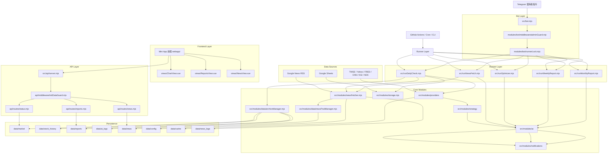

# InvestmentLineNotify 總體架構 / System Architecture

## 1. 系統定位
`InvestmentLineNotify` 是一套以 Node.js 為核心的投資決策與通知系統，主要服務 0050 / 00675L 與生命週期投資策略的日常監控、新聞治理、AI 分析與週期報告生成。系統採用 **file-based persistence + external services** 的設計，不使用傳統資料庫，而是以 `data/`、Google Sheets、Telegram、Langfuse 與多個市場資料來源共同構成執行基礎。

目前專案已不只是一條 `dailyCheck` 單線流程，而是由多個 runner 組成，並搭配一個長駐 Telegram Bot、一個唯讀 HTTP API Server，以及一個 Vite + Vue 3 前端 Mini App：

1. `src/runDailyCheck.mjs`：每日主流程。
2. `src/runNewsFetch.mjs`：獨立新聞抓取、去重、更新新聞池。
3. `src/runOptimizer.mjs`：獨立執行 blacklist / rule optimizer。
4. `src/runWeeklyReport.mjs`：讀取近期報告並生成 AI 週報。
5. `src/runMonthlyReport.mjs`：讀取近期報告並生成 AI 月報。
6. `src/bot.mjs`：Telegram Bot 長駐程序，處理即時指令觸發與互動。
7. `src/api/server.mjs`：Fastify HTTP API Server，提供唯讀資料 API 給 Mini App 前端使用。
8. `webapp/`：Vite + Vue 3 前端 Mini App，作為 Telegram Mini App 嵌入式儀表板。

---

## 2. 生命週期總覽
系統實際運作可拆成八個層次：

1. **Entry Layer**：由 GitHub Actions、Cron 或手動 CLI 啟動各 runner；或由 Telegram Bot 指令觸發。
2. **Bot Layer**：`src/bot.mjs` 長駐，接受白名單使用者即時指令，透過 `runnerLock` 防止並發衝突，呼叫與 runner 相同的核心邏輯。
3. **API Layer**：`src/api/server.mjs` 長駐，提供唯讀 HTTP REST API（Port 3000），供 Telegram Mini App 前端請求資料，具備 Telegram initData HMAC-SHA256 驗證與 CORS 設定。
4. **Frontend Layer**：`webapp/`（Vite + Vue 3 + ECharts），作為 Telegram Mini App 嵌入式前端，透過 API Layer 取得資料並渲染圖表、報告列表與新聞池。
5. **Data Collection Layer**：從 `src/modules/providers/`、Google News RSS、Google Sheets 抓取市場資料、帳戶狀態與新聞。
6. **Decision Layer**：由 `src/modules/strategy/` 與 `src/modules/ai/` 共同完成量化計算與 AI 判讀。
7. **Delivery Layer**：由 `src/modules/notifications/` 將結果轉為 Telegram HTML 訊息或週期報告。
8. **Persistence Layer**：透過 `data/`、Google Sheets 與 Langfuse 持久化報告、快取、觀測資料與新聞池。

---

## 3. Mermaid Flow



---

## 4. 目錄與責任對照

### `src/` 執行與模組層
| Path | 說明 |
|---|---|
| `src/dailyCheck.mjs` | 每日主 orchestration，串接持股繼承、資料抓取、策略計算、新聞摘要、AI 建議、通知、歸檔與條件式 `llmJudge`。 |
| `src/runDailyCheck.mjs` | CLI entry，處理參數如 `--telegram=false`、`--aiAdvisor=false`。 |
| `src/runNewsFetch.mjs` | 獨立新聞抓取流程，包含動態關鍵字產生、Yield Rate score 回寫、新聞池更新。 |
| `src/runOptimizer.mjs` | 獨立執行 Rule Optimizer，優化新聞治理規則，完成後若有新規則則靜默推播至 Log 頻道。 |
| `src/runWeeklyReport.mjs` | 讀取近 7 天報告，最低 3 份才生成週報。 |
| `src/runMonthlyReport.mjs` | 讀取近 50 天報告（取最後 30 天為評估期，全 50 天供報酬率計算），最低 10 份才生成月報。 |
| `src/bot.mjs` | Telegram Bot 長駐程序（grammY Long-Polling）。實作 `/start`、`/help`、`/status`、`/daily`、`/news`、`/weekly`、`/monthly`、`/optimize` 指令，並透過 `adminGuard` 白名單驗證與 `runnerLock` 防止並發衝突。 |
| `src/api/server.mjs` | Fastify HTTP API Server（Port 3000），提供唯讀 REST API 給 Mini App 前端。整合 `@fastify/cors` 與 `initDataGuard` middleware。以 `npm run api` 啟動。 |
| `src/api/middleware/initDataGuard.mjs` | Telegram initData HMAC-SHA256 驗證 middleware。`NODE_ENV=dev` 或 `BYPASS_INIT_DATA=true` 時可 bypass，方便本機開發。 |
| `src/api/routes/status.mjs` | `GET /api/status`：讀取 `data/market/latest.json`，不存在回 404。 |
| `src/api/routes/reports.mjs` | `GET /api/reports?limit=N`（預設 30，DESC 排序）與 `GET /api/report/:date`，不存在回 404。 |
| `src/api/routes/news.mjs` | `GET /api/news`：讀取 `data/news/pool_filtered_active.json`，不存在回 `[]`。 |
| `src/modules/bot/middleware/adminGuard.mjs` | 白名單 middleware，僅允許 `TELEGRAM_USER_ID` 指定的 chat_id 使用指令。 |
| `src/modules/bot/runnerLock.mjs` | 全域 lock 機制，防止 Bot 指令與排程 runner 同時執行同一任務。 |
| `src/modules/providers/` | 市場資料 provider layer，封裝 TWSE、Yahoo、FRED、CNN、KGI、NDC 等來源。 |
| `src/modules/strategy/` | 策略與風控核心，計算 RSI / KD / MACD、過熱、冷卻期與投資建議。 |
| `src/modules/ai/` | AI decision layer，包含 search query generation、news filter、macro analysis、investment coach、period report、rule optimizer、LLM judge。 |
| `src/modules/news/newsConflictGrouper.mjs` | 矛盾偵測前置層，以 Jaccard 相似度（閾值 0.3）+ Union-Find 對新聞標題預分群，輸出 `_conflictGroup` 標籤供 AI 識別同一事件的正反報導。 |
| `src/modules/newsFetcher.mjs` | 新聞抓取與初步去噪主程式，負責整合靜態 / 動態關鍵字與 blacklist。 |
| `src/modules/keywordConfig.mjs` | 關鍵字與 blacklist loading 的設定入口，承接已完成的 keyword system 重構。 |
| `src/modules/data/newsPoolManager.mjs` | 新聞池 CRUD、TTL 清理、archive、fuzzy dedupe。 |
| `src/modules/notifications/` | 將決策結果輸出成 Telegram 訊息與週期報告格式。 |
| `src/modules/storage.mjs` | 與 Google Sheets 同步持股狀態與每日紀錄，包含 `avgCost0050` / `avgCostZ2` 均價欄位讀取。 |
| `src/utils/coreUtils.mjs` | 通用工具：`TwDate`、`fetchWithTimeout`、`parseNumberOrNull`、`stepTimer` 等。 |
| `src/test/` | 手動測試與回測腳本，不在排程流程內。 |

### `src/test/` 測試腳本
| Path | 說明 |
|---|---|
| `src/test/backtest.mjs` | 回測腳本，用於驗證策略歷史表現。 |
| `src/test/newsTest.mjs` | 新聞抓取手動測試。 |
| `src/test/providers.test.mjs` | 各 provider 單元測試。 |
| `src/test/test-all.mjs` | 整合測試入口。 |
| `src/test/test-archiveManager.mjs` | archiveManager 模組測試。 |
| `src/test/test-keywordConfig.mjs` | keywordConfig 載入測試。 |
| `src/test/test-keywords.mjs` | 關鍵字系統測試。 |

### `webapp/` 前端 Mini App 層
| Path | 說明 |
|---|---|
| `webapp/package.json` | 獨立子專案依賴（vite、@vitejs/plugin-vue、vue、vue-router、echarts、vue-echarts）。 |
| `webapp/vite.config.js` | Vite 設定，base `/`，build 輸出至 `webapp/dist/`。 |
| `webapp/index.html` | HTML 入口，包含 Telegram Web App SDK CDN（`telegram-web-app.js`）。 |
| `webapp/src/main.js` | Vue app 建立入口，掛載 router。 |
| `webapp/src/App.vue` | 根元件，包含底部 Tab Bar 導航（圖表／報告／新聞）與 `useTelegram().expand()` 初始化。 |
| `webapp/src/router/index.js` | Vue Router（hash mode），三條路由：`/` → ChartView、`/reports` → ReportsView、`/news` → NewsView。 |
| `webapp/src/api/index.js` | API fetch wrapper，baseURL 由 `VITE_API_BASE` env 控制（預設 `http://localhost:3000`），自動帶入 `X-Telegram-Init-Data` header。 |
| `webapp/src/composables/useTelegram.js` | `window.Telegram?.WebApp` 封裝，提供 `initData`、`expand()`、`themeParams`、`openLink()` 方法，含非 Mini App 環境降級處理。 |
| `webapp/src/views/ChartView.vue` | (a) ECharts 折線圖，Y 軸為 `signals.priceChangePercent`，每點依漲跌著綠/紅色，markLine y=0，tooltip 顯示 `signals.target` 與 `signals.weightScore`。 |
| `webapp/src/views/ReportsView.vue` | (b) 報告摘要列表，預設顯示日期、`signals.marketStatus`、`signals.targetSuggestion`，點擊展開 `ai.action_items`、`ai.risk_warnings`、`ai.mindset_advice`。 |
| `webapp/src/views/NewsView.vue` | (d) 新聞池列表，顯示 `age_band` 標籤（🔴/🟡/⚪）與 `_region` 國旗，連結透過 `tg.openLink()` 開啟。 |

### `data/` 檔案持久化層
| Path | 說明 |
|---|---|
| `data/market/` | 總經與市場快取資料（`latest.json` 含所有 provider 最新快取）。 |
| `data/stock_history/` | 歷史股價快取。 |
| `data/reports/` | 每日決策最終報告，亦作為週報 / 月報輸入來源。 |
| `data/ai_logs/` | AI prompt / response 與治理相關紀錄。 |
| `data/news/pool_active.json` | 主新聞池，目前有效新聞。 |
| `data/news/pool_filtered_active.json` | 已整理後的新聞池版本。 |
| `data/news/archive/YYYY-MM-DD.json` | 過期新聞歸檔。 |
| `data/news_logs/` | 每次新聞抓取的 raw log，用於 debug 與治理分析。 |
| `data/config/` | 執行期設定檔，包含 blacklist、關鍵字規則等可動態調整的治理設定。 |
| `data/cache/` | 各 provider 的短期 API 快取，避免重複請求外部資料源（TTL 由各 provider 模組控制）。 |
| `data/last_buy.json` | 記錄最後一次買進事件的日期與標的，用於冷卻期計算。 |

### `docs/` 文件層
| Path | 說明 |
|---|---|
| `docs/architecture.md` | 本文件，總體架構總覽。 |
| `docs/agent_prompts.md` | AI Agent 使用的 prompt 結構說明。 |
| `docs/langfuse-score-configs.md` | Langfuse 評分配置說明。 |
| `docs/modules/ai_pipeline.md` | AI 決策管線詳細說明（aiCoach、periodReportAgent、ruleOptimizerAgent、llmJudge）。 |
| `docs/modules/core_infrastructure.md` | 基礎設施詳細說明（storage、archiveManager、newsPoolManager、coreUtils）。 |
| `docs/modules/entry_and_notifications.md` | 入口 Runner 與通知模組詳細說明（含 Bot 指令清單、API 路由說明）。 |
| `docs/modules/market_strategy.md` | 市場策略引擎詳細說明（strategyEngine、signalRules、indicators、riskManagement、newsFetcher）。 |
| `docs/modules/providers.md` | 各市場資料 provider 詳細說明與 API 快取策略。 |
| `docs/plans/finish_features.md` | 已完成功能記錄，細節已整合至 `docs/architecture.md` 與 `docs/modules/`，此檔作為歷史快照。 |
| `docs/plans/preplan_features.md` | 預計功能池，Oracle VM 部署計畫已抽離為 `docs/plans/oracle_vm_deployment_plan.md`。 |
| `docs/plans/oracle_vm_deployment_plan.md` | Oracle Cloud VM 正式部署計畫（🔄 進行中），含 domain/HTTPS 取得、Nginx 設定、pm2 管理、data/ 同步策略。 |
| `docs/plans/optimization_ideas.md` | 最佳化方向構想（待排期）。 |

---

## 5. 已完成的架構演進

### 5.1 Keyword System 重構
新聞關鍵字系統已從單純寫死字串，演進為結構化 `KeywordEntry`：

```ts
{
  keyword: string,
  searchType: "intitle" | "broad"
}
```

此設計帶來三層好處：
- 讓 RSS query 可區分「標題必含」與「廣泛匹配」。
- 讓靜態關鍵字池與 AI 動態關鍵字能共用同一 schema。
- 讓 AI Agent 後續調整關鍵字時，更容易定位 `keywordConfig`、`newsFetcher`、`prompts` 三個修改點。

### 5.2 AI 新聞過濾管線 — 矛盾偵測層（Contradiction Detection）

`filterAndCategorizeAllNewsWithAI` 呼叫前，由 `newsConflictGrouper.mjs` 以 Jaccard 相似度（閾值 0.3）+ Union-Find 對新聞標題預分群，為每篇新聞輸出 `_conflictGroup` 標籤（`G1`、`G2`… 或 `no_group`）。

AI 依此識別同一事件的正反報導，透過 `FILTERED_NEWS_SCHEMA` 的 `has_conflict / conflict_note / conflict_winner_id` 欄位回傳矛盾標記；`aiCoach.mjs` 讀取後組裝 `conflictSummary` 前置注解，傳遞至 `analyzeMacroNewsWithAI`，使宏觀分析層能依時序選出「最新立場」，而非將正反報導同時計入多空評分。

Langfuse `Contradiction_Count` score 記錄每次執行偵測到的矛盾事件數，供長期觀察與 Prompt 效益評估。

**相關檔案**：`src/modules/news/newsConflictGrouper.mjs`、`src/modules/ai/aiCoach.mjs`、`src/modules/ai/prompts.mjs`
