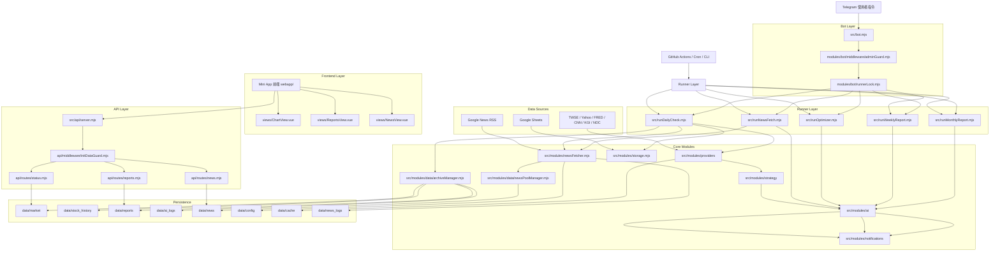

# InvestmentLineNotify 總體架構 / System Architecture

## 1. 系統定位
`InvestmentLineNotify` 是一套以 Node.js 為核心的投資決策與通知系統，主要服務 0050 / 00675L 與生命週期投資策略的日常監控、新聞治理、AI 分析與週期報告生成。系統採用 **file-based persistence + external services** 的設計，不使用傳統資料庫，而是以 `data/`、Google Sheets、Telegram、Langfuse 與多個市場資料來源共同構成執行基礎。

目前專案已不只是一條 `dailyCheck` 單線流程，而是由多個 runner 組成，並搭配一個長駐 Telegram Bot、一個唯讀 HTTP API Server，以及一個 Vite + Vue 3 前端 Mini App：

1. `src/runDailyCheck.mjs`：每日主流程。
2. `src/runNewsFetch.mjs`：獨立新聞抓取、去重、更新新聞池。
3. `src/runOptimizer.mjs`：獨立執行 blacklist / rule optimizer。
4. `src/runWeeklyReport.mjs`：讀取近期報告並生成 AI 週報。
5. `src/runMonthlyReport.mjs`：讀取近期報告並生成 AI 月報。
6. `src/bot.mjs`：Telegram Bot 長駐程序，處理即時指令觸發與互動。
7. `src/api/server.mjs`：Fastify HTTP API Server，提供唯讀資料 API 給 Mini App 前端使用。
8. `webapp/`：Vite + Vue 3 前端 Mini App，作為 Telegram Mini App 嵌入式儀表板。

---

## 2. 生命週期總覽
系統實際運作可拆成八個層次：

1. **Entry Layer**：由 GitHub Actions、Cron 或手動 CLI 啟動各 runner；或由 Telegram Bot 指令觸發。
2. **Bot Layer**：`src/bot.mjs` 長駐，接受白名單使用者即時指令，透過 `runnerLock` 防止並發衝突，呼叫與 runner 相同的核心邏輯。
3. **API Layer**：`src/api/server.mjs` 長駐，提供唯讀 HTTP REST API（Port 3000），供 Telegram Mini App 前端請求資料，具備 Telegram initData HMAC-SHA256 驗證與 CORS 設定。
4. **Frontend Layer**：`webapp/`（Vite + Vue 3 + ECharts），作為 Telegram Mini App 嵌入式前端，透過 API Layer 取得資料並渲染圖表、報告列表與新聞池。
5. **Data Collection Layer**：從 `src/modules/providers/`、Google News RSS、Google Sheets 抓取市場資料、帳戶狀態與新聞。
6. **Decision Layer**：由 `src/modules/strategy/` 與 `src/modules/ai/` 共同完成量化計算與 AI 判讀。
7. **Delivery Layer**：由 `src/modules/notifications/` 將結果轉為 Telegram HTML 訊息或週期報告。
8. **Persistence Layer**：透過 `data/`、Google Sheets 與 Langfuse 持久化報告、快取、觀測資料與新聞池。

---

## 3. Mermaid Flow

---

## 4. 目錄與責任對照

### `src/` 執行與模組層
| Path | 說明 |
|---|---|
| `src/dailyCheck.mjs` | 每日主 orchestration，串接持股繼承、資料抓取、策略計算、新聞摘要、AI 建議、通知、歸檔與條件式 `llmJudge`。 |
| `src/runDailyCheck.mjs` | CLI entry，處理參數如 `--telegram=false`、`--aiAdvisor=false`。 |
| `src/runNewsFetch.mjs` | 獨立新聞抓取流程，包含動態關鍵字產生、Yield Rate score 回寫、新聞池更新。 |
| `src/runOptimizer.mjs` | 獨立執行 Rule Optimizer，優化新聞治理規則，完成後若有新規則則靜默推播至 Log 頻道。 |
| `src/runWeeklyReport.mjs` | 讀取近 7 天報告，最低 3 份才生成週報。 |
| `src/runMonthlyReport.mjs` | 讀取近 50 天報告（取最後 30 天為評估期，全 50 天供報酬率計算），最低 10 份才生成月報。 |
| `src/bot.mjs` | Telegram Bot 長駐程序（grammY Long-Polling）。實作 `/start`、`/help`、`/status`、`/daily`、`/news`、`/weekly`、`/monthly`、`/optimize` 指令，並透過 `adminGuard` 白名單驗證與 `runnerLock` 防止並發衝突。 |
| `src/api/server.mjs` | Fastify HTTP API Server（Port 3000），提供唯讀 REST API 給 Mini App 前端。整合 `@fastify/cors` 與 `initDataGuard` middleware。以 `npm run api` 啟動。 |
| `src/api/middleware/initDataGuard.mjs` | Telegram initData HMAC-SHA256 驗證 middleware。`NODE_ENV=dev` 或 `BYPASS_INIT_DATA=true` 時可 bypass，方便本機開發。 |
| `src/api/routes/status.mjs` | `GET /api/status`：讀取 `data/market/latest.json`，不存在回 404。 |
| `src/api/routes/reports.mjs` | `GET /api/reports?limit=N`（預設 30，DESC 排序）與 `GET /api/report/:date`，不存在回 404。 |
| `src/api/routes/news.mjs` | `GET /api/news`：讀取 `data/news/pool_filtered_active.json`，不存在回 `[]`。 |
| `src/modules/bot/middleware/adminGuard.mjs` | 白名單 middleware，僅允許 `TELEGRAM_USER_ID` 指定的 chat_id 使用指令。 |
| `src/modules/bot/runnerLock.mjs` | 全域 lock 機制，防止 Bot 指令與排程 runner 同時執行同一任務。 |
| `src/modules/providers/` | 市場資料 provider layer，封裝 TWSE、Yahoo、FRED、CNN、KGI、NDC 等來源。 |
| `src/modules/strategy/` | 策略與風控核心，計算 RSI / KD / MACD、過熱、冷卻期與投資建議。 |
| `src/modules/ai/` | AI decision layer，包含 search query generation、news filter、macro analysis、investment coach、period report、rule optimizer、LLM judge。 |
| `src/modules/news/newsConflictGrouper.mjs` | 矛盾偵測前置層，以 Jaccard 相似度（閾值 0.3）+ Union-Find 對新聞標題預分群，輸出 `_conflictGroup` 標籤供 AI 識別同一事件的正反報導。 |
| `src/modules/newsFetcher.mjs` | 新聞抓取與初步去噪主程式，負責整合靜態 / 動態關鍵字與 blacklist。 |
| `src/modules/keywordConfig.mjs` | 關鍵字與 blacklist loading 的設定入口，承接已完成的 keyword system 重構。 |
| `src/modules/data/newsPoolManager.mjs` | 新聞池 CRUD、TTL 清理、archive、fuzzy dedupe。 |
| `src/modules/notifications/` | 將決策結果輸出成 Telegram 訊息與週期報告格式。 |
| `src/modules/storage.mjs` | 與 Google Sheets 同步持股狀態與每日紀錄，包含 `avgCost0050` / `avgCostZ2` 均價欄位讀取。 |
| `src/utils/coreUtils.mjs` | 通用工具：`TwDate`、`fetchWithTimeout`、`parseNumberOrNull`、`stepTimer` 等。 |
| `src/test/` | 手動測試與回測腳本，不在排程流程內。 |

### `src/test/` 測試腳本
| Path | 說明 |
|---|---|
| `src/test/backtest.mjs` | 回測腳本，用於驗證策略歷史表現。完整策略行為請搭配此腳本進行歷史回測，驗證 allocation 與風控參數；策略計算完全重用 `strategy/indicators.mjs` 與 `strategyEngine.mjs`，不另行實作指標邏輯。 |
| `src/test/newsTest.mjs` | 新聞抓取手動測試。 |
| `src/test/providers.test.mjs` | 各 provider 單元測試。 |
| `src/test/test-all.mjs` | 整合測試入口。 |
| `src/test/test-archiveManager.mjs` | archiveManager 模組測試。 |
| `src/test/test-keywordConfig.mjs` | keywordConfig 載入測試。 |
| `src/test/test-keywords.mjs` | 關鍵字系統測試。 |

### `scripts/` 運維腳本層
| Path | 說明 |
|---|---|
| `scripts/rollbackOptimizer.mjs` | 手動 rollback 最近一次 Rule Optimizer 對 blacklist 與歷史紀錄的變更，用於治理失誤時快速回滾。 |
| `scripts/testOptimizer.mjs` | Rule Optimizer 壓力測試與實驗腳本，用於在正式排程之外檢驗新 prompt 或規則策略。 |

### `.github/workflows/` 排程與監控層

GitHub Actions 負責定時觸發各 runner 並在完成後 git push 更新 `data/`。Bot daemon（`src/bot.mjs`）與 API Server（`src/api/server.mjs`）在 VM 上由 pm2 長駐執行，**不**由 Actions 啟動。

| Workflow 檔案 | 對應 Runner | Cron 說明 |
|---|---|---|
| `line_notify.yml` | `src/runDailyCheck.mjs`（`npm start`） | 多段 cron，涵蓋台灣時區開盤前、盤中、收盤後與夜間；每次完成後自動 commit `data/` 變更。 |
| `news-fetch.yml` | `src/runNewsFetch.mjs` | 每 3 小時執行一次，維護 `data/news/pool_active.json` 與 archive。 |
| `optimizer.yml` | `src/runOptimizer.mjs` | 每日固定時間執行，更新 blacklist 與 optimizer history 並 commit。 |
| `weekly-report.yml` | `src/runWeeklyReport.mjs` | 每週一早上執行，產出策略週報並透過 Telegram 發送。 |
| `monthly-report.yml` | `src/runMonthlyReport.mjs` | 每月 1 日早上執行，產出策略月報並透過 Telegram 發送。 |
| `notify-workflow-failure.yml` | — | 其他 workflow 失敗時觸發，透過 `sendSystemMessage()` 發送靜默通知至 Log 頻道。 |

> **`data/` 同步機制**：Actions 完成後透過 SSH 通知 VM 執行 `git pull`（方案 B），確保 VM 上 Fastify 讀取的 JSON 與 GitHub 一致。詳見 `docs/appendix/deployment-oracle-vm.md`。

---

## 5. `webapp/` 前端層

| Path | 說明 |
|---|---|
| `webapp/src/App.vue` | 根元件，整合 Telegram Mini App SDK 初始化（`expand()`、`ready()`）。 |
| `webapp/src/router/index.js` | Vue Router，三個主要路由：`/`（Chart）、`/reports`（Reports）、`/news`（News）。 |
| `webapp/src/views/ChartView.vue` | 主頁，以 ECharts 顯示近期 RSI / KD / MA240 等技術指標折線圖。 |
| `webapp/src/views/ReportsView.vue` | 報告列表頁，支援分頁載入，點擊可展開每日報告全文。 |
| `webapp/src/views/NewsView.vue` | 新聞池頁，顯示 `pool_filtered_active.json` 中的有效新聞條目。 |
| `webapp/src/api/index.js` | Axios wrapper，統一設定 `baseURL` 與 Telegram `initData` header。 |
| `webapp/src/composables/useTelegram.js` | 封裝 `window.Telegram.WebApp` 物件，提供 `tg`、`user`、`initData` 等響應式資料。 |

`webapp/dist/` 為 Vite build 產物，由 Nginx 作為靜態檔案服務；開發時以 `npm run dev`（Vite dev server）執行。

---

## 6. `docs/` 文件層

| 文件 | 說明 |
|---|---|
| `docs/architecture.md` | **本文件**。系統總覽、Mermaid flow、目錄責任對照、`webapp/` 層說明。 |
| `docs/agent_prompts.md` | 所有 AI agent 的 prompt 設計說明與版本紀錄。 |
| `docs/langfuse-score-configs.md` | Langfuse 評分維度設定（Schema_Validation、Actionability、Tone_and_Empathy 等）。 |
| `docs/modules/ai_pipeline.md` | AI decision pipeline 詳細設計：aiClient、aiCoach、llmJudge、periodReportAgent、ruleOptimizerAgent。 |
| `docs/modules/market_strategy.md` | 策略引擎、技術指標、新聞治理架構說明。 |
| `docs/modules/core_infrastructure.md` | 共用 infra 說明：storage、archiveManager、newsPoolManager、coreUtils、Google Sheets 欄位 mapping。 |
| `docs/modules/providers.md` | 各 market data provider 的欄位、來源與快取策略。 |
| `docs/modules/entry_and_notifications.md` | 系統入口（runner / Bot / Actions）與通知層（Telegram 訊息格式、分流策略）完整說明。 |
| `docs/plans/finish_features.md` | 已完成功能清單（內容已整合至系統文件，供歷史追蹤）。 |
| `docs/plans/preplan_features.md` | 預計功能規劃清單。 |
| `docs/plans/oracle_vm_deployment_plan.md` | Oracle VM 部署計畫（✅ 已完成）。完整安裝手冊見 `docs/appendix/deployment-oracle-vm.md`。 |
| `docs/appendix/deployment-oracle-vm.md` | Oracle VM 完整安裝與設定手冊（DuckDNS、Nginx、SSL、pm2、data/ 同步）。 |

> **已淘汰計畫文件**：`telegram_intergration_plan.md` 與 `optimization_ideas.md` 的內容已於開發過程中全數整合至 `docs/architecture.md`、`docs/modules/ai_pipeline.md` 及 `docs/modules/entry_and_notifications.md`，原計畫文件不再維護。
