# InvestmentLineNotify 總體架構 / System Architecture

## 1. 系統定位

`InvestmentLineNotify` 是一套以 Node.js 為核心的投資決策與通知系統，主要服務 0050 / 00675L 與生命週期投資策略的日常監控、新聞治理、AI 分析與週期報告生成。系統採用 **file-based persistence + external services** 的設計，不使用傳統資料庫，而是以 `data/`、Google Sheets、Telegram、Langfuse 與多個市場資料來源共同構成執行基礎。

目前專案已不只是一條 `dailyCheck` 單線流程，而是由多個 runner 組成，並搭配一個長駐 Telegram Bot、一個唯讀 HTTP API Server，以及一個 Vite + Vue 3 前端 Mini App（含 7 個 Tab 的多頁儀表板）：

1. `src/runDailyCheck.mjs`：每日主流程。
2. `src/runNewsFetch.mjs`：獨立新聞抓取、去重、更新新聞池。
3. `src/runOptimizer.mjs`：獨立執行 blacklist / rule optimizer。
4. `src/runWeeklyReport.mjs`：讀取近期報告並生成 AI 週報。
5. `src/runMonthlyReport.mjs`：讀取近期報告並生成 AI 月報。
6. `src/bot.mjs`：Telegram Bot 長駐程序，處理即時指令觸發與互動。
7. `src/api/server.mjs`：Fastify HTTP API Server（Port 3000），提供唯讀資料 API 給 Mini App 前端使用。
8. `webapp/`：Vite + Vue 3 前端 Mini App，作為 Telegram Mini App 嵌入式多頁儀表板。
9. `src/utils/dataMigrator.mjs`：[NEW 2.0] 歷史資料遷移與結構升級工具。

---

## 2. [ILN 2.0] 數據治理與分層 (Data Governance)

從 2.0 版本起，系統引入了強型別的數據合約與分層存儲架構，解決了資料結構變動導致的系統崩潰問題：

### 2.1 數據分層 (Data Layering)

- **Raw (原始層)**: `data/market/latest.json` 存放各 Provider 抓回的非結構化原始數據。
- **Canonical (標準層)**: 透過 `src/utils/normalizer.mjs` 將原始數據轉化為統一的數值格式，並歸類至 `valuation`, `sentiment`, `liquidity`, `economy` 四大維度。
- **Inference (推論層)**: `data/reports/` 存放 Strategy Engine 根據標準層數據算出的決策結果。

### 2.2 數據合約 (Data Contract)

所有報告與 API 回傳結構均遵循 `src/api/schema/contract.mjs` 定義的 `REPORT_SCHEMA`：

- **完整策略拷貝 (Strategy Snapshot)**: 每份報告均完整記錄當下使用的策略設定，確保決策可回溯。
- **全量數字化**: 所有數值欄位統一為 `Number` 類型，前端無需再處理百分比或逗號字串。
- **嵌套語意化**: 資料以模組化路徑（如 `report.signals.score`）存取。

---

## 3. 生命週期總覽

系統實際運作可拆成八個層次：

1. **Entry Layer**：由 VM crontab 或手動 CLI 啟動各 runner；或由 Telegram Bot 指令觸發。
2. **Bot Layer**：`src/bot.mjs` 長駐，接受白名單使用者即時指令，透過 `runnerLock` 防止並發衝突，呼叫與 runner 相同的核心邏輯。Bot 亦提供 `/status_debug` 指令檢視各市場資料來源的 metadata 狀態（對應 `_meta.sources`）。
3. **API Layer**：`src/api/server.mjs` 長駐，提供唯讀 HTTP REST API（Port 3000），供 Telegram Mini App 前端請求資料，具備 Telegram initData HMAC-SHA256 驗證與 CORS 設定。
4. **Frontend Layer**：`webapp/`（Vite + Vue 3 + ECharts），作為 Telegram Mini App 嵌入式前端，透過 API Layer 取得資料並渲染市場快照、資產趨勢圖表、報告列表與新聞池。採7-tab 左右滑動底部 Tab Bar 導覽。其中 `AccountView.vue` 會讀取 `/api/status`，將 `data/market/latest.json` 中的 `_meta.sources` 視覺化為「系統狀態 + 資料來源健康度」區塊，並提供展開/收合詳細資訊的 UI。
5. **Data Collection Layer**：從 `src/modules/providers/`、Google News RSS、Google Sheets 抓取市場資料、帳戶狀態與新聞。市場資料 provider 由 `marketData.mjs` 統一 orchestrate，並透過 `dataSourceConfig.mjs` 與 `providerRegistry.mjs` 以 `providerId` 管理各資料來源與快取 metadata。
6. **Decision Layer**：由 `src/modules/strategy/` 與 `src/modules/ai/` 共同完成。採用 **Scoring Matrix (評分矩陣)** 將異質指標（跌幅、技術面、籌碼、情緒）標準化為 -1 到 1 的分數並加權求和。具備 **Override Hierarchy** 極致風控：維持率與動態停利指令優先於評分建議。執行撥款受 **10 日滾動預算上限** (Trading Budget) 監控，確保槓桿擴張不超越安全性紅線。
7. **Delivery Layer**：由 `src/modules/notifications/` 將結果轉為 Telegram HTML 訊息或週期報告。
8. **Persistence Layer**：透過 `data/`、Google Sheets 與 Langfuse 持久化報告、快取、觀測資料與新聞池。

---

## 3. Mermaid Flow

```mermaid
flowchart TD
    A[VM Crontab / CLI] --> B[Runner Layer]
    TG[Telegram 使用者指令] --> BOT[src/bot.mjs]
    WA[Mini App 前端 webapp/] --> API[src/api/server.mjs]

    subgraph Bot Layer
      BOT
      LOCK[modules/bot/runnerLock.mjs]
      ADMIN[modules/bot/middleware/adminGuard.mjs]
    end

    subgraph API Layer
      API
      GUARD[api/middleware/initDataGuard.mjs]
      RT_STATUS[api/routes/status.mjs]
      RT_REPORTS[api/routes/reports.mjs]
      RT_NEWS[api/routes/news.mjs]
      AGG[api/utils/snapshotAggregator.mjs]
    end

    subgraph Frontend Layer
      WA
      WA_DASHBOARD[views/DashboardView.vue]
      WA_RADAR[views/MarketRadarView.vue]
      WA_MACRO[views/MacroBattleView.vue]
      WA_CHART[views/ChartView.vue]
      WA_REPORTS[views/ReportsView.vue]
      WA_NEWS[views/NewsView.vue]
      WA_ACCOUNT[views/AccountView.vue]
    end

    BOT --> ADMIN --> LOCK
    API --> GUARD --> RT_STATUS & RT_REPORTS & RT_NEWS
    RT_REPORTS --> AGG
    WA --> WA_DASHBOARD & WA_RADAR & WA_MACRO & WA_CHART & WA_REPORTS & WA_NEWS & WA_ACCOUNT

    subgraph Runner Layer
      B1[src/runDailyCheck.mjs]
      B2[src/runNewsFetch.mjs]
      B3[src/runOptimizer.mjs]
      B4[src/runWeeklyReport.mjs]
      B5[src/runMonthlyReport.mjs]
    end

    B --> B1
    B --> B2
    B --> B3
    B --> B4
    B --> B5

    LOCK --> B1
    LOCK --> B2
    LOCK --> B4
    LOCK --> B5
    LOCK --> B3

    subgraph Data Sources
      S1[Google Sheets]
      S2[TWSE / Yahoo / FRED / CNN / KGI / NDC]
      S3[Google News RSS]
    end

    subgraph Core Modules
      M1[src/modules/providers]
      M2[src/modules/strategy]
      M3[src/modules/newsFetcher.mjs]
      M4[src/modules/data/newsPoolManager.mjs]
      M5[src/modules/ai]
      M6[src/modules/notifications]
      M7[src/modules/storage.mjs]
      M8[src/modules/data/archiveManager.mjs]
      M9[src/utils/snapshotCrypto.mjs]
    end

    subgraph Persistence
      D1[data/market]
      D2[data/stock_history]
      D3[data/reports]
      D4[data/ai_logs]
      D5[data/news]
      D6[data/config]
      D7[data/cache]
      D8[data/news_logs]
    end

    S1 --> M7
    S2 --> M1
    S3 --> M3

    B1 --> M1 --> M2 --> M5 --> M6
    B1 --> M7
    B1 --> M8
    B1 --> M3
    B1 --> M9

    B2 --> M5
    B2 --> M3 --> M4
    B3 --> M5
    B4 --> M5 --> M6
    B5 --> M5 --> M6

    M8 --> D1
    M8 --> D2
    M8 --> D3
    M8 --> D4
    M4 --> D5
    M3 --> D6
    M1 --> D7
    M3 --> D8

    RT_STATUS --> D1
    RT_REPORTS --> D3
    RT_NEWS --> D5
```

---

## 4. 目錄與責任對照

### `src/` 執行與模組層

| Path                                   | 說明                                                                                                                                                                                                                                                                                                                                                  |
| -------------------------------------- | ----------------------------------------------------------------------------------------------------------------------------------------------------------------------------------------------------------------------------------------------------------------------------------------------------------------------------------------------------- |
| `src/dailyCheck.mjs`                   | 每日主 orchestration，串接持股繼承、資料抓取、策略計算、新聞摘要、AI 建議、通知、歸檔與條件式 `llmJudge`。`saveReport()` 呼叫時若環境變數 `SNAPSHOT_ENCRYPT_KEY` 已設定且 `lastState` 不為空，會將持倉快照以 AES-256-GCM 加密後寫入 `snapshot` 欄位。                                                                                                 |
| `src/runDailyCheck.mjs`                | CLI entry，處理參數如 `--telegram=false`、`--aiAdvisor=false`。                                                                                                                                                                                                                                                                                       |
| `src/runNewsFetch.mjs`                 | 獨立新聞抓取流程，包含動態關鍵字產生、Yield Rate score 回寫、新聞池更新。                                                                                                                                                                                                                                                                             |
| `src/runOptimizer.mjs`                 | 獨立執行 Rule Optimizer，優化新聞治理規則，完成後若有新規則則靜默推播至 Log 頻道。                                                                                                                                                                                                                                                                    |
| `src/runWeeklyReport.mjs`              | 讀取近 7 天報告，最低 3 份才生成週報。                                                                                                                                                                                                                                                                                                                |
| `src/runMonthlyReport.mjs`             | 讀取近 50 天報告（取最後 30 天為評估期，全 50 天供報酬率計算），最低 10 份才生成月報。                                                                                                                                                                                                                                                                |
| `src/bot.mjs`                          | Telegram Bot 長駐程序（grammY Long-Polling）。實作 `/start`、`/help`、`/status`、`/status_debug`、`/daily`、`/news`、`/weekly`、`/monthly`、`/optimize` 指令，並透過 `adminGuard` 白名單驗證與 `runnerLock` 防止並發衝突。`/status_debug` 會直接讀取 `data/market/latest.json` 的 `_meta.sources`，以人類可讀格式顯示各 provider 最近更新時間與錯誤。 |
| `src/api/server.mjs`                   | Fastify HTTP API Server（Port 3000），提供唯讀 REST API 給 Mini App 前端。整合 `@fastify/cors` 與 `initDataGuard` middleware。以 `npm run api` 啟動。                                                                                                                                                                                                 |
| `src/api/middleware/initDataGuard.mjs` | Telegram initData HMAC-SHA256 驗證 middleware。`NODE_ENV=dev` 或 `BYPASS_INIT_DATA=true` 時可 bypass，方便本機開發。                                                                                                                                                                                                                                  |

> ⚠️ **實作狀態**：`adminGuard`（管理員路由防護）與 `initDataGuard`（Telegram WebApp `initData` HMAC 驗證）目前為**規劃中功能，尚未實作實質驗證邏輯**。
> 現階段 API 服務未對外公開，安全性依賴 VM 網路層隔離。
> 若未來需開放 API 端點，應優先完成此兩個 Guard 的核心驗證邏輯後才可上線。
> | `src/api/routes/status.mjs` | `GET /api/status`：讀取 `data/market/latest.json`，不存在回 404。回傳內容包含 `_meta.lastRun` 與 `_meta.sources`，供 Bot `/status` 以及 Mini App 的 AccountView 系統狀態頁使用。 |
> | `src/api/routes/reports.mjs` | `GET /api/reports?limit=N`（預設 30，最大 365，DESC 排序）、`GET /api/report/:date`、`GET /api/snapshots?limit=N`（日粒度快照，解密後回傳）、`GET /api/snapshots/weekly?limit=N`（週聚合，透過 `snapshotAggregator` 計算）、`GET /api/snapshots/monthly?limit=N`（月聚合）。快照端點均需 `SNAPSHOT_ENCRYPT_KEY` 環境變數，否則回傳 `{ hasEncryption: false }`。 |
> | `src/api/routes/news.mjs` | `GET /api/news`：讀取 `data/news/pool_filtered_active.json`，不存在回 `[]`。 |
> | `src/api/utils/snapshotAggregator.mjs` | 週/月快照聚合工具。讀取日粒度快照陣列，按自然週或自然月分組，計算期未快照（`endDate`、`startDate`、`period`）與市價淨値（`netValueMarket = qty0050 × price0050 + qtyZ2 × priceZ2 - totalLoan`）。供 `/api/snapshots/weekly` 與 `/api/snapshots/monthly` 使用。 |
> | `src/utils/snapshotCrypto.mjs` | AES-256-GCM 對稱加密工具模組。提供 `encrypt(obj)` 與 `decrypt(str)` 兩支函式，金鑰來自環境變數 `SNAPSHOT_ENCRYPT_KEY`（32 bytes hex）。供 `dailyCheck.mjs` 寫入快照與 API routes 讀取快照時使用。 |
> | `src/modules/bot/middleware/adminGuard.mjs` | 白名單 middleware，僅允許 `TELEGRAM_USER_ID` 指定的 chat_id 使用指令。 |
> | `src/modules/bot/runnerLock.mjs` | 全域 lock 機制，防止 Bot 指令與排程 runner 同時執行同一任務。 |
> | `src/modules/providers/` | 市場資料 provider layer，封裝 TWSE、Yahoo、FRED、CNN、KGI、NDC 等來源。自 2026-04 起，總經類資料由 `marketData.mjs` 統一 orchestrate，並透過 `dataSourceConfig.mjs` + `providerRegistry.mjs` 以 `providerId` 管理 Slot 與 metadata。所有總經快取寫入 `data/market/latest.json`，結構含 `_meta.sources`（各 provider 狀態與 `lastFetch`）與 `data`（8 個 Slot 資料：`rawNdc`、`rawMargin`、`rawCnn`、`rawUsMarket`、`rawValuation`、`rawFx`、`rawMarketOverview`、`quote`）。詳見 `docs/modules/providers.md`。 |
> | `src/modules/strategy/` | 策略與風控核心，包含技術指標計算、**標準化評分矩陣 (Scoring Matrix)**、過熱/冷卻期判定、**動態移動停利 (Trailing Stop)** 與 **10 日滾動預算攔截 (Budget Control)**。採「風控優先」邏輯，確保安全性指令具備最高 Override 權限。 |
> | `src/modules/ai/` | AI decision layer，包含 search query generation、news filter、macro analysis、investment coach、period report、rule optimizer、LLM judge。 |
> | `src/modules/news/newsConflictGrouper.mjs` | 矛盾偵測前置層，以 Jaccard 相似度（閥値 0.3）+ Union-Find 對新聞標題預分群，輸出 `_conflictGroup` 標籤供 AI 識別同一事件的正反報導。 |
> | `src/modules/newsFetcher.mjs` | 新聞抓取與初步去噪主程式，負責整合靜態 / 動態關鍵字與 blacklist。 |
> | `src/modules/keywordConfig.mjs` | 關鍵字與 blacklist loading 的設定入口。 |
> | `src/modules/data/newsPoolManager.mjs` | 新聞池 CRUD、TTL 清理、archive、fuzzy dedupe。 |
> | `src/modules/notifications/` | 將決策結果輸出成 Telegram 訊息與週期報告格式。 |
> | `src/modules/storage.mjs` | 與 Google Sheets 同步持股狀態與每日紀錄，包含 `avgCost0050` / `avgCostZ2` 均價欄位讀取。 |
> | `src/utils/coreUtils.mjs` | 通用工具：`TwDate`、`fetchWithTimeout`、`parseNumber`、`stepTimer` 等。 |
> | `src/test/` | 手動測試與回測腳本，不在排程流程內。 |

### `src/test/` 測試腳本

| Path                               | 說明                                                                                                                                                                                       |
| ---------------------------------- | ------------------------------------------------------------------------------------------------------------------------------------------------------------------------------------------ |
| `src/test/backtest.mjs`            | 回測腳本，用於驗證策略歷史表現。完整策略行為請搭配此腳本進行歷史回測，驗證 allocation 與風控參數；策略計算完全重用 `strategy/indicators.mjs` 與 `strategyEngine.mjs`，不另行實作指標邏輯。 |
| `src/test/newsTest.mjs`            | 新聞抓取手動測試。                                                                                                                                                                         |
| `src/test/providers.test.mjs`      | 各 provider 單元測試。                                                                                                                                                                     |
| `src/test/test-all.mjs`            | 整合測試入口。                                                                                                                                                                             |
| `src/test/test-archiveManager.mjs` | archiveManager 模組測試。                                                                                                                                                                  |
| `src/test/test-keywordConfig.mjs`  | keywordConfig 載入測試。                                                                                                                                                                   |
| `src/test/test-keywords.mjs`       | 關鍵字系統測試。                                                                                                                                                                           |

### `scripts/` 運維腳本層

| Path                            | 說明                                                                                        |
| ------------------------------- | ------------------------------------------------------------------------------------------- |
| `scripts/vm-daily-check.sh`     | VM crontab 執行腳本，觸發 `runDailyCheck`（每日 5 次）。內建 lockfile、log 輸出與錯誤通知。 |
| `scripts/vm-news-fetch.sh`      | VM crontab 執行腳本，觸發 `runNewsFetch`（每 4 小時）。                                     |
| `scripts/vm-optimizer.sh`       | VM crontab 執行腳本，觸發 `runOptimizer`（每日 02:00）。                                    |
| `scripts/vm-weekly-report.sh`   | VM crontab 執行腳本，觸發 `runWeeklyReport`（每週一 09:30）。                               |
| `scripts/vm-monthly-report.sh`  | VM crontab 執行腳本，觸發 `runMonthlyReport`（每月 1 日 09:00）。                           |
| `scripts/notify-error.sh`       | 錯誤通知腳本，各 vm-\*.sh 失敗時呼叫，發送 Telegram 告警。                                  |
| `scripts/rollbackOptimizer.mjs` | 手動 rollback 最近一次 Rule Optimizer 對 blacklist 與歷史紀錄的變更。                       |
| `scripts/testOptimizer.mjs`     | Rule Optimizer 壓力測試腳本。                                                               |

### `.github/workflows/` 監控層

> 所有自動排程已於 **2026-04-13 全面移轉至 Oracle VM crontab**。
> GitHub Actions 僅保留手動觸發與異常監控用途。
> Bot daemon（`src/bot.mjs`）與 API Server（`src/api/server.mjs`）在 VM 上由 pm2 長駐執行，**不**由 Actions 啟動。

| Workflow 檔案                 | 用途                                                                         | 觸發方式                          |
| ----------------------------- | ---------------------------------------------------------------------------- | --------------------------------- |
| `line_notify.yml`             | `src/runDailyCheck.mjs` 手動排程                                             | 僅手動觸發（`workflow_dispatch`） |
| `news-fetch.yml`              | `src/runNewsFetch.mjs` 手動排程                                              | 僅手動觸發（`workflow_dispatch`） |
| `optimizer.yml`               | `src/runOptimizer.mjs` 手動排程                                              | 僅手動觸發（`workflow_dispatch`） |
| `weekly-report.yml`           | `src/runWeeklyReport.mjs` 手動排程                                           | 僅手動觸發（`workflow_dispatch`） |
| `monthly-report.yml`          | `src/runMonthlyReport.mjs` 手動排程                                          | 僅手動觸發（`workflow_dispatch`） |
| `notify-workflow-failure.yml` | 其他 workflow 失敗時觸發，透過 `sendSystemMessage()` 發送靜默通知至 Log 頻道 | 自動（on workflow_run failure）   |

---

## 5. `webapp/` 前端層

`webapp/` 為 Vite + Vue 3 前端，以 Telegram Mini App 形式嵌入。底部採 **7-tab 左右滑動 Tab Bar**（`overflow-x: auto`，隱藏捲軸），支援系統深色模式與 Telegram 主題色變數（`--tg-theme-*`）。`webapp/dist/` 為 Vite build 產物，由 Nginx 作為靜態檔案服務；開發時以 `npm run dev`（Vite dev server）執行。

| Path                                    | Tab  | 說明                                                                                                                                                                                                                                                                                                                                                                                                                                                                                                  |
| --------------------------------------- | ---- | ----------------------------------------------------------------------------------------------------------------------------------------------------------------------------------------------------------------------------------------------------------------------------------------------------------------------------------------------------------------------------------------------------------------------------------------------------------------------------------------------------- |
| `webapp/src/App.vue`                    | —    | 根元件，整合 Telegram Mini App SDK 初始化（`expand()`、`ready()`）、7-tab 左右滑動底部導覽列（總覽 / 雷達 / 多空 / 圖表 / 報告 / 新聞 / 設定），搭配 active 頂部指示線動畫。                                                                                                                                                                                                                                                                                                                          |
| `webapp/src/router/index.js`            | —    | Vue Router（Hash History），9 條路由：`/dashboard`、`/radar`、`/macro`、`/chart`、`/reports`、`/news`、`/account`，以及 `/` redirect → `/dashboard` 與 catch-all redirect。                                                                                                                                                                                                                                                                                                                           |
| `webapp/src/views/DashboardView.vue`    | 總覽 | 市場總覽首頁，整合市場快照（VIX / CNN 情緒 / 景氣燈號）、最新決策（AI action items 展開/收合）、技術指標卡片（RSI / KD / MACD / 乖離率）與最新消息預覽（跳轉 `/news`）。                                                                                                                                                                                                                                                                                                                              |
| `webapp/src/views/MarketRadarView.vue`  | 雷達 | 市場雷達儀表板，3-col 卡片格，依數値自動渲染紅/黃/綠/藍色階。**美股區**：美股 VIX、S&P 500 漲跌、CNN 情緒；**台股區**：台股 VIX、景氣燈號、融資維持率、大盤 PE / PB、美元/台幣匯率、**加權指數收盤（taiex）、當日成交金額（億元）、近 20 日均量**；資料同時讀取 `/api/status`（`data.rawMarketOverview`）與最新 report。                                                                                                                                                                              |
| `webapp/src/views/MacroBattleView.vue`  | 多空 | 總經多空對決頁，讀取最新 report 的 `macroAnalysis` 欄位。顯示市場方向 Badge（BULLISH / BEARISH / NEUTRAL）、多空積分長條動畫、`key_takeaways` 核心邏輯列表，以及多方/空方/中性事件卡片（含積分與分析文字）。                                                                                                                                                                                                                                                                                          |
| `webapp/src/views/ChartView.vue`        | 圖表 | 資產趨勢圖表頁。以 ECharts 折線圖顯示持倉歷史，支援**日（90 筆）/ 週（52 筆）/ 月（120 筆）**三段粒度切換，以及市價淨値、0050 股數、00675L 股數、融資餘額四項指標 chip 切換。市價淨値（`netValueMarket`）採市價法計算（`qty0050 × price0050 + qtyZ2 × priceZ2 - totalLoan`）。圖表含 tooltip、零軸參考線與面積漸層。下方顯示最新快照摘要卡片（4 格）。快照資料透過 `/api/snapshots`、`/api/snapshots/weekly`、`/api/snapshots/monthly` 取得，需後端 `SNAPSHOT_ENCRYPT_KEY` 環境變數才能啟用。         |
| `webapp/src/views/ReportsView.vue`      | 報告 | 報告列表頁，支援分頁載入，點擊可展開每日報告全文（含 AI 建議、巨集分析、技術指標等欄位）。                                                                                                                                                                                                                                                                                                                                                                                                            |
| `webapp/src/views/NewsView.vue`         | 新聞 | 新聞池頁，顯示 `pool_filtered_active.json` 中的有效新聞條目，支援地區 flag 標示與新舊色點。                                                                                                                                                                                                                                                                                                                                                                                                           |
| `webapp/src/views/AccountView.vue`      | 設定 | 帳戶與設定頁。上半部顯示 Telegram 使用者資訊與帳戶快照。下半部的「系統狀態」區塊會讀取 `/api/status`，展示 `_meta.lastRun`（資料最後更新時間）與 `_meta.sources`（各市場資料來源的狀態），並計算來源健康度總結。使用者可展開/收合「資料來源」詳細清單，查看每個 provider 的狀態（OK / FAIL / STALE）、最後更新時間與錯誤訊息，方便在手機上直接追蹤 market data pipeline 的健康度。若要在此頁顯示 `twMarketOverview` 的中文標籤，可在 `SOURCE_LABELS` 中加入 `twMarketOverview: '大盤量價 (FMTQIK)'`。 |
| `webapp/src/api/index.js`               | —    | 輕量 fetch wrapper，統一設定 `baseURL` 與 Telegram `initData` header。提供 `fetchStatus()`、`fetchReports(limit)`、`fetchNews()` 等 API 函式，並提供 `fetchSnapshots(limit)`、`fetchSnapshotsWeekly(limit)`、`fetchSnapshotsMonthly(limit)` 三支快照 API。                                                                                                                                                                                                                                            |
| `webapp/src/composables/useTelegram.js` | —    | 封裝 `window.Telegram.WebApp` 物件，提供 `tg`、`user`、`initData`、`openLink` 等響應式資料與方法。                                                                                                                                                                                                                                                                                                                                                                                                    |

---

## 6. `docs/` 文件層

| 文件                                      | 說明                                                                                                                                                                                                                                                                                             |
| ----------------------------------------- | ------------------------------------------------------------------------------------------------------------------------------------------------------------------------------------------------------------------------------------------------------------------------------------------------ |
| `docs/architecture.md`                    | **本文件**。系統總覽、Mermaid flow、目錄責任對照、`webapp/` 層說明。                                                                                                                                                                                                                             |
| `docs/agent_prompts.md`                   | 所有 AI agent 的 prompt 設計說明與版本紀錄。                                                                                                                                                                                                                                                     |
| `docs/langfuse-score-configs.md`          | Langfuse 評分維度設定（Schema_Validation、Actionability、Tone_and_Empathy 等）。                                                                                                                                                                                                                 |
| `docs/modules/ai_pipeline.md`             | AI decision pipeline 詳細設計：aiClient、aiCoach、llmJudge、periodReportAgent、ruleOptimizerAgent。                                                                                                                                                                                              |
| `docs/modules/market_strategy.md`         | 策略引擎、技術指標、新聞治理架構說明。                                                                                                                                                                                                                                                           |
| `docs/modules/core_infrastructure.md`     | 共用 infra 說明：storage、archiveManager、newsPoolManager、coreUtils、snapshotCrypto、Google Sheets 欄位 mapping。                                                                                                                                                                               |
| `docs/modules/providers.md`               | 各 market data provider 的欄位、來源與快取策略，以及 `marketData.mjs` / `dataSourceConfig.mjs` / `providerRegistry.mjs` 的 Slot + providerId 抽象層說明。包含所有 8 個 Slot（`rawNdc`、`rawMargin`、`rawCnn`、`rawUsMarket`、`rawValuation`、`rawFx`、`rawMarketOverview`、`quote`）的詳細描述。 |
| `docs/modules/entry_and_notifications.md` | 系統入口（runner / Bot / 排程）與通知層（Telegram 訊息格式、分流策略）完整說明。                                                                                                                                                                                                                 |
| `docs/schedules.md`                       | 排程總覽（VM crontab 全面移轉後的所有排程設定）。                                                                                                                                                                                                                                                |
| `docs/plans/finish_features.md`           | 已完成功能清單（內容已整合至系統文件，供歷史追蹤）。                                                                                                                                                                                                                                             |
| `docs/plans/preplan_features.md`          | 預計功能規劃清單。                                                                                                                                                                                                                                                                               |
| `docs/plans/oracle_vm_deployment_plan.md` | Oracle VM 部署計畫（✅ 已完成）。完整安裝手冊見 `docs/appendix/deployment-oracle-vm.md`。                                                                                                                                                                                                        |
| `docs/appendix/deployment-oracle-vm.md`   | Oracle VM 完整安裝與設定手冊（DuckDNS、Nginx、SSL、pm2、crontab 設定）。                                                                                                                                                                                                                         |
| `CHANGELOG.md`                            | 版本異動紀錄，格式遵循 Keep a Changelog。                                                                                                                                                                                                                                                        |

> **已淡汰計畫文件**：`telegram_intergration_plan.md` 與 `optimization_ideas.md` 的內容已於開發過程中全數整合至 `docs/architecture.md`、`docs/modules/ai_pipeline.md` 及 `docs/modules/entry_and_notifications.md`，原計畫文件不再維護。
