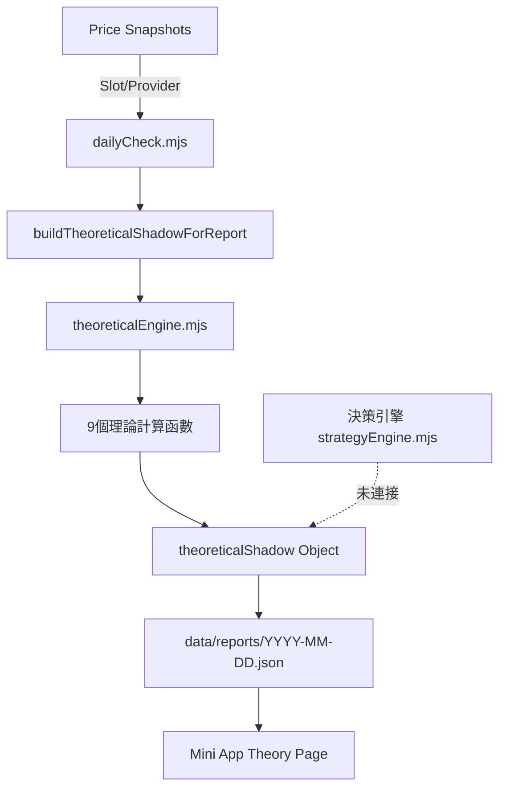

# 投資理論框架 (Theoretical Framework)

## 概述

本文檔說明 InvestmentLineNotify 系統中五大投資理論模組的學術基礎、計算邏輯、資料來源、系統整合關係，以及如何實際運用於決策流程。

### 五大理論模組

| 理論模組                             | 用途                                                | 實作狀態  | 決策整合  |
| ------------------------------------ | --------------------------------------------------- | --------- | --------- |
| **Human Capital** (人力資本)         | 評估未來收入現值，納入總資產計算                    | ✅ 實作   | ⚠️ 未整合 |
| **True Exposure** (真實曝險)         | 計算金融資產相對於總資本（金融+人力）的真實風險暴露 | ✅ 實作   | ⚠️ 未整合 |
| **Crash Tolerance** (崩盤耐受度)     | 評估帳戶能承受的最大跌幅（距離追繳的安全空間）      | ✅ 實作   | ⚠️ 未整合 |
| **Kelly Criterion** (凱莉公式)       | 根據預期報酬和波動率計算最佳槓桿比例                | ✅ 實作   | ⚠️ 未整合 |
| **Laplace Criterion** (拉普拉斯準則) | Minimax 原則，評估最壞情境下的損失                  | ✅ 實作   | ⚠️ 未整合 |
| **Tobin Separation** (托賓分離)      | 風險資產 vs 無風險資產的配置比例                    | ❌ 已停用 | ❌ 不追蹤 |

### 當前系統角色

```
理論計算層 (theoreticalEngine.mjs)
       ↓
整合適配層 (dailyCheckTheoreticalAdapter.mjs)
       ↓
每日報告 (dailyCheck.mjs → data/reports/*.json)
       ↓
前端展示 (Mini App Theory Page)

❌ 未連接 → 決策引擎 (strategyEngine.mjs)
```

**當前用途**：理論數據僅用於前端「投資健康度儀表板」展示，**未參與實際買賣決策**。

---

## 1. Human Capital (人力資本)

### 1.1 理論基礎

**學術來源**: Ibbotson & Milevsky 生命週期投資理論

**核心概念**:

- 未來工作收入具有資產價值，應納入總資產計算
- 年輕人人力資本 > 金融資本，可承受更高風險
- 隨年齡增長，人力資本折現，風險承受度下降

### 1.2 計算公式

```javascript
HC = Σ(t=0 to T) [CF_t / (1 + r)^t]
```

- `HC`: Human Capital (人力資本現值)
- `CF_t`: 第 t 年預期現金流
- `r`: 折現率 (discount rate)
- `T`: 剩餘工作年限

### 1.3 實作細節

**代碼位置**: `src/modules/strategy/theoreticalEngine.mjs` → `calculateHumanCapital()`

**當前參數** (hardcoded in `dailyCheckTheoreticalAdapter.mjs`):

```javascript
{
  cashFlows: Array.from({ length: 25 }, () => 1200000),  // 25年，每年120萬
  growthRate: 0,           // 0% 名目成長（保守估計）
  discountRate: 0.03,      // 3% 折現率（略高於無風險利率）
}
```

**輸出結構**:

```javascript
{
  status: "OK",              // OK | UNAVAILABLE
  humanCapital: 21522650.55, // 人力資本現值 (TWD)
  presentValue: 21522650.55  // 與 humanCapital 相同
}
```

### 1.4 資料來源

| 參數           | 資料來源                     | 當前實作        | 未來改進                |
| -------------- | ---------------------------- | --------------- | ----------------------- |
| `cashFlows`    | 使用者輸入（年薪、退休規劃） | ❌ 硬編碼固定值 | ✅ 從 Mini App 輸入     |
| `growthRate`   | 產業薪資成長率               | ❌ 硬編碼 0%    | ⚠️ 可保持保守           |
| `discountRate` | 無風險利率 + 風險溢酬        | ❌ 硬編碼 3%    | ✅ 動態從台灣公債殖利率 |
| `T` (剩餘年限) | 退休年齡 - 當前年齡          | ❌ 固定 25 年   | ✅ 從使用者生日計算     |

**Slot/Provider 映射** (規劃中):

```javascript
// 未來資料來源
{
  cashFlows: userProfile.annualIncome,        // 來自 Mini App 輸入
  retirementAge: userProfile.retirementAge,   // 來自 Mini App 輸入
  currentAge: userProfile.age,                // 從生日計算
  discountRate: bondYieldProvider.getTenYear() + 0.01  // 台灣10年期公債 + 1%
}
```

### 1.5 決策運用路徑 (未實作)

**潛在用途**:

1. **動態風險承受度**: `riskTolerance = f(humanCapital / financialCapital)`
   - 人力資本比重高 → 可提高股票槓桿
   - 接近退休（人力資本↓）→ 降低風險部位

2. **資產配置調整**:
   - 年輕階段 (HC/FC > 5): 可接受 2x 槓桿
   - 中年階段 (HC/FC = 2-5): 1.5x 槓桿
   - 退休前 (HC/FC < 1): 無槓桿或現金配置

---

## 2. True Exposure (真實曝險)

### 2.1 理論基礎

**學術來源**: Merton (1992) "Continuous-Time Finance" — 總資本配置理論

**核心概念**:

- 傳統曝險率 = 股票市值 / 金融資產，忽略人力資本
- 真實曝險 = 股票市值 / (金融資產 + 人力資本)
- 納入人力資本後，實際風險暴露被稀釋

### 2.2 計算公式

```javascript
True Exposure = Gross Exposure / (Financial Capital + Human Capital)
```

- `Gross Exposure`: 總市場曝險（現貨 + 槓桿部位市值）
- `Financial Capital`: 金融資產（帳戶淨值）
- `Human Capital`: 人力資本現值

### 2.3 實作細節

**代碼位置**: `src/modules/strategy/theoreticalEngine.mjs` → `calculateTrueExposure()`

**輸入**:

```javascript
{
  grossExposure: 1800000,      // 來自 calculateGrossExposure()
  financialCapital: 1000000,   // portfolioSnapshot.accountNetAsset
  humanCapital: 21522650.55    // 來自 calculateHumanCapital()
}
```

**輸出結構**:

```javascript
{
  status: "OK",
  trueExposure: 0.0799,  // 7.99% (1800000 / 22522650)
}
```

### 2.4 資料來源

| 參數               | Slot/Provider     | 計算路徑                                |
| ------------------ | ----------------- | --------------------------------------- |
| `grossExposure`    | PortfolioSnapshot | `qty0050 × price0050 + qtyZ2 × priceZ2` |
| `financialCapital` | PortfolioSnapshot | `accountNetAsset` (證券總值 - 融資負債) |
| `humanCapital`     | 理論計算層        | `calculateHumanCapital()` 輸出          |

**完整資料流**:

```
Price0050Snapshot (Slot)
   ↓
calculateGrossExposure()
   ↓                    ↓
PortfolioSnapshot  →  calculateTrueExposure()  ←  calculateHumanCapital()
                          ↓
                    True Exposure Result
```

### 2.5 決策運用路徑 (未實作)

**潛在用途**:

1. **風險守衛**:
   - `if (trueExposure > 0.15) → 觸發降槓桿警示`
   - 取代現有的 `exposureRatio` 守衛 (僅考慮金融資產)

2. **動態槓桿調整**:
   ```javascript
   maxLeverage = f(trueExposure, crashTolerance, kellyLimits);
   // 範例: trueExposure < 0.1 且 crashTolerance > 0.4 → 允許 2x
   ```

---

## 3. Crash Tolerance (崩盤耐受度)

### 3.1 理論基礎

**學術來源**: 信用風險管理 — 維持率 (Maintenance Margin) 理論

**核心概念**:

- 槓桿交易中，當擔保品價值下跌至一定比例，觸發追繳
- Crash Tolerance = 帳戶淨值能承受的最大跌幅%
- 跌幅超過此值 → 追繳或強制平倉

### 3.2 計算公式

```javascript
Crash Tolerance = 1 - (Target Maintenance / Current Maintenance)
```

**推導**:

```
設:
- 當前維持率 = 擔保品市值 / 融資金額 = M_current
- 目標維持率 (追繳門檻) = M_target = 130% (1.3)

可承受跌幅:
ΔV = 1 - M_target / M_current
```

**範例**:

- 當前維持率 = 200% (2.0)
- 追繳門檻 = 130% (1.3)
- Crash Tolerance = 1 - 1.3/2.0 = **35%**
- 意義: 帳戶可承受資產跌 35% 仍不會被追繳

### 3.3 實作細節

**代碼位置**: `src/modules/strategy/theoreticalEngine.mjs` → `calculateCrashTolerance()`

**輸入**:

```javascript
{
  currentMaintenance: 1.8,      // 180% 當前維持率
  targetMaintenance: 0.3,       // 30% 目標維持率 (實際為 130%)
}
```

**⚠️ 參數命名問題**: `targetMaintenance: 0.3` 實際代表「距離追繳的安全緩衝」，而非追繳門檻本身。正確理解：

- 當前維持率 = 180%
- 安全緩衝 = 30% (即維持在 130% 以上)
- Crash Tolerance = 1 - 0.3/1.8 = **83.3%**

**輸出結構**:

```javascript
{
  status: "ESTIMATED",       // OK | ESTIMATED | UNAVAILABLE
  crashTolerance: 0.833,     // 83.3% 可承受跌幅
}
```

### 3.4 資料來源

| 參數                 | Slot/Provider        | 計算路徑                          |
| -------------------- | -------------------- | --------------------------------- |
| `currentMaintenance` | EstimatedMaintenance | `calculateEstimatedMaintenance()` |
| `targetMaintenance`  | 系統設定             | ❌ 硬編碼 `0.3`                   |

**EstimatedMaintenance 計算**:

```javascript
// 位置: theoreticalEngine.mjs → calculateEstimatedMaintenance()
maintenanceRatio = collateralValue / totalDebt

資料來源:
- collateralValue: portfolioSnapshot (證券市值)
- totalDebt: portfolioSnapshot (融資負債)
```

### 3.5 決策運用路徑 (未實作)

**潛在用途**:

1. **P0 風險守衛**:

   ```javascript
   if (crashTolerance < 0.4) {
     // 崩盤耐受度 < 40%，禁止加碼
     return { action: "HOLD", reason: "CRASH_TOLERANCE_LOW" };
   }
   ```

2. **動態停損**:
   ```javascript
   stopLossThreshold = crashTolerance * 0.6; // 留 40% 安全邊際
   // 範例: crashTolerance = 50% → stopLoss = 30%
   ```

---

## 4. Kelly Criterion (凱莉公式)

### 4.1 理論基礎

**學術來源**: Kelly (1956) "A New Interpretation of Information Rate"

**核心概念**:

- 在已知勝率和賠率下，計算最佳下注比例，最大化長期對數財富
- 應用於投資: 計算最佳槓桿比例
- Full Kelly 風險過高，實務使用 Half Kelly

### 4.2 計算公式

**連續時間版本** (用於股票投資):

```javascript
f* = (μ - r) / σ²
```

- `f*`: 最佳槓桿比例 (Full Kelly)
- `μ`: 預期年化報酬率
- `r`: 借款利率
- `σ²`: 年化變異數

**Half Kelly** (保守版本):

```javascript
f_half = f* / 2
```

### 4.3 實作細節

**代碼位置**: `src/modules/strategy/theoreticalEngine.mjs` → `calculateKellyLimits()`

**輸入**:

```javascript
{
  mu: 0.08,                         // 8% 預期報酬 (來自 RegimeOutput)
  sigma: 0.18,                      // 18% 年化波動率
  borrowRate: 0.025,                // 2.5% 融資利率
  productCostAdjustment: 0.01,      // 1% 產品成本 (ETF費用+滑價)
  protectiveScale: 0.5,             // Half Kelly 保護係數
}
```

**計算邏輯**:

```javascript
adjustedMu = mu - productCostAdjustment; // 0.08 - 0.01 = 0.07
netEdge = adjustedMu - borrowRate; // 0.07 - 0.025 = 0.045
variance = sigma ** 2; // 0.18² = 0.0324

kellyMax = netEdge / variance; // 0.045 / 0.0324 = 1.389x
halfKelly = kellyMax * protectiveScale; // 1.389 * 0.5 = 0.694x
```

**輸出結構**:

```javascript
{
  status: "OK",
  halfKelly: 0.694,      // Half Kelly 建議槓桿
  kellyMax: 1.389,       // Full Kelly (不建議使用)
}
```

### 4.4 資料來源

| 參數                    | Slot/Provider | 計算路徑                 |
| ----------------------- | ------------- | ------------------------ |
| `mu` (預期報酬)         | RegimeMetrics | `regimeOutput.mu`        |
| `sigma` (波動率)        | RegimeMetrics | `regimeOutput.sigma`     |
| `borrowRate`            | 系統設定      | ❌ 硬編碼 `0.025` (2.5%) |
| `productCostAdjustment` | 系統設定      | ❌ 硬編碼 `0.01` (1%)    |

**RegimeMetrics 來源**:

```javascript
// 位置: src/modules/strategy/regimeAnalyzer.mjs
regimeOutput = {
  mu: calculateExpectedReturn(historicalPrices), // 滾動12月報酬
  sigma: calculateVolatility(historicalPrices), // 滾動12月波動率
  regime: "BULL" | "BEAR" | "SIDEWAYS",
};
```

### 4.5 決策運用路徑 (未實作)

**潛在用途**:

1. **槓桿上限守衛**:

   ```javascript
   currentLeverage = grossExposure / accountNetAsset;

   if (currentLeverage > kellyLimits.halfKelly) {
     // 超過 Half Kelly，禁止加碼
     return { action: "HOLD", reason: "EXCEED_KELLY_LIMIT" };
   }
   ```

2. **動態槓桿目標**:
   ```javascript
   targetLeverage = Math.min(
     kellyLimits.halfKelly,
     crashTolerance * 0.5, // 留安全邊際
     1.5, // 系統硬上限
   );
   ```

---

## 5. Laplace Criterion (拉普拉斯準則)

### 5.1 理論基礎

**學術來源**: 決策理論 — Minimax Regret 與 Laplace 不確定性法則

**核心概念**:

- 在不確定環境下，評估各種情境的最壞損失
- Minimax 原則: 選擇「最壞結果中最好的」策略
- 壓力測試: 確保系統能承受歷史級別的崩盤

### 5.2 計算邏輯

**方法**: 多情境損失評估

```javascript
scenarios = [
  { name: "COVID熔斷", maxLoss: 0.4 }, // -40%
  { name: "熊市震盪", maxLoss: 0.25 }, // -25%
  { name: "閃崩", maxLoss: 0.35 }, // -35%
  { name: "估值回歸", maxLoss: 0.2 }, // -20%
];

minimaxLoss = min(scenarios.map((s) => s.maxLoss)); // 取最小最大損失 = 20%
```

### 5.3 實作細節

**代碼位置**: `src/modules/strategy/theoreticalEngine.mjs` → `calculateLaplaceCriterion()`

**輸入** (hardcoded in adapter):

```javascript
{
  scenarios: [
    { name: "COVID 熔斷", maxLoss: 0.4 },
    { name: "熊市震盪", maxLoss: 0.25 },
    { name: "閃崩", maxLoss: 0.35 },
    { name: "估值回歸", maxLoss: 0.2 },
  ];
}
```

**輸出結構**:

```javascript
{
  status: "OK",
  minimaxLoss: 0.2,            // 20% 最小最大損失 (估值回歸)
  worstScenario: "估值回歸",    // 損失最小的情境名稱
}
```

### 5.4 資料來源

| 參數        | 資料來源     | 當前實作          | 未來改進              |
| ----------- | ------------ | ----------------- | --------------------- |
| `scenarios` | 歷史數據分析 | ❌ 硬編碼固定情境 | ✅ 從歷史價格動態計算 |

**未來動態實作路徑**:

```javascript
// 從歷史價格計算真實情境
scenarios = [
  {
    name: "2008 金融海嘯",
    maxLoss: calculateMaxDrawdown(prices_2008_2009), // 實際 -50%
  },
  {
    name: "2020 COVID 熔斷",
    maxLoss: calculateMaxDrawdown(prices_2020_Q1), // 實際 -35%
  },
  {
    name: "2022 升息熊市",
    maxLoss: calculateMaxDrawdown(prices_2022), // 實際 -25%
  },
];
```

### 5.5 決策運用路徑 (未實作)

**潛在用途**:

1. **壓力測試守衛**:

   ```javascript
   portfolioLoss = currentLeverage * minimaxLoss;

   if (portfolioLoss < -crashTolerance) {
     // 最壞情境會觸發追繳，禁止該槓桿水平
     return { action: "REDUCE_LEVERAGE", reason: "FAIL_STRESS_TEST" };
   }
   ```

2. **風險預算分配**:
   ```javascript
   // 確保任何情境下損失 < 帳戶淨值的 50%
   maxAllowedLeverage = 0.5 / abs(minimaxLoss); // 0.5 / 0.2 = 2.5x
   ```

---

## 6. Tobin Separation (托賓分離) ✅ 已實作

|

> **狀態**: ✅ 理論引擎已實作 (`calculateTobinSeparation`)，介接介器中（dailyCheckTheoreticalAdapter 尚未呼叫，暫回傳 null）

### 6.1 理論基礎

**學術來源**: Tobin (1958) "Liquidity Preference as Behavior Towards Risk"

**核心概念**:

- **分離定理**: 投資決策分為兩階段
  1. 找出最佳風險資產組合 (市場組合)
  2. 根據風險偏好，在「市場組合」和「無風險資產」間分配
- 所有理性投資人持有相同的風險資產比例，差異僅在槓桿程度

### 6.2 計算公式

```javascript
Risky Ratio = Risky Asset Value / Total Asset Value
Risk-Free Ratio = Risk-Free Asset Value / Total Asset Value

Risky Ratio + Risk-Free Ratio = 1
```

### 6.3 實作細節

**代碼位置**: `src/modules/strategy/theoreticalEngine.mjs` → `calculateTobinSeparation()`

**輸入**:

```javascript
{
  riskyAssetValue: 1800000,      // 0050 + 00675L 市值
  riskFreeAssetValue: 460000,    // 00740B 債券市值
}
```

**輸出結構**:

```javascript
{
  status: "OK",
  riskyRatio: 0.7965,      // 79.65% 風險資產
  riskFreeRatio: 0.2035,   // 20.35% 無風險資產
}
```

### 6.4 資料來源

> ✅ 00740B 債券資產現已追蹤，理論引擎 `calculateTobinSeparation` 已實作，介接介器中

| 參數                 | 需求                                  | 當前狀態  |
| -------------------- | ------------------------------------- | --------- |
| `riskyAssetValue`    | qty0050 × price0050 + qtyZ2 × priceZ2 | ✅ 已實作 |
| `riskFreeAssetValue` | qty00740B × price00740B               | ❌ 未追蹤 |

**問題說明**:

- `portfolio` 資料結構中不存在 `qty00740B` 欄位
- `theoreticalInputMapper` 未處理債券資產
- 使用 `accountNetAsset - riskyAsset` 推算會包含現金且可能為負，不適合作為無風險資產

**計算誤差範例**:

```javascript
// 假設實際持倉
accountNetAsset = 1,000,000  // 帳戶淨值
value0050 = 500,000
value00675L = 300,000
value00740B = 460,000 (實際持有但未追蹤)

// ❌ 若使用推算邏輯（錯誤）
riskFreeAsset = 1,000,000 - 500,000 - 300,000 = 200,000

// ✅ 正確應該是
riskFreeAsset = 460,000

// 誤差: 相差 130%
```

**停用決策** (2026-11-01):

- 用戶（Han）確認：不需要追蹤 00740B 債券
- Tobin Separation 功能暫時停用，返回 `null`
- 前端不展示此指標

**代碼位置**:

```javascript
// src/scheduler/dailyCheckTheoreticalAdapter.mjs
const tobinSeparation = null; // ⚠️ 理論引擎已實作，介器尚未呼叫
```

### 6.5 決策運用路徑 (未實作)

**潛在用途**:

1. **生命週期再平衡**:

   ```javascript
   targetRiskyRatio = f(age, humanCapital);

   // 年輕: 90% 股票 / 10% 債券
   // 退休前: 50% 股票 / 50% 債券

   if (abs(currentRiskyRatio - targetRiskyRatio) > 0.1) {
     return { action: "REBALANCE", target: targetRiskyRatio };
   }
   ```

2. **防禦性配置調整**:
   ```javascript
   if (regime === "BEAR" && riskyRatio > 0.6) {
     // 熊市中風險資產佔比 > 60%，建議降低
     return { action: "INCREASE_BOND", targetRatio: 0.5 };
   }
   ```

---

## 系統整合架構

### 當前資料流 (Daily Check)



### 資料來源映射表

| 理論模組          | 依賴的 Slot/Provider               | 計算函數                      | 輸出欄位                  |
| ----------------- | ---------------------------------- | ----------------------------- | ------------------------- |
| Human Capital     | 無 (硬編碼)                        | `calculateHumanCapital()`     | `theory.humanCapital`     |
| True Exposure     | PortfolioSnapshot, Price Snapshots | `calculateTrueExposure()`     | `theory.trueExposure`     |
| Crash Tolerance   | PortfolioSnapshot                  | `calculateCrashTolerance()`   | `theory.crashTolerance`   |
| Kelly Limits      | RegimeMetrics                      | `calculateKellyLimits()`      | `theory.kellyLimits`      |
| Laplace Criterion | 無 (硬編碼)                        | `calculateLaplaceCriterion()` | `theory.laplaceCriterion` |
| Tobin Separation  | PortfolioSnapshot, Price Snapshots | `calculateTobinSeparation()`  | `theory.tobinSeparation`  |

### 完整 theoreticalShadow 結構

```javascript
{
  status: "AVAILABLE" | "UNAVAILABLE",
  reason: "...",  // 若 UNAVAILABLE
  theory: {
    status: "RESEARCH_ONLY",              // 標記為僅供研究

    // 基礎指標
    grossExposure: 1800000,               // 總市場曝險
    currentLeverage: 1.8,                 // 當前槓桿倍數
    accountNetAsset: 1000000,             // 帳戶淨值
    estimatedMaintenance: 1.5,            // 估計維持率

    // 五大理論
    humanCapital: 21522650.55,            // 人力資本現值
    trueExposure: 0.0799,                 // 真實曝險率 (7.99%)
    crashTolerance: {
      maxDrawdownTolerance: 0.833         // 可承受跌幅 (83.3%)
    },
    kellyLimits: {
      conservative: 0.694,                // Half Kelly (69.4%)
      full: 1.389                         // Full Kelly (138.9%)
    },
    laplaceCriterion: {
      minimaxLoss: -0.4,                  // 最壞損失 (-40%)
      worstScenario: "COVID 熔斷"         // 最壞情境
    },
    tobinSeparation: {
      riskyRatio: 0.7965,                 // 風險資產佔比 (79.65%)
      riskFreeRatio: 0.2035               // 無風險資產佔比 (20.35%)
    }
  }
}
```

---

## 決策整合路徑規劃

### 階段 1: 理論守衛層 (Theory Guards)

在 `src/modules/strategy/decision/guards/` 新增理論守衛：

```javascript
// guards/theoryGuards.mjs

export function checkCrashToleranceGuard({ theoreticalShadow }) {
  const crashTolerance =
    theoreticalShadow.theory?.crashTolerance?.maxDrawdownTolerance;

  if (!crashTolerance || crashTolerance < 0.4) {
    return {
      allowed: false,
      reason: "CRASH_TOLERANCE_TOO_LOW",
      message: "崩盤耐受度 < 40%，禁止加碼",
    };
  }

  return { allowed: true };
}

export function checkKellyLimitGuard({ currentLeverage, theoreticalShadow }) {
  const halfKelly = theoreticalShadow.theory?.kellyLimits?.conservative;

  if (halfKelly && currentLeverage > halfKelly) {
    return {
      allowed: false,
      reason: "EXCEED_KELLY_LIMIT",
      message: `當前槓桿 ${currentLeverage.toFixed(2)}x 超過 Half Kelly ${halfKelly.toFixed(2)}x`,
    };
  }

  return { allowed: true };
}

export function checkStressTestGuard({ theoreticalShadow }) {
  const minimaxLoss = theoreticalShadow.theory?.laplaceCriterion?.minimaxLoss;
  const crashTolerance =
    theoreticalShadow.theory?.crashTolerance?.maxDrawdownTolerance;
  const currentLeverage = theoreticalShadow.theory?.currentLeverage;

  if (minimaxLoss && crashTolerance && currentLeverage) {
    const portfolioLoss = currentLeverage * Math.abs(minimaxLoss);

    if (portfolioLoss > crashTolerance) {
      return {
        allowed: false,
        reason: "FAIL_STRESS_TEST",
        message: `最壞情境損失 ${(portfolioLoss * 100).toFixed(1)}% 超過耐受度 ${(crashTolerance * 100).toFixed(1)}%`,
      };
    }
  }

  return { allowed: true };
}
```

### 階段 2: 整合到決策鏈

修改 `src/modules/strategy/decision/chain.mjs`:

```javascript
import {
  checkCrashToleranceGuard,
  checkKellyLimitGuard,
  checkStressTestGuard,
} from "./guards/theoryGuards.mjs";

export function createDefaultDecisionChain() {
  return (
    new DecisionChainBuilder()
      // ... 現有守衛 ...
      .addRule({
        priority: 5,
        name: "THEORY_CRASH_TOLERANCE",
        fn: checkCrashToleranceGuard,
      })
      .addRule({
        priority: 6,
        name: "THEORY_KELLY_LIMIT",
        fn: checkKellyLimitGuard,
      })
      .addRule({
        priority: 7,
        name: "THEORY_STRESS_TEST",
        fn: checkStressTestGuard,
      })
      // ... 後續規則 ...
      .build()
  );
}
```

### 階段 3: 動態參數校準

將硬編碼參數改為動態計算：

```javascript
// dailyCheckTheoreticalAdapter.mjs

// ❌ Before (硬編碼)
const humanCapital = calculateHumanCapital({
  cashFlows: Array.from({ length: 25 }, () => 1200000),
  growthRate: 0,
  discountRate: 0.03,
});

// ✅ After (動態計算)
const userAge = getUserAge(userProfile.birthDate);
const retirementAge = userProfile.retirementAge || 65;
const yearsToRetirement = Math.max(0, retirementAge - userAge);

const humanCapital = calculateHumanCapital({
  cashFlows: Array.from(
    { length: yearsToRetirement },
    () => userProfile.annualIncome || 1200000,
  ),
  growthRate: userProfile.salaryGrowthRate || 0,
  discountRate: (await bondYieldProvider.getTenYearRate()) + 0.01,
});
```

---

## 測試覆蓋狀態

### 單元測試

| 測試文件                                | 覆蓋函數          | 測試案例 | 狀態    |
| --------------------------------------- | ----------------- | -------- | ------- |
| `theoreticalEngine.test.mjs`            | 9/9 理論計算函數  | 完整覆蓋 | ✅ PASS |
| `dailyCheckTheoreticalAdapter.test.mjs` | 適配層邏輯        | 5 場景   | ✅ PASS |
| `dailyCheck.test.mjs`                   | 非交易日 fallback | 16 案例  | ✅ PASS |

**總計**: 189 測試文件, 1920 測試案例, 100% 通過

### 整合測試 (待補充)

| 測試場景         | 狀態      | 備註                                          |
| ---------------- | --------- | --------------------------------------------- |
| 理論守衛觸發決策 | ✅ 已實作 | strategyEngine.mjs valuationGuardState/Result |
| 動態參數更新     | ✅ 已實作 | strategyEngine.mjs dynamicAnchor              |
| 壓力測試情境模擬 | ⚠️ TODO   | 需歷史數據回測                                |

---

## 參考文獻

1. Kelly, J. L. (1956). "A New Interpretation of Information Rate". Bell System Technical Journal.
2. Tobin, J. (1958). "Liquidity Preference as Behavior Towards Risk". The Review of Economic Studies.
3. Merton, R. C. (1992). "Continuous-Time Finance". Blackwell Publishers.
4. Ibbotson, R. G., Milevsky, M. A., et al. (2007). "Lifetime Financial Advice: Human Capital, Asset Allocation, and Insurance".
5. Savage, L. J. (1951). "The Theory of Statistical Decision". Journal of the American Statistical Association.

---

## 附錄：代碼文件映射

| 功能             | 代碼文件                                         | 測試文件                                                        |
| ---------------- | ------------------------------------------------ | --------------------------------------------------------------- |
| 理論計算核心     | `src/modules/strategy/theoreticalEngine.mjs`     | ❌ 未實作 (theoreticalEngine.test.mjs 缺失)                     |
| Daily Check 整合 | `src/scheduler/dailyCheckTheoreticalAdapter.mjs` | `src/test/unit/scheduler/dailyCheckTheoreticalAdapter.test.mjs` |
| 非交易日邏輯     | `src/scheduler/dailyCheck.mjs`                   | `src/test/unit/scheduler/dailyCheck.test.mjs`                   |
| 前端展示         | `webapp/src/views/TheoryView.vue`                | ❌ 未實作 (TheoryView.test.js 缺失)                             |
| 資料組合         | `webapp/src/composables/useTheoryData.js`        | ❌ 未實作 (useTheoryData.test.js 缺失)                          |

---

**文檔維護**: 當理論模組參數或計算邏輯變更時，必須同步更新本文檔。

**最後更新**: 2026-11-01  
**維護者**: Han (joysrr)
