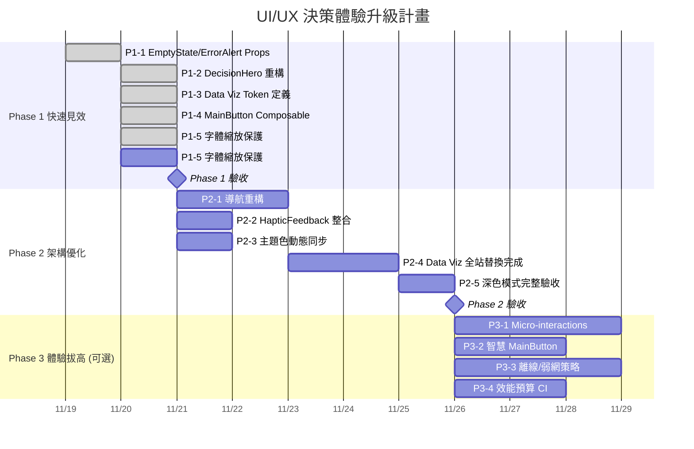

# UI/UX 決策體驗升級計畫（2026-11-19）

> **版本**：v1.0
> **狀態**：📋 規劃中
> **範圍**：`webapp/`（Vue 3 + Vite + Element Plus，Telegram Mini App）
> **基線**：承接 2026-11-17 計畫（P0–P3 已完成：導航去重、圖標語義化、響應式柵格）
> **不改動**：API 契約、資料模型、後端邏輯、路由 `redirect` 語義（僅調整內部引用方式）

---

## 1. 背景與目標

### 1.1 現況痛點（基於 2026-11-18 實測與代碼審計）

| 面向                  | 現況                                                                                                   | 影響                                     |
| --------------------- | ------------------------------------------------------------------------------------------------------ | ---------------------------------------- |
| **決策英雄區**        | `DecisionHero` 整合「核心決策 + 配置進度 + 風險指標」三塊，視覺權重均勻，Primary CTA 不明顯            | 用戶一眼抓不到「現在該做什麼」，決策延遲 |
| **資料視覺一致性**    | ECharts、MetricCard、進度條、ScoreBar 顏色語意略有出入（多方綠/空方紅，但警告也用橙/紅）               | 認知負擔高，跨頁面色義不一致             |
| **空/錯誤狀態**       | `EmptyState`、`ErrorAlert` 多為純文字，缺乏主要動作按鈕（重試、去設定、聯繫支援）                      | 用戶遇到空/錯誤時無明確下一步，流失率高  |
| **Telegram 原生能力** | 未使用 `MainButton`（底部固定 CTA）、`BackButton`（除 Dashboard 外）、`HapticFeedback`、主題色動態同步 | 體驗與原生 App 脫節，錯失平台紅利        |
| **導航資訊架構**      | 底部 5 項 +「洞察」內雙 Tab（雷達/多空），層級不清，巢狀深度過深                                       | 找功能需 2–3 次點擊，心智模型不清        |
| **字體縮放/無障礙**   | `rem` 基準未鎖定，Telegram 系統字體縮放可能導致版面崩壞；關鍵數值無 `tabular-nums`                     | 無障礙合規風險，數值閱讀困難             |

### 1.2 升級目標

1. **決策即時可見**：Dashboard 首屏 3 秒內傳達「核心建議 + 主要動作 + 關鍵風險」
2. **視覺語言統一**：建立 Data Viz Token 子集，全站圖表/卡片/進度條色義一致
3. **狀態可行動**：所有空/錯誤/載入狀態必須提供 ≥1 個 Primary CTA
4. **原生級體驗**：關鍵頁面掛載 `MainButton`，頁面切換/關鍵操作給予觸覺回饋，主題色跟隨 Telegram 實時同步
5. **導航扁平化**：將「市場雷達」提升頂層，底部導航精簡為 4 項，減少巢狀深度
6. **無障礙合規**：字體縮放保護、`tabular-nums`、WCAG AA 對比度、完整 ARIA

---

## 2. 範圍與邊界

| 包含                                                     | 不包含                         |
| -------------------------------------------------------- | ------------------------------ |
| DecisionHero 視覺重構（佈局、CTA、摺疊）                 | 後端決策邏輯、報表資料結構     |
| Data Viz Token 定義與全站替換                            | 新增圖表類型、ECharts 配置重寫 |
| EmptyState/ErrorAlert Props 擴充與各頁套用               | 新增錯誤碼、後端錯誤處理       |
| `useTelegramMainButton` / `useHapticFeedback` Composable | Telegram Bot API、後端通知發送 |
| 導航重構（路由、FloatingPill、InsightsView 入口卡片）    | 新增頁面、刪除現有功能         |
| tokens.css 擴充（字體 clamp、Data Viz、數值字體）        | 設計系統文檔網站、Figma 元件庫 |
| 深色模式完整驗收測試                                     | 自動化視覺回歸測試框架建置     |

---

## 3. 階段規劃

### Phase 1 — 快速見效（1–2 天，獨立可發布）

| ID       | 任務                                 | 檔案                                           | 驗收標準                                                                                                                                                                                                 | 狀態      |
| -------- | ------------------------------------ | ---------------------------------------------- | -------------------------------------------------------------------------------------------------------------------------------------------------------------------------------------------------------- | --------- |
| **P1-1** | **EmptyState/ErrorAlert Props 擴充** | `EmptyState.vue`, `ErrorAlert.vue`             | 新增 `actionText`, `actionType`, `actionSize`, `actionIcon`, `actionHref`, `secondaryActionText`, `secondaryActionType`；emits `action`, `secondary-action` / `action`；所有現有實例補上至少一個 CTA     | ✅ 已完成 |
| **P1-2** | **DecisionHero 視覺層級重構**        | `DecisionHero.vue`                             | Primary CTA 區塊：背景 `var(--iln-brand-soft)`、字級 `var(--iln-font-xl)`、按鈕 `size="large"`；次要資訊預設摺疊（`CollapsibleSection`）                                                                 | ✅ 已完成 |
| **P1-3** | **Data Viz Token 子集定義**          | `tokens.css`                                   | 新增 `--iln-viz-bull/bear/neutral/alert` 4 色系（主色/背景/邊框/陰影/亮色），替換 `DecisionHero`、`MacroBattleView`、`MarketRadarView`、`ChartView`、`TechnicalPanel`、`MetricCard`、`StatCard` 硬編碼色 | ✅ 已完成 |
| **P1-4** | **MainButton 掛載 Composable**       | `composables/useTelegramMainButton.js`（新建） | 封裝 `show/setParams/hide/onClick/offClick`；`DashboardView`、`StrategyConfigEditor`、`AccountView` 掛載對應 CTA                                                                                         |
| **P1-5** | **字體縮放保護 + tabular-nums**      | `tokens.css`, 全域數值元件                     | `--iln-font-base: clamp(14px, 3.5vw, 16px)`；關鍵數值元件套用 `font-variant-numeric: tabular-nums`、`font-family: var(--iln-font-mono)`                                                                  |

### Phase 2 — 架構級優化（3–5 天）

| ID       | 任務                               | 檔案                                                                 | 驗收標準                                                                                                                                     |
| -------- | ---------------------------------- | -------------------------------------------------------------------- | -------------------------------------------------------------------------------------------------------------------------------------------- |
| **P2-1** | **導航重構：頂部分段 + 底部 4 項** | `router/index.js`, `App.vue`, `FloatingPill.vue`, `InsightsView.vue` | 底部保留：儀表板、洞察、圖表、帳號；「市場雷達」改為頂部 Segmented Control（InsightsView 入口卡片保留但標記為次要）；`FloatingPill` 同步更新 |
| **P2-2** | **HapticFeedback 整合**            | `composables/useTelegram.js` 擴充、各頁 `onMounted`                  | 頁面切換 `impactOccurred('light')`、Primary 按鈕點擊 `impactOccurred('medium')`、數值異動 `selectionChanged()`                               |
| **P2-3** | **主題色動態同步**                 | `useTelegram.js`、`tokens.css`                                       | 監聽 `themeParams` 變化，即時映射 `--iln-bg/text/hint/link/button_color`；深/淺色無縫切換                                                    |
| **P2-4** | **全站 Data Viz Token 替換完成**   | 所有含圖表/進度條/ScoreBar 的元件                                    | ECharts `color` 陣列、MetricCard 邊框/背景、ScoreBar fill、進度條全部改用 `var(--iln-viz-*)`                                                 |
| **P2-5** | **深色模式完整驗收**               | 全站                                                                 | `@media (prefers-color-scheme: dark)` + Telegram `colorScheme` 雙軌驗收；所有頁面截圖對比，無對比度 < 4.5:1、無背景色衝突                    |

### Phase 3 — 體驗拔高（視資源，可延後）

| ID       | 任務                   | 說明                                                                                      |
| -------- | ---------------------- | ----------------------------------------------------------------------------------------- |
| **P3-1** | **Micro-interactions** | 骨架屏→內容淡入、數值變動數字滾動、卡片 hover/active 狀態、路由切換共享元素動畫           |
| **P3-2** | **智慧 MainButton**    | 根據報表狀態動態顯示「立即再平衡」/「查看詳情」/「設定策略」/「關閉」                     |
| **P3-3** | **離線/弱網策略**      | Service Worker + `stale-while-revalidate`，Telegram Mini App 必須 HTTPS；離線頁面友善提示 |
| **P3-4** | **效能預算守護**       | CI 加入 `bundle-size`、`lighthouse`（Performance ≥ 90、Accessibility ≥ 95）門檻           |

---

## 4. 詳細設計規格

### 4.1 Data Viz Token 定義（`tokens.css` 新增）

```css
/* === Data Viz 專用語意色（Phase 1 優先） === */
--iln-viz-bull: var(--m3-green-40); /* 多方/獲利/正向 */
--iln-viz-bull-bg: rgba(16, 185, 129, 0.1);
--iln-viz-bull-border: rgba(16, 185, 129, 0.25);

--iln-viz-bear: var(--m3-red-40); /* 空方/虧損/負向 */
--iln-viz-bear-bg: rgba(239, 68, 68, 0.1);
--iln-viz-bear-border: rgba(239, 68, 68, 0.25);

--iln-viz-neutral: var(--m3-blue-40); /* 中性/資訊/基準 */
--iln-viz-neutral-bg: rgba(59, 130, 246, 0.1);
--iln-viz-neutral-border: rgba(59, 130, 246, 0.25);

--iln-viz-alert: var(--m3-amber-40); /* 警告/注意/待處理 */
--iln-viz-alert-bg: rgba(245, 158, 11, 0.1);
--iln-viz-alert-border: rgba(245, 158, 11, 0.25);

/* === 字體縮放保護 === */
--iln-font-base: clamp(14px, 3.5vw, 16px);
--iln-font-lg: clamp(16px, 4vw, 18px);
--iln-font-xl: clamp(20px, 5vw, 24px);

/* === 數值專用 === */
--iln-font-mono: "SF Mono", "Fira Code", "JetBrains Mono", monospace;
--iln-num-tabular: tabular-nums;
```

### 4.2 DecisionHero 視覺重構草案

```
┌─────────────────────────────────────────────────────┐
│  📈 核心建議：維持當前配置，觀望中                    │  ← Primary: 大標題 + 狀態 Badge
│  ─────────────────────────────────────────────────  │
│  [ 立即再平衡 ]              下次執行：12/01 09:00  │  ← Primary CTA (MainButton 同步)
│  ─────────────────────────────────────────────────  │
│  ▼ 顯示詳細指標                                      │  ← CollapsibleSection 觸發器
│  ┌─────────┬─────────┬─────────┬─────────┐          │
│  │ 淨值    │ 0050    │ 00675L  │ 融資餘額  │          ← MetricCard (tabular-nums)
│  │ $1.23M  │ $45.6   │ $28.9   │ -$12.4K  │
│  └─────────┴─────────┴─────────┴─────────┘
└─────────────────────────────────────────────────────┘
```

### 4.3 EmptyState / ErrorAlert Props 擴充

```ts
// EmptyState.vue 新增 Props
interface EmptyStateProps {
  title: string;
  message?: string;
  illustration?: string; // 'inbox' | 'chart' | 'settings' | 'offline'
  actionText?: string; // Primary CTA 文字
  actionHandler?: () => void; // Primary CTA handler
  secondaryActionText?: string; // Secondary CTA 文字
  secondaryActionHandler?: () => void;
}

// ErrorAlert.vue 新增 Props（繼承現有 show-retry）
interface ErrorAlertProps {
  title: string;
  description: string;
  showRetry?: boolean;
  retryText?: string; // 自訂重試文字
  retryHandler?: () => void; // 自訂重試 handler
  actionText?: string; // 額外 Primary CTA（如「去設定」）
  actionHandler?: () => void;
}
```

### 4.4 useTelegramMainButton Composable 介面

```ts
// composables/useTelegramMainButton.js
export function useTelegramMainButton() {
  const { webApp } = useTelegram(); // 既有 composable

  function show(params: {
    text: string;
    color?: string; // var(--iln-brand)
    textColor?: string; // var(--iln-btn-text)
    isActive?: boolean;
    progress?: boolean;
  }) {}

  function hide() {}
  function onClick(handler: () => void) {}
  function offClick(handler: () => void) {}
  function setParams(params: Partial<MainButtonParams>) {}

  return { show, hide, onClick, offClick, setParams };
}
```

### 4.5 導航重構資訊架構

```
舊：
底部導航：[儀表板] [洞察▼] [圖表] [新聞] [帳號]
  洞察內：[市場雷達] [多空對決] (Tab)

新：
頂部（InsightsView 內）：[市場雷達] [多空對決] (Segmented)
底部導航：[儀表板] [洞察] [圖表] [帳號]  (4 項)
  - 「新聞」併入「洞察」或移至帳號設定
  - FloatingPill 對應更新
```

---

## 5. 影響面與相依性分析

| 變更                        | 影響檔案數                | 風險等級 | 緩解策略                                        |
| --------------------------- | ------------------------- | -------- | ----------------------------------------------- |
| DecisionHero 重構           | 1 主檔 + 1 引用頁         | 低       | 保留既有 Props 介面，僅調整 Template/CSS        |
| Data Viz Token 替換         | ~15 檔                    | 中       | 分檔案替換，每檔獨立 commit，視覺回歸以截圖比對 |
| EmptyState/ErrorAlert Props | 2 組件 + ~20 引用處       | 低       | 新增 Props 為可選，既有呼叫零改動               |
| MainButton Composable       | 1 新檔 + 3–4 頁面掛載     | 低       | 可選掛載，不影響無 Telegram 環境                |
| 導航重構                    | router + 4–5 檔           | 中       | 保留 redirect 路由兼容深鏈，僅調整內部入口      |
| 字體縮放/數值字體           | tokens.css + 全域數值元件 | 低       | 漸進式套用，先關鍵數值再擴展                    |

---

## 6. 測試與驗收策略

### 6.1 單元測試（既有 + 新增）

- `Icon.test.js`：新增 Data Viz color class 測試
- `EmptyState.test.js`、`ErrorAlert.test.js`：新增 Props 渲染、事件觸發測試
- `useTelegramMainButton.test.js`：Mock `webApp.MainButton` 驗證 API 呼叫
- `tokens.test.js`：新增 `clamp()` 計算值、CSS 變數解析測試

### 6.2 整合測試（手動 + 腳本）

| 場景                               | 驗收方式                                           |
| ---------------------------------- | -------------------------------------------------- |
| Dashboard 首屏 3 秒決策可見        | 5 秒截圖 + 人工審閱                                |
| 所有空/錯誤狀態有 CTA              | 逐頁檢查清單（含離線、無資料、API 錯誤、權限不足） |
| MainButton 顯示/隱藏/點擊          | Telegram 真機 + ngrok 隧道驗收                     |
| 主題色同步（深/淺/跟隨系統）       | Chrome DevTools 模擬 + Telegram 真機               |
| 字體縮放 100%/125%/150%/200%       | Chrome DevTools 模擬 + 真機系統設定                |
| 導航路徑：任意頁 → 任意頁 ≤ 2 點擊 | 路徑矩陣表驗收                                     |

### 6.3 視覺回歸（建議）

- 引入 `playwright-chromium` + `pixelmatch` 對比 Phase 1/2 前後截圖
- 關鍵頁面：Dashboard、InsightsView、ChartView、AccountView、MacroBattleView、MarketRadarView、StrategyConfigEditor

---

## 7. 交付清單

| 階段       | 交付物                                          | 格式                             |
| ---------- | ----------------------------------------------- | -------------------------------- |
| P1 完成    | Phase 1 所有任務代碼 + 更新 tokens.css          | Git commits + PR                 |
| P1 完成    | Phase 1 驗收報告                                | Markdown（含截圖、檢查清單勾選） |
| P2 完成    | Phase 2 所有任務代碼 + 導航重構                 | Git commits + PR                 |
| P2 完成    | 深色模式驗收報告 + 視覺回歸基準圖               | Markdown + PNG 基準圖            |
| P3（可選） | Micro-interactions、Service Worker、效能預算 CI | Git commits + CI 配置            |

---

## 8. 里程碑與時間軸



---

## 9. 風險與應對

| 風險                                         | 機率 | 影響 | 應對                                                                |
| -------------------------------------------- | ---- | ---- | ------------------------------------------------------------------- |
| Data Viz Token 替換導致現有圖表色義錯位      | 中   | 高   | 分檔案 PR + 視覺回歸截圖比對，單檔可 revert                         |
| Telegram WebApp API 在某些客戶端版本行為不一 | 低   | 中   | `try-catch` 保護、Feature detection、降級為普通按鈕                 |
| 導航重構破壞現有深鏈/書籤                    | 低   | 高   | 保留所有 redirect 路由、新增 `router.beforeEach` 記錄導航來源供除錯 |
| 字體 `clamp()` 在極小/極大視窗表現異常       | 低   | 低   | 設定合理 min/max、添加 `@media (max-width: 320px)` 兜底             |
| Phase 2 工期超出預期影響後續迭代             | 中   | 中   | Phase 1 獨立可發布，Phase 2 可拆分為獨立 PR 逐個合入                |

---

## 10. 交接記錄區（Session 結束時必填）

> **若本次 Session 未做完就結束，必須在這裡寫清楚：**

**最近更新：2026-11-19 10:40**

1. **做到哪**：
   - ✅ P1-1 EmptyState/ErrorAlert Props 擴充：新增 `actionText`, `actionType`, `actionSize`, `actionIcon`, `actionHref`, `secondaryActionText`, `secondaryActionType`；emits `action`, `secondary-action`（EmptyState）與 `action`（ErrorAlert）
   - ✅ P1-3 Data Viz Token 子集定義：`tokens.css` 新增 4 色系（bull/bear/neutral/alert），含主色/背景/邊框/陰影/亮色；已替換 DecisionHero、MacroBattleView、MarketRadarView、ChartView、TechnicalPanel、MetricCard、StatCard 硬編碼色
   - 🔄 P1-2 DecisionHero 視覺層級重構：進行中

2. **卡在哪**：無阻塞項目

3. **下一步**：
   - 完成 P1-2 DecisionHero 視覺層級重構（Primary CTA 區塊放大、背景品牌色、字級放大、次要資訊摺疊）
   - 進行 P1-4 `useTelegramMainButton` Composable
   - 進行 P1-5 字體縮放保護（`clamp()` + `tabular-nums`）

4. **有無未提交變更**：
   - `webapp/src/components/common/EmptyState.vue` — Props 擴充與雙行動按鈕
   - `webapp/src/components/common/ErrorAlert.vue` — 新增 actionText/actionType/buttonSize/actionIcon/actionHref
   - `webapp/src/styles/tokens.css` — Data Viz tokens（含 light/shadow 變體）
   - `docs/plans/active/2026-11-19-UIUX_DECISION_EXPERIENCE_PLAN.md` — 進度更新

驗收狀態：`pnpm run build` ✅ (372.6 KB gzip)，`pnpm run lint` ✅ (0 errors)，EmptyState/ErrorAlert/ChartView 測試 ✅

---

## 11. Commit 規範

每階段獨立 commit，訊息格式：

```
uiux(p1-1): 擴充 EmptyState/ErrorAlert Props 新增 actionText/actionHandler
uiux(p1-2): DecisionHero 視覺層級重構 Primary CTA 放大 次要資訊摺疊
uiux(p1-3): 新增 Data Viz Token 子集 4 色系
uiux(p1-4): 新增 useTelegramMainButton Composable
uiux(p1-5): 字體縮放保護 clamp() + tabular-nums
uiux(p2-1): 導航重構 底部 4 項 + 頂部 Segmented
uiux(p2-2): 整合 HapticFeedback 頁面切換/按鈕點擊觸覺回饋
uiux(p2-3): 主題色動態同步 themeParams 監聽
uiux(p2-4): 全站 Data Viz Token 替換完成
uiux(p2-5): 深色模式完整驗收
```

好處：任一階段出問題可單獨 `git revert`，不影響其他階段。

---

## 12. 不確定時的處理原則

- 程式碼與本文件描述不符 → **以程式碼為準**，並更新文件
- 某項改動會影響 §2 邊界外的內容 → **停手**，在 §10 記錄，等確認
- 測試失敗且原因不明 → **不要跳過**，記錄錯誤訊息後停在該項
- Telegram WebApp API 行為與文檔不符 → 以**真機實測為準**，文檔標註差異

---

## 13. 參考文獻

- `docs/design/DESIGN_PRINCIPLES.md` — 設計原則（決策優先、資訊分層、原生優先）
- `docs/design/page-responsibility-matrix.md` — 頁面職責矩陣
- `docs/plans/active/2026-11-17-UIUX_OPTIMIZATION_PLAN.md` — 上一期計畫（已完成 P0–P3）
- Telegram Mini App 官方文檔：`MainButton`、`BackButton`、`HapticFeedback`、`themeParams`、`viewport`
- Material 3 Design Tokens 規範
- WCAG 2.1 AA 對比度標準
