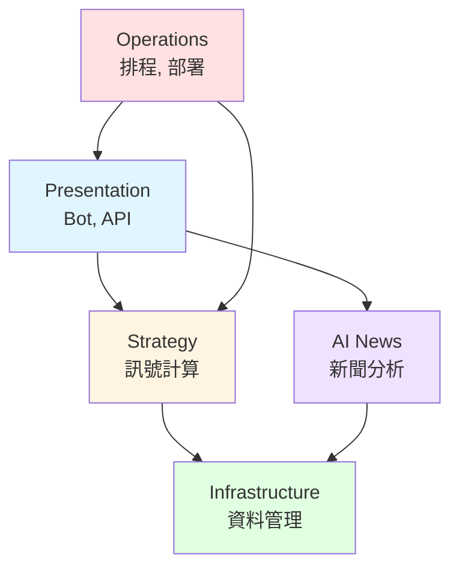

# 文件系統現代化計畫

**建立日期**: 2026-09-10  
**狀態**: 🔜 待開始  
**策略**: 漸進式優化 + 內容驗證  
**目標**: 提升文件可發現性、確保內容準確性、優化 Agent 使用體驗

---

## 🎯 核心理念

**不是「刪減文件」，而是「讓文件更有用」**

### 真正的問題

1. ❌ 文件與代碼不同步（例如 Langfuse v3 → v5）
2. ❌ Agent 和開發者難以快速找到需要的資訊
3. ❌ 缺少清晰的文件地圖和索引
4. ❌ 不知道哪些文件是「現行參考」、哪些是「歷史記錄」

### 解決方案

1. ✅ **建立導航中心**：統一入口 `docs/README.md`
2. ✅ **元數據標準化**：每個文件標記類型、狀態、更新日期
3. ✅ **內容驗證**：更新核心技術文件至當前狀態
4. ✅ **持續維護機制**：文件更新 checklist、自動化檢查

---

## 📊 現況盤點

### 統計數據

- **總文件數**: 141 個 .md 文件
  - `docs/` 目錄: 133 個
  - 根目錄: 8 個
- **文件分布**:

| 類別                        | 數量          | 狀態評估          | 優先級    |
| --------------------------- | ------------- | ----------------- | --------- |
| **modules/** (模組技術文件) | 26 個         | ⚠️ 需驗證與更新   | ⭐⭐⭐ 高 |
| **architecture/** (ADR/DEC) | 4 個          | ✅ 決策記錄，保留 | ⭐⭐⭐ 高 |
| **plans/completed/**        | 32 個         | ⚠️ 需添加元數據   | ⭐⭐ 中   |
| **plans/archive/**          | 25 個         | ✅ 已歸檔，OK     | ⭐ 低     |
| **Reports/**                | 13 個         | ⚠️ 需整理         | ⭐⭐ 中   |
| **api/**                    | 2 個 + 模組內 | ⚠️ 需驗證         | ⭐⭐⭐ 高 |
| **測試相關**                | 8 個          | ⚠️ 需更新         | ⭐⭐⭐ 高 |
| **部署/運維**               | 5 個          | ⚠️ 需驗證         | ⭐⭐ 中   |
| **backlog/**                | 4 個          | ✅ 有效 backlog   | ⭐ 低     |
| **根目錄**                  | 8 個          | ⚠️ 需整理         | ⭐⭐ 中   |

### 關鍵發現

1. **Langfuse v5 遷移完成，但文件未更新**
   - `modules/ai_news/integrations/langfuse_*.md` (3 個)
   - `modules/operations/env_vars.md`
   - 相關 API 文件

2. **Bot 指令剛修復，文件需同步**
   - `modules/presentation/bot.md`
   - 根目錄 `README.md` 中的指令說明

3. **缺少導航中心**
   - 新手或 Agent 不知道從哪裡開始
   - 文件間缺少索引和連結

---

## 📚 文件架構設計

### 採用策略：**漸進式優化**

保留現有結構，逐步增強：

```
docs/
├── README.md                    # 🆕 導航中心 (新增)
│
├── modules/                     # ✅ 保留現有結構
│   ├── README.md                # 🆕 模組索引 (新增)
│   ├── ai_news/
│   │   ├── _index.md            # ✅ 已存在
│   │   ├── ai_pipeline.md       # 🔄 需驗證
│   │   ├── integrations/
│   │   │   ├── langfuse_prompt_management.md  # ⚠️ 需更新 v5
│   │   │   ├── langfuse_score_analytics.md    # ⚠️ 需更新 v5
│   │   │   └── langfuse_score_configs.md      # ⚠️ 需更新 v5
│   │   └── ...
│   ├── strategy/                # 🔄 需驗證
│   ├── infrastructure/          # 🔄 需驗證
│   ├── presentation/            # 🔄 需驗證
│   └── operations/              # 🔄 需驗證
│
├── architecture/                # ✅ 保留，ADR/DEC 決策記錄
│   ├── README.md                # 🆕 ADR 索引 (新增)
│   ├── DEC-004-backtest-scheduler-automation.md
│   ├── DEC-005-monitoring-alerting.md
│   └── DEC-006-deployment-automation.md
│
├── decisions/                   # ✅ 保留，技術決策
│   └── DEC-016-vitest-worker-crash.md
│
├── design/                      # ✅ 保留，設計文件
│   ├── README.md                # 🆕 設計決策索引 (新增)
│   └── BUDGET_PRIORITY_DESIGN.md
│
├── api/                         # ✅ 保留，集中 API 文件
│   ├── README.md                # 🆕 API 索引 (新增)
│   ├── decision-chain_api.md
│   └── (從 modules/presentation/api/ 整合過來)
│
├── guides/                      # 🆕 新增目錄，集中 How-to
│   ├── testing/
│   │   ├── e2e-testing-guide.md      # 📦 從根目錄移入
│   │   ├── test-troubleshooting.md   # 📦 從根目錄移入
│   │   └── writing-tests.md
│   ├── deployment/
│   │   └── deployment-checklist.md   # 📦 從根目錄移入
│   └── development/
│       └── adding-strategy-rule.md   # 🆕 待創建
│
├── plans/                       # ✅ 保留
│   ├── active/                  # 當前活躍 (0-3 個)
│   ├── completed/               # 近 3 個月 + 元數據
│   ├── backlog/                 # 待規劃
│   └── archive/                 # 歷史歸檔
│
├── Reports/                     # ✅ 保留，添加結構
│   ├── current/                 # 🆕 最新報告
│   │   ├── security-report.md
│   │   └── quality-status.md
│   └── archive/                 # 📦 歷史報告按月
│       ├── 2026-04/
│       ├── 2026-08/
│       └── ...
│
├── verification/                # ✅ 保留，驗證結果
│   └── (現有驗證文件)
│
└── meta/                        # 🆕 新增，文件的文件
    ├── documentation-standards.md
    └── maintenance-schedule.md
```

### 文件分類標準（Diátaxis 框架）

每個文件應明確屬於以下一種類型：

| 類型             | 用途     | 讀者目標     | 範例                           |
| ---------------- | -------- | ------------ | ------------------------------ |
| **Tutorial**     | 學習     | 理解概念     | `getting-started.md`           |
| **How-to Guide** | 解決問題 | 完成特定任務 | `e2e-testing-guide.md`         |
| **Reference**    | 查閱     | 找到精確資訊 | `API_CONTRACT.md`, `modules/*` |
| **Explanation**  | 理解     | 知道為什麼   | `ADR-*.md`, `DEC-*.md`         |

---

## 📋 文件元數據標準

### 每個文件開頭添加 YAML frontmatter：

```yaml
---
type: reference | guide | explanation | tutorial
status: current | needs-review | outdated | archived
last_updated: 2026-09-10
last_verified: 2026-09-10
related_code:
  - src/modules/ai/aiClient.mjs
  - src/modules/ai/langfuseClient.mjs
related_docs:
  - docs/architecture/DEC-005-monitoring-alerting.md
  - docs/modules/infrastructure/data_manager.md
dependencies:
  - Langfuse v5.11.0
  - Node.js >= 26
tags:
  - ai
  - langfuse
  - observability
---
```

### 狀態定義

- **current**: 內容準確，與代碼同步
- **needs-review**: 可能過時，需要驗證
- **outdated**: 確認過時，需要更新
- **archived**: 歷史記錄，不再維護

### 使用場景

Agent 可以透過元數據：

1. 快速判斷文件是否可信（`status`, `last_verified`）
2. 找到相關代碼進行驗證（`related_code`）
3. 追蹤文件依賴關係（`related_docs`）
4. 理解技術棧版本（`dependencies`）

---

## 🚀 執行計畫

### Phase 1: 建立文件基礎設施 (2-3h)

**目標**: 創建導航系統和元數據標準

#### 1.1 創建導航中心 `docs/README.md`

**內容結構**:

```markdown
# InvestmentLineNotify 文件中心

## 🚀 快速開始

- 我是新手 → [系統概覽](../README.md)
- 我要部署 → [部署檢查清單](guides/deployment/deployment-checklist.md)
- 我要寫代碼 → [開發環境設定](#開發環境)

## 🎯 我想要...

- **理解系統架構** → [架構決策記錄](architecture/)
- **查詢 API** → [API 參考](api/)
- **修改模組** → [模組文件](modules/)
- **編寫測試** → [測試指南](guides/testing/)
- **部署系統** → [部署指南](guides/deployment/)
- **查看計畫** → [開發計畫](plans/)

## 📦 按模組瀏覽

- [AI 新聞模組](modules/ai_news/) - 新聞採集、AI 分析、Langfuse 整合
- [策略引擎](modules/strategy/) - 投資策略、訊號計算、狀態機
- [Telegram Bot](modules/presentation/bot.md) - 指令處理、通知推送
- [基礎設施](modules/infrastructure/) - 資料管理、快取、儲存
- [運維](modules/operations/) - 部署、排程、監控

## 🔍 常見問題

- [Langfuse v5 如何使用？](modules/ai_news/integrations/langfuse_prompt_management.md)
- [如何新增策略規則？](guides/development/adding-strategy-rule.md)
- [E2E 測試為何失敗？](guides/testing/test-troubleshooting.md)
- [環境變數設定？](modules/operations/env_vars.md)

## 📊 文件類型

- **Reference** (參考): 技術規格、API、配置
- **Guide** (指南): 如何完成特定任務
- **Explanation** (說明): 設計決策、架構原理
- **Archive** (歷史): 已完成計畫、審計報告

## 🛠️ 文件維護

- [文件標準](meta/documentation-standards.md)
- [維護計畫](meta/maintenance-schedule.md)
```

#### 1.2 創建索引文件

1. **`modules/README.md`** - 模組總覽 + 依賴關係圖
2. **`architecture/README.md`** - ADR/DEC 索引
3. **`api/README.md`** - API 列表 + 版本資訊
4. **`guides/README.md`** - 指南目錄

#### 1.3 定義文件標準

創建 `docs/meta/documentation-standards.md`：

- 元數據格式規範
- 文件類型定義
- 命名慣例
- 更新流程

#### 1.4 產出

- [ ] `docs/README.md` 導航中心
- [ ] 4 個索引文件（modules, architecture, api, guides）
- [ ] `docs/meta/documentation-standards.md`
- [ ] `docs/meta/maintenance-schedule.md`

---

### Phase 2: 更新核心技術文件 (4-5h)

**目標**: 確保技術文件反映當前實作狀態

#### 2.1 Langfuse v5 文件更新（高優先級 ⭐⭐⭐）

**需要更新的文件**:

1. **`modules/ai_news/integrations/langfuse_prompt_management.md`**
   - 檢查項目：
     - [ ] API 從 `langfuse.getPrompt()` 更新為 `langfuseClient.prompts.get()`
     - [ ] 移除 v3 的 `cacheTtlSeconds` 參數
     - [ ] 更新代碼範例
   - 驗證方式：對照 `src/modules/ai/langfuseClient.mjs` (line 58-65)

2. **`modules/ai_news/integrations/langfuse_score_analytics.md`**
   - 檢查項目：
     - [ ] API 從 `langfuse.score()` 更新為 `langfuseClient.score.create()`
     - [ ] 參數格式變更
     - [ ] 更新代碼範例
   - 驗證方式：對照 `src/modules/ai/langfuseClient.mjs` (line 75-82)

3. **`modules/ai_news/integrations/langfuse_score_configs.md`**
   - 檢查項目：
     - [ ] Score 配置格式
     - [ ] 與新 API 的整合方式
   - 驗證方式：對照實際 score 使用案例

4. **`modules/operations/env_vars.md`**
   - 檢查項目：
     - [ ] 確認 Langfuse v5 環境變數（應該沒變）
     - [ ] 更新範例配置
     - [ ] 移除 v3 特定的說明
   - 驗證方式：對照 `.env.example`

5. **`modules/ai_news/ai_pipeline.md`**
   - 檢查項目：
     - [ ] AI 管線流程圖
     - [ ] observe() 使用方式（v5 新 API）
     - [ ] Trace ID 取得方式更新
   - 驗證方式：對照 `src/modules/ai/aiClient.mjs`

**更新模板**:

```markdown
---
type: reference
status: current
last_updated: 2026-09-10
last_verified: 2026-09-10
related_code:
  - src/modules/ai/langfuseClient.mjs
dependencies:
  - "@langfuse/tracing": "5.11.0"
  - "@langfuse/client": "5.11.0"
---

# Langfuse Prompt 管理（v5）

> **摘要**: 使用 Langfuse v5 REST API Client 管理和取得 AI prompts

## 🔄 從 v3 遷移

- ❌ v3: `langfuse.getPrompt(name, { cacheTtlSeconds })`
- ✅ v5: `langfuseClient.prompts.get({ name, label, version })`

## API 參考

... (詳細內容)
```

#### 2.2 Bot 文件更新

**`modules/presentation/bot.md`**

- 檢查項目：
  - [ ] 更新指令列表（確認 `/daily`, `/news`, `/weekly`, `/monthly`, `/optimize` 都存在）
  - [ ] 更新指令行為說明
  - [ ] 確認 export 問題修復已記錄
- 驗證方式：對照 `src/bot.mjs` (line 112-124, 213-243)

#### 2.3 API 文件驗證

**`docs/api/decision-chain_api.md`**

- 檢查項目：
  - [ ] API 路由是否正確
  - [ ] 請求/回應格式是否最新
  - [ ] 錯誤碼是否完整
- 驗證方式：對照 API 實作代碼

**`modules/presentation/api/portfolio_health_api.md`**

- 檢查項目：
  - [ ] Health check endpoint
  - [ ] 回應格式
- 驗證方式：實際呼叫 API

#### 2.4 測試文件更新

**`docs/E2E_TESTING_GUIDE.md`** → 移至 `docs/guides/testing/`

- 檢查項目：
  - [ ] 是否反映當前 Playwright 設定
  - [ ] workers=1 設定的說明
  - [ ] verify-pages.sh 模式
- 驗證方式：對照 `playwright.config.mjs`

**`docs/TEST_TROUBLESHOOTING.md`** → 移至 `docs/guides/testing/`

- 檢查項目：
  - [ ] 常見錯誤是否仍然相關
  - [ ] 解決方案是否有效
- 驗證方式：執行測試，確認疑難排解步驟

#### 2.5 產出

- [ ] 5 個 Langfuse 相關文件已更新並添加元數據
- [ ] Bot 文件已同步
- [ ] 2 個 API 文件已驗證
- [ ] 2 個測試文件已更新並移至 guides/testing/
- [ ] 所有更新都有 `last_verified: 2026-09-10`

---

### Phase 3: 優化 Agent 可發現性 (2-3h)

**目標**: 讓 Agent 能快速找到需要的資訊

#### 3.1 為每個模組添加/更新 `_index.md`

**模板**:

```markdown
---
type: reference
status: current
last_updated: 2026-09-10
---

# AI 新聞模組

> **職責**: 新聞採集、AI 分析、Langfuse 觀測

## 模組概覽

### 核心功能

- 新聞採集：從 PTT、Bluesky 收集投資相關新聞
- AI 評分：使用 LLM 評估新聞重要性
- Langfuse 整合：追蹤 AI 呼叫、管理 prompts

### 對外依賴

- **AI Provider**: Gemini (primary), Grok (fallback)
- **Observability**: Langfuse v5
- **Data Storage**: newsPool.json

### 對內依賴

- `infrastructure/data_manager` - 資料儲存
- `strategy/regime_policy` - 市場狀態判斷

## 文件列表

- [AI 管線](ai_pipeline.md) - 整體流程說明
- [新聞採集器](news_fetcher.md) - 資料來源與抓取邏輯
- [關鍵字配置](keyword_config.md) - 搜尋關鍵字管理
- **整合文件**:
  - [Langfuse Prompt 管理](integrations/langfuse_prompt_management.md)
  - [Langfuse Score 分析](integrations/langfuse_score_analytics.md)
  - [Langfuse Score 配置](integrations/langfuse_score_configs.md)

## 相關 ADR

- [DEC-005: 監控與告警](../../architecture/DEC-005-monitoring-alerting.md)

## 快速連結

- 代碼入口：`src/modules/ai/aiCoach.mjs`
- 測試：`src/test/integration/aiCoach.test.mjs`
- 配置：`config/news_keywords.json`
```

**需要創建/更新的 `_index.md`**:

- [ ] `modules/ai_news/_index.md` (已存在，需更新)
- [ ] `modules/strategy/_index.md` (已存在，需更新)
- [ ] `modules/infrastructure/_index.md` (已存在，需更新)
- [ ] `modules/presentation/_index.md` (已存在，需更新)
- [ ] `modules/operations/_index.md` (已存在，需更新)

#### 3.2 建立模組依賴關係圖

在 `modules/README.md` 中添加 Mermaid 圖表：



#### 3.3 建立 ADR/DEC 索引

在 `architecture/README.md` 中：

```markdown
# 架構決策記錄 (ADR/DEC)

## 決策清單

| ID      | 標題                | 狀態      | 日期       | 影響模組            |
| ------- | ------------------- | --------- | ---------- | ------------------- |
| DEC-004 | Backtest 排程自動化 | ✅ 已實施 | 2026-08-13 | operations          |
| DEC-005 | 監控與告警          | ✅ 已實施 | 2026-08-13 | ai_news, operations |
| DEC-006 | 部署自動化          | ✅ 已實施 | 2026-08-13 | operations          |
| DEC-016 | Vitest Worker 崩潰  | ✅ 已解決 | 2026-08-14 | testing             |

## 按主題分類

### 基礎設施

- [DEC-004: Backtest 排程自動化](DEC-004-backtest-scheduler-automation.md)
- [DEC-006: 部署自動化](DEC-006-deployment-automation.md)

### 可觀測性

- [DEC-005: 監控與告警](DEC-005-monitoring-alerting.md)

### 測試

- [DEC-016: Vitest Worker 崩潰](../decisions/DEC-016-vitest-worker-crash.md)
```

#### 3.4 建立 API 索引

在 `api/README.md` 中：

```markdown
# API 參考

## REST API

### Portfolio Health API

- **Endpoint**: `/api/portfolio/health`
- **文件**: [portfolio_health_api.md](portfolio_health_api.md)
- **代碼**: `src/api/portfolioHealthApi.mjs`

### Decision Chain API

- **Endpoint**: `/api/decision-chain`
- **文件**: [decision-chain_api.md](decision-chain_api.md)
- **代碼**: `src/api/decisionChainApi.mjs`

## Telegram Bot API

- **文件**: [../modules/presentation/bot.md](../modules/presentation/bot.md)
- **指令列表**: `/start`, `/help`, `/status`, `/daily`, `/news`, `/weekly`, `/monthly`, `/optimize`

## API 版本

- 當前版本：v2.0.0
- 相容性：Node.js >= 26
```

#### 3.5 產出

- [ ] 5 個模組 `_index.md` 已更新
- [ ] `modules/README.md` 包含依賴關係圖
- [ ] `architecture/README.md` 包含 ADR 索引
- [ ] `api/README.md` 包含 API 列表

---

### Phase 4: 歷史文件元數據化 (2h)

**目標**: 不移動文件，但標記清楚狀態

#### 4.1 為 `plans/completed/` 添加元數據

**批次處理 32 個已完成計畫**：

1. 添加 frontmatter：

```yaml
---
type: explanation
status: archived
completed_date: 2026-09-09
project_phase: langfuse-v5-migration
related_commits:
  - 02e77c3
  - c615419
---
```

2. 在文件開頭添加狀態標記：

```markdown
> **狀態**: ✅ 已完成 (2026-09-09)  
> **相關 Commits**: 02e77c3, c615419
```

**分類處理**:

- 最近完成（9 月）: 保留在 completed/
- 8 月完成：考慮移至 archive/2026-08/
- 更早：移至相應的 archive 目錄

#### 4.2 為 `Reports/` 添加元數據

**當前報告**（保留在 Reports/current/）:

- `security_report.md` → 添加元數據，檢查是否最新
- 其他最新狀態報告

**歷史報告**（移至 Reports/archive/YYYY-MM/）:

- 審計報告
- 測試報告
- 代碼審查報告

#### 4.3 為根目錄文件添加元數據

**保留在根目錄**:

- `README.md` - 專案主入口
- `CHANGELOG.md` - 版本記錄
- `SOUL.md` - Agent 準則

**需要處理**:

- `AGENTS.md`, `CLAUDE.md` → 檢查用途，可能合併或移至 docs/meta/
- `PENDING_ACTIONS.md` → 檢查是否完成，移至 plans/backlog/ 或刪除
- `TEST_REPORT.md` → 移至 Reports/archive/
- `TEST_VERIFICATION_PLAN.md` → 移至 plans/completed/ 或 guides/testing/

#### 4.4 產出

- [ ] 32 個 completed plans 已添加元數據
- [ ] Reports/ 已整理（current/ + archive/）
- [ ] 根目錄保留 3-5 個核心文件

---

### Phase 5: 建立維護機制 (1h)

**目標**: 防止文件再次過時

#### 5.1 創建文件更新 Checklist

在 `docs/meta/maintenance-schedule.md` 中：

````markdown
# 文件維護計畫

## 隨代碼更新

### Pull Request Checklist

- [ ] 如果修改模組 API，更新對應的 `modules/<module>/` 文件
- [ ] 如果修改環境變數，更新 `modules/operations/env_vars.md`
- [ ] 如果修改 Telegram 指令，更新 `modules/presentation/bot.md`
- [ ] 如果做架構決策，創建新的 ADR/DEC 文件
- [ ] 更新相關文件的 `last_updated` 日期

### 代碼審查重點

- 檢查 PR 描述是否提及文件更新
- 驗證技術文件與代碼的一致性

## 定期審查

### 每月檢查（每月 1 號）

- [ ] 檢查 `last_verified` 超過 90 天的文件
- [ ] 驗證核心技術文件（modules/, api/）
- [ ] 更新 Reports/current/ 中的狀態報告

### 每季歸檔（每季最後一週）

- [ ] plans/completed/ 中超過 3 個月的計畫移至 archive/
- [ ] Reports/current/ 中過時的報告移至 archive/
- [ ] 檢查是否有需要 deprecated 的文件

### 年度大掃除（每年 1 月）

- [ ] 全面審查所有文件
- [ ] 更新文件結構（如有需要）
- [ ] 清理 archive/deprecated/ 中超過 1 年的文件

## 自動化檢查（未來規劃）

```bash
# scripts/validate-docs.sh
# 1. 檢查文件中的代碼路徑是否存在
# 2. 檢查 last_verified 超過 90 天的文件
# 3. 檢查斷裂的內部連結
# 4. 檢查缺少元數據的文件
```
````

## 負責人

- 技術文件：開發團隊 + AI Agent
- ADR/DEC：架構師 + Tech Lead
- 計畫文件：PM + Tech Lead

````

#### 5.2 創建文件標準

在 `docs/meta/documentation-standards.md` 中：

```markdown
# 文件標準

## 文件命名

- 使用小寫 + 連字符：`langfuse-integration.md`
- 避免特殊字符：`#`, `@`, `空格`
- 日期格式：`YYYY-MM-DD`

## 元數據格式

必須包含：
```yaml
---
type: reference | guide | explanation | tutorial
status: current | needs-review | outdated | archived
last_updated: YYYY-MM-DD
---
````

可選包含：

```yaml
last_verified: YYYY-MM-DD
related_code:
  - src/path/to/file.mjs
related_docs:
  - docs/other/document.md
dependencies:
  - package@version
tags:
  - tag1
  - tag2
```

## 文件結構

### Reference (參考文件)

```markdown
---
type: reference
status: current
last_updated: 2026-09-10
---

# 模組名稱

> **摘要**: 一句話說明用途

## API 參考

...

## 配置

...

## 範例

...
```

### Guide (操作指南)

```markdown
---
type: guide
status: current
last_updated: 2026-09-10
---

# 如何完成 X 任務

> **適用場景**: 當你需要...

## 前置條件

...

## 步驟

1. ...
2. ...

## 疑難排解

...
```

### Explanation (解釋說明)

```markdown
---
type: explanation
status: current
last_updated: 2026-09-10
---

# 決策標題

> **背景**: 為什麼需要這個決策

## 問題

...

## 決策

...

## 後果

...
```

## Markdown 慣例

- 使用 ATX 標題（`#`），不用 Setext（`===`）
- 代碼區塊指定語言：```javascript
- 連結使用相對路徑：`[文件](../other/doc.md)`
- 表格對齊：左對齊為主
- 使用 Mermaid 圖表（架構圖、流程圖）

````

#### 5.3 Git Hooks（選用）

創建 `.husky/pre-commit` 檢查：
```bash
#!/bin/sh
# 檢查修改的 .md 文件是否有 frontmatter
# 檢查是否更新了 last_updated
````

#### 5.4 產出

- [ ] `docs/meta/maintenance-schedule.md` 維護計畫
- [ ] `docs/meta/documentation-standards.md` 文件標準
- [ ] (選用) Git hooks 設定

---

## ✅ 驗收標準

### Phase 1 完成標準

- [ ] `docs/README.md` 導航中心已建立
- [ ] 4 個索引文件（modules, architecture, api, guides）已建立
- [ ] 文件標準已定義
- [ ] Agent 可以從 `docs/README.md` 快速找到任何文件

### Phase 2 完成標準

- [ ] 5 個 Langfuse 相關文件已更新至 v5
- [ ] 所有代碼範例已驗證可執行
- [ ] Bot 文件已同步最新指令
- [ ] API 文件已驗證準確性
- [ ] 測試文件已更新並移至 guides/testing/

### Phase 3 完成標準

- [ ] 5 個模組都有完整的 `_index.md`
- [ ] 模組依賴關係圖已繪製
- [ ] ADR 索引包含所有決策記錄
- [ ] API 索引包含所有端點

### Phase 4 完成標準

- [ ] 所有 completed plans 都有元數據和狀態標記
- [ ] Reports/ 目錄結構清晰（current/ + archive/）
- [ ] 根目錄僅保留核心文件

### Phase 5 完成標準

- [ ] 文件更新 checklist 已整合至開發流程
- [ ] 定期審查計畫已排程
- [ ] 文件標準已文件化

### 總體驗收

- [ ] Agent 能在 3 步內找到任何技術文件
- [ ] 所有核心技術文件（modules/, api/）都有 `last_verified: 2026-09-10`
- [ ] 文件與代碼 100% 同步（特別是 Langfuse v5）
- [ ] 新開發者能透過文件理解系統架構
- [ ] 無文件被誤刪或遺失

---

## 📅 執行時程

| Phase   | 工作內容            | 預估時間 | 累積時間 |
| ------- | ------------------- | -------- | -------- |
| Phase 1 | 建立文件基礎設施    | 2-3h     | 2-3h     |
| Phase 2 | 更新核心技術文件    | 4-5h     | 6-8h     |
| Phase 3 | 優化 Agent 可發現性 | 2-3h     | 8-11h    |
| Phase 4 | 歷史文件元數據化    | 2h       | 10-13h   |
| Phase 5 | 建立維護機制        | 1h       | 11-14h   |

**總預估**: 11-14 小時

**建議分批執行** (3 個 sessions):

1. **Session 1**: Phase 1 (2-3h) - 建立基礎設施
2. **Session 2**: Phase 2 + Phase 3 (6-8h) - 更新核心文件
3. **Session 3**: Phase 4 + Phase 5 (3h) - 收尾與維護

---

## 📊 成功指標

### 量化指標

- **文件覆蓋率**: 所有模組都有完整文件
- **同步率**: 技術文件與代碼 100% 一致
- **可發現性**: Agent 查找文件平均步數 < 3 步
- **更新頻率**: 核心文件每季至少驗證一次

### 質化指標

- Agent 能獨立完成開發任務，無需反覆詢問
- 新功能開發時，文件更新與代碼同步
- 文件結構清晰，無重複或矛盾內容
- 歷史決策可追溯，理解「為什麼這樣做」

---

## 🔄 後續演進

### 短期（1-3 個月）

- 執行完成 Phase 1-5
- 觀察文件使用情況
- 收集 Agent 和開發者反饋

### 中期（3-6 個月）

- 根據反饋優化文件結構
- 補充缺少的 Tutorial 類文件
- 實作自動化驗證腳本

### 長期（6-12 個月）

- 考慮引入文件生成工具（如 VitePress, Docusaurus）
- 整合 CI/CD 自動檢查文件品質
- 建立文件貢獻指南

---

## 🚀 開始執行

**當前狀態**: 🔜 待開始

執行時請依序完成各 Phase，並在此更新進度：

- [ ] Phase 1: 建立文件基礎設施
- [ ] Phase 2: 更新核心技術文件
- [ ] Phase 3: 優化 Agent 可發現性
- [ ] Phase 4: 歷史文件元數據化
- [ ] Phase 5: 建立維護機制
- [ ] 最終驗收

---

**最後更新**: 2026-09-10  
**負責人**: Hermes Agent + Han  
**預計完成**: 2026-09-20
