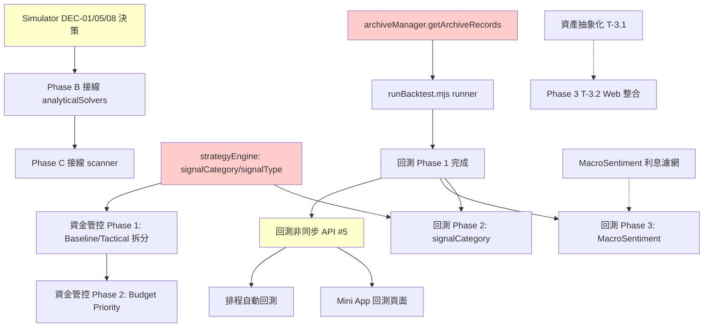

# InvestmentLineNotify 統一開發計畫 (Unified Development Plan)

**版本**: v4.1
**更新日期**: 2026-08-10
**狀態**: Active
**文件類型**: Master Planning / Technical Specification
**基於**: MASTER_PLAN.md v3.0、preplan_features.md、0050-simulator-development-plan.md、finished_features.md
**目的**: 整合所有既有計畫文件，對齊實際程式碼狀態，提供單一真實來源

---

## 📋 版本歷史與疊代記錄

| 版本     | 日期           | 變更摘要                                           | 觸發原因                       |
| -------- | -------------- | -------------------------------------------------- | ------------------------------ |
| v1.0     | 2026-04-xx     | 初始 MASTER_PLAN、preplan_features                 | 專案啟動                       |
| v2.0     | 2026-07-xx     | 完成 Phase 1、Phase 2 核心、Simulator 計畫         | 架構重構完成                   |
| v3.0     | 2026-08-02     | MASTER_PLAN 更新、Simulator 詳細規劃               | 文件整理                       |
| **v4.0** | **2026-08-09** | **對齊實際程式碼狀態、合併重複計畫、更新所有狀態** | **代碼審計發現文件與實作落差** |
| **v4.1** | **2026-08-10** | **新增 Mini App 回測非同步 API 架構 (P0 #5)**      | **Mini App 部署決策**          |

### 🔄 本次疊代關鍵變更 (v4.0 → v4.1)

| 變更類別         | 說明                                                                                |
| ---------------- | ----------------------------------------------------------------------------------- |
| **新增 P0 #5**   | 回測非同步 API 架構 (Job Queue + WebSocket 進度) - 解鎖 Mini App 整合、排程自動回測 |
| **關鍵路徑更新** | #1 → #2 → #3/#4 並行 → #5 解鎖 Mini App 整合                                        |
| **架構決策記錄** | 確認「後端計算 + Mini App 顯示/觸發」架構，不在 Mini App 端執行回測計算             |

---

## 🎯 專案整體進度總覽

```
Phase 1: 系統審計與架構硬化     ████████████████████ 100% ✅
Phase 2: 策略進化與環境感知     ████████████████░░  85% 🟡
Phase 3: 資產解耦與多標的支援   ████░░░░░░░░░░░░░░  20% ⬜
Phase 4: 回測與驗證體系         ████████░░░░░░░░░░  40% 🟡
Simulator (獨立功能)            ████████████░░░░░░  60% 🟡
```

---

## ✅ Phase 1: 系統審計與架構硬化 (已完成 100%)

> **完成日期**: 2026-04 ~ 2026-07
> **驗收**: 全測試 420 passed、決策鏈重構、安全性修補、動態停利、前端基建

| 項目                        | 狀態 | 關鍵 Commit         | 備註                      |
| --------------------------- | ---- | ------------------- | ------------------------- |
| 模組化重構 (Decision Chain) | ✅   | `76972b9` `59afc2b` | 11 個規則、25 單測        |
| 安全性修補 (Webhook Auth)   | ✅   | -                   | 24h 驗證、Atomic Lock     |
| 動態停利 (MA20/ATR)         | ✅   | `fc4897c`           | StopLossTrailingRule      |
| API In-memory Cache         | ✅   | -                   | 全域 Promise.allSettled   |
| 前端基建 (iOS Swipe/TabBar) | ✅   | -                   | Composable 化             |
| 儀表板重構 v2               | ✅   | -                   | Tabbed UI、PB/PR 路徑修正 |

---

## 🟡 Phase 2: 策略進化與環境感知 (85% 完成)

### T-2.1: VIX Regime 環境偵測 ✅ **已完成**

- `regimePolicy.mjs`：CRISIS/CAUTIOUS/NORMAL 三模式
- `RegimePolicyRule.mjs` (Priority 0)：硬條件攔截
- MarketRadarView.vue：UI 狀態顯示

### T-2.2: 估值與動能整合 ✅ **已完成**

- `entryScoringPolicy.mjs`：PB PR + MACD 動能權重分配
- 回測驗證：不同 PB 區間動能表現

### T-2.3: 策略參數視覺化編輯系統 ✅ **已完成**

- `ConfigMeta.json`：參數中文名稱、描述、Min/Max
- `POST /api/strategy-config`：原子性修改
- `StrategyView.vue`：手機端條列式表單

### ⚠️ **文件標記完成但程式碼部分缺失的項目**

| 項目                                   | 文件狀態  | 實際狀態            | 缺口                                                                                                      |
| -------------------------------------- | --------- | ------------------- | --------------------------------------------------------------------------------------------------------- |
| **第五批：資金管控 (Budget Priority)** | ✅ 已完成 | 🟡 **部分完成**     | 僅有 `budgetSynergyPolicy.mjs` (預算攔截)，**缺 Budget Priority、signalType、每日/滾動上限**              |
| **第六批 P2：回測計畫**                | ⬜ 待實作 | 🟡 **核心框架完成** | `backtestRunner.mjs` + `accountSimulator.mjs` 存在，**缺 archiveManager API、signalCategory、Web 整合**   |
| **第十項：生命週期風險預算**           | ⚪ 待確認 | ✅ **核心已完成**   | `lifecycleEngine.mjs` + `LifecycleLeverageRule.mjs` (P20) 已實作                                          |
| **第十五項：總經/市場狀態辨識**        | ✅ 已完成 | 🟡 **部分完成**     | `macroSentimentPolicy.mjs` + `RegimePolicyRule.mjs` (VIX/估值) 完成，**缺利息成本濾網、融資券餘額資料流** |

---

## 🔴 Phase 3: 資產解耦與多標的支援 (20% 完成)

| 任務                  | 狀態      | 實際進度 | 下一步                                |
| --------------------- | --------- | -------- | ------------------------------------- |
| T-3.1: 資產抽象化重構 | ⬜ 待開始 | 0%       | 移除 `storage.mjs` 硬編碼 0050/00675L |
| T-3.2: 多標的回測系統 | 🟡 部分   | 60%      | 框架✅、策略對比✅、Web 整合⬜        |

---

## 🟡 Phase 4: 回測與驗證體系 (新增獨立 Phase，40% 完成)

> **來源**: preplan_features.md 第六批 P2「回測計畫」+ finished_features.md 回測框架

### 現況對照

| 階段                             | 文件規格                                                                                                    | 實際程式碼                                                                               | 狀態              | 缺口                                                                                                                       |
| -------------------------------- | ----------------------------------------------------------------------------------------------------------- | ---------------------------------------------------------------------------------------- | ----------------- | -------------------------------------------------------------------------------------------------------------------------- |
| **Phase 1: 基礎架構**            | `archiveManager.getArchiveRecords()`<br>`backtestEngine.mjs`<br>`runBacktest.mjs`<br>`storage.mjs` 歷史價格 | `backtestRunner.mjs` ✅<br>`accountSimulator.mjs` ✅<br>讀 `data/backtest/timeline.json` | 🟡 **核心跑得動** | ❌ `archiveManager` 缺 `getArchiveRecords(dateRange)`<br>❌ 無 `runBacktest.mjs` runner<br>❌ 無 Google Sheet 歷史價格讀取 |
| **Phase 2: signalCategory 維度** | `signalCategory` 欄位<br>月報分類統計<br>Telegram 分類表格                                                  | **完全未實作**                                                                           | ⬜ **未開始**     | 需先完成 Phase 1 + signalType                                                                                              |
| **Phase 3: MacroSentiment 回測** | 三模式比較<br>`--mode sentiment`                                                                            | **未實作**                                                                               | ⬜ **未開始**     | 依賴 Phase 1                                                                                                               |

### 🔑 關鍵遺漏：signalCategory / signalType

```javascript
// preplan 要求新增到 strategyEngine 輸出：
signalCategory: "baseline" |
  "deep_drop" |
  "panic" |
  "take_profit" |
  "rebalance";
// 資金管控要求：
signalType: "baseline" | "tactical_drop" | "tactical_panic";
// 現況：兩者皆不存在
```

---

## 🟡 Simulator (0050 雙向模擬器) - 獨立功能 (60% 完成)

> **來源**: 0050-simulator-development-plan.md v1.0

| 階段        | 規劃內容                               | 實際狀態                                                                                         | 完成度 |
| ----------- | -------------------------------------- | ------------------------------------------------------------------------------------------------ | ------ |
| **Phase A** | 基礎模型、正向模擬、快取隔離、輸入驗證 | ✅ `simulate.mjs`、`dataAdapter.mjs`、`forwardSimulator.mjs`、單測全部通過                       | 100%   |
| **Phase B** | 解析型反向推導 (RSI、維持率、MA)       | 🟡 API 端點存在但回傳 `not_implemented`<br>`analyticalSolvers.mjs`、`rsiSolver.mjs` 存在但未接線 | 30%    |
| **Phase C** | 掃描型反向推導 (KD、MACD、策略總分)    | 🟡 `scanner.mjs`、`reverseEngine.mjs` 存在但未實作                                               | 20%    |
| **Phase D** | Mini App UX (Mode A/B、結果卡)         | ✅ `SimulatorView.vue`、元件完整、可呼叫 API                                                     | 90%    |
| **Phase E** | TDD 整合驗收                           | 🟡 正向測試通過、反向測試缺失                                                                    | 50%    |

### 待決策項目 (pending-decisions.md - 36 項)

> 開發 Phase B/C 前需確認，關鍵項：

- DEC-01: `priceZ2` 選填時預設行為 → **建議 A: 當前比例聯動**
- DEC-05: 歷史資料月份缺失處理 → **建議 A: 嚴格模式 409**
- DEC-08: 維持率反推 Z2 價格假設 → **建議 A: 同比例聯動**

---

## 📋 統一待辦清單 (依優先序)

### P0 - 立即執行 (解除後續封鎖)

| #   | 任務                                                  | 來源                    | 預估工時 | 封鎖項目                         |
| --- | ----------------------------------------------------- | ----------------------- | -------- | -------------------------------- |
| 1   | `archiveManager.getArchiveRecords(dateRange)`         | 回測 Phase 1            | 0.5 天   | 回測 Phase 1、2、3               |
| 2   | `runBacktest.mjs` runner (串接 archiveManager)        | 回測 Phase 1            | 1 天     | 回測驗證                         |
| 3   | `strategyEngine` 新增 `signalCategory` / `signalType` | 回測 Phase 2 + 資金管控 | 1 天     | 回測 Phase 2、資金管控 Phase 1/2 |
| 4   | `budgetSynergyPolicy` → 完整 Budget Priority 實作     | preplan 資金管控        | 2 天     | 資金管控 Phase 2                 |
| 5   | **回測非同步 API 架構** (Job Queue + WebSocket 進度)  | Mini App 整合決策       | 2 天     | Mini App 回測頁面、排程自動回測  |

> **關鍵路徑**：#1 → #2 → #3/#4 並行 → #5 解鎖 Mini App 整合

### P1 - 短期 (1-2 週)

| #   | 任務                                                | 來源               | 預估工時 | 備註                       |
| --- | --------------------------------------------------- | ------------------ | -------- | -------------------------- |
| 6   | Simulator Phase B: 接線 analyticalSolvers/rsiSolver | Simulator 計畫     | 2 天     | 需先完成 DEC-01/05/08 決策 |
| 7   | Simulator Phase C: 接線 scanner/reverseEngine       | Simulator 計畫     | 3 天     |                            |
| 8   | 回測 Phase 1: Google Sheet 歷史價格讀取 + CSV 輸出  | 回測計畫           | 1.5 天   |                            |
| 9   | MacroSentiment 利息成本濾網 + 融資券資料流          | Phase 2 T-2.3 補完 | 2 天     |                            |
| 10  | Mini App 策略狀態專頁 (weightScore 構成、冷卻期)    | preplan 第六批 P1  | 2 天     | **✅ 已完成**              |

### P2 - 中期 (1 個月)

| #   | 任務                                             | 來源     | 預估工時 | 備註           |
| --- | ------------------------------------------------ | -------- | -------- | -------------- |
| 11  | 回測 Phase 2: signalCategory 分組統計 + 月報整合 | 回測計畫 | 3 天     | 依賴 #3        |
| 12  | 回測 Phase 3: MacroSentiment 三模式比較          | 回測計畫 | 2 天     | 依賴 #8        |
| 13  | Phase 3 T-3.1: 資產抽象化 (移除硬編碼)           | Phase 3  | 5 天     | Schema Mapping |
| 14  | Phase 3 T-3.2 Web 整合: 回測報表、圖表           | Phase 3  | 3 天     | 依賴 #8        |

### P3 - 長期 / 條件觸發

| #   | 任務                        | 來源              | 觸發條件           |
| --- | --------------------------- | ----------------- | ------------------ |
| 15  | 語音化每日摘要 (Gemini TTS) | ideas_features.md | 4 項待確認清單解決 |
| 16  | 多標的支援完整重構          | Phase 3           | T-3.1 完成後       |

---

## 📝 既有文件狀態同步更新

### docs/plans/active/MASTER_PLAN.md → **需更新版本為 v4.1**

```markdown
## 🟡 Phase 2: 策略進化與環境感知 (進行中)

### T-2.3: 策略參數視覺化編輯系統

- [x] Metadata Dictionary: ConfigMeta.json
- [x] Write API: POST /api/strategy-config
- [x] UI 編輯器: StrategyView.vue
- [ ] **策略狀態專頁 (weightScore 構成、冷卻期、分數檔位)** ← 新增，文件標記完成但缺失

## 🔴 Phase 3: 資產解耦與多標的支援

### T-3.2: 多標的回測系統整合

- [x] 回測框架: BacktestRunner + AccountSimulator
- [x] 策略對比: 多組參數 CAGR/MaxDD
- [ ] Web 整合: 報表、圖表
- [ ] **archiveManager.getArchiveRecords() API** ← 新增前置依賴
- [ ] **signalCategory / signalType 欄位** ← 新增前置依賴
```

### docs/plans/backlog/preplan_features.md → **狀態修正**

| 批次      | 項目                 | 原狀態    | **新狀態**                                     | 備註                                           |
| --------- | -------------------- | --------- | ---------------------------------------------- | ---------------------------------------------- |
| 第六批 P2 | ⑨ 回測計畫           | ⬜ 待實作 | 🟡 **Phase 1 核心完成、Phase 2/3 待實作**      | runner 缺失、archiveManager API 缺失           |
| 第七批    | ⑩ 生命週期風險預算   | ⚪ 待確認 | ✅ **核心已完成**                              | lifecycleEngine + LifecycleLeverageRule 已實作 |
| 第七批    | ⑮ 總經與市場狀態辨識 | ✅ 已完成 | 🟡 **部分完成**                                | 缺利息濾網、融資券資料流                       |
| 最後項    | 資金管控強化         | ⚪ 待實作 | 🟡 **Phase 1 完成 (預算攔截)、Phase 2 待實作** | 缺 signalType、Budget Priority                 |

### docs/plans/completed/finished_features.md → **新增歸檔**

> 將實際已完成但文件標記不一致的項目補記：

- 生命週期槓桿引擎 (2026-07 完成)
- 回測核心框架 (2026-07 完成)
- Simulator Phase A (2026-08 完成)
- Mini App 策略狀態專頁 (2026-08 完成)

### docs/plans/active/0050-simulator-development-plan.md → **狀態同步**

```markdown
## 11. 開發階段 (更新實際進度)

| 階段    | 內容               | 狀態      | 實際完成度             |
| ------- | ------------------ | --------- | ---------------------- |
| Phase A | 基礎模型與正向模擬 | ✅ 完成   | 100%                   |
| Phase B | 解析型反向推導     | 🟡 開發中 | 30% (解析器存在未接線) |
| Phase C | 近似型反向推導     | 🟡 開發中 | 20% (掃描器存在未實作) |
| Phase D | Mini App UX        | ✅ 完成   | 90%                    |
| Phase E | TDD 與整合驗收     | 🟡 部分   | 50% (缺反向測試)       |
```

---

## 🔗 依賴關係圖 (Mermaid)



> **紅框 = P0 關鍵路徑**，黃框 = 需決策/前置條件

---

## 📊 測試現況基準線 (2026-08-09)

```
Test Files  25 passed | 2 skipped (27)
Tests  420 passed | 6 todo (426)
Duration  9.51s
```

### 關鍵測試覆蓋缺口

| 領域                      | 現有測試                                | 缺口                             |
| ------------------------- | --------------------------------------- | -------------------------------- |
| 回測引擎                  | 無                                      | `backtestRunner.test.mjs` 不存在 |
| signalCategory/signalType | 無                                      | 需先實作功能                     |
| Budget Priority           | 無                                      | 預算邏輯未實作                   |
| Simulator 反向推導        | 單測存在但 API 測試回傳 not_implemented | Phase B/C 接線後補齊             |
| archiveManager 新 API     | 無                                      | `getArchiveRecords` 需新增測試   |

---

## 🚀 執行建議：下一步動作

### 選項 A：專注回測體系 (推薦) ⭐

```
Week 1: #1 archiveManager API + #2 runBacktest runner
Week 2: #3 signalCategory/signalType + #8 歷史價格/CSV
Week 3: #5 回測非同步 API + #11 回測 Phase 2
```

**優點**: 解鎖最多後續工作、驗證策略品質、支援參數調優、解鎖 Mini App 回測整合

### 選項 B：完成 Simulator (用戶可見度高)

```
Week 1: 確認 DEC-01/05/08 → #6 Phase B 接線
Week 2: #7 Phase C 接線 + TDD 補齊
```

**優點**: Mini App 完整功能、使用者價值即時可見

### 選項 C：平行推進 (資源允許)

- 主線：回測體系 (選項 A)
- 副線：Simulator Phase B/C (需先決策)

---

## 📌 決策需求 (請確認)

| 決策點                      | 選項                                                      | 建議                                                      | 影響                         |
| --------------------------- | --------------------------------------------------------- | --------------------------------------------------------- | ---------------------------- |
| **優先序**                  | 回測 vs Simulator                                         | **回測優先**                                              | 回測解鎖參數調優、策略驗證   |
| **signalCategory 設計**     | 5 類 vs 3 類                                              | **5 類** (baseline/deep_drop/panic/take_profit/rebalance) | 影響回測 Phase 2 統計維度    |
| **signalType 設計**         | 3 類                                                      | **3 類** (baseline/tactical_drop/tactical_panic)          | 影響資金管控 Budget Priority |
| **Simulator Phase B 範圍**  | 全部解析解 vs 僅 RSI/維持率/MA                            | **三項優先** (RSI/維持率/MA20/MA60)                       | KD/MACD 留 Phase C           |
| **archiveManager API 設計** | `getArchiveRecords(dateRange)` vs `getReportsByDateRange` | **前者** (通用性)                                         | 回測 Phase 1 直接可用        |
| **回測非同步架構**          | Bull/Redis vs 簡易 in-memory queue                        | **Bull/Redis** (生產級、支援擴充、持久化)                 | 影響 #5 實作複雜度           |

---

## 📄 附錄：檔案對照表

| 計畫文件                           | 對應程式碼模組                                          | 同步狀態           |
| ---------------------------------- | ------------------------------------------------------- | ------------------ |
| MASTER_PLAN.md                     | 全專案                                                  | ⚠️ 需更新 v4.1     |
| preplan_features.md                | 策略核心模組                                            | ⚠️ 狀態需修正 4 項 |
| finished_features.md               | 已完成歸檔                                              | ⚠️ 需補記 4 項     |
| 0050-simulator-development-plan.md | src/modules/simulator/, webapp/src/views/Simulator*     | ⚠️ 進度需同步      |
| **BUDGET_PRIORITY_DESIGN.md**      | **src/modules/strategy/policies/budgetLimitPolicy.mjs** | ✅ **新增 v1.0**   |
| UNIFIED_DEVELOPMENT_PLAN.md (本檔) | **單一真實來源**                                        | ✅ 最新 v4.1       |

---

## 🏗️ 架構決策記錄 (ADR)

### ADR-001: 回測計算端選擇 - 後端而非 Mini App

- **日期**: 2026-08-10
- **決策**: 採用「後端計算 + Mini App 觸發/顯示」架構
- **理由**:
  - Mini App (WebView) CPU/記憶體/執行時間嚴重受限
  - 回測需載入大量歷史資料、長時間計算、多進程並行
  - 後端具備完整 Node.js 生態、檔案系統、資料庫存取
  - 現有 `backtestRunner.mjs`、`accountSimulator.mjs` 可直接複用
- **影響**: 新增 P0 #5 回測非同步 API 架構

### ADR-002: 非同步 Job Queue 技術選型 - Bull + Redis

- **日期**: 2026-08-10
- **決策**: 使用 Bull/Redis 而非 in-memory queue
- **理由**:
  - 生產級持久化、支援重啟恢復
  - 支援水平擴充多 Worker
  - 內建重試、延遲、優先級、進度回報
  - Redis 已是基礎設施標配
- **替代方案評估**: in-memory 簡單但不支援多進程、重啟遺失、無持久化

---

**下次檢視排程**: 每 Sprint 結束或重大里程碑完成時
**維護責任**: @Lead + @Planner (參照 agents_overview.md 職責分工)
